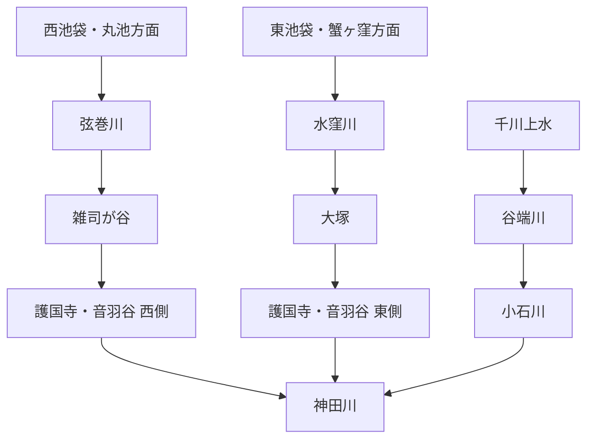

# otowa-ankyoscape

水窪川・弦巻川・谷端川と、その周辺の旧河道・暗渠・湧水・用水・土地利用について調べた記録です。

中心となる範囲は、池袋・雑司が谷・護国寺・音羽・小日向・小石川です。

**追加調査対象：人参川（古茗荷谷川との関係は未確定）** — 2026年10月8日、茗荷谷の西側谷頭について明治初期の地図表示と色別標高図を照合。筑波大学附属中・高の南方にある浅い枝谷が合流する可能性も含め、[人参川の調査ノート](docs/人参川.md)に記録した。**10月8〜9日の現地歩行・二源頭・古地図上の池・筑附南方の分水界候補・還国寺の湧水・水窪川の橋名**は[専用の観察記録](docs/2026-10-09・茗荷谷・人参川現地観察.md)に整理した。名称の史料上の確実性と、水路・谷地形の推定は区別している。

> [!IMPORTANT]
> このリポジトリでは、既知の河川史をまとめるだけでなく、**まだ決着していない流路・接続・成立年代を史料から検証すること**を重視します。
> とくに「水窪川と弦巻川はどこかで合流していたのか」「音羽通り西側の弦巻川下流はいつ成立したのか」「弦巻川・水窪川側と谷端川側の更新世旧河道はどちら向きに流れていたのか」は中心的な未解決問題です。

  

幕末の音羽・雑司ヶ谷周辺を描いた尾張屋版 <i>Otowa ezu</i>。1851年近吾堂板とは別史料。画像をクリックすると合流問題の検討ページへ移動します。

## 未解決問題

このリポジトリの中心です。解決していない問題は川別の概要へ埋め込まず、できるだけ独立した文書として追跡します。

| 問題 | 現状 |
| --- | --- |
| **水窪川と弦巻川は合流していたのか** | [独立文書で検討中](docs/open-questions/水窪川と弦巻川の合流・接続問題.md) |
| **音羽谷西側の弦巻川下流はいつ成立したのか** | [独立文書で検討中](docs/open-questions/音羽谷西側の弦巻川下流の成立年代.md) |
| **更新世の旧河道はどちら向きに流れていたのか** | 滝口志郎（2019）が谷端川側への接続可能性を提示するが、流向は未決着 |
| **千川上水から弦巻川・水窪川へ直接分水したのか** | 谷端川への分水は確認できるが、両河川への直接分水は未確認 |

→ [未解決問題の一覧](docs/open-questions/README.md)

## 水系の全体像

これは近代以降に把握しやすい大まかな配置であり、全時代にそのまま当てはまるとは限りません。近世の造成・灌漑、近代の河川改修、暗渠化、下水道再編によって接続関係や流路が変化した可能性があります。

## 現時点で重要なこと

- **2026年10月の東京都下水道局施工図は、東池袋駅付近の南池袋二丁目で、都市計画道路の整備に伴う下水道再構築区間を道路単位で示す。** 東京都下水道局「[工事情報詳細（豊島区）](https://www.gesui1.metro.tokyo.lg.jp/living/a5/current/116/index.html)」の「**環状第5の1号線街路整備事業に伴う豊島区南池袋二丁目付近再構築その2工事**」は、施工箇所を**豊島区南池袋二丁目**、掲載工期を**令和8年3月～12月（2026年3～12月）**、受注者を**株式会社松尾工務店東京支店**とする。都の[施工位置図](https://www.gesui1.metro.tokyo.lg.jp/living/a5/current_img/07114118.jpg)では、**東池袋駅西側、都電雑司ヶ谷駅の北側**にあたる南北方向の道路に工事線が描かれ、凡例は**青＝9月までの施工完了、赤＝10月施工予定、緑＝11月施工予定、黒＝未施工**と区別する。〔**確認：東京都下水道局の2026年10月閲覧時点の工事件名・町域・掲載工期・位置図／観察：図の施工線と駅名・凡例**〕 旧水窪川の東池袋側や弦巻川上流の地形と、**現代の道路・下水管がどこで交差するか**を照合するための位置資料となるが、**この施工線が旧河道・旧暗渠本体に一致するという根拠はない**。工事図は月次更新のため、凡例上の完了・予定は**2026年10月の掲載時点の表示**であり、実際の全区間竣工や地下水の流向は示さない。〔**推定：旧地形図との照合用途／未解決：管路の系統・竣工図・旧河道との重なり**〕 出典：東京都下水道局「[下水道局が施工する工事情報](https://www.gesui1.metro.tokyo.lg.jp/living/a5/current/)」（**毎月1日現在の情報を原則10日掲載**）／同「[豊島区の工事一覧](https://www.gesui1.metro.tokyo.lg.jp/living/a5/current/116/index.html)」／[工事位置図](https://www.gesui1.metro.tokyo.lg.jp/living/a5/current_img/07114118.jpg)（**2026年10月28日閲覧**）。

- **2026年10月の東京都下水道局施工図には、神田川沿いの関口一丁目と早稲田鶴巻町を結ぶ下水道再構築工事の位置も記録されている。** 東京都下水道局「[工事情報詳細（文京区）](https://www.gesui1.metro.tokyo.lg.jp/living/a5/current/105/index.html)」の「**新宿区早稲田鶴巻町、文京区関口一丁目付近再構築その2工事**」は、施工箇所を**新宿区早稲田鶴巻町・文京区関口一丁目**、掲載工期を**令和7年9月～令和8年10月（2025年9月～2026年10月）**、受注者を**株式会社ヤマソウ**とする。都の[施工位置図](https://www.gesui1.metro.tokyo.lg.jp/living/a5/current_img/07117108.jpg)は、**神田川の南側で関口二丁目・関口一丁目に近い道路を東西に走る施工線と、山吹町側へ南下する枝線**を示し、図中の青線は**2026年9月までの施工完了表示**である。〔**確認：東京都下水道局の工事一覧・位置図・凡例／観察：道路・神田川との位置関係**〕 **水窪川・弦巻川の流末を神田川へ結び付ける現代下水道の位置照合候補**だが、当該管渠が両河川の暗渠を引き継いだものか、雨水・汚水のいずれを運ぶか、旧落口との接続関係は**この図だけでは不明**。青線の表示も**工事全体の竣工・供用開始を保証しない**。〔**推定：流末周辺の地下施設との比較資料／未解決：管路台帳・吐口・旧河道との接続**〕 出典：東京都下水道局「[下水道局が施工する工事情報](https://www.gesui1.metro.tokyo.lg.jp/living/a5/current/)」／同「[文京区の工事一覧](https://www.gesui1.metro.tokyo.lg.jp/living/a5/current/105/index.html)」／[工事位置図](https://www.gesui1.metro.tokyo.lg.jp/living/a5/current_img/07117108.jpg)（**2026年10月28日閲覧**）。

- **2019年の音羽・鳩山会館麓では、建物解体後の空地に水窪川旧水路の構造物とみられる横長の開口部・石組みが一時的に露出し、写真付きの現地記録が残された。** ヤスノリ「**水窪川の暗渠で新発見があったそうなので解説してもらった**」（**2019年3月19日**）は、文京区音羽の民家跡が更地となり、壁の下に奥へ続く横長の穴と水路の石組み上部らしい構造が見えるようになったと、発見者「ソトノミスト」への取材と写真で記録する。〔**確認：2019年公開の現地踏査記事・写真説明／観察：解体に伴う露出状況**〕 別の踏査記録、地図子「**地図子、水窪川を歩く**」（**2019年12月22日公開、同月14日現地歩行**）も、**鳩山会館のふもとの空地と、橋の下に反対側まで通じる狭い空間**を写真付きで紹介する。〔**確認：同年末の別筆者による現地観察**〕 両記事が**同一の開口部・構造物を撮影したか、正確な地番、石組み・橋の施工年代、暗渠化前の河道中心線、2026年現在の存否は未確認**。写真の形状だけで近世の護岸・橋台や水窪川本流の原位置遺構と断定しない。〔**推定：旧水路構造との関連／未解決：位置・年代・構造の同定**〕 出典：[サンポー「水窪川の暗渠で新発見があったそうなので解説してもらった」](https://sanpoo.jp/article/mizukubogawa-sanpo/)（2019年3月19日、冒頭と「例の場所」）／[地図子「地図子、水窪川を歩く」](https://chizuchizuko.hatenablog.com/entry/mizukubogawa)（2019年12月22日、「8. 鳩山家の秘密」）。

- **2019年12月14日の音羽谷東側では、晴天時にも崖下の壁から水が滲み、駐車場に水が溜まる状況が写真で記録されている。** 地図子の同日踏査・同月22日公開記事は、音羽通り東側の崖沿いで壁からの滲出水を複数箇所に認め、「**7. 晴れても水浸しの駐車場**」に水の溜まった駐車場と水が出る壁を掲載し、下流寄りでも崖から流れる水を受ける容器を紹介する。〔**確認：撮影日のある現地踏査記録／観察：2019年12月の湿潤・滲出状況**〕 水窪川沿いの**崖下湧水の残存を検証する地点候補**だが、地下水の自然湧出か配管漏水等かの水源、正確な地番、恒常的な流量、現在の状況は未確認。晴天という記述のみで通年湧水・旧河川との直接連結を証明しない。〔**仮説／未解決**〕 出典：地図子「[地図子、水窪川を歩く](https://chizuchizuko.hatenablog.com/entry/mizukubogawa)」（**2019年12月22日**、2019年12月14日踏査、「6」「7」「9」の各節）。

- **2026年公開の豊島区地域防災計画では、南大塚の下水道浸水対策は時間75mm対応の工事中、池袋駅の同水準の施設整備は完了と、地点ごとに進捗を区別している。** 豊島区防災会議『**豊島区地域防災計画（令和7年修正）**』第5部「風水害編」（**2026年7月公開、印刷pp.385–387／PDF pp.5–7**）は、①**豊島区南大塚では時間75mm降雨に対応するため東京都が対策工事を進めている**、②**池袋駅では時間75mm対応の施設整備が完了**、③**池袋本町は『下水道浸水対策計画2022』の新たな重点地区10地区の一つ**、④**豊島区内の神田川護岸整備は完了**と記す。さらに、東京都の**2023年12月改定の豪雨対策基本方針**を受け、下水道施設の**時間75mm対応に流域対策を加え、時間85mm降雨での内水氾濫被害防止を目標**とする一方、神田川流域の河川施設については**時間85mm対応を「検討」**と区別する。〔**確認：2026年公開の区公式計画に記された地域別進捗と対策目標**〕 **南大塚は谷端川の大塚周辺の旧低地に近く、池袋駅は弦巻川源流の丸池周辺に近い**ため、既収録の旧河道・内水被害・谷端川幹線関連工事と現在の整備状況を比較する手掛かりになる。〔**観察：地理的な照合対象**〕 ただし**時間75mmは施設・対策の目標降雨であり、南大塚の工事が完了したこと、各地点が時間85mmまで完全に安全になったこと、工事管路が旧河道と一致することを示さない**。区の説明は工事名・施工区間・完成予定日をこの箇所では特定していない。〔**未解決：工事台帳・設計図との位置照合、各施設の完成年月**〕 出典：豊島区防災会議『[豊島区地域防災計画（令和7年修正）・第5部風水害編](https://www.city.toshima.lg.jp/documents/49964/20260714180326.pdf)』（**2026年7月公開、印刷pp.385–387、PDF pp.5–7**）／豊島区「[計画公開ページ](https://www.city.toshima.lg.jp/514/kuse/shisaku/shisaku/kekaku/documents/documents/2303131135.html)」（**2026年7月15日更新**）。

- **神田川の高田地区には、2026年版の区防災計画に番地付きで記載された水位警報装置5か所と、曙橋の警報水位の基準がある。** 同『**豊島区地域防災計画（令和7年修正）**』資料編「**水位観測装置及び水位警報装置**」（**印刷p.97／PDF p.102**）は、**高田2-5-26（吉祥染色脇）、高田2-1-12（星野ビル脇）、高田1-18-1（三島橋脇）、高田1-13-15（渡辺染工脇）、高田1-1-14（佐藤染業脇）**を高田地区・神田川の水位警報装置の設置場所として列挙する。**曙橋桁下1.9m（川底より6.0m）**を吹鳴位置の基準として掲げ、音声放送等による警報と**一度吹鳴すると20分間休止**する運用も記す。〔**確認：2026年公開の区公式資料にある装置位置・基準値・吹鳴方法**〕 旧弦巻川の流末に近い神田川沿いで、**河川水位監視の地点と現在の洪水対応施設を番地単位で重ねる**ための資料となる。〔**観察：位置照合への用途**〕 ただし**「染工」「染色」等は資料中の位置目印であり、当該事業者が2026年現在も営業している証拠ではない**。また**1.9m／6.0mは曙橋の装置に関する基準であって、弦巻川・水窪川・谷端川の旧水路の水深・河床高ではない**。各警報装置の設置年、最新の作動状況、旧河川流末との正確な距離は未確認。〔**注意／未解決**〕 出典：豊島区防災会議『[豊島区地域防災計画（令和7年修正）・資料編](https://www.city.toshima.lg.jp/documents/49964/20260714180512.pdf)』（**2026年7月公開、印刷p.97、PDF p.102**）。

- **寛政9年（1797年）の下高田村の井戸掘削と、近世の関口新町付近の浅い掘削で「貝殻の層」が見つかったという地誌の記録があり、弦巻川下流域と神田川沿いの地下地質を検証する手掛かりになる。** 金子直徳『**和佳場の小図絵**』（別称『若葉の梢』、**寛政10年〔1798年〕の自序を持つ写本が伝存**）の文章を転記した地域史記事によれば、**寛政9年秋**、下高田村の**松平大炊頭屋敷**で「御膳水」の井戸を掘った際、**地下「四丈四五尺」ほど（約13.3～13.6mと読めるが字義・基準面は未照合）**で多くの貝殻が現れ、**厚さ三尺余（約0.9m超）**の貝殻が集まる箇所があったと記される。記事筆者は屋敷を現在の**高田一丁目、日本女子大学附属豊明小学校の西隣付近**に比定している。〔**確認：2015年の地域史記事に掲載された近世地誌の二次転記と、CiNii Booksが確認する写本の書誌・1798年自序／未確認：原写本の該当丁、井戸の実測記録、屋敷境界**〕 同記事は海老沢了之介『**新編若葉の梢**』（**1958年刊**）から、**関口新町（関口水道町）付近では六尺ほど（約1.8m）掘ると牡蠣・蛤などの貝殻が出て、厚さ二～三尺ほど（約0.6～0.9m）の場所もある**とする記述も紹介する。〔**確認：1958年刊の現代語訳からの二次引用／未確認：原文・調査地点・掘削年代**〕 **二つの記述は同じ地点・同じ地層を測ったものではなく、自然堆積の貝化石・貝塚・盛土・再堆積のいずれかを決定できない**。近世著者による「昔は海だった」という解釈や、後年の紹介記事による縄文海進・貝塚説を**年代測定や地質柱状図の代わりに採用しない**。〔**観察：近世の井戸掘削に関する地点・深さ・貝殻層厚の伝聞記録／推定：弦巻川下流・神田川沿いの地質ボーリング、貝塚分布図との照合に使える／未解決：原典の丁付、松平屋敷の地番、関口新町の掘削地点、堆積物の年代・成因**〕 出典：落合道人「[目白崖線の入江と貝塚と『白鳥池』](https://tsune-atelier.seesaa.net/article/2015-09-27.html)」（**2015年9月27日**、金子直徳の原文と1958年訳文を二次引用）／CiNii Books「[和佳場の小圖繪 2巻](https://ci.nii.ac.jp/ncid/BC0390756X)」（**写本6冊、底本に寛政10年自序、東京大学総合図書館所蔵、NCID BC0390756X**）。**『和佳場の小図絵』写本・『新編若葉の梢』本文の直接照合は未実施。**

- **幕末の千川上水分水口を復元する際、1864年の絵図に「明治初期の修正・加筆」が混在することを、所蔵館の資料一覧で確認できる。** 練馬区立石神井公園ふるさと文化館『**所蔵資料リスト**』（刊行年月は一覧に明記されず、**PDF pp.1–2「地図」8・11番**）は、千川家文書絵図「**千川分水口取調絵図**」を、**上保谷新田の取水口から巣鴨村までの素掘り区間を描く1864年（元治元年）作成の図**としつつ、**明治初期に修正・加筆されている**と明記する。同じ一覧の「**千川用水絵図**」は**1884年（明治17年）作成**で、千川上水の分水とその水を利用した水田を描くとされる。〔**確認：所蔵館の公的資料一覧に記載された絵図の名称・対象範囲・年代・加筆の存在・描画対象／原図の線・注記は未判読**〕 既収録の元治元年図に由来する**巣鴨村分水口「四寸四方長六尺」**などの二次転記を検証する際、**1864年時点の原記載か、後年の追記かを図中の筆跡・色・注記・同時代文書で区別する必要がある**。1884年図は、1877年の分水樋寸法・1880年代の分水口変更記録と比較できる別年代の図である。〔**観察：同じ水路を異時点で示す図面の存在／推定：幕末から明治前期の分水口変遷を検証する資料組**〕 ただし**1884年図に長崎村・巣鴨村のどの分水口や谷端川への接続が実際に描かれるかは未確認**。1864年図の修正範囲・加筆年・二枚の異同も未解決である。〔**未解決：原図の高精細画像、加筆箇所、分水口の地点・年代別照合**〕 出典：練馬区立石神井公園ふるさと文化館『[所蔵資料リスト](https://www.city.nerima.tokyo.jp/kankomoyoshi/bunka/nerimi.files/hurubunrisuto.pdf)』（**PDF pp.1–2、地図8番・11番、公開リストの作成年未記載**）／補助書誌：豊島区立郷土資料館『[研究紀要『生活と文化』・年報](https://www.city.toshima.lg.jp/129/bunka/bunka/shiryokan/kankobutu/005957.html)』（**年報13号、1999年3月31日刊**、伊藤暢直「千川用水『王子分水』をめぐる二・三の問題」）および昭和館『[同年報の目次](https://search.showakan.go.jp/search/magazine/detail.php?material_cord=160001479)』（副題に**「二枚の『元治元年千川分水口取調絵図』」**とある）。**王子分水と谷端川へ向かう長崎村分水は別系統**として扱う。

- **1952年頃の千川上水の写真群について、長崎分水との分岐・西武池袋線横断・暗渠化済み区間を個別の写真番号と町丁目で追える。** 上記ふるさと文化館『所蔵資料リスト』の**「写真・フィルム」欄（PDF pp.2–4）**は、「**千川上水記録フィルム**」を、**練馬区内の暗渠化が本格化する直前の1952年（昭和27年）頃、玉川上水からの取水口付近～巣鴨付近を撮影した記録**と説明する。写真一覧の**33番**は**豊島区南長崎6丁目付近で東長崎駅―江古田駅間の西武池袋線と交差する千川上水**、**34番**は**要町3丁目付近ですでに暗渠化された千川上水（現・千川児童遊園）**、**35番**は**要町3丁目付近で手前から奥へ流れる千川上水本流と、画面右手前に見える「長崎分水」の流れ**、**39番**は**西巣鴨2丁目付近の旧素掘り区間（現・千川上水公園）**と説明する。〔**確認：所蔵館の写真目録に記された地点・被写体・写真番号、フィルム群の概括年代／写真画像そのものは未閲覧**〕 とくに**35番は長崎分水の分岐位置を写真と現地地割で照合する有力な候補**であり、谷端川上流の人工導水史を検証できる。〔**推定：分水地点の写真同定・旧地籍との位置合わせに役立つ**〕 ただし**「右手前」は写真の画面内の位置を指す目録説明で、実際の水の流向・本流への流入を証明しない**。各写真の正確な撮影日・カメラ方向・画面内の水路境界は未確認で、**1952年頃という群全体の年代を各地点の暗渠化工事の完了日とみなさない**。また長崎分水の写る35番から谷端川本流までの通水継続を直接証明できない。〔**未解決：原写真の閲覧、写真33～35・39の撮影位置・方向、長崎分水の流向と谷端川接続**〕 出典：練馬区立石神井公園ふるさと文化館『[所蔵資料リスト](https://www.city.nerima.tokyo.jp/kankomoyoshi/bunka/nerimi.files/hurubunrisuto.pdf)』（**PDF pp.2–4、「写真・フィルム」33～35・39番と「千川上水記録フィルム」解説、撮影時期は1952年頃**）。

- **神田川の2026年4月1日時点の護岸現況について、文京区の最新の土木現況表で旧水窪川・弦巻川の流末に近い神田川本川の管理区間と護岸延長を数値で確認できる。** 文京区土木部『**令和8年度 土木現況**』（**2026年4月1日現在**、区公式ページ**2026年9月4日更新**）の**p.36「35. 河川」（PDFの37頁目）**は、対象を**「神田川の駒塚橋付近から聖橋付近まで」**と明記し、護岸延長を**左岸4,674.00 m、右岸1,340.00 m**と記録する。内訳は左岸が**コンクリート2,705.80 m・石積140.00 m・コンクリートブロック1,575.00 m・その他253.20 m**、右岸が**コンクリート981.90 m・コンクリートブロック304.00 m・その他54.10 m**である。〔**確認：2026年4月1日現在の文京区公式土木台帳集計を原表で判読**〕 この表は**江戸川橋近傍を含む神田川本川の現代の護岸材料・管理延長**を、旧水窪川・弦巻川の推定落口と比較するための行政資料となる。〔**推定：流末付近の護岸変遷・吐口構造を照合する基準資料**〕 ただし**左右岸の延長差の理由、各材料の施工年・正確な施工位置、旧河川落口との接続は表に示されていない**。延長は**文京区の表に載る護岸の集計**であり、神田川全体の河道延長や旧二河川の河長ではない。〔**未解決：区管理範囲と左右岸集計差、工区別護岸図、吐口・旧落口の位置照合**〕 出典：文京区土木部『[令和8年度 土木現況](https://www.city.bunkyo.lg.jp/documents/4645/r8dobokugenkyou.pdf)』（**2026年4月1日現在、p.36「河川」**）／文京区「[土木現況](https://www.city.bunkyo.lg.jp/b034/p004821.html)」（**2026年9月4日更新**）。

- **2008年7月29日と8月5日の局地豪雨について、豊島区が同年9月11日に作成した町名別の浸水被害表を確認でき、旧谷端川上流側と水窪川・弦巻川周辺の被害を区全体の集計から切り分けて比較できる。** 豊島区総務部防災課『**平成20年度の豪雨災害について**』（**2008年9月11日**、防災対策調査特別委員会資料、**PDF p.4「平成20年7月・8月 豊島区 浸水被害状況」**）では、**7月29日**は住居床上**目白8件**、住居床下**長崎2件・南長崎1件**、事業所被害**目白2・長崎17・南長崎3・高松8件（計30件）**と記録する。一方、**8月5日**は住居床上**目白1・駒込6・巣鴨1件（計8件）**、住居床下**目白1・駒込21・巣鴨9件（計31件）**、事業所**巣鴨3・南大塚3・上池袋1・南池袋1件（計8件）**、さらに**南大塚で半地下車庫1件**を別枠で記録する。〔**確認：区の2008年同時代委員会資料の町名別原表を直接判読**〕 **7月29日は長崎・高松等の西側、8月5日は駒込・巣鴨等の東側に被害が偏る**ことが分かり、既収録の『としま政策データブック2025』の区全体の雨量・被害件数に、**地点と被害種別の内訳**を補える。〔**観察：異なる2日の町名別分布／推定：旧谷端川上流域と水窪川・弦巻川側の微地形・下水道系統を比較する検証起点**〕 ただし**町名は浸水地点の番地や旧河道との重なりを示さず、どの河川・下水幹線が原因だったかは未確認**。また2025年版の**7月29日「床上38件」**は2008年原表の**住居床上8件＋事業所30件**と数値が一致するが、**原表は事業所を床上・床下に分けていない**ため、集計定義が一致するとの断定は避ける。〔**未解決：番地別浸水位置、事業所被害の分類、2025年版との集計定義**〕 出典：豊島区総務部防災課『[平成20年度の豪雨災害について](https://adeac.jp/viewitem/toshima-history/viewer/viewer/08_48_H200911/data/08_48_H200911.pdf)』（**2008年9月11日、PDF pp.1–4、特にp.4**）／既収録の豊島区『[としま政策データブック2025 分野別データ1](https://www.city.toshima.lg.jp/documents/54270/20260312185335.pdf)』（p.49）。

- **2008年8月5日の豪雨について、豊島区の同時代資料は複数観測点の時間別雨量と、駒込・巣鴨の暫定貯留管が二度の降雨で容量を超えたとする行政側の説明を記録する。** 上記『平成20年度の豪雨災害について』**PDF p.2**には、1時間雨量として**南大塚66.0mm（都雨量計・13時10分）、東池袋48.0mm（区雨量計・12時）と37.5mm（同・17時）、高田43.0mm（区雨量計・12時）と24.0mm（同・17時）**が列記される。駒込・巣鴨については、**50mm対応済み**であっても、暫定利用中の貯留管が**1回目の雨で容量の約70％まで貯留し、排水前の2回目の雨で容量を超えた**と区が説明する。〔**確認：2008年9月11日付区資料に記載された観測値と行政説明**〕 これは**「50mm対応済み」と「特定の複数波の豪雨に耐えた」は同義でない**ことを示す当時の管理上の記録であり、2008年8月5日の雑司ヶ谷幹線事故・音羽谷下流の浸水と併せて、雨の時間分布と貯留・排水能力を別々に検討する材料となる。〔**観察：行政資料の時系列／推定：流域別の水理検証に必要な比較項目**〕 **約70％という値は駒込・巣鴨側の暫定貯留管についての区の説明**であり、雑司ヶ谷幹線・水窪川旧河道・谷端川幹線の貯留率や事故原因を示す数値ではない。異なる時刻の1時間雨量を同時刻の空間比較に使わず、観測地点・流域界・雨量時系列・貯留管の正式名称は未照合とする。〔**未解決**〕 出典：豊島区総務部防災課『[平成20年度の豪雨災害について](https://adeac.jp/viewitem/toshima-history/viewer/viewer/08_48_H200911/data/08_48_H200911.pdf)』（**2008年9月11日、PDF p.2**）。

- **谷端川・水窪川の大正末期の地割を検証できる、1924年12月10日刊の巣鴨町・西巣鴨町の番地入り町図が、2026年公開の特別区自治デジタルアーカイブで閲覧できる。** 都築祐之編・文化地図普及會刊『**東京府下巣鴨町西巣鴨町全図**』（**1924年12月10日**、**縮尺1:6,000**、**78.7×54cm**、特別区協議会資料番号**ATA-116-924**）の公開目録を確認した。〔**確認：所蔵機関の目録にある原図の題名・刊行日・縮尺・寸法・資料番号・公開条件（CC BY 4.0）／地図面の水路表現は未読図**〕 既収録の豊島区『東池袋駅周辺まちづくり方針』（2024年）が「明治後期頃の東京府下巣鴨町西巣鴨町全図」として紹介する地図、および豊島区地域地図集第1集に収録された**1929年11月5日刊の同地域の図**と比較する際、**1924年刊の本図を同一版・同一測量時点とみなさない**ことが重要である。〔**観察：地図名・年代の異なる史料の存在／推定：谷端川沿いの大塚・巣鴨側の街区と水窪川上流の1920年代の地割を比較する材料**〕 **刊行日は各道路・水路の測量日ではなく、旧河道の記号・橋・筆界の実際の描画状況や1929年図との改訂差は未確認**。〔**未解決**〕 出典：特別区協議会「[東京府下巣鴨町西巣鴨町全図・資料目録](https://adeac.jp/tokyo-23city/catalog/ct00000157)」（**1924年12月10日刊、ATA-116-924**）／同「[東京府15区8郡時代の町村区分図・収録地図一覧](https://www.tokyo-23city.or.jp/chosa/tokei/kochizu/kubunchizu/choson/documents/map3.pdf)」（原図刊行日・寸法の照合）／豊島区「[豊島区地域地図集（複製）](https://www.city.toshima.lg.jp/129/bunka/bunka/shiryokan/kankobutu/005951.html)」（**1987年刊の第1集の収録図一覧**）。

- **弦巻川上流と千川上水・谷端川上流側を1925年の町図で比較できる公開原図が、特別区自治デジタルアーカイブに追加されている。** ①文化地図普及会編『**東京府下高田町戸塚町全図**』（**1925年4月10日刊**、**78.5×54.6cm**、東京都立図書館目録によれば**縮尺1:5,000**）と、②東京遞信局編纂・遞信協會刊『**東京府北豊島郡長崎村 豊多摩郡落合町 第2版**』（**1925年6月1日刊**、**78×100cm**、デジタル公開資料ID**ct00000135**）である。〔**確認：特別区協議会の公開地図一覧・国立国会図書館サーチ・東京都立図書館目録による刊行年月日・図郭・縮尺・公開所在／地図面の水路表示は未読図**〕 1925年高田町図は既収録の**1911年高田村図**とは異なる刊行時点であり、両図を比較すれば丸池・弦巻川の源頭側の道路・地番・水路表現の変化を検討できる可能性がある。長崎村図は千川上水沿いと谷端川上流側の位置照合に利用する候補となる。〔**推定：版間比較の用途**〕 **1925年という刊行年だけで川がその年まで開渠だったことや、分水が実際に通水していたことは証明できない**。水路記号の有無、旧版からの転記、村境を越える接続については原図を拡大して照合する。〔**未解決**〕 出典：特別区協議会「[東京府15区8郡時代の町村区分図・収録地図一覧](https://www.tokyo-23city.or.jp/chosa/tokei/kochizu/kubunchizu/choson/documents/map3.pdf)」（高田町図**1925年4月10日**、長崎村図**同年6月1日第2版**）／同「[長崎村・落合町第2版の公開原図目録](https://adeac.jp/tokyo-23city/catalog/ct00000135)」／東京都立図書館「[地図目録](https://www.library.metro.tokyo.lg.jp/search/uploads/re_chizumokuroku202006_2_ippan.pdf)」（高田町図**1:5,000**）／豊島区「[豊島区地域地図集（複製）](https://www.city.toshima.lg.jp/129/bunka/bunka/shiryokan/kankobutu/005951.html)」（**1987年刊第1集にも両図の複製を収録**）。

- **大塚駅・池袋駅周辺の戦前の道路計画を検証する資料として、公開された「豊島区詳細図」に二つの駅前広場計画図が付属することを確認した。** 植野録夫著作・東京地形社『**大東京区分図三十五区之内豊島区詳細図**』（**刊年は公開目録で未記載**、**78.5×54.3cm**）について、特別区協議会と国立国会図書館サーチの目録は、**新旧町名一覧表に加えて「大塚広場計画図」「池袋広場計画図」がある**と明記する。〔**確認：公的目録の附図名・著作者・出版社・寸法／地図面・計画図の線形は未閲覧**〕 谷端川の大塚駅付近の鉄道横断構造や、水窪川・弦巻川の池袋側の道路・街区改変を調べる際、**駅前広場の計画範囲と旧河道・既存道路の重なりを検証する別系統の資料**となる。〔**推定：都市計画と旧水路敷の位置比較の用途**〕 ただし**「計画図」の記載は事業決定・施工・竣工を証明せず**、計画の作成年・実施状況・水路の付替えの有無も未確認。既収録の**1947年2月5日刊・日本地図株式会社『大東京区分図 豊島区詳細図』**や、豊島区地域地図集第1集の**1933年1月5日刊『豊島区詳細図』**と本図が同一版であるかも未照合。〔**未解決**〕 出典：特別区協議会「[大東京区分図三十五区之内豊島区詳細図・資料目録](https://adeac.jp/tokyo-23city/catalog/ct00000187)」（**刊年未記載、附図2点を明記**）／国立国会図書館サーチ「[同図の書誌](https://ndlsearch.ndl.go.jp/books/R100000094-I1530880)」／豊島区「[豊島区地域地図集（複製）](https://www.city.toshima.lg.jp/129/bunka/bunka/shiryokan/kankobutu/005951.html)」（1933年刊図の書誌）。

- **谷端川の南大塚・旧巣鴨町字平松付近について、1921年5月調査・1922年刊の土地評価資料が、旧河道を基準とした区域・傾斜・工場の立地を記述している。** 中所眞『**大正十年五月調 北豊島郡巢鴨町土地槪評価**』（**東京興信所、1922年**）の一節を引用する2020年の地域史研究によれば、対象地は**江戸橋通りの西・谷端川の東**、南は松井邸・北は折戸の通りに至る範囲で、**山手線が中央を東西に通り、地勢は概ね東から西の谷端川岸へ下る**とされる。**谷端川岸の低地には小工場が若干あり、北部には廃兵院・金門商会などの工場、南部には採乳場、江戸橋付近には商家**があったという。〔**確認：2020年研究における1922年刊資料の書名・書誌・該当箇所の引用／1922年原本画像は未閲覧**〕 既収録の明治期の水田・大塚三業地の記録と異なり、**河岸低地への工場立地と宅地化が進む時期の地勢・土地利用を、川の東西という相対位置で特定できる**。〔**観察：引用文の地形・土地利用の対比／推定：地籍図・工場名簿・大正期の地形図の照合基準**〕 **1921年5月は書名に示された調査時点であり、記載された全施設の開業・建設年を意味しない**。川岸の各工場の番地・排水経路・水路敷との境界、原本の頁は未確認。〔**未解決**〕 出典：地域史研究「[19番目の富士見坂（上）またの名を、あさみ坂](https://fujimizaka.wordpress.com/2020/08/27/asami-saka/)」（**2020年8月27日**、本文・註25に1922年刊『北豊島郡巢鴨町土地槪評価』を引用）／原資料の閲覧先：[国立国会図書館デジタルコレクション](https://dl.ndl.go.jp/info:ndljp/pid/921577/7)（**原本の該当画像・頁は未照合**）。

- **谷端川の大塚駅付近には、鉄道盛土を抜ける煉瓦アーチ状の通水部と、三業地入口の「ドンドン橋」と呼ばれた仮設的な板渡しを伝える1985年の聞き取りがある。** 田崎不二夫編『**聞き書き帖 谷端川**』（**巣鴨のむかしを語り合う会、1985年**、のち1989年『座談会集 巣鴨のむかし 第一集』収録）を引用する地域史研究（**2020年**）には、山手線建設時に高台を切り下げた土で盛土し、**川の部分を煉瓦のアーチ型に抜いたと思う**という証言、三業地入口の料理屋「すずむら」付近に、踏むと音のする板渡しを**「ドンドン橋」**と呼んだという証言が掲載されている。〔**確認：2020年研究の聞き取り引用と出典註56／1985年原冊・1989年収録本文は未閲覧**〕 これは**1903年開業の日本鉄道豊島線（現・山手線）の築堤と谷端川の交差位置、橋の名称・構造**を絞る手掛かりとなる。〔**推定：旧地形図・鉄道構造物台帳・橋梁聞き取りの照合用途**〕 ただし**煉瓦アーチの材質・断面・築造年は証言者自身の推量を含み**、現在の暗渠が当時の鉄道横断構造をそのまま利用しているかは不明。また**「ドンドン橋」は地元での通称**で、行政上の正式橋名や架橋年代は確定しない。〔**未解決**〕 出典：「[19番目の富士見坂（上）](https://fujimizaka.wordpress.com/2020/08/27/asami-saka/)」（**2020年8月27日**、鉄道横断部・三業地入口の証言と註56）／原出典：田崎不二夫編『聞き書き帖 谷端川』（**1985年**）、『座談会集 巣鴨のむかし 第一集』（**1989年**）。

- **大塚三業地の谷端川が開渠だった頃の橋・染物排水・暗渠化年代について、詩人・田村隆一の1982年刊の回想という新しい証言の所在を特定できる。** 田村隆一「**ぼくのピクニック 連載5 武州大塚のエピソード**」（『**年金と住宅**』**No.23、住宅福祉協会、1982年5月31日**）を2020年の地域史研究が引用し、**料理屋を営んだ祖父の家の前を川が流れ、大ケヤキと朱塗りの小橋があり、上流の染物屋の影響で水色が日によって変わった**という少年期の記憶を紹介する。本人は**川幅を5mほどだったかと回想**し、**「昭和五年」（1930年）に暗渠化**されたと述べている。〔**確認：2020年研究における1982年回想の引用・掲載誌名・発行日／1982年の原雑誌は未閲覧**〕 **染色排水という具体的な土地利用・水質変化と、朱塗りの橋の存在を示す地点未特定の証言**として有用だが、**川幅は記憶に基づく概数、1930年は回想上の年であり、既収録の谷端川下流1934年暗渠化記録と直ちに矛盾するとは限らない**（区間や工期が異なる可能性）。また本人の別の回想には川を**石神井川の支流**と誤認する記述もあり、**川名・流末・暗渠化年の同定は地図・行政工事記録を優先して検証**する。〔**観察：証言の史料価値と限界／未解決：橋と染物屋の地番、1930年前後の工区別竣工年、原文異同**〕 出典：「[19番目の富士見坂（上）](https://fujimizaka.wordpress.com/2020/08/27/asami-saka/)」（**2020年8月27日**、本文・註57）／原出典：田村隆一「ぼくのピクニック 連載5 武州大塚のエピソード」（**1982年5月31日**）。

- **明治13年（1880年）の千川上水再興には、岩崎弥太郎らの同年3月26日の出願より前に、1879年9月の前田家・沿線有志による計画があったことを、2021年の史学論文が同時代新聞と三菱史料館文書から示している。** 森島知之「**明治一〇年代の千川上水再興と東京府**」（『文学研究論集』**55号、明治大学大学院、2021年9月、pp.129–139**）は、『**郵便報知新聞**』**1879年9月4日・9月30日号**から前田家や小木曽富蔵・守田治兵衛・平山省斎・増田寿平らによる再興構想を確認し、**1879年10月2日**の資金関係書類（三菱史料館「**千川水道開設関連証書**」**IWS-00133**）も参照する。**1880年3月26日**の岩崎弥太郎ら4名の出願に先行する動きであり、同年3月の計画では**5万円の株券のうち4万円を発起人が拠出し、1万円を募集**する構成だったと分析する。〔**確認：2021年論文の本文・注15–17・同時代新聞の日付と史料番号／新聞原紙・三菱史料館原本は未閲覧**〕 さらに同論文は**1880年8月25日の会社創設認可**を記すが、既収録の『東京市史稿 上水篇第2』の目次には**8月21日「千川水道再興」**という別の日付がある。**認可日と編纂史料の立項日が何を指すかは、同じ出来事と即断せず原史料で照合する**。〔**観察：日付の照合課題／未解決：決裁・告示・工事開始・通水開始の区別**〕 水源側の千川用水と谷端川側の分水を考える際、**飲用水再興の資金・行政許可と、従来の農業用水管理は別に追う必要がある**。〔**推定：水利制度の時系列比較上の意義**〕 出典：森島知之「[明治一〇年代の千川上水再興と東京府](https://meiji.repo.nii.ac.jp/record/10514/files/bungakuronshu_55_129.pdf)」（**2021年9月、pp.129–139、特にpp.131–133・138–139**）／既収録の東京都公文書館「[東京市史稿 上水篇第2 目次](https://www.soumu.metro.tokyo.lg.jp/01soumu-archives/06kanko_butsu/0601sisiko/0601jousui02)」。

- **千川上水の明治期の配水経路を、三菱史料館所蔵の「樋線切絵図11葉」を基に復元した2021年の論文地図で検討できる。** 森島（**2021年、p.132、図2**）は、三菱史料館「**千川上水 各自引用樋線切絵図11葉**」（**資料番号MA-01209**）と「**第一軍管区地方2万分の1迅速測図原図**」を用いて明治期の配水経路を作図する。本文（**p.131**）は**巣鴨村→中山道→巣鴨籠町→白山坂上→駒込東片町・森川町→本郷四丁目**の幹線、本郷四丁目から**湯島切通町・湯島天神町・妻恋町方面**と**本郷一丁目・湯島二丁目の女子師範学校方面**への二系統、さらに**白山坂上から肴町・千駄木林町・谷中三崎町を経て上野公園へ向かう支線**を記す。〔**確認：公開論文本文と図2の出典注記／観察：近世の図1と明治期の図2で給水範囲が異なる**〕 同論文は**1894年に六義園への支線を新設、1908年6月25日に千川水道会社が解散**し、六義園支線を除く東京府区部への給水が停止したと説明する（**pp.131–132**）。〔**確認：論文による年次記述／社史・会社文書の原本未照合**〕 **この図は江戸市中への上水樋線の復元であり、谷端川の自然流路・巣鴨村の田用水分水・現代の下水道幹線を描いたものではない**。谷端川への分水口位置を図2の線だけで確定せず、同史料の原図と1789–1790年の一橋家分水絵図、近代の地籍図を別々に照合する。〔**未解決：各図の測量・作成年、分水口との位置関係**〕 出典：森島知之「[明治一〇年代の千川上水再興と東京府](https://meiji.repo.nii.ac.jp/record/10514/files/bungakuronshu_55_129.pdf)」（**2021年9月、p.131・p.132図2**、原図所蔵番号**MA-01209**）。

- **千川上水が南長崎六丁目付近で北東に曲がる地点について、1780年の水番所敷地寸法と1798年の建物計画図を照合できる手掛かりがある。** 地域踏査記録「**南長崎６丁目交差点**」は、安永9年（**1780年**）の「**千川素堀筋普請所積見分**」に、旧長崎村字五郎久保の**石橋・分水口と「水番敷五間半四方有」**との記載があると転記する。また「**千川家文書**」の寛政10年（**1798年**）の絵図面には、**2間×4間＝8坪と2間×9尺＝3坪**の2区画からなる「水番家」が描かれると紹介し、**1775年に水番人の長崎村弥兵衛が辞め、上板橋村の者が番を引き継いだ後、1798年に弥兵衛の縁者による再建が計画された**と解説する。〔**確認：踏査記事における史料名・年代・寸法・人名の二次転記／原図・原文は未閲覧**〕 現在の**南長崎六丁目交差点で清戸道と別れ北東へ向きを変える千川上水の右岸側**を番所候補地に比定するが、**現代の飲食店付近という位置は踏査者の推定で、敷地境界・座標は未確定**。また1780年の敷地記録は**建物の現存や1798年の建築完了を証明しない**。〔**推定：地形・道路形状からの位置比定／未解決：絵図原本・普請実績・谷端川上流への分水との接続**〕 既収録の1884年『千川用水取調表』の「長崎村付近の水見守」候補に、**敷地寸法と番人交代の年代**を付け加えられる。出典：地域踏査「[南長崎６丁目交差点](https://ameblo.jp/kazuaruki/entry-12940933805.html)」（『千川素堀筋普請所積見分』**1780年**・『千川家文書』**1798年**を二次紹介）／既収録の豊島区立郷土資料館編『**千川上水関係史料集 1**』（**1995年**）。

- **千川上水の巣鴨村側流末の施設規模について、天明期の「滝野川大枡」を六尺四方・深さ八尺とする小川家文書の二次引用がある。** 地域踏査「**巣鴨村分水と流末**」は、千川上水再興期（**1780年代**）の「**小川家文書・樋枡仕様書**」から**「滝野川大枡　六尺四方深サ八尺」**と転記し、流末の水門・分水枡・巣鴨村田用水の位置関係を考察する。〔**確認：公開された二次引用の寸法・史料名／原文・図面・工事竣工の実績は未確認**〕 寸法を単純換算すれば一辺約**1.82m**・深さ約**2.42m**だが、**枡の内法・外法、実際の水深、建設済みか設計寸法かは不明**で、これを谷端川の川幅・水深と取り違えない。既収録の**1789–1790年「一橋家小石川屋敷分水絵図」の巣鴨村田用水・流末に関する記述**を、水理施設の寸法という別の角度から照合できる可能性がある。〔**推定：末端施設の同定候補／未解決：大枡の正確な位置・巣鴨村分水口との関係・史料原本**〕 出典：地域踏査「[巣鴨村分水と流末](https://ameblo.jp/kazuaruki/entry-12940934039.html)」（「小川家文書・樋枡仕様書」の二次引用、**天明期の上水再興を扱う**）。

- **谷端川沿いの戦後の土地利用・生活景観を調べるための、2026年刊の回想資料を新たに確認した。** 臼田捷治『**池袋木賃アパート生活5年のあとさき――昭和版〈長屋〉の盛衰劇とわが住みか遍歴**』（**東京図書出版、2026年4月、164頁、ISBN 978-4-86641-951-0**）の第1章「つかの間のアパート生活と〈池袋モンパルナス〉と」には、目次の小項目として**「豊島区要町のアパートの3畳ひと間／周辺各所にあったアトリエ村と谷端川」**が明記されている。国立国会図書館請求記号は**KH971-R25480**、書誌IDは**034648900**で、東京都立中央図書館にも所蔵記録がある。〔**確認：国立国会図書館サーチの書誌・出版社提供の目次・所蔵表示／本文未閲覧**〕 本書は**1960～70年代の木造賃貸住宅生活を扱う回想**と紹介されており、既収録の池袋モンパルナス・谷端川緑道・旧アトリエ村の資料に対し、**戦後の要町周辺の居住環境と谷端川の関係を照合する新しい文献候補**となる。〔**観察：同じ章でアトリエ村と谷端川が扱われること／推定：戦後の土地利用・生活景観の比較に役立つ可能性**〕 ただし**谷端川の流路、暗渠の構造、川の水が見えた年代、著者が実見した景観、写真・地図の掲載有無は目次からは分からない**。題名・章題だけを根拠に1960～70年代に谷端川が開渠で残っていたと判断せず、原本第1章の記述時点・観察地点・参照資料を確認する。〔**未解決：本文の内容と証言年代・地点の特定**〕 出典：国立国会図書館サーチ「[池袋木賃アパート生活5年のあとさき](https://ndlsearch.ndl.go.jp/books/R100000137-I9784866419510)」（**2026年4月刊、書誌ID034648900、出版社提供の目次**）／同[蔵書書誌](https://ndlsearch.ndl.go.jp/books/R100000002-I034648900)（**請求記号KH971-R25480**）。

- **明治12年（1879年）の千川分水に関する水積・水源費の書上が、杉並区指定文化財「星野家文書」に現存する。** 杉並区デジタルアーカイブの目録は、**資料番号mus-002488『（神田・玉川両上水水源費・千川分水村々引取水積高書上）』**を**1879年（明治12年）・1綴・星野家文書G10**として登録する。さらに、杉並区教育委員会編『**星野家文書 千川用水関係史料**』（**文化財シリーズ29、1983年3月刊**）の**pp.65–66**に翻刻され、**翻刻時の史料名は「上水源費割付」**であると目録が明記する。〔**確認：自治体所蔵目録に記載された資料名・年代・資料番号・翻刻掲載頁と異題／原文・水積の具体的数値は未閲覧**〕 既収録の**1877年の巣鴨村分水樋口寸法**と、明治前期の分水口縮小・廃止を論じる記録を、**1879年という別時点の村別取水量・費用配分を扱う可能性がある同時代文書**で検証する入口になる。〔**推定：時系列比較への利用可能性**〕 ただし**資料名の「村々」が巣鴨村を含むか、谷端川側の取水量が記されるか、1877年の樋口と同一の施設かは未確認**。題名だけから分水の実施・増減や流量を確定せず、**翻刻pp.65–66と原綴の村名・単位・計算根拠を照合**する必要がある。〔**未解決**〕 出典：杉並区デジタルアーカイブ「[（神田・玉川両上水水源費・千川分水村々引取水積高書上）](https://adeac.jp/suginami-city/catalog/mus-002488)」（**1879年、星野家文書G10、翻刻pp.65–66を案内**）／同「[文化財シリーズ29 星野家文書 千川用水関係史料](https://adeac.jp/suginami-city/catalog/lib-bukazai_s_029)」（**1983年刊、142頁・76コマ**）。

- **千川上水の分水口改変・維持管理を追える1880年代の史料群について、1983年の翻刻集の目次から個別の年代と文書名を特定できる。** 杉並区教育委員会編『**星野家文書 千川用水関係史料**』（**1983年3月刊、142頁**）の目次には、**1881年（明治14年）「樋口変換願」「用水分口寸積割受書」**、**1885年（明治18年）「分水口之義に付会合廻状」「竹下新田分水口板柵改築入費書」**、**1886年（明治19年）「分水口・堤修繕入費割合書」**が列挙される。また**1880～1888年「水路ノ件指令書類綴込」**、年代未詳「用水川浚場所取極書」も含まれる。〔**確認：昭和館の公的図書目録が掲載する1983年翻刻集の目次・年次／各文書本文・図面は未閲覧**〕 **分水口の寸法・変更申請・維持費用を時点別に調べられる一次史料の翻刻先**が具体化し、千川上水から谷端川側への取水が近世以来不変だったと仮定せずに比較する手掛かりとなる。〔**観察：史料の種類と年代の分布／推定：既存仮説の検証用途**〕 ただし**星野家文書は主として上井草周辺の村政史料であり、これらの文書が巣鴨村・谷端川の分水口を扱うと確認したわけではない**。「竹下新田」の分水口を谷端川への取水口と同定せず、各文書の対象村・樋口位置・寸法・年月を本文で照合する。〔**未解決**〕 出典：昭和館デジタルアーカイブ「[星野家文書 千川用水関係史料（文化財シリーズ29）](https://search.showakan.go.jp/search/book/detail.php?material_cord=080003801)」（**1983年3月刊、資料番号080003801、目次1～38**）／杉並区デジタルアーカイブ「[同書の目録](https://adeac.jp/suginami-city/catalog/lib-bukazai_s_029)」（**1983年刊、公開目録**）。

- **千川上水の1779～1786年の再興・堀割・廃止を、東京都公文書館『東京市史稿 上水篇第1』の目次から日付・頁・引用史料まで絞り込める。** 同館公開の目次は、①「**千川上水再興**」を**1779年（安永8）11月28日・上水1-571**（出典「文政町方書上」「千川文書」）、②「**千川上水堀割竣成**」を**1783年（天明3）11月20日・上水1-589**（「柳営日次記」「撰要集」）、③「**千川上水廃止**」を**1786年（天明6）閏10月22日・上水1-598**（「天明撰要集」「文政町方書上」）と掲げる。関連して「**千川上水高札**」**1781年12月28日・上水1-584**、「**千川上水助成地**」**1786年6月・上水1-595**、「**千川上水出銀訴訟**」**1786年8月19日・上水1-595**の項目もある。〔**確認：東京都公文書館が公開する史料編纂物の目次の項目名・年月日・掲載頁・引用史料名／各項目の本文・原史料は未閲覧**〕 既収録の**1779年の給水再開・1786年の上水用途廃止**という年単位の説明に対し、史料照合の対象日と頁を特定できる。特に**1696年の創設とは別に1783年の「堀割竣成」が立項されている**点は、当時の掘割の位置・工区・目的を確かめるべき新しい論点である。〔**観察：目次に別個の工事項目が存在／仮説：既存上水の改修・別区間の新設等の可能性はあるが未判定**〕 **目次の「廃止」は千川上水全線の埋立て・断水、あるいは谷端川への農業用分水の停止を意味すると断定しない**。三河川への分水口位置・1783年の工区・1786年以後の灌漑通水の有無は、**上水篇第1のpp.571–600と引用原史料の本文**を照合するまで未解決。出典：東京都公文書館「[東京市史稿 上水篇第1 目次](https://www.soumu.metro.tokyo.lg.jp/01soumu-archives/06kanko_butsu/0601sisiko/0601jousui01)」（**公開目次、上水1-571・584・589・595・598、原資料の対象年1779–1786年**）。

- **1983年の東京都建設局・土木技術研究所による洪水到達時間の分析は、旧水窪川・弦巻川・谷端川の流末側に関係する神田川・石神井川の雨水排除条件が、1970年代から1980年代初めに変化したことを示す比較史料となる。** 佐藤一夫（東京都建設局河川部）・和泉清（東京都土木技術研究所）「**公共下水道の普及と洪水到達時間の変化について**」（『第27回水理講演会論文集』**1983年、pp.37–42**）は、**1973年（昭和48年）頃から1981年（昭和56年）頃**にかけて、対象とした**神田川本川の平均洪水到達時間が約90分から約50分へ短縮（論文記載44.4%）**、**石神井川が約180分から約80分へ短縮**したと報告する（**p.40、図6**）。〔**確認：論文本文の数値・対象年・研究機関／観察：同論文が下水道普及と洪水の応答時間を比較している**〕 著者らは公共下水道普及率の変化と到達時間の関係を検討し、石神井川では**下流側への整備の偏りと田柄川流域の先行整備**が雨水集中に影響すると論じる（**p.41**）。ただし石神井川について本文に記された**「180分→80分」と「短縮率50.0%」は算術上は一致しない**（両値をそのまま計算すると約55.6%）。〔**確認：原著内の数値不整合／推定：丸め・別集計値等の可能性はあるが原因未確認**〕 **神田川・石神井川本川の集計を、旧水窪川・弦巻川・谷端川それぞれの洪水到達時間や下水道普及率に置き換えない**。また論文の対象は**3～35 mm/h未満の降雨強度の出水例**であり、極端な豪雨の応答や現在の流況へ外挿しない。〔**注意／未解決：各観測地点、旧三河川の排水経路と対象集水域の対応、石神井川の短縮率不整合の理由**〕 出典：佐藤一夫・和泉清「[公共下水道の普及と洪水到達時間の変化について](https://www.jstage.jst.go.jp/article/prohe1975/27/0/27_0_37/_pdf)」（**1983年、pp.37–42、特にpp.38・40–41、図6・7**、DOI **10.2208/prohe1975.27.37**）。

- **明治42年（1909年）頃の水窪川周辺の耕地・古道を、河川・土地利用の色分けで検討できる豊島区の主題図がある。** 豊島区『**豊島区景観計画**』（**2015年6月11日付委員会資料として公開される版、p.72「明治42年のまちの様子」**）は、**河川・水田・畑／雑木林・集落・街道・鉄道を色分けした図**を載せ、**「水窪川」「雑司ヶ谷道」「小石川道」**等を図中に表示する。図の典拠は**『豊島区地域地図第四集』（2011年）と『豊島区史跡めぐり』**と記載される。〔**確認：区公開資料における図題・凡例・記載名称・典拠表示／観察：水窪川付近の水田・集落・道の相互配置を対照できる**〕 既収録の**2024年『東池袋駅周辺まちづくり方針』p.4に載る明治後期の水窪川・巣鴨監獄南側の地図**とは別に、**1909年頃を基準とした土地利用分類と古道名**が示されている点が比較材料となる。〔**推定：谷筋に沿う谷地田と旧道の交差地点の探索に利用可能**〕 ただし**1909年当時の原測量図ではなく後年の資料を基にした編集図**であり、河道中心線・筆界・水田の範囲の測量精度は不明。**弦巻川・谷端川まで図郭が及ぶか、三河川を同一精度で比較できるかも原図未確認**である。図の描線を旧河道・橋・水田筆の確定位置とせず、原典図集の測図年・凡例と地籍図で検証する。〔**未解決：図郭・編集時の簡略化・原図との位置合わせ**〕 出典：豊島区『[豊島区景観計画（2015年6月11日付委員会資料掲載版）](https://adeac.jp/viewitem/toshima-history/viewer/viewer/13_H270611_04/data/13_H270611_04.pdf)』（**p.72「明治42年のまちの様子」**、図の出典表記は『豊島区地域地図第四集』〔2011年〕・『豊島区史跡めぐり』）。

- **谷端川下流・小石川五丁目の旧氷川橋（湯立坂下）付近について、1947年8月8日撮影の空中写真を使った旧河道の読図と、戦後の街路付替えを年代で挟む観察がある。** 高橋俊一「谷端川の跡を歩く 文京区千石編1」（**2012年1～2月現地撮影**）は、国土地理院の**1947年8月8日撮影**と表記する空中写真を1921年の地図と並べ、氷川橋周辺に川跡が読み取れるとする。また、同記事が**仮称「新久堅坂」**と呼ぶ坂道について、**1948年と1956年の空中写真の比較から、その間に街路が整備された**と判断している。〔**確認：2012年の踏査記事に写真の撮影日・比較年・仮称が明記されること／観察：1947年の河道痕跡と1948～1956年の街路変化は記事筆者による画像読図**〕 これは、旧河道と現道の位置のずれを戦後の道路整備と結び付けて検証するための、**写真撮影日を伴う照合候補**である。ただし**1947年写真のコマ番号・原画像、1948年と1956年の各撮影日・コマ番号、道路工事の竣工記録は未確認**。「新久堅坂」は筆者の仮称で公称ではなく、**写真間に道路が現れたことは旧谷端川の暗渠化工事の施工年を直接示さない**。〔**推定：旧河道敷と戦後の街路付替えの関係／未解決：原写真・道路台帳・工事図による位置合わせ**〕 出典：高橋俊一「[谷端川の跡を歩く 文京区千石編1](https://warpal.sakura.ne.jp/river-yabata/b-koishi1/koishi1.htm)」（**2012年1～2月撮影**、「湯立坂と氷川橋」「仮称 新久堅坂」の段；**1947年8月8日・1948～1956年は記事中の資料表示・比較に基づく**）。

- **小石川五丁目の旧氷川橋付近で撮影された2012年の下水管工事記録には、旧河道付近の管と千川通り沿いの二つの幹線を区別する断面値が記載されている。** 同じ高橋俊一の現地踏査記事は、旧氷川橋跡付近の開口工事で見えた管を**内径約1.8m**と説明する一方、**千川通りを通る「千川下水幹線」は幅3.39m×高さ2.69m、「雨水用の第二千川幹線」は径3.6m**と記す。〔**確認：記事本文における三つの管渠・寸法の区別／観察：旧橋付近の開口部は2012年の写真に写る／**管径は公的竣工図・台帳未照合の二次記述**〕 既収録の旧氷川橋付近の**約1.8mの管の工事写真**と、別地点で言及される**「千川幹線」3.6m×2.52m**を、名前や寸法が近いだけで同じ構造物と同定しない。特に**千川下水幹線・第二千川幹線・旧谷端川の暗渠本体**は、現代の管路線形と旧河道線形が一致するかを個別に確認する必要がある。〔**推定：下水道台帳と旧河道の重ね合わせに使える数値／未解決：寸法の測点・工事時点・施設正式名称・管渠系統と接続関係**〕 出典：高橋俊一「[谷端川の跡を歩く 文京区千石編1](https://warpal.sakura.ne.jp/river-yabata/b-koishi1/koishi1.htm)」（**2012年1～2月撮影**、「氷川橋」の段）。

- **谷端川一号幹線の「整備完了」という行政資料の表現は、全計画区間の完成と同義ではない可能性がある。** 豊島区都市計画マスタープラン改定検討資料『**土地利用方針・都市づくり方針素案（本編）**』（**2013～2014年の改定検討過程、p.16「都市型水害対策」**）の新旧対照表は、旧方針の「谷端川１号幹線、第二千川幹線等の下水道幹線整備」を改定する理由として、**「谷端川１号幹線、第二千川幹線等の下水道幹線整備は完了」**と注記し、根拠として**2013年3月刊『豊島区の街づくり2013』と2013年2月作成の東京都『経営計画2013』**を挙げる。〔**確認：区公式の改定検討資料における進捗の記述・参照資料名／両参照資料の該当頁と工区別竣工図は未照合**〕 一方、既収録の豊島区防災会議『**豊島区地域防災計画 平成29年（28年度）修正 新旧対照表**』（**2017年3月**）は、整備済み施設を**「谷端川一号幹線（一部）」**と表記し、さらに2026年2月の高松地区浸水対策の説明には**将来の谷端川一号幹線への新規接続構想**が現れる。〔**観察：2013～2014年の「完了」と2017年の「一部」の対象範囲・事業単位が一致するとは限らない**〕 したがって**2013年以前に谷端川一号幹線の全構想区間・全接続枝線が竣工したと断定しない**。これは旧谷端川の暗渠化年とも別問題である。〔**推定：当時の計画対象工区だけを「完了」とした可能性／未解決：『経営計画2013』の工区別進捗、2001年の「将来計画」区間との対応、後年の延伸・接続計画**〕 出典：豊島区都市計画マスタープラン改定検討委員会『[土地利用方針・都市づくり方針素案（本編）・資料5](https://www.city.toshima.lg.jp/295/kuse/shingi/kaigichiran/033814/documents/toshimasu-siryou-07-05.pdf)』（**2013～2014年の改定検討資料、p.16**）／豊島区防災会議『[豊島区地域防災計画 平成29年（28年度）修正 新旧対照表](https://adeac.jp/viewitem/toshima-history/viewer/viewer/08_40_H290413_2/data/08_40_H290413_2.pdf)』（**2017年3月、p.94**）。

- **谷端川の源流域に近い長崎・千早地域の街路形成と、1950年頃の千川上水の写真を同じ区の景観資料で照合できる。** 豊島区『**豊島区景観計画**』（**2022年6月改定**）第5章「長崎・千早地域」（**p.98／当該PDFの1頁目**）は、**大正初期に千川上水の土手沿いへ桜が植えられた**こと、**昭和初期の耕地整理と建築線指定で格子状の道路が形成された**こと、**上水・用水としての役割を終えた千川上水が千川通りの拡幅に伴って暗渠化された**ことを地域史として記す。さらに**図表5-99「千川上水（昭和25（1950）年頃）」**を掲載し、写真の出典を『**写真で見る豊島区50年のあゆみ**』と明示する。〔**確認：区公式計画の文章・写真の標題・転載元／写真の撮影者・撮影日・地点、元写真の原版は未確認**〕 **1950年頃の写真**は、既収録の1952年千川上水写真・1938～1941年調査アルバムと比較できる別の写真史料候補である。〔**推定：写真比較による水路・護岸・沿道景観の年代拘束**〕 一方、同計画の**p.99・図表5-100**は国土地理院の標高模型に基づく**長崎・千早地域の等高線図に千川上水と谷端川を併記**し、分水界・谷頭の概観に利用できる。〔**確認：図表の存在と作成資料／図面の細部・標高値は未判読**〕 **道路の格子化は旧河道の移設や水路敷の消滅を直接立証せず、千川通りの拡幅・暗渠化の竣工年もこの記述だけでは確定しない**。写真の撮影場所を谷端川の分水口と決めつけない。〔**未解決：元写真の原版・撮影位置、耕地整理の施行区域と旧地籍、道路拡幅の工事記録**〕 出典：豊島区『[豊島区景観計画・第5章 長崎・千早地域](https://www.city.toshima.lg.jp/documents/22568/kaitei_keikankeikaku_5-11.pdf)』（**2022年6月改定、pp.98–99、図表5-99・5-100**）。

- **1972～1973年の谷端川洪水を再現した1983年の論文には、流出解析で採用した具体的な係数が残る。** 鮭川登・北川善廣「**線形貯水池モデルに基づく流出解析法**」（『**第27回水理講演会論文集**』**1983年2月、pp.29–35**）の**p.34**は、既収録の**流域面積5.42km²・市街化率100％・不浸透面積率53.1％**に加え、谷端川流域を**2小流域に分割**して、**一次流出率 f1=0.55、流出率切替雨量 Rc=∞、斜面の等価粗度 N=0.007、河道粗度係数 n=0.03**を用いたと明記する。**p.35**の結論では、線形貯水池の直列個数 **m=2～4** でおおむね妥当な計算結果となり、**m=1** は適合性が劣るため **m=2** でよいとする。また比較対象の多摩川上流域には **N=0.7** を用いる。〔**確認：論文原文p.34の係数・p.35の結論／観察：当時の都市流域と山地流域でモデル係数を変えている**〕 これらは**1972年7月15日・1973年10月14日の観測洪水に合わせた解析上の設定値**であり、**N・nを現地で直接測定した実測値、f1を現在の不浸透面積率、Rc=∞を降雨の物理的な無限量と解釈しない**。本文は洪水ごとにf1を調整すれば観測との一致が改善すると述べる。〔**推定：古い谷端川流域の洪水再計算の初期条件／未解決：観測時系列の原簿、係数の感度、現況への適用可能性**〕 出典：鮭川登・北川善廣「[線形貯水池モデルに基づく流出解析法](https://www.jstage.jst.go.jp/article/prohe1975/27/0/27_0_29/_pdf)」（**1983年2月、pp.34–35、図9～11**）。

- **明治17年（1884年）頃と推定される『千川上水路図』には水車8か所が記され、上水の工業利用を地点別に検証できる。** 練馬区の地域史連載「千川上水が水田、工業利用に」（**原掲載『ねりま区報』1987年2月21日号、2024年3月1日再掲**）は、同図に**8か所の水車**があると述べ、**後年も含めて練馬区内で確認された4か所**として**田中水車（上石神井1丁目8番）・斎藤水車（南田中1丁目22番）・鴨下水車（富士見台1丁目4番）・矢島水車（豊玉上2丁目27番付近）**を挙げる。**昭和30年代の田中水車の写真**も同記事に掲載される。〔**確認：区所蔵の旧区報記事の再掲内容と4地点の記載／観察：1884年頃の図には8基との二次解説**〕 同記事の参照先『**千川上水路図解説**』は、東京都水道歴史館の図書目録で**1986年8月刊・31頁・資料ID B081・貸出可**と確認できる。目録の著者欄は「**千川の会編、肥留間博著**」だが、区報再掲記事は「**肥留間・北沢著**」と記しており、著者表示の差は現物で要照合。〔**確認：書誌・閲覧先／未解決：著者表記と原図の所蔵・凡例・水車位置**〕 **8基は1884年頃の図に載る数、4基は異なる年代を含む練馬区内の確認地点であり、両者を同一時点の内訳として扱わない**。この情報は千川上水の利用形態を示すが、**谷端川・中丸川への分水口や田留さんの水車の位置・通水年代を直接確定しない**。〔**推定：水車分布と分水・工業利用の比較資料／未解決：図の原画像・谷端川系統との接続**〕 出典：練馬わがまち資料館「[千川上水が水田、工業利用に](https://www.nerima-archives.jp/column/3518/)」（**2024年3月1日再掲、原掲載1987年2月21日**、水車の節）／東京都水道歴史館「[千川上水路図解説](https://www.ro-da.jp/suidorekishida/book/detail/B081)」（**1986年8月刊、資料ID B081、書誌のみ確認**）。

- **1952年の千川上水の写真を主題にした、2000年刊の別冊資料の所在が確認できた。** 練馬区教育委員会編『**千川上水―昭和27年の写真を中心に―**』（**2000年3月刊、45頁、26cm、〈祖先の足跡〉シリーズ**）は、東京都水道歴史館の所蔵目録**B078-2（開架書架B、館外貸出不可）**とCiNii Booksのシリーズ書誌に登録されている。〔**確認：書名・編者・刊年・頁数・所蔵先／本文・図版は未閲覧**〕 既収録の**1952年制作・カラー反転フィルム60コマ**や**1938～1941年の調査アルバム**と突き合わせる候補で、暗渠化前後の水路形状・写真の撮影地点を絞れる可能性がある。〔**推定：史料比較の用途**〕 ただし、**同書が1952年フィルムと同一写真を収録するか、谷端川への分水口や豊島区内の区間を含むかは未確認**。書名にある1952年は**写真の対象年であって刊行年ではない**。〔**未解決：収録写真の地点・撮影日・他史料との重複**〕 出典：東京都水道歴史館「[千川上水 昭和27年の写真を中心に](https://www.ro-da.jp/suidorekishida/book/detail/B078-2)」（**2000年3月刊、資料ID B078-2、書誌のみ確認**）／CiNii Books「[祖先の足跡（関連書誌一覧）](https://ci.nii.ac.jp/ncid/BN03633483)」（**同書を2000年3月刊として収録**）。

- **谷端川に架かっていた旧「宮仲橋」と、山手線を跨ぐ現在の「宮仲橋」は別の橋であり、1920年代後半には同名の橋が近接して併存した可能性が高い。** 高橋俊一「宮仲橋と旧第一鎌倉踏切」（**2010年2月掲載、2020年11月改訂**）は、豊島区立郷土資料館『**豊島区地域地図 第4集**』の**1929年（昭和4年）地形図・第4図**に加筆して、**谷端川本流上の旧宮仲橋**を示す一方、鉄道側の宮仲橋は**1924年（大正13年）の山手線複々線化時に初代が架けられ、1995年（平成7年）3月に二代目が竣工**したと整理する。〔確認：調査記事における二橋の区別・年次・加筆図の掲載／**原地形図・鉄道橋台帳は未照合**〕 別の現地踏査Natrium.jp「谷端川と周辺の水路敷群（宮原橋〜板橋駅）」も、**北大塚三丁目交差点から入った巣鴨新田交番前**を旧谷端川の宮仲橋跡と記しており、鉄道跨線橋とは異なる地点であることを補強する。〔観察：2023年12月30日撮影とされる現地写真・橋跡位置の二次記録〕 1929年図の出典に当たる**『豊島区地域地図 第4集（東京近傍1万分1地形図）改訂版』は2011年3月刊・地図7枚・縮尺1:10,000**と国立国会図書館の書誌で確認できる。〔確認：図集の書誌／**第4図の橋名の原記号は今回未判読**〕 **旧宮仲橋の撤去年・橋台位置・構造は不明**。記事の「谷端川が昭和10年前後に暗渠化」という概数を、その橋の撤去年と同一視しない。また鉄道側の1995年竣工は**旧河川橋の改築年ではない**。〔推定：同名橋の混同防止と地図上の年代拘束／未解決：旧橋の竣工・撤去、原図・橋梁台帳照合〕 出典：高橋俊一「[宮仲橋と旧第一鎌倉踏切](https://warpal.sakura.ne.jp/yamanote/13bukuro/07miyanaka/miyanaka-brg.htm)」（**2010年2月、2020年11月改訂**、末尾「ふたつの宮仲橋」）／Natrium.jp「[谷端川と周辺の水路敷群（宮原橋〜板橋駅）](https://natrium.jp/canal_lot/yabata/yabata08/index.html)」（**2023年12月30日現地撮影とする「宮仲橋」節**）／国立国会図書館サーチ「[豊島区地域地図 第4集・改訂版](https://ndlsearch.ndl.go.jp/books/R100000002-I000011160982)」（**2011年3月刊、地図原本は未閲覧**）。

- **谷端川の蛇子橋付近について、近世・明治の異名候補「寂法橋」「真法橋」「蛇下橋」と、近接する小名「寂法」が新たな照合対象となる。** 現地調査「宮仲公園通り２」は、**北大塚三丁目交差点から空蝉橋下交差点へ向かう途中の旧谷端川横断地点**を挙げ、**『新編武蔵風土記稿』（1830年完成）の「寂法橋」、『東京府志料』（1874年に編纂事業の記録）の「真法橋」、明治以降の「蛇下橋」が同一橋ではないか**と推測する。〔確認：調査記事の三名称と位置説明／**同一橋との同定は筆者の推定で、地誌原文・図面未照合**〕 同じ記事の図説明では「**蛇子橋**」と表記されており、**「蛇下橋」と「蛇子橋」の表記差は未解決**。別資料「小字マップ 北豊島郡」は『新編武蔵風土記稿』の巣鴨村小名に**「寂法（シヤクホウ）」**を載せ、少なくとも地名「寂法」の二次転記は独立に確認できる。〔確認：小字資料の二次転記／橋名の原史料確認とは別〕 **空蝉橋は山手線を跨ぐ橋で、谷端川の旧橋と取り違えない。** また「寂法」という地名の存在だけでは「寂法橋」の位置・同一性を証明できない。〔観察／未解決：各地誌の橋名の字形・年代・橋位置、地籍との照合〕 出典：「[宮仲公園通り２](https://ameblo.jp/kazuaruki/entry-12940941834.html)」（**公開日未特定、2026年10月27日閲覧**、旧地誌の二次紹介と1929年修正地形図の読図）／Spidersweb「[小字マップ・北豊島郡](https://spidersweb-map.github.io/koaza-map/pages/%E5%8C%97%E8%B1%8A%E5%B3%B6%E9%83%A1.html)」（**2024〜2025年のサイト表記、『新編武蔵風土記稿』1830年の巣鴨村小名を転記**）／東京都公文書館「[東京市史稿 市街篇第57 目次](https://www.soumu.metro.tokyo.lg.jp/01soumu-archives/06kanko_butsu/0601sisiko/0601shigai/0601shigai57)」（**1874年「東京府志料編纂」の年次確認のみ**）。

- **近代の雑司ヶ谷村・高田村の小字資料には、水窪川・弦巻川の谷頭・支谷・水利地名を検証する候補が複数ある。** Spidersweb「小字マップ 北豊島郡」は、**1911年と1920年の高田村周辺の地図を典拠とする小字一覧**に、旧雑司ヶ谷村の**「星跡」「中谷戸見行島」「池谷戸浅井原」「西谷戸大門原」「水久保新田」**、旧高田村の**「堰下」「金久保沢」「階子田」**などを収録する。〔確認：小字一覧にこれらの表記があること／**個別地名の初出年・1911年図と1920年図のどちらに載るかは未照合**〕 同サイトの『**新編武蔵風土記稿**』（**1830年完成**）由来の江戸期小名一覧には、雑司ヶ谷村の**「星谷（ホシヤト）」「池谷（ヤト）」「弦巻」**、巣鴨村の**「清水」「水久保」「寂法」**などが記され、近世と近代で表記・区画を比較する具体的な候補になる。〔確認：地誌を基にした二次転記／観察：水・谷・堰に関係しそうな地名群の存在〕 ただし**「星跡」と「星谷」、「水久保新田」と水窪川、「金久保沢」と谷端川支流をそれぞれ同一地点・同一水路と断定しない**。名称から湧水・用水の実在や流向を直接証明することもできず、**小字の筆界・地名の使用年代・原図上の位置**を1911・1920年の原図と旧地籍図で照合する必要がある。〔仮説：谷頭・水利地名と旧水系の対応／未解決：小字界・原図・初出〕 出典：Spidersweb「[小字マップ・北豊島郡](https://spidersweb-map.github.io/koaza-map/pages/%E5%8C%97%E8%B1%8A%E5%B3%B6%E9%83%A1.html)」（**2024〜2025年のサイト表記**、典拠として**1911年東京逓信管理局・1920年逓信協会の高田村周辺図、『新編武蔵風土記稿』1830年**を掲示。**原図・原文は今回未照合**）。

- **谷端川の暗渠上部は、2020年の豊島区の建築取扱資料で「都市公園法に基づく緑道もしくは公有地」として、両側の側道とは区別して描かれている。** 豊島区『**谷端川の取り扱い**』（**2020年3月26日作成・改訂**）は、**「敷地―側道―暗渠部分―側道」**の模式図を掲げ、谷端川側からの**隣地斜線・採光**については緑道に関する緩和を適用し、**側道と暗渠部分を合わせた幅員の半分だけ外側にあるとみなす**一方、**高度斜線・日影**には同じ公園緩和を適用せず、**側道幅員の半分**を基準とする、と区別する。**延焼のおそれのある部分**は側道と暗渠部分を合わせた**中心線**から算定する旨も記される。〔**確認：区の公式建築取扱資料の作成・改訂日と本文・模式図の記載／観察：2020年の建築行政上、暗渠部分と側道が異なる区画として扱われている**〕 同資料は、**谷端川の側道と建築基準法上の道路の両方に接する敷地**について、確認申請前に側道を含め**2m以上を道路状に自主整備する場合の建蔽率10％緩和**、敷地内通路や窓先空地からの避難通路に側道を算入できる場合などを、条件付きで説明する。**側道自体が建築基準法上の道路に指定されている敷地はこの取扱いの対象外**で、**谷端川にのみ接する場合には同法43条の許可が必要**とする。〔**確認：区の取扱資料に記載された適用条件／現行の個別敷地への適用可否は未確認**〕 **旧河道に沿う緑道・側道・宅地の境界を地籍・道路台帳・建築確認資料から検証する際の具体的な手掛かり**となるが、**模式図は実測平面図ではなく、近世・近代の河岸線や暗渠断面の寸法を示さない**。2020年の行政解釈が現在も無変更か、各区間の暗渠上部の所有権・公園区域・道路指定状況は別途確認を要する。〔**推定：旧水路敷の境界追跡への利用可能性／未解決：区間別の地籍・道路指定と現行取扱い**〕 出典：豊島区『[谷端川の取り扱い](https://www.city.toshima.lg.jp/documents/9390/yabatagaw_kousinn2.pdf)』（**2020年3月26日作成・改訂、区公式PDF**。検索可能な本文・図説明を確認、実測図の代用としない）。

- **谷端川緑道の整備完了月は1991年3月、南・北緑道の公園としての開園は同年4月と、豊島区の公式記録で区別できる。** 豊島区「**区政のあゆみ年表1989（平成元）年～2000（平成12）年**」（**2015年2月25日更新**）は**1991年3月「谷端川緑道整備完了」**と記す。区の「**谷端川南緑道**」「**谷端川北緑道**」（いずれも**2015年2月25日更新**）は、双方の**開園を1991年4月**と記載し、南緑道について**1983年に施設改修整備を開始、1990年に終了**、北緑道について**1990年に施設改修整備**と説明する。〔**確認：区公式年表の整備完了月と公園台帳の開園月・沿革**〕 南緑道は**西武池袋線～川越街道、約1.7km・幅4～5m**、北緑道は**西前橋～東武東上線下板橋駅前**の区間とされ、各区間の行政上の整備時期を分けて追跡できる。〔**観察：整備・開園の年次と区間の対応**〕 **1990年「施設改修整備終了」と1991年3月「整備完了」の表記差が、工事の竣工・供用準備・事業全体の完了のいずれを指すかは未確認**。また、**1991年は緑道整備・開園の年代であり、谷端川の暗渠化年代ではない**。〔**未解決：竣工検査・引渡し・公園告示等の原記録との照合**〕 出典：豊島区「[区政のあゆみ年表1989年～2000年](https://www.city.toshima.lg.jp/012/kuse/gaiyo/nenpyo/014156.html)」（**2015年2月25日更新、1991年3月の欄**）／同「[谷端川南緑道](https://www.city.toshima.lg.jp/340/shisetsu/koen/033.html)」「[谷端川北緑道](https://www.city.toshima.lg.jp/340/shisetsu/koen/042.html)」（**ともに2015年2月25日更新、施設情報と沿革**）。

- **護国寺創建（1681年）より前の音羽谷を検討できる『寛永江戸全図』の「御薬種畑」周辺には、谷地田が合流するという読図がある。** 芳賀ひらく『**古地図で読み解く江戸東京地形の謎**』（**2013年8月初版**、二見書房、「雑司ヶ谷・池袋・板橋」、**pp.170–174とされる箇所**）を引用した2014年の紹介記事は、**寛永19年（1642年）頃の図**について、法明寺から東へ延びる細い谷地田と北側から来る谷地田が、後の護国寺境内に比定される**「御薬種畑」付近で合わさり、南へ続く**という著者の読図を伝える。〔**確認：2014年記事にその引用・説明が掲載されること、2013年の書誌、および『寛永江戸全図』複製図の書誌／**地図原本と2013年書籍の該当頁は今回直接照合していない**〕 地図の複製は、**臼杵市教育委員会所蔵図を底本とする之潮『寛永江戸全図 仮撮影版』（2007年12月、地図2枚・解説28頁）**として所在を確認できる。**護国寺の公式縁起は高田薬園の地に1681年創建と明記**しており、薬園の存在と寺院成立の前後関係は独立に裏付けられる。〔確認：地図の所蔵・複製書誌と寺院公式縁起／観察：近世初期の谷地田と後の参道・寺地を比較する起点〕 また同じ2014年記事には、之潮の**2008年8月の文章を引用したものとして**、音羽谷の水田を参道造成時に埋め、水流を道の両側へ分けたという説明がある。これは**造成前の流路を考える具体的な仮説**だが、**工事記録・同時代の分水図・造成前後の地籍図で実証された事実ではない**。〔仮説：護国寺参道造成と二筋の水路形成の関係〕 **谷地田の図示を、当時の水窪川と弦巻川の自然河道が実際に合流していた直接証拠としない。** 絵図の方位・縮尺・描画の一般化、谷地田と常時流水路の違い、地名・水路の後世との対応、原図の字形は未検証。〔未解決：原図・2013年書籍の図版、地形標高、護国寺参道造成史料の照合〕 出典：芳賀ひらく『[古地図で読み解く江戸東京地形の謎](https://ci.nii.ac.jp/ncid/BB13336978)』（**2013年初版、本文未閲覧**）／「[水辺](https://katation.exblog.jp/24286277/)」（**2014年公開、書籍pp.170–174と之潮2008年記事を二次引用**）／之潮『[寛永江戸全図 仮撮影版](https://ndlsearch.ndl.go.jp/books/R100000002-I000009327900)』（**2007年12月、臼杵市教育委員会蔵図の複製**）／金行信輔「[寛永江戸全図―臼杵市所蔵の新出江戸図について](https://ndlsearch.ndl.go.jp/books/R000000004-I7932540)」（**2006年3月、『建築史学』46号、pp.97–107、書誌のみ確認**）／護国寺「[護国寺について](https://www.gokokuji.or.jp/about)」（公式縁起、**1681年の高田薬園地への創建**）。

- **護国寺西側の支谷には「星谷（ほしやと）の井」と「星谷橋」という近世の湧水・橋梁伝承を追える。** 『**江戸名所図会**』**巻之四・第12冊（1836年刊）**の「**星谷の井旧地**」（**第45齣**）を解説する地誌踏査「江戸名所図会の大塚・雑司ヶ谷を歩く」は、**護国寺西の小篠坂付近・本浄寺裏**に、旱魃でも枯れないと伝えられた井があったものの、同書成立頃には埋没して痕跡のみだったとし、**その下流に「星谷橋」が架かっていた**という記述を紹介する。さらに**1910年『礫川要覧』**では井の故地が詳らかでない旨が記されるという。〔**確認：二次解説の記述、国立国会図書館公開の『江戸名所図会』第12冊第45齣への参照先／原文の字形・橋名・『礫川要覧』原本は未照合**〕 同冊の**第40齣「其二 護国寺」**については、境内の惣門内に**小池と、流れを渡る橋**が描かれるとの読図もある。〔観察：二次解説による図像の読解／**境内の橋と星谷橋を同一視しない**〕 護国寺西の谷筋に**別個の湧水・橋の伝承**があることは、既収録の小篠坂沿い支谷候補を検討する地点手掛かりになる。ただし**星谷の井が弦巻川本流に流入したか、橋の位置・構造・築造年代、井の枯渇・埋没年代、護国寺境内の池の水源は不明**。また**清土鬼子母神の「星の清水」と「星谷の井」を混同しない**。〔推定：西側支谷の水系復元に利用可能／未解決：原典と古地図・地籍・標高の照合〕 出典：斎藤月岑編『[江戸名所図会・第12冊「星谷の井旧地」（第45齣）](https://dl.ndl.go.jp/info:ndljp/pid/2563391/45)』『[同「護国寺」（第40齣）](https://dl.ndl.go.jp/info:ndljp/pid/2563391/40)』（**1836年刊、国立国会図書館デジタルコレクションの原版所在を確認・画像本文未精査**）／「[江戸名所図会の大塚・雑司ヶ谷を歩く](https://ma-maison.sakura.ne.jp/hill/meishozue/zue_otsuka.html)」（**公開年不詳、同書の星谷・本浄寺・護国寺図像の二次解説**）／「[江戸名所図会・第12冊 索引](https://www.benricho.org/Unchiku/Ukiyoe_NIshikie/edo-meisyozue/12.html)」（**2025年12月26日更新、原版第40・45齣への案内**）。

- **音羽1丁目の鼠坂には、弦巻川を坂上から望めたという「水見坂」の別名が2005年の文京区教育委員会説明板に記録されている。** 説明板は所在地を**音羽1丁目10番と13番の間**とし、鼠坂を音羽谷から小日向台地へ上る急坂と説明したうえで、別名「**水見坂**」は坂上から音羽谷を流れる**弦巻川の水流を眺められた**ことに由来すると記す。〔**確認：2005年3月付の説明板の存在と記述を、2013年10月13日の写真・文字起こしおよび2022年1月28日の現地記事で照合／説明板の記述は河川の同時代観測記録ではない**〕 この別名は、**音羽谷東側の小日向台地上から西側の弦巻川を視認したという地域の地名伝承**として、川筋の候補と斜面の見通しを古地図・旧写真で検証する手掛かりになる。〔**観察：地名と地形の対応／推定：眺望の復元可能性**〕 ただし**「水見坂」がいつから使われたか、どの地点から川面が見えたか、説明板の由来の原史料は不明**。説明板中の「高速道路に沿って」は現代の位置説明であって、弦巻川の近世・近代の河道が現在の高速道路の直下と一致する証拠ではない。**この説明を水窪川と弦巻川の合流・接続の証拠には用いない。**〔**未解決：別名の初出・眺望地点・旧河道の位置**〕 出典：文京区教育委員会「**鼠坂**」説明板（**2005年3月設置表記**、現地原版は未確認）／Monumento「[鼠坂 音羽一丁目10と13の間](https://monumen.to/spots/1067)」（**2013年10月13日投稿、説明板写真・文字起こし**）／D.2.C.「[文京区小日向 鼠坂](https://d-2-c.jp/column_back199.html)」（**2022年1月28日、説明板転記**）。

- **弦巻川源頭の丸池（成蹊池）について、「1954年撮影」と説明される写真と、1931年の根津山下水道工事とされる写真が、2017年の地域史記事に掲載されている。** 落合道人「**すぐに『斬ってやる！』の高田町議会。**」（**2017年7月30日**）は、旧高田町長・海老澤了之介の『追憶』（**1954年刊、私家版**）を紹介するとともに、**「戦後の1954年（昭和29）に撮影された弦巻川湧水源の丸池（成蹊池）」**とする写真、**「1931年（昭和6）からスタートした根津山の下水道工事」**とする写真、弦巻川の暗渠化工事および「弦巻川暗渠1932」と名付けられた内部写真を掲載する。〔**確認：2017年記事の画像掲載・写真説明・『追憶』の書誌紹介／写真の撮影年・場所は記事筆者の説明であり原写真台帳による独立確認ではない**〕 丸池の掲載画像には、周囲の建物と、低い囲いを伴う池状の区画が写る。**画質上、水面の存在や湧水の流出は判定できない。**〔**観察：掲載画像の外観／水量・水質・取水施設は未確認**〕 既収録の豊島区広報課による**1998年3月31日の丸池沿革**（成蹊学園移転後の縮小、石材で囲ったコンクリート造りへの改変、最終的な枯渇）と照合すれば、**1954年とされる時点の池の形態を比較できる写真候補**となる。〔**推定：写真年代と被写体同定が正しければ、戦後の池の形態変化を追える**〕 ただし**原版・撮影者・1954年という年次の根拠・正確な撮影位置は未確認**で、**写真から1954年時点の湧水存続や枯渇を断定しない**。また、**根津山下水道工事の写真を水窪川本川の暗渠化工事と同一視しない**。写真が既収録の1932年『高田町写真帖』と重複するかどうかも、原版照合まで保留する。〔**未解決：写真原本・撮影位置・撮影年の裏付け、丸池の水面と周囲の石積みの変遷、根津山工事の管路系統**〕 出典：落合道人「[すぐに『斬ってやる！』の高田町議会。](https://tsune-atelier.seesaa.net/article/2017-07-30.html)」（**2017年7月30日**、本文末の「写真中下」「写真下」説明）／同記事掲載の[丸池写真](https://tsune-atelier.up.seesaa.net/_imagesblog_1bechinchiko/E4B8B8E6B1A0-6979c.jpg)・[根津山下水道工事写真](https://tsune-atelier.up.seesaa.net/_imagesblog_1bechinchiko/E6A0B9E6B4A5E5B1B1E4B88BE6B0B4E98193E5B7A5E4BA8B-61eb1.jpg)（**いずれも原版の来歴未確認**）。

- **1932年の西巣鴨町下水道計画について、谷端川排水区・音羽排水区を別々に扱ったとする数値付きの二次転記と、旧町の下水道蓋の現地写真記録を確認した。** rzeka「**マンホール(170)：東京府北豊島郡西巣鴨町の蓋**」（**2012年12月31日**）は、参考文献を1932年刊『**西巣鴨町誌**』と明記し、東京府が**1921年**に郊外町村の下水道改良調査を行い、**1927年3月**に設計書等を町へ交付、町が**1929年**に調査委員会を設置し、**1930年**に茂庭忠次郎を顧問に迎え、**1932年3月**に内務省の下水道建設・起債認可を受け、**同年5月18日**に着工したという経過を記す。〔**確認：2012年記事の記述／1932年『西巣鴨町誌』の刊行・402頁という書誌情報はGoogle Booksで独立確認／**町誌本文の該当頁は未照合**〕 同記事が示す**計画上の**4排水区は、**石神井川排水区455ha・管渠43,070m、谷端川排水区138ha・37,070m、音羽排水区100ha・19,970m、谷田川排水区17ha・4,460m**で、**1931～1941年度の11か年計画**だったという。〔**観察：町誌に基づくとする二次転記。計画値であり施工済み実績ではない**〕 水窪川に関連し得る「音羽排水区」と谷端川排水区を、**1930年代初頭の町営下水道計画で区別していた可能性**があり、現在の下水道排水区・自然流域とは別に追跡する価値がある。記事はまた**東池袋5丁目の階段状路地で旧西巣鴨町の下水道蓋を撮影**したと報告する。〔**観察：現地写真に関する記事筆者の報告／蓋の鋳造・設置年と当該管渠の現存・通水は未確認**〕 **要注意：転記された4排水区の面積合計は710ha（7.10km²）となり、同記事が示す西巣鴨町の面積約3.8km²を超える。** 「455ha」等の転記・原資料の単位・町外集水域を含むかに未解決の疑問があり、面積や排水区境界を確定値として使わない。また同記事が引用する**施工延長514m（『下水道東京100年史』）と4,056m（『豊島区史』）**の食い違いも、集計対象・時点を原本で照合する必要がある。〔**未解決：町誌の原表・排水区図・工事竣工図・管渠実績表、1932年10月の東京市編入後の引継記録**〕 出典：rzeka「[マンホール(170)：東京府北豊島郡西巣鴨町の蓋](https://rzeka.blog88.fc2.com/blog-entry-277.html)」（**2012年12月31日**、旧町下水道計画・現地写真・参照文献を掲載）／Google Books「[Nishisugamo-chō shi（西巣鴨町誌）](https://books.google.com/books/about/Nishisugamo_ch%C5%8D_shi.html?id=uOk4AAAAMAAJ)」（**西巣鴨町役場、1932年刊、402頁**。**書誌のみ確認**）。

- **旧西巣鴨町域の1932年前後の水路敷・排水区・地番を照合するため、1933年4月刊の番地界入り実測地図の所蔵を新たに確認した。** CiNii Booksには、小林編纂部実測・川流堂小林又七発行『**東京市豊嶋區（旧巣鴨町西巣鴨町）全圖：番地界入**』**1933年4月、第3版訂正、縮尺1:6,000、76×109cm**（**NCID BB12706164**）が、お茶の水女子大学図書館の所蔵図として登録されている。〔**確認：大学図書館所蔵目録の書誌・縮尺・版・所在**〕 **1932年の町営下水道計画とほぼ同時期の番地界資料**として、谷端川・水窪川周辺の旧筆界や当時の道路・水路の表示を照合する候補になる。〔**推定：利用可能性**〕 **地図原本の画像は未閲覧**であり、河道・水路敷・管渠・排水区境界が実際にどこまで描かれているかは未確認。**「実測」表記や1:6,000の縮尺だけで水路中心線・地下管路の測量精度を保証しない**。〔**未解決：原図の凡例・原測年・改版内容・谷端川と音羽排水区の境界の直接判読**〕 出典：CiNii Books「[東京市豊嶋區（旧巣鴨町西巣鴨町）全圖：番地界入](https://ci.nii.ac.jp/ncid/BB12706164)」（**1933年4月、第3版訂正、NCID BB12706164**）。

- **更新世の旧河道の流向を検討するため、武蔵野台地全域のボーリング資料から古河川の時代別流路を復元した2024年の研究を新たな比較資料とする。** 遠藤邦彦・須貝俊彦ほか「**武蔵野台地における中・後期更新世の地形・地質と古地理変遷―主としてボーリングデータに基づく―**」（『日本大学文理学部自然科学研究所研究紀要』**59号、2024年、pp.109–142**）は、**基準となるボーリング・露頭資料32件と、地質断面の検討に用いた6万件超のボーリング資料**を用い、**1km格子**の地質断面などから更新世の堆積・侵食過程を復元している（**p.110**）。〔**確認：大学公開論文の書誌・方法・数値／観察：原論文p.110の英文要旨と本文**〕 同論文は、**D層（海洋酸素同位体ステージMIS 10～9）、C層（MIS 8～7）、B層（MIS 6～5.5）**を異なる時代の堆積・侵食系列として分け、**図23～24（pp.136–137）**で古多摩川の流路変遷を図示する。p.137は、当時の多摩丘陵が現在より**約8km北まで存在した**との復元に基づき、古多摩川が狭山丘陵との間の**幅約6～7kmの帯状範囲（小平市付近を中心）**を東へ流れた段階や、**D層・B層の谷が上総層群の高まりを越えて東～南東へ向かう**という解釈を記す。〔**観察：論文本文・図の記載／推定：著者らによる古地理復元**〕 既収録の**谷端川側と弦巻川・水窪川側の更新世旧河道の流向問題**では、**異なるMIS期の埋没谷・礫層を一本の同時代の河道として接続しない**ための地質学的な比較枠組みになる。〔**推定：既存仮説を検証する際の用途**〕 ただし**論文の広域的な古多摩川の流路図は、池袋・音羽の特定地点における旧河道の存在・向き・谷端川への接続を直接確定するものではない**。中・後期更新世の埋没河道を近世の水窪川・弦巻川・谷端川の地表流路や近代下水道と同一視しない。〔**未解決：三河川周辺の柱状図におけるD・C・B層の同定、谷底基底高度と地質年代の地点別照合**〕 出典：日本大学リポジトリ「[武蔵野台地における中・後期更新世の地形・地質と古地理変遷](https://nihon-u.repo.nii.ac.jp/records/2002272)」（**2024年7月25日公開、DOI 10.15006/0002002272**）／著者らの所属する首都圏地盤解析ネットワーク「[2024年研究成果と原著PDFの案内](https://shutokenjiban.jimdofree.com/)」（**2024年3月25日更新欄、圧縮版PDFあり**、原著**p.110・pp.136–137、図23～24**）。

- **2010年の博士論文審査要旨には、谷端川流域の雨水流出を8出水で検証し、うち1出水を除いて計算と観測の流量変化がおおむね一致したという結果が記録されている。** 北川善廣『**降雨強度と土地条件を考慮した流出モデルの開発と適用に関する研究**』（**2010年2月、早稲田大学博士〔工学〕、2010年2月25日学位授与**）の大学公開「論文審査の結果の要旨」は、第5章「都市河川の流出解析への適用」について、**谷端川流域5.42 km²で8出水、比較対象の名古屋市山崎川流域13.5 km²で7出水**を対象とし、流域ごとに**同一のパラメータ値**を用いて流量の時間変化（ハイドログラフ）を比較した結果、**谷端川の1出水以外はほぼ一致**したと述べる。〔**確認：大学の学位論文書誌・学位授与年月日／観察：大学公開の審査要旨に記載された検証数・結果**〕 既収録の**鮭川登・北川善廣（1982）による谷端川の流路延長3.4 km・流域斜面勾配1/69・不浸透面積率53.1%**や1970年代の水文観測資料と照合すると、**同じ流域が後年の流出モデル検証にも用いられた**という研究史を追える。〔観察：先行研究との関連〕 ただし**8出水の観測日・対象期間、1982年論文とのデータ重複、外れた1出水の降雨条件・誤差の大きさは審査要旨から確定できない**。「ほぼ一致」は審査要旨の定性的評価であり、全降雨での精度や現在の排水能力を保証しない。**5.42 km²は研究対象の排水区であって近世の自然流域境界を示すものではない**。〔未解決：学位論文本文の出水一覧・誤差指標・観測点図との照合〕 出典：早稲田大学リポジトリ「[降雨強度と土地条件を考慮した流出モデルの開発と適用に関する研究](https://waseda.repo.nii.ac.jp/records/19234)」（**北川善廣、2010年2月、2012年6月22日公開**）／同「[論文審査の結果の要旨（PDF）](https://waseda.repo.nii.ac.jp/record/19234/files/Shinsa-5267.pdf)」（**2010年2月、第5章の審査要約**）。

- **谷端川の観測史には、雨量・流量の測定とは別に、1971年（昭和46年）からの水質・汚濁負荷流出調査を示唆する博士論文の記述がある。** 岩佐行利『**渦流発生による夾雑物の越流抑制効果に関する研究**』（**日本大学博士〔工学〕、2021年3月25日学位授与、同年5月20日公開**）の**本文を掲載した第三者の全文転載ページ**には、第2章の東京都の合流式下水道対策史として、**東京都下水道局が昭和46年（1971年）から谷端川・桃園川・立会川等で流量と水質を現地観測し、雨水流出モデル・汚濁負荷流出モデルの検討を開始した**との説明がある。〔**確認：日本大学リポジトリの論文書誌・著者・学位授与年／観察：第三者転載に掲載された当該説明**。**大学公開の原論文PDFの該当箇所は未照合**〕 既収録の土木研究所資料第678号（**1971年刊、1967年度以来の雨水流出量調査**）や第1026号（**1975年刊、1972～1974年の水文観測**）と比べ、**1971年は水質・汚濁負荷に重点を置いた下水道局側の調査開始年だった可能性**がある。〔**仮説：観測対象・実施主体の違いによる開始年の差**〕 ただし**1967年の雨量・流量観測が1971年に初めて始まったという意味ではない**。調査開始月、採水地点、観測水質項目、実測値、一次資料の所在は未確認であり、**2021年の後年の概説を1971年の一次観測記録とは扱わない**。〔未解決：博士論文原本と東京都下水道局の当時の観測報告書・測点図の照合〕 出典：日本大学リポジトリ「[渦流発生による夾雑物の越流抑制効果に関する研究](https://nihon-u.repo.nii.ac.jp/records/2001661)」（**岩佐行利、2021年、DOI 10.15006/32665A5701**）／[同論文の全文転載ページ](https://123deta.com/document/qmjek98w-%E6%B8%A6%E6%B5%81%E7%99%BA%E7%94%9F%E3%81%AB%E3%82%88%E3%82%8B%E5%A4%BE%E9%9B%91%E7%89%A9%E3%81%AE%E8%B6%8A%E6%B5%81%E6%8A%91%E5%88%B6%E5%8A%B9%E6%9E%9C%E3%81%AB%E9%96%A2%E3%81%99%E3%82%8B%E7%A0%94%E7%A9%B6.html)（**第2章p.2-11と表示される箇所、原本未照合**）。

- **音羽一丁目の現存する水遊び池は、旧水窪川の湧水・開渠の残存とは区別する必要がある。** 文京区『[区立児童遊園一覧](https://www.city.bunkyo.lg.jp/b036/p004907/index.html)』（**2025年12月25日更新**）は、**音羽児童遊園（音羽1-19）を1970年11月25日開園、面積3,275.44m²、特色「じゃぶじゃぶ池」**と記録する。さらに文京区「[じゃぶじゃぶ池の利用について](https://www.city.bunkyo.lg.jp/b036/p004823.html)」（**2026年5月25日更新**）は、同園を**2026年6月12日～9月9日の水遊び池の利用対象施設**に挙げ、毎週木曜を清掃日とし、池の水を**塩素滅菌**していると説明する。〔確認：区公式施設台帳の開園日・所在地・面積と、2026年度の水遊び池運用案内〕 水窪川下流の音羽地区で現在目に入る水面を旧河道・湧水の痕跡として数える前に、**季節運用される公園内水景**として別分類するための地点・年代付きの資料となる。〔観察：現代の水景施設と歴史的水系を分ける比較基準〕 ただし**1970年は児童遊園の開園日であり、じゃぶじゃぶ池の設置日を示さない**。水源が水道水・地下水・再利用水のいずれか、循環方式、旧水窪川の河道・暗渠との位置関係、2026年の実際の稼働日数は資料からは確認できない。**塩素処理の事実だけで水源を断定しない。**〔未解決：池の設計・給水設備図と旧版地図の照合〕 出典：文京区『区立児童遊園一覧』（**2025年12月25日更新**、音羽児童遊園の行）／同区「じゃぶじゃぶ池の利用について」（**2026年5月25日更新**、2026年度の対象施設・注意事項）。

- **谷端川排水区の1960年代後半の雨水流出観測について、1975年の観測資料より前に刊行された1971年の土木研究所原報告書（全84画像頁）を確認した。** 建設省土木研究所都市河川研究室・横尾将位『**東京都における雨水流出量調査報告書**』（**土木研究所資料第678号、1971年3月1日刊**）の第1章（印刷p.1／PDF画像p.4）は、**1967年度（昭和42年度）以来、谷端川・桃園川で雨水流出量を調査**し、本書が**1970年度（昭和45年度）の報告**に当たると明記する。〔確認：土木研究所の刊行物書誌／観察：原報告書本文画像の判読〕 第5章の**表5-1（印刷p.49／PDF画像p.52）**は、谷端川の**上流観測対象72.0ha、全排水区542.0ha（5.42km²）**を別々に掲げ、全排水区の工種別面積を**建物（屋根）171.4ha、簡易・高級舗装・駐車場等116.6ha、未舗装・間地・鉄道敷・運動場等228.0ha、公園・芝生・庭園・田畑等26.0ha**とする。〔観察：当時の排水区土地利用の数量的基準値〕 **表5-3（印刷p.50／PDF画像p.53）**には、谷端川幹線の**上流・下流の各水位観測区間**について矩形管渠の寸法（上流**3.5×4.9m**、下流**6.0×3.3m**）、観測区間の直線距離（上流**400m**、下流**300m**）が示され、**図5-2（印刷p.53／PDF画像p.55）**は**千早中学校・真和中学校・椎名町観測所・板橋第五小学校**等を手掛かりに、雨量計・水位計・谷端川幹線の概略配置を図示する。〔観察：1970年度までの観測設備・位置関係〕 本文**印刷p.56／PDF画像p.57**には、**2分間隔の自動水位測定**と解析用の**5分間隔の読み取り**も記される。〔観察：観測方法〕 既収録の**1975年刊・土木研究所資料第1026号（1972～1974年の谷端川・桃園川観測）**に先立つ**1967～1970年度の観測・排水区特性を追跡できる原史料**として重要。〔推定：観測系列の前史と比較に利用可能〕 ただし**1967年度から全地点で連続観測したとは限らず**、1975年資料の「1969年発足」は**調査開始年との対象・組織の違いを原文で照合する必要がある**。**542.0haは調査時点の排水区面積で、近世の自然集水域・現在の行政境界・旧河道の面積ではない**。表の寸法は管渠断面の辺長であって旧河川の川幅・水深ではなく、図の観測地点は概略配置であり正確な座標は未確定。〔未解決：測点の座標・観測年次別の変遷、管渠改築前後の比較〕 出典：土木研究所「[東京都における雨水流出量調査報告書・書誌](https://thesis.pwri.go.jp/public_detail/103680/)」（**第678号、1971年3月1日**）／同「[本文PDF](https://thesis.pwri.go.jp/files/doken_shiryou_0678_00.pdf)」（**全84画像頁**、第1章p.1、表5-1・5-3、図5-2、本文p.56；**2026年10月27日確認**）。

- **旧高田小学校跡の雑司が谷公園では、弦巻川沿いの旧地形に加え、2020年の再整備に伴う約90cmの人工的な盛り土を区別する必要がある。** 雑司が谷・南池袋まちづくりの会「[雑司が谷公園](https://zoshigaya.org/zoshigaya-park.html)」（**掲載年月日未記載、2026年10月26日閲覧**）は、旧高田小学校の敷地を「近くを流れていた弦巻川の河岸段丘の上」と説明し、**北側に約2mの擁壁**があったこと、**北東側の老朽化した擁壁を撤去して緑化法面・歩道状空地に改めた**ことを、整備前後の写真とともに紹介する。また校舎解体で生じたコンクリートガラの**約3分の1を再生砕石として路盤・盛り土に利用し、ボールひろばを中心に敷地を約90cmかさ上げした**と記す。〔**確認：地元まちづくり団体の整備記録にある寸法・施工方法／観察：整備前後の写真が掲載されていること**〕 豊島区公式「[雑司が谷公園](https://www.city.toshima.lg.jp/454/shisetsu/koen/2008270918.html)」（**2026年5月27日更新**）によれば、所在地は**雑司が谷2丁目12番1号・11番8号**、公園は**1986年4月1日開園、旧高田小学校跡地を取り込んで2020年3月28日再開園**、面積**8,653.75m²**である。〔確認：区の施設情報〕 さらに同まちづくり会は、園内の**深さ20mの防災用井戸**と、**丘の上テラス地下に貯留した雨水を平常時の散水・災害時のソーラー電力利用に供する設備**を紹介している。〔確認：地域団体の施設説明〕 **井戸は旧弦巻川の自然湧水点と同一視できず、20mは井戸深度であって地下水位ではない**。また、**現況の地盤高や法面形状をそのまま旧河岸の自然地形として復元することはできない**。団体が用いる「河岸段丘」の地形学的な厳密さ、約2mの旧擁壁の築造年代、盛り土前の地盤標高、井戸の掘削年・取水層、旧河道との位置・水理関係は未確認。〔**推定：地形復元では人工造成分の補正が必要／未解決：原地盤と旧河道の測量図・造成断面図との照合**〕 出典：雑司が谷・南池袋まちづくりの会「[雑司が谷公園](https://zoshigaya.org/zoshigaya-park.html)」（**掲載年月日未記載、2026年10月26日閲覧**、節「工事車両を減らすために」「丘の上テラス」「外周部のビフォア・アフター」「防災設備」）／豊島区「[公園ガイド・雑司が谷公園](https://www.city.toshima.lg.jp/454/shisetsu/koen/2008270918.html)」（**2026年5月27日更新**）。

- **水窪川・弦巻川の旧流末に近い神田川の戦後治水事業について、1960年代の住民運動と放水路工事を結びつける町会側の年代付き記録がある。** 文京区公式が転載する関口一丁目南部会の回想（文京区町会連合会『**六十年のあゆみ**』、**2014年11月刊**）は、**1965年（昭和40年）頃から関口・関水・関口一丁目南部会・古川松ヶ枝・小日水・武島・西江戸川・水道端・後楽の9町会**が「**神田川治水対策協議会**」を結成し、**1966年10月**に住民署名を添えて東京都河川部・下水道局に治水対策を要請したと記す。さらに**1969年（昭和44年）頃から江戸川橋付近の下水管埋設と、「江戸川―白鳥橋」「江戸川橋―船河原橋」と表記された区間の放水路整備**が行われたと述べる。〔**確認：2014年の町会回想が区公式ページに転載されていること／回想記録：工事年・施設名は同時代の竣工台帳では未照合**〕 既収録の**1930年代の神田川本川改修**や**水窪川・弦巻川の戦前暗渠化**に対して、**1960年代後半の治水施設整備という別の段階**を位置・年代の候補として追加できる。〔**観察：戦前の支流暗渠化と戦後の本川・下水道整備を分けて考える根拠**〕 ただし原文の「江戸川―白鳥橋」の始点名は**江戸川橋の略記かどうか不明**で、放水路の**本数・線形・着工／完成年月**も回想だけでは確定しない。**神田川本川の放水路を水窪川・弦巻川の旧河道や暗渠本体と同一視せず**、東京都の河川改修図・下水道竣工図と照合する。〔**未解決：事業主体、正確な区間・工期、旧落口への影響**〕 出典：文京区「[関口一丁目南部会](https://www.city.bunkyo.lg.jp/b011/p001295.html)」（**2024年4月25日更新**、『文京区町会連合会創立60周年記念誌「六十年のあゆみ」』**2014年11月**掲載文の転載、**2026年10月26日閲覧**）。

- **水窪川（音羽川）の暗渠化時期を1932～1934年の市販地図で検証する、新しい比較候補が見つかった。** 古地図踏査ブログ「[【文京区】音羽川（水窪川）の消失はいつ？①](https://ameblo.jp/dai-neo/entry-12285256068.html)」（**公開日未確認、2026年10月26日閲覧**）の筆者は、音羽通り東側の水窪川下流について、**1932年（昭和7年）の『東京近郊地圖』には川筋の線が見え、1934年（昭和9年）の『東京全圖』では同様の線を見いだせない**と報告し、1932～1933年頃の暗渠化を推測している。〔**確認：ブログ本文にその比較・推測が記されていること／観察：川筋の有無は記事筆者による二次読図で、当方による原図の直接判読ではない／仮説：1932～1933年の暗渠化**〕 独立の所蔵目録として、国際日本文化研究センター「[所蔵地図データベース・地図名順（た行）](https://lapis.nichibun.ac.jp/chizu/index_map.php?ini=ta)」は**1932年『東京近郊地圖；郡分町村地番入圖』（54×79cm、請求記号YG/7/GC65/To、資料ID 002876589）**を収録する。〔**確認：1932年地図の資料名・年代・寸法・所蔵ID**〕 一方、ブログで比較された**1934年の『東京全圖』は発行者・版・縮尺・所蔵番号が示されず、同センターの目録にある1933年『東京全図』（ID 000903344）や1934年刊の別題図との同一性は未確認**。〔未解決：1934年図の同定〕 **市販案内図で河川記号が省略されたことは暗渠化・工事竣工の証明ではなく、1932年図の表示も測量・原稿更新時期の遅れを含み得る。** ブログが1933年の関口大洗堰廃止と結びつける説明にも、両工事の因果関係を示す根拠はない。〔注意〕 **1932年・1934年の原図の同一縮尺比較、図郭内の他河川の描き方、東京市・文京区側の工事記録**との照合を要する。〔未解決：暗渠化区間・施工年月・河道と現下水道の対応〕 出典：上記ブログ／国際日本文化研究センター「所蔵地図データベース」（**1932年原図の目録、2026年10月26日検索確認**）。

- **大塚駅北側の旧谷端川と折戸通りの交差候補について、2026年の古地図・現地・下水道台帳の三者比較記録がある。** 立教歴史同好会「**そうだ　古地図を手に街へ出よう【目白・池袋・大塚・巣鴨】**」（**2026年5月31日公開、7月4日追記**）は、**1801年の「豊島郡巣鴨村図」**（『豊島区史 地図編 上』収録）と**1911年とする5千分1図**、現代地図を比較し、**大塚駅北口から折戸通りへ接する旧谷端川の道路筋**を現地でたどっている。筆者らは、**折戸通りとの交差地点**で橋の遺物を発見できなかった一方、古絵図に「**コジキバシ**」の表記を読み取り、さらに東京都下水道局の公開台帳上、推定川筋の地下に**周囲より太い下水道管**があると述べる。〔確認：公開記事にある地図比較・踏査・台帳閲覧の記述／**観察：橋名の二次読図・道路筋と管路の重なりは記事執筆者の判断であり、原図・台帳を当方で再判読したものではない**〕 既収録の**1801年巣鴨村図に「コジキバシ」と読める橋名があるという情報**に対し、**大塚駅北側・折戸通りとの交点**という現地照合候補が増えた。〔推定：位置比定の検証先〕 **記事の「周辺より二倍以上太い」という管径比較には実寸値・台帳図郭番号が示されず、現役管路が近世の川筋と完全に一致する証拠にはならない。** また記事中の地図年代は「明治11年(1911年)」と「1911年(明治44年)」が混在するため、**1911年の図とみられるが原図の年記・図郭は要照合**。橋名の原字、橋の正確な位置、管渠の径・施工年・旧河道との一致は未解決。〔未解決：原図・下水道台帳・地籍図の重ね合わせ／旧橋遺構の有無〕 出典：立教歴史同好会「[そうだ　古地図を手に街へ出よう【目白・池袋・大塚・巣鴨】](https://note.com/rikkyo_hr_club/n/nfed7960b311a)」（**2026年5月31日公開、7月4日追記**、節「巣鴨編」「(2.5)谷端川」）／原図所蔵先：東京都公文書館「[豊島郡 巣鴨村図 共十六枚之内](https://www.archives.metro.tokyo.lg.jp/detail?cls=collection_01&pkey=000100341)」（**1801年10月、資料ID 000100341**、既収録）。

- **2026年10月8日、谷端川南緑道の西池袋4丁目5番先を履行場所とする「袖壁修繕」の落札記録がある。** 豊島区発注「**令和8年度谷端川南緑道袖壁修繕**」（案件番号**2026－00551**、内部発注番号**9340**）について、東京電子自治体共同運営「入札（見積）経過調書詳細（物品）」の**2026年10月8日11時開札**の記録には、**履行場所「谷端川南緑道（西池袋四丁目5番先）」、落札者「株式会社武蔵野種苗園」、落札金額1,800,000円**とある。〔確認：電子調達の同日付原画面を第三者が保存した複製。**原発注者の現行画面は未照合**〕 この番地は、既収録の谷端川南緑道の維持管理方針に対して、**修繕の対象地区と発注時期を具体化する2026年の記録**となる。〔観察：既存の緑道沿革・維持管理情報との照合〕 **「袖壁」が旧谷端川の護岸・河道断面・暗渠本体を構成する壁であるとは確認できず、落札は修繕完了の証明ではない。** 修繕箇所の正確な座標・数量・施工前後の写真・竣工日は設計図書等で未確認。〔未解決：構造物の種類と旧河道との位置関係〕 出典：東京電子自治体共同運営「[入札（見積）経過調書詳細（物品）：令和8年度谷端川南緑道袖壁修繕](https://api.nyusatsu-yoho.jp/raw/adddb1ba47bd53307e78e6857960c987839215eb01e111918ab46f9dfbc24178?v=2)」（**2026年10月8日付、同日15:51保存の原画面複製**、原掲載元 **www.e-tokyo.lg.jp**、**2026年10月26日閲覧**）。

- **2026年、谷端川上流域周辺の長崎公園にある人工的な小川の「ろ過機タンク改修」が発注・落札されている。** 豊島区発注「**長崎公園親水施設設備改修工事**」（案件番号**2026－00485**、内部発注番号**6518**）の**2026年8月18日公表**の発注案件表は、履行場所を**長崎3丁目25番15号地内**、工事概要を「**ろ過機タンク改修／給排水：100％**」、履行期間を**契約確定の翌日から2027年3月19日まで**と記す。**9月17日**の入札経過調書では、落札者**株式会社パイプ技研**、落札金額**17,300,000円**とされる。〔確認：東京電子自治体共同運営の発注案件表・入札経過調書の保存複製〕 豊島区公式「[長崎公園](https://www.city.toshima.lg.jp/340/shisetsu/koen/055.html)」は同公園を**学習院大学職員住宅跡地に1996年1月開園**し、水遊びのできる小川を備えると説明しており、既収録の現代公園水景の**給排水設備を伴う維持改修の具体例**として記録できる。〔確認：公園の所在地・沿革／観察：現代の人工水景と旧谷端川水系を区別する手掛かり〕 **ろ過機の存在から循環方式・水源が地下水か水道水かを断定しない。公園の小川を谷端川の自然湧水・旧河道の現存とみなさず、落札を工事完了ともみなさない。** 配管・ろ過機の構成、旧水路との位置関係、実際の竣工日は未確認。〔未解決〕 出典：東京電子自治体共同運営「[発注案件表（工事）：長崎公園親水施設設備改修工事](https://api.nyusatsu-yoho.jp/genpon/66456/)」（**2026年8月18日公表、9月1日保存の原画面複製**）／同「[入札（見積）経過調書詳細（工事）](https://api.nyusatsu-yoho.jp/raw/72bd128ca2e0f9c3e3b5fbe1d7582825a28541803ac643828374315098935063?v=2)」（**2026年9月17日、同日保存の原画面複製**）／豊島区「[長崎公園](https://www.city.toshima.lg.jp/340/shisetsu/koen/055.html)」（**2015年2月25日更新**、**2026年10月26日閲覧**）。

- **2026年の長崎五丁目・千早三丁目の下水道再構築工事は、旧長崎村側の谷端川上流域を検討するための新しい施工範囲・数量付き資料となる。** 東京都下水道局「[工事情報詳細（豊島区）](https://www.gesui1.metro.tokyo.lg.jp/living/a5/current/116/)」は、「**豊島区長崎五丁目、千早三丁目付近再構築工事**」の施工箇所を**豊島区長崎四・五丁目、千早三丁目**、受注者を**多賀建設株式会社**、掲載工期を**令和8年7月～令和13年3月（2026年7月～2031年3月）**と記す。〔確認：東京都下水道局の公開施工一覧／**2026年10月26日閲覧**〕 さらに東京都入札情報を転載するNJSS「[案件07-土早-031](https://www2.njss.info/offers/view/33227580)」（**2026年4月27日登録、6月23日開札**）には、**既設管の内面被覆工法による再構築延長3,479.85m**（製管工法**2,303.95m**、反転・形成工法**1,175.90m**）、**既設人孔改造127か所・汚水ます421か所**、工期「契約確定の日の翌日から1,110日間」とあり、落札者として多賀建設を掲げる。〔確認：入札情報の**二次掲載**にある工事数量・開札日・落札者／**原公告の設計図・契約書は未照合**〕 長崎四・五丁目と千早三丁目は、既収録の**要町三丁目・千早二、三丁目**および**千早一丁目・長崎一丁目・西池袋四丁目**の別工事より西寄りの、旧長崎村周辺の排水網を比較する候補である。〔観察：施工町域と既収録工事の比較〕 **3,479.85mは既設下水管の施工延長であり、谷端川旧河道の長さではない。** 都の当該一覧にはこの工事の**個別位置図へのリンクが表示されておらず**、施工路線・旧谷端川や千川上水の分水路との重複、工事の着手・進捗・竣工の実績は未確認である。〔未解決：下水道台帳・施工平面図と旧河道の重ね合わせ／工期は掲載予定であり完成実績ではない〕 出典：東京都下水道局「[工事情報詳細（豊島区）](https://www.gesui1.metro.tokyo.lg.jp/living/a5/current/116/)」（**2026年10月26日閲覧**）／入札情報速報サービスNJSS「[豊島区長崎五丁目、千早三丁目付近再構築工事（07-土早-031）](https://www2.njss.info/offers/view/33227580)」（**2026年4月27日登録・6月23日開札、東京都入札情報の転載**）。

- **1934・1935年度の東京市下水道事業を年度別に照合できる、東京市編の『東京市下水道事業年報』第15・16回の原本画像が東京都立図書館で公開されている。** 同館「TOKYOアーカイブ」の書誌によると、**第15回（昭和9年度＝1934年度）は1936年刊・202頁・資料コード3120605462**、**第16回（昭和10年度＝1935年度）は1937年刊・215頁・資料コード3120605471**で、いずれも**東京市編・東京市刊、請求記号T/0・519/226/G**、公開画像の利用条件はパブリックドメインとされる。〔確認：東京都立図書館の原資料目録にある対象年度・刊行年・頁数・資料コード・公開画像の存在〕 **高田町下水道事業が1932年の東京市編入後にどう引き継がれ、弦巻川の暗渠化・周辺管渠整備が1934～1935年度にどの段階にあったか**を、既収録の地域史・工事年代と突き合わせるための**同時代の行政年報**が新たに特定できた。〔観察：調査に利用できる年度別一次史料の所在〕 **本文画像の各頁・付図・工事明細は未読**で、年報に「弦巻川」「高田町」「雑司ヶ谷」「谷端川」「水窪川」の個別工事が載るかどうか、管渠の施工区間・完成年月・事業継承の具体的内容は**確認できない**。東京市全域の下水道事業年報であるため、**年報の存在をもって弦巻川暗渠工事の実施・竣工を立証したことにはならない**。〔未解決：1934・1935年度の工事章・施工地名・計画図の原文判読、昭和6～8年度の前後巻との比較〕 出典：東京都立図書館デジタルアーカイブ『[東京市下水道事業年報 第15回（昭和9年度）](https://archive.library.metro.tokyo.lg.jp/da/detail?tilcod=0000000009-00054224)』（**対象1934年度、1936年刊、202頁**）／同『[東京市下水道事業年報 第16回（昭和10年度）](https://archive.library.metro.tokyo.lg.jp/da/detail?tilcod=0000000009-00054225)』（**対象1935年度、1937年刊、215頁**）〔**2026年10月26日書誌確認**〕。

- **寛政3年（1791年）の幕府記録『上水記』第8巻は、1722年の千川上水の「上水としての廃止」を一次史料に遡って検証するための所蔵資料である。** 東京都水道歴史館デジタルアーカイブは、**幕府普請方上水方（石野広通）作成・1791年6月**の『上水記』**第8巻（資料ID K0008、2021年8月4日公開）**について、前半に玉川・神田上水の創設関係文書、後半に**享保7年（1722年）に廃止された青山・三田・千川・亀有（本所）の4上水の概要**を収録すると解説している。〔確認：所蔵館の史料目録・解説／**原本本文の該当箇所は未読**〕 東京都水道局の「玉川上水の歴史」は、**玉川上水から分水した青山・三田・千川の3上水が1722年に廃止**された一方、**三田・千川はその後も灌漑用水として利用された**と説明する。〔確認：水道局の公式解説〕 **4上水と3上水という数の違いは、前者が亀有（本所）上水を含み、後者が玉川上水からの3分水を対象とするという列挙範囲の違い**であり、直ちに史料矛盾とはみなさない。〔観察：資料間の分類の照合〕 既収録の1722年の千川上水廃止を**水路全線の断水や谷端川への分水停止年と同一視しない**ための史料所在が増えた。ただし『上水記』第8巻の該当原文、廃止対象となった配水区間、谷端川・巣鴨村・長崎村への個別分水の存廃・流量は未確認。〔未解決：原文の翻刻・分水記録・地図との照合〕 出典：東京都水道歴史館『[上水記 第8巻](https://www.ro-da.jp/suidorekishida/content/detail/K0008)』（**1791年6月作成、資料ID K0008、目録公開2021年8月4日**）／東京都水道局「[玉川上水の歴史](https://www.waterworks.metro.tokyo.lg.jp/kouhou/pr/tamagawa/rekishishiritai/rekishi)」（「玉川上水の分水」の節、**閲覧2026年10月26日**）。

- **2017年の池袋東貝塚再発見と2024年の試掘地点を、谷端川北部の土地利用・地形を調べるための番地付きの考古資料として照合できる。** 豊島区「[池袋東貝塚の再発見について](https://www.city.toshima.lg.jp/349/bunka/bunka/bunkazai/1808281105.html)」（**2026年2月18日更新**）によると、**1896年に蒔田鎗次郎が発見**し、大正期までに正確な位置が不明となっていた貝塚が、**2017年10月の発掘調査**で再確認された。縄文時代後期（区の説明では**約4,500～3,300年前**）の貝層は**現地表下約20cm・確認範囲長約6m・最大幅約3m**で、縄文土器片**2万点以上**のほか貝類・魚骨・獣骨等が出土した。〔確認：区公式の発掘成果概要／**確認範囲は貝塚全体の規模ではない**〕 豊島区「[池袋東貝塚 解き明かされる縄文人の生活](https://www.city.toshima.lg.jp/349/bunka/bunka/bunkazai/kankobutsu/2002171021.html)」（**2019年3月刊パンフレット、公式案内2026年4月16日更新**）は再発見地点を**池袋本町3丁目**とする。さらに豊島区教育委員会「[令和5年度文化財事業実施状況（第4四半期）](https://www.city.toshima.lg.jp/documents/46856/r6dai4kaiteireihoukoku4.pdf)」（**2024年1～3月の実績、p.1**）には、**池袋東貝塚・池袋本町4-19-15**、**氷川神社裏貝塚・池袋本町3-18地内／2-17-19**での**別々の試掘・確認調査**が列挙される。〔確認：区公式の地点・年度記録／**試掘での遺構検出の有無は記載なし**〕 既収録の**2026年8月刊『氷川神社裏貝塚・池袋東貝塚』（東京都埋蔵文化財センター調査報告398）**と、谷端川北緑道・補助73/82号線計画図を照合する際、**発掘済み地点と試掘地点を混同せず位置を絞る手掛かり**になる。〔観察：地形・土地利用資料の照合先〕 ただし**貝塚・居住跡の存在は、縄文期の谷端川の流路・湧水点・河床標高や近世以降の水路位置を直接示さない**。2017年の「10月」は区の発掘時期の記載であり、別資料の「11月の再発見」表記と同一日付とはみなさない。2024年の試掘3地点と2017年の貝層位置の関係、報告書398の平面図・層序は未照合。〔未解決：遺構の正確な座標・地形断面・各調査地点の対応〕 出典：豊島区「[池袋東貝塚の再発見について](https://www.city.toshima.lg.jp/349/bunka/bunka/bunkazai/1808281105.html)」（**2026年2月18日更新**）／豊島区『[池袋東貝塚 解き明かされる縄文人の生活](https://www.city.toshima.lg.jp/349/bunka/bunka/bunkazai/kankobutsu/2002171021.html)』（**2019年3月刊**）／豊島区教育委員会「[令和5年度文化財事業実施状況（第4四半期）](https://www.city.toshima.lg.jp/documents/46856/r6dai4kaiteireihoukoku4.pdf)」（**2024年1～3月実績、p.1**）。

- **千川増強幹線の接続人孔工事について、施工者の住民向け掲示と2024年8月の現地視察写真を照合できる。** 株式会社森本組の「[千川増強幹線人孔設置工事 千川立坑作業所・住民向け工事案内](https://webban.group/morimoto2022_03)」は、**内径3,750 mmの千川増強幹線に雨水を取り込むための人孔・接続下水管の工事**と説明し、施工業者を**森本組**と明記する。同ページには**上池袋東公園・宮仲公園・窪町東公園**それぞれの「月間工程表」のお知らせが**2024年4月1日付**で並び、施工地点ごとの住民向け案内が公開されていたことが分かる。〔確認：施工者名・工事目的・施設径・お知らせの日付・公園名／**月間工程表の実画像・詳細工程は未確認**〕 また豊島区議会議員ふまミチ「[千川増強幹線 人孔接続工事](https://www.michi-fuma.com/2024/08/08/%E5%8D%83%E5%B7%9D%E5%A2%97%E5%BC%B7%E5%B9%B9%E7%B7%9A%E3%80%80%E4%BA%BA%E5%AD%94%E6%8E%A5%E7%B6%9A%E5%B7%A5%E4%BA%8B/)」（**2024年8月8日公開**）は、**前日8月7日に完成前の現場を視察した**と記し、写真2点を掲載し、**当時は8月末の完成予定**と紹介している。〔確認：本人の公開現地視察記録・掲載写真の存在／**写真の撮影地点・撮影対象の個別施設は未同定**〕 **2024年春～夏に人孔接続工事の住民周知・現場視察があった**ことを補う年代付き資料であり、既収録の2022年シールド掘進完了、2023～2024年の工期変更資料と対照できる。〔観察：工事段階を分ける資料価値〕 ただし施工者サイトの「**進捗率0%**」は表示基準日が更新される可変表示で、**実工事の進捗・未完成の証拠に使わない**。同サイトには「文京区北大塚三丁目付近」との地名表記もあり、**文京区の町名としては不整合**なので公園の正確な所在地は別の区公式資料で照合する。**2024年8月末は当時の予定であり、竣工日・全取水施設の供用開始日とは断定しない**。〔注意／未解決：施工図・実際の竣工日・写真地点・住民向け月間工程表の原画像〕 出典：森本組「[千川増強幹線人孔設置工事 千川立坑作業所](https://webban.group/morimoto2022_03)」（**2024年4月1日付の公園別告知、閲覧2026年10月26日**）／ふまミチ「[千川増強幹線 人孔接続工事](https://www.michi-fuma.com/2024/08/08/%E5%8D%83%E5%B7%9D%E5%A2%97%E5%BC%B7%E5%B9%B9%E7%B7%9A%E3%80%80%E4%BA%BA%E5%AD%94%E6%8E%A5%E7%B6%9A%E5%B7%A5%E4%BA%8B/)」（**2024年8月8日**）。

- **文京区の小日向台地にある大塚遺跡では、江戸期の屋敷境溝と近代の車庫遺構が発掘され、地下坑については粘土採掘の可能性が指摘されている。** 東京都埋蔵文化財センター編『**大塚遺跡Ⅱ―東京都交通局旧大塚支所解体工事に伴う埋蔵文化財発掘調査**』（**2019年9月30日刊**、東京都埋蔵文化財センター調査報告**第347集**、本文等**573頁**）の公開要旨によると、調査地点は**豊島台東部の小日向台地**に位置し、江戸初期には**安藤家下屋敷**、**1697年（元禄10年）以降**は旗本・御家人屋敷として利用された。**17世紀代の区画溝**や、**18世紀以降の絵図と照合可能な屋敷境溝**、大正期の市電車庫・**1928年（昭和3年）以降**のバス車庫に関係する遺構が報告される。〔確認：報告書の刊行書誌と公開要旨に記載された年代・遺構・土地利用〕 **時期不詳の地下坑を近代の粘土採掘坑とみる説明は報告者の可能性の指摘であり、採掘用途・掘削年は確定していない**。〔仮説：地下坑の用途〕 既収録の大塚道・屋敷境溝の調査とあわせ、**水窪川に近い台地側の地形改変・地中構造・土地利用**を照合する新たな発掘報告書となる。〔観察：比較史料としての位置づけ〕 ただし**この遺構が水窪川の旧河道・暗渠・水路施設に当たるとの記載は確認できない**。**573頁の報告書本文・平面図は未閲覧**で、調査区の厳密な位置・標高・水路や井戸の有無は未照合。〔未解決：報告書本文・遺構配置図・旧河道との位置比較〕 出典：国立国会図書館サーチ「[大塚遺跡Ⅱ（研究報告書の要旨）](https://ndlsearch.ndl.go.jp/books/R000000025-I011440005281762)」（**2019年9月30日**）／同「[大塚遺跡 2（第347集、573頁）](https://ndlsearch.ndl.go.jp/books/R100000002-I030004982)」（**2019年9月刊**、請求記号**GB121-M1404**）／全国遺跡報告総覧[DOI:10.24484/sitereports.121981](https://doi.org/10.24484/sitereports.121981)（**2019年刊報告書の書誌**）。

- **1938年（昭和13年）の東京市役所刊『後楽園』パンフレットに、園内の神田上水流路跡を比較するための案内図・景観写真が残ることを、水道歴史館の2015年展示記録から確認した。** 東京都水道歴史館「[ミニ展示『小石川後楽園と神田上水』](https://www.suidorekishi.jp/event/%E3%83%9F%E3%83%8B%E5%B1%95%E7%A4%BA%E3%80%8C%E5%B0%8F%E7%9F%B3%E5%B7%9D%E5%BE%8C%E6%A5%BD%E5%9C%92%E3%81%A8%E7%A5%9E%E7%94%B0%E4%B8%8A%E6%B0%B4%E3%80%8D/)」（**2015年6月1～30日開催**）は、展示画像の説明を「**『後楽園』パンフレット 昭和十三年 東京市役所**」と明記し、**昭和初期の園内案内図、円月橋・白糸の滝・大泉水の当時の写真、絵葉書等**を展示したと記す。〔確認：所蔵機関の展示記録・刊行主体と年・展示対象〕 **小石川後楽園内の神田上水跡と人工水景の1930年代の姿を比較する年代付きの図像史料候補**であり、谷端川（小石川）下流側と神田川沿いの水利用史を区別して調べる手掛かりになる。〔観察：比較対象としての価値〕 ただし**パンフレット現物の全頁・案内図の細部は未閲覧**で、列挙された各写真がすべて**1938年撮影**とは限らない。**園内の神田上水跡や庭園水景を、谷端川の旧河道・流末と同一視しない**。〔未解決：原図・写真の撮影年・水系の接続関係〕 出典：東京都水道歴史館の上記展示記録（**2015年6月開催、1938年東京市役所刊パンフレットの展示画像キャプション**）。

- **大正～昭和前期の「小石川区大塚仲町」で電車軌道下に水道鉄管を敷設する工事を写した、東京都水道歴史館の写真史料2点を確認した。** 同館の[紙焼写真「小石川区大塚仲町 電車軌道下鉄管敷設工事」（資料ID P0120_012_02）](https://www.ro-da.jp/suidorekishida/content/detail/P0120_012_02)は、**東京市（水道局か）**制作、撮影年代**「大正時代～昭和前期」**、アルバム名**「和田堀～青山線 鉄管敷設工事現場」**、写真裏書等に**「小石川区大塚仲町電車軌道下鉄管敷設　NO.237✓」**と記録され、**2026年10月23日**に公開された。別の[ガラス乾板写真「小石川大塚仲町電車軌道下鉄管布設」（資料ID REKI-039-003_02）](https://www.ro-da.jp/suidorekishida/content/detail/REKI-039-003_02)も、制作主体を**東京市（水道局か）**、年代を**「大正時代～昭和前期か」**、原題を同名、備考に**「327」**と記し、**2022年9月30日**に公開されている。〔確認：都の公的写真目録にある資料ID・件名・制作主体の留保・年代幅・公開日・写真備考／**写真画像そのものの細部は未判読**〕 旧町名「小石川大塚仲町」は『日本歴史地名大系』の[地名項目データセット](https://geoshape.ex.nii.ac.jp/nrct/resource/13/130000200600.html)（原典『東京都の地名』**2002年**）で**現・文京区大塚3～4丁目**に対応し、代表座標**35.722347, 139.735031**が示される（**町名を代表する推定座標であり撮影地点ではない**）。また国立公文書館には[「大塚仲町停留場附近渉線工事方法変更の件」](https://www.digital.archives.go.jp/item/473527)（**1940年12月27日**、平12運輸00376100-07600）が所蔵され、電車停留場付近の工事を位置づける別の同時代史料となるが、**この案件と写真の鉄管敷設工事が同一工事とは確認できない**。〔確認：地名対応と公文書の書誌／観察：旧水窪川周辺の近代道路・水道埋設物を比較するための写真資料が増えた〕 **鉄管は上水道施設の記録であって、水窪川の暗渠・下水管・旧河道の存在を示すものではない**。両写真が同一工事・同一地点か、電車軌道のどの交差部か、撮影年月と水窪川との位置関係は未確定。〔未解決：画像の照合・当時の電車軌道図・水道敷設図・旧町界図〕 出典：東京都水道歴史館デジタルアーカイブの上記**2点（公開2026年10月23日・2022年9月30日）**／人文学オープンデータ共同利用センター『日本歴史地名大系』地名項目データセット（**原典2002年**）／国立公文書館デジタルアーカイブ（**1940年12月27日付文書**）。

- **1894年に樋口一葉が移り住んだ西片一丁目の旧居には、崖の湧水を利用した庭池があったと文京区が伝える。** 文京区「[樋口一葉終焉の地](https://www.city.bunkyo.lg.jp/b014/p003779.html)」（**2025年10月16日更新**）は、現在の**文京区西片1-17-8**にあたる旧居について、**1894年（明治27年）**に一葉が転居したことと、**うなぎ屋の離れの庭に「がけの湧水で造られた池」があった**ことを紹介する。〔確認：文京区の公式史跡案内における所在地・転居年・池の伝承〕 **小石川・春日周辺の崖地で、近代に湧水を庭池へ利用したとされる具体的な住所付きの記録**であり、谷端川最下流域付近の地形・地下水・庭園利用を比較する手掛かりとなる。〔観察：周辺の湧水利用史料としての位置づけ〕 ただし、案内文は**池が現存することや、1894年に新たに造成されたことを示していない**。「あったという」という伝聞形の記述であり、当時の池の位置・規模・水量・湧水の継続年代・原史料は未確認。また、**この湧水が谷端川・千川に流入したことや同じ地下水系に属することは証明されない**。〔推定：水理的関連の検討候補／未解決：旧地籍・屋敷図・湧水流末・伝承の原典〕 出典：文京区「[樋口一葉終焉の地](https://www.city.bunkyo.lg.jp/b014/p003779.html)」（**2025年10月16日更新**、旧居所在地と明治27年の転居・庭池の説明）。

- **音羽谷・小日向台・関口台を直接の比較対象とした1992年の歴史地理学系の卒業論文要旨が、お茶の水女子大学の学術誌に収録されている。** お茶の水地理学会『**お茶の水地理**』第**33号**（**1992年5月9日**）の**116頁**には「**山の手台地東縁における居住空間の系譜と現状―小日向台，音羽谷，関口台を事例として（卒業論文要旨）**」が掲載され、大学図書館の号別目次とCiNii Researchの書誌（**CRID 1050001202679171584、HANDLE 10083/12091**）から同定できる。〔確認：大学図書館・学術書誌における論題、対象地名、掲載頁・刊行日〕 **音羽谷の両側の台地と谷底の居住空間を、1990年代初頭の研究対象として明示した史料**であり、旧水窪川・弦巻川流域の斜面地利用や宅地化を調べる先行研究候補となる。〔推定：地形・土地利用史への利用可能性〕 ただし、**本文は未閲覧**で、掲載物は**1頁の卒業論文要旨**である。原論文の所在、使用地図、調査年代、河川・暗渠への言及、具体的な結論は確認していない。**論題のみから旧河道・流路変更を実証することはできない**。〔未解決：要旨本文・卒論原本の照合〕 出典：お茶の水女子大学附属図書館「[お茶の水地理 第33号（1992年5月9日）](https://www.lib.ocha.ac.jp/oab/26chiri/1992-05-09.html)」（**p.116の目次・電子公開案内**）／CiNii Research「[山の手台地東縁における居住空間の系譜と現状](https://cir.nii.ac.jp/crid/1050001202679171584)」（**1992年5月9日刊、p.116、書誌情報**）。

- **豊島区の2024年刊行文化財地図には「昔の川」が古道・史跡とともに図示されており、旧流路の区公式の図示を照合する別資料となる。** 豊島区「[豊島区文化財マップ](https://www.city.toshima.lg.jp/349/bunka/bunka/bunkazai/kankobutsu/018233.html)」（公式案内**2026年4月15日更新**）は、『**【新版】豊島区文化財マップ―豊島区史跡めぐり―**』を**2024年3月第3刷**、展開時**A1判**（折り畳み時A4判）とし、**13の史跡めぐりコースに加えて古道や「昔の川」も図示**すると明記する。**2022年には史跡めぐり動画の案内も追加**された。区文化事業課・郷土資料館・区立図書館で配布、行政情報コーナーで閲覧できる。〔確認：区公式の刊行物案内における書誌・収録対象・配布先〕 **弦巻川・谷端川・水窪川のどの区間がどの名称・線形で描かれているかは、地図現物未閲覧のため未確認**。特に区の一般向け概略図を測量図・地籍図と同一精度の流路根拠にはせず、既収録の明治期地図や区史地図編との重ね合わせの候補として記録する。〔推定：流路比較に使える史料候補／未解決：凡例・作図根拠・初版の年代・旧河道の線形〕 出典：豊島区「[豊島区文化財マップ](https://www.city.toshima.lg.jp/349/bunka/bunka/bunkazai/kankobutsu/018233.html)」（**2026年4月15日更新**、新版の刊行情報・収録内容）。

- **2019年9月の建築家団体による谷端川中流踏査の募集資料は、上池袋東公園を「千川幹線工事・第三の谷端川」の観察地点として挙げていた。** 公益社団法人日本建築家協会城北地域会の「[豊島区 まち歩き 谷端川をたどる。（第二弾）](https://www.jia-kanto.org/johoku/walking/1296.html)」（**2019年9月17日掲載**）と[同時期の行程案内PDF](https://www.jia-kanto.org/johoku/wp/wp-content/uploads/2019/09/47d53faf934898cd84d769a06686efc8.pdf)は、**2019年9月21日**に予定した約8kmの踏査について、**北池袋駅→池袋本町小学校・氷川神社→神社下遺跡→谷端川緑道→板橋駅ガード→旧鎌倉橋→上池袋東公園→巣鴨新田→大塚駅→旧大塚三業地**の経路を示し、上池袋東公園を「**千川幹線工事・第三の谷端川**」と記す。**2012年にも谷端川を歩く企画があった**と紹介する。〔確認：主催団体が公開した2019年の募集文・行程PDFの記載〕 既収録の**2022年の千川増強幹線シールド掘進完了・2023年以降の上池袋東公園での取水施設工事**に先立ち、**2019年には同公園が地下排水施設の観察地点として紹介されていた**という年代付きの地域調査記録となる。〔観察：公開資料の時系列照合〕 ただし募集案内は**工事竣工記録でも当日の現地踏査報告でもない**。「第三の谷端川」は**主催者の呼称**であり、資料の「千川幹線工事」を**現在の千川増強幹線の特定工区・施工開始年**と同定できない。2012年の企画の実施状況や2019年当日の写真・配布資料も未確認。〔未解決：対象工事の正式名称・実際の施工年月・当日記録〕 出典：日本建築家協会城北地域会「[まち歩き案内](https://www.jia-kanto.org/johoku/walking/1296.html)」・「[行程PDF](https://www.jia-kanto.org/johoku/wp/wp-content/uploads/2019/09/47d53faf934898cd84d769a06686efc8.pdf)」（**2019年9月、1頁**）。

- **2026年の後楽・春日・小石川・本郷にまたがる下水道再構築工事について、管径別延長・更生工法・契約日を追える。** 東京都下水道局「[工事情報詳細（文京区）](https://www.gesui1.metro.tokyo.lg.jp/living/a5/current/105/)」（**2026年10月26日閲覧**）は、「**文京区後楽一丁目、春日一丁目付近再構築工事**」の施工場所を**後楽1丁目・春日1丁目・小石川1丁目・本郷1丁目**、受注者を**天間建設株式会社**、掲載工期を**2026年6月～2029年5月**とする。〔確認：東京都下水道局の工事一覧〕 入札情報の二次掲載は同案件を**07-土早-016**とし、**口径250～300 mmの管34.95 m、口径210～1000 mmの管1,504.30 m（製管工法1,019.40 m、反転・形成工法484.90 m）、人孔4か所・既設人孔改造56か所・汚水ます32か所**、契約日を**2026年6月2日**、当初の履行期間表示を**契約確定の翌日から705日間**としている。〔確認：入札情報の二次転載／原設計書・契約変更書は未照合〕 **公式一覧の2029年5月終期と二次掲載の705日間には差があり**、工期変更の有無や各資料の基準日を確かめるまで同一の確定工期と扱わない。〔観察／未解決〕 谷端川（小石川）最下流域の現在の管路を旧河道と照合する候補だが、**工事名の町域が谷端川幹線の改修や旧河道上の施工を証明するわけではない**。〔未解決：施工線形・対象管路・旧河道との位置関係〕 出典：東京都下水道局「[工事情報詳細（文京区）](https://www.gesui1.metro.tokyo.lg.jp/living/a5/current/105/)」（**2026年10月26日閲覧**）／NJSS「[文京区後楽一丁目、春日一丁目付近再構築工事【07-土早-016】](https://www2.njss.info/offers/view/33119412)」（**2026年4月6日登録、掲載契約日2026年6月2日**）／天間建設「[施工実績](https://tenmakk.com/works/)」（請負金額**税抜663,240,000円**、落札日を**2026年7月**と記載。**契約日表示の食い違いは未照合**）。

- **水窪川上流域に近い南大塚1・2丁目などで、2025年契約の管渠再構築工事の施工箇所図と工法別延長を確認できる。** 東京都下水道局「[工事情報詳細（豊島区）](https://www.gesui1.metro.tokyo.lg.jp/living/a5/current/116/)」（**2026年10月26日閲覧**）は「**豊島区巣鴨四丁目、文京区大塚四丁目付近再構築工事**」の施工町域を**巣鴨4丁目・南大塚1、2丁目・西巣鴨1、3丁目・北大塚3丁目・文京区大塚4丁目・千石3丁目**、受注者を**スミセキ・コンテック株式会社東京支店**、掲載工期を**2025年8月～2027年7月**とする。都の[工事箇所図](https://www.gesui1.metro.tokyo.lg.jp/living/a5/current_img/07114109.jpg)では、**巣鴨地区と南大塚地区など離れた複数の街路に施工表示がある**。〔確認：都の公式一覧・位置図／観察：図上の分布〕 入札情報の二次掲載（契約番号**07-土-026**、契約日**2025年8月20日**）には、**口径250 mm・65.65 m、口径210～480 mm・1,071.95 m（製管工法485.00 m、反転・形成工法586.95 m）、人孔1か所・既設人孔改造57か所・汚水ます123か所**と記載される。〔確認：二次転載の工事概要〕 **町丁目全域が工区ではなく、全延長を旧水窪川の暗渠延長とみなせない**。地図上の管路線が旧水窪川の河道・支流と重なるかは未確認で、凡例の施工色は図面の基準年月が未特定のため現在の進捗とは断定しない。〔未解決：旧版地図・下水道台帳との照合〕 出典：東京都下水道局「[工事情報詳細（豊島区）](https://www.gesui1.metro.tokyo.lg.jp/living/a5/current/116/)」・「[工事箇所図](https://www.gesui1.metro.tokyo.lg.jp/living/a5/current_img/07114109.jpg)」（**2026年10月26日閲覧**）／NJSS「[豊島区巣鴨四丁目、文京区大塚四丁目付近再構築工事【07-土-026】](https://www2.njss.info/offers/view/31634024)」（**2025年6月23日登録、掲載契約日2025年8月20日**）。

- **旧谷端川の中・下流域付近では、池袋三丁目側と池袋本町三丁目側に別々の現行下水道再構築工事があり、道路単位の施工位置図が公開されている。** 東京都下水道局「[工事情報詳細（豊島区）](https://www.gesui1.metro.tokyo.lg.jp/living/a5/current/116/)」（**2026年10月26日閲覧**）は、①「**板橋区中丸町、豊島区池袋三丁目付近再構築工事**」（施工場所：中丸町・池袋3、4丁目、受注者：八幡建設、掲載工期：**2024年10月～2027年1月**）と、②「**板橋区大山金井町、豊島区池袋本町三丁目付近再構築工事**」（施工場所：大山金井町・板橋3丁目・池袋本町3丁目、受注者：天間建設、掲載工期：**2025年6月～2027年3月**）を別件として掲げる。〔確認：都の公式工事一覧〕 ①の[施工位置図](https://www.gesui1.metro.tokyo.lg.jp/living/a5/current_img/06118118.jpg)は**池袋第三小学校周辺と山手通り側の複数の道路**を、②の[施工位置図](https://www.gesui1.metro.tokyo.lg.jp/living/a5/current_img/07118102.jpg)は**金井橋と記された地点・池袋本町3丁目の周辺街路**を示す。〔観察：公式地図の地名・施工線〕 既収録の谷端川沿いの**金井窪橋などの橋梁台帳**と②の図中「金井橋」の位置・名称を照合する具体的な手掛かりとなるが、**両者が同一橋の別称かどうか、施工管路が旧谷端川河道上にあるかは未確認**。工事名だけで谷端川幹線の更生工事と同定せず、位置図の色別表示も更新時点不明のため施工完了の証拠としない。〔未解決：橋名・旧河道・管路台帳の照合〕 出典：東京都下水道局「[工事情報詳細（豊島区）](https://www.gesui1.metro.tokyo.lg.jp/living/a5/current/116/)」・「[中丸町・池袋三丁目の施工位置図](https://www.gesui1.metro.tokyo.lg.jp/living/a5/current_img/06118118.jpg)」・「[大山金井町・池袋本町三丁目の施工位置図](https://www.gesui1.metro.tokyo.lg.jp/living/a5/current_img/07118102.jpg)」（**2026年10月26日閲覧**）。

- **2026年2月の豊島区都市整備委員会では、高松地区の浸水対策が地下埋設物による施工困難を受けて変更され、将来的に谷端川一号幹線へ接続する新たな排水管と、当面の暫定貯留管を検討していることが報告された。** 豊島区議会議員・細川正博が**2026年2月24日の都市整備委員会報告事項9「高松地区の浸水対策について」**を紹介した記録によれば、**2018年9月に床上浸水11件**が生じ、**2020年6月**に東京都下水道局が調査設計を開始。**2023年1月**に着手した下水道管増径工事は地中埋設物が支障となり**2025年2月に中止**され、同年8月に区が検討した雨水排水管の新設も埋設物を理由に断念した。**2026年2月**に区と下水道局は新方針を示し、**将来的な谷端川1号幹線への接続を構想する流下管**と、接続までの**暫定貯留管**の整備を挙げ、**千川中学校のプール跡地（公園予定地）を掘進の発進立坑用地に活用する予定**とした。区の当面の措置として**雨水浸透ます55か所**の設置計画も示され、記事は工期を**2025年12月5日～2026年3月27日**とする。〔確認：委員会の報告を紹介する**出席議員の二次記録**に記載された年月・数量・方針。区・都の議案原本・図面・施工実績は未照合〕 旧谷端川の自然河道とは別に、**現代の谷端川一号幹線へ周辺排水系統を新たに接続しようとする計画**と、埋設物によって計画が変更された過程を追える。〔観察：排水系統の再編史〕 ただし**幹線への接続・貯留管の築造・55か所のます設置が完了したとは確認できず**、予定工期を竣工日とみなさない。また、**千川中学校のプール跡地から谷端川一号幹線までの管路線形、貯留容量、施工場所の詳細、旧谷端川河道との重なりは未確認**。〔未解決：委員会原資料・下水道局の設計図・施工結果・立坑位置〕 出典：細川正博「[巣鴨5丁目児童遊園の用地、高松地区の浸水対策など　都市整備委員会2/2](https://ameblo.jp/hosokawamasahiro/entry-12958309769.html)」（**2026年2月24日の委員会報告事項9を紹介、記事の公開年月日未確認**）／豊島区立千川中学校「[アクセス](https://toshima.schoolweb.ne.jp/1320075/page/access)」（学校所在地**千早2丁目39番16号**、**プール跡地の敷地境界は未確認**）。

- **旧谷端川が通る池袋本町四丁目・板橋一丁目付近では、東京都下水道局発注の再構築工事について施工会社が2024年8月～2027年4月の工期を掲げている。** 金寿建設株式会社の「工事実績」は、東京都下水道局工事として「**豊島区池袋本町四丁目、板橋区板橋一丁目付近再構築その2工事**」を掲載し、期間を**令和6年（2024年）8月～令和9年（2027年）4月**、状態を「施工中」と表示している。〔確認：施工会社の公開実績ページ、**2026年10月25日閲覧**／ページ自体の更新日・工期の変更履歴は不明〕 既収録の**谷端川幹線の2026年再構築調査**や**板橋一丁目の2025年補修記録**とは件名が異なるため、旧谷端川周辺の現代下水道工事を場所と工期で追跡する別の手掛かりとなる。〔観察：旧河道付近の施工履歴候補〕 ただし、**この工事が谷端川幹線そのものを対象とするか、旧河道・旧水路敷と施工区間が重なるかは不明**であり、工事名の「付近」は施工範囲の正確な境界を示さない。また、同ページには2026年4月終了予定の別工事にも「施工中」の表示が残っており、**表示上の施工状況を2026年10月現在の進捗の独立した証拠とは扱わない**。〔未解決：都の発注原票・施工図・工期変更・対象管渠の照合〕 **東京都下水道局の現行「工事情報詳細（豊島区）」でも同名工事・同じ受注者を掲載し、工期を2024年8月～2027年4月と記している。** さらに同局が公開する[工事箇所図](https://www.gesui1.metro.tokyo.lg.jp/living/a5/current_img/06114107.jpg)には、**下板橋駅付近および池袋本町四丁目の複数の街路に沿った施工区間**が図示され、**本管・更生管・取付管・管内調査・試験施工・道路復旧**の凡例と、青（9月まで施工完了）・赤（10月施工予定）・緑（11月施工予定）・黒（未施工）の色分けがある。〔確認：東京都下水道局の公式工事一覧・位置図を**2026年10月25日閲覧**／図面の作成・更新日と凡例の年は明記されていない〕 **施工位置を町丁目名より細かく比較できる新たな地図資料**だが、略図上の工事線を測量済みの管路中心線や旧谷端川の河道線と同一視しない。色分けも**図面作成時点の施工予定・表示**であり、2026年10月現在の各区間の竣工を保証しない。〔観察：位置照合の手掛かり／未解決：縮尺・図面更新日・管路台帳との対応〕 出典：金寿建設株式会社「[工事実績](https://www.kinjukensetu.com/hp/%E5%B7%A5%E4%BA%8B%E5%AE%9F%E7%B8%BE/)」（**2026年10月25日閲覧**、東京都下水道局工事欄）／東京都下水道局「[工事情報詳細（豊島区）](https://www.gesui1.metro.tokyo.lg.jp/living/a5/current/116/)」・「[工事箇所図](https://www.gesui1.metro.tokyo.lg.jp/living/a5/current_img/06114107.jpg)」（**2026年10月25日閲覧**）。

- **板橋区の2026年5月版建築確認協議先一覧は、東京都管理の「水路・谷端川のみ」について、東京都下水道局の資産運用課を専用の照会先として明示している。** 板橋区都市整備部建築指導課『**建築確認申請をされる方へ（協議先一覧）**』（**令和8年〔2026年〕5月現在、p.4「公有地（公道・水路）」**）では、区管理の道路・水路は区土木部管理課、都管理の道路・水路は東京都第四建設事務所管理課に対し、**「都の管理地（水路・谷端川のみ）」は東京都下水道局経理部資産運用課**を照会先として区別している。〔確認：板橋区の公的協議先一覧・2026年5月版の直接判読〕 **谷端川に関する公有水路敷の管理・地籍照会先を特定できる**ため、既収録の谷端川沿いの旧河川用地・暗渠蓋と沿道敷地の境界・占用記録を調べる際の具体的な行政窓口となる。〔推定：原図・管理台帳・境界資料の探索先〕 ただし、**谷端川の全区間・全筆が都の所有地であることや、旧河道境界が暗渠蓋の外縁と一致することは示していない**。一覧の「谷端川のみ」は**板橋区内の協議先分類**であり、他区への適用や河川法上の区分まで一般化しない。〔未解決：対象筆・現況境界・管路敷と旧水路敷の重なり〕 出典：板橋区都市整備部建築指導課『[建築確認申請をされる方へ（協議先一覧）](https://www.city.itabashi.tokyo.jp/_res/projects/default_project/_page_/001/001/946/kakuninn.r8.pdf)』（**2026年5月現在、p.4／PDF 4頁目**）。

- **板橋区公文書館の2026年3月末現在の移管文書目録に、熊野町5～7番先の「谷端川児童遊園改修実施設計委託」が収録されている。** 板橋区『**公文書館移管文書目録**』（**2026年3月31日現在、PDF 26頁／一覧26頁**）は、土木部公園課の文書として、**事案番号「H 05-0168-000」／件名「谷端川児童遊園改修実施設計委託　熊野町5番先～7番先」／移管年度「平成11年度（1999年度）」／箱番号・保存場所「35-06-08」**を記載する。〔確認：公文書館の公的目録・該当行を直接確認〕 旧谷端川の暗渠上部が児童遊園として整備された**熊野町5～7番先**について、実施設計に関係する行政文書の所在を**事案番号・保管位置まで具体化**できた。〔観察：位置・資料探索の前進〕 ただし**目録の移管年度は設計委託・工事施工・竣工の年度ではない**。事案番号中の「05」も原文書未閲覧のため設計年の確定根拠にせず、**実施設計図・現況平面図・暗渠断面図が含まれるかは未確認**。実際の改修範囲と旧河道・地下施設との対応は文書原本の閲覧を要する。〔未解決：委託実施年・図面内容・竣工状況〕 出典：板橋区『[公文書館移管文書目録](https://www.city.itabashi.tokyo.jp/_res/projects/default_project/_page_/001/010/111/kobunshor8.pdf)』（**2026年3月31日現在、PDF 26頁、事案番号H 05-0168-000**）。

- **2026年10月20日開札の「雑司ヶ谷幹線再構築その11工事」は、従来の入札情報だけでは不明だった施工町丁目・管渠断面・延長・工法まで、別の入札結果掲載から絞り込める。** 東京都下水道局経理部契約課発注、契約番号**08-土-050**（別サイトの識別子**08-土-050-9ad8898c**）について、「東京都 入札情報ビューア」は**2026年10月20日開札、北立建設工業株式会社が2億3,430万円（税込）で落札、予定価格2億4,704万円（税込）**と記録する。これに加え日本工業経済新聞社の入札結果記事（**2026年10月21日発表**）は、**工事場所を豊島区雑司が谷三丁目・南池袋三丁目**、工事概要を**矩形管渠□1,340×1,300 mm、延長98.25 m、既設管改造（内面被覆工法）、既設人孔改造2か所、汚水ます7か所**、**工期355日**と掲載する。〔**確認：二つの入札情報二次掲載における案件名・開札日・落札結果と、一方における町丁目・断面・延長・工法・工期の表示／東京都電子調達システムの原公告・設計書・契約書は未照合**〕 旧弦巻川に関係する現役下水道の再構築対象を、**雑司が谷三丁目～南池袋三丁目という地理的範囲と、約98 mの工事延長**に絞って下水道台帳・旧河道図と照合できる。〔**観察：旧水系の後継排水施設の維持更新史／推定：工区の詳細な位置を確定するための候補**〕 ただし**二つの町丁目は施工地点の住所範囲であって、管渠の両端座標・全延長の線形ではない**。断面値は**当該工事の掲載寸法であり、雑司ヶ谷幹線全線の統一断面や1930年代の旧弦巻川断面ではない**。**「その11」は工事名の枝番号**で、開札結果は着工・完成の証拠ではない。工期355日も**実際の着工日・竣工日を確定しない**。〔**未解決：原設計書・工区平面図・管底高・契約変更・旧河道との重複範囲**〕 出典：「[東京都 入札情報ビューア：雑司ヶ谷幹線再構築その11工事](https://bid.const-ai.com/tokyo/?id=11456&p=project)」（**開札2026年10月20日、情報取り込み10月22日**）／日本工業経済新聞社「[雑司ヶ谷幹線再構築その１１工事](https://www.nikoukei.co.jp/bid_result/detail/013804766)」（**2026年10月21日発表、工事概要・施工町丁目・工期を掲載**）／東京都「[電子調達システム 入札情報サービス](https://www.e-procurement.metro.tokyo.lg.jp/indexPbi.jsp)」（**令和8年度、契約番号08-土-050で原票要確認**）。

- **雑司ヶ谷幹線再構築「その7」について、東京都下水道事業年報の2012年度版と2013年度版で同一工事番号の延長・人孔数・金額・完了予定日が異なる。** 東京都下水道局『**平成24年度 東京都下水道事業年報**』の建設工事一覧（**p.203、工事番号24111106**）は、「雑司ヶ谷幹線再構築その7工事」を**延長158.85 m、既設人孔改造8か所、金額178,164,000円、着手2012年8月20日、完了予定2013年6月13日**と記す。一方『**平成25年度 東京都下水道事業年報**』（**p.214、同じ工事番号24111106**）では、**延長221.30 m、既設人孔改造2か所、金額254,625,000円、着手2012年8月20日、完了（予定）2013年8月30日**と記される。〔**確認：東京都公開PDFの検索索引に抽出された同一工事番号の表記・数値／原PDFの表組・工事変更履歴は未照合**〕 二つの年報の間で**延長が62.45 m増、金額が76,461,000円増**となり、**人孔改造数は8から2へ減っている**。〔**観察：掲載値の差分**〕 これは**工事変更・年度末時点の進捗・集計方法の差**などを検証する手掛かりだが、**変更契約が実際に行われたと断定する資料ではない**。2013年度版の「完了（予定）」欄から**2013年8月30日に竣工したと確定することもできない**。2026年度の「その11」とは別工事であり、**二つの延長を連続した旧弦巻川の実測流路長として足し合わせない**。〔**推定：再構築事業の施工履歴を追跡する候補／未解決：工事変更契約・竣工図・年報表組の原版確認**〕 出典：東京都下水道局『[平成24年度 東京都下水道事業年報・建設工事](https://www.opendata.metro.tokyo.lg.jp/gesui/R3/jigyounenpou/2012/24nenpo2_3.pdf)』（**p.203、工事番号24111106**）／同『[平成25年度 東京都下水道事業年報・建設工事](https://www.opendata.metro.tokyo.lg.jp/gesui/R3/jigyounenpou/2013/25nenpo2_3.pdf)』（**p.214、同番号**）。

- **1879年の千川用水工事では、下板橋宿の浄連寺裏で本流を堰き止め、谷端川へ水を回したことが研究報告書に明記されている。** 小坂克信『**近代化を支えた多摩川の水**』（**2012年4月7日発行**、とうきゅう環境財団、本文**p.66**「印刷局配合分科―上流の工事」）によると、印刷局は水車に必要な落差を得るため、**1879年1月13日**、配合分科の水車の**156間上流**で水路を水面より**6尺高く**し、道路2か所を掘り下げて木樋を通す工事に着手した。**工事中は灌漑期でなかったため水量を減らし、「下板橋宿浄連寺裏」で千川用水本流を堰き止めて「谷端川へ流すようにした」**と明記され、工事は**同年12月3日竣工**とされる。〔確認：2012年研究報告書の本文・刊記を直接閲覧／**1879年当時の工事原文書は未照合**〕 既収録の**長崎村外三村分水→谷端川**という常設的な取水系とは別に、**下板橋宿付近で工事時に本流の水を谷端川へ一時的に逃がした**という水量操作の具体的記録が得られた。〔観察：用水と谷端川の歴史的接続・工事時の運用を補強〕 ただし、**堰の正確な位置・浄連寺の当時の境内範囲・導水に使った水路の線形・通水の開始終了日・放流量は未確認**であり、1879年を通じて恒常的に全水量が谷端川へ流れたと解釈しない。〔未解決：旧地籍・千川用水工事図・東京都公文書館原史料との照合〕 出典：小坂克信『[近代化を支えた多摩川の水](https://foundation.tokyu.co.jp/wp-content/uploads/2024/10/G193.pdf)』（**2012年4月7日発行**、とうきゅう環境財団、本文p.66／PDF通し71頁、同書p.65には印刷局配合分科周辺水路図〔『北区史 通史編 近現代』転載〕も掲載）。

- **千川用水の下板橋「宮本水車」は、1874年の所在地（字平尾裏950番地）と1906年の上流側溢水記録まで追える。** 同じ小坂克信『近代化を支えた多摩川の水』（**2012年、本文pp.69–70**）は、**1874年に板橋町下板橋字平尾裏950番地で千川用水を利用する宮本水車が新設**され、**1886年9月**には精米を中心に搗き臼**60個**を備えていたとする。さらに**1897年10月14日**の平尾裏水車の水輪・堰の改造、**1906年1月29日**の字水道向997番地での水車建築（搗き臼36個）、**1906年6月29日**の上流耕地への溢水と下流水量の減少、**同年10月10日**の大山橋上流150間・下流50間の堤塘への粘土施工計画が記される。〔確認：研究報告書本文の直接閲覧／当時の営業許可・請願書・地籍原本は未照合〕 **字名・地番・堰高・溢水日**は、谷端川へ分水していた千川用水側の水位操作と土地利用を復元する際の比較点になる。〔推定：周辺用水系の水利・地籍比較〕 ただし**この宮本水車は千川用水の水車**であり、既収録の「谷端川を利用した加藤家の水車」や谷端川沿いの水車願書と同一視しない。旧地番の現位置、1906年の溢水が谷端川へ波及したか、工事図の所在は未確認。〔未解決：地籍照合・谷端川との水理的関係〕 出典：小坂克信『[近代化を支えた多摩川の水](https://foundation.tokyu.co.jp/wp-content/uploads/2024/10/G193.pdf)』（**2012年4月7日発行**、本文pp.69–70「千川用水の水車業者との関係」、とうきゅう環境財団）。

- **2026年6月の豊島区公式行事告知には、弦巻川跡の踏査を「鬼子母神前」から「護国寺仁王門」へ進む経路として記録している。** 豊島区観光課「**としま案内人雑司ヶ谷イベント『消えた川「弦巻川」を歩こう！』**」（**2026年5月15日更新**）は、**6月6日（土）10時～12時（雨天時7日順延）**、都電荒川線**鬼子母神前停留場集合・護国寺仁王門解散**、定員20人の案内行事として「昭和のはじめまで雑司が谷に流れていた弦巻川の痕跡をたどる」と明記する。〔確認：区公式の開催予定告知／**当日の実施・参加人数は未確認**〕 区公式の案内人紹介（**2025年9月29日更新**）にも、通年の案内コースの一つとして「消えた『弦巻川』を歩こう！」が掲載され、昔の図会・画像を用意して案内すると記す。〔確認：公的紹介ページの案内内容〕 既収録の2018年の学芸員による弦巻川踏査とは**別の2026年の地域案内経路**であり、案内時の配布図・写真・旧河道比定の所在を探す手掛かりになる。〔推定：資料探索先〕 ただし集合・解散地点を結ぶ直線を**旧河道中心線とみなさず**、途中の立寄地点・配布資料・実施結果は未確認。〔未解決：実際の歩行経路・案内資料〕 出典：豊島区「[消えた川『弦巻川』を歩こう！](https://www.city.toshima.lg.jp/132/bunka/kanko/annainin/2603231006.html)」（**2026年5月15日更新、6月6日開催予定**）／豊島区「[としま案内人雑司ヶ谷](https://www.city.toshima.lg.jp/132/miryoku/meguru/sanpo/toshimaannainin/guide-zoshigaya.html)」（**2025年9月29日更新**）。

- **谷端川南緑道の維持管理について、2025年4月の豊島区回答は、樹木の剪定と古い水銀灯のLED化を進める方針を示し、全面改修は将来の検討事項としている。** 豊島区公式「**区民の声（暮らし・地域）**」（**ウェブページ更新2026年5月21日**）の「谷端川南緑道のウォーカブルエリア化」では、夜間に走る区民から、暗さと植込みのため夜間利用を避けているとの意見が寄せられた。これに対する**2025年4月付の区回答**は、街路灯の照度は確保されている一方、**繁った樹木によって暗い箇所がある**と説明し、**剪定と古い水銀灯のLED化を進める**とした。また「**今後、緑道を全面改修する際には**」区民意見を取り入れた歩きやすい緑道整備を目指すと述べている。〔確認：区公式に掲載された2025年4月の回答内容と2026年5月21日のページ更新日〕 **暗渠の覆蓋上を緑道として使う区間で、2025年時点の地上利用・維持管理上の課題が照明と植栽として具体化している**。〔観察：旧河道上部の現在の土地利用に関する行政記録〕 ただし、**剪定・LED化の完了や施工箇所、全面改修の実施決定・予算・着工予定を示す資料ではない**。区回答を工事竣工記録と取り違えず、旧河道や地下管渠の改変が決定したともみなさない。〔未解決：施工実績・改修計画・下水道施設への影響〕 出典：豊島区「[区民の声（暮らし・地域）](https://www.city.toshima.lg.jp/016/2506181022.html)」（**「谷端川南緑道のウォーカブルエリア化」、2025年4月回答、ページ更新2026年5月21日**）。

- **弦巻川源流の丸池について、豊島区の1998年3月31日付一次資料は「1925年の成蹊実務学校移転まで湧水が枯れなかった」とする沿革と、その後の池の縮小過程を明記する。** 豊島区広報課「**4月1日、池袋地名ゆかりの地に『元池袋史跡公園』オープン**」（**1998年3月31日発表、1頁**）は、丸池周辺がかつて**「池ヶ谷」**と呼ばれ、**1912年（明治45年）創設の成蹊実務学校が1925年（大正14年）に武蔵野市吉祥寺へ移転するまで、丸池は「湧水も枯れず」、当時「成蹊池」と呼ばれ、学生が泳いだ**と記す。学校跡地が**鉄道教習所**となった後は池が縮小し、周囲を石材で囲うコンクリート造りの池に変わり、戦後は元池袋公園の敷地となって、最終的には水が枯れて石積みだけが残ったという。〔確認：区の1998年同時代発表文に記された沿革・土地利用の変遷／**1912～1925年の水量を直接観測した一次記録ではなく、後年の区による歴史説明**〕 また同資料は、**1998年4月1日開園の元池袋史跡公園の所在地を西池袋一丁目9番、面積を167.98m²**とし、園内の池を「新しい池」と明記する。〔確認：1998年の公園所在地・面積・人工的な新設池の区別〕 既収録の**1933年『高田町史』の「鉄道教習所内の石囲いの水溜」**という二次転記、および**2009年『かたりべ92』の旧公園と移転先の写真比較**と合わせると、少なくとも区の沿革説明上は、**1925年以前の湧水池→学校移転後の縮小・人工護岸→戦後の枯渇→1998年の別位置への史跡公園整備**という変化を時系列に置ける。〔観察：複数史料の年代対応〕 ただし**湧水の実際の枯渇年、鉄道教習所による改造年、旧池の水面範囲・湧出口、学校移転と池縮小の因果関係は未確定**であり、1998年の新設池を弦巻川の自然湧水の現存証拠とはしない。〔未解決：学校史・鉄道教習所敷地図・旧公園工事図・地籍との照合〕 出典：豊島区広報課「[4月1日、池袋地名ゆかりの地に『元池袋史跡公園』オープン](https://adeac.jp/viewitem/toshima-history/viewer/viewer/pressH100331/data/pressH100331.pdf)」（**1998年3月31日、豊島区プレスリリース、1頁**）／豊島区デジタルアーカイブ「[同資料目録](https://adeac.jp/toshima-history/catalog/mp404709)」（**目録ID mp404709**）。

- **板橋区教育委員会の1986年刊『いたばしの河川』には、折込図1枚と河川年表（pp.161–165）が付属することが書誌から確認できる。** 板橋区教育委員会事務局社会教育課編『**いたばしの河川―その変遷と人びとのくらし**』（**文化財シリーズ第52集・板橋区河川調査報告書、1986年12月刊、166頁**）のCiNii Books書誌は、**「折り込図1枚」「河川年表：p161–165」「付：文献」**と明記し、立教大学・学習院大学などの所蔵先を挙げる。〔確認：書誌情報・図版と年表の所在。**本文・折込図は未閲覧**〕 また東京都江戸東京博物館の収蔵品検索には、板橋区教育委員会発行の**1986年「文化財特別展 いたばしの河川と人びとのくらし」ポスター（資料番号03340735）**が登録される。〔確認：博物館目録における資料名・発行者・年次〕 既収録の『いたばしの地名』（1995年）や1914年東上鉄道の河溝工事資料に対し、**谷端川・出端川・中丸川と千川上水の流路・改修年を照合できる候補史料**が新たに得られた。〔推定：照合用途〕 **折込図や年表にこれらの水路が載るか、1986年特別展と同書がどの程度対応するかは未確認**であり、書誌だけから具体的な流路・年次を引用しない。〔未解決：原本の図版・年表・展示資料の照合〕 出典：板橋区教育委員会事務局社会教育課編『[いたばしの河川―その変遷と人びとのくらし](https://ci.nii.ac.jp/ncid/BN02372420)』（**1986年12月、文化財シリーズ52、CiNii Books書誌**）／東京都江戸東京博物館「[文化財特別展 いたばしの河川と人びとのくらし ポスター](https://museumcollection.tokyo/works/7047217/)」（**1986年、資料番号03340735**）。

- **下板橋駅～板橋駅間の谷端川には「三の橋・二の橋・一の橋」が連続し、1929年修正の地形図を橋の出現時期の検証起点にできる。** 現地・旧図調査「神田川『まる歩き』」の**2019年5月20日**の記事「三つの橋」は、東武東上線下板橋駅からJR板橋駅へ向かう谷端川児童遊園沿いの橋を**上流から三の橋・二の橋・一の橋**とし、陸地測量部の**1万分の1地形図「王子」（明治42年〔1909年〕測図、大正5年〔1916年〕第1回修正、昭和4年〔1929年〕第3回修正）**を比較して、3橋は**1929年修正版で初めて登場する**と報告する。さらに**この区間の区境は河道そのものではなく南側の道筋にあり、滝野川村と池袋村の村境が右岸側流に沿った名残**という解釈を記す。〔確認：2019年記事の地図比較・地形解釈の記述／**原図未閲覧・村境解釈は二次資料**〕 別の**2026年9月17日公開**の写真踏査「ぶらっと遡上探索 Scene-1043」は、同じ3橋の位置を**緑道起点から一の橋約0.19km、二の橋約0.24km、三の橋約0.31km**と概測し、各地点に親柱・欄干が見られると記録する。〔観察：現地写真と踏査者の概算距離〕 **1929年地形図への初出は架橋年そのものを意味せず**、橋の現存部材が当初材かも未確認。村境・右岸側流の経路と**一の橋付近への右岸支流の合流**は、旧村境図・地籍図・1909／1916／1929年の原図で照合する必要がある。〔推定：区境と支流の復元に使える／未解決：原図・橋台帳・旧地籍による確定〕 出典：「神田川『まる歩き』」[三つの橋](https://blog.goo.ne.jp/kawawalk/e/f289b1a3d198b5312b55763196e6fb84)（**2019年5月20日**、旧地形図の二次比較）／「ぶらっと遡上探索」[Scene-1043 谷端川緑道『一の橋跡～前田橋跡』](https://freedomwalk.blog.fc2.com/blog-entry-1257.html)（**2026年9月17日**、写真・距離）。

- **2025年11月の東京都下水道局の公金支出記録には、板橋一丁目3番先を所在地に含む「谷端川幹線補修工事」が明記されている。** 東京都下水道局『**公金支出情報_令和7年11月分**』の西部第二下水道事務所の欄は、**2025年11月6日**の支払項目として「**板橋区板橋一丁目3番先谷端川幹線補修工事**」、**1,463,000円**を掲載し、下水道管理費・管渠費・設備補修費・請負費に分類する。〔確認：東京都下水道局の公表支出明細における件名・支払日・金額・費目〕 **谷端川の名を冠した現役の下水道幹線の維持補修が、板橋一丁目3番先という具体的な住所で公費支出の対象になっている**ことを示す。〔観察：工事件名と所在地の照合〕 ただし**支払日は着工日・竣工日ではなく**、工事範囲・補修した管渠の構造・断面・位置・築造年代・河道との重なりはこの明細だけでは分からない。近接する千川上水暗渠や1914年東上鉄道の河溝施設との直接の同一性も証明しない。〔未解決：契約図書・竣工図・管路台帳との照合〕 出典：東京都下水道局「[公金支出情報_令和7年11月分](https://www.gesui.metro.tokyo.lg.jp/documents/d/gesui/koukin202511-1-)」（**2025年11月分、西部第二下水道事務所・2025年11月6日支払欄**）。

- **下板橋駅前の旧谷端川沿いでは、暗渠に関連する下水道局用地が少なくとも2002～2005年に自転車置場として利用されていたことを区の行政資料で追える。** 豊島区の**2002年7月23日付委員会資料**に掲載された「下板橋置場」は、**池袋本町3丁目25番、東京都所有、261.00m²、261台収容、1983年4月1日開設**と記録され、備考に「谷端川」とある。さらに豊島区土木部交通安全課「**下板橋自転車置場の再整備について**」（**2005年12月2日、都市整備委員会報告資料**）は、既存置場を**「下水道局用地（谷端川）261㎡を無償使用」**した261台収容の無料施設と明記し、利用が約450台に達して**谷端川緑道内にも駐輪が及ぶ**状況、板橋区との共同道路整備に合わせた有料化・再整備方針、**2006年1月23日の開設予定**を示す。〔確認：区の2002年施設一覧と2005年委員会資料における所在地・所有／利用区分・面積・年月・計画〕 **下水道局管理の河川跡地と、区の緑道・駐輪施設の利用が重なっていた**ことを示す行政上の手掛かりになる。〔観察：2002年・2005年の資料比較〕 ただし**2006年の開設は当時の予定であり、実際の竣工日を確定しない**。用地261㎡の外周が旧河道・管渠の外形・官民境界と一致するとも限らず、2005年の置場と現在の駅前駐輪施設が同じ区域・構造で残るかは未確認。〔未解決：施設平面図・占用許可・現行地籍との照合〕 出典：豊島区「[2002年7月23日付委員会資料・自転車等保管所／置場一覧](https://adeac.jp/viewitem/toshima-history/viewer/viewer/02_60_H140723/data/02_60_H140723.pdf)」（**2002年7月23日、下板橋置場の欄**）／豊島区土木部交通安全課「[下板橋自転車置場の再整備について](https://adeac.jp/viewitem/toshima-history/viewer/viewer/14_52_H171202/data/14_52_H171202.pdf)」（**2005年12月2日、都市整備委員会報告資料**）。

- **1914年の東上鉄道の河溝・道路工事資料に、下板橋駅付近の谷端川本流の橋梁と、堀之内側の支流の土管埋設箇所を番号で追える手掛かりがある。** 現地・旧図調査サイトNatrium.jp「東上1号～8号踏切」は、東京都公文書館で入手した東上鉄道起案の「**道路及河溝工事施設（巣鴨村地内工事施設箇所表）**」（**大正3年・1914年**）と添付の「巣鴨村地内線路平面図」を用いた照合を報告する。同記事では、**下板橋駅西側の現・東上8号踏切（巣鴨村2号と推定）の西に「谷端川橋梁（巣鴨村1号）」**があり、また旧**堀之内人道橋**付近の谷端川へ向かう**二つの支流**について、西側の水路を**巣鴨村23号「土管埋設」（哩程1哩7鎖90節、約1,767m）**、東側の水路を**巣鴨村21号「土管埋設」と推定**している。〔確認：1914年の工事資料を利用した調査記事に、原資料名・施設番号・管渠種別・線路との対応が掲載されること／観察：記事の2011年・2024年の現地写真と旧道・水路敷の読図〕 **鉄道敷を横切る水路・支流を1914年の施設番号に結び付けられる**ため、既収録の谷端川の橋名・支流・1947年空中写真と、東上線開業時の位置を比較する固定点候補になる。〔推定：旧河道位置合わせへの利用〕 **ただし原図・工事施設表そのものは今回直接閲覧しておらず、施設番号の現在地比定には調査者の推定が含まれる。「土管埋設」は工事資料上の記載であり、1914年時点ですでに施工・通水していた証拠とはしない**。橋梁の竣工日・形式・現在の構造物との同一性も未確認。〔未解決：原図の縮尺・座標・施工履歴〕 出典：東上鉄道「道路及河溝工事施設（巣鴨村地内工事施設箇所表）」・添付「巣鴨村地内線路平面図」（**1914年起案、東京都公文書館所蔵と調査者が報告**、原本未閲覧）／Natrium.jp「[東上1号～8号踏切](https://natrium.jp/fumikiri/tobu/tojo01/index.html)」（**公開年月未確認、現地写真2011年10月22日・2024年3月16日ほか、巣鴨村1・21・23号の説明**）。

- **同じ1914年の東上鉄道の板橋町側工事資料は、谷端川・出端川・千川上水の鉄道横断位置を別々の施設番号で検証できる候補である。** Natrium.jp「東上9号～21号踏切」は、東京都公文書館で入手した東上鉄道起案の「**道路及河溝工事施設（板橋町地内工事施設個所表）**」と添付「下板橋町地内線路平面図」（**1914年**）を読図している。同記事によれば、**巣鴨村との境界近く、現・東上9号踏切脇から西の谷端川旧河道が板橋町1号**とされる。また、現・**東上11号踏切付近の板橋町18号は「土管埋設」（哩程10鎖40節、約209m）**で、1947年米軍空中写真との比較から**谷端川支流「出端川」の線路横断部に相当する可能性**が指摘される。さらに現・**東上16号踏切の南側に「千川上水溝橋」板橋町28号（哩程16鎖15節、約324m）**が記され、**当該記載には取り消し線と、水利組合との関係により再出願を要する旨の欄外注記**があるという。〔確認：調査記事における原資料名・番号・哩程・欄外注記の二次転記／観察：1947年空中写真・2024年現地写真との照合／推定：18号と出端川の対応〕 **谷端川本流・出端川支流・千川上水は別系統として記録・検討すべき**であり、とくに28号の取り消しと再出願の記載は**上水路横断施設の工事認可・水利関係を追跡する史料上の手掛かり**となる。〔推定：工事史・水利史の検証用途〕 ただし**28号の施設が実際に計画どおり築造されたか、再出願の結果、水利組合の管理主体、18号が出端川だったかは未確認**。哩程のゼロ地点・記載誤差も調査者自身が指摘しており、数値をそのまま現在の確定座標に変換しない。〔未解決：原文・工事認可書・竣工図・現地地籍との照合〕 出典：東上鉄道「道路及河溝工事施設（板橋町地内工事施設個所表）」・添付「下板橋町地内線路平面図」（**1914年起案、東京都公文書館所蔵と調査者が報告**、原本未閲覧）／Natrium.jp「[東上9号～21号踏切](https://natrium.jp/fumikiri/tobu/tojo02/index.html)」（**公開年月未確認、現地写真2011年10月29日・2024年4月13日ほか、板橋町1・18・28号の説明**）。

- **谷端川の暗渠蓋と沿道敷地の関係は、2025年改正の豊島区建築許可基準で具体的な距離・接道条件として示されている。** 豊島区「**建築基準法第43条第2項第2号に関する豊島区許可基準**」（**2005年8月15日制定、2025年9月19日最終改正、pp.2–3・基準5-1／5-2**）は、通常の道路に接せず**谷端川沿いのみに接する既存敷地**を、一戸建て・長屋（基準5-1）と共同住宅（基準5-2）に分けて扱う。前者では**谷端川沿いへの接触2m以上**、原則として**暗渠コンクリート蓋から建築物まで4m以上**（一定の小規模建築物には2m等の例外）、後者では**谷端川沿いへの接触5m以上**、**暗渠コンクリート蓋から建築物まで4m以上**、蓋から4mの範囲の道路状整備などを定める。共同住宅は**3階以下・地下階なし、床面積合計300m²以下**等の条件もある。〔確認：区の現行許可基準本文・具体的な距離／用途条件〕 同区の**2019年11月版の概念図**にも「**谷端川緑道（暗渠）**」「暗渠コンクリート蓋」の位置を基準とする考え方が描かれており、**2025年にこの特例が初めて創設されたわけではない**。2025年9月19日の改正概要によれば、基準5-2に関する今回の変更は、**建物周囲の有効75cm以上の避難用通路について、地盤面から高さ3mを超える庇・軒等を例外とする**点である。〔確認：旧概念図との照合・改正概要〕 **旧河道敷・下水道覆蓋・現行緑道・建築敷地の境界を比較する際、「暗渠蓋の線」と「官民境界」とを別々に測る必要がある**という調査上の手掛かりとなる。〔推定：地籍・現地測量との照合用途〕 ただし、この基準は**建築許可の条件**であって、近世の河幅、旧河道の法的所有区分、蓋の築造年代、すべての緑道区間への一律適用、個別敷地の許可の有無を示すものではない。**暗渠蓋線と官民境界の具体的な位置・ずれは現地の境界図と施設図で未照合**。〔未解決：現況蓋位置・官民境界・旧地籍の重なり〕 出典：豊島区「[建築基準法第43条第2項第2号に関する豊島区許可基準](https://www.city.toshima.lg.jp/documents/33428/kyokakizyun.pdf)」（**2025年9月19日改正、pp.2–3、基準5-1／5-2**）／同「[改正の概要](https://www.city.toshima.lg.jp/documents/33428/gaiyou.pdf)」（**2025年9月19日**）／同「[令和元年11月版・許可基準概念図](https://www.city.toshima.lg.jp/315/kyoka/documents/kyokakizyun.pdf)」（**2019年11月、基準5-2**）。

- **谷端川沿いの二つの親水公園について、1991年時点の調査に基づく1994年の学術論文と豊島区の現行施設面積に数値の食い違いがある。** 上山肇・若山治憲・北原理雄「**親水公園の利用実態と評価に関する研究：東京都23区における親水公園の現況と利用状況**」（『**日本建築学会計画系論文集**』**59巻462号、1994年8月30日、pp.127–135**）は、**1991年10月時点**の23区の親水公園を管理部署への聞き取り・質問票で調べたと説明し、**表2「各親水公園の規模・特徴」**に**谷端川親水公園（1985年、150m²）**、**谷端川第二親水公園（1987年、80m²）**を挙げる。前者は谷端川緑道沿いの「モニュメンタルな性格」の公園と評する。〔確認：学術論文の書誌・表2の掲載値／観察：当時の親水公園の位置づけ〕 一方、豊島区の施設案内（**2024年10月23日更新／2015年2月25日更新**）は同じ公園の**面積をそれぞれ420.18m²・316.25m²**とする。〔確認：区公式施設情報〕 **学術論文の150m²・80m²と区の施設面積は同じ値ではない**が、調査対象範囲（親水設備部分か公園全体か）、集計基準、後年の区域変更のいずれによる差なのかは分からない。**面積が実際に拡張された証拠とは扱わず**、1991年当時の施設台帳・竣工図と現在の公園区域を照合する課題とする。〔仮説：面積定義・区域変更の可能性／未解決：差の原因〕 出典：上山ほか「[親水公園の利用実態と評価に関する研究](https://www.jstage.jst.go.jp/article/aija/59/462/59_KJ00004220922/_article/-char/ja)」（**1994年、DOI:10.3130/aija.59.127、表2**）／豊島区「[谷端川親水公園](https://www.city.toshima.lg.jp/340/shisetsu/koen/039.html)」「[谷端川第二親水公園](https://www.city.toshima.lg.jp/340/shisetsu/koen/035.html)」。

- **谷端川緑道の整備は、住民協議会の1988年「谷端川プロムナード構想」より前の1987年度予算方針でも区の継続事業として明示されている。** 豊島区長の「**昭和62年第1回区議会定例会招集あいさつ・所信表明**」（**1987年2月13日**）は、1987年度予算案の公園・緑化事業の項で、**谷端川緑道整備を引き続き事業化する**方針を述べている。〔確認：区長の同時代議会所信表明〕 既収録の区公式案内が示す**1983年からの施設改修**、区史にある**1988年の住民協議会によるプロムナード構想**と照合すると、**行政側の緑道整備と住民側の構想は少なくとも1987～1988年に並行・連続していた**と整理できる。〔観察：別資料の年代照合〕 ただし「引き続き」は**1987年度が初年度だったことを意味せず**、区長発言だけで住民構想との因果関係や具体的な施工区間・予算額を確定しない。〔未解決：予算書の事業内訳、1988年構想との相互影響〕 出典：豊島区デジタルアーカイブ「[昭和62年第1回区議会定例会招集あいさつ・所信表明](https://adeac.jp/toshima-history/texthtml/d400500/mp01000000/ht01000010)」（**1987年2月13日、公園・緑化事業の項**）。

- **板橋区内の水車を河川別に整理した2016年の連載が、東京都水道歴史館の蔵書目録で確認できる。** 小坂克信「**板橋区の水車（一）千川用水の水車**」（『**板橋史談**』**287号、2016年2月**）、「（二）石神井川の水車（前）」（**288号、2016年5月**）、「（三）石神井川の水車（後）」（**289号、2016年8月**）、「**（四）その他の河川の水車**」（**290号、2016年11月**）の4回分が、東京都水道歴史館の資料ID **B305** としてまとめて登録されている。〔確認：公的所蔵目録の書誌・巻号・発行月・著者・配架〕 **谷端川の水車営業記録（1880年代以降）や加藤家の水車小屋という地域記録**を検証する際、千川用水の水車と「その他の河川」の水車を区別して照合できる文献候補となる。〔推定：既存史料との比較可能性〕 **ただし本文は未閲覧で、290号に谷端川の水車が掲載されるか、蛇子橋付近の水車・加藤家に言及するかは未確認**。所蔵目録には「画像のない資料です」「貸出不可」とあり、公開本文・図版を確認できたことを意味しない。〔未解決：対象河川・水車の所在地・所有者・稼働年代・原資料〕 出典：東京都水道歴史館デジタルアーカイブ「[板橋区の水車 一～四（『板橋史談』287～290号）](https://www.ro-da.jp/suidorekishida/book/detail/B305)」（**2016年刊行、資料ID B305、目録公開2022年6月30日**）。

- **千川上水の暗渠の現在の管理区間は、東京都建設局の公的説明では板橋一丁目までとされ、谷端川の旧水系と現行施設の管理範囲を区別する手掛かりになる。** 東京都建設局第四建設事務所「**千川上水**」（**2018年1月26日更新**）は、**1971年（昭和46年）に従来の水流が途絶えた**こと、**1989年（平成元年）3月に清流復活事業で再生水の流れが復活した**ことを記す。さらに、同事務所の管内**15.9km**のうち開渠部**2.1km**を**2006年4月**に練馬区・武蔵野市へ移管し、現在は**練馬区関町南二丁目の伊勢橋下流から板橋区板橋一丁目までの暗渠部13.8km**を補修・清掃等の対象とする、と明記する。〔確認：都の施設管理説明・年月・区間・延長〕 既収録の**千川上水から谷端川への分水・旧水路の接続**を検討する際、**現存する千川上水の管理対象暗渠と、谷端川の旧分水路・下水道幹線を同じ施設として扱わない**ための境界情報となる。〔推定：史料・現行管理図の照合用途〕 **13.8kmは千川上水の管理区間の延長であり、谷端川の長さや現在の分水流量ではない**。1971年の通水停止が谷端川への各分水の停止時期と一致するか、板橋一丁目で現行暗渠がどの施設に接続するか、再生水が旧谷端川側へ流入するかはこの資料からは分からない。〔未解決：分水施設の廃止年・接続構造・流量〕 出典：東京都建設局第四建設事務所「[千川上水｜河川の整備](https://www.kensetsu.metro.tokyo.lg.jp/jimusho/yonken/koji2/senkawa)」（**2018年1月26日更新**）。

- **2025年の地域調査論文は、東大下水の石橋跡を本駒込の江岸寺門前に位置づけ、同寺への聞き取り時期も明記する。** 鈴木敬一・岡村幸二・三宅あき子「**本郷台地の地形・地質と文学・歴史との融合**」（『**深田地質研究所年報**』**第26号、2025年、pp.117–125**）の**p.118–119**は、**2025年4月に江岸寺で聞き取り**を行い、**門前に残る石橋跡を「東大下水」と呼ばれる水路の痕跡**として記す。**図1「東大下水の経路」**も掲載する。〔確認：論文本文の現地聞き取り記録・図の存在／観察：著者らによる石橋跡の現況報告〕 既収録の**真砂町遺跡第10地点の石垣造り下水溝（2014年報告）**とあわせ、谷端川（小石川）へ向かう支谷・東大下水を**上流の橋跡と下流の発掘遺構**という異なる種類の物証から照合する手掛かりとなる。〔推定：史料・遺構の照合可能性〕 ただし**石橋跡の築造年代・原位置・現存構造と、発掘下水溝との同一水路上での連続性は未確認**である。同論文p.119は**「東青柳下水（水窪川）」「音羽川」「弦巻川」**を別々に列記するが、**水窪川と音羽川の名称・区間関係が独立した二河川であることを証明する記述ではない**。〔未解決：橋跡の地籍位置・築造年代、流路接続、河川名の対応〕 出典：鈴木敬一ほか「[本郷台地の地形・地質と文学・歴史との融合](https://fukadaken.or.jp/wp-content/uploads/26_117.pdf)」（**深田地質研究所年報26号、2025年、pp.117–125、図1・pp.118–119**）。

- **小石川谷の谷底が上中流の侵食地形から下流の沖積層で埋まった埋没谷へ変わることを、地質断面・ボーリングで検討した2023年の論文がある。** 木村克己「**文京区本駒込周辺の地形を読み解く：本郷台の成り立ちと洪水・地震ハザード**」（『**深田地質研究所年報**』**第24号、2023年、pp.87–108**）は、**5m数値標高モデル**から本郷台の立体地形・谷の縦断形を作成し、**指ヶ谷と小石川谷の分水界**を示す。さらに**ボーリング柱状図を用いた地質断面**により、上・中流では侵食が卓越するのに対し、下流は**沖積層が埋めた埋没谷**で、厚い埋土・盛土による改変もあると論じる。〔確認：研究所公開論文の要旨・図表の説明／観察：論文が示す谷の区間差〕 既収録の**谷端川下流（小石川谷）と音羽谷の旧河道・更新世流向**の検討において、現代の谷底標高だけでなく、**沖積層の厚さ・人工改変と古い侵食面を区別するための比較資料**となる。〔推定：研究上の用途〕 ただし、**この論文の対象は本駒込周辺の指ヶ谷・小石川谷であり、水窪川・弦巻川との更新世の接続や古流向を示したものではない**。今回、断面図の測線・個別ボーリング番号と三河川の位置関係は精査できていない。〔未解決：具体的測線の照合、層序の連続性〕 出典：木村克己「[文京区本駒込周辺の地形を読み解く](https://fukadaken.or.jp/data_pdf/24_87.pdf)」（**深田地質研究所年報24号、2023年、pp.87–108、公開PDF**）／[深田地質研究所の第24号目次](https://fukadaken.or.jp/?page_id=8024)／[国立国会図書館書誌](https://ndlsearch.ndl.go.jp/books/R000000004-I033259301)。

- **副都心線（建設時の地下鉄13号線）と有楽町線の工事地質断面を整理した2006・2007年の研究があり、弦巻川・水窪川の谷底地下を地質で比較する史料候補となる。** 藤江力・小林英一・堀口隆士・野焼計史「**東京都東西方向地質断面図の作成 その6―東京地下鉄（株）東西線、南北線および13号線の地下地質断面モデル**」（『**深田地質研究所年報**』**第7号、2006年、pp.59–88**）の公表要旨によれば、**2005年度後半に地下鉄3路線の地質断面図を入手し、縮尺を揃えた着色モデルを作成**した。続く藤江力ほか「**同 その7―千代田線、有楽町線および都営新宿線・浅草線の地下地質断面モデル**」（**第8号、2007年、pp.17–49**）は、**2006年度前半に4路線の断面図を入手**して同様に整理したとする。〔確認：研究所公式年報の書誌・要旨、国立国会図書館の頁数〕 **13号線の池袋―雑司が谷付近は弦巻川上流側、有楽町線の東池袋―護国寺―江戸川橋付近は水窪川・弦巻川の谷筋と近接・交差するため**、既収録の地下鉄工事に伴う発掘資料や東京都ボーリング資料と**地質境界を比較する新たな候補**である。〔推定：地理的な照合可能性〕 **ただし論文本体の断面図は未閲覧で、当該駅間が図に含まれるか、谷埋め堆積物や旧河床を識別できるかは未確認**。地下鉄路線の地質断面をそのまま近世の川筋や更新世の流向と同一視しない。〔未解決：対象測線・標高基準・地層対比〕 出典：深田地質研究所「[2006年・年報第7号の論文要旨（その6、pp.59–88）](https://fukadaken.or.jp/?page_id=848)」／同「[2007年・年報第8号の論文要旨（その7）](https://fukadaken.or.jp/?page_id=844)」／[国立国会図書館・その7の書誌](https://ndlsearch.ndl.go.jp/books/R000000004-I9384029)。

- **谷端川が椎名町駅付近で大きくU字状に屈曲して囲む長崎一丁目の台地先端では、道路整備に伴う発掘で近世以降の溝・畝間溝・井戸と戦時期の貯水施設候補が記録されている。** 東京都埋蔵文化財センター『**たまのよこやま**』**131号（2022年12月23日刊、p.3「遺跡だより134　豊島区 長崎一丁目周辺遺跡」）**は、谷端川が南流後、椎名町駅付近でU字状に折れて北上し、流路に囲まれた半島状の台地先端に遺跡があると説明する。〔確認：調査機関による地形・遺跡立地の説明〕 同センターの発掘報告書『**長崎一丁目周辺遺跡2**』（**2024年3月31日刊、東京都埋蔵文化財センター調査報告第383集**）によれば、**都道補助第172号線整備事業**に伴う**2022年7月20日～2023年3月16日、1,363㎡**の調査で、**溝状遺構16条、畝間溝22条以上、井戸4基**のほか、**E-1a区で貯水施設と考えられるコンクリート構造物1基**を検出した。報告書はこの施設を**第二次世界大戦期のコンクリートタイル・モルタル製**と記す。〔確認：公的発掘報告書の書誌・調査概要・遺構数・時期解釈／観察：報告書抄録に示された区画別遺構の分布〕 **谷端川の屈曲部に挟まれた近世・近代の土地利用、水の確保、農耕排水の実物資料**として、地籍図・旧河道・旧道との位置照合に利用できる。〔推定：比較研究上の意義〕 ただし、**溝状遺構を谷端川の旧河道・分水路、畝間溝を常時通水した用水路、井戸を自然湧水、コンクリート構造物を谷端川からの取水設備または防火用水と断定できない**。報告書の代表点座標は各遺構の座標ではなく、**E-1a区の正確な位置・施設の給排水経路・設置年は図版と本文で未照合**。〔未解決：各溝の年代・流向・河道との接続、貯水施設の用途〕 出典：東京都埋蔵文化財センター『[たまのよこやま131号](https://www.tomaibun.jp/cms/file/c8355682b238be15a279cb30fdfecab7_3.pdf)』（**2022年12月23日、p.3**）／同『[長崎一丁目周辺遺跡2](https://sitereports.nabunken.go.jp/139901)』（**2024年3月31日、第383集、発掘期間2022～2023年、PDF・抄録公開**）。

- **弦巻川の護国寺西側には、雑司ケ谷霊園南端から小篠坂（小笹坂）を下る支谷候補があり、近世に開かれた坂道の由来と現地の谷地形を別資料で照合できる。** 文京区『**文京区生物多様性地域戦略**』（**2019年3月策定**）は、大塚五丁目の**小篠坂（小笹坂）**を「幕府の御鷹部屋の開設による新道」で、笹が茂っていたと考えられる場所として記載する。文京区の景観基礎調査資料も、**「大塚5丁目護国寺西側池袋への坂道」**として所在を掲げる。〔確認：区公式資料の地名・位置・成立由来の説明／推定：笹の繁茂は区資料の地名解釈〕 坂道研究者の**2010年3月11日**の調査記録は、**1989年3月設置の文京区教育委員会標識**を転記し、御鷹部屋御用屋敷から坂下の本浄寺へ下る道として開かれた旨、坂の長さ約**310m**・高低差約**10m**と報告する。〔観察：現地標識の二次転記・地形計測値の報告〕 Natrium.jp「**神田川周辺の水路敷群（弦巻川）**」（**写真の撮影時期は2023年12月～2024年2月、記事自体の公開年月未確認**）は、**護国寺西交差点から護国寺墓地の西側を上り、雑司ケ谷霊園南端付近に至る谷筋**を弦巻川の支谷候補として踏査し、**墓地擁壁と歩道の隙間、崖下に細長い建物敷地**を写真で記録する。また護国寺西交差点西側の崖下に**弦巻稲荷神社**があると報告する。〔観察：第三者による現地写真・地形の読図／仮説：この谷筋に小水路があった可能性〕 **小篠坂の近世の開道は水路の開削・暗渠化の年代を意味しない**。坂道が谷地形を利用したことと、擁壁沿いに実際の開渠が存在したことは別問題であり、**井戸・湧水、川筋、弦巻川本流への合流点を示す古図・地籍・下水道図は未照合**。弦巻稲荷と崖上の腰掛稲荷の関係も不明。〔未解決：支谷の旧河道・水路敷の有無、合流位置、神社の由緒〕 出典：文京区『[文京区生物多様性地域戦略](https://www.city.bunkyo.lg.jp/documents/4879/honpen2.pdf)』（**2019年3月策定、地名と生きものの由来一覧**）／文京区『[景観に関する基礎調査](https://www.city.bunkyo.lg.jp/documents/4404/sankousiryou1.pdf)』（**資料の成立年月は未確認、坂道一覧**）／東京の坂道研究会「[小篠坂](https://sakagakkai.org/profile/bunkyo/kozasazaka.html)」（**2010年3月11日調査、同年9月18日登録**、1989年標識の転記）／Natrium.jp「[神田川周辺の水路敷群（弦巻川）](https://natrium.jp/canal_lot/kanda/tsurumaki/index.html)」（**2023～2024年の写真、護国寺西・小篠坂・弦巻稲荷の踏査記録**）。

- **正徳6年（1716年）の下高田村絵図を、弦巻川上流周辺の水利・地形を比較するための複製図と読解資料で確認できる。** 豊島区立郷土資料館編『**豊島区地域地図 第5集 近世（村絵図I）編**』（**1992年3月刊**）は、**「武蔵国豊島郡下高田村絵図」（1716年）**と、既収録の**「武蔵国豊島郡雑司谷村絵図」（明和9年・1772年）**を複製し、**両図の「読みおこし参考図」を各1枚**付すと区公式刊行物一覧に明記される。〔確認：豊島区の刊行物目録・絵図の年記・複製と読解図の存在〕 これまで1772年の雑司谷村絵図を弦巻川の線形や鬼子母神参道の三叉路と照合してきたが、**その56年前の隣接村の絵図**も同じ刊行物で参照でき、**目白・高田側の谷、池、田用水、村境を1772年図と区別して検証する手掛かり**になる。〔推定：史料比較の用途〕 別の地誌解説は、1716年図に現在の学習院構内の池に対応するとされる**下高田村・下落合村境の溜池**が描かれるとするが、**同一の池・池岸・水路と確定する前に原図・読解図の確認が必要**である。〔観察：二次読図／未解決：1716年の池・水路の正確な位置、1772年の弦巻川との接続〕 **複製図自体は未閲覧**であり、1716年図に弦巻川の名称・流路が明記されるとは断定しない。出典：豊島区立郷土資料館「[豊島区地域地図集（複製）](https://www.city.toshima.lg.jp/129/bunka/bunka/shiryokan/kankobutu/005951.html)」（**2023年12月20日更新**、第5集の刊行年月・収録絵図・読解図）／「[下高田村用水](https://ameblo.jp/kazuaruki/entry-12940940614.html)」（掲載年月未確認、1716年図と溜池についての二次読図）。

- **享和元年（1801年）の巣鴨村絵図と年代未詳の池袋村絵図には、2009年刊の独立した読みおこし参考図が存在する。** 豊島区立郷土資料館編『**豊島区地域地図 第7集 近世（村絵図2）編**』（**2009年3月刊**）は、東京都公文書館所蔵の**「武蔵国豊島郡巣鴨村絵図」（享和元年頃）**と**「武蔵国豊島郡池袋村絵図」（原図の作成年不詳）**の複製、および**それぞれの読みおこし参考図**を収録する。〔確認：豊島区公式刊行物一覧と国立国会図書館書誌、**請求記号 YG41-Z-381、書誌ID 000010185698**〕 既収録の**1801年巣鴨村原図（東京都公文書館資料ID 000100341）**で検討中の谷端川の橋名・村境、また**近世池袋村絵図**で検討中の弦巻川上流側の川筋を、**公的な読解参考図と原図の両方で照合する入口**となる。〔推定：難読地名・橋名の検証用途〕 ただし**原図・読みおこし参考図の当該箇所は未判読**で、橋名や河道の位置が新たに確定したわけではない。また**付属解説書の頁数は区公式案内では20頁、国立国会図書館書誌では14頁**と一致せず、現物の版・数え方を確認する必要がある。〔観察：書誌上の不一致／未解決：本文の異同、河道・橋の読み、解説書頁数〕 出典：豊島区立郷土資料館「[豊島区地域地図集（複製）](https://www.city.toshima.lg.jp/129/bunka/bunka/shiryokan/kankobutu/005951.html)」（**第7集、2009年3月刊**、複製図・読みおこし参考図・解説書の案内）／国立国会図書館「[豊島区地域地図 第7集](https://ndlsearch.ndl.go.jp/books/R100000002-I000010185698)」（**2009年3月**、所蔵・付属資料・書誌ID）。

- **下高田村の溜池には、近世の地名由来と近代の水門管理者に関する具体的な記述があるが、現存する血洗池との位置同定には異説がある。** 金子直徳『**若葉の梢**』（**寛政10年・1798年**）は「**溜坂**」を村の用水の**水溜の池**に由来する坂と記すとされ、海老沢了之介『**新編若葉の梢**』（**昭和33年・1958年**）の二次引用には、**池の南側の低地に土手と水門があり、「鍵番」と呼ばれた新倉氏が水位を管理し、明治30年頃に年7円の手当を受けた**との記述がある。〔確認：書名・年代・記述の二次転記／未確認：原典本文〕 同じ二次資料は『**東京府村誌**』（**明治11年・1878年**）による池の規模を**東西51間・南北49間・周囲3町4間・面積約2反6畝**と伝えるが、方位・換算値・池の範囲は原典未照合。〔観察：二次転記〕 一方、**2015年8月25日の古絵図・地形図比較記事**は、**1716年絵図と1880年2千分1図などで「溜坂」の道筋が一致しない可能性**を指摘しており、古い溜池を現在の学習院構内の血洗池と**同じ輪郭・同じ水門位置で描くことには留保**が必要である。〔観察：第三者による図面比較／仮説：池岸・道筋の改変〕 **この溜池を弦巻川の直接水源・支流とする根拠はなく、神田川側への田用水系統と弦巻川の流域境界を比較する周辺資料**として扱う。〔未解決：水門の旧位置・放流先・溜坂の位置・両流域との関係〕 出典：「[下高田村用水](https://ameblo.jp/kazuaruki/entry-12940940614.html)」（『若葉の梢』『新編若葉の梢』『東京府村誌』の二次引用、掲載年月未確認）／「落合学」[溜池と溜坂と面白怪談](https://ochiai2.rssing.com/chan-5356519/all_p19.html)（**2015年8月25日公開記事の転載**、1716年・1880年・1910年図の比較）／豊島区立郷土資料館「[豊島区地域地図集（複製）](https://www.city.toshima.lg.jp/129/bunka/bunka/shiryokan/kankobutu/005951.html)」（1716年絵図の複製所在）。

- **更新世旧河道の接続・流向仮説を検証するための、東京都区部の地層境界を立体的に調べられる公的研究成果がある。** 産業技術総合研究所は**2021年5月21日**、「**都市域の地質地盤図『東京都区部』**」を公開した。東京都の土木・建築工事のボーリング資料**約5万地点**と産総研の独自調査を地層対比に利用し、地下数十mまでの地層分布を三次元化したもので、**任意の測線の地質断面図**も表示できる。〔確認：産総研の2021年5月21日付研究発表・公開図の仕様〕 同発表は、武蔵野台地の一部に、**約14万年前頃の氷期に形成され、約13万～12万年前の間氷期に海が侵入して軟らかい泥で埋められた谷**があると説明する。〔確認：研究全域についての地質年代解釈〕 既収録の**弦巻川・水窪川側と谷端川側の更新世旧河道の接続問題**について、現在の谷底の標高だけでなく、**古い谷埋め堆積物の分布・地層境界の連続性**を照合するための資料となる。〔推定：本調査への適用可能性〕 **ただし、約14万年前という年代は東京都区部で認められた古い埋没谷の一般的な形成期であり、三河川の下に同年代の谷が実際に連続することや、その流向を確認したものではない**。今回、護国寺・雑司が谷・小石川間の具体的な断面図を作成・判読しておらず、旧河道の向きは未解決のまま。なお**2026年10月24日の閲覧時、地質地盤図の入口は「メンテナンス中」**と表示され、地図画面での地点照合はできなかった。〔観察：公開サイトの当日表示／未解決：局所の層序・谷底高度・古流向〕 出典：産業技術総合研究所「[ついに完成！東京都心部の3次元地質地盤図](https://www.aist.go.jp/aist_j/press_release/pr2021/pr20210521/pr20210521.html)」（**2021年5月21日**、約5万地点・谷埋め堆積物の年代・任意断面の説明）／同「[3次元地質地盤図プロジェクト](https://unit.aist.go.jp/igg/ja/projects/3d_jiban.html)」（東京都区部版の紹介）／「[都市域の地質地盤図](https://gbank.gsj.jp/urbangeol/)」（当日メンテナンス表示）。

- **東京都の地盤公開システムには、地層と孔内水位を地点ごとに比較できる原資料があり、2014年の技術報告で公開方式と資料数が確認できる。** 東京都土木技術支援・人材育成センターの松村真人・石原成幸・国分邦紀・中山俊雄「**東京の地盤（GIS版）のインターネット公開**」（『**平成26年度 都土木技術支援・人材育成センター年報**』**2014年、pp.263–266**）は、従来の約**8,000本**のウェブ公開から、2014年度に約**22,200本**のボーリング資料を地図上で地点別に公開する方式へ移行したと記す。柱状図は土質・色調・標準貫入試験・**孔内水位**等を含み、個別PDFとして表示できる。〔確認：東京都の技術報告本文、2014年当時の公開数・機能〕 現行の公式操作説明では、**住所（町丁目）・ボーリング番号からの検索、PDFの閲覧に加えてXMLの取得**も案内されている。〔確認：公式操作説明、現行公開機能の記述〕 旧谷底候補と台地上の柱状図を同じ標高基準・年代で比較すれば、**水窪川・弦巻川・谷端川の浅い埋積層や地下水条件を、地形図だけに依存せず検証する手掛かり**となる。〔推定：比較手法〕 ただし**2014年の22,200本は当時の公開件数であり2026年の現行件数ではない**。東京都の利用上の注意は、柱状図の位置座標が**秒単位に丸められ**、孔口標高が**調査当時の値**で、後の切土・盛土等と一致しない場合があるとする。**単一の孔内水位は自然湧水や地下水流向を直接証明せず、ボーリング孔を旧河床と即断できない**。〔未解決：三河川沿いの対象孔の選定・層序対比・水位の測定時期〕 出典：東京都土木技術支援・人材育成センター「[東京の地盤（GIS版）のインターネット公開](https://www.kensetsu.metro.tokyo.lg.jp/documents/d/kensetsu/000010087)」（**2014年、年報pp.263–266**）／東京都「[東京の地盤（GIS版）操作説明](https://doboku.metro.tokyo.lg.jp/start/03-jyouhou/geo-web/manual/manual1.html)」（PDF・XML・住所検索）／東京都「[東京の地盤（GIS版）利用上の注意](https://doboku.metro.tokyo.lg.jp/start/03-jyouhou/geo-web/000-geo-web03.aspx)」（座標・標高の制約、利用条件）。

- **谷端川下流の小石川谷に面する小石川三丁目26番3号では、発掘調査によって台地・埋没谷の地層境界と、近世・近代の井戸計4基が記録されている。** 大成エンジニアリング編『**東京都文京区 小石川三丁目東遺跡**』（**2016年9月30日刊、報告書B-146**）は、**2014年10月8日～2015年2月10日**に調査した**1,068㎡**の遺跡（**小石川3丁目26番3号、総覧掲載の参考座標35.7157, 139.7465**）について、**江戸期の井戸1基・明治以降の井戸3基**を主な遺構として登録する。〔確認：奈良文化財研究所「全国文化財総覧」の報告書書誌・遺跡抄録〕 調査担当者の蒲明男による『日本文化財保護協会紀要』**第1号（2017年8月、pp.12–13）**の概要は、調査区が**北西から南東に傾斜**し、**北側は立川ローム・武蔵野礫層、南側はシルト・粘土・砂礫層を基盤とする低地**で、北西側台地部を除き**谷の埋没過程で堆積した縄文時代以降の黒ボク土**が広がり、**現地表面の標高は約7.5m**と記す。さらに**18世紀中葉頃の墓域の盛土造成**、**明治時代の測量図で墓域が湿地記号で示されること**、**明治29年（1896年）頃の調査区西側道路の開通**を述べる。〔確認：発掘担当者による地層・遺構・旧図の記述／観察：旧測量図の湿地記号は担当者による読図であり、原図は未照合〕 これは谷端川（小石川）谷の**斜面と低地の地層・水利用・土地造成を具体的な地番で検証できる**新たな手掛かりとなる。〔推定：流域地形の照合価値〕 ただし**井戸は湧水点を意味せず、近代の井戸3基をすべて明治期に限定することもできない**。黒ボク土・湿地記号・盛土の年代は**谷端川本流の河床、支流の流路、暗渠化時期を直接示さない**。〔未解決：井戸の掘削深度・水位・地層断面と旧河道の位置関係、湿地記号の原図〕 出典：奈良文化財研究所「[東京都文京区 小石川三丁目東遺跡](https://sitereports.nabunken.go.jp/62516)」（**2016年刊報告書B-146、所在地・調査期間・井戸の遺構数**）／蒲明男「小石川三丁目東遺跡（東京都文京区）」『[日本文化財保護協会紀要 第1号](https://www.n-bunkazaihogo.jp/data/library/kaihoushi_H29.pdf)』（**2017年8月、pp.12–13、公開PDFの34–33ページ付近**、地層・湿地記号・道路開通の記述）。

- **谷端川（小石川）下流の町割と水路敷を比較するため、1896・1907・1911年調査の「小石川区全図」5千分1図3時点の原図所在を確認した。** **①東京郵便電信局『東京市小石川區全圖』**（**1896年10月調査**、CiNii Booksでは**1896年11月刊**、**NCID BA36941274**、筑波大学附属図書館ほか所蔵）、**②東京郵便局『東京市小石川區全圖：番地入』**（**1907年1月調査、1907年3月刊、NCID BA39858654**、国際日本文化研究センター所蔵**資料ID 004922811**・所蔵地図データベースに画像掲載）、**③東京逓信管理局『東京市小石川區全圖：番地界入』**（**1911年5月調査、1911年6月刊**、国立国会図書館**YG913-895／書誌ID 000010088540**）で、いずれも**縮尺1:5,000**と記録されている。〔確認：公的図書館の原図書誌・調査年月・縮尺・所蔵先／1907年図の画像公開先〕 既収録の**1921年・1937年・1956年の谷端川下流地図比較**より前の3時点を、**番地界・道路・橋・水路表示の異版比較**に使える。〔推定：旧水路敷と近代道路の位置・変更年代を絞る可能性〕 ただし**図面の河道部分を拡大して実読・重ね合わせたわけではなく、個別の橋・水路・筆界の変化を確認したものではない**。「番地入」「番地界入」は郵便・市街図の書誌上の呼称であり、**地籍原簿や公図と同等の法的な筆界精度を保証しない**。また**1896年調査の同名図は東京都立図書館の別所蔵目録では「1898年刊」**とされ、版・刷・刊年の差は原図の奥付で照合を要する。〔観察：書誌間の刊年不一致／未解決：1896年図の版次、3図の河道描写、各図の測量・編集基準〕 出典：CiNii Books「[1896年調査『東京市小石川區全圖』](https://ci.nii.ac.jp/ncid/BA36941274)」（**1896年11月刊との書誌**）／東京都立図書館TOKYOアーカイブ「[東京市小石川区全図](https://archive.library.metro.tokyo.lg.jp/da/detail?tilcod=0000000008-00001360)」（**1896年10月調査・1898年刊との書誌、画像公開、資料コード1124491240**）／CiNii Books「[1907年図](https://ci.nii.ac.jp/ncid/BA39858654)」・国際日本文化研究センター「[1907年図の所蔵地図データベース](https://lapis.nichibun.ac.jp/chizu/map_detail.php?id=004922811)」（**1907年3月刊、画像公開**）／国立国会図書館「[1911年図](https://ndlsearch.ndl.go.jp/books/R100000002-I000010088540)」（**1911年6月刊、YG913-895**）。

- **水窪川の旧称として「水久保川」「日の出川」が併記され、川幅を「一間ほど」とする1999年の豊島区公式記録がある。** 豊島区広報課『失われた水辺を探る 水窪川跡を辿るフィールドワーク開催』（**1999年10月9日**、p.1）は、東池袋4丁目の旧字「水久保」にちなみ地元で**「水窪川」（水久保川、または日の出川）**と呼ばれたとし、**川幅を一間ほど（換算すると約1.8m）**と説明する。〔確認：区の同時代広報に記載された呼称・概数／聞き取り由来の可能性〕 既収録の同広報による**大正期の紙漉き業者・1999年の護岸候補観察**とは別に、**名称の揺れと河幅の目安**を原文から追加できる。ただし一間は**地点・測定年・実測方法を伴わない概数**であり、1829年『御府内備考』の東青柳町条に二次転記された**「幅九尺」**とは場所・時代が異なる可能性があるため、両数値の差を河道縮小の証拠とはしない。「日の出川」の呼称がどの区間・時期に使われたかも未確認。〔観察：異時点の幅記載を比較する候補／未解決：河幅の測点・原証言・旧称の使用範囲〕 出典：豊島区広報課『[失われた水辺を探る 水窪川跡を辿るフィールドワーク開催](https://adeac.jp/viewitem/toshima-history/viewer/viewer/pressH111009/data/pressH111009.pdf)』（**1999年10月9日**、p.1、旧字・異称・川幅の記述）。

- **千川上水の用途変遷を近世から近代まで検討した2017年の学術論文を新たに確認した。** Patricia Sippel「**The Senkawa Josui: The Changing Uses of a Constructed Waterway in Early Modern and Modern Japan**」（邦題「千川上水―近世・近代上水の変化する役割」、『**東洋英和大学院紀要**』**13号、pp.1–15、2017年3月15日**）は、**1696年の開削、1707年の農業用水利用許可、1722年の上水としての廃止、その後の水車利用と明治初期の工業用水化**を、上水の役割変化として検討する論文である。〔確認：CiNii Research掲載の書誌・要旨／本文未閲覧〕 既収録の長崎村・巣鴨村分水の変遷を、**飲料水供給・灌漑・水車・工業用水の利用競合という制度史の観点**から照合するための新しい文献候補となる。ただし**論文本文と脚注・引用史料は未確認**であり、要旨には**谷端川の分水口の個別位置・樋口寸法・停止年月は示されていない**。1722年の「上水としての廃止」は飲料水供給機能の停止を指すのであって、千川上水本流・谷端川分水がその年に涸れたという意味ではない。〔推定：史料照合の用途／未解決：本文の一次史料と谷端川への適用範囲〕 出典：CiNii Research「[The Senkawa Josui: The Changing Uses of a Constructed Waterway In Early Modern and Modern Japan](https://cir.nii.ac.jp/crid/1050282812820358656)」（**2017年3月15日、13号pp.1–15、CRID 1050282812820358656**）／[東洋英和女学院大学学術リポジトリ・書誌ページ](https://toyoeiwa.repo.nii.ac.jp/records/1389)（**本文は今回未閲覧**）。

- **谷端川の一木橋（一本橋）付近では、旧河道と現在の千川幹線・道路の線形を区別できる地図比較が公開されている。** 高橋俊一「谷端川の跡を歩く―文京区千石編1」は、**一木橋**（『旧谷端川の橋の跡を探る』〔1999年〕に基づく「一本橋」「いちもくばし」「かみねこまたばし」の異称）付近について、旧谷端川は現地の建物沿いを**直線的に進んだ**のに対し、現代の**「千川幹線」は道路に沿って曲がり千川通りへ出る**と記す。下水幹線の断面を**3.6 m × 2.52 m**とも記載する。〔確認：現地踏査記事の記述・数値／観察：著者による現道・旧流路の位置比較〕 同記事には**1921年の地形図、1937年の暗渠化後の図、1956年の道路変更後の図**が並び、旧河道を踏襲した道から千川通りへ斜めに接続する道と三角形の公園が生じた経過を検証するための**地図上の年代拘束（1937年図と1956年図の間）**になる。〔推定：道路付替えの時期・旧河道と現行幹線の線形差〕 ただし**各図の原版・図上位置は未照合**であり、**1937～1956年は図の比較範囲であって工事の竣工年月ではない**。幹線断面の数値も**東京都下水道局の管路台帳・竣工図では未検証**で、旧河道の直下に現在も同じ管渠があるとは断定しない。〔未解決：道路改変の正確な年月・管路の線形・管径と断面の原典〕 出典：高橋俊一「[谷端川の跡を歩く―文京区千石編1](https://warpal.sakura.ne.jp/river-yabata/b-seng1/b-seng1.htm)」（**公開年月未確認、現地写真は主に2011年12月6日撮影**、一木橋の項・1921／1937／1956年の比較図）／『旧谷端川の橋の跡を探る』（**1999年刊**、橋の異称は前記記事からの二次引用）。

- **谷端川沿いの旧川崎邸（文京区千石・旧丸山町）では、1929年から1937年までの宅地化と、戦後の集合住宅化を比較できる図・写真がある。** 同じ高橋俊一の現地記録は、**1929年図と1937年図**を対置して旧川崎邸の南側（不忍通り寄り）の宅地化を指摘し、**1947年の米軍撮影空中写真**と**1956年図**を対置して、終戦時まで残った緑地に集合住宅が現れる様子を示す。**1854年『巣鴨絵図』の池田甲斐守屋敷地**との対応にも言及する。〔観察：著者による異年代図・写真の比較／確認：比較史料の掲載と著者の位置説明〕 谷端川下流の**河岸地割・崖地・旧屋敷地の宅地化**を、河道自体の変化と区別して追跡できる手掛かりとなる。〔推定〕 ただし原地図・空中写真の**図郭・測量年・幾何補正・個別建築年は未確認**で、**1929～1937年に谷端川の蛇行が人為的に直された**という著者の説明は、河川工事記録で裏付けられるまで仮説にとどめる。〔仮説／未解決：旧河道改修と宅地化の前後関係〕 出典：高橋俊一「[谷端川の跡を歩く―文京区千石編1](https://warpal.sakura.ne.jp/river-yabata/b-seng1/b-seng1.htm)」（**公開年月未確認、現地写真は主に2011年12月6日撮影**、丸山町住宅・川崎邸の項、1929／1937／1947／1956年図・写真）。

- **1991年の土木学会講演概要集に、谷端川試験流域を対象とする洪水流出解析の先行発表がある。** 藤村和正・安藤義久・横山博一「**谷端川試験流域における洪水流出解析**」は、**土木学会第46回年次学術講演会講演概要集第2部、pp.150–151、1991年**の発表として、筆頭著者の研究室の業績一覧と大学の教員業績情報に掲載されている（後者は**1991年9月**と記載）。〔確認：著者自身の公開業績目録・大学の書誌情報〕 既収録の**1992年「台地部の都市試験流域における洪水流出解析」**（『水工学論文集』36、pp.635–640）に先立ち、**「谷端川試験流域」を題名に明記した1991年の発表原稿**を追跡できるようになった。〔観察：研究発表の時系列／推定：1992年論文の観測地点・モデル・図表の来歴を照合する候補〕 ただし**1991年の講演概要本文は未閲覧**であり、1992年論文と同じ観測期間・解析条件・数値結果を扱ったかは未確認。**1991年を洪水観測の開始年や管渠整備年とはみなさない**。〔未解決：1991年概要の図・観測期間・解析条件・1992年論文との異同〕 出典：明星大学・藤村和正研究室「[研究業績](https://kenkyu.hino.meisei-u.ac.jp/fujimura/%E7%A0%94%E7%A9%B6%E6%A5%AD%E7%B8%BE/)」（1991年欄、講演概要集第2部 pp.150–151）／明星大学「[教員情報：藤村和正](https://www.iag.meisei-u.ac.jp/meuhp/KgApp?resId=S000144)」（1991年9月の業績欄）。

- **谷端川試験流域を扱った可能性がある1993年の英文研究報告について、著者自身の業績目録と掲載誌の最終号を照合できる。** 藤村和正（K. Fujimura）・安藤義久（Y. Ando）・横山博一（H. Yokoyama）の **“Stormwater Runoff Analysis of Urban Upland Basin”** は、東京都立大学工学部の *Memoirs of the Faculty of Technology, Tokyo Metropolitan University* **No. 43（1993年）、pp.123–130** に掲載されたものとして、藤村研究室の公開業績一覧に記録されている。〔確認：著者の公開書誌〕 別途、大学図書館の所蔵情報では同誌の刊行範囲を**1951～1993年・第1～43号**とし、国立環境研究所の旧所蔵目録も**第25～43号（1975～1993年）**を掲げるため、掲載先の雑誌・巻号を独立に追跡できる。〔確認：雑誌の書誌・所蔵範囲。個別論文の収録頁は著者目録による〕 既収録の**1991年「谷端川試験流域における洪水流出解析」**、**1992年「台地部の都市試験流域における洪水流出解析」**と**著者3名・都市台地流域という主題が一致**し、観測・解析の記述を比較できる**別の英文刊行物**が存在する手掛かりとなる。〔推定：先行研究との比較価値〕 ただし**1993年報告の本文は未閲覧**であり、**谷端川を対象とするか、1992年論文の英訳・再録か、新たな観測・解析を含むかは未確認**。題名・著者の一致だけで谷端川の追加データや新しい水理的結論が得られたとはしない。〔未解決：対象流域・観測期間・1991／1992年版との異同・図表〕 出典：明星大学・藤村和正研究室「[研究業績](https://kenkyu.hino.meisei-u.ac.jp/fujimura/%E7%A0%94%E7%A9%B6%E6%A5%AD%E7%B8%BE/)」（**1993年欄、No.43、pp.123–130**）／富山大学附属図書館「[蔵書検索（同誌の書誌）](https://opac.lib.u-toyama.ac.jp/opc/xc/search/%2A?date_df_gap=%2B1YEAR&filter%5B0%5D=type%3Amanifestation&filter%5B1%5D=place_fc%3A%22Central+Library%22&filter%5B2%5D=language_fc%3A%22English%22&filter%5B3%5D=date_df%3A%5B1950-01-01T00%3A00%3A00Z+TO+1959-12-31T23%3A59%3A59Z%5D&filter%5B4%5D=contentType_fc%3A%22Journal%22&ql=1&remove_facet=1&rows=100)」（**第1～43号、1951～1993年**）／国立環境研究所『[旧所蔵目録](https://www.nies.go.jp/50th/archive/houkoku/pdf/f109-1998.pdf)』（**1998年刊、同誌第25～43号の所蔵記載**）。

- **2026年10月公開の弦巻川全線踏査記録は、清土鬼子母神堂近くの井戸と、晴天時に路面に水が見えた状況を写真付きで追加記録している。** Katsura「弦巻川の川跡をたどる」（**2026年10月10日公開**）は、丸池跡から江戸川橋までを歩いた写真記録で、弦巻通りから清土鬼子母神堂へ向かう細い道の井戸を「自噴井戸」と記し、続く地点で**晴天なのに道路に水が見えた**と述べる。〔確認：公開日・本文の地点説明／観察：投稿者による井戸と路面の写真・記述〕 既収録の**2021年・2025年の目白台2丁目17-7付近の井戸観察**に対し、**2026年にも水の見える現地報告が存在する**という独立した時点の補強材料になる。〔推定：継続的な水の存在を検証する手掛かり〕 ただし**撮影・踏査日は記事公開日と同一とは限らず**、写真の井戸が既収録の井戸と同一か、路面の水がその井戸に由来するか、自然自噴・ポンプ揚水・漏水・降雨後の残水のいずれかは未確認。**「自噴井戸」という呼称を水理的な自噴の実証としない。**〔未解決〕 出典：Katsura「[弦巻川の川跡をたどる](https://note.com/katsura_ino/n/n3e209eaa2a15)」（**2026年10月10日公開**、清土鬼子母神堂手前の井戸と路面の写真、撮影日未記載）。

- **『東京人』2020年10月号（430号）には、水窪川跡の表紙写真・江戸川橋から美久仁小路へ遡る記事と、谷端川を対象にした散歩案内が収録されている。** 都市出版『東京人』**2020年10月号（2020年9月3日発売）**の公開目次は、**表紙を「つづら折りあり」の標識と水窪川跡が重なる渡部さとる撮影の写真**と説明し、浦島茂世「**江戸川橋から美久仁小路へ 住宅街の流路を遡上する**」（**p.26開始**）、暗渠散歩の推奨経路として**谷端川・豊島区→文京区「Uの字エリア」**を挙げる。また本田創は同号に関連して細馬宏通との**水窪川巡り・対談**に参加したと記している。〔確認：書誌・目次・写真説明と執筆者による制作経緯の公開記述〕 **2020年前後の水窪川沿いの街路景観を写真で照合し、谷端川のU字状流路をどう案内したか追跡する候補史料**である。〔推定：旧河道と道路形状の比較用途〕 ただし**雑誌本文・表紙の撮影地点・撮影日・掲載地図は未閲覧**であり、表紙写真を旧河床の実測線形や特定地点の確定証拠とはしない。〔未解決〕 出典：都市出版『[東京人 2020年10月号（no.430）特集「東京暗渠散歩」目次](https://www.fujisan.co.jp/product/1808/b/2019117/)』（**2020年9月3日発売**）／本田創「[9本に分かれて流れていた羅漢寺川下流部（『東京人』2020年10月号記事補足）](https://note.com/hondaso/n/n6678646353b5)」（**2020年9月4日公開**、水窪川巡り・対談への参加に言及）。

- **水窪川流域に重なる東池袋四・五丁目では、2000年度の坂下幹線増強と2015・2017年度の枝線整備を、2021年の行政説明会参加者の記録から追える。** 豊島区議会議員・細川正博による**2021年12月13日**の「東池袋地区 補助81号線と沿道まちづくり」報告会の同時代記録は、下水道局の説明として、**平成12年度（2000年度）に「坂下幹線の増強幹線」を整備**したこと、その後は東池袋五丁目周辺で大きな浸水被害が生じていないとの説明、**平成27年度（2015年度）に補助81号線区域の新設主要枝線が完成、平成29年度（2017年度）に同区域の再構築工事が完了**したことを記す。〔確認：出席議員による行政説明会の記録／未確認：下水道局の説明原稿・工事竣工図〕 これとは別に、豊島区防災会議『豊島区地域防災計画 平成29年（28年度）修正 新旧対照表』（**2017年3月、p.94／PDF p.98**）も、**坂下幹線・第二雑司ヶ谷幹線・第二千川幹線・谷端川一号幹線（一部）**を、1時間50mm降雨対応の整備済み幹線として列挙する。〔確認：区公的計画の記載〕 **2000年度の整備年は議員の二次記録によるもので、竣工日・増強幹線の延長・管径・具体的な線形は未照合**。また、整備後の浸水減少を施設だけの因果効果と確定せず、坂下幹線の増強線・補助81号線の新設枝線・旧水窪川河道を同一線形とみなさない。〔推定：現代の排水経路を旧河道から切り分ける年代上の手掛かり／未解決：工事図面・雨水流入先〕 出典：細川正博「[令和3年度東池袋地区『補助81号線と沿道まちづくり』報告会](https://ameblo.jp/hosokawamasahiro/entry-12715667909.html)」（**2021年12月13日開催の報告会**、項目1-(3)）／豊島区防災会議『[豊島区地域防災計画 平成29年（28年度）修正 新旧対照表](https://adeac.jp/viewitem/toshima-history/viewer/viewer/08_40_H290413_2/data/08_40_H290413_2.pdf)』（**2017年3月**、風水害対策編「内水排水」）。

- **補助81号線の東池袋四・五丁目区間では、2019年9月から下水道管布設工事が進められ、2026年夏にも道路・軌道・埋設管路の工事が続いていた。** 東京都第二市街地整備事務所「東池袋地区―事業の状況」（**2026年8月27日更新**）は、道路中央の都電荒川線の移設に合わせて道路本体工事を進め、**2019年9月に下水道管布設へ着手**、**2024年12月に電線共同溝の設置へ着手**したと明記する。また**2026年7月現在の工事予定箇所図**を掲載し、軌道移設は区間の約半分が完了とする。〔確認：都の事業進捗説明／観察：工事予定箇所図の所在〕 この区間は既収録の水窪川・坂下幹線の調査範囲に近く、**現代の管路工事の位置を旧河道・旧水路敷と重ねる比較対象**になる。〔推定〕 ただし**2019年の布設工事を旧水窪川の暗渠化工事と解釈しない**。工事の管種・線形・接続先、旧坂下幹線や2000年度増強線との関係、2026年7月図の実際の施工進捗は、下水道台帳・竣工図を確認するまで未確定。〔未解決〕 出典：東京都第二市街地整備事務所「[東池袋地区―事業の状況](https://www.toshiseibi.metro.tokyo.lg.jp/dainiseibi/tikubetu/ensen_machizukuri/higashi_ike/yotei)」（**2026年8月27日更新**、工事予定箇所図は2026年7月現在）。

- **2023年の南池袋遺跡見学会資料には、1927年に建てられた東洋乾板の新工場に付随する排水施設の発掘写真と配置図がある。** 豊島区教育委員会『南池袋遺跡（南池袋二丁目C地区市街地再開発地区・南街区）遺跡見学会資料』（**2023年2月4日**、PDF **p.2**）は、**1927年（昭和2年）建設の新工場基礎**と、ガラス乾板の製造に大量の水が必要だったため重要だったと考えられる**排水施設**を、発掘写真・空撮上の遺構配置で示す。別に同年建設の**研究所の基礎・地下室・トイレ**も図示される。**2021年8月開始**の発掘で、調査場所は**南池袋2-40付近**。PDF **p.1**には江戸時代の畑・井戸と、**1772年の『武蔵国豊島郡雑司谷村絵図』の一部**も掲載され、工場建設前の地割・土地利用との比較が可能である。〔確認：区教育委員会の見学会資料・年代・所在地／観察：発掘写真・遺構配置図・古絵図の掲載〕 **排水施設の放流先、管の勾配・接続先、弦巻川の旧河道との距離は未確認**。施設が弦巻川へ排水していた、または発掘された溝が弦巻川の支流だったとは断定しない。〔推定：近代排水系統と近世土地利用の位置照合に有用／未解決：排水先・測量座標〕 出典：豊島区教育委員会『[南池袋遺跡 遺跡見学会資料（改訂版）](https://www.city.toshima.lg.jp/documents/43426/webkeisai.pdf)』（**2023年2月4日**、PDF pp.1–2）／豊島区「[遺跡見学会を開催しました](https://www.city.toshima.lg.jp/349/bunka/bunka/bunkazai/news/2301181644.html)」（**2023年2月17日更新**）。

- **下板橋駅付近の谷端川幹線は、2014年の道路計画図で移設が施工の前提とされ、2016年の都議会答弁で浅い位置の箱形管渠と説明されている。** 東京都第四建設事務所『補助第73号線及び補助第82号線 整備事業のお知らせ』（**2014年9月**、PDF **p.2**）は、東武東上線との交差を道路が鉄道下を通る構造とし、**「補助第73号線は、谷端川幹線（下水道幹線）移設後にアンダーパスに着手します」**と明記する。平面・縦断・横断の**計画模式図**が付く。さらに東京都議会環境・建設委員会（**2016年11月8日**）で道路建設部長は、交差予定地点に**谷端川幹線のボックスカルバートが浅く埋設**されており、移設位置・施工方法を下水道局と協議中で、費用分担・工期も課題と答弁した。〔確認：2014年の都公式計画と2016年の議会答弁／観察：計画図の交差構造〕 既収録の2016年本会議答弁が示す「幹線移設の協議」に対し、**管渠形式・浅い埋設位置・工事の前後関係**を補足する。**2014年資料の2020年度完成予定は当時の目標**であり、実際の移設・道路完成を示さない。箱形管渠の寸法・深度・正確な位置、現在の移設状況、自然河道との一致は未確認。〔推定：現代の地下施設による道路計画の制約／未解決：施工実績・実測断面〕 出典：東京都第四建設事務所『[補助第73号線及び補助第82号線 整備事業のお知らせ](https://www.kensetsu.metro.tokyo.lg.jp/documents/d/kensetsu/000009573)』（**2014年9月**、PDF p.2）／東京都議会『[平成28年環境・建設委員会速記録第13号](https://www.gikai.metro.tokyo.lg.jp/record/environmental-construction/2016-13.html)』（**2016年11月8日**、河野ゆうき委員への答弁）。

- **1982年の流出モデル論文は、1970年代前半の谷端川試験流域について、河道延長・平均勾配を数量で記録している。** 鮭川登・北川善廣「都市化流域の洪水流出モデル」（『土木学会論文報告集』**第325号、1982年9月、pp.51–59**）の「(3)都市流域」（**p.56**）は、建設省土木研究所の**1972～1974年の谷端川・桃園川排水区水文観測資料**を用いた解析について、**流域面積5.42 km²、流路延長3.4 km、流域斜面勾配1/69、市街化面積率100%、不浸透面積率53.1%**と記す。図15に**2小流域への分割図**、図16に**1972年7月15日・1973年10月14日の流出計算と観測の比較**がある。〔確認：1982年の学術論文本文・図15～18／観察：解析条件として明記された長さ・勾配・流域区分〕 既収録の**1983年の鮭川・北川論文**と対象流域・観測期間が重なるが、**「3.4 km」「1/69」および1982年刊の原論文**を新たに特定できる。〔確認：既収録書誌との比較〕 **3.4 kmは論文の解析対象となる流路延長で、粟島神社から神田川までの近世谷端川全長（約11 km）ではない**。また1/69は「流域斜面勾配」と記され、**自然河床の縦断勾配や暗渠管底勾配を直接測量した値とは扱わない**。観測区間の正確な起終点・観測点座標・河道断面の年代は図・原観測資料との照合が必要。〔推定：現代排水区の形状を復元する比較基準／未解決：位置と施設の同定〕 出典：鮭川登・北川善廣「[都市化流域の洪水流出モデル](https://www.jstage.jst.go.jp/article/jscej1969/1982/325/1982_325_51/_pdf/-char/en)」（**1982年9月、特にp.56・図15～18**）。

- **1992年の谷端川流出解析には、雨水浸透ますを仮定した場合の洪水抑制効果が数値で示されている。** 藤村和正・安藤義久・横山博一「台地部の都市試験流域における洪水流出解析」（『水工学論文集』**第36巻、1992年2月、pp.635–640**）の**pp.639–640・図7・表3**は、屋根に降った雨を宅地の雨水浸透ますに導く**仮想条件**を計算し、終期浸透能を**10 mm/h**としたとき、解析した6洪水の**ピーク流量を14.3～21.5%、総流出量を21.5～43.0%抑制**すると報告する。〔確認：既収録論文の未記載だった解析結果／観察：表3・本文の数値〕 同論文の**p.636**は当時の解析で**「谷端川本川はコンクリート張り矩形断面水路、支川は下水管渠」**と区別している。〔確認：論文の施設区分〕 ただしこれは**1989～1990年の対象排水区をモデル化した記述**であり、全線が開渠だったことや近世の支流が下水管渠と一致することの証明ではない。浸透ますの効果は**実施設の設置実績・実測された浸透能力・観測された洪水削減率ではなく、論文自身が現地の浸透ます能力を未測定と断っている試算**である。〔推定：雨水処理施設の導入効果を比較する参考値／未解決：施設分布・実測浸透能・河道構造〕 出典：藤村ほか「[台地部の都市試験流域における洪水流出解析](https://www.jstage.jst.go.jp/article/prohe1990/36/0/36_0_635/_pdf/-char/en)」（**1992年2月、pp.636・639–640**）。

- **1992年の土木水理論文は、谷端川の都市化に伴う不浸透域の増加を1972年と1987年の数値で比較し、1989～1990年の降雨・流出を実測している。** 藤村和正・安藤義久・横山博一「台地部の都市試験流域における洪水流出解析」（『水工学論文集』**36巻、1992年2月、pp.635–640**）は、谷端川の**解析対象流域5.42 km²**を12区画に分け、**流域内6地点の自記雨量計による5分間雨量**と水位観測を用いて1989～1990年の6洪水を検証する。論文の表2（p.639）では、**1972年→1987年の不浸透域率が53.2%→60.0%（+6.8ポイント）**、民家の間地が43.2%→37.6%、運動場が3.6%→2.4%となる。先行する現地浸透能測定の中央値として、運動場**3.8 mm/h**、民家の間地**11.3 mm/h**を採用する。〔確認：論文本文・図1～3・表2の原資料／観察：二時点の土地利用構成の変化〕 **「谷端川は石神井川の支川」という論文中の流域説明は、近代以降の放水路・排水系統を含む可能性があり、自然河道の歴史的流末を石神井川と断定する根拠にはしない**。5.42 km²も論文が定義した解析流域であり、近世谷端川の自然集水域面積とは限らない。雨量観測点・水位観測点の正確な位置、1972・1987年の土地利用原図、既収録の谷端川放水路との接続は未確認。〔推定：都市化と洪水流出を検証する比較基準／未解決：観測点・排水系統の同定〕 出典：藤村ほか「[台地部の都市試験流域における洪水流出解析](https://www.jstage.jst.go.jp/article/prohe1990/36/0/36_0_635/_pdf/-char/en)」（**1992年2月**、特にpp.636–637・639）。

- **1983年の流出解析論文は、1970年代前半の谷端川流域を「市街化率100%、不浸透面積率53.1%」と記録し、1972～1973年の洪水実測を利用している。** 鮭川登・北川善廣「線形貯水池モデルに基づく流出解析法」（『第27回水理講演会論文集』**1983年2月、pp.29–35**）は、板橋区の住宅地を流域とする谷端川の解析対象を**5.42 km²**とし、図9で2小流域に分割。図11では**1972年7月15日、1973年10月14日**の洪水の観測・計算流量を比較している。参考文献には建設省土木研究所『**都内谷端川・桃園川排水区水文観測資料（昭和47年～49年）**』（**1975年**）が明記され、当時の観測原資料を追跡する書誌上の手掛かりとなる。〔確認：学術論文の本文・図・参考文献／観察：観測時点の流域被覆率〕 **市街化率100%は不浸透率100%を意味しない**。53.1%と後年論文の1972年値53.2%の小差は、定義・資料・丸めの違いを原資料で確認するまで同一値として扱わない。**1975年の観測資料原本は未閲覧**で、測点座標・当時の水路断面や神田川／石神井川への配分も未確認。〔未解決：観測原簿・地点・排水経路〕 出典：鮭川・北川「[線形貯水池モデルに基づく流出解析法](https://www.jstage.jst.go.jp/article/prohe1975/27/0/27_0_29/_pdf)」（**1983年2月**、pp.34–35・参考文献）。

- **谷端川上流域の高松3丁目付近では、2008年9月13日の遺跡踏査中に縄文土器が地表採集されたとの同時代記録がある。** NPO法人としま遺跡調査会『つたのは通信』**第4号（2008年9月30日、p.2）**の宮川和也「谷端川流域の遺跡を訪ねて」は、**9月13日**にJR大塚駅付近から谷端川沿いをたどり、氷川神社裏貝塚・池袋東貝塚を経て要町の粟島神社へ向かった踏査を記録し、途中の**高松遺跡の某所（写真説明では「高松3丁目付近」）で縄文土器を表採**したと明記する。採集土器の写真も掲載される。〔確認：調査関係者による同時代の踏査報告／観察：掲載写真と位置説明〕 谷端川の上流・谷頭付近の考古学的な土地利用を検討する手掛かりとなるが、**「某所」の正確な位置・地層・採集品の帰属年代の詳細・所蔵先は未確認**で、表採品は発掘層位が確定した出土遺物ではない。土器の存在から**その地点に縄文時代の川筋・湧水・集落があったとは断定しない**。〔推定：地形・土地利用比較の価値／未解決：採集地点と旧河道の関係〕 出典：NPO法人としま遺跡調査会『[つたのは通信 第4号](https://www.toshima-iseki.org/2nd/img08/tutanoha080930.pdf)』（**2008年9月30日**、p.2「谷端川流域の遺跡を訪ねて」、宮川和也）。

- **豊島区教育委員会は2008年に『谷端川流域にひそむ遺跡』を刊行・展示し、氷川神社裏貝塚の大正～昭和初期採集資料の写真を公開していた。** 同年**10月27日～11月7日**に豊島区役所本館1階で行われた「豊島区の文化財展2008」の案内紙は、谷端川流域の**縄文～江戸時代の遺跡**を対象とし、**氷川神社裏貝塚出土資料（区内個人蔵）として、大正～昭和初期に採取された石鏃・土器の写真**を掲載する。〔確認：主催側の2008年展示案内・写真説明〕 区の刊行物一覧にも豊島区教育委員会刊『谷端川流域にひそむ遺跡』（**2008年**、在庫なし）が載り、展示案内とは別に原冊子を追跡できる。〔確認：区公式の刊行物一覧〕 既収録の氷川神社裏貝塚発掘報告と、明治以降の採集資料・展示図録を照合する候補。ただし**案内紙に写る個々の遺物の採集地点・層位、冊子の本文・図版は未確認**であり、展示テーマをもって谷端川の縄文期の流路を確定しない。〔推定：史料照合の用途／未解決：原冊子・個別遺物の来歴〕 出典：としま遺跡調査会「[豊島区の文化財展2008](https://wp.toshima-iseki.org/wp/info/bunkaziten2008/)」・豊島区教育委員会『[展示案内紙](https://wp.toshima-iseki.org/wp/wp-content/uploads/2016/10/tenji0810201.pdf)』（**2008年10～11月**）／豊島区「[文化財展関連刊行物一覧](https://www.city.toshima.lg.jp/documents/2426/tenupload.pdf)」（**2008年刊**の書誌を収録、一覧自体の更新年月は未確認）。

- **2008年3月刊の池袋南地区まちづくり記録は、弦巻川旧流域の井戸を「既存井戸の再整備」と「新設深井戸」に区別する一次的な事業記録である。** 池袋南地区まちづくりの会・豊島区『池袋南地区のまちづくりの歩み』（**2008年3月**、冊子p.10–11／PDF p.10–11）は、地区内の残存井戸を所有者の承諾を得て整備した**「七曲りの水」「柳の水」「番神の水」**の3井戸広場を、整備前後の写真とともに紹介する。一方、旧南池袋保育園跡地の**「南池ふくろうひろば」には深さ20mの深井戸「つるまきの水」**を整備したと明記する。〔確認：豊島区と地元組織の事業記録／観察：掲載写真〕 井戸の再整備と新設の違いは、古い地下水利用地点の分布を復元する際に重要である。ただし**20mは井戸の掘削深度であって地下水面の深さではない**。3既存井戸の掘削年代・深度・取水層や、各井戸と弦巻川の自然湧水との水理的連絡は未確認。〔推定：比較資料としての価値／未解決：水理関係〕 出典：池袋南地区まちづくりの会・豊島区『[池袋南地区のまちづくりの歩み](https://www.zoshigaya.org/pdf/seika/ikebukuro-minami-kiroku.pdf)』（**2008年3月**、冊子p.10–11／PDF p.10–11、井戸広場と南池ふくろうひろば）。
 
- **同じ2008年刊行物には、明治中頃の法明寺正門前に弦巻川と田圃が写ると説明された古写真と、1909年・1937年の比較地図がある。** 同書の冊子**p.3（PDF p.3）**は、古写真に「**明治中頃の法明寺正門、手前に弦巻川が流れ田圃になっていた**」という説明を付し、**1909年（明治42年）の図**と**1937年（昭和12年）の図**を並載する。図版の出典は豊島区資料と記され、1909年図の集落等、1937年図の1945年空襲被災区域は後から色分けした説明図として掲載されている。〔確認：区・地元組織の刊行物の写真説明と図版／観察：掲載図の構成〕 写真の視点・水田・旧河道の位置を、1909年図と地籍・現在地形へ照合する資料となる可能性がある。ただし**原写真の撮影者・撮影年月日・原板・写真説明の成立時期は未確認**で、1909年図や1937年図を写真の撮影年とみなさない。青色等の水路描写や図面への加筆は原図と照合が必要。〔推定：位置照合への利用／未解決：原写真・地図の原版〕 出典：同『[池袋南地区のまちづくりの歩み](https://www.zoshigaya.org/pdf/seika/ikebukuro-minami-kiroku.pdf)』（**2008年3月**、冊子p.3／PDF p.3、図1・図2と法明寺門前の写真）。

- **1772～1789年頃の写本『小石川元御殿地跡より巣鴨染井辺迄絵図』が高精細画像の照合候補になる。** 台東区立図書館デジタルアーカイブの目録は、資料ID **2015_chi_003**、**安永・天明年間（1772～1789年）写**、彩色の一枚物、寸法 **72.8×108.3 cm**、表題は**端裏貼紙による**ものと記す。〔確認：所蔵館の原史料目録・書誌情報〕 小石川元御殿地跡から巣鴨・染井までの近世の地名・道筋・土地利用を、1801年『巣鴨村図』等と別系統で比較する候補である。〔推定：比較用途〕 **原図中の個別水路は未判読**で、谷端川の河道が描かれているか、写本の成立時期と図示された地形の時期が一致するかは未確認。〔未解決〕 出典：台東区立図書館「[小石川元御殿地跡より巣鴨染井辺迄絵図](https://adeac.jp/taito-lib/catalog/mp070250-100070)」（**1772～1789年写**、資料ID 2015_chi_003、原図画像公開、CC BY 4.0）。

- **1849年春刊『谷中本郷駒込小石川辺絵図』は、既収録の尾張屋板とは別系統の小石川周辺図である。** 台東区立図書館の原史料目録によれば、**高柴三雄訂・近江屋吾平編／刊、嘉永2年（1849）春、44.2×63.0 cm**、資料ID **2017_chi_003**。図中の識語は、従来の図の誤りや変化した家居を改めて刊行した旨を述べる。道を薄黄色、池・川を水色で示し、現在の本郷・小石川・谷中・池之端を含むと同館が説明する。〔確認：所蔵館目録・識語翻刻・所蔵館による図の説明〕 1854・1857年頃の小石川関係切絵図と、近世末期の道路・水路・土地利用を異版比較する候補となる。〔推定：比較用途〕 **原図中の谷端川下流の描写は未判読**で、対象河道が図域に含まれるか、他版との描写差があるかは未確認。〔未解決〕 出典：台東区立図書館「[谷中本郷駒込小石川辺絵図](https://adeac.jp/taito-lib/catalog/mp070430-100070)」（**1849年春**、資料ID 2017_chi_003、[原図閲覧](https://adeac.jp/taito-lib/viewer/mp070430-100070/2017_chi_003_002)、CC BY 4.0）。

- **谷端川最下流の後楽周辺に隣接する神田上水の樋線は、江戸後期～明治前期の別系統の絵図4点でも比較できる。** 東京都水道歴史館の公開目録には、**K0073『小川町辺 神田上水樋筋絵図』**（樋線図第1種、江戸後期～明治前期、76×53cm）、**K0084『水道橋から神田橋 絵図（神上）』**（第2種、明治前期、7.5×54cm）、**K0103『神田上水 小石川牛天神下ヨリ神田橋御門迄 切絵図（地庚）』**（第3種「地」、明治前期、66.5×44cm）、**K0110『同（人己）』**（第3種「人」、明治前期、63×43cm）がある。いずれも小石川から西神田・駿河台下方面、現在の文京区後楽付近を含む送水経路を対象とし、**2021年8月4日公開**。〔確認：所蔵館の資料目録・制作年代の表示。絵図の細部は未判読〕  
  K0073は**大名屋敷名の記載から江戸後期の作成が考えられ、明治期にも追記・使用された**と館が推定する。K0084の**1871～1878年頃**という年代は「大小区」の表記からの館の推定であり、K0103・K0110の**1875年以前頃**という見方も第3種の**別の1枚に1875年の付箋がある**ことに基づく系列全体の推定である。〔確認：館の解説／推定：館による年代比定〕  
  既収録の第3種「天己」K0093、第4種K0123、第5種K0224・K0225と合わせ、後楽・水道橋付近で**上水樋線の異版比較**を行うための追加史料となる。ただしK0073には押紙・付箋が多数あり、記載をすべて同一時点の状況とみなせない。また**上水の樋線は谷端川（小石川）の自然河道・下水道幹線とは別施設**で、谷端川との交差・接続位置を確認したものではない。〔推定：異版比較の有用性／未解決：図面間の差・施設交差の有無〕  
  出典：東京都水道歴史館デジタルアーカイブ「[K0073 小川町辺 神田上水樋筋絵図](https://www.ro-da.jp/suidorekishida/content/detail/K0073)」「[K0084 水道橋から神田橋 絵図（神上）](https://www.ro-da.jp/suidorekishida/content/detail/K0084)」「[K0103 地庚](https://www.ro-da.jp/suidorekishida/content/detail/K0103)」「[K0110 人己](https://www.ro-da.jp/suidorekishida/content/detail/K0110)」（江戸後期～明治前期、いずれも**2021年8月4日公開**）／同館「[東京都水道歴史館所蔵の上水樋線図](https://www.ro-da.jp/suidorekishida/map/detail01)」（系列別の年代・構成の解説）。

- **1857年（安政4年）改訂の尾張屋版『音羽絵図』の別伝本が、西尾市岩瀬文庫に所蔵される。** 国立国会図書館サーチが収録する同文庫の古典籍書誌では、原題簽は「音羽絵図〈全〉」、内題は「〈嘉永／新鐫〉雑司ヶ谷音羽絵図」である一方、右下の刊記を**「安政四丁巳年改新鐫／戸松昌訓正訂／江戸麹町六丁目／板元〈金鱗堂〉尾張屋清七」**とする。寸法は**49.7×53.7cm**。〔確認：所蔵館由来の書誌・刊記転記、刊年1857年〕
  既収録の**1853年版と版・刊記を区別**し、弦巻川下流・音羽谷の田圃や橋名・水路線を比較する候補とする。ただし**原図画像は未閲覧**で、河道や地名の記載に差があるか、改訂がどの部分に及ぶかは未確認。内題の「嘉永」をこの伝本の刊年と取り違えない。〔推定：版比較の可能性／未解決：改訂内容〕
  出典：西尾市岩瀬文庫「[音羽絵図 : 江戸区分絵図](https://ndlsearch.ndl.go.jp/books/R100000094-I220243)」（国立国会図書館サーチ収録の所蔵書誌、**1857年**、デジタル本文なし）。

- **雑司が谷隧道（ウイロード）の改修前・工事中・完成後を3時点で比較できる豊島区の記録映像がある。** 豊島区『昭和60年度 豊島区記録撮影：ノーナレーション記録映像①』（**収録28分**）の公式目録は、**1985年9月26日**を改修前、**同年12月20日**を工事中、**1986年2月25日**を完成・命名式の撮影日とする。〔確認：区公式映像目録にある撮影日・内容〕
  池袋駅付近の地下通路・道路の改変年代を、1993年の浸水記録や後年の下水道整備史と照合する資料候補となる。ただし**映像本編は未視聴**であり、通路の排水設備、弦巻川・水窪川の旧河道や下水道幹線との接続を示す証拠ではない。**歩行者用の雑司が谷隧道と下水道の雑司ヶ谷幹線は別施設**として扱う。〔推定：比較資料としての利用／未解決：映像に映る排水設備〕
  出典：豊島区「[昭和60年度 豊島区記録撮影](https://adeac.jp/toshima-history/catalog/mp01800400)」（**1985～1986年撮影**、目録ID mp01800400、二次利用不可）。

- **1997年3月3～4日撮影の東池袋四・五丁目の街並みを、豊島区の無音記録映像が収録している。** 『平成8年度 豊島区記録撮影：ノーナレーション記録映像①』の横断目録は、再開発地域に密集する木造家屋を**1997年3月3～4日**に撮影したと記し、同じ映像に江戸橋・西池袋五丁目等の記録も含まれる。〔確認：公的アーカイブの映像目録・撮影日〕
  水窪川上流域に近い街区の道路形状・土地利用を、同年代の住宅地図・航空写真と照合する候補となる。ただし**映像本編は未視聴**で、旧水路敷が写るか、どの街路を撮ったかは未確認。目録中の「江戸橋」を旧河川の橋と同一視しない。〔推定：街区比較の可能性／未解決：映像の撮影位置〕
  出典：豊島区「[平成8年度 豊島区記録撮影：ノーナレーション記録映像①](https://jpsearch.go.jp/item/adeac-R100000094_I000111076_00)」（**1997年3月撮影**、ジャパンサーチ収録目録）。

- **神田上水・千川上水の近世から近代への利用転換を扱う2024年の展示図録がある。** 文京ふるさと歴史館『川と人と水道と 神田上水・千川上水と文京』（**2024年10月刊、40頁、カラー**）は、神田上水・千川上水および近代の千川水道を対象とする特別展図録として区が案内している。〔確認：文京区公式刊行案内・対象範囲・書誌〕
  谷端川への千川上水の分水、音羽谷付近の水路と上水施設を年代別に区別するための原本調査候補。ただし**図録本文・図版は未閲覧**であり、三河川の特定の流路・分水口・水量が掲載されているとは断定しない。〔推定：調査候補／未解決：掲載図版〕
  出典：文京ふるさと歴史館「[川と人と水道と 神田上水・千川上水と文京](https://www.city.bunkyo.lg.jp/b014/rekishikan/p007766.html)」（**2024年10月刊**、区公式案内）。

- **1970年の文京区住宅地図を国立国会図書館の所蔵から追跡できる。** 公共施設地図航空株式会社編『文京区 1970年度版』（『全国統一地形図式航空地図全住宅案内地図帳』、**1970年9月刊、1冊35cm**）は国立国会図書館の所蔵書誌にあり、**請求記号YG111-13-105-A1、書誌ID 000003563757**。〔確認：国立国会図書館書誌〕
  音羽・小日向・千石の旧水路敷に沿う道路・敷地・建物を、昭和期の地形図や後年の住宅地図と照合する候補。ただし**本文未閲覧**であり、旧河道や橋跡の表示を確認したわけではない。縮尺も書誌上「不定」で、地籍境界の測量資料とみなさない。〔推定：土地利用比較への利用／未解決：各頁の記載〕
  出典：国立国会図書館サーチ「[文京区 1970年度版](https://ndlsearch.ndl.go.jp/books/R100000002-I000003563757)」（**1970年9月**）。

- **2024年の地下水研究は、都区部の武蔵野帯水層への供給源の広域的な推計値を示す。** 山中勝・趙明哲「東京都の武蔵野台地における不圧地下水の流動にともなう水質変化とその要因」『地下水学会誌』66巻2号（**2024年5月31日、pp.103–122**）は、武蔵野台地の不圧地下水の広域的な東向きの流動を報告し、既往研究と水理パラメータに基づいて、**都区部の武蔵野帯水層への降水・上水道管漏水の寄与を約16%、残りを上流域からの移流**と推算する。〔確認：査読論文の書誌・抄録／推定：論文著者の水収支推計〕
  音羽・小日向・千石の湧水や旧河川の涵養を考える広域的な背景になるが、**16%は水窪川・弦巻川・谷端川や個別湧水の測定値ではない**。涵養域・水質・流向の地点別資料なしに、個別の枯渇原因や旧河道の接続へ適用しない。〔比較資料／注意／未解決〕
  出典：山中勝・趙明哲「[東京都の武蔵野台地における不圧地下水の流動にともなう水質変化とその要因](https://www.jstage.jst.go.jp/article/jagh/66/2/66_103/_article/-char/ja/)」（**2024年**、DOI:10.5917/jagh.66.103）。

- **1990年の都市水文学研究は、東京の台地部小河川の湧水減少を土地利用・地下構造物の変化から論じる。** 新井正「東京の都市水文」『Geographical Review of Japan, Series B』63巻1号（**1990年6月30日、pp.88–97**）は、地下水位低下の要因として雨水浸透の減少、地下水揚水、下水道・地下道への地下水流入を挙げる一方、上水道管の漏水が地下水を補給し得ると述べる。土地利用と流出率から東京の水収支を推計し、**1960年代に特に収支が悪化した**とする。〔確認：学術論文の書誌・抄録／推定：論文著者の水収支推計〕
  これは三河川の湧水減少・暗渠化を検討する際の比較枠組みだが、**1960年代を三河川の枯渇年代と同一視しない**。暗渠化の時期と湧水枯渇の時期も別々に史料を照合する。〔注意／未解決〕
  出典：新井正「[東京の都市水文](https://www.jstage.jst.go.jp/article/grj1984b/63/1/63_1_88/_article/-char/ja/)」（**1990年**、DOI:10.4157/grj1984b.63.88）。

- **1696年の千川上水開削費について、練馬区の登録文化財解説が分水口～巣鴨の区間を特定している。** 練馬区「千川上水跡」（**2026年1月9日更新**）は、**1696年の分水口から巣鴨までの費用が1,340両余り、幕府支出は860両余り**で、請負人の徳兵衛・太兵衛が私費を投じたと説明する。**1707年**には沿線**20か村**が田への引水を許可されたという。〔確認：自治体の文化財解説に記された金額・年代・利用形態〕
  谷端川への分水と近世の灌漑を検証する背景史料になるが、**この金額は谷端川への分水工事費ではない**。20か村の内訳、谷端川への取水施設・流量との関係、原勘定帳は未確認。〔注意／未解決〕
  出典：練馬区「[千川上水跡](https://www.city.nerima.tokyo.jp/kankomoyoshi/annai/rekishiwoshiru/rekishibunkazai/bunkazai/b047.html)」（**2026年1月9日更新**、区登録文化財解説）。

- **1996年7月15日の『下水幹線整備状況』という追加の委員会資料が豊島区の公式目録にある。** 『下水幹線整備状況(H080715副都心開発調査特別委員会資料)』（**1996年7月15日**）は、同月2日の『第二雑司ヶ谷幹線の概要』から13日後の同時代資料である。〔確認：豊島区デジタル区史の目録における題名・日付〕
  1993年の整備状況表と1996年5月の第二雑司ヶ谷幹線一部完成記録をつなぐ照合先となる可能性がある。ただし**本文未閲覧**であり、どの幹線が載るか、数値や工事進捗に変化があるかは不明。〔推定：比較史料候補／未解決〕
  出典：豊島区デジタル区史「[水道関係資料の目録検索](https://adeac.jp/toshima-history/detailed-search?mode=catalog&word=140d%E6%B0%B4%E9%81%93)」（資料名『下水幹線整備状況(H080715副都心開発調査特別委員会資料)』、**1996年7月15日**）。

- **1853年（嘉永6年）の尾張屋版『音羽絵図』は、弦巻川下流・雑司が谷・神田川沿いの水辺地名を個別の識別番号で照合できる史料である。** ROIS-DS人文学オープンデータ共同利用センター「江戸マップ」は、同絵図から**219件**の地名を抽出し、**19-028「鬼子母神出現井」、19-196「砂利場ト云」、19-198「氷川田圃ト云」、19-199「姿見橋」、19-203「駒塚橋」、19-204「関口橋」、19-207「江戸川橋」**などを個別に掲載する。国立国会図書館の書誌では戸松昌訓正訂、尾張屋清七刊、**嘉永6年（1853年）秋新鐫**とされる。〔確認：地名索引・地図刊年・原図の書誌〕  
  **「氷川田圃」「砂利場」の文字が1853年の絵図にあること**は近世の土地利用・地名を比較する材料になるが、これらの地名だけでは田圃の外縁・砂利採取の実態・弦巻川の流路を確定できない。現代位置合わせ地図は古地図の歪みを補正した比較資料であり、地名座標を河道・橋の精密測量位置として採用しない。既収録の別年代の音羽関係絵図とも**版・刊年を区別**し、河道描写の変化は原画像を比較するまで保留する。〔観察／推定を保留／要原図照合〕  
  出典：ROIS-DS人文学オープンデータ共同利用センター「[江戸マップ・音羽絵図](https://codh.rois.ac.jp/edo-maps/owariya/19/)」（1853年版の地名索引）／「[尾張屋版一覧](https://codh.rois.ac.jp/edo-maps/owariya/)」（19番・1853年・219件）／国立国会図書館サーチ「[音羽繪圖](https://ndlsearch.ndl.go.jp/books/R100000136-I1971993809773550645)」（1853年の刊記・書誌）。
- **2025年2月18日の豊島区議会答弁では、雑司ヶ谷幹線と谷端川幹線が老朽管の再構築工事の対象として名指しされている。** 豊島区議会令和7年第1回定例会第2号における**宮川勝之土木担当部長**の答弁を掲載した会議録転載によると、東京都下水道局から区内下水道管は約**400 km**、法定耐用年数50年超は約**120 km**と説明を受け、幹線については「雑司ヶ谷幹線、谷端川幹線など」で再構築工事を実施していると答えた。枝線は環状6号線東側の第一期再構築区域を**2029年度（令和11年度）**完了目途、残る西側を同年度以降の第二期とする計画にも言及している。〔確認：議会答弁の二次掲載本文／資料時点：2025年2月〕  
  これは既収録の個別工事年報を補う**2025年時点の両幹線の更新状況**である。ただし約120 kmは区内下水道管全体の老朽延長であり、両幹線の老朽区間延長ではない。答弁には個別の施工地点・工事番号・竣工日がなく、旧河道の暗渠化時期を示すものでもない。公式会議録の原文は今回直接取得できていないため、転載本文を原文照合前の根拠として扱う。〔既存理解の補強／注意／要公式会議録・工事図面照合〕  
  出典：豊島区議会「令和7年第1回定例会（第2号、[2025年2月18日](https://www.jichiscope.com/ward/toshima/kaigiroku/5067)）」宮川勝之土木担当部長答弁（自治スコープ掲載の発言全文、二次転載。掲載ページ内に公式会議録への導線あり）。
- **谷端川の暗渠上に整備された遊歩道公園の植生について、2025～2026年の写真・開花結実時期を伴う定点的な観察記録が公表された。** 板橋区立エコポリスセンター『**令和7年度かんきょう観察報告書**』（**2026年4月22日公開**）所収、上薗明「谷端川遊歩道公園の植物」（冊子pp.26–32、PDFの28～33頁）は、**2025年4月～2026年1月19日**に原則月2回観察し、**草本類63種・木本類48種**を記録する。開花・結実の月別表、草本・木本各24種の抜粋写真、4～12月の植物暦を収録する。〔確認：公表資料の本文・観察期間・種数／観察：調査者の現地記録〕  
  調査者は剪定・除草による観察の中断、植栽と自生草本の混在にも触れており、**暗渠化後の緑道の土地利用・維持管理の時点資料**となる。ただし、現存植生から暗渠化前の湿地植生、旧河床の水位、湧水の有無を逆算しない。調査区間の端点・植栽履歴は本文だけでは未確定であり、過去の公園整備図・航空写真との照合が必要。〔観察／注意／未解決〕  
  出典：板橋区立エコポリスセンター「[令和7年度かんきょう観察報告書](https://itbs-ecopo.jp/wp-content/uploads/2026/04/R7houkokusyo.pdf)」（2026年公開、上薗明「谷端川遊歩道公園の植物」）／同センター「[令和8年度かんきょう観察員募集](https://itbs-ecopo.jp/event/post-4286/)」（2026年4月22日更新、前年度報告書への案内）。

- **谷端川幹線流域の浸水対策には、板橋区熊野町・中丸町の重点地区No.42があり、豊島区池袋本町のNo.65とは別枠である。** 東京都下水道局『東京都下水道事業 経営レポート2024』（2024年刊、**2023年度末時点**）p.17では、No.42の取組内容を「谷端川幹線流域の増強施設」、No.65の取組内容を「増強施設」と記載する。〔確認：公的な地区別一覧〕 「増強施設」は幹線本体だけでなく主要枝線の整備等も含むため、旧河道上の谷端川幹線の改築工事やNo.42とNo.65の同一工区を示すものではない。〔推定：流域内の浸水対策の地区別比較／未解決：施工位置・施設仕様・進捗〕 **2026年10月刊『経営レポート2026』p.17の2025年度末時点の一覧を照合すると、No.42「板橋区熊野町、中丸町」は「事業中」と明記され、取組内容は引き続き「谷端川幹線流域の増強施設」である。No.65「豊島区池袋本町」は「増強施設」と掲載されるが、同表では「完了」「事業中」の括弧書きが付かない。**〔確認：2026年報告書p.17、2025年度末の地区別表示〕 **No.65を竣工済み・工事着手済みと判断できず、No.42の「事業中」も谷端川幹線本体の改修完了を意味しない。**〔観察・注意〕 同じ一覧のNo.18「文京区後楽、音羽」は「雑司ヶ谷幹線、坂下幹線の吐口」で「完了」のまま、No.55「文京区千石、豊島区南大塚」は「千川増強幹線」で「完了」とされる。〔確認：同表〕 **千川増強幹線は近代以前の千川上水そのものと同一視しない。** 地区の事業評価と旧河道・管路の位置は別問題であり、No.42・65の施工線形と竣工年月は未確認。〔未解決〕 報告書は2021～2025年度の5年間を総括し、重点67地区の2025年度末時点の内訳を「完了31・事業中20・設計中16」と記す。〔確認：同書p.17、全体値であり個別地区の進捗率ではない〕出典：東京都下水道局『[経営レポート2024](https://www.gesui1.metro.tokyo.lg.jp/vr/2024_keiei_report/pageindices/index18.html)』（2024年、p.17）／同『[経営レポート2026](https://www.gesui.metro.tokyo.lg.jp/data/report/keiei-kankyou/kei-kan2026)』（2026年10月、2021～2025年度総括）。

- **2023年度末時点の浸水対策重点地区「文京区後楽、音羽」は、東京都下水道局の2024年報告で「完了」と整理され、対象施設として「雑司ヶ谷幹線、坂下幹線の吐口」が挙げられている。** 東京都下水道局『東京都下水道事業 経営レポート2024』（2024年、掲載値は**2023年度末時点**）の浸水対策一覧は、重点地区No.18「文京区後楽、音羽」を「完了」とし、対応する取組内容に両幹線の吐口を記載する。〔確認：東京都下水道局の事業評価・施設名・基準時点〕  
  既収録の江戸川橋付近の現況写真・下水道台帳の二次読図に対して、**両吐口が都の浸水対策事業の対象施設として明記された**という独立した行政資料を加える。ここでの「完了」は、報告書の注記によれば**幹線等の完成によって浸水被害軽減効果を発揮した段階**を指し、地区内のすべての下水道工事が終了した意味ではない。**吐口の工事内容・改修前後の位置・完成年度・構造・河道との対応はこの一覧では未確認**であり、2023年度末の評価を旧河口の年代・位置の根拠にしない。〔既存理解を補強／注意／要工事図照合〕  
  出典：東京都下水道局『[東京都下水道事業 経営レポート2024](https://www.gesui1.metro.tokyo.lg.jp/vr/2024_keiei_report/pageindices/index18.html)』（2024年、p.17「浸水対策［対象地区と取組内容］」、2023年度末時点）。
- **2016・2017年度の東京都下水道事業年報は、谷端川幹線に大断面の馬蹄形管渠が存在し、2016年度に再構築対象となっていたことを断面寸法・工事番号付きで示す。** 『平成28年度 東京都下水道事業年報』「幹線（建設部門）」の工事番号**28111109「谷端川幹線再構築その3工事」**は、既設管の**内面被覆工法、馬蹄形管渠の断面約3,590×3,550 mm～3,610×3,600 mm、対象延長50.00 m**を記録する。着手は**2016年8月26日**、同年報の完了（予定）欄は**2017年11月24日**。翌『平成29年度』年報にも同工事が掲載され、完了（予定）欄は**2018年2月9日**へ変更されている。別件の工事番号**28111108「谷端川上幹線再構築工事」**は既設人孔6か所の改造を掲げ、2016年8月8日着手・2017年3月22日完了（予定）と記載する。〔確認：東京都下水道局の原年報・工事番号・断面・工期欄〕  
  これらは旧谷端川の水路を継承する**現代下水道の具体的な断面・維持更新史**を示すが、**自然河道の幅・深さを表す数値ではない**。年報の「完了（予定）」を竣工の確定日とはせず、年度間で予定日が変わった理由も不明。工事の正確な施工地点・旧河道との重なり・改造前の築造年代・馬蹄形渠の全線延長は、工事契約書・設計図・竣工図・下水道台帳で要確認。**「谷端川上幹線」と「谷端川幹線」の工事を混同しない。**〔観察／注意／要図面照合〕  
  出典：東京都下水道局『[平成28年度 東京都下水道事業年報](https://www.opendata.metro.tokyo.lg.jp/gesui/R3/jigyounenpou/2016/H28_nenpo2.pdf)』（2016年度、2-6-2「幹線（建設部門）」p.202、PDF p.110）／同『[平成29年度 東京都下水道事業年報](https://www.opendata.metro.tokyo.lg.jp/gesui/R3/jigyounenpou/2017/H29_nenpo2.pdf)』（2017年度、同p.196、PDF p.110）。
- **神田川の江戸川橋～船川原橋には、1977年度（昭和52年度）完成・延長1,640 mの「江戸川橋分水路」がある。** 東京都建設局「東京都の分水路」（2021年4月23日更新）は、江戸川橋分水路を**神田川の洪水を処理する暗渠形式の分水路**として一覧に掲載し、区間を下流側「船川原橋」～上流側「江戸川橋」と記す。東京都の分水路には本川へ戻す形式と別河川へ放流する形式があるが、この一覧のみで個別の分流・合流口の構造や管路の正確な線形を特定しない。〔確認：東京都の施設一覧・完成年度・延長／未解決：個別の取排水口・施工図〕  
  また、東京都第六建設事務所「河川の整備」（**2025年12月26日更新**）は、予防保全計画に基づき**江戸川橋分水路の補修工事を施工中**と記す。これは2025年末時点の公表状況であり、2026年10月現在も施工中か、どの区間を補修したかは未確認。〔確認：公表時点の工事状況／未解決：完了日・施工区間〕  
  **水窪川・弦巻川の旧河口、現代の坂下幹線・雑司ヶ谷幹線、神田川の江戸川橋分水路は別の施設・時代の情報として扱う。** 1977年度の分水路完成から旧河道の付替え・河口位置の変化・下水道との接続を推論しない。〔注意／検証課題：河川施設の平面図と下水道台帳の重ね合わせ〕  
  出典：東京都建設局「[東京都の分水路](https://www.kensetsu.metro.tokyo.lg.jp/river/chusho_seibi/bunsuiro)」（2021年4月23日更新、江戸川橋分水路：1977年度・1,640 m）／東京都建設局第六建設事務所「[河川の整備](https://www.kensetsu.metro.tokyo.lg.jp/jimusho/rokken/kasen-seibi)」（2025年12月26日更新、神田川の項）。
- **2012年10月の日本地下水学会の現地見学資料は、音羽・小日向・小石川の湧水地点を地図上で個別に示し、2012年当時の湧出状況も記録している。** 同学会市民コミュニケーション委員会は**2012年10月14日**に「都内湧水めぐり－2／文京区 坂と湧水」を実施し、配布地図で**還国寺、鷺坂下の湧水、今宮神社駐車場の湧水、善仁寺、極楽水、小石川植物園**などを区別して記載した。解説資料では、還国寺は寺背後の段丘崖から裏庭に滲出、鷺坂下は擁壁下から少量滲出、今宮神社駐車場も段丘崖下から滲出（鷺坂下よりやや多い程度）と説明している。〔確認：学会の開催記録・配布資料／観察：2012年の現況説明と地図上の地点表示〕  
  **極楽水はこの2012年資料では「現在湧水はなく、その名残を見る」とされる**。既収録の森和紀（2026年）が「水量が僅かで、先行降雨がないと枯渇する場合が多い」と述べることと照合すると、恒常湧出ではなく、観察時期・降雨条件による間欠的な湧出の可能性を検証すべき地点となる。ただし、**2012年の見学日の無湧出記述を恒久的な枯渇年とはしない**。いずれの湧水も水窪川・弦巻川・谷端川へ直接接続していた証拠とはせず、流路・涵養域・水質は別途検証する。〔既存の湧水状況に年代付きの比較点を追加／仮説／注意〕  
  出典：日本地下水学会「[第9回 都内（文京区）の湧水巡り（2012年）](https://jagh.jp/activities/wakimizu/%E7%AC%AC%EF%BC%99%E5%9B%9E%E3%80%80%E9%83%BD%E5%86%85%EF%BC%88%E6%96%87%E4%BA%AC%E5%8C%BA%EF%BC%89%E3%81%AE%E6%B9%A7%E6%B0%B4%E5%B7%A1%E3%82%8A2012%E5%B9%B4/)」（実施2012年10月14日）／同学会「[見学地図](https://jagh.jp/wp-content/uploads/2024/01/map20121014.pdf)」「[文京区周辺デジタル標高地形図（坂と湧水）](https://jagh.jp/wp-content/uploads/2024/01/degital_geograph.pdf)」（2012年の見学配布資料、現行公開PDF）。
- **小石川植物園の湧水を、園内の4か所と旧養生所井戸に分けて確認できる学会作成図が公開されている。** 日本地下水学会が2012年の湧水見学用に作成した「小石川植物園 湧水案内図」は、湧水箇所1～4を図示し、**池の上流部、次郎稲荷の真下、段丘崖の下、園路沿いの水路**という地形・施設との位置関係をそれぞれ説明する。旧養生所井戸は別記号で示し、蓋があって内部を見られないとする。学会の「地形・地質概説」は、小石川～下落合の地質断面を載せ、武蔵野礫層などの帯水層と谷底の沖積層を区別している。〔確認：学会資料・図示された位置／観察：2012年時点の湧出説明〕  
  既収録の文京区公式「小石川植物園には多くの湧水池がある」という記述を**園内の具体的な比較地点へ細分化**できる。ただし案内図は地下水の流線や各湧水の流出先を示すものではなく、4地点すべての通年湧出・現況・谷端川（小石川）への直接流入を証明しない。地質断面も広域概説であり、三河川の河床高や更新世旧河道の流向を直接確定しない。〔位置具体化／注意〕  
  出典：日本地下水学会「[小石川植物園 湧水案内図](https://jagh.jp/wp-content/uploads/2024/01/koishikawa.pdf)」（2012年見学関連資料）／「[地形・地質概説](https://jagh.jp/wp-content/uploads/2024/01/geograph.pdf)」（同、2頁）。
- **護国寺門前の土地利用を発掘で年代づける新しい照合資料として、2012年刊『音羽二丁目遺跡』が確認できる。** 文京区教育委員会編『東京都文京区 音羽二丁目遺跡』（警視庁大塚警察署改築に伴う調査、**2012年12月28日刊、B-126**）の公開要旨は、調査地点が江戸時代初めまで**関口村の耕作地**で、護国寺創建に伴い**護国寺領の門前町屋**となり、**19世紀前葉～中葉に整地が行われた**と記す。現在の大塚警察署所在地は文京区**音羽2丁目12番26号**。また、斎藤悦正「護国寺と門前町屋東青柳町について」（『大塚2丁目遺跡』、**2007年2月、pp.27–32**）という、既収録の『御府内備考』東青柳町条を検証する際に参照すべき発掘報告所収論考の書誌も確認できる。〔確認：発掘報告書の公開要旨・書誌／所在地は警視庁の現況案内〕  
  19世紀の整地は**警察署改築調査地点の土地利用史**を限定する情報であり、水窪川・弦巻川の河道付替えや音羽谷全体の埋立て時期とは断定しない。東青柳町論考は**本文未確認**であり、水路幅・位置・名称について新しい結論を引き出さない。旧地籍・近世の町割・発掘平面図との照合対象とする。〔注意／要原報告図面照合〕  
  出典：CiNii Research「[東京都文京区 音羽二丁目遺跡](https://cir.nii.ac.jp/crid/2120589364412597760)」（2012年12月28日、DOI:10.24484/sitereports.86651）／国立国会図書館サーチ「[音羽二丁目遺跡](https://ndlsearch.ndl.go.jp/books/R100000002-I026235685)」／全国文化財総覧「[大塚2丁目遺跡](https://sitereports.nabunken.go.jp/86122)」（2007年2月、斎藤悦正論考pp.27–32）／警視庁「[大塚警察署の案内](https://www.keishicho.metro.tokyo.lg.jp/about_mpd/shokai/ichiran/kankatsu/otsuka/ps_info.html)」（2022年1月4日更新）。
- **1870年の玉川上水通船・新堀用水への取水経路変更を、翌1871年の同時代絵図で検証する手掛かりが見つかった。** 東京都水道歴史館の公開史料**K0265『明治四辛未二月改正 玉川上水路略図』**は、土木司上水掛作成・表題と目録の制作年月日が**明治4年（1871年）2月**で、玉川上水の橋・分水口・船溜を描いた19画像の折本である。別の公開史料**K0264『玉川上水白堀分水絵図』**（制作年不詳、6画像）は、福生分水から三田用水までの分水名と取水口の樋寸法を記した絵図と所蔵館が説明している。〔確認：東京都水道歴史館の原絵図目録・画像公開状況〕  
  K0265は既収録の**1870年の取水経路変更**の前後を比較する同時代資料候補、K0264は取水口寸法の比較資料候補になる。ただし**図中の千川上水取水口の描画・位置・寸法は画像未判読**であり、これらを根拠に千川上水や長崎村分水の取水状態を確定しない。K0264の制作年を1871年とみなさない。なおK0265の目録は制作年月日を1871年2月とする一方、解説本文に「明治4年（1872）」との年号換算の不一致があるため、表題と制作年月日欄を優先し、必要なら原図の奥書で再確認する。〔史料候補／未解決／注意〕  
  出典：東京都水道歴史館デジタルアーカイブ「[明治四辛未二月改正 玉川上水路略図](https://www.ro-da.jp/suidorekishida/content/detail/K0265)」（K0265、1871年2月、2021年8月4日公開）／「[玉川上水白堀分水絵図](https://www.ro-da.jp/suidorekishida/content/detail/K0264)」（K0264、制作年不詳、2021年8月4日公開）。

- **千川上水の練馬区域の分水数は、1989年の区教育委員会資料で「文献上7か所／北沢邦彦の実地調査では9か所」と食い違う。** 北沢邦彦「千川上水について」『ねりまの文化財』第3号（練馬区教育委員会、**1989年4月**、PDF **2頁目**）は、石神井川・中新井川（当時すでに暗渠）沿いの水田へ向かう**練馬区域**の水路についてこの差を記している。〔確認：公的刊行物の本文／観察：文献数と実地確認数の差〕  
  分水口の存在数は資料の年代・調査範囲・現存痕跡の数え方で変わり得る。**谷端川への長崎村分水を含む千川上水全体の総数ではない**。北沢の実地調査日、9か所の内訳・座標、7か所を数えた文献は同記事だけでは確定できず、同氏の調査原図・『みどりと水の練馬』（1989年）と照合する。〔推定：数の差の理由／未解決〕  
  出典：練馬区教育委員会「[『ねりまの文化財』第3号](https://www.city.nerima.tokyo.jp/kankomoyoshi/annai/rekishiwoshiru/rekishibunkazai/kakarikara/prnerima/dai1_10.files/dai03.pdf)」（1989年4月、pp.1–2、特にPDF2頁目）。
- **千川上水の農業分水には、1707年の利用許可以降、田1反につき米3升という水使用料と村別の樋口寸法の取り決めがあったとする地域史料がある。** 練馬区の北沢邦彦による旧区報連載（**1987年2月21日号**、2024年3月1日再掲）は、利用組合が千川家へ水使用料を払い、分水口の大きさを利用度に応じて村別に割り当てたと説明する。20か村の内訳は多摩郡系統6か村・豊島郡系統14か村とする。〔確認：区報記事の再掲／観察：水利管理制度〕  
  同記事は元治元年（**1864年**）の練馬区域6か村の水田利用面積も示す（例：中新井村17町5反2畝15歩、中村7町7畝）。ただし、**1864年の数値を1707年の利用面積と混同せず**、またこの6か村の表から長崎村分水の取水量・樋口寸法を逆算しない。米3升の徴収頻度、対象田の算定基準、長崎村分水の具体的な賦課額は原文書で未確認。〔観察／未解決〕  
  出典：練馬区「[千川上水が水田、工業利用に](https://www.nerima-archives.jp/column/3518/)」（「ねりまの川」、2024年3月1日再掲、原掲載『ねりま区報』1987年2月21日号）。
- **明治3年（1870年）の玉川上水通船に伴い、千川上水の上流側取水系統が一時的に付け替えられたとする記録がある。** 練馬区の北沢邦彦による旧区報連載は、玉川上水の通船準備で千川上水が玉川上水本流から切り離され、並行する新水路につながれた結果、水量が減って沿線農民が旧分水口への復帰を願い出たと記す。東京都水道局も、**1870年に野火止用水から千川上水までの9分水の取水口をまとめるため新堀用水が開削された**ことを説明する。〔確認：地域史料と水道局公式解説／既存の水量変化仮説を補強〕  
  これは谷端川への長崎村分水にも影響した可能性があるが、**同分水の減水・断水を直接示す史料ではない**。新水路への切替・旧取水口への復帰の正確な日付と、下流各分水の水量変化は未確認。〔推定／未解決〕  
  出典：練馬区「[千川上水が水田、工業利用に](https://www.nerima-archives.jp/column/3518/)」（原掲載1987年2月21日、2024年3月1日再掲）／東京都水道局「[玉川上水の歴史](https://www.waterworks.metro.tokyo.lg.jp/kouhou/pr/tamagawa/rekishishiritai/rekishi)」（「通船事業」の節）。
- **長崎村を含む4村が1915年11月に千川上水堤へ桜・楓を植樹したことを示す石碑が現存する。** 練馬区公式「千川堤植櫻楓碑」は、大正天皇即位の大礼に伴う植樹の関係村を中新井・下練馬・長崎・上板橋とし、碑裏面に各村関係者の氏名が刻まれると記す。原位置は**現・旭丘1丁目75番の江古田駅南口交差点付近**、戦後に小竹町1丁目59番の浅間神社へ移設。〔確認：区指定・登録文化財解説／観察：石碑原位置と移設先〕  
  長崎村が上水堤の景観形成に関わったことは示すが、**1915年時点の谷端川分水への通水や個々の植樹地点は証明しない**。碑文原刻・植樹区間・当時の地籍図を要照合。〔注意／未解決〕  
  出典：練馬区「[千川堤植櫻楓碑](https://www.city.nerima.tokyo.jp/kankomoyoshi/annai/rekishiwoshiru/rekishibunkazai/bunkazai/sennkawatututmi.html)」（2025年4月17日更新、対象事績1915年11月）。
- **谷端川の水源・粟島神社の弁天池では、2018年の時点ですでに井戸水を汲み上げているとの説明が記録されている。** 2018年3月7日公開の現地踏査記事は、神社由緒板と池の写真を掲載し、「現在の弁天池は井戸水をくみ上げているそうだ」と記す。〔確認：公開文章と写真／伝聞：給水方式〕  
  既収録の2022年8月15日の聞き取りによる「湧水は枯れ、ポンプで汲み上げていた」という証言に先行し、**人工揚水に関する説明が遅くとも2018年の公開時点に存在した**ことを示す。ただし2018年の記事は揚水設備の直接確認ではなく、公開日を現地訪問日・揚水開始日・自然湧水の枯渇日とみなせない。井戸の位置・深さ・取水層も未確認。〔既存仮説を強める補助根拠／未解決〕  
  出典：miwa3k「[小石川から谷端川へ 水の見えない川歩き](https://miwa3k.hatenablog.jp/entry/koishikawa_yabatagawa)」（2018年3月7日、粟島神社弁天池の節）。
- **2026年9月23日の谷端川踏査では、下板橋駅付近の旧川筋と鉄道橋状構造物が写真に記録された。** 主催者による翌24日付の報告は、谷端川北緑道から駅前駐輪場へ続く旧川筋と、その上を横切る鉄道の橋状構造物を写している。〔確認：開催日・主催者報告／観察：2026年の現況写真〕  
  既収録の谷端川幹線・鉄道交差地点と現況を照合できるが、橋の架設・改築年、橋台の原位置、下水道管との位置関係は未確認であり、暗渠化前の橋桁が無改造で残るとは断定しない。〔位置照合の候補／未解決〕  
  出典：WANDER×WONDER「[池袋の暗渠を歩く！皆川典久さんとたどる谷端川・水窪川](https://www.wanderxwonder.com/post/ikebukuro-ankyo-walk-20260923)」（2026年9月24日、下板橋駅付近の写真）。
- **同じ2026年9月の踏査には、上池袋の小水路跡候補を示す屈曲路地・石積み・マンホールの写真もある。** 記事は周囲より低い細道と「護岸の石」と説明された石積み、鉄道切り通し付近の上流端を紹介する。〔確認：現地報告／観察：写真・案内人の説明〕  
  旧地籍・航空写真と照合する支水路候補にはなるが、自然河川の旧河道か人工排水路か、谷端川に接続したか、石積みが原位置の護岸かは未確認。〔仮説／未解決〕  
  出典：WANDER×WONDER「[池袋の暗渠を歩く！皆川典久さんとたどる谷端川・水窪川](https://www.wanderxwonder.com/post/ikebukuro-ankyo-walk-20260923)」（2026年9月24日、上池袋の暗渠の節）。
- **水窪川沿いの細街路は、建築基準法上の道路区分からも旧水路敷の土地利用を検討できる。** 2025年5月18日の不動産鑑定士による踏査は、美久仁小路を建築基準法42条1項5号の私道、周辺を商業地域・指定容積率800％とし、旧水路沿いの多くの狭い道を豊島区側では42条2項私道、文京区側では42条2項区道と判断している。筑波大学附属中学校付近の蛇行路に路線価のない区間があることも報告する。〔観察：専門家による二次確認／推定：道路指定と土地利用との関係〕  
  各区間の指定・公私道境界・路線価は公式の道路種別図・地籍図で個別に再確認する必要がある。現在の道路種別から近世の河道敷の所有関係は直接推定できない。〔未解決／注意〕  
  出典：銀木犀「[不動産鑑定士目線で暗渠散歩（水窪川）](https://note.com/nangaparbat/n/n87ccd443c3b2)」（2025年5月18日）／照合先：豊島区「[道路台帳現況平面図及び建築基準法上の道路種別等の閲覧](https://www.city.toshima.lg.jp/325/machizukuri/doro/002293.html)」（2026年4月1日更新）。
- **水窪川跡近くのポポー広場（文京区大塚5-13）は防災用空地であり、2025年の現地記録では手押し井戸が確認される。** 文京区の公式施設説明（2008年5月14日更新）は、住民と区が木造住宅密集地区に防災拠点として広場を設置したと記す。2025年5月18日の踏査写真に井戸があり、同年秋の踏査記事は災害用の手押し井戸と紹介する。〔確認：所在地・設置目的／観察：写真・踏査記録〕  
  **この井戸を旧水窪川の湧水点や自然湧水の継続とみなさない。** 井戸の設置年、深度、取水元、旧河道との位置関係は未確認。公式ページの更新日を広場・井戸の竣工日ともみなせない。〔未解決〕  
  出典：文京区「[ポポー広場](https://www.city.bunkyo.lg.jp/b036/p004908.html)」（2008年5月14日更新）／銀木犀「[不動産鑑定士目線で暗渠散歩（水窪川）](https://note.com/nangaparbat/n/n87ccd443c3b2)」（2025年5月18日）／「[秋の水窪川跡を歩く](https://ameblo.jp/kak-dela/entry-12945958998.html)」（2025年秋の踏査記録）。
- **東池袋の日光広場には、2015年の現地説明板を紹介する記録で「ポンプ仕掛け」の華厳の滝風水景が登場する。** 2025年5月18日の別の踏査では、同広場の防火水槽と、周囲より低いベンチ付近にたまった水が報告されている。〔確認：2015年公開の説明板の二次転記／観察：2025年の現地記録〕  
  人工水景と後年の滞水の関係、水景の取水元、滞水の原因は未確認。**滞水を湧水や暗渠からの漏水の証拠とはしない。**〔推定：比較地点／未解決〕  
  出典：eno「[池袋～巣鴨①（小公園廻りと水窪川跡）](https://ameblo.jp/eno-sawan/entry-12098846421.html)」（2015年11月23日）／銀木犀「[不動産鑑定士目線で暗渠散歩（水窪川）](https://note.com/nangaparbat/n/n87ccd443c3b2)」（2025年5月18日）。
- **2015年の水窪川周辺の散歩記録は、富士山広場など東池袋の小規模防災広場群の当時の意匠を比較できる写真資料でもある。** 日光・ガタガタ・サンサン・富士山・四季の花・さわやか・星降る・モーモー各広場を紹介し、富士山広場の「水窪川の碑」と川を模した造形にも言及する。〔確認：2015年公開の写真・記述／観察：施設名と景観〕  
  既収録の1986年度整備の富士山広場について2015年時点の中間記録となるが、各広場の開設年・番地・旧河道との対応は個別に未確認。すべてが旧河道上にあるとはみなさない。〔比較資料／注意〕  
  出典：eno「[池袋～巣鴨①（小公園廻りと水窪川跡）](https://ameblo.jp/eno-sawan/entry-12098846421.html)」（2015年11月23日）。
- **暗渠河川の谷底低地で浸水が残る傾向を、神田川・石神井川流域の1974～2003年の記録で検証した論文がある。** 阿部亮吾「1974年～2003年における神田川・石神井川流域の河川改修・下水道整備と浸水域の変遷」『季刊地理学』60巻2号（2008年9月10日、pp.96–108、DOI:10.5190/tga.60.96）は、河川改修後に現河道沿いの大面積浸水が減る一方、台地や暗渠河川の谷底低地に小面積浸水が目立つようになり、そうした浸水の多くが1973年以前に下水道幹線を整備した暗渠河川の周辺に分布したと報告する。〔確認：学術論文の書誌・抄録・分析結果〕  
  水窪川・弦巻川・谷端川の下水道整備年代と浸水履歴を比較するための研究だが、**流域全体の傾向を三河川の特定区間の因果関係と同一視しない。**〔推定：三河川への適用／未解決〕  
  出典：阿部亮吾「[1974年～2003年における神田川・石神井川流域の河川改修・下水道整備と浸水域の変遷](https://www.jstage.jst.go.jp/article/tga1992/60/2/60_2_96/_article/-char/ja/)」『季刊地理学』60(2)、2008年、pp.96–108（[DOI](https://doi.org/10.5190/tga.60.96)）。
- **IKE・SUNPARKには、2020年の整備時に災害時のトイレ洗浄水を確保する井戸が設けられた。** UR都市機構『UR PRESS』63号（2020年10月31日）は、下水管破損時にもトイレを使えるよう地下ピットを造り、緊急時の洗浄水用に井戸を設置したと記す。〔確認：整備関係者の公表資料〕  
  既収録の旧巣鴨刑務所排水口遺構とは異なる**現代の防災用水施設**として区別する。井戸の深さ・揚水能力・取水層・水窪川の旧湧水との関係は未確認であり、両施設の水理的な接続は断定しない。〔観察／未解決〕  
  出典：UR都市機構「[【特集】IKE・SUNPARK](https://www.ur-net.go.jp/aboutus/publication/web-urpress63/special1.html)」『UR PRESS』63号（2020年10月31日）。

- **水窪川は、護国寺創建直後の1682年・1687年の江戸図で確認できる。** これは本調査による地図画像の観察であり、広域図なので弦巻川の不掲載を不存在の証明にはしない。  
  原資料：[1682年『増補江戸大絵図 絵入』](https://dl.ndl.go.jp/pid/1286182) / [1687年『ゑ入江戸大繪圖』](https://dl.ndl.go.jp/pid/2542450)
- **水窪川流域では、大正期に湧水を利用する紙漉き業者が音羽から移住したという地域記録があり、昭和40年（1965年）以前には大雨時の浸水被害も多かったとされる。** 豊島区広報課の1999年10月9日付資料は、水窪川を「昭和初期から戦後にかけて下水化される以前」の小流として説明したうえで、**大正期に流域の湧き水を利用する紙漉き業者が音羽から多く移り住んだ**こと、また**昭和40年以前には大雨で浸水被害が多かった**ことが地域で語られていると記す。〔公的資料に収録された地域聞き取り〕  
  この記録は、水窪川上流～中流域の湧水が農業だけでなく近代の小規模工業にも利用された可能性と、下水化後も低地・旧河道に洪水脆弱性が残った可能性を示す。ただし、紙漉き業者の具体的な所在地・人数・工房名、利用した湧水地点、1965年以前の各浸水地点は同資料だけでは特定できないため、商工名鑑・住宅地図・水害記録・聞き取り原資料との照合が必要である。〔観察／推定／要照合〕  
  出典：豊島区広報課「水窪川をたどって」関連プレス資料（1999年10月9日）[PDF](https://adeac.jp/viewitem/toshima-history/viewer/viewer/pressH111009/data/pressH111009.pdf)
- **1999年の豊島区立郷土資料館フィールドワークは、旧造幣局脇の水窪川跡で、排水溝跡と大谷石の塀並みを現地観察している。** 豊島区広報課資料は、マンホール蓋を辿るように続く造幣局脇の細道に「排水溝の跡」や「護岸用として作られたと思われる大谷石の塀並み」が見られ、道が曲がりくねり、周囲の高台から一段低くなっている様子から、かつての流れを想像していたと記す。〔公的資料に記録された現地観察〕  
  これは、東池袋の旧河道候補を道路線形だけでなく、**1999年時点に観察された排水施設・石積み・微地形**を重ねて検証できる地点情報になる。ただし資料自体が大谷石を「護岸用と思われる」と推定しており、石積みの築造年・原位置・水窪川との直接関係は未確認である。現在も同じ遺構が残るとはみなさず、旧造幣局配置図・地籍・下水道図と照合する。〔観察／推定／要照合〕  
  出典：豊島区広報課「[失われた水辺を探る 水窪川跡を辿るフィールドワーク開催](https://adeac.jp/viewitem/toshima-history/viewer/viewer/pressH111009/data/pressH111009.pdf)」（1999年10月9日）
- **音羽の紙漉業は、少なくとも1876年（明治9）には同業者集団としてまとまりを持っていた可能性を示す由緒が残る。** 今宮神社（現・音羽1-4-4）の境内末社・天日鷲神社について、現地由緒板を転記した資料は、**明治9年に「音羽の紙漉家一同」によって阿波国忌部神社から勧請・建立された**と記す。別の神社解説・地域事業者による紹介も同じ由緒を伝え、天日鷲命を紙祖神として紙漉家が商売繁盛を願ったものと説明する。〔現地由緒板の二次転記＋複数二次資料〕  
  これは、既収録の「大正期に音羽から水窪川流域へ紙漉き業者が移住し、湧水を利用した」という地域記録に対し、**その移住以前の1876年時点で音羽に複数の紙漉業者からなる職業集団が存在した可能性を独立に強める**。一方、天日鷲神社の由緒だけでは各工房の所在地・人数・使用水源を特定できず、1876年の紙漉家が水窪川・弦巻川の水を直接利用していたとも断定できない。勧請・建立の原典となる社伝、棟札、神社明細帳等と、明治期の営業人名録・地籍・工場資料を照合する。〔観察／既存仮説を強める根拠／要原典照合〕  
  出典：今宮神社境内掲示の転記：[江戸御府内千社参詣「第二七一回 今宮神社（音羽）」](https://ameblo.jp/benben7887/entry-12065296757.html) / [Monumento「今宮神社御由緒（通称今宮五社）」](https://monumen.to/spots/3981) / 補助確認：[神社と御朱印「今宮神社（今宮五社）」](https://jinja.tokyolovers.jp/tokyo/bunkyo/otowa-imamiyajinja) / [文京組版「文京区について」](https://bunkyo-kumihan.com/bunkyo.html)
- **旧巣鴨刑務所の排水施設と水窪川を結び付ける現存遺構候補が、東池袋四丁目に移設・保存されている。** IKE・SUNPARK（としまみどりの防災公園、東池袋4-42）に保存された石積みについて、現地解説板を撮影・転記した2023年の現地記録は「かつてこの石積みは巣鴨刑務所の排水口として、この周辺を流れていた水窪川（現・暗渠）につながっていたのではないかと考えられています」と説明している。CBCテレビ『道との遭遇』（2025年4月15日放送）の記事でも同じ石造排水口跡が写真付きで紹介される。〔現存遺構・現地解説板の二次確認／写真観察〕  
  豊島区公式資料は現在の公園が**造幣局東京支局跡地**に2020年12月開園し、所在地が東池袋4丁目42番であることを確認できる。この遺構が巣鴨刑務所の排水口であったこと、さらに水窪川へ接続した可能性は、**監獄・刑務所という近代土地利用の排水系と水窪川上流～中流部を結ぶ手掛かり**になる。ただし、解説板自体が接続を推定形で記しており、排水口の築造年・原位置・排水管路・水窪川との接続点は未確認である。現在の展示位置を旧河道や排水口の原位置とみなさず、巣鴨監獄・刑務所の配置図、下水・営繕図、地籍図で照合する。〔観察／仮説を強める根拠／要照合〕  
  出典：豊島区公式 [「としまみどりの防災公園（愛称：IKE・SUNPARK）」](https://www.city.toshima.lg.jp/340/shisetsu/koen/2009031543.html)（東池袋4-42、2020年12月開園） / 現地解説板の転記・写真：[帝都を歩く「巣鴨刑務所の跡地にできた防災公園『イケ・サンパーク』」](https://teitowalk.blog.jp/archives/86580769.html)（2023年1月8日） / CBCテレビ『道との遭遇』2025年4月15日放送の写真・紹介：[Locipo「東京都・池袋はかつて田畑や沼地だった！？池袋が大都市に発展した経緯とは」](https://locipo.jp/media/entertainment/entry-4003.html)（2025年5月16日）
- **水窪川の護国寺近くの民有地にある池について、「旧流路が池を通る」という現地踏査者の予想を修正する2025年の取材記録がある。** CBCテレビ『道との遭遇』（**2025年4月15日放送**、**5月16日記事公開**）では、髙山英男氏が護国寺近くの暗渠道をたどる途中、道路から先を見通せない屋敷内の池が水窪川の経路に組み込まれていると予想した。しかし、**所有者の親族の許可を得た近隣地からの観察**では、池に流入するのではなく、**池の手前で塀沿いに続き、その先にカルバート（暗渠構造）がある**と判断を改めている。〔確認：2025年の番組放送日・記事公開日・取材経緯／観察：取材者による現地での池・塀・暗渠状構造の位置関係の報告／既存仮説を弱める根拠：当該池を川筋の途中に直列接続する説明〕 ただし、**番組記事は敷地の旧地番・測量図・カルバートの築造年・断面・通水状況を示しておらず**、取材時に観察された通路・構造物が近世・近代の自然河道と同一線形だったことや、池と地下水・排水が一切つながらないことまで証明しない。**民有地への無断立入りを要する検証は避け**、公的地籍図・旧地形図・下水道台帳で塀沿いの線形と池の成立年代を照合する。〔推定：池を迂回する旧水路敷の候補／未解決：旧地番・池の造成時期・水路の年代・現在の排水経路〕 出典：CBCテレビ『道との遭遇』「[東京都・池袋はかつて田畑や沼地だった！？池袋が大都市に発展した経緯とは](https://locipo.jp/media/entertainment/entry-4003.html)」（**2025年4月15日放送、2025年5月16日公開**、護国寺近くの屋敷と池の取材部分）。

- **2026年の雑司ケ谷霊園研究は、「水久保」周辺から霊園内へ流れ込んだ可能性のある別の水路を、戦後の記憶と旧土地利用から具体化している。** 山本瞳・薬袋奈美子「雑司ケ谷霊園の形成過程に関する研究」（『日本女子大学紀要 家政学系』73、2026年、pp.103–110）は、近隣住民への聞き取りとして、昭和34年（1959年）頃に雑司ヶ谷へ移住した人物が、当時の霊園内で**現在の1種5号と8号の間を南北に通る通路付近に水路があった**と記憶していることを報告する。また、夏目漱石墓所付近には以前の宅地に伴う古井戸があり、論文は、当時「水久保」と呼ばれた現在の霊園北部・南池袋二丁目～東池袋五丁目付近の田畑から、その古井戸を結ぶように水が流れていたとすれば位置関係が整合し、聞き取りの水路と同一である可能性を検討している。〔学術論文／聞き取り＋推定〕  
  この水路を直ちに水窪川本流とはみなさない。むしろ、既知の水窪川上流とされる美久仁小路・東池袋側の谷筋に加えて、**水久保の田畑―雑司ケ谷霊園北部―霊園内古井戸周辺に、戦後まで残った支流・排水路・湧水路の可能性**が出たものとして扱う。東京都交通局の公式沿線資料でも、現在の東池袋四丁目停留場は1925年11月の開業時に「水久保停留場」と呼ばれ、1939年に「日出町二丁目」へ改称したと確認できるため、「水久保」という地名が少なくとも大正末～昭和初期にこの周辺で現役だったことも独立に確認できる。〔確認／観察〕  
  ただし、論文が示す「水久保」の範囲と旧字界、水路の水源・流向、既知の水窪川本流との接続は未確定である。霊園拡張前後の地籍図・墓地平面図・1920～1950年代の地形図や航空写真と照合し、別支流なのか本流の旧線なのかを検証する必要がある。〔未解決〕  
  出典：山本瞳・薬袋奈美子「[雑司ケ谷霊園の形成過程に関する研究 ―従前の土地利用と墓地政策の観点から―](https://jwu.repo.nii.ac.jp/records/2000742)」『日本女子大学紀要 家政学系』73（2026年3月、pp.103–110、DOI:10.57483/0002000742） / 東京都交通局「さくらたび。」[「vol.15 東池袋四丁目」](https://toden-sakuratabi.jp/column/todenpedia/15/)
- **東池袋五丁目30番7号の第1辻広場（富士山広場）は、1986年度に整備され、水窪川を記憶する碑と流れを模した造形が置かれている。** 豊島区『公共施設の概要（令和5年度）』は第1辻広場（富士山広場）を**東池袋5丁目30番7号、竣工年度S61、土地面積65.17 m²**と記録する。現地写真を掲載する複数資料では、「昔ここに小さな川が流れていた。後世にこれを伝える」と刻まれた「水窪川の碑」と、地表に川筋を模した造形が確認でき、碑には1986年の年記があると報告されている。〔公的施設台帳確認＋写真観察〕  
  これは水窪川の実流路・暗渠化年代を直接示す史料ではなく、**暗渠化後の旧河道の記憶が1986年度までに番地を伴う公共空間として固定された**ことを示す資料として扱う。広場内の造形線を暗渠化前の河道中心線とみなさず、碑の設置主体・正確な設置日・旧河道との位置関係は当時の整備図や区資料で再確認する。〔観察／注意／要照合〕  
  出典：豊島区『[公共施設の概要（令和5年度）](https://www.city.toshima.lg.jp/066/kuse/shisaku/shisaku/hakusho/011708/documents/r5_koukyousisetunogaiyou.pdf)』 / 現地写真・碑文の二次確認：[「水窪川」](https://ameblo.jp/kazuaruki/entry-12940940845.html) / [「池袋～巣鴨①(小公園廻りと水窪川跡)」](https://ameblo.jp/eno-sawan/entry-12098846421.html)
- **弦巻川の水源として丸池が公的資料に明記される。**  
  出典：豊島区公式 [「元池袋史跡公園」](https://www.city.toshima.lg.jp/340/shisetsu/koen/030.html)
- **明治11年（1878）の『東京府村誌』は、丸池と弦巻川の規模・流向・灌漑利用を数量付きで記したとされる。** 同書雑司ヶ谷村条の二次転記では、丸池を「本村ノ西」にある**東西6間・南北5間・周囲30間**の池で「弦巻川ノ源」、また「或ハ田ノ用水ト為ル」と記し、弦巻川については丸池から一条の流れとなって**村中央を東流し、西青柳町へ入る**とする。あわせて雑司ヶ谷村の水田を5町3畝15歩、畑を70町余とする数値も紹介されている。〔本文は二次転記／原典所在確認〕  
  これは、既収録の「丸池＝弦巻川水源」「雑司ヶ谷の用水」という理解に対し、**1878年という時点、池の寸法、流向、田用水利用を具体化する補強材料**になる。一方、水田の全てが弦巻川灌漑だったこと、丸池の1878年時点の実水面が常にこの寸法だったこと、現在の元池袋史跡公園位置を当時の池中心と同一視することはできない。東京都公文書館所蔵原本または影印で雑司ヶ谷村条の文字・数値を直接確認するまでは〔確認〕に上げない。〔観察／既存理解を強める根拠／要原典照合〕  
  出典：二次転記：[「雑司ヶ谷村用水」](https://ameblo.jp/kazuaruki/entry-12940940738.html) / 原典所在・影印書誌：CiNii Research [『皇国地誌稿本東京府誌』](https://cir.nii.ac.jp/crid/1971712334789334309)（東京都公文書館所蔵『東京府村誌』全15冊・函架番号654-16-CI302～317の影印を含む）
- **現在の元池袋史跡公園の位置を、丸池そのものの位置と無補正で同一視してはならない。** 豊島区公式「元池袋史跡公園」は、丸池跡地にあった旧「元池袋公園」が**下水道工事のため隣接する現在地と土地を交換**し、平成10年（1998年）4月に「元池袋史跡公園」として開園したと明記する。〔確認〕  
  したがって、現在の公園・「池袋地名ゆかりの池」碑の座標は、丸池の池面中心・湧水点・旧公園の位置をそのまま示す基準点にはできない。丸池の正確な位置復元には、移転前の元池袋公園の敷地、土地交換の対象筆、下水道工事図面、旧地籍・旧版地図を別途照合する必要がある。〔観察／注意〕  
  出典：豊島区公式 [「元池袋史跡公園」](https://www.city.toshima.lg.jp/340/shisetsu/koen/030.html)（更新2024年10月23日、開園1998年4月）
- **文化年間の見聞記『遊歴雑記』には、丸池を村境と水利の観点から見る手掛かりがある。** 2024年の解説記事による二次転記では、丸池は以前より埋まりながらも当時なお「三百余坪」ほどあり、池袋村と雑司ヶ谷村の境付近で常時湧水していたとされる。さらに、その流出水を農業用水として利用する権利は雑司ヶ谷村側にあり、池袋村側は関与しなかったという趣旨の記述が紹介される。〔史料所在確認＋本文は二次転記〕  
  これは、丸池を単なる自然湧水ではなく、**村境を越えて雑司ヶ谷側の耕地を支える管理対象の水源だった可能性**を強める。ただし、水利権の法的性格・成立年代・取水施設の位置は未確認であり、『遊歴雑記』原本または翻刻該当頁の直接照合前に断定しない。〔観察／推定〕  
  また東京都公文書館には原図・彩色の『池袋村図』（1枚、93×118 cm、資料ID 000100349）が現存する。文政期の図として紹介される二次資料もあるが、公文書館目録自体には年代が明記されていないため、年代は原図・関連目録で再確認する。丸池・村境・弦巻川上流の位置関係を1772年雑司谷村絵図や近代地図と照合する候補一次史料とする。〔史料所在確認〕  
  出典：nippon.com [「池袋（JY13）: ホテルメトロポリタンあたりにあった農業用水の水源『丸池』が駅名の由来」](https://www.nippon.com/ja/japan-topics/c13306/) / 東京都公文書館 [『池袋村図（帙書：江戸各郷村図　坤）』](https://www.archives.metro.tokyo.lg.jp/detail?cls=collection_01&pkey=000100349) / 国立国会図書館 [『十方庵遊歴雑記 初編 上・中・下』書誌・デジタル資料](https://ndlsearch.ndl.go.jp/books/R100000002-I000000568769)
- **1772年『武蔵国豊島郡雑司谷村絵図』は現存し、オンライン複製画像を本調査で直接確認している。** 雑司ヶ谷村内では、丸池方面から来る弦巻川本流とみられる水路、護国寺裏門方向から来る別水路、本浄寺南側付近での接続、道路横断部の橋らしい記号を確認した。護国寺裏門側の上流端は丸く膨らんで描かれ、小池・湧水・水源となる溜まりの可能性がある。ただし村絵図は実測図ではなく、方位・流向・現在地への位置比定は未確定である。原図またはより高精細な複製・読みおこし参考図で細部を再照合する。〔画像観察／要原図照合〕  
  出典：豊島区公式 [「豊島区地域地図集（複製）」](https://www.city.toshima.lg.jp/129/bunka/bunka/shiryokan/kankobutu/005951.html)、[NDLサーチ](https://ndlsearch.ndl.go.jp/books/R100000002-I000009123633) / 直接確認したオンライン複製：[画像掲載元](https://zoushigaya.seesaa.net/article/189594335.html)
- **嘉永6年（1853）の柳下家文書に、弦巻川の橋梁を上流から列挙した書上があるという具体的な史料同定候補が得られた。** 現地調査者による二次転記は、史料名を「雑司ヶ谷村ほか沿革起立書上」（1772年村絵図と同じ柳下家文書）とし、上流から「卒トハ橋」、無名の石橋・土橋類、鎌倉橋、木村橋、南坂橋、丸太投渡橋、弦巻橋、松屋橋、境橋、末尾の石橋まで**計12箇所**を列挙する。橋種も「石橋」「土橋」「板橋」「丸太投渡橋」などと記されるという。〔本文は二次転記／史料同定候補〕  
  これが原文どおりなら、1853年時点の弦巻川を、単なる一本の線ではなく**橋名・橋種・順序を伴う連続した地点列**として復元できる。とくに木村橋は清立院下・御嶽権現社前、弦巻橋・松屋橋・境橋は下流側の道路交差を絵図・地籍と照合する基準点になり得る。一方、リポジトリ内の既存ノートではこれまで橋名資料の正式名称・成立年を固定できていなかったため、今回の情報はその未同定状態を一段進める。ただし、豊島区立郷土資料館等の原文画像・目録で「雑司ヶ谷村ほか沿革起立書上」という表題、嘉永6年の年記、12橋の転記を直接確認できていないので〔確認〕には上げない。〔観察／要原文照合〕  
  出典：二次転記：[「雑司ヶ谷村用水」](https://ameblo.jp/kazuaruki/entry-12940940738.html) / 柳下家文書が雑司ヶ谷村史料として『豊島区史』資料編に利用されていることの学術的確認：[横浜商科大学紀要掲載論文](https://ycc.repo.nii.ac.jp/record/1213/files/KJ00004472974.pdf)（注7に「旧豊島郡雑司ヶ谷村柳下家文書『文政元年人別帳』」）
- **弦巻川には、暗渠化前の流況・微地形・生態を伝える1993年の地域聞き取りがある。** 葉上太郎（2026）が地域情報誌『坂まち通信』第2号（1993年）から紹介する証言では、弦巻川沿いに原っぱと小さな段差による「滝」があり、周辺は昔からホタルの名所だったこと、川の水深が膝ほどだったことが語られている。また豊島区立郷土資料館刊『豊島の歳時記』には、春の七草のセリを川沿いで摘んだという生活記憶もあると紹介される。〔本文は二次転記／地域聞き取り〕  
  これは弦巻川を単なる灌漑線・下水線ではなく、暗渠化以前には**局所的な落差、水深、生物相、採取利用を伴う生活水路**だったことを示す手掛かりになる。ただし、『坂まち通信』第2号の原誌面・証言者・証言地点、また『豊島の歳時記』の該当巻・頁を今回直接確認していないため、「滝」の位置や水深を流路全体へ一般化しない。〔観察／要原文照合〕  
  出典：葉上太郎「[かつて池袋には“大洪水を招く川”が流れていた…戦前に封印された『弦巻川』が“再び猛威をふるう”衝撃の未来とは](https://bunshun.jp/articles/-/88508)」文春オンライン（2026年6月8日、地域情報誌『坂まち通信』第2号〔1993年〕および豊島区立郷土資料館『豊島の歳時記』を紹介） / 『坂まち通信』の編集人が岩田智明であったことの補助確認：[「雑司が谷 路地裏縁側日記」](https://tabineko.seesaa.net/article/200549108.html)（2011年5月11日）
- **弦巻川の名称の由来には、1919年刊『高田村誌』で紹介されたとする二つの伝承がある。** 葉上太郎（2026）は、源義家が奥州出兵の帰路に川辺で弓の弦を巻いたという説と、源義経が鶴の群れを吉兆として「鶴舞川」と名づけたという説を、同村誌に基づき紹介する。〔確認：2026年記事の二次紹介／原典本文未照合〕 **両説は伝承であり、両人物の当地訪問や平安時代の河川名を立証しない。** 原誌の該当頁・記述表現と伝承の初出は未確認。〔注意／未解決〕  
  出典：葉上太郎「[かつて池袋には“大洪水を招く川”が流れていた…戦前に封印された『弦巻川』が“再び猛威をふるう”衝撃の未来とは](https://bunshun.jp/articles/-/88508)」文春オンライン（**2026年6月8日**、高田村誌編纂所『高田村誌』〔**1919年刊**〕の伝承を二次紹介）。
- **1969年9月27日の都電32系統の写真は、鬼子母神前―雑司ヶ谷間の弦巻川谷底に、旧河道跡とされた道路を跨ぐ小ガーダー橋がなお残っていたことを記録する。** 鉄道写真アーカイブ「さっしいの鉄道風景」の写真489・490は、都電が鬼子母神前から谷底へ下り、雑司ヶ谷へ再び上る地点を「弦巻川の谷筋」と説明し、1969年9月27日時点で「弦巻川の跡の道」に架かる小さなガーダー橋を撮影している。〔写真観察／撮影者による地点同定〕  
  これは、1930年代の暗渠化から30年以上後にも、旧河道・道路と都電軌道の交差部に**谷の高低差と橋梁形式の構造物が残存していた**ことを示す写真資料で、弦巻川旧河道・弦巻通り・王子電気軌道の位置関係を大正～昭和初期の地形図・地籍へ重ねる固定点候補になる。〔観察〕  
  ただし撮影者自身が、弦巻川は大正初期にはこの付近で流路を変えていた可能性を指摘し、この小橋梁は王子電気軌道の建設当初から河川橋ではなく架道橋だった可能性が高いと推測している。したがって、**1925年の軌道建設時に現役の弦巻川を跨ぐ目的で築造された橋だったとは断定しない**。橋の竣工年・旧河道との正確な位置関係は、王子電気軌道の工事図・橋梁台帳・大正期地籍で要照合。〔推定／未解決〕  
  出典：さっしい「[さっしいの鉄道風景 昭和44年9月](https://sassy.la.coocan.jp/archives/archives_s44-09.html)」（写真489・490、1969年9月27日撮影）
- **弦巻川上流を西池袋側まで追うには、1911年と1925年の5千分1級の町村図が重要な候補になる。** 1911年7月刊の『東京府北豊島郡高田村豊多摩郡戸塚村』は、逓信協会刊・著作権所有者東京逓信管理局の**番地界入5千分1図**としてCiNii Booksで原図書誌を確認でき、国立国会図書館には東京逓信管理局著の復刻版『北豊島郡高田村・豊多摩郡戸塚村全図 番地界入』が所蔵される。豊島区立郷土資料館の公式「豊島区地域地図集（複製）」には、1925年4月10日発行の『東京府下高田町・戸塚町』が第1集収録図として掲げられている。〔史料所在確認〕  
  これらを用いた現地調査者の二次読図では、陸地測量部の大正期1万分1地形図で見える上流端よりさらに西へ、**西武池袋線を越える側まで弦巻川系と解釈される水路表現が続く**とされる。したがって、丸池・旧元池袋公園・池袋駅西側の流路を復元する際には、1万分1地形図だけで上流端を固定しない方がよい。〔二次読図／観察〕  
  ただし、今回1911年図・1925年図の高精細原図を直接読図して水路線を確定したわけではない。西武池袋線以西のどの線を弦巻川本流・支流・用水とみなすか、また1911年図の刊行年をそのまま流路成立年とみなせるかは未確認であり、原図・地番界・旧地籍・丸池位置の重ね合わせが必要である。〔要原図照合／未解決〕  
  出典：CiNii Books [『東京府北豊島郡高田村豊多摩郡戸塚村』](https://ci.nii.ac.jp/ncid/BA55911066)（1911年7月、1:5000） / 国立国会図書館 [『北豊島郡高田村・豊多摩郡戸塚村全図 番地界入』](https://ndlsearch.ndl.go.jp/books/R100000002-I000009377006) / 豊島区公式 [「豊島区地域地図集（複製）」](https://www.city.toshima.lg.jp/129/bunka/bunka/shiryokan/kankobutu/005951.html)（『東京府下高田町・戸塚町』1925年4月10日発行） / 二次読図：[Natrium.jp「神田川周辺の水路敷群（弦巻川）」](https://natrium.jp/canal_lot/kanda/tsurumaki/index.html)
- **1926年『東京府下高田町北部住宅明細図』には、丸池を越えて北西側へ続く水路が描かれていたとする学術研究がある。** 青木哲夫「丸池（『池袋地名由来の池』）説話成立に関する文献的考証」（『生活と文化』18、2009年、pp.3–20）は豊島区教育委員会刊の研究論文として書誌を確認でき、豊島区公式の地域地図集は同図を1926年6月1日発行資料として収録する（3月20日は高田町**中部**住宅明細図の発行日）。論文本文を引用した二次資料では、東京鉄道中学と成蹊学校の間付近の池の脇に水路があり、**北西方向から山手線を越えて雑司ヶ谷方面へ向かい、丸池付近の流れへつながるように描かれる**とされる。〔学術論文・原図所在確認＋本文は二次転記〕  
  青木はさらに、近世『池袋村絵図』にも雑司ヶ谷村境付近から北西へ延びる川があり、現立教通り付近まで来るとの比定を紹介し、1926年図・『成蹊実務学校 教育の想い出』・『成蹊学園六十年史』所収図を傍証として、**「丸池が弦巻川の最上流端だった」という単純な理解を疑う材料**としている。ただし、近世図の川と1926年図の水路が同一かについて論文自身が決め手なしとしており、水路の流向・水源・常時流水の有無も未確定である。したがって「弦巻川本流が立教通りまで確実に遡った」とはせず、原図高精細画像・地籍・標高との照合対象とする。〔観察／仮説を強める根拠／未解決〕  
  出典：CiNii Research [青木哲夫「丸池（『池袋地名由来の池』）説話成立に関する文献的考証」](https://cir.nii.ac.jp/crid/1390574334779064960)（2009年3月27日、DOI:10.24484/sitereports.128212-113596） / 豊島区公式 [「豊島区地域地図集（複製）」](https://www.city.toshima.lg.jp/129/bunka/bunka/shiryokan/kankobutu/005951.html)（『東京府下高田町北部住宅明細図』1926年6月1日） / 本文二次転記：[D.2.C.「弦巻川の水源 池袋丸池から北西の西池袋公園・立教通り方向へ延びる水路」](https://www.d-2-c.jp/column_back251.html)（2024年7月6日）
- **弦巻川の暗渠化は、1932年だけを単独の工事年とみなすより、1930～1933年の高田町下水道事業の連続として見る必要がある。** 1930年刊『高田町政概要』（高田町役場）を参照した二次転記では、高田町を4区画に分けた「下水道計画延長概数表」が掲載され、計画延長は合計約32,063間（約58.4 km）とされる。さらに1933年刊『高田町史』（高田町教育会）を参照した二次転記では、1931年（昭和6年）に失業者対策を兼ねて下水道築造の町債を発行し、39万2,800円の予算で河川沿いの工事を進め、1932年の東京市編入後は東京市へ事業が引き継がれたとされる。〔史料所在確認候補＋本文は二次転記〕  
  2023年公開の「としまの記憶」動画アーカイブは「昭和7年（1932年）に当時の北豊島郡高田町により暗渠化工事」と説明する一方、2026年の文春オンライン記事は弦巻川の**下水道工事開始を1931年**とする。両者は、1931年を着工、1932年を暗渠化工事の主要実施・完成段階または行政移管期とすれば両立し得るが、現段階では工事起工・竣工日を示す高田町議会決議、町債資料、工事台帳を直接確認していない。したがって「1932年に一挙に全流路が暗渠化された」とは断定しない。〔観察／推定／要原文照合〕  
  この行政史は、現在の弦巻通り・雑司ヶ谷幹線が旧河道と微妙にずれる理由を考える際にも重要である。下水道計画が町域全体の街路・衛生事業として設計されていたなら、河道をそのまま覆蓋した区間と、道路・管渠として線形を整理した区間を分けて検討する必要がある。〔推定〕  
  出典：『高田町政概要』（高田町役場、1930年）・『高田町史』（高田町教育会、1933年）の二次転記：[落合道人「東京郊外の文化住宅街のトイレ事情。」](https://tsune-atelier.seesaa.net/article/2021-08-19.html) / 「としまの記憶」をつなぐ会 [「記憶の遺産ツアー：消えた『としまの川』を訪ねる　弦巻川編」](https://movie.toshima-kioku.jp/archives/tsurumakigawa/)（2023年10月28日） / 葉上太郎「雑司ヶ谷、95年前に消滅しても生きる川 #2」文春オンライン（2026年6月8日）[記事](https://bunshun.jp/articles/-/88509)
- **大鳥神社脇では、弦巻川暗渠化と「鶴巻道路」完成を遅くとも1932年9月までに写真資料で固定できる。** 豊島区立郷土資料館『かたりべ104』は、高田町長・海老澤了之介が「高田町解体」を後世に記念すべく**昭和7年（1932年）9月に発行した写真帖**（14枚の台紙に計80枚のモノクロ写真）を紹介する。館報p.1は**撮影者を小石川区豊川町の南谷写真館**とし、**鶴巻川・下水道工事と神田川改修工事の関係写真が合計20枚**含まれると記す。20枚すべてが弦巻川の写真ではなく、個別写真の撮影日・地点は未同定である。〔確認：2012年刊の館報が紹介する1932年写真帖の構成・撮影者／未解決：写真の内訳〕その収録写真について同館は、**大鳥神社脇を流れていた鶴巻（弦巻）川が下水道工事にともない暗渠となり、「鶴巻道路」が完成した**と説明し、一段高くなった道路が王子電車の線路を横切る様子も指摘する。別写真には「改修前の鶴巻（弦巻）川」として下流域から宝城寺・清立院を望む景観が残り、神社境内には暗渠記念碑が建つことも明記される。〔公的写真アーカイブ確認〕  
  写真帖自体が1932年9月発行であるため、**少なくとも大鳥神社脇の当該区間では暗渠化・道路化が同月以前に完了していた**とみてよい。これは既収録の1931年工事開始・1932年暗渠化という年代を地点単位で強める一方、1933年『高田町史』が弦巻川の一部をなお地表の「河／下水」のように描写することとも両立し、工事が全線同時完成ではなく区間ごとに進行した可能性をさらに強める。〔確認／観察／既存仮説を強める根拠〕  
  ただし館報の写真説明だけでは、写真の個別撮影日、暗渠工事の起工・竣工日、「鶴巻道路」の正確な起終点、記念碑の建立年月までは確定しない。1932年写真帖原本の各写真裏書・台紙注記、高田町下水道設計平面図、工事台帳、記念碑碑文で詰める。〔注意／要原資料照合〕  
  出典：豊島区立郷土資料館『[かたりべ104](https://www.city.toshima.lg.jp/documents/2546/kataribe104.pdf)』p.1（1932年9月発行の高田町写真帖を紹介）

- **雑司が谷の大鳥神社境内にある高田町下水道築造記念碑は、弦巻川暗渠化の目的を当時の公衆衛生政策として説明する碑文の手掛かりとなる。** 増田剛己「池袋から江戸川橋まで、弦巻川の痕跡を歩く」（**2010年7月13日**、3頁目）は、境内の記念碑を写真付きで紹介し、碑文に**「公衆衛生ノ根本的解決」**という語があり、末尾を**「昭和七年九月 高田町長 海老澤了之介 識」**と読んでいる。また冒頭に、高田町の人口が**5万人に達した旨**が記されると説明する。〔確認：2010年の現地踏査記事に掲載された碑文の部分転記・写真／観察：同記事執筆者による碑文読解〕 既収録の**1930～1932年の下水道事業**について、衛生上の目的を**1932年9月付の碑文**に結び付けて確認する新たな根拠となる。もっとも、記事にある「伝染病の元凶となっていたのだろう」は**執筆者の推測**であり、碑文に伝染病発生の実測・記録があるとは扱わない。碑文の年月は**記文の年月**であって、碑の建立日・弦巻川全区間の竣工日ではない。**碑文全文・石面の高精細判読・人口5万人の基準年**は未確認で、1930年12月の内務省告示と内閣認可の区別も引き続き要検証。〔推定：工事の政策目的を補強／未解決：碑文全文・建立日・各工区の竣工日〕 出典：増田剛己「[池袋から江戸川橋まで、弦巻川の痕跡を歩く（3ページ目）](https://allabout.co.jp/gm/gc/214953/3/)」（**2010年7月13日**、「大鳥神社の境内にあった暗渠記念碑」、現地写真・碑文部分転記）。

- **大鳥神社の「高田町下水道築造記念碑」について、2012年の写真付き現地記録に、既収録の2010年記事より長い碑文の判読・転記がある。** 個人ブログ「東京都豊島区の歴史」の**2012年7月25日**の記事は、**1932年9月付の碑文**をほぼ一続きで転記し、**1929年6月の施設計画立案、1930年1月以降の実地調査、同年10月の事業案成立・14日の町会可決、1931年5月23日までの認可許可完了、同年6月17日の起工式**という事業の時系列を伝える。〔確認：2012年公開の碑文二次転記と現地写真／観察：転記から読める年月日。碑面を直接精読した結果ではない〕 さらに、**「総工費一百九十餘萬圓」「六箇年継続事業」**という**当初計画**の金額・期間、**失業救済事業**としての位置付け、下水道事業と道路網計画の連動、関連道路名**「鶴巻道路」「日出道路」「根津道路」**を記している。〔確認：転記にこれらの語句があること／推定：暗渠化と道路整備を一体的に追う手掛かり〕 既収録の豊島区立郷土資料館**2014年解説リーフレット**にある**1930年10月14日町会議決・1931年6月起工式**と大筋で対応し、起工式の**月日を6月17日まで具体化**できる。ただし**190余万円・6か年は1930年時点の計画値であり、実支出額・全線完成年ではない**。転記には**「■」の判読不能箇所や誤字と思われる表記**があり、**1930年12月29日の内務省告示**と区リーフレットの**同月24日の内閣認可**は手続きの別を『官報』で照合する必要がある。**「日出道路」と水窪川の別称「日の出川」が同一の路線・水路を指すこと、列挙された道路すべてが旧河道上にあること、1931年6月17日が弦巻川の各区間の着工日であることは確認できない**。〔未解決：碑文原面の精読・告示原文・計画図上の道路線形・各工区の竣工年月〕 出典：「東京都豊島区の歴史」[高田町下水道築造記念碑（大鳥神社）](https://tokyotoshima.blog.shinobi.jp/%E9%9B%91%E5%8F%B8%E3%81%8C%E8%B0%B7/%E9%AB%98%E7%94%B0%E7%94%BA%E4%B8%8B%E6%B0%B4%E9%81%93%E7%AF%89%E9%80%A0%E8%A8%98%E5%BF%B5%E7%A2%91%EF%BC%88%E5%A4%A7%E9%B3%A5%E7%A5%9E%E7%A4%BE%EF%BC%89)（**2012年7月25日**、碑文転記・碑の写真、所在地：豊島区雑司が谷3-20-14）／豊島区立郷土資料館『[2014年度 秋の収蔵資料展 解説リーフレット](https://adeac.jp/viewitem/toshima-history/viewer/viewer/pressH261016_2/data/pressH261016_2.pdf)』（**2014年9月5日**、既収録の年表と照合）。

- **2014年秋の豊島区立郷土資料館収蔵資料展は、弦巻川暗渠化に関わる高田町下水道の原設計図と、工事の行政経過をたどる史料の所在を具体的に示す。** 豊島区広報課の2014年10月16日資料と同展解説リーフレット（2014年9月5日発行）は、**1994年に「測量図面及び高田地区関連文書類」が同館へ寄贈**されたと記し、展示資料として**館蔵「高田町下水道設計平面図」（展示は複製）**と旧高田町の「高」字入りマンホール蓋を明示する。広報は設計平面図の幹線の多くが2014年時点でも使われていると説明し、蓋は**1932年鋳造と「推測」**する。〔確認：区の展示資料・収蔵史料の所在／観察：広報の解説〕  
  同リーフレットの年表は、**1930年10月14日**の下水道条例議決、**同年12月24日**の下水道築造に対する内閣認可、**1931年1月27日**の下水道部設置規程議決、**同年7月6日**の下水道部処務・事務取扱規程制定、**1932年7月18日**の下水道工事直傭人夫による東京市編入後の継続従業嘆願を記す。また本文は、**1930年1月に茂庭忠次郎を顧問に迎え、同年9月に実地調査・設計を終え、1931年6月に地鎮祭・起工式を挙行**し、1932年の市域編入後に事業が東京市へ引き継がれたと整理する。〔確認：2014年刊の区立郷土資料館編纂年表・解説／原行政文書は未照合〕  
  これは既収録の1930～1933年の事業経過に**設計図の実在・保管先、1929～1931年の行政手続き、1932年7月時点の工事従事者の動向**を追加し、暗渠化が町から市への移管をまたいだことを裏づける。とくに既出の大鳥神社「高田町下水道築造記念碑」の**1930年12月29日「内務省告示」**という二次判読と、リーフレットの**12月24日「内閣認可」**は手続きの種類が異なり得るため、矛盾と決めつけず『官報』・原議決書で照合する。**1931年6月の起工式は町の事業全体の式典であり、弦巻川の各区間の着工日ではない。** 展示の複製図を今回直接読図していないため、旧河道・幹線の線形、蓋の鋳造年、原図の製作年・縮尺・所蔵番号も未確定とする。〔既存理解を強める根拠／注意／要原図照合〕  
  出典：豊島区広報課「[教育と行政の歴史を考えてみませんか～秋の収蔵資料展開催中～](https://adeac.jp/viewitem/toshima-history/viewer/viewer/pressH261016_2/data/pressH261016_2.pdf)」（2014年10月16日、PDF 1頁）／同PDF所収、豊島区立郷土資料館『2014年度 秋の収蔵資料展 解説リーフレット』（2014年9月5日、特にPDF 2・9～10・12～13頁）。
- **高田町の耕地整理による字区域変更は、弦巻川周辺で近世の地籍と昭和初期の道路・下水道線形を重ねる際の年代上の注意点となる。** 上記の豊島区立郷土資料館『2014年度 秋の収蔵資料展 解説リーフレット』の略年表は、**1918年10月2日**の高田村耕地整理組合設立認可、**1919年5月20日**の高田第2耕地整理組合設立認可、**1923年1月25日**の耕地整理施行に伴う高田町の大字・字区域変更、**1926年4月22日・6月22日**の両組合事業完了・解散を記す。〔確認：区立郷土資料館編纂年表／原耕地整理図・換地台帳は未確認〕  
  この時系列は、**1923年前後の字界・地番・道路形状の変化を、河道の自然移動と取り違えない**ための比較基準になる。ただし、整理事業の施行区域が弦巻川のどの区間を含んだか、河道の付替え・埋立てが行われたかは未確認であり、耕地整理によって弦巻川の流路が変わったとは断定しない。原耕地整理図・換地台帳・1923年前後の地籍図を照合する。〔推定：地籍比較上の影響／未解決：施行区域と河道変更〕  
  出典：豊島区立郷土資料館『[2014年度 秋の収蔵資料展 解説リーフレット](https://adeac.jp/viewitem/toshima-history/viewer/viewer/pressH261016_2/data/pressH261016_2.pdf)』（2014年9月5日、PDF 12～13頁「近代高田町の略年表」）。
- **高田町営下水道の物的痕跡候補として、2025年2月時点で旧高田町章入りマンホール蓋が少なくとも7地点で現存確認されている。** 現地写真記録では、①雑司が谷3丁目・千登世橋東詰北側、②目白2丁目、③高田2丁目・都電学習院下停留場脇、④高田3丁目・高戸橋北詰西側、⑤～⑦南池袋2丁目の路地で、中央に旧高田町章とみられる「髙」意匠を持つ蓋を確認している。①～④は明治通り沿いで、⑤～⑦は都電雑司ヶ谷停留場近くの東通り周辺である。〔現地写真観察／二次資料〕  
  これらの蓋は、1930～1933年の高田町下水道事業を現在の街路上で地点化する手掛かりになる一方、**蓋そのものの鋳造年・設置年、直下の管渠が高田町施工時の原位置・原管渠かどうかは未確認**である。旧町章を持つ蓋が後年移設・再利用された可能性も排除せず、設置位置をそのまま1931～32年の下水道中心線や弦巻川暗渠中心線とみなさない。とくに弦巻川との関係は、当時の下水道計画図・人孔台帳・道路工事図と照合して初めて評価する。〔観察／注意／要照合〕  
  出典：歩・探・見・感「[『東京府北豊島郡高田町』時代のマンホール蓋を探索する。](https://citywalk2020.hatenablog.com/entry/2025/02/06/140600)」（2025年2月6日公開・2月9日更新、2025年2月3～4日現地確認） / 旧高田町蓋の意匠の補助確認：[マンホールの蓋調査隊「旧高田町（旧東京府）」](https://www.uraken.net/museum/man/616.html)
- **1933年刊『高田町史』の丸池・弦巻川記述は、「1932年に全区間がすでに完全暗渠化していた」という読みをさらに弱める。** 同書200頁の二次転記では、丸池は当時すでに鉄道教習所構内の「石囲いの水溜」になっていた一方、弦巻川については、宅地化に伴って「河が下水となり」、裏長屋の炊事・洗濯排水や塵芥で悪臭を放つ状態を現在形で描写し、その後に**下水が鉄筋コンクリート管へ置き換わり、埋没して川の姿を失うことを将来の見通しとして記している**。〔本文は二次転記／観察〕  
  この文面が1933年刊行時点の現況をそのまま反映するなら、少なくとも著者が観察・認識した弦巻川の一部には、1932年以後も地表に開いた「川／下水」として残る区間があった可能性が高い。したがって、「1932年暗渠化」は全流路の同時竣工年ではなく、工事着手・主要区間施工・高田町事業の年度など別の意味を持つ可能性を検討する必要がある。〔推定／既存年代解釈を弱める根拠〕  
  また同じ転記は、丸池が大正初期までは子供の水泳場だったが、1933年頃には鉄道教習所構内で汚濁した水溜となっていたとする。別の二次調査は、1932年時点の鉄道教習所が池袋二丁目（旧西巣鴨町大字池袋字向原）と雑司ヶ谷七丁目の境界にまたがり、1937年火災保険特殊地図では丸池が食堂・浴室に近接していたと読図している。これは丸池の位置・土地利用変化を絞る手掛かりだが、施設配置と汚濁原因の因果関係は原図・町史原本で再確認する。〔二次読図／要原文照合〕  
  出典：高田町教育会『高田町史』（1933年）p.200 の二次転記：[sakura「池袋地名の由来『丸池』」](https://note.com/toshima_lab/n/n3d4eeeecbbb1) / 鉄道教習所・火保図の二次照合：[sakura「続・池袋地名の由来『丸池』（鉄道教習所時代）」](https://note.com/toshima_lab/n/n87060ff10465)
- **雑司が谷一丁目7番付近では、暗渠化と道路新設に伴って建物を曳家したという店主家伝があり、旧河道と現在の弦巻通りのずれを地点で検討できる。** 文春オンライン（2026年6月8日）の聞き取りで、弦巻通り沿いの赤丸ベーカリー店主は「この辺りでは店の裏の方を流れていた」と伝え、暗渠化され道路ができた際、当時和菓子屋だった店を曳家で動かしたと聞いていると証言する。別の地域記事では現店舗を**雑司が谷1-7-1**、雑司ヶ谷での「赤丸文化堂」創業を大正12年（1923年）としている。〔地域聞き取り／二次報道〕  
  この家伝が正しければ、少なくとも同地点では**旧河道→暗渠・道路化の過程で、道路線形に合わせて既存建物まで移動させた可能性**があり、「現在の弦巻通り＝暗渠化前の河道中心線」と単純には置けないことを具体的に補強する。ただし、曳家の実施年、移動前後の敷地・建物位置、旧河道との距離は未確認であり、1930年代の火災保険特殊地図・地籍図・道路工事図・商工名鑑等で照合するまで線形の確定には使わない。〔観察／推定／要照合〕  
  出典：葉上太郎「[『えっ、ここを川が流れていたの？』地元では言い伝えが残るだけ…かつて池袋を流れていた『幻の川』の流域をたどる](https://bunshun.jp/articles/-/88509)」文春オンライン（2026年6月8日） / 池袋タイムズ「[【創業100年】雑司が谷の老舗『赤丸ベーカリー』に行ってきた！](https://ikebukuro-times.com/archives/akamaru-bakery.html)」（2026年、所在地・沿革の補助確認）
- **雑司が谷遺跡は、弦巻川へ向かう豊島台の縁辺に位置し、その一地点で近世後期から近代まで続く土地利用を発掘成果から番地単位で固定できる。** 『日本歴史地名大系』「雑司が谷遺跡」項は、遺跡範囲を現在の雑司が谷三丁目などとし、**「豊島台上、弦巻川（現在は暗渠）に向かう台地の縁辺」**を占めると説明する。豊島区遺跡調査会調査報告21『雑司が谷』（2011年8月30日）の全国遺跡報告総覧データは、そのうちM・K・Cビル地区を**雑司が谷3-3-5**、調査期間2000年10月2～7日、調査面積184.23 m²とし、近世後期から近代まで続いた掘立柱建物・地下室などを検出して、**下高田村の新倉家所有地の一画に比定**している。〔歴史地名辞典＋発掘調査報告データ確認〕  
  これは弦巻川の河道中心線や水利用施設を直接検出した記録ではない。一方、旧河道に面する台地縁辺について、近世～近代の土地利用を現住所・発掘遺構・旧所有者比定まで伴って置けるため、**弦巻川低地と門前町・宅地側の境界を古地図・地籍・標高と照合する固定点候補**になる。報告書本文の平面図・土層図を確認するまでは、3-3-5の発掘区を旧河岸線そのもの、あるいは新倉家が弦巻川を利用した証拠とはみなさない。〔観察／注意／要原報告図面照合〕  
  出典：平凡社『日本歴史地名大系』「[雑司が谷遺跡](https://kotobank.jp/word/%E9%9B%91%E5%8F%B8%E3%81%8C%E8%B0%B7%E9%81%BA%E8%B7%A1-3044836)」 / 全国遺跡報告総覧 [『雑司が谷』豊島区遺跡調査会調査報告21](https://sitereports.nabunken.go.jp/47334)（雑司が谷遺跡M・K・Cビル地区、発行2011年8月30日、調査2000年10月2～7日） / 豊島区公式 [「【有償刊行物】文化財」](https://www.city.toshima.lg.jp/029/kuse/kankobutsu/yusho/010136.html)（雑司が谷遺跡発掘調査報告の刊行確認）
- **1851年近吾堂板では、護国寺南西端から寺域外へ短く続く青い水路を本調査で確認している。** 「護国寺内で完全に終わる」という単純な読みは弱い。  
  原資料：[東京都立図書館『音羽目白雑司ケ谷辺絵図』](https://archive.library.metro.tokyo.lg.jp/da/detail?tilcod=0000000013-00042337)
- **1941年『「郷土の観察」の指導体系』には、音羽谷の川を水田開発時に一流から二流へ分けたのではないか、という趣旨の推測がある。** 工事記録ではなく、後世の地理的推論として扱う。  
  原資料：[国立国会図書館デジタルコレクション PID 1275204](https://dl.ndl.go.jp/pid/1275204)
- **文政12年（1829）成立の幕府官撰地誌『御府内備考』は、護国寺門前の東西二流を同じ史料体系の中で区別している。** 東京都公文書館の原本目録では巻之五十「護国寺領三ヶ町」に東青柳町・西青柳町が収録されることを確認できる。東青柳町条の二次転記では、町内東寄りを北から南へ流れる細流を「幅九尺」とし、当時は古来の川名を知らないとしつつ、水上を「巣鴨村雑司ヶ谷村之内田場際」、流末を「鼠ヶ谷下水」とする。西青柳町条の二次転記では対になる細流を「里俗弦巻川」とし、こちらも流末では鼠ヶ谷下水と称したとされる。〔史料所在確認＋本文は二次転記〕  
  この記述が正しく転記されているなら、少なくとも江戸後期の書上では、**東側の水窪川系は音羽谷に入る段階で固有河川名が不明とされ、上流域は巣鴨村・雑司ヶ谷村の田場際に求められていた一方、西側は「弦巻川」という里俗名が明記されていた**ことになる。また「鼠ヶ谷下水」は両者の流末側をまとめて指し得る名称で、水窪川・弦巻川全区間の固有名とは区別して扱う必要がある。これは後世の「水窪川」「弦巻川」という二河川名を江戸期全区間へそのまま遡及させることへの注意材料にもなる。〔観察／推定〕  
  ただし、幅九尺や水上・流末の原文は今回『御府内備考』原本画像または公開翻刻該当頁を直接読めておらず、二次転記に依存する。国立国会図書館には1931年の『大日本地誌大系 第3巻 御府内備考』がインターネット公開されているため、該当頁を直接同定できた段階で再確認する。〔要原文照合〕  
  出典：東京都公文書館 [『御府内備考 巻之四十八～五十二』](https://www.archives.metro.tokyo.lg.jp/detail?cls=collection_01&pkey=000101055) / 国立国会図書館 [『大日本地誌大系 第3巻 御府内備考』](https://ndlsearch.ndl.go.jp/books/R100000039-I1214872)（1931年、インターネット公開） / 本文二次転記：[「水窪川」](https://ameblo.jp/kazuaruki/entry-12940940845.html)
- **『日本歴史地名大系 東京都の地名』は、音羽門前町の東西二流を町地との位置関係まで独立に記録している。** 平凡社地方資料センター編『日本歴史地名大系 第13巻 東京都の地名』（2002年7月）の「音羽町一丁目」項は、音羽町一～九丁目を護国寺門前から神田上水・江戸川方面へ南下する表参道（現・音羽通り）沿いの両側町としたうえで、**東側裏町の裏手を東側の鼠ヶ谷下水、西側裏町の裏手を西側の鼠ヶ谷下水が、それぞれ南流していた**と記す。〔歴史地名辞典による確認〕  
  これは『御府内備考』二次転記から得ていた「東西二流」の理解を、別系統の地名研究が**門前町の宅地背後という土地利用・位置関係まで含めて補強する**。一方、2002年刊の歴史地名辞典は江戸期の同時代一次史料ではなく、この記述だけで個々の町丁目における河道中心線・川幅・造成年代を確定することはできない。『御府内備考』原文、切絵図、地籍・町割図と照合して線形を詰める。〔確認／観察／注意〕  
  出典：平凡社地方資料センター編『[日本歴史地名大系 第13巻 東京都の地名](https://ndlsearch.ndl.go.jp/books/R100000002-I000003672476)』（平凡社、2002年7月） / コトバンク「[音羽町一丁目](https://kotobank.jp/word/%E9%9F%B3%E7%BE%BD%E7%94%BA%E4%B8%80%E4%B8%81%E7%9B%AE-3043790)」（同書「音羽町一丁目」項）
- **1878年『東京府村誌』雑司ヶ谷村条の二次転記では、弦巻川は「西青柳町ニ通ス」とされる。** 原文確認前なので確定引用にはしない。  
  二次転記：[「雑司ヶ谷村用水」](https://ameblo.jp/kazuaruki/entry-12940940738.html)、原資料系統：[『皇国地誌稿本東京府誌』書誌](https://ci.nii.ac.jp/ncid/BB30888890)
- **同じ1878年『東京府村誌』雑司ヶ谷村条の二次転記には、丸池と灌漑規模を数量で絞れる記述がある。** 転記では、丸池を「本村ノ西」に位置する弦巻川の水源とし、東西六間・南北五間・周囲三十間、田の用水にも用いるとする。また弦巻川は丸池から出て村中央を東流し西青柳町へ通じるとされ、雑司ヶ谷村の水田面積は5町3畝15歩、畑は70町余と紹介されている。さらに『新編武蔵風土記稿』雑司ヶ谷村条の二次転記では、弦巻川を「丸池の下流」、幅七尺ほどで村の用水とする。〔史料所在確認＋本文は二次転記〕  
  これらが原文どおりなら、弦巻川は少なくとも近世末～明治初期の記述上、単なる自然流路ではなく**丸池を水源とする村内灌漑水路として明示的に利用され、丸池の規模も概数ではなく間単位で記録された**ことになる。一方、水田5町3畝15歩の「大部分が弦巻川流域」という説明は二次資料側の整理であり、村誌本文そのものの記述かは未確認なので区別する。丸池の寸法・弦巻川幅・耕地面積はいずれも原本または影印の該当頁で再照合する。〔観察／要原文照合〕  
  出典：二次転記：[「雑司ヶ谷村用水」](https://ameblo.jp/kazuaruki/entry-12940940738.html) / 原資料系統：CiNii Research [『皇国地誌稿本東京府誌』](https://cir.nii.ac.jp/crid/1971712334789334309)（東京都公文書館所蔵『東京府村誌』全15冊の影印を含む）
- **千川上水から谷端川への分水は、明治10年（1877年）の文書と現代地番比定から、取水地点・接続先・利用村までかなり具体化できる。** 練馬区の地域資料「千川上水の分水を訪ねて（2）」は、北沢邦彦による旧区報連載・『みどりと水の練馬』を基に、**現在の豊島区要町3-45付近から南東へ分水し、要町2-41の粟島神社境内の池を水源とする谷端川へ接続していた**と整理する。さらに明治10年7月の「千川用水組合村樋口伏替願」では、この系統が「長崎村、中丸村、池袋村、金井窪村四ケ村用水」と記されるという。〔公的地域資料による史料転記・現在地比定〕  
  国立国会図書館サーチでは、杉並区立郷土博物館所蔵の原文書系統を**『千川用水組合村々樋口伏替願』、1877年7月6日、15か村村々役人・惣代連名ほか、東京府知事楠本正隆宛**として独立に書誌確認できる。したがって、谷端川への千川上水分水は単に「存在した」とするだけでなく、少なくとも明治初期には**四村の灌漑用水系として管理され、千川上水本流から粟島神社・谷端川側へ入る分水口があった**可能性を強く支持する。〔史料所在・年代確認／既存理解を強める根拠〕  
  ただし、要町3-45・要町2-41は後世の研究による現在地比定であり、1877年当時の樋口位置を地籍筆・座標まで直接示すものではない。また国会図書館の書誌情報だけでは「四ケ村用水」の本文を直接判読できないため、原文書または明治17年（1884年）の千川上水絵図・旧地籍で分水口、導水路、粟島神社の池への接続位置を再確認する。自然湧水を水源とする谷端川へ人工的に助水した系統として扱い、「谷端川そのものが千川上水から新設された人工水路」とは断定しない。〔観察／注意／要原文・原図照合〕  
  出典：練馬わがまち資料館 [「千川上水の分水を訪ねて（2）」](https://www.nerima-archives.jp/column/3572/)（2024年5月1日、北沢邦彦「ねりまの川」・『みどりと水の練馬』を基礎資料とする） / 国立国会図書館サーチ [『千川用水組合村々樋口伏替願』](https://ndlsearch.ndl.go.jp/books/R100000094-I1542114)（1877年7月6日、杉並区立郷土博物館所蔵）
- **巣鴨村分水は、幕末から明治初期にかけて取水口の規模と灌漑機能が大きく変化した可能性がある。** 「千川家文書」等を参照した二次転記では、幕末近くには巣鴨村で千川用水が十分に届かず田が荒れた時期があった一方、元治元年（1864年）の取調絵図では独立した「四寸四方長六尺」の分水口が描かれ、明治10年（1877年）の「星野家文書」では字本村の樋口が「幅壱寸四分・高壱寸四分五厘」に縮小しつつ、村内7町5反の水田のうち1町歩を灌漑できたとされる。〔本文は二次転記／史料同定候補〕  
  紙の博物館が公開する明治38年（1905年）『千川上水使用権利詳細平面図』は、1874年に抄紙会社と水利権利者が千川用水利用の約定を結んだこと、1905年当時の水路を示す図であることを確認できる。二次読図では同図の旧巣鴨村分水位置に「元樋口九合九勺」とあり、明治17年頃の『千川上水路図』からは分水が消えるという。したがって、**谷端川側への農業用分水は「常に同じ規模で存在した一本の水路」ではなく、少なくとも幕末～明治前期に復活・縮小・廃止へ向かう変化をした可能性**を考える必要がある。〔確認＋観察／推定〕  
  ただし、1864年の樋口寸法、1877年の灌漑面積、「元樋口九合九勺」の文字は今回原史料画像を直接判読できておらず、現段階では二次転記に依存する。また巣鴨村分水の流末が各時期にどの地点で谷端川へ入ったかは未確定で、明治末の郵便地図に見える村境沿い水路との同一性も仮説に留める。〔要原文・原図照合／未解決〕  
  出典：練馬区公式 [「千川家文書」](https://www.city.nerima.tokyo.jp/kankomoyoshi/annai/rekishiwoshiru/rekishibunkazai/bunkazai/b0904.html)（元禄9年～明治17年の文書・絵図297点を所蔵） / 紙の博物館 [『千川上水使用権利詳細平面図』](https://papermuseum.jp/ja/shoshigaisya150-collection-08/)（1905年） / 本文・図の二次転記：[「巣鴨村分水と流末2」](https://ameblo.jp/kazuaruki/entry-12940934042.html)
- **寛政元～6年（1789～1794）の史料候補は、巣鴨村分水がこの時期に千川上水の「流末・既存用水落口」を利用していた可能性を示す。** 豊島区立郷土資料館編『千川上水関係史料集 1』（豊島区教育委員会、1995年3月）の所収図を参照した二次転記では、寛政元～2年（1789～1790）に企画された一橋家小石川屋敷への千川上水引水計画図「一橋家小石川屋敷分水絵図」に、滝野川村境付近の流末側で**「巣鴨村田用水」**と記され、さらに「此所有来用水落口へ水門仕付吐水口ニ仕ル様」と読まれる注記があるという。国立国会図書館では同史料集を豊島区立郷土資料館調査報告書第12集・146頁として書誌確認できる。〔原資料集の書誌確認＋本文・図は二次転記〕  
  同じ二次転記は、寛政6年（1794）の「星野家文書」に巣鴨村分水について「巣鴨村流落し候也」とあるとも紹介する。これが原文どおりなら、既収録の1864年の独立分水口、1877年の縮小した樋口より前には、**千川上水の余水・流末や既存の用水落口を灌漑側へ転用する段階があった可能性**があり、巣鴨村分水を全時代にわたる固定的な一本の取水施設として扱わない方がよい。杉並区指定文化財「星野家文書」には千川用水関係史料が含まれ、1983年に『星野家文書―千川用水関係史料―』として翻刻刊行されたことも公的文化財データベースで確認できる。〔観察／既存理解を強める根拠〕  
  ただし、「巣鴨村田用水」の正確な線形・取水地点、当時この水が谷端川へ接続したか、絵図範囲外に別の吐水門・分水口が存在したか、「流落し」の水理的意味は未確認である。一橋家小石川屋敷への引水計画自体も実現しなかったとされるため、計画図に描かれた新設部分を実在水路とみなさない。『千川上水関係史料集 1』の原図・翻刻該当頁と『星野家文書―千川用水関係史料―』、1801年『巣鴨村図』を照合するまで、谷端川への直接接続は〔仮説〕にも上げない。〔注意／要原図・原文照合〕  
  出典：国立国会図書館 [『千川上水関係史料集 1』](https://ndlsearch.ndl.go.jp/books/R100000002-I000002419137)（豊島区立郷土資料館編、豊島区教育委員会、1995年3月、豊島区立郷土資料館調査報告書第12集） / 本文・図の二次転記：[「巣鴨村分水と流末」](https://ameblo.jp/kazuaruki/entry-12940934039.html) / 文化遺産オンライン [「星野家文書」](https://online.bunka.go.jp/heritages/detail/182244)（杉並区指定有形文化財、1630～1948年、664点）
- **上池袋一丁目には、谷端川へ注いだ湧水支流と池・洗い場を番地単位で追える史料がある。** 豊島区公式の研究紀要一覧から、横山恵美「豊島区の湧き水をたずねて」が豊島区立郷土資料館研究紀要『生活と文化』第11号（2001年12月25日発行）の「調査ノート」として掲載されたことを確認できる。〔史料所在確認〕  
  同論文をもとにした二次転記では、**上池袋1-3付近から湧いた清水が北上し、上池袋1-14で東へ直角に折れ、西巣鴨1-10の丹羽藤吉郎邸（のち山口玉造邸）内を通って谷端川へ注いだ**とされる。途中の上池袋1-27には洗い場があり、流れが急なため「滝」と呼ばれたともいう。また谷端川との合流部にあった丹羽邸には、瓢箪形の大きな池が存在したという。〔本文は二次転記／観察〕  
  これは、谷端川本流だけでなく、**池袋台地北縁の湧水→小流→洗い場→屋敷内池→谷端川という局地的な水利用・排水系**を具体的な地点列として復元できる手掛かりになる。ただし、上記番地・「滝」呼称・瓢箪池の形状や規模は今回紀要原文を直接読んでおらず、二次転記に依存する。近代地籍図・火保図・旧版地図と原文該当図版の照合前に旧河道中心線を確定しない。〔観察／要原文照合〕  
  なお豊島区公式「上池袋中央公園」は、上池袋1-28-7の園内に**昔使われていた井戸**と手押しポンプがあるとする。これは二次転記で洗い場があったとされる上池袋1-27に隣接するが、この井戸を旧支流の湧水点・洗い場の水源と同一視できる資料は未確認である。〔確認／注意〕  
  出典：豊島区公式 [「研究紀要『生活と文化』・年報」](https://www.city.toshima.lg.jp/129/bunka/bunka/shiryokan/kankobutu/005957.html)（第11号、2001年12月25日、横山恵美「豊島区の湧き水をたずねて」） / 本文二次転記：[D.2.C.「谷端川と上池袋支流（瓢箪池支流）の落ち合い地点にある防災用ポンプ」](https://www.d-2-c.jp/column_back174.html)（2021年3月10日） / 豊島区公式 [「上池袋中央公園」](https://www.city.toshima.lg.jp/340/shisetsu/koen/014.html)（住所：上池袋1-28-7）
- **南長崎三丁目には、谷端川へ注いだ別の湧水支流を、1911年以前の地図・番地列・戦前の湿地記憶で追える記録がある。** 横山恵美「豊島区の湧き水をたずねて」（『生活と文化』第11号、2001年）p.60を引用した二次転記によれば、**南長崎3-30・3-37の間で湧いた水が、南長崎2-24付近で現在の西武池袋線に達し、線路沿いを流れて椎名町駅前のストア付近で谷端川へ注いでいた**という（佐藤鈴代氏提供）。同じ転記は、明治44年（1911年）の武蔵野鉄道開通前の地図にこの小川が描かれること、1916年生まれの足立慶孝氏が**昭和10年代まで線路沿いに湿地（原っぱ）が続いていた**と証言していることも伝える。〔史料所在確認＋本文は二次転記／地域聞き取り〕  
  西武鉄道公式年譜では、現在の池袋線の前身・武蔵野鉄道は**1915年4月15日に池袋～飯能間を営業開始**している。したがって、転記の1911年図が正しければ、この小川は鉄道開通より少なくとも約4年前にすでに地図上へ現れ、鉄道開通後も昭和10年代まで沿線低地に湿地的環境が残った可能性がある。〔確認＋観察〕  
  これは、既収録の1956年「千早町2-1～長崎2-6、310 m」の谷端川支流とは別に、**南長崎三丁目側の湧水から椎名町駅前へ入る支流候補**を具体化する資料である。ただし、1911年図の正式図名・原図上の線形、湧水点の正確な位置、椎名町駅前の「ストア」の施設名、1956年支流との接続・同一性は未確認である。また鉄道線形がこの湿地・小川に沿って選定されたとまでは資料から言えない。原論文p.60、1911年図、旧地籍・火保図・鉄道用地図を照合するまで〔確認〕には上げない。〔観察／推定／注意／要原文照合〕  
  出典：豊島区公式 [「研究紀要『生活と文化』・年報」](https://www.city.toshima.lg.jp/129/bunka/bunka/shiryokan/kankobutu/005957.html)（第11号、2001年12月25日、横山恵美「豊島区の湧き水をたずねて」） / 本文p.60の二次転記：[「暗渠ハンター 谷端川 南長崎支流（仮）を再検証。」](https://lotus62ankyo.blog.jp/archives/7712218.html)（2014年9月8日） / 西武鉄道公式 [「年譜」](https://www.seiburailway.jp/company/history/chronology/)（1915年4月15日、池袋～飯能間営業開始）
- **谷端川一号幹線は、2001年時点で西池袋五丁目地先から池袋四丁目地先まで約1.6 kmが完成段階にあり、約3.2万トンを暫定貯留する計画だった。** 東京都議会公営企業委員会（2001年3月21日）で下水道局建設部長が、同年5月から暫定貯留を開始する予定と答弁している。〔確認〕  
  同答弁では、川越街道より北側は都市計画道路補助73号線が未整備で管渠を敷設できず、下流部の計画を変更して熊野神社付近へ主要枝線を敷設し、内径を計画2,200 mmから3,000 mmへ増径すると説明している。また山手通り横断部には4か所の伏せ越しがあり、他企業埋設物を避けるための暫定構造だったことも確認できる。したがって、現在の「谷端川」系下水道は旧河道をそのまま一本の暗渠として残したものではなく、都市計画道路・既設埋設物・浸水対策に応じて経路と機能を再編してきた系統として扱う必要がある。〔確認／観察〕  
  ただし、この2001年の谷端川一号幹線・主要枝線の中心線を近世・近代の谷端川旧河道と同一視しない。議会記録が直接示すのは当時の下水道計画と施設条件であり、旧河道との一致・不一致は古地図・地籍・下水道台帳との地点別照合が必要である。〔観察〕  
  出典：東京都議会 [『平成十三年 公営企業委員会速記録第三号』2001年3月21日](https://www.gikai.metro.tokyo.lg.jp/record/public-enterprise/2001-03.html)
- **2001年7月31日の豊島区委員会資料は、谷端川一号幹線の「既設・今回施工・将来計画」と過去の浸水箇所を同一図上で具体化する。** 豊島副都心開発調査特別委員会 資料1「谷端川一号幹線の一部完了について（報告）」は、流域と過去の主な浸水箇所に重ねて、**谷端川幹線（既設）・谷端川一号幹線（今回施工）・谷端川一号幹線（将来計画）**を線種別に描き、山手通り・川越街道・環七・旧中山道・明治通り・池袋駅・石神井川との位置関係を示す。〔公的図面確認／観察〕  
  下段の「雨水貯水のしくみ」断面図では、一号幹線を地表から**図上約28～33mの深部**に置き、地下鉄池袋駅の地下構造物や排水ポンプとの位置関係を模式的に示し、地下貯留部には**「23,000m³」**と明記している。〔公的図面確認／観察〕  
  この23,000m³は、同年3月21日の東京都議会答弁が西池袋五丁目～池袋四丁目・約1.6 kmの暫定貯留量を**約32,000トン**とした数値と一致しない。両資料はいずれも公的資料だが、7月資料は「一部完了」の報告であり、23,000m³が一部供用区間の容量、有効貯留量、模式図上の対象施設容量などのどれを指すかは資料単独では判別できない。したがって32,000トンを完成後施設の唯一の確定容量とはせず、**2001年には32,000トンと23,000m³という二つの公的数値が併存する**ものとして保留する。差の理由は工事完成図・施設台帳・当年度の下水道事業資料で要確認。〔観察／未解決〕  
  一方、この図は一号幹線が旧谷端川を単純に覆蓋した施設ではなく、池袋駅周辺の地下空間を踏まえて別の深度・線形で整備された貯留・排水施設であることを視覚的に補強する。ただし、図上の深さを全線共通の施工深度とはみなさず、「過去の主な浸水箇所」も個々の発生日・件数を示さないため、地点別災害記録とは区別する。〔観察／注意〕  
  出典：豊島副都心開発調査特別委員会 資料1（2001年7月31日、土木部道路整備課）[「谷端川一号幹線の一部完了について（報告）」](https://adeac.jp/viewitem/toshima-history/viewer/viewer/13_H130731_15/data/13_H130731_15.pdf) / 東京都議会 [『平成十三年 公営企業委員会速記録第三号』2001年3月21日](https://www.gikai.metro.tokyo.lg.jp/record/public-enterprise/2001-03.html)
- **1999年の豊島区防災対策調査特別委員会資料は、既設の谷端川幹線について、旧河川を覆蓋して下水道へ転用した成り立ちを明記している。** 同資料は、豊島区西部の山手通り沿いにある谷端川幹線が、池袋駅西口周辺から長崎・千川を経て板橋区大山町に至る地域の雨水・汚水排除を担うと説明し、そのうえで**「もともと川だったところにふたを掛けてそのまま下水道幹線として利用」している**ため、都市化による流出増加で負担が大きくなっているとする。〔公的委員会資料確認〕  
  これは、既設谷端川幹線の成立原理が旧谷端川の覆蓋利用だったことを行政側が明示した根拠として重要で、旧河道と現行下水道の連続性を強める。一方、後年の付替え・改築・バイパス整備まで含めて**全区間の管渠中心線が暗渠化前の河道中心線と完全一致する**ことを意味しない。2001年議会資料に見える谷端川一号幹線や主要枝線の新設・経路変更と区別し、地点ごとに下水道台帳・工事完成図と照合する。〔確認／観察／注意〕  
  出典：豊島区議会 防災対策調査特別委員会資料「谷端川一号幹線について」（1999年7月27日）[PDF](https://adeac.jp/viewitem/toshima-history/viewer/viewer/08_48_H110727_1/data/08_48_H110727_1.pdf)
- **池袋耕地整理組合の事業は、谷端川沿いの旧田圃と支水路が1920年前後に再編された時期を絞る手掛かりになる。** ジャパンサーチでは『豊島区史 資料編 四』（豊島区史編纂委員会、1981年）が豊島区デジタルアーカイブ／ADEAC収録資料として確認できる。〔史料所在確認〕  
  同書収録の事業報告書を参照した二次転記では、池袋耕地整理組合は大正9年（1920年）に発足し、対象は西巣鴨町大字池袋と板橋町大字中丸にまたがる618反余（うち田128反余）で、**同年中に中上橋から中丸橋にかけての谷端川流域工事が竣功**、事業全体は大正12年（1923年）に完了したとされる。さらに境井田・前田・沼田など谷端川沿いの田圃が主要対象だったこと、整理前の大正10年地形図に見える南橋付近の左岸側流が整理後に消失したという読図も示される。〔本文は二次転記／観察〕  
  これが原資料どおりなら、谷端川流域では昭和期の暗渠化より前に、**耕地整理によって河道周辺の区画・道路・支水路が改変された段階が1920～1923年に存在した**ことになる。したがって、明治42年測図・大正10年修正版・昭和4年修正版の差を「自然な河道変化」や「暗渠化」だけで説明せず、耕地整理による付替え・支流整理の可能性を検討する必要がある。〔推定／注意〕  
  ただし、今回『豊島区史 資料編 四』の事業報告書該当頁を直接確認できていないため、618反余・田128反余・中上橋～中丸橋の竣功時期・総工費等の数値は原文再照合前に確定値として扱わない。また、南橋付近の側流消失が耕地整理工事そのものによるものかは、換地図・工事設計図・地籍図との照合が必要である。〔要原文照合／未解決〕  
  出典：ジャパンサーチ [『豊島区史 資料編 四』](https://jpsearch.go.jp/item/adeac-R100000094_I000110841_00)（ADEAC収録） / 本文二次転記・地形図読図：[「耕地整理（池袋）」](https://ameblo.jp/kazuaruki/entry-12940941622.html)
- **成蹊学園側では、大正9年（1920年）の池袋周辺図に谷端川を「十町川」と呼ぶ別名資料があるという二次転記が見つかった。** 2025年の地域調査記事は、成蹊学園『成蹊学園六十年史』（1973年）所収の「池袋周辺地図（大正9年）」を書き起こし、当時の成蹊学園では谷端川を「十町川」と呼称していたと紹介する。国立国会図書館では同書が成蹊学園刊・1973年・709頁の学園史として所蔵されていることを確認できる。〔史料所在確認＋本文は二次転記〕  
  ただし、より早い大正6年（1917年）の小瀬松次郎『成蹊小学校の一年間』（原題表記は『成蹊小学校之一年間』）について、成蹊学園史料館は、開校初年度の教育実践を日記形式で記した文献として書誌を確認している。地域史調査記事による同書転記では、学校からの距離に応じて「二町橋」「五町の森」「九町田圃」と仮称し、**長崎村の田圃の先の「里川」に「十町川」と命名した**とある。したがって、少なくとも成蹊側の1917年記録における「十町川」は、在地で古くから固定した正式河川名というより、**学校側が距離を目安に付けた校内呼称**だったことが分かる。〔史料所在・年代確認＋本文は二次転記／既存解釈の修正〕  
  同書7月29日条の転記は、旱魃が続いていたにもかかわらず**武蔵野鉄道の鉄橋下に水が残り、児童が浅い流れで水遊びをした**こと、メダカ・小鮒・田螺・アメンボ・ゲンゴロウ・ヒルが見られたことを記す。また栢野ヒサ『わが教へ子』（成蹊学園出版部、1920年）の転記にも、4月12日に「十町川」のほとりへ出て、ゆったり流れる水と岸辺の植物を観察した記述がある。これは1917～1920年頃の谷端川上流～中流について、**少なくとも鉄道交差部付近では干魃時にも浅い流水と水生生物が存在し、児童の遊び・自然観察の場として使われた可能性**を具体化する。〔本文は二次転記／観察〕  
  一方、「十町川」＝谷端川という同定は位置関係と後年図を踏まえた二次資料の整理であり、1917年本文が「谷端川」と併記しているわけではない。記事筆者は鉄橋を現在の宮下橋付近と推定するが、これは原図未照合のため採用しない。鉄道交差地点は大正5年（1916年）地形図、武蔵野鉄道用地図、旧地籍で再確認する。〔注意／要原図照合〕  
  同じ『成蹊学園六十年史』書き起こし図は、上り屋敷側の水路を「弦巻川」へつながるように表現しているとされるが、二次調査者自身も地形上の不自然さを指摘している。したがって、この図を**谷端川（十町川）と弦巻川の実際の水理的接続を示す一次的証拠には用いず**、大正期の学校内・地域内の河川呼称と、当時の認識を記録した図として扱う。原図の凡例・作図時期・作図根拠・「十町川」の文字位置を『六十年史』原本で確認できれば、谷端川の別称史と上り屋敷周辺水路の誤認／伝承を切り分けられる。〔観察／注意／要原文照合〕  
  出典：成蹊学園史料館 [「刊行物」](https://www.seikei.ac.jp/gakuen/archive/publication.html)（小瀬松次郎『成蹊小学校の一年間』1917年、1978年復刻を紹介） / 国立国会図書館 [『成蹊学園六十年史』](https://ndlsearch.ndl.go.jp/books/R100000039-I12110426)（成蹊学園、1973年） / 国立国会図書館デジタルコレクション [栢野ヒサ『わが教へ子』](https://dl.ndl.go.jp/pid/941398)（1920年） / 本文・図の二次転記：[sakura「池袋を流れる十町川と成蹊学園」](https://note.com/toshima_lab/n/n3b8c57fc5fdc)（2025年7月7日） / 地域位置の補助資料：「としまの記憶」動画アーカイブ [「狐塚、大野の森を歩く」](https://movie.toshima-kioku.jp/archives/2012039/)（2012年撮影、戦前・戦時中の西池袋・上り屋敷・大野の森の聞き取り）
- **谷端川の板橋側には、地域資料で「中丸川」「出端川」と呼ばれた支流が確認できる。** 板橋区教育委員会『いたばしの地名』（1995年3月、文化財シリーズ第81集）は板橋区立郷土資料館・国立国会図書館で書誌を確認できる。本文を引用・要約した二次資料によれば、中丸川は幸町に発して谷端川へ東西に流れた小川、出端川は大山町37番地付近から大山駅南側・東上線沿いを経て谷端川へ入る小川とされる。〔史料所在確認＋本文は二次転記〕  
  出端川について同転記は、両岸の低地が田の用水に使われ、農産物の洗い場が複数あったこと、千川用水の漏水を水源とする説があったことも伝える。したがって、谷端川と千川上水の関係は本流への分水だけでなく、**支流の灌漑・洗い場・漏水利用という局地的な水利用**からも検討する余地がある。ただし「千川用水漏水＝出端川の確定水源」とはしない。〔観察／仮説〕  
  また2026年7月更新の現地調査では、中丸川上流端や谷端川西側の複数地点について地籍図上の水路敷が照合されている。これは公図・地籍の直接史料ではなく現地調査者による読図なので、旧河道の確定線ではなく原公図を探すための手掛かりとする。〔観察〕  
  出典：板橋区立郷土資料館 [『いたばしの地名』刊行案内](https://www.city.itabashi.tokyo.jp/kyodoshiryokan/shuppan/3000113/3000138.html) / [NDLサーチ](https://ndlsearch.ndl.go.jp/books/R100000002-I000002431691) / 二次転記・現地照合：[出端川](https://lotus62ankyo.blog.jp/archives/7712076.html)、[中丸川](https://natrium.jp/canal_lot/yabata/yabata06/index.html)
- **1999年12月刊『旧谷端川の橋の跡を探る』は、谷端川に架かっていた67橋を写真と文章で追跡した橋梁・景観史料である。** 2000年1月21日付の豊島区広報課資料が刊行経緯と「67の橋」を明記し、CiNii Booksでは豊島区立郷土資料館友の会刊・35頁、編集協力：豊島区立郷土資料館として書誌を確認できる。〔確認〕  
  67という数は**谷端川に歴史上存在した橋の総数を確定する値とは限らず**、同冊子が調査・収録した橋の数として扱う。暗渠化前の橋位置、旧道との交差、欄干・橋跡の現況を点ごとに照合するための写真資料として価値が高い。〔観察〕  
  出典：豊島区広報課「かつて区内を流れていた川筋を辿って 冊子『旧谷端川の橋の跡を探る』」（2000年1月21日）[PDF](https://adeac.jp/viewitem/toshima-history/viewer/viewer/pressH120121/data/pressH120121.pdf) / [CiNii Books](https://ci.nii.ac.jp/ncid/BA46331735) / [GOV-007](docs/sources/gov/GOV-007.md)(docs/出典一覧.md)
- **谷端川の橋梁・地域記憶調査は、1980年代の聞き取りと1989～1996年の連載まで史料系譜を遡れる。** 豊島区広報課（2000年1月21日）は、1999年『旧谷端川の橋の跡を探る』の基礎が、豊島区立郷土資料館友の会『友の会だより』第21～35号（1989年8月～1992年9月）の清水治男「谷端川橋名私考」と、第39～52号（1993年6月～1996年11月）の田崎不二夫「続谷端川橋名私考」「続々谷端川橋名私考」であり、これらに加筆して流路図・現況写真を加えたものだと明記する。〔公的広報による史料系譜確認〕  
  また、CiNii Booksは巣鴨のむかしを語り合う会『巣鴨のむかし : 座談会集』第1集を1989年8月刊・折込図24枚付きとして書誌確認でき、二次資料の詳細注は田崎不二夫編『聞き書き帖 谷端川』（同会、1985年）が同集に収録されたとする。別の注記では少なくとも1985年6月29日・7月27日の「巣鴨のむかしを語り合う会」、1988年6月18日の公開座談会「巣鴨のむかしの遊び」が資料源として挙げられる。〔書誌確認＋内容・収録関係は二次資料〕  
  これにより、1999年冊子の記述だけでなく、**暗渠化から数十年後の1980年代に採取された聞き取り、橋ごとの連載、折込図を原資料側へ遡って検証できる具体的な所在・号数・年代**が得られた。ただし今回『聞き書き帖 谷端川』・『友の会だより』各号・折込図そのものは直接確認していないため、個々の橋位置・流路・証言内容をこの書誌情報だけで採用しない。〔観察／新史料候補／要原資料照合〕  
  出典：豊島区広報課「[かつて区内を流れていた川筋を辿って 冊子『旧谷端川の橋の跡を探る』](https://adeac.jp/viewitem/toshima-history/viewer/viewer/pressH120121/data/pressH120121.pdf)」（2000年1月21日） / CiNii Books [『巣鴨のむかし : 座談会集』](https://ci.nii.ac.jp/ncid/BA31855415)（巣鴨のむかし編集委員編、1989年8月～、第1集は折込図24枚） / 収録関係・座談会日付の二次確認：[「19番目の富士見坂（上）」](https://fujimizaka.wordpress.com/2020/08/27/asami-saka/)、[「19番目の富士見坂（中）」](https://fujimizaka.wordpress.com/2021/01/08/19th-fujimizaka/)
- **谷端川の橋跡写真の撮影担当について、1999年の橋梁調査冊子の制作に参加した当事者の証言が公開されている。** 豊島区公式「オーラルヒストリー・小池陸子さんインタビュー」（**2020年3月4日収録**）で、豊島区立郷土資料館友の会の活動に携わった小池氏は、谷端川調査の会報記事は前半を清水氏、後半を田崎氏が担当し、**「三田さんが橋の写真を全部撮った」**と回想している。〔確認：豊島区公開の当事者聞き取り記録／観察：既収録の1989～1996年連載の写真制作過程を補足〕  
  既収録の1999年刊『旧谷端川の橋の跡を探る』と、その元になった『友の会だより』各号の**写真の撮影者・原版・撮影時期を追跡する手掛かり**となる。ただし「三田さん」の氏名全体、各写真の撮影日、冊子に収録された**全写真**が同氏撮影かどうかは、証言だけでは確定しない。1989～1996年の**連載時期を写真撮影年と同一視しない**。〔推定：史料照合の手掛かり／未解決：撮影者の特定・原版所在・撮影年代〕  
  出典：豊島区「[オーラルヒストリー・小池陸子さんインタビュー](https://adeac.jp/toshima-history/texthtml/d000000/mp00500101/ht430020)」（**2020年3月4日**、谷端川の調査に関する発言）／関連：豊島区広報課「[冊子『旧谷端川の橋の跡を探る』](https://adeac.jp/viewitem/toshima-history/viewer/viewer/pressH120121/data/pressH120121.pdf)」（2000年1月21日）。
- **谷端川下流の小石川では、旧初音町の中央を流れた水路が地域では「千川」と呼ばれ、少なくとも「嫁入橋」「柳橋」という橋名と、両岸の商店・縁日の記憶が残る。** 文京区公式の初音町町会ページは、2014年11月刊『六十年のあゆみ』掲載内容として、東部と西部の両岸を嫁入橋・柳橋が結び、源覚寺の縁日に両岸の商店と夜店が賑わったと回想する。また、交通量の増加と大雨による洪水被害を背景に「昭和の初期」に暗渠化されたとしている。〔公的掲載の地域回想〕  
  この「千川」を谷端川全流域の正式名称とみなさず、**小石川側下流区間の地域呼称・生活空間の記録**として扱う。暗渠化理由も行政の工事決裁ではなく地域史の回想なので、交通・洪水が暗渠化を促した事情を示す補助根拠に留める。嫁入橋・柳橋の位置と年代は、1883～84年の五千分一東京図や江戸切絵図、下水道台帳との照合余地がある。〔観察／要照合〕  
  出典：文京区公式 [「初音町町会」](https://www.city.bunkyo.lg.jp/b011/p001217.html)（文京区町会連合会創立60周年記念誌『六十年のあゆみ』、2014年11月掲載内容）
- **谷端川下流（小石川・千川）の水車と製薬業を結び付ける、明治期の住所付き薬史記録と2016年の地域証言が見つかった。** 小山鷹二「**明治時代の薬物展覧会について**」『**薬史学雑誌**』**16巻1号（1981年、pp.9–20）**の**脚注18**は、**胃散本舗の太田信義が売薬原料を水車で粉末にした**ことに触れ、**明治29年（1896年）6月・小石川区氷川下町59番地**での設立を記す。〔確認：日本薬史学会公開誌の脚注にある記載／未解決：「設立」の対象事業体と水車の実位置は本文・原資料との照合が必要〕 **1896年を太田胃散そのものの創業年とはしない**（同社公式は**1879年6月8日創業**と記す）。〔確認：企業公式沿革との区別〕 一方、**2016年8月18日**の文京区「**平成28年度第2回環境基本計画改定協議会**」では、**上田委員**が**小石川植物園の下方の「千川」には大正末頃まで水車があり、太田胃散とライオンハミガキが関係した**旨を発言している。〔確認：区公式会議録に発言が収録／**証言**：操業時期・利用企業は同時代の工場記録で裏付けられた事実ではない〕 さらに現地踏査記事「**千川通り**」は、**「東京近傍図」に千石3丁目交差点から簸川神社下付近の水車記号がある**と報告する。〔観察：第三者による古地図の二次読図／未確認：使用図の測量・修正年と原図の記号〕 **明治期の粉末製造・大正末の水車・古地図の水車記号が同一施設を指すとは限らず**、取水元が谷端川本流か側水路かも不明である。〔推定：工業水利・水車の位置照合に利用可能／未解決：旧59番地の位置、水車の設置・廃止年、企業ごとの利用実態、取排水経路〕 出典：小山鷹二「[明治時代の薬物展覧会について](https://yakushi.umin.jp/publication/pdf/zasshi/Vol16-1_all.pdf)」『薬史学雑誌』**16(1)、1981年、pp.9–20、脚注18**／文京区『[平成28年度第2回環境基本計画改定協議会会議録](https://www.city.bunkyo.lg.jp/documents/4902/20160818kaigiroku.pdf)』（**2016年8月18日**、上田委員の発言、PDFの19頁付近）／太田胃散「[企業情報・沿革](https://www.ohta-isan.co.jp/company/index.html)」（創業年）／現地踏査・古図二次読図「[千川通り](https://ameblo.jp/kazuaruki/entry-12940941921.html)」（公開年月日未確認）。

- **小石川（谷端川下流）の暗渠化は、文京区の地域史料では1930年11月着工・1934年7月竣工まで月単位で絞れる。** 文京区公式「氷川下町会」は、2014年11月刊『六十年のあゆみ』掲載内容として、享保年間（1726～1736年）に千川沿いが開墾され「氷川たんぼ」と呼ばれ、隣接して「播麿たんぼ」もあったこと、明治末頃までは清流に魚影が見られたことを記す。さらに明治中頃から製紙・染工場が立地し、**1896年に博進社印刷工場が播麿たんぼの中央へ進出した**とする。一方、共同印刷の公式沿革では、前身の博文館印刷工場は**1897年に京橋区竹川町で創業し、1898年に小石川区久堅町へ移転して合資会社博進社印刷工場へ改称**したとされ、進出年に2年の食い違いがある。現時点では1896年を確定年として採用せず、地域史側の年代と会社公式沿革側の年代を併記する。暗渠工事について同地域史は、人口増加と下水道不備で出水を繰り返したため、**昭和5年（1930年）11月に治水改修工事を開始し、コンクリート暗渠化して昭和9年（1934年）7月に竣工した**とする。〔公的掲載の地域史料確認／年代不一致あり〕  
  この記録は、下流部での土地利用が**水田・清流→製紙・染色・印刷工場を伴う市街地→洪水・排水対策としての暗渠**へ変化した過程と、暗渠化工期を同時に示す。ただし、これは町会史を文京区が公式掲載したものであり、工事の起工・竣工を示す当時の東京市公文書そのものではない。また「氷川たんぼ」「播麿たんぼ」の範囲、1930～34年工事の正確な起終点・断面・施工区間は未確認であるため、谷端川全流域の暗渠化年代へ一般化しない。〔観察／要公文書・工事図照合〕  
  出典：文京区公式 [「氷川下町会」](https://www.city.bunkyo.lg.jp/b011/p001251.html)（文京区町会連合会創立60周年記念誌『六十年のあゆみ』、2014年11月掲載内容） / 共同印刷『CORPORATE PROFILE 2024』[PDF](https://www.kyodoprinting.co.jp/company-profile/pdf/profile2024.pdf) / [ORG-001](docs/sources/org/ORG-001.md)(docs/出典一覧.md)
- **さらに下流の小石川一丁目～後楽側では、1930～34年工事より前に暗渠化していた区間がある可能性が高い。** 大日本帝国陸地測量部の東京西部近郊図は大正5年（1916年）測図の系統が現存し、これを用いた現地調査者の読図では、**春日通り以南の小石川（谷端川下流）が1916年図ですでに破線＝暗渠表現**となり、さらに後楽一丁目の旧陸軍砲兵工廠内でも1909年図に見える直線化された流路が1916年図では暗渠表現へ変わるとされる。〔原図系統の書誌確認＋二次読図／観察〕  
  この読図が正しければ、1930年11月～1934年7月の治水改修は小石川下流全体を初めて一括暗渠化した工事ではなく、**少なくとも春日通り以南・後楽側には1916年以前または1916年までに先行して暗渠化された区間が存在した**ことになる。暗渠化は下流から段階的に進んだ可能性が強まる。ただし、今回1916年原図の当該図郭を高精細画像で直接判読しておらず、「破線」の凡例・工事年・先行暗渠の正確な起終点は未確認であるため、年代は「1916年測図時点で暗渠表現」とするに留める。〔推定／要原図・凡例・工事記録照合〕  
  出典：一般財団法人日本開発構想研究所 [「東京西部近郊図」](https://www.ued.or.jp/sengo/390010034-2/)（大正5年測図・大正12年鉄道補入、2万5000分の1） / 国立国会図書館・CiNii Books [『東京近傍地形圖』](https://ci.nii.ac.jp/ncid/BA59580867)（明治42年測図・大正10年第2回修正測図、1万分の1、比較対象） / 二次読図：[高橋俊一「谷端川の跡を歩く―文京区小石川二・一丁目」](https://warpal.sakura.ne.jp/river-yabata/b-koishi4/koishi4.htm)、[同「後楽一丁目」](https://warpal.sakura.ne.jp/river-yabata/b-kouraku1/kouraku-1.htm)
- **更新世旧河道説は研究上の仮説である。** 滝口志郎（2019）は弦巻川の流路がかつて谷端川側へつながっていた可能性を提示するが、流向を確定したものではない。  
  出典：[深田地質研究所](https://fukadaken.or.jp/?page_id=6569) / [国立国会図書館](https://dl.ndl.go.jp/pid/14529520)
- **小日向台は、発掘調査報告でも「東に小石川谷、西に音羽谷を望む」尾根として位置づけられ、谷端川下流側と音羽谷側の地形的な分水界を検討する基準になる。** 『東京都文京区 大塚町遺跡 第8地点』（一般財団法人自警会、2018年8月31日）は、調査地点を「小石川谷を東に、音羽谷を西に望む小日向台と呼称される小台地の尾根上」とし、近世初頭～幕末まで安藤家大塚下屋敷、近代には陸軍関係施設、その後は文教地区となった土地利用史を記す。さらに調査では、**18世紀後葉以降の盛土造成**を含む近世遺構が検出されている。〔発掘調査報告メタデータ確認〕  
  この記述は、小日向台が小石川谷と音羽谷を隔てる地形的位置を独立に補強する一方、**更新世旧河道の流向を直接示す証拠ではない**。また尾根上でも近世に盛土造成が行われた地点があるため、現在の微地形をそのまま自然地形として旧流向の復元に使わず、地質柱状図・地形分類・発掘土層と照合する必要がある。〔観察／注意〕  
  出典：CiNii Research [『東京都文京区 大塚町遺跡 第8地点』](https://cir.nii.ac.jp/crid/2120589364416063360)（2018年8月31日、研究報告、DOI:10.24484/sitereports.72606） / 全国遺跡報告総覧 [同報告書](https://sitereports.nabunken.go.jp/72606)
- **弦巻川流域の現代下水道は、2001年完成の「第二雑司ヶ谷幹線」への枝線切替えによって再編されており、旧弦巻川由来の雑司ヶ谷幹線だけを現在の排水系統とみなせない。** 東京都下水道局が神田川流域浸水予想区域図の改定時に公表した資料は、豊島区目白・雑司ヶ谷周辺で**第二雑司ヶ谷幹線（直径2.8 m・延長約1.2 km）が平成13年（2001年）に完成し、その後、順次同幹線への切替え（枝線整備）を実施した**と明記する。さらに東池袋周辺では、**1時間75 mm降雨に対応する下水道整備が平成20年（2008年）に完了**し、図上では「池袋駅75ミリ対策」の整備面積を約120 haとしている。〔確認／東京都下水道局公表資料〕  
  これは、1930年代に弦巻川を下水道化した雑司ヶ谷幹線と、2008年事故時の既設雑司ヶ谷幹線、さらに2001年以降の第二雑司ヶ谷幹線を**別世代の施設として区別する必要がある**ことを示す。とくに現在のマンホール・雨水管・浸水挙動から暗渠化当初の流路や集水域を逆算する場合、2001年以降の枝線切替えによって排水先が変わった可能性を考慮する。〔観察／既存復元への注意材料〕  
  ただし、公表資料は第二雑司ヶ谷幹線の全線形、各枝線の切替え地点・年月、旧雑司ヶ谷幹線との接続関係を本文では示していない。また「池袋駅75ミリ対策」約120 haをそのまま弦巻川または水窪川の歴史的流域面積とはみなさない。下水道台帳（SEMIS）、竣工図、事業誌で各切替えを地点別に確認する。〔注意／要台帳・竣工図照合〕  
  出典：東京都下水道局「[神田川流域浸水予想区域図（改定前・改定後の比較資料）](https://www.gesui.metro.tokyo.lg.jp/documents/d/gesui/kanda)」（改定図は2018年3月公表、平成28年度〔2016年度〕施設状況を反映）

- **1996年の豊島区委員会資料の原本を確認し、第二雑司ヶ谷幹線の計画線形・寸法・暫定貯留設備を具体化できた。** 豊島区区民建設委員会『第二雑司ヶ谷幹線の概要』（**1996年7月2日**、PDF全3頁）は、既設雑司ヶ谷幹線の流下能力を補完する**合流幹線**として、**三河島処理区・対象流域約104 ha、計画延長3,179 m、管径は円形φ2,800 mm～矩形3,800×2,280 mm**と記す。計画線形は**豊島区西池袋一丁目**からJR山手線・西武池袋線を横断し、明治通りを南下、千登世橋・都電荒川線を横断して目白通りに入り、**文京区音羽一丁目の音羽幹線**へ接続するもの。**1983年1月11日都市計画決定、1983年11月21日下水道法による事業認可、1984年1月17日都市計画法による事業認可、1989年度着手**と記載する。〔確認：公的委員会資料の原本・p.1〕  
  同資料は**1996年5月に1,224 mが「一部完成」**したと明記し、その管渠を集中豪雨時に**約6,500 m³の雨水暫定貯留**に使い、**取り入れ人孔2か所、排水人孔（ポンプ2基）**を設けて池袋南交差（ビックリガード）等の浸水被害を軽減する構想を示す。平面図（p.2）は**ビックリガード付近の取り入れ人孔**と**雑司ヶ谷小学校横の排水人孔・ポンプ設置箇所**を位置づけ、縦断・構造図（p.3）は貯留管渠の勾配と人孔・ポンプの構造を描く。〔確認：1996年時点の計画・一部完成の記述／観察：図面上の施設位置〕  
  **1996年の「一部完成」と別資料の「2001年完成」は、対象区間・供用段階の違いを原資料同士で確認する必要がある**。1996年の6,500 m³は**暫定貯留計画量**であり、2001年以降の全幹線容量・実績貯留量とは断定しない。図面上の人孔・ポンプの計画位置も現存施設の竣工位置とは限らず、**旧弦巻川の自然河道や1930年代の雑司ヶ谷幹線と第二幹線を同一視しない**。〔既存記述の年代・位置を具体化／注意／未解決：竣工図・供用開始日・旧河道との対応〕  
  出典：豊島区区民建設委員会『[第二雑司ヶ谷幹線の概要](https://adeac.jp/viewitem/toshima-history/viewer/viewer/14_03_H080702/data/14_03_H080702.pdf)』（1996年7月2日、pp.1–3、[デジタル区史目録](https://adeac.jp/toshima-history/viewer/mp15001080/14_03_H080702/)）。
- **2008年時点の既設雑司ヶ谷幹線は、少なくとも雑司が谷一・二丁目～目白台二丁目の再構築区間で矩形渠 2,000×1,460 mm、施工延長598.75 mとして確認できる。** 東京都下水道局の報告書は、既設人孔8箇所・汚水ます83箇所を含む再構築工事とし、関連施設図では雑司ヶ谷幹線を神田川・後楽ポンプ所へ続く下水道系統として示す。また工事資料中では最下流で雨水・汚水面積48 haを受け持つとされる。〔確認〕  
  これは**暗渠化前の弦巻川河道が全区間そのまま現在の管路になったことを証明するものではない**。むしろ、1930年代の河道・暗渠と2008年の既設下水道施設を年代別に分けて比較するための基準資料とする。〔観察〕  
  出典：東京都下水道局『雑司ヶ谷幹線再構築工事事故調査報告書』（2008年9月1日）[国土交通省公開PDF](https://www.mlit.go.jp/common/000024056.pdf)
- **同じ2008年報告書は、雑司が谷二丁目22番地先の雑司ヶ谷幹線を縦断・平面寸法まで具体化している。** 事故地点を雑司が谷2丁目22番地先と特定し、既設No.20～No.22人孔間を平面上約82.55 m、途中の勾配を3.3‰・4.5‰、管頂までの土被りを図上約1.67 mから1.28 mとして示す。横断面は既述の2.00 m×1.46 mの矩形渠である。〔確認／図面観察〕  
  この図面は、**2008年時点の雑司ヶ谷幹線中心線と道路・街区の関係を番地・人孔・縦断条件付きで固定できる**ため、1930年代の旧河道・弦巻通り・地籍境界と重ねる際の基準点になる。一方、No.20～22間の現代管渠中心線を暗渠化前の弦巻川中心線へそのまま遡及させることはしない。〔観察／注意〕  
  出典：東京都下水道局『雑司ヶ谷幹線再構築工事事故調査報告書』（2008年9月1日）pp.1–4、図2～5 [国土交通省公開PDF](https://www.mlit.go.jp/common/000024056.pdf)
- **2008年8月5日の局地豪雨では、雑司ヶ谷幹線内の急増水と同じ日に、旧弦巻川・音羽谷周辺で地上の浸水被害も公的に記録されている。** 東京都総務局の当日20時30分時点の第4報は、文京区の床上浸水6件の内訳を**音羽1丁目4件、水道1・2丁目2件**とし、18時15分時点の第3報は豊島区の床下浸水1件を**目白2丁目**と記録する。また事故地点は雑司が谷2丁目22番地先の雑司ヶ谷幹線で、当日11時40分頃に降雨による急な増水が発生した。〔東京都・国土交通省の災害記録確認〕  
  音羽1丁目・目白2丁目はいずれも弦巻川・雑司ヶ谷幹線の流域や旧河道を考えるうえで重要な地域だが、**この浸水記録だけから各被害地点が旧弦巻川の河道上だった、あるいは旧河道地形が直接の原因だったとは断定しない**。被害は町丁目単位で、個々の住所・浸水経路・排水能力・地盤高が不明だからである。一方、暗渠化後も同一流域で管渠内急増水と地上浸水が同日に生じた実例として、旧河道・微地形と現代排水系統の重ね合わせを検証する対象になる。〔観察／推定／要照合〕  
  出典：東京都総務局総合防災部「[平成20年8月5日豪雨に伴う被害状況等について（第3報）](https://www.bousai.metro.tokyo.lg.jp/taisaku/saigai/1000036/1000041/1000704.html)」（2008年8月5日18時15分） / 同「[第4報](https://www.bousai.metro.tokyo.lg.jp/taisaku/saigai/1000036/1000500.html)」（同日20時30分） / 国土交通省「[東京都 雑司ヶ谷幹線工事における事故について](https://www.mlit.go.jp/report/press/city13_hh_000009.html)」（2008年8月5日）
- **文京区の番地別浸水履歴を使うと、音羽谷下流の浸水が単発ではなく、同じ街区で繰り返されてきたことまで確認できる。** 文京区「浸水履歴一覧表（平成元年4月1日～）」（令和6年8月15日現在）は、音羽1丁目について、**1番で2004年10月9日・2008年8月5日、2番で2008年8月5日・2009年8月10日、24番で2004年10月9日・10月20日・2008年8月5日・2009年10月8日、27番で1993年8月27日・1999年8月29日・2004年10月9日・10月20日・2009年8月10日・2011年8月26日**の浸水履歴を記録している。〔確認／公的浸水履歴〕  
  既収録の東京都災害記録では2008年8月5日の音羽1丁目4件までしか位置を絞れなかったが、この一覧により、同日の記録を少なくとも**1番・2番・24番**まで街区単位で具体化できる。さらに24番・27番では複数年の豪雨で反復しており、音羽谷下流の一部に継続的な内水脆弱性があることを検討する材料になる。〔観察／既存理解を強める根拠〕  
  ただし、この一覧は「浸水履歴」であって、水窪川・弦巻川の旧河道や暗渠管路を原因として認定した資料ではない。各記録の浸水種別・建物位置・流入方向・当時の下水道能力も一覧だけでは分からないため、**番地を旧河道中心線や歴史的氾濫原と同一視しない**。旧版地図・地籍・標高・下水道台帳と重ね、反復地点が旧河道、谷底、現管路のどれと対応するかを別途検証する。〔注意／要照合〕  
  出典：文京区「[文京区浸水履歴一覧表（平成元年4月1日～）](https://www.city.bunkyo.lg.jp/documents/84/rirekitiirann_1.pdf)」（令和6年8月15日現在、p.1）

- **東池袋雨水調整池は、水窪川上流域に重なる現代の雨水排水系統を具体化する資料になる。** JICA東京が東京都下水道局協力の視察記録として公開した資料では、同施設は豊島区立総合体育場地下に位置し、1994年に整備、最大14,000 m³を貯留し、東池袋3・4丁目周辺の冠水被害を大きく軽減したとされる。〔確認〕  
  2026年5月の建設専門紙による東京都下水道局の耐震補強計画報道では、所在地を東池袋4丁目41-30、平面約50×50 m・深さ約5～6.25 mとし、**雨天時に旧坂下幹線へ流入した雨水を取り込んで貯留し、晴天時には旧坂下幹線を経由して神田川へ放流する**施設と説明している。また同記事は「1996年から稼働」とする。〔報道確認〕  
  **耐震補強の調査設計・実施設計の進展を、2025年の支出原簿と2026年の入札報道から追える。** 東京都下水道局『公金支出情報（令和7年5月分）』PDF p.69には、第一基幹施設再構築事務所の**2025年5月12日「東池袋雨水調整池耐震補強調査設計」16,660,000円の支出**が記載される。〔確認：公的支出記録／支払額は契約総額とは限らない〕 建通新聞2026年5月26日付は、**2024年度にエフウォーターマネジメント**が現地確認・コア抜き調査・静的線形解析を伴う調査設計を担当したと報じる。同紙7月13日付は、**7月9日開札の耐震補強実施設計を丸栄調査設計が5,840万円で落札**したと報じる。〔報道確認：設計業務の段階・事業者・落札額〕 これらは**調査設計と実施設計の別段階**であり、補強工事の着工・完成・総工費を示さない。「早ければ2027年度に工事発注」も2026年5月時点の予定。旧坂下幹線と水窪川旧河道の線形一致を示す設計図は未確認。〔観察／注意／未解決〕 出典：東京都下水道局『[公金支出情報（令和7年5月分）](https://www.gesui.metro.tokyo.lg.jp/documents/d/gesui/koukin202505)』（PDF p.69）／建通新聞「[27年度にも工事 東池袋雨水調整池の耐震補強 都](https://digital.kentsu.co.jp/articles/artcl_rglr/01KSEJDYWFZXQF82KWACC2APY2)」（2026年5月26日）／同「[実施設計は丸栄調査 東池袋雨水調整池の耐震補強 都](https://digital.kentsu.co.jp/articles/artcl_rglr/01KX4Z202BKFRK780DNJ8BQ6H7)」（2026年7月13日）。
  **運用開始日は、豊島区の公的年表により1994年4月28日と確認できる。** 同日付の豊島区プレスリリースも「東池袋雨水調整池 運用開始」と題されている。これは既収録のJICA資料の「1994年に整備」を具体化し、建設専門紙の「1996年から稼働」とは**運用開始年の記録が一致しない**ことを示す。1996年が別段階の運転・設備改修等を指すか、報道上の誤記かは未確認であり、1994年時点の供用範囲・竣工検査・運転記録と照合するまで理由を断定しない。〔確認：豊島区年表・当日付広報目録／観察：記録間の不一致／未解決〕  
  出典：豊島区『[平成～令和 としま（1994年4月28日）](https://adeac.jp/toshima-history/timeline/tm000001_1?key=%E5%B9%B3%E6%88%906%E5%B9%B4)』／豊島区「[東池袋4・5丁目一帯の浸水被害を低減『東池袋雨水調整池』運用開始](https://adeac.jp/toshima-history/catalog/mp404438)」（1994年4月28日付プレスリリース目録。本文未閲覧）。

  **1992年7月10日の工事概要には、調整池本体14,000 m³とは別に、既設坂下幹線の上流537.60 mを約2,000 m³の貯留管として利用する計画が明記されている。** これは坂下幹線が雨水の排出経路であるだけでなく、計画段階では管路内貯留も担う構成だったことを数量付きで示す。もっとも、1992年の設計説明は完成後の実測・竣工仕様を保証しない。約2,000 m³を本体の14,000 m³と無条件に合算して完成容量とせず、旧坂下幹線の当該区間が水窪川の旧河道に一致するともみなさない。〔確認：公的委員会資料の計画値／観察／要竣工図照合〕  
  出典：豊島区「[豊島区東池袋雨水調整池建設工事の概要（H040710防災対策調査特別委員会資料）](https://adeac.jp/viewitem/toshima-history/viewer/viewer/08_48_H040710/data/08_48_H040710.pdf)」（1992年7月10日、PDF p.2）。  
  なお、**旧坂下幹線＝暗渠化前の水窪川河道そのもの**とは現時点では断定しない。現地調査では水窪川系の現代雨水排水として坂下幹線が指摘されるが、旧河道と管路中心線の一致・不一致は東京都下水道台帳や工事完成図で地点ごとに確認する必要がある。〔推定／未解決〕  
  出典：JICA東京 [「JICA留学生が東京都の下水道施設を視察しました！」](https://www.jica.go.jp/domestic/tokyo/information/topics/2022/i8dm0l000000375m.html)（2023年1月10日公開、2022年12月21日視察） / 建通新聞 [「27年度にも工事　東池袋雨水調整池の耐震補強　都」](https://digital.kentsu.co.jp/articles/artcl_rglr/01KSEJDYWFZXQF82KWACC2APY2)（2026年5月） / 現地・台帳読図の補助資料：[Natrium.jp「神田川周辺の水路敷群（水窪川）」](https://natrium.jp/canal_lot/kanda/mizukubo/index.html)
- **江戸川橋では、現在の雨水吐口の位置を暗渠化前の水窪川・弦巻川の河口位置へそのまま遡及できない。** 東京都下水道局は、23区の公道下の下水道管について位置・深さ・管径・管種・排除方式などを示す**縮尺1:500の下水道台帳**を2005年4月1日からウェブ公開している。〔公的資料の性格確認〕  
  この台帳を読図した2023～2024年の現地調査記録では、**江戸川橋東側に見える吐口は雑司ヶ谷幹線（弦巻川側の現代排水系統）**である一方、音羽通り東側の雨水系統は下流で音羽通りの下を西へ横断し、**江戸川橋西側の坂下幹線吐口**へ導かれているとされる。東側吐口は2023年12月23日、西側吐口は2024年2月10日の現地写真でも記録されている。〔下水道台帳の二次読図＋現地写真観察〕  
  さらに同調査は、暗渠化前の水窪川の流末は現在の神田川護岸に直接対応するのではなく、当時の神田上水の流路へ入っていたと整理している。したがって、**現在の吐口＝旧河口、現在の管渠中心線＝旧河道中心線**という対応は置かない。とくに音羽谷下流では、近世の東西二流・旧神田上水と、現代の雑司ヶ谷幹線・坂下幹線を別の時代層として重ね合わせる必要がある。台帳の個別図郭・人孔番号・管径・横断地点は、東京都下水道局の原台帳画面で直接再確認するまで確定値にしない。〔観察／注意／要原台帳照合〕  
  出典：東京都下水道局 [「下水道台帳案内」](https://www.gesui.metro.tokyo.lg.jp/contractor/daicyo) / 下水道台帳の二次読図・吐口写真：[Natrium.jp「神田川周辺の水路敷群（水窪川）」](https://natrium.jp/canal_lot/kanda/mizukubo/index.html)（写真：2023年12月23日・2024年2月10日）
- **寛政3年（1791）の幕府記録『上水記』第7巻は、音羽谷下流に接する神田上水について、目白下付洲から水戸徳川家小石川邸までが「白堀」と呼ばれる開渠だったことを公的アーカイブで確認できる。** 東京都水道歴史館デジタルアーカイブは、第7巻を幕府普請方上水方（石野広通）作成・寛政3年6月の神田上水樋線図とし、**目白下付洲から水戸邸までは白堀（蓋のない水路）、水戸邸を出た所から地下樋となり、神田川を掛樋で越えて江戸市中へ導いた**と解説する。〔一次史料所在＋東京都水道歴史館公的解説確認〕  
  これは、水窪川・弦巻川の近世流末を検討する際、江戸川橋付近から下流側に存在した神田上水を単なる地下配管として扱わず、**1791年時点では水戸邸まで連続する開渠区間があった**ことを独立に固定する。ただし『上水記』の解説だけでは、水窪川・弦巻川がこの白堀へ流入した地点や接続方法は示されないため、両河川との合流を〔確認〕には上げない。東西の鼠ヶ谷下水との位置関係は原図・切絵図・地籍で別途照合する。〔観察／注意／要原図照合〕  
  出典：東京都水道歴史館デジタルアーカイブ [『上水記』第7巻](https://www.ro-da.jp/suidorekishida/content/detail/K0007)（寛政3年〔1791〕6月、資料ID K0007）
- **後楽一丁目の神田上水系水路は、1901年の上水廃止と同時には消滅せず、東京砲兵工廠の工業用水として1935年頃まで維持された。** 東京都水道歴史館所蔵「小石川区砲兵工廠（上水樋線之図）」は東京市水道改良事務所作成・明治中期～後期の絵図で、現在の文京区後楽一丁目の樋線と工廠敷地内の井戸配置を描く。同館解説は、**明治34年（1901）に神田上水が廃止された後も、砲兵工廠までの水路「巻石白堀」が維持され工業用水として使用され、昭和10年（1935）頃の工廠移転に伴い廃止された**とする。〔東京都水道歴史館所蔵絵図・公的解説確認〕  
  これは、谷端川最下流・後楽側の古地図を読む際に、**「上水制度の廃止年」と「物理的な水路の消滅年」を分ける必要がある**ことを具体的に示す。既収録の1909年図・1916年図で谷端川側に先行暗渠化が疑われる時期にも、隣接する旧神田上水の水路は別用途で存続していた可能性がある。ただし、この史料は谷端川そのものの流路・暗渠工事を記録したものではなく、谷端川が1935年頃まで巻石白堀へ直接流入していたことや、巻石白堀の廃止年を谷端川の暗渠化年とみなすことはできない。両者の位置関係は砲兵工廠配置図、樋線図原画像、旧版地形図・地籍図で照合する。〔観察／注意／要図面照合〕  
  出典：東京都水道歴史館デジタルアーカイブ [「小石川区砲兵工廠（上水樋線之図）」](https://www.ro-da.jp/suidorekishida/content/detail/K0224)（東京市水道改良事務所、明治中期～後期、資料ID K0224、公開2021年8月4日）
- **2026年8月契約の再構築調査では、現行の谷端川幹線が板橋一・四丁目で老朽化対策の対象になっていることを確認できる。** 入札情報サイトが東京都下水道局第一基幹施設再構築事務所の契約情報として掲載した「自由断面SPR工法による谷端川幹線及び浅草幹線再構築調査委託」は、履行場所に板橋区板橋一丁目・四丁目を含み、谷端川幹線と浅草幹線を「経年による管渠の老朽化が著しい」として、管路内調査・構造解析を行い更生設計資料を作成する業務としている。契約日は2026年8月25日。〔契約情報の二次掲載確認〕  
  同案件の流域踏査0.70 ha、提案路線1.33 km、管路内調査1.33 km、構造解析各2箇所という数量は**谷端川幹線と浅草幹線を合わせた業務全体の数量**であり、谷端川幹線単独の延長・調査量とはみなさない。板橋一・四丁目という履行場所は、現在の谷端川系下水道を旧河道・緑道・橋跡と照合する際の区間候補として利用できる。〔観察〕  
  出典：入札情報速報サービスNJSS [「自由断面SPR工法による谷端川幹線及び浅草幹線再構築調査委託【08-委-007】」](https://www2.njss.info/offers/view/33882462)（2026年8月26日登録、契約日2026年8月25日）
- **2026年8月25日契約の谷端川幹線・浅草幹線再構築調査は、随意契約の理由と金額を別々の入札情報サイトで追跡できる。** NJSS掲載の契約理由によると、東京都下水道サービス株式会社が自由断面SPR工法の開発者・関連特許保有者であり、非線形有限要素解析（FEM）による耐震・耐荷性能の検討と、公平な更生設計資料の作成が可能であることなどを理由に、同社との**随意契約**とされた。〔確認：契約理由の二次掲載〕 特許番号・契約原本は未確認。  
  「落札企業名鑑」の**2026年10月20日時点**の集計では、同案件の**掲載落札額3,017万円、掲載応札額27,430,000円**（2,743万円）を確認できる。〔確認：入札情報の二次集計〕 両幹線を合わせた一契約の金額であり、谷端川幹線単独の費用ではない。掲載落札額は万円単位に丸められており、金額の税込・税抜区分や正確な契約総額は東京都の契約原本で未照合。**調査・設計の契約であって、更生工事の着工・施工区間の確定を意味しない。**〔注意／未解決〕  
  出典：NJSS「[自由断面SPR工法による谷端川幹線及び浅草幹線再構築調査委託【08-委-007】](https://www2.njss.info/offers/view/33882462)」（**2026年8月26日登録**、契約理由・契約日）／落札企業名鑑「[東京都下水道サービス株式会社の入札結果・受注実績](https://nyusatsukekka.jp/tokyo-to-gesuido-sabisu)」（**2026年10月20日時点**、落札額・応札額）。
- **谷端川処理分区の池袋本町地区は、旧河道・既設谷端川幹線とは別に、現代の浸水対策として新たな主要枝線・暫定貯留管の増強が検討されている。** 東京都下水道局は『下水道浸水対策計画2022』（2022年3月31日策定、計画期間2022～2036年度）で豊島区池袋本町地区を新たな重点地区の一つに加え、区部全域で1時間75 mm降雨への対応を目標としている。〔公的計画確認〕  
  2026年3月23日の建設専門紙は、2024～25年度の東京都下水道局「小台処理区谷端川処理分区浸水対策調査設計」で**流域踏査87 ha、流出解析680 ha**を実施し、主要枝線と暫定貯留管について**計画系統路線約2.1 km**の敷設ルート・立坑候補・内径等を検討したと報じる。また都議会公営企業委員会での下水道局答弁として、池袋本町地区の増強施設は2030年度までの着手へ前倒しする方針と伝えている。〔二次報道／計画進捗確認〕  
  これは、谷端川系の排水問題が暗渠化・1962年の河川廃止・2001年の谷端川一号幹線整備で完結せず、**現在も同じ処理分区で追加の雨水排除・貯留能力が必要と評価されている**ことを示す。ただし、87 ha・680 ha・2.1 kmは調査設計段階の値であり、最終的な施工延長・管径・立坑位置・着工年度を確定するものではない。また「池袋本町地区」という重点地区と、近世・近代の谷端川旧河道範囲を同一視せず、今後公表される実施設計図・事業認可図・下水道台帳で位置関係を照合する。〔観察／注意／要照合〕  
  出典：東京都下水道局 [「『下水道浸水対策計画2022』を策定しました」](https://www.gesui.metro.tokyo.lg.jp/information/press/2022/03/2022033101)（2022年3月31日） / 東京都下水道局 [「主要施策等｜令和4年度決算の概要」](https://www.gesui.metro.tokyo.lg.jp/about/finance/04gaiyou/01)（池袋本町地区を新規重点地区として明記） / 建通新聞 [「30年度までに着手　池袋本町の浸水対策増強施設　都」](https://digital.kentsu.co.jp/articles/artcl_rglr/01KM0FBKHHWJY7TDNM66213B43)（2026年3月23日）
- **板橋駅には、谷端川の別表記を施設名称として残す1980年の公的写真記録がある。** 板橋区公文書館の電子展示室は、昭和55年（1980年）撮影の「地下通路完成式典 栗原敬三区長の挨拶」（写真資料番号35566）を公開し、板橋駅地下通路の名称を「矢畑川自由地下通路ガード／矢畑川自由通路地下道架道橋」と注記している。さらに、通常は「谷端川」の表記が多い一方、この地下道名では「矢畑川」を用いることを明記する。〔確認〕  
  この記録は、**1980年時点で板橋駅の鉄道横断部に「矢畑川」という河川由来の名称が制度的な施設名として残っていた**こと、また板橋駅付近の旧河道・下水道・鉄道横断施設を照合する際に地点を絞れることを示す。ただし、施設名称だけから、地下通路そのものが暗渠化前の谷端川中心線と完全に一致するとは断定しない。旧河道中心線と現行下水道本管の位置関係は、鉄道図面・下水道台帳・地籍図で別途確認する。〔観察／要照合〕  
  出典：板橋区公式・板橋区公文書館 電子展示室76号 [「板橋駅前！むかし写真館」](https://www.city.itabashi.tokyo.jp/kusei/shiryo/koubunsho/ichiran/1009231.html)（写真15、昭和55年撮影、資料番号35566）
- **江戸後期には、谷端川・小石川の川幅が道路敷などの埋立てで縮小していたとする地誌記述がある。** 『新編武蔵風土記稿』小石川村条の二次転記では、長崎村方面の細流が池袋・滝野川・巣鴨を経て小石川村に入り、下流で神田川へ合流する系統を「小石川幷谷端川」と記し、かつてはより大きな川だったが、後年「道敷等」による埋立てが進み、広い所でも川幅三～四間程度になったという趣旨を記す。また巣鴨村内では谷端川と称したとされる。〔史料所在確認＋本文は二次転記〕  
  これは近代の暗渠化以前にも、**道路化・土地利用による河道幅の人為的縮小が進んでいた可能性**を示す根拠になる。ただし、どの区間がいつ、何の事業で埋め立てられたかは本文だけでは特定できず、近代暗渠工事と同一視しない。〔観察／推定〕  
  位置を詰める一次史料候補として、東京都公文書館には享和元年十月（1801年）の彩色原図『豊島郡 巣鴨村図 共十六枚之内』（資料ID 000100341）が現存し、道・寺社・抱屋敷・田畑を色分けしている。二次的な画像読解では、谷端川を渡る「藤橋」や別称「コジキバシ」と読める橋名も報告されているが、橋名・位置は高精細原図で再確認するまで〔観察〕に留める。  
  出典：東京都公文書館 [『豊島郡 巣鴨村図 共十六枚之内』](https://www.archives.metro.tokyo.lg.jp/detail?cls=collection_01&pkey=000100341)（享和元年十月、資料ID 000100341） / 『新編武蔵風土記稿』小石川村条の二次転記：[「19番目の富士見坂（上）またの名を、あさみ坂」](https://fujimizaka.wordpress.com/2020/08/27/asami-saka/) / 巣鴨村図の橋名読解：[「19番目の富士見坂（中）大塚三業地」](https://fujimizaka.wordpress.com/2021/01/08/19th-fujimizaka/)
- **1828年刊『新編武蔵風土記稿』巣鴨村条の二次転記は、谷端川の川幅と東福寺橋の規模を数量で示す。** 現地調査資料による転記では、巣鴨村内の谷端川は**幅三間または六間**とされ、東福寺へ向かう道に架かる東福寺橋は**土橋・長さ四間**と記されるという。四間は約7.3 mであり、近世末の南大塚付近で河道と橋の規模を点で復元する基準値になる。〔本文は二次転記／観察〕  
  同資料には、豊島区立郷土資料館が書き起こした享和元年（1801年）『巣鴨村絵図』部分図も掲載され、東福寺と谷端川の交差関係を示している。したがって、1801年絵図と1828年地誌を組み合わせれば、**東福寺橋地点を近世谷端川の固定点として扱える可能性**がある。ただし、橋長四間をそのまま河道幅とみなさず、土手・橋台を含む可能性を残す。また『新編武蔵風土記稿』原文該当頁を今回直接確認していないため、幅員・橋長は原本または影印で再照合する。〔観察／要原文照合〕  
  出典：『新編武蔵風土記稿』巣鴨村条（文政11年・1828年刊行とする二次転記）／1801年『巣鴨村絵図』書き起こし掲載：[高橋俊一「谷端川の跡を歩く―豊島区南大塚編2」](https://warpal.sakura.ne.jp/river-yabata/t-mo2/t-mo21.htm)
- **1930年前後には、谷端川は都市計画上の河川改修事業として正式に扱われていた。** 国立公文書館デジタルアーカイブには『東京都市計画河川改修及其ノ事業執行年割決定ノ件』が現存し、東京都土木技術支援・人材育成センター年報（2010）は、昭和5～6年（1930～1931年）に立会川・神田上水・**谷端川**・呑川・宇田川・谷田川・江戸川の改修計画が告示されたと整理している。〔史料所在確認＋公的研究整理〕  
  昭和5年（1930年）の谷端川改修計画を引用する二次資料では、谷端川について「其ノ下流ハ市内ニ入リ千川トナリ、小石川区を経…」という記述が紹介される。これが原文どおりなら、**当時の行政計画でも上流の「谷端川」と小石川区内の「千川」を連続する同一水系として記述していた**ことになり、旧初音町の地域回想に残る「千川」という呼称を補強する。〔本文は二次転記／観察〕  
  ただし、今回国立公文書館の原画像本文までは直接閲覧できておらず、計画の起終点・延長・断面・工費・年割や上記引用文の全文脈は未確認である。また、計画決定・告示の時点と実際の暗渠工事竣工年を同一視しない。1934年の下流暗渠竣工や1962年の河川廃止とは別段階の史料として扱う。〔要原文照合／注意〕  
  出典：ジャパンサーチ／国立公文書館デジタルアーカイブ [『東京都市計画河川改修及其ノ事業執行年割決定ノ件』](https://jpsearch.go.jp/item/najda-KQdR01910100_00400) / 東京都土木技術支援・人材育成センター 石原成幸「東京の河川に係わる管理体制と改修計画の経緯」『平成22年度 年報』（2010年）[PDF](https://www.tmpc.or.jp/Portals/0/images/03_business/douro/dobokugijutsu/tech/nenpo/pdf/000009993.pdf) / 二次転記：[「千川通り」](https://ameblo.jp/kazuaruki/entry-12940941921.html)
- **1935年刊『小石川区史』は、谷端川から千川への呼称切替地点と、下流で合流する指ヶ谷の溝水を町名単位で具体化する。** 文京区公式の旧区史案内と国立国会図書館書誌から、東京市小石川区編・発行『小石川区史』（1935年、993頁）が現存し、国立国会図書館デジタルコレクションでインターネット公開されていることを確認できる。〔原本書誌・公開確認〕  
  同書本文を引用する二次転記では、小石川（千川）について「源を長崎町に発し上流を谷端川と呼び」、西北から迂回して**丸山町で小石川区に入り「千川」となり**、林町・白山御殿町側の台地と大塚台地の間を南東流し、**柳町付近で本郷台下から来る「指ヶ谷の溝水」を合わせ**、小石川町で神田川へ注ぐと記される。〔本文は二次転記／観察〕  
  これが原文どおりなら、既存資料で確認していた「上流＝谷端川／小石川区内＝千川」という呼称関係を、**丸山町という記述上の切替地点**と**柳町付近の支流合流点**まで絞り込める。また指ヶ谷側の小支谷を、谷端川・千川下流へ合流する別水系として追う新たな手掛かりになる。ただし、1935年刊行時点には下流で暗渠化が進んでいたため、この記述を「1935年に全区間が開渠だった」証拠とはしない。丸山町・柳町の現在地比定、指ヶ谷溝水の正確な流路・合流点、原文掲載頁は、区史原本・地籍図・旧版地図で再確認する。〔観察／注意／要原文照合〕  
  出典：文京区公式 [「過去の区史刊行物について」](https://www.city.bunkyo.lg.jp/b001/p005257.html) / 国立国会図書館 [『小石川区史』](https://ndlsearch.ndl.go.jp/books/R100000039-I1875569)（東京市小石川区、1935年、PID:1875569） / 本文二次転記：[「小石川の地名の由来を探る（３）」](https://ma-maison.sakura.ne.jp/hill/hist_koishikawa2/hist_koishikawa2_3.html)
- **豊島区デジタルアーカイブ／ADEACの「谷端川」年表を原ページで再照合すると、既存READMEにあった複数の出来事と年代の対応を訂正する必要がある。** 年表は、**1930年8月8日**を「神田上水と谷端川改修工事の認可、閣議決定」〔法令全書〕、**1934年4月11日**を谷端川流域などの道路新設・拡張促進に関する区会土木調査委員会、**1935年4月13日**を「谷端川暗渠工事陳情委員」の設置、**1949年3月16日**を「谷端川、椎名町駅付近曲折部改修工事完成」〔区公報〕、**1951年5月20日**を「谷端川改修工事竣工。椎名町駅より下流、武蔵野鉄道横断までの区間」としている。〔公的年表確認／既存記述の訂正〕  
  さらに、**1956年3月**には谷端川支流の千早町2-1～長崎2-6（全長310 m）等の暗渠工事完成、**1958年9月26日**には「主として谷端川流域」150万 m²・区内浸水家屋7,000戸、**1960年12月13日**には豊島・板橋・北の3区による谷端川治水懇談、**1964年**には谷端川の浚渫約600 m、**1965年3月**には大明小学校PTAによる暗渠上の児童公園化を求める署名運動、**1983年8月9日**には谷端川遊歩道計画の地元説明会、**1984年4月29日**には遊歩道完成、**1984年11月**には「緑と水」の整備工事開始、**1991年4月1日**には谷端川緑道全線開通が記録される。〔公的年表確認〕  
  この時系列は、河川改修・暗渠化・治水・覆蓋上利用・緑道化が一度の事業ではなく、**1930年代から1991年まで複数段階に分かれていた**ことを示す。とくに1962年の河川廃止後に1964年「浚渫約600 m」がある点は未解決であり、残存開渠の浚渫なのか、暗渠内部・工事中区間等を指すのかを『区広報』原記事・工事記録で確認するまで、「1964年まで600 mが開渠で残った」とは断定しない。〔観察／未解決〕  
  出典：豊島区デジタルアーカイブ／ADEAC [「谷端川」年表検索](https://adeac.jp/toshima-history/detailed-search?mode=timeline&word=%E8%B0%B7%E7%AB%AF%E5%B7%9D)
- **北大塚一丁目付近の谷端川には、暗渠化直前まで局地的な落差があり、昭和10年（1935年）頃の暗渠化地点を具体化できる「滝不動」の記録が残る。** 公益財団法人東京都道路整備保全公社の2025年記事は、現・北大塚1丁目付近の谷端川沿いに石造不動明王立像があり、川が**小さな滝のように流れる場所**だったため「滝不動」と呼ばれたこと、昭和初期の改修・暗渠化が進み、**1935年頃に川が暗渠となった際に像も移設された**と説明する。現地の1999年10月付・豊島区教育委員会解説板を転記した複数資料も、旧所在地を「北大塚一丁目十四番付近」とし、1935年頃の暗渠化工事に伴う移設、1945年4月13日の空襲による像の破損、1955年頃の再造立、1999年の現所在地への移設という経緯を伝える。〔公的機関系解説＋教育委員会現地解説の二次転記〕  
  これは、谷端川の大塚区間で**暗渠化前の微地形上の小落差を番地レベルで置けること**と、少なくとも北大塚一丁目付近では暗渠化の時期を1935年前後まで絞れることに価値がある。ただし「滝」は大規模な自然滝を意味すると断定せず、護岸・堰・洗い場等による人工的な段差だった可能性も残す。また現在の滝不動所在地（北大塚2-14-7）と旧所在地（北大塚1丁目14番付近）は同一地点ではないため、旧河道復元では区別する。豊島区の地域史資料が西巣鴨南側を旧谷端川流域の谷地とし、古い巣鴨周辺に洲・沼・池・葦原があったと整理していることも、周辺が一様な平坦地ではなかったことを補助的に示す。〔観察／注意〕  
  出典：公益財団法人東京都道路整備保全公社『TR-mag. 2025 SUMMER NO.80』[「東京を遊ぶ・滝不動」](https://tr-mag.jp/80/navi.html) / 豊島区教育委員会（1999年10月）現地解説板の転記：[D.2.C.「COLUMN 2018年5月」](https://www.d-2-c.jp/column_back118.html) / 豊島区デジタルアーカイブ [平成30年度「わが街ひすとりぃ」基本情報・西巣鴨](https://adeac.jp/viewitem/toshima-history/viewer/viewer/content01_v7info/data/content01_v7info.pdf)
- **北大塚二丁目～西巣鴨一丁目の谷端川沿いには、湧水・洗い場・飲用泉を番地・停留場・旧街道単位で追える記録がある。** 横山恵美「豊島区の湧き水をたずねて」（豊島区立郷土資料館研究紀要『生活と文化』第11号、2001年12月25日）を引用する二次転記では、**北大塚2-28に湧水があり、王電（現・都電荒川線）との間に洗い場があった**こと、**巣鴨新田停留場付近にも洗い場があった**こと、さらに**折戸通り（旧王子道）入口の石材店には泉が湧き、通行人が飲用した**ことを記す。別の同論文引用記事は、巣鴨新田停留場近くの洗い場を現在の**西巣鴨1-2付近**として現地写真で照合している。〔史料所在確認＋本文は二次転記／地域聞き取り〕  
  豊島区広報課が2000年10月7日の地域史講座「豊島区の湧き水をたずねて」に際して公表した資料は、区内の湧水が谷間に沿って流れ、**灌漑用溜池・洗い場・農業用水・飲用水・生活用水・寺社や屋敷の池**として利用されてきた、と調査の背景を公的に整理している。したがって北大塚～西巣鴨の記録は、滝不動だけでは捉えにくかった**谷端川沿いの複数の地下水湧出点と生活用水施設の分布**を具体化する手掛かりになる。〔公的資料確認＋観察〕  
  ただし、二次転記からは各湧水・洗い場・石材店の泉が存在した年代、泉の所有者・石材店名、北大塚2-28の湧水と谷端川本流の水理的接続を確定できない。また現在の町丁目番地は聞き取り整理時の地点表示であり、旧地番とは区別する。原論文の該当頁・図、旧地籍、火災保険特殊地図、商工名鑑で位置・年代を再確認するまで、これらを同一の支流や恒常湧水帯として連結しない。〔注意／要原文・地籍照合〕  
  出典：豊島区公式 [「研究紀要『生活と文化』・年報」](https://www.city.toshima.lg.jp/129/bunka/bunka/shiryokan/kankobutu/005957.html)（第11号、2001年12月25日、横山恵美「豊島区の湧き水をたずねて」） / 豊島区広報課「[豊島区の湧き水をたずねて　地域史講座でフィールドワーク](https://adeac.jp/viewitem/toshima-history/viewer/viewer/pressH121007/data/pressH121007.pdf)」（2000年10月7日） / 本文二次転記・現地照合：[D.2.C.「谷端川流域 大塚 折戸通り入口付近の湧き水と洗い場 石材店のきれいな泉（湧き水）」](https://d-2-c.jp/column_back175.html)（2021年3月18日）、[同「谷端川 西巣鴨1-2 洗い場跡」](https://d-2-c.jp/column_back190.html)（2021年9月23日）
- **谷端川の「河川廃止」と「全域暗渠完成」は同じ年ではない可能性が高い。** 豊島区公式の谷端川南・北緑道案内は昭和37年（1962年）に河川として廃止され暗渠の下水道幹線になったとする一方、豊島区広報課の2000年1月21日付資料は、都市化・洪水対策に伴って暗渠化が進み、**昭和39年（1964年）に「全域の暗渠が完成」した**と明記する。〔公的資料間の年代差確認〕  
  したがって現段階では、1962年を行政上の河川廃止・下水道幹線への転用時点、1964年を広報資料上の全域暗渠完成時点として区別して扱うのが安全である。さらに区年表には1965年3月の上流改修工事竣工も残るため、1964年の「全域暗渠完成」を、その後の改修・管渠更新まで全て終了した年とは解釈しない。各年の法的廃止手続、工事竣工区間、下水道供用開始を原資料で突き合わせる必要がある。〔観察／要照合〕  
  出典：豊島区広報課「かつて区内を流れていた川筋を辿って 冊子『旧谷端川の橋の跡を探る』」（2000年1月21日）[PDF](https://adeac.jp/viewitem/toshima-history/viewer/viewer/pressH120121/data/pressH120121.pdf) / 豊島区公式 [「谷端川南緑道」](https://www.city.toshima.lg.jp/340/shisetsu/koen/033.html) / [「谷端川北緑道」](https://www.city.toshima.lg.jp/340/shisetsu/koen/042.html) / 豊島区デジタルアーカイブ [「谷端川」年表検索](https://adeac.jp/toshima-history/detailed-search?mode=timeline&word=%E8%B0%B7%E7%AB%AF%E5%B7%9D)
- **谷端川下流の猫又橋は、現存する親柱の銘と現在の公有地から、近代橋の年代と位置をかなり具体的に固定できる。** 現地写真を掲載する水路調査資料では、保存された親柱に「ねこまたはし」「大正七年三月成」と刻まれていることが確認され、1918年3月に成立した橋体・親柱の一部だった可能性が高い。〔写真観察／二次資料〕  
  文京区公式『土木現況』（令和4年4月）は、旧橋地点に対応する「猫又橋際」ポケットパークを**千石3-13（79.6 m²）と千石2-7（51.5 m²）の2か所**に置き、いずれも昭和50年（1975年）3月設置と記録する。文京区の現行施設一覧でも「猫又橋際公衆便所」を千石3-13-14に置く。これにより、少なくとも現在の不忍通り・千石二／三丁目境界付近に旧橋名を継承する公有地が両側に残ることを〔確認〕でき、猫又橋を谷端川（小石川・千川）下流の旧河道復元に使う固定点とできる。  
  文京区教育委員会が1999年3月に設置したとされる現地説明板の複数転記は、**昭和初期までこの川でどじょうを採り、ホタルを追って「千川たんぼ」に入ったという古老の記憶**を伝え、反復する増水・水害を背景に1934年（昭和9）に千川が暗渠化され、猫又橋も撤去されたと説明する。さらに、改修工事相談役だった市川虎之助が東京市と交渉し、親柱・袖石を自宅へ移したため遺構の一部が保存されたという来歴も記す。〔現地解説板の二次転記／地域記憶・遺構来歴〕  
  これは、猫又橋地点について**橋梁年代・旧河道位置だけでなく、暗渠化直前の水田景観・生物利用と、撤去後に現存遺構が残った経緯**を一つの地点で追えることに価値がある。ただし、古老の回想は個別の観察年代を確定するものではなく、「水害のため1934年に暗渠化」という説明も当時の東京市工事決裁そのものではない。1918年3月の銘を橋全体の竣工日と断定することも避け、1930年11月～1934年7月の治水改修記録・橋梁台帳・工事図と照合する。〔観察／注意／要公文書照合〕  
  出典：文京区『[土木現況 令和4年4月](https://www.city.bunkyo.lg.jp/documents/4645/20237148241.pdf)』 / 文京区 [「公衆トイレ（地図で施設を探す）」](https://www.city.bunkyo.lg.jp/b003/p006760.html) / 親柱銘の写真確認：[Natrium.jp「小石川の水路跡」](https://natrium.jp/canal_lot/yabata/koishikawa/index.html) / 文京区教育委員会（1999年3月）現地説明板の転記：[Monumento「猫又橋 親柱の袖石」](https://monumen.to/spots/5062)、[TEIONE BLOG「谷端川（小石川）大塚～水道橋01-南大塚」](https://teione.exblog.jp/27958991/)
- **元治元年（1864）の錦絵は、猫又橋が幕末に「氷川下」の名勝として認識されていたことを同時代図像から独立に確認できる。** 文化遺産オンライン所収の三代歌川豊国・清水為斎・卍楼北対『江戸乃花名勝会 氷川下　猫又橋 犬村大角』は**元治1年（1864）**の大判錦絵で、同データベースは「巣鴨氷川下の猫又橋の風景」と明記する。〔公的文化財データベース確認／同時代図像〕  
  これは、既収録の1918年「ねこまたはし」親柱や後世の現地説明板より半世紀以上前に、**「氷川下」と「猫又橋」の組合せが作品名・図像として存在した**ことを固定し、猫又橋の存在年代と地域呼称を幕末まで遡らせる根拠になる。一方、錦絵は測量図・橋梁台帳ではなく、作品の主題には八犬伝の怪猫退治を重ねた見立ても含まれるため、描かれた橋の形状・川幅・河道中心線を実測景観として採用しない。また1864年の橋体を1918年のコンクリート橋と同一構造物とはみなさない。〔観察／注意〕  
  出典：文化遺産オンライン [『江戸乃花名勝会 氷川下　猫又橋 犬村大角』](https://online.bunka.go.jp/heritages/detail/382078/1)（三代歌川豊国・清水為斎・卍楼北対、元治1年〔1864〕、館山市立博物館所蔵） / 館山市立博物館『[平成29年度版 年報](https://www.city.tateyama.chiba.jp/files/300345523.pdf)』（同館所蔵資料として同作を掲載）
- **祇園橋は、江戸後期から明治期にかけて谷端川下流（小石川）の河道・橋梁幅が縮小した可能性を数量で追える地点である。** 『江戸砂子』および『御府内備考』を紹介する二次資料では、簸川神社へ渡る祇園橋を**「六七間」の土橋**とし、明治22年（1889年）の架替え後は**木橋・長さ二間半・幅一間**になったとされる。明治43年（1910年）『礫川要覧』も、旧橋が七～八間ほどだったとの伝承から、当時の千川（小石川）の流れがかなり広かったことを推測しているという。〔本文は二次転記／観察〕  
  江戸期の「六七間」を河道の純粋な水面幅と直ちにみなすことはできず、土橋の堤・取付部を含む長さだった可能性がある。それでも、1889年の橋長二間半との大きな差は、近代以前から河道の縮小・護岸整理・周辺水田の土地利用変化が進んだ可能性を検討する材料になる。既存の『新編武蔵風土記稿』による「道敷等」の埋立てで川幅が縮んだという記述とも整合的だが、因果関係は未確認である。〔推定／既存仮説を強める根拠／要原文照合〕  
  出典：『江戸砂子』・『御府内備考』・『礫川要覧』（1910年）の二次転記：[「江戸名所図会の小石川を歩く」](https://ma-maison.sakura.ne.jp/hill/meishozue/zue_koishikawa.html)（祇園橋項） / 『御府内備考』原資料系統：国立国会図書館 [『大日本地誌大系 第3巻 御府内備考』](https://ndlsearch.ndl.go.jp/books/R100000039-I1214872)
- **谷端川の豊島区内区間は、河川廃止から下水道幹線・覆蓋上公園・緑道へ段階的に転用された年代を公的資料で追える。** 豊島区公式の谷端川南・北緑道案内は、谷端川が昭和37年（1962年）に河川として廃止され、暗渠の下水道幹線として使用されるようになったと明記する。南側では都下水道局の承認を受け、昭和41年（1966年）に谷端川第1～第3児童遊園、昭和42年（1967年）に第4児童遊園、昭和55年（1980年）に遊歩道として覆蓋上部を開放した。北側では昭和46年（1971年）に第5児童遊園および遊歩道として開放している。〔確認〕  
  南緑道は昭和58年（1983年）から平成2年（1990年）にかけて改修整備され、西武池袋線～川越街道の約1.7 kmが現在の緑道となった。北側も平成2年（1990年）に改修され、西前橋～東武東上線下板橋駅前の区間が谷端川北緑道となり、両施設とも平成3年（1991年）4月開園とされる。〔確認〕  
  この時系列は、**「暗渠化した時点で直ちに現在の緑道になった」のではなく、河川廃止・下水道化の後、覆蓋上を児童遊園や遊歩道として段階的に開放し、1980年代末までに現在に近い線状緑地へ再整備した**ことを示す。一方、豊島区の案内だけでは1962年の河川廃止と各区間の実際の覆蓋工事完了日を同一日・同一工事とみなすことはできない。〔観察／注意〕  
  出典：豊島区公式 [「谷端川南緑道」](https://www.city.toshima.lg.jp/340/shisetsu/koen/033.html) / [「谷端川北緑道」](https://www.city.toshima.lg.jp/340/shisetsu/koen/042.html)
- **暗渠化後の谷端川では、1980年代に旧河道上へ「清流の記憶」を再現する親水公園が二段階で整備された。** 豊島区公式資料によれば、谷端川親水公園（池袋3-2-5）は昭和60年（1985年）4月、谷端川第二親水公園（西池袋5-22-11）は昭和62年（1987年）8月に開園した。後者は「かつてはこどもたちの遊び場でもあった、谷端川の清流を偲んで造られた」と明記され、半円形の池・噴水を備える。〔確認〕  
  これは、暗渠化・下水道化した旧河道が、1960～70年代の児童遊園化、1980年の遊歩道開放に続いて、**1985～1987年には「旧河川の記憶を水景として再構成する」公園施設へ転用された**ことを示す。旧河道そのものへ自然水流を復活させた事業ではなく、河川史・都市景観史上の記憶装置として区別して扱う。〔観察／注意〕  
  出典：豊島区公式 [「谷端川親水公園」](https://www.city.toshima.lg.jp/340/shisetsu/koen/039.html)（1985年4月開園、420.18 m²） / [「谷端川第二親水公園」](https://www.city.toshima.lg.jp/340/shisetsu/koen/035.html)（1987年8月開園、316.25 m²）
- **山手通りが旧谷端川をまたぐ南長崎一丁目の「谷端橋」は、東京都管理橋梁資料で昭和26年（1951年）建設と記録される。** 豊島区の区民建設委員会資料（1996年2月26日）は、東京都管理橋梁の一覧で「谷端橋」を**山手通り・南長崎1-18先、建設年：昭和26年、交差する施設等：谷端川・区道**と記載する。〔公的委員会資料確認〕  
  これは、戦後の谷端川改修・暗渠化が進む途中の**1951年時点で、南長崎1丁目の山手通り横断部が「谷端川」を明示する橋梁施設として整備された**ことを地点・年次付きで示す資料になる。ただし、この一覧は1996年時点の橋梁台帳的資料であり、1951年当時の竣工図・橋梁台帳原本そのものではない。また「交差する施設等：谷端川・区道」という記載だけから、1951年の橋下が全幅開渠だったこと、現在の橋中心と暗渠化前の河道中心が完全一致することまでは断定しない。1951年前後の航空写真・工事図・河川改修資料と照合する。〔確認／観察／注意〕  
  出典：豊島区議会 区民建設委員会資料（1996年2月26日）[PDF](https://adeac.jp/viewitem/toshima-history/viewer/viewer/08_50_H080226/data/08_50_H080226.pdf)（東京都管理橋梁一覧、「谷端橋」）
- **板橋地区の谷端川暗渠周辺は、公的防災資料で「盛土・埋立てられている」地形として整理されている。** 板橋区町会連合会板橋支部・板橋区危機管理室『防災マニュアル』（2016年3月）は、石神井川・谷端川（暗渠）が武蔵野台地に入り込んだ地形で「これまで盛土されてきました」とし、同資料の土地条件図等を用いた整理でも「石神井川周辺や谷端川周辺は、盛土・埋立てられている」と記す。〔公的資料確認〕  
  さらに板橋区都市整備部『板橋区の土地利用』（2024年3月）は、谷端川を石神井川等とともに、河川侵食により板橋区の複雑な谷地形を形成した河川の一つに挙げる。したがって少なくとも板橋地区では、**谷端川が形成した谷地形の上に人為的な盛土・埋立てが重なっている**ことを、旧河道復元や現在の微地形解釈で考慮する必要がある。〔確認／観察〕  
  ただし2016年資料は地区防災用の広域整理であり、盛土・埋立ての実施年代・厚さ・範囲や旧河道中心線を地点ごとに示す工事記録・地盤調査ではない。現在の標高や道路形状だけから旧河道深度・河道幅を逆算せず、土地条件図・地質柱状図・下水道工事図・旧地籍で地点別に照合する。〔注意／要照合〕  
  出典：板橋区町会連合会板橋支部・板橋区危機管理室『防災マニュアル』（2016年3月）[PDF](https://www.city.itabashi.tokyo.jp/_res/projects/default_project/_page_/001/005/650/attach_76376_9.pdf) / 板橋区都市整備部『板橋区の土地利用』（2024年3月）[PDF](https://www.city.itabashi.tokyo.jp/_res/projects/default_project/_page_/001/052/586/r5tochiriyougennkyouchousa1syou2syou.pdf)
- **文京区は2026年の遺跡一覧で、水道二丁目の「水窪川跡」をNo.124・「その他（水路）」・近世として登録している。** 文京区の埋蔵文化財ページは「遺跡一覧」「遺跡分布図」を公開し、一覧（2026年3月12日現在）でNo.124「水窪川跡」、所在地「水道二丁目」、種別「その他（水路）」、時代「近」＝近世（江戸時代）と記録する。2026年4月現在の分布図にもNo.124が図示される。〔公的文化財資料確認〕  
  これは江戸絵図の読図とは別系統に、**水道二丁目の旧流路の一部が考古・文化財行政上も近世の水路遺跡として扱われている**ことを示す。さらに同じ一覧はNo.148「神田上水白堀跡」を音羽・小日向・水道・春日、「その他（上水跡）」・近世として登録しており、水窪川下流と神田上水系の位置関係を、考古学的な登録範囲同士でも照合できる。〔観察／新しい照合軸〕  
  ただし「近世」は遺跡の時代区分であり、水窪川の開削・成立を江戸時代に限定するものでも、登録範囲全体で同じ遺構が発掘確認済みであることを意味するものでもない。文京区自身も遺跡分布図は概略図で、遺跡境界等の詳細は地点ごとの照会が必要としているため、No.124・148の正確な境界、登録根拠、既往発掘地点・検出遺構は文化財保護係への照会や発掘報告書で詰める。〔注意／要照会〕  
  出典：文京区 [「区内の埋蔵文化財包蔵地」](https://www.city.bunkyo.lg.jp/b047/p004383.html) / 文京区『[文京区遺跡一覧](https://www.city.bunkyo.lg.jp/documents/4231/ichiran2026.pdf)』（2026年3月12日現在） / 文京区『[文京区遺跡分布図](https://www.city.bunkyo.lg.jp/documents/4231/tebikichizu2026.pdf)』（2026年4月現在）
- **雑司ヶ谷幹線には、昭和初期までに造られたと東京都下水道局が説明するレンガ造り区間が現在も残ると報じられている。** 葉上太郎（2026）が東京都下水道局への取材として記すところでは、法明寺付近に**幅120 cm・高さ90 cmで底部がレンガ造りの区間**があり、さらに下流側には馬蹄形レンガ造りの区間として、神田川へ雨水を放流する**雨水管12.65 m**と、その直前の**最下流160.28 m**がある。下水道局はこれらを「昭和初期までに造られたもの」としている。〔報道による東京都下水道局取材内容の確認〕  
  これは、2008年事故調査報告書で確認した2.00 m×1.46 mの矩形渠とは異なる断面・材料の旧構造が雑司ヶ谷幹線内に併存することを示し、**1930年代の高田町下水道から後年の再構築までを一つの均質な管渠とみなせない**ことを具体的に補強する。ただし、記事は工事台帳・竣工図そのものではなく、各レンガ区間の正確な起終点、人孔番号、築造年、改修履歴は未確認である。また、これらの構造物を暗渠化前の弦巻川河道そのものと同一視せず、旧河道・初期下水道・現行幹線の三時点を分けて照合する。〔観察／注意／要原資料照合〕  
  出典：葉上太郎「[かつて池袋には“大洪水を招く川”が流れていた…戦前に封印された『弦巻川』が“再び猛威をふるう”衝撃の未来とは](https://bunshun.jp/articles/-/88508?page=3)」文春オンライン（2026年6月8日、東京都下水道局への取材）
- **文京区千石・豊島区南大塚の千川幹線流域では、既設幹線とは別に1時間75 mm降雨へ対応する「千川増強幹線」が整備され、2024年度までに完成した。** 東京都下水道局の2020年資料は、文京区千石・豊島区南大塚を「75ミリ市街地対策地区」の一つとして、既存の下水道管に加えて新たな下水道管を整備する地区に位置づける。東京都議会公営企業委員会では、2013年8月21日の集中豪雨で南大塚周辺の主に既設幹線沿い低地に浸水被害が出たことを受け、既設の千川幹線・第二千川幹線の排水能力を増強する千川増強幹線を整備した経緯が説明されている。〔公的資料確認〕  
  さらに東京都議会公営企業委員会の2023年3月答弁では、千川増強幹線を**内径3.75 m・延長約2.5 km**の下水道管とし、シールドトンネル築造を2022年5月までに完了、その後は上池袋東公園・宮仲公園などで取水管・マンホール工事を進め、完成後に**約26,000 m³の貯留管として活用する計画**だったことが確認できる。〔確認／公的議会記録〕  
  この数値は、谷端川暗渠化後の浸水対策が、旧河道を覆蓋した既設千川幹線の改修だけでなく、**直径3.75 m級の別線トンネルに豪雨時の雨水を一時貯留する方式へ拡張された**ことを具体化する。上池袋東公園・宮仲公園は取水施設等の工事地点として挙げられているが、公園位置を旧谷端川の河道中心や増強幹線の全線形と同一視しない。〔観察／注意〕  
  出典：東京都議会「[令和五年 東京都議会公営企業委員会速記録第四号](https://www.gikai.metro.tokyo.lg.jp/record/public-enterprise/2023-04.html)」（2023年3月、下水道局答弁）  
  東京都下水道局『令和6年度東京都下水道事業会計決算書』は、**文京区千石、豊島区南大塚地区（千川増強幹線）の整備が完了した**と明記する。2018年の技術誌には西山達也ほか「計画 1時間75mm降雨に対応する下水道施設をシールドトンネルで整備：東京下水道 千川増強幹線」が掲載され、施設整備を技術面から追える。〔確認／学術・技術文献所在確認〕  
  これは、暗渠化後も旧谷端川・小石川低地を含む千川幹線流域で浸水対策が更新され続けていることを示すが、**千川増強幹線の中心線＝旧谷端川河道**とはみなさない。現代の追加幹線は、既設下水道の能力不足を補う別時代の人工施設として、旧河道・千川幹線・第二千川幹線と分けて重ね合わせる。〔観察／注意〕  
  出典：東京都下水道局 [『豪雨から東京を守る！下水道局の浸水対策』](https://www.gesui.metro.tokyo.lg.jp/documents/d/gesui/shinsuitaisaku__2)（2020年5月） / 東京都議会 [『平成二十九年 公営企業委員会速記録第十号』](https://www.gikai.metro.tokyo.lg.jp/record/public-enterprise/2017-10.html) / 東京都下水道局 [『令和6年度 東京都下水道事業会計決算書』](https://www.gesui.metro.tokyo.lg.jp/documents/d/gesui/gesuidoukessansyo06) / CiNii Research [西山達也・大塚信一・岸宗「計画 1時間75mm降雨に対応する下水道施設をシールドトンネルで整備：東京下水道 千川増強幹線」](https://cir.nii.ac.jp/crid/1520573330050347648)（『トンネルと地下』49(10), 793–798, 2018年10月）
- **千川増強幹線は「2024年度整備完了」の記録後も、既設千川幹線への接続工事が残っていた。** 豊島区『千川増強幹線事業について』（2025年4月15日、副都心開発調査特別委員会資料）は、**2025年6月以降に東京都下水道局が千川幹線との接続工事を実施する予定**と記す。〔確認：区公的資料に記された予定〕 区議会議員・細川正博の2025年4月・5月の報告では、第二千川幹線との接続は完了した一方、**北大塚二丁目の試掘で既設千川幹線の位置が想定と異なり**、千川幹線との接続工期が延びたとされる。〔行政説明の二次報告〕  
  同議員の**2026年7月15日**の続報では、北大塚二丁目・宮仲公園通りの路上工事の予定終期を**2027年2月→5月**、上池袋東公園内工事を**2026年7月→2027年3月**へ延長したとする。一方、東京都下水道局の公開工事一覧（2026年10月20日閲覧）は同名の「豊島区北大塚二丁目付近枝線工事」を**2023年10月～2026年12月**、受注者を**大豊建設東京土木支店**と掲載しており、公開記録間で工期が一致しない。**情報更新時点・契約変更・実際の供用開始日は未確認**で、いずれも竣工済みとは断定しない。〔確認：都工事一覧／二次報告確認／観察：工期差〕  
  2024年度の「整備完了」は、少なくともすべての既設幹線への接続完了と同義には扱えない。また**現代の既設千川幹線の想定外の位置を、旧谷端川河道の位置と同一視しない**。〔観察／注意〕 出典：豊島区『[千川増強幹線事業について](https://adeac.jp/viewitem/toshima-history/viewer/viewer/mp15003420/data/mp15003420.pdf)』（2025年4月15日）／細川正博「[接続工事の続報](https://ameblo.jp/hosokawamasahiro/entry-12904764222.html)」（2025年5月22日）・「[工期延長について](https://ameblo.jp/hosokawamasahiro/entry-12972702319.html)」（2026年7月15日）／東京都下水道局「[工事情報詳細（豊島区）](https://www.gesui1.metro.tokyo.lg.jp/living/a5/current/116/)」（2026年10月20日閲覧）。

- **第二千川幹線は、水道橋分水路（神田川）へ接続する吐口を持つ合流式下水道であり、2022年には規定外の流出を契機に、想定と異なる吐口構造と管路の一部閉塞が現地確認された。** 東京都下水道局の2022年10月25日資料は、第二千川幹線が一定の降雨時に水道橋分水路へ下水を放流する構造で、流出箇所を**文京区後楽一丁目3番地付近**と明記する。2021年9月24日、小石川四丁目付近で公共ますを設置する際に千川幹線の水位を下げるため、上流側の一部下水を第二千川幹線へ切り替えたところ、2022年5月26日に所定の降雨条件以下でも流出していることを確認し、同日に切替を解除した。〔東京都下水道局資料確認〕  
  同局は吐口部が潮位の影響で水没し詳細確認が難しかったため、2022年9月末から現地調査を実施し、**当初想定していた構造との齟齬と、管路の一部閉塞**を確認した。10月24日に原因調査・再発防止策の検討を完了し、今後は流下経路切替工事の前後に分水人孔などの構造物・現場状況をより入念に確認するとしている。〔確認〕  
  これは、現在の小石川・千川系下水道について**千川幹線→第二千川幹線→水道橋分水路（神田川）という雨天時の接続経路**を地点・日付付きで具体化すると同時に、現代の管理図・想定構造と現地施設が一致しない事例が実際にあったことを示す。ただし、この経路を旧谷端川の河道そのものとはみなさず、規定外流出も一時的な流下経路切替に伴う事象であるため、平常時に常時神田川へ放流しているとは解釈しない。〔観察／注意〕  
  出典：東京都下水道局「[下水道幹線（第二千川幹線）から河川への放流状況について](https://www.gesui.metro.tokyo.lg.jp/information/topics/2022/10/2022102501)」（2022年10月25日） / 同ページ添付「資料.pdf」（令和4年10月25日）
- **文京区公式の地勢説明は、谷端川下流の「千川（小石川）」が形成した低地と、後楽園付近での支流合流を明記している。** 文京区「礫川（れきせん）地域活動センター」（2026年6月11日更新）は、礫川地区の地形を**小石川台地の東端と、千川（小石川）・江戸川（現在の神田川）がつくった低地**から成ると説明する。さらに、昔は**千川・江戸川と周囲の高台から流れ出た細流が現在の後楽園付近で合流していた**とし、砂や小石が多い川「小石川」が「礫川」の名称由来だとする。〔公的地域史・地勢資料確認〕  
  これは、谷端川下流の小石川・千川を単なる後世の道路・暗渠線としてではなく、**周囲の台地を刻む低地形成に関与した水系**として文京区が位置づけていること、また後楽園付近では本流以外の細流も集まる地点だったという地域史的理解を独立に補強する。一方、このページは地質調査報告や近世の同時代史料ではないため、各細流の本数・流路・合流年代や、「砂や小石が多かった」ことを堆積学的事実として確定する根拠にはしない。「礫川」の語源も公的地域史の説明として扱い、古地図・地籍・発掘資料で別途検証する。〔観察／注意〕  
  出典：文京区公式 [「礫川（れきせん）地域活動センター」](https://www.city.bunkyo.lg.jp/b011/p006656.html)（更新2026年6月11日、「礫川地区の地勢」）
- **2026年の水文学論文は、谷端川上流の自然湧水起源を独立に補強するとともに、小石川四丁目の「極楽水」を周辺地下水環境の比較点として位置づけている。** 森和紀「東京の地下水ガバナンス―過去・現在とこれから―」（『日本水文科学会誌』56、2026年、pp.79–87）は、武蔵野I面の豊島台とII面の本郷台がほぼ接する地点にある**極楽水（文京区小石川4丁目）**を、1662年『江戸名所記』にも現れる湧水として紹介し、現在は水量が僅かで、先行降雨がないと枯渇する場合が多いと記す。〔学術論文確認／現況観察〕  
  同論文は、現在暗渠となった小石川の上流を谷端川とし、**豊島区・粟島神社弁天池を涵養する湧水を水源**として水道橋で神田川へ合流すると整理する。これは、既収録の千川上水から谷端川への人工的な分水・助水とは矛盾せず、**自然湧水を基礎とする谷端川に後から千川上水系の水が加わった**という理解を独立の水文学文献から補強する材料になる。〔確認／既存仮説を強める根拠〕  
  ただし、同論文の「1934年に暗渠」という記述は小石川・谷端川水系を概括した説明であり、既収録の1916年時点の先行暗渠候補、1930～34年の下流改修、1962年の河川廃止、1964年の全域暗渠完成という区間別・行政上の年代差を上書きするものとは扱わない。また極楽水を谷端川の直接支流・涵養源とする記述はなく、**小石川谷周辺の地下水・湧水環境を比較する地点**として扱う。〔注意／要地形・地下水照合〕  
  出典：森和紀「[東京の地下水ガバナンス―過去・現在とこれから―](https://doi.org/10.4145/jahs.56.79)」『日本水文科学会誌』56（2026年7月24日、pp.79–87） / [J-STAGE PDF](https://www.jstage.jst.go.jp/article/jahs/56/0/56_79/_pdf/-char/ja)
- **文京区公式の地勢資料は、小石川植物園が小石川谷に面する急崖に位置し、「多くの湧水池」を持つことを明記している。** 文京区「大原地域活動センター」（2026年8月7日更新）は、大原地区を**小石川の谷とその支谷・指ヶ谷の間を占める白山台地**と位置づけたうえで、小石川植物園について「小石川谷に面した急崖」に位置し、**多くの湧水池を持つ**と説明する。〔公的地勢資料確認〕  
  これは、既収録の極楽水や後楽園付近の細流とは別に、**谷端川下流＝小石川の谷に面した台地縁辺で複数の地下水湧出地点が存在するという公的な地形・湧水情報**を加える。ただし、各湧水池の成立年代・位置・水量や、谷端川（千川・小石川）本流へ直接流入していたかは同ページから確認できないため、支流・水源とは断定しない。指ヶ谷を含む旧水路、御薬園・白山御殿の池、地籍・古地図・園内地形図と照合する対象とする。〔観察／注意／要照合〕  
  出典：文京区公式 [「大原地域活動センター」](https://www.city.bunkyo.lg.jp/b011/p006657.html)（更新2026年8月7日、「大原地区の地勢」）
- **小石川四丁目東遺跡の発掘調査は、谷端川（小石川）下流の谷底～台地斜面で、近世の土地境界と人為的盛土を番地単位で固定する。** 『東京都文京区 小石川四丁目東遺跡』（2018年）は調査地点を**小石川4-14-32**、調査期間を2016年10月24日～11月29日、面積を235.66 m²とし、地点そのものを「小石川の谷の底部から台地斜面」に位置づける。発掘では**上部東京層を覆う近世～近現代の盛土層3面**と、17世紀末～18世紀代の溝1条、近代建物跡1箇所を確認した。溝は近世の伝通院百姓地・旗本抱地の東側敷地境であった可能性が検討されている。〔発掘調査報告確認〕  
  この成果は、近世の小石川谷底が水田・河道だけでなく、**境界溝を伴う百姓地・抱地として利用され、その後の盛土で地表が段階的に改変された地点がある**ことを物証で示す。古地図や現在標高から旧谷端川の微地形を復元する際、少なくとも小石川4丁目では人為的造成を差し引く必要がある。ただし、検出溝は報告書自身が敷地境の可能性を示すもので、谷端川本流・支流・灌漑水路とは確認されていない。盛土3面の厚さ・施工年代、溝と当時の河道との距離も要原報告図面照合であり、この地点から更新世旧河道の流向を推定しない。〔観察／注意／要図面照合〕  
  出典：パリノ・サーヴェイ株式会社『[東京都文京区 小石川四丁目東遺跡](https://sitereports.nabunken.go.jp/72596)』（B-164、2018年3月31日、DOI:10.24484/sitereports.72596） / 国立国会図書館サーチ [同報告書](https://ndlsearch.ndl.go.jp/books/R000000025-I011440005090026)
- **春日町東遺跡の発掘調査は、谷端川（小石川）最下流側で、本郷台の崖縁と谷端川沖積低地の境界を標高値付きで固定する。** 『東京都文京区 春日町東遺跡』（2012年）は調査地点を**文京区本郷1丁目33番地内**とし、調査区東側を本郷台の崖縁部、調査区を含むその西側を**谷端川（小石川）の沖積低地**と位置づける。東側斜面では**標高17.5 mから立川ローム第IIc層相当**を検出し、そこから立川ローム・武蔵野ローム・TP層・武蔵野礫層・東京層まで約14 mの一連の堆積を確認した。〔発掘調査報告確認〕  
  これは、後楽園～水道橋側で谷端川低地の**東縁を地形名称だけでなく、発掘地点と地質層序・標高を伴って比較できる基準点**になる。旧版地図・現在DEM・ボーリング資料を重ねる際、本郷台側の自然地形面と谷底低地を切り分ける手掛かりとして使える。一方、この調査は谷端川の河床・自然堤防・沖積層中心部を直接掘削したものではなく、17.5 mという値を旧河床高・河岸高・洪水位とはみなさない。また、この地点だけから谷端川の旧河道幅・深さや更新世の流向を推定しない。〔観察／注意／要地質・ボーリング照合〕  
  出典：池田悦夫ほか『[東京都文京区 春日町東遺跡](https://ndlsearch.ndl.go.jp/books/R000000025-I011440005110243)』（B-109、2012年12月28日、DOI:10.24484/sitereports.94659）
- **音羽谷下流では、文京区公式掲載の町会史が、水窪川・弦巻川を具体的な坂下と対応させている。** 文京区「音六町会」は、文京区町会連合会創立60周年記念誌『六十年のあゆみ』（2014年11月）の掲載内容として、音羽通り東側を**「ねずみ坂下水窪川」**、西側を**「鳥尾坂下弦巻川」**と記し、そこから江戸川橋までの範囲を戦災後の街の記憶とともに述べる。〔公的掲載の地域回想確認〕  
  これは、既収録の『御府内備考』・『日本歴史地名大系』による「音羽門前町の東西二流」という理解を、**東側＝鼠坂下の水窪川、西側＝鳥尾坂下の弦巻川という坂名レベルの地点情報で補強する**。古地図・旧地籍・町割図を重ねる際の基準候補になる一方、2014年刊の町会史は同時代の河川図・測量記録ではなく、文章も戦災範囲の説明の中で河川名を用いた地域回想である。したがって、坂下の一点を河道中心線・橋位置・両河川の合流点として確定せず、また同ページ記載の空襲年月を河川史の年代根拠には用いない。〔観察／既存理解を強める根拠／注意／要古地図・地籍照合〕  
  出典：文京区公式 [「音六町会」](https://www.city.bunkyo.lg.jp/b011/p001289.html)（更新2024年4月25日、文京区町会連合会創立60周年記念誌『六十年のあゆみ』2014年11月掲載内容）
- **1953年1月1日時点の東京都建設局『普通河川・水路調書』は、戦後の谷端川と周辺排水路を、開渠・暗渠、構造、断面、延長まで数量で記録している。** 東京都土木技術支援・人材育成センターが原調書を電子化した「東京の河川改修計画に関する資料集（その4）」表2(45)・2(46)では、豊島区域の「水道局関係水路」1号として**谷端川：長崎1-1～池袋6-1900、開渠・大谷石積、渠高2.70 m・渠幅5.20 m、延長2,713 m、放合流先＝神田川**と記録する。〔1953年原調書の公的再録確認〕  
  同じ豊島区域の普通河川欄には「在来下水」1～20が並び、たとえば1号は**要町2-2～椎名町1-1820、鉄筋コンクリート柵渠・開渠、渠高1.80 m・渠幅3.00 m、延長1,358 m、谷端川へ合流**、2号は**長崎1-53～同1-8、ヒューム管・暗渠、径1.00 m、延長619 m、谷端川へ合流**、3号は**要町3-32～要町2-5、鉄筋コンクリート柵渠・開渠、1.80 m×1.80 m、延長1,509 m、谷端川へ合流**とされる。ほかにも谷端川へ直接、またはこれらの水路を経由して合流する開渠・暗渠が多数列挙される。したがって1953年時点では、谷端川流域の排水網が**開渠と暗渠の混在する段階**にあったことを、個別の番地・断面付きで確認できる。これは1951年の谷端橋・区間改修と、1962年の河川廃止／1964年の全域暗渠完成の間を埋める重要な中間時点になる。〔確認／観察／既存年代整理を強める根拠〕  
  ただし、「水道局関係水路」という分類を上水路とは解釈しない。2024年の同センター資料による再集計注は、この区分について**上・下水道を含み、下水道は水道局所管で改良下水等により実施するもの**と説明する。また1953年調書は旧河川法下の行政分類で、現在の河川・下水道区分とは一致しない。旧町名・番地も現在地へ無補正で置かず、渠高・渠幅を自然河道の水深・水面幅とみなさない。各在来下水が自然支流・灌漑水路・街路排水のどれを継承したかも、この表だけでは確定できないため、旧地籍・1950年代地図・下水道工事図との照合対象とする。〔注意／要地籍・工事図照合〕  
  出典：石原成幸・高崎忠勝「[東京の河川改修計画に関する資料集（その4）](https://www.tmpc.or.jp/Portals/0/images/03_business/douro/dobokugijutsu/tech/nenpo/pdf/000026778.pdf)」『平成28年度 都土木技術支援・人材育成センター年報』（2016年）pp.203–222、表2(45)・2(46)（原資料：東京都建設局『普通河川・水路調書』1953年4月刊、1953年1月1日時点、市政専門図書館蔵） / 中嶌一彦ほか「[東京の河川改修計画に関する資料集（その5）](https://www.tmpc.or.jp/Portals/0/images/03_business/douro/dobokugijutsu/tech/nenpo/pdf/000071339.pdf)」『令和6年度 都土木技術支援・人材育成センター年報』（2024年）、普通河川・水路調書総括表注記
- **小石川植物園北縁の発掘では、現在の地表からは見えない「縄文時代に形成された埋没谷」が実際に検出されている。** 文京区教育委員会ほか『東京都文京区 小石川御薬園跡』（B-118、2012年3月31日）は、小石川植物園周辺道路第一期整備工事に伴い**白山3丁目7、821 m²を2011年11月10日～12月22日に調査**し、調査区中央部で縄文時代に形成された埋没谷を検出したと報告概要に明記する。〔発掘調査報告確認〕  
  これは、既収録の「小石川植物園は小石川谷に面する急崖にあり多数の湧水池を持つ」という地勢情報に対し、**園北縁近傍の地下に、現地形とは別の古い谷地形が埋没していることを考古学的に確認した地点**を加える。更新世旧河道問題を考える際にも重要な比較材料になり得るが、報告概要だけでは埋没谷の流向・谷底標高・幅・埋積時期の細分や、現在の谷端川（小石川）谷・指ヶ谷・園内湧水池との接続関係は分からない。したがって、この埋没谷を谷端川の旧河道、更新世の谷端川―弦巻川接続線、あるいは現在の湧水池の直接的な涵養谷とは断定せず、原報告書の平面図・土層断面・地質記載とボーリング資料を照合する。〔観察／注意／旧河道仮説を検証する新しい固定点〕  
  出典：文京区教育委員会・株式会社武蔵文化財研究所『[東京都文京区 小石川御薬園跡](https://sitereports.nabunken.go.jp/47151)』（B-118、2012年3月31日、調査2011年11月10日～12月22日、白山3丁目7、821 m²） / CiNii Research [同報告書](https://cir.nii.ac.jp/crid/2120026414469286528)
- **護国寺旧境内の日本大学豊山中高新校舎建設地点では、調査区北側を東西方向に走る埋没谷が発掘で検出されている。** 文京区教育委員会編『**東京都文京区 大塚坂下町遺跡：日本大学豊山高等学校・中学校新校舎建設工事に伴う埋蔵文化財発掘調査報告書**』（**B-125、2012年12月刊、16頁・図版2枚**）の公開抄録は、調査地が**近世の護国寺境内**に位置し、近世の遺構・盛土・遺物とともに、**「埋没谷が調査区北側を東西方向に走るように検出された」**と明記する。〔確認：報告書の書誌・公開抄録の記載／**本文・平面図・断面図は未閲覧**〕 現在の日本大学豊山中学校・高等学校の所在地は**文京区大塚5丁目40番10号（護国寺駅1番出口付近）**だが、校地全体と発掘区の範囲を同一視しない。〔確認：学校公式所在地／未解決：調査区の厳密な位置〕 既収録の**小石川御薬園跡（白山3丁目7）で検出された縄文期の埋没谷**とは別の地点であり、**護国寺周辺の地下にも、現在の道路や谷底地形だけでは把握できない谷筋が存在する**ことを示す検証点となる。〔観察：異なる発掘地点での埋没谷の報告〕 ただし、**「東西方向」は谷筋の向きであって流水の東西どちら向きかを示さない**。埋没谷の形成・埋積年代、谷底標高・幅・谷頭、近世盛土との層序関係、旧水窪川・弦巻川・護国寺境内の池や湧水との接続は抄録からは分からない。**近世の盛土が確認されたことをもって埋没谷自体の形成期を近世としない**。〔推定：旧地形復元の照合対象／未解決：年代・位置・流向・水系接続〕 出典：CiNii Research「[東京都文京区 大塚坂下町遺跡](https://cir.nii.ac.jp/crid/2120307889445994368)」（**2012年12月26日公開、報告書B-125、抄録**）／CiNii Books「[同報告書の所蔵・書誌](https://ci.nii.ac.jp/ncid/BB12134162)」（**2012年12月刊、16頁・図版2枚**）／日本大学豊山中学校・高等学校「[交通アクセス](https://www.buzan.hs.nihon-u.ac.jp/access/)」（現所在地）。

- **1883年『五千分一東京図測量原図』の二次読図では、音羽谷下流で水窪川・弦巻川が神田上水を伏樋で下越しして神田川へ流入していた可能性が示される。** 国際日本文化研究センター所蔵地図データベースと国立国会図書館の地図資料案内から、対象図郭「東京府武蔵国小石川区小日向水道町近傍」は**明治16年（1883年）・参謀本部陸軍部測量局作成の五千分一東京図測量原図**として現存することを確認できる。〔原図書誌確認〕  
  この原図を読んだ水路調査者は、護国寺参道東側で神田上水が破線＝地下流路として描かれ、水窪川と弦巻川はその神田上水のさらに下を「伏樋」でくぐった後、神田川へ流入していると読む。〔二次読図／観察〕  
  読図が正しければ、少なくとも1883年時点の流末は**両河川が神田上水と平面的に合流するのではなく、立体交差して神田川側へ排水されていた**可能性が高まり、1791年『上水記』で確認した白堀時代と、現代の雨水吐口・下水道系統の間を埋める年代固定点になる。ただし今回は高精細原図上で破線の凡例・伏樋記号を直接再判読していないため〔確認〕には上げない。両河川が互いに合流してから下越ししたのか、それぞれ別に下越ししたのか、伏樋の正確な位置・構造も未確認であり、原図高精細画像・凡例・地籍・神田上水樋線図で再照合する。〔推定／注意／要原図照合〕  
  出典：国際日本文化研究センター所蔵地図データベース [『五千分一東京図測量原図 : 東京府武蔵国小石川区小日向水道町近傍』](https://lapis.nichibun.ac.jp/chizu/map_detail.php?id=002275675-0026)（1883年、参謀本部陸軍部測量局） / 国立国会図書館リサーチ・ナビ [YG17-Z-266「五千分一東京図測量原図」](https://ndlsearch.ndl.go.jp/file/rnavi/maps/post_546/Z001.pdf) / 二次読図：[東京の水 2009 fragments「弦巻川断章」](https://tokyoriver.exblog.jp/13903570/)（2010年3月8日）
- **2016年の東京都議会答弁は、下板橋駅付近で現行の谷端川幹線が東武東上線・補助第73号線計画と交差する位置を固定し、幹線移設が道路構造の前提条件になっていたことを示す。** 平成28年第3回定例会で東京都建設局長は、補助第73号線のうち**豊島区池袋本町二丁目～板橋区板橋一丁目、延長1,070 m**の区間が2015年1月に事業着手したこと、下板橋駅付近で東武東上線と交差する当該箇所には**下水道施設である谷端川幹線が通っているため、移設方法の協議と道路構造の検討を行っている**ことを答弁している。〔公的議会記録確認〕  
  これは、既収録の板橋駅・谷端川北緑道・2026年再構築調査とは別に、**下板橋駅という鉄道交差地点で2016年時点の谷端川幹線の存在を行政答弁から固定できる**資料になる。また、現行幹線の線形が都市計画道路・鉄道立体交差との関係で移設対象になり得ることを示すため、「現在または後年の谷端川幹線中心線＝暗渠化時の旧河道中心線」と無条件に遡及することへの注意材料になる。一方、答弁は移設を検討中とする段階であり、実際にいつ・どこへ移設されたか、あるいは最終的に移設されたかはこの資料だけでは確認できない。旧河道の位置を直接示す資料でもないため、下水道台帳・道路事業図・工事完成図で別途照合する。〔観察／注意／要照合〕  
  出典：東京都議会 [「平成28年第3回定例会 一般質問（河野ゆうき）―都市基盤整備・質問3」](https://www.gikai.metro.tokyo.lg.jp/netreport/2016/report07/4.html)（2016年）
- **2025年刊『原町西遺跡』は、小石川植物園北側で、千川上水から小石川御殿の御殿堀へ接続する上水路を複数、発掘調査で確認している。** 国立国会図書館サーチの報告概要は、原町西遺跡が小石川植物園の北側に隣接し、館林藩下屋敷を前身とする小石川御殿を取り囲む御殿堀と、**千川上水から御殿堀に接続する複数の上水路**を検出したと明記する。東京都埋蔵文化財センターの発掘トピックスは調査地点を**文京区白山4丁目10番8、標高約25 m**とし、1698年（元禄11）の小石川御殿拡張時に構築されたとされる堀の一部を発掘し、北西方向へ続く千川上水の出水口も確認したと説明する。〔発掘調査報告確認／公的発掘情報確認〕  
  これは、既収録の「千川上水から谷端川への分水」や植物園周辺の湧水・埋没谷とは別に、**近世の小石川御殿周辺で千川上水系の水が御殿堀へ物理的に導入されていたことを遺構で裏づける**。国会図書館の概要は御殿堀が1713年（正徳3）に埋め立てられたとするため、この水利用系統を検討する際の下限年代も絞れる。一方、上水路が御殿堀へ接続したことは、千川上水がこの地点で谷端川本流へ直接流入したことや、御殿堀の排水が谷端川へ流れたことを意味しない。御殿堀・上水路・谷端川（小石川）の高低差と排水先、各上水路の幅・流向・使用時期は報告書の平面図・断面図、近世絵図、地籍・地形資料で別途照合する。〔確認／既存理解を強める根拠／注意／要図面照合〕  
  出典：五十嵐彰ほか『[原町西遺跡](https://ndlsearch.ndl.go.jp/books/R000000025-I011440006961002)』（東京都埋蔵文化財センター調査報告第389集、2025年8月31日、DOI:10.24484/sitereports.143726） / 東京都埋蔵文化財センター [「原町西遺跡7」](https://www.tomaibun.jp/excavation/post-53.html)（2024年11月現在の発掘トピックス、所在地・御殿堀・千川上水出水口の確認）
- **小日向一・二丁目南遺跡の発掘は、神田上水の白堀が同じ線形・構造のまま固定されず、新旧二筋への付替えと石蓋暗渠化を経たことを物証で示す。** 文京区立福祉センター（現・文京総合福祉センター）建設に伴う2011～2012年の調査について、文京区教育委員会の現地解説板を転記した資料は、神田川北岸・小日向台地南縁に沿う白堀から、間知石の石積み護岸を持つ**新旧二筋を60 m以上**確認したとする。展示部では、旧白堀（15b号遺構）の石積み護岸を新白堀（15a号遺構）が再利用し、その新白堀が後に「万年巻石蓋」で覆われ暗渠化された状態が保存・復原されている。国立国会図書館はこの調査報告書を文京区教育委員会編『小日向一・二丁目南遺跡』（2014年3月、145頁・図版4頁）として書誌確認でき、東京都水道歴史館も2016年2月13日に同遺跡の白堀跡を発掘写真・データで解説する講演を開催している。〔発掘調査報告書の書誌確認＋公的講演確認＋文京区教育委員会現地解説板の二次転記〕  
  これは、既収録の1791年『上水記』による「白堀」確認と、明治～昭和初期の巻石白堀・暗渠資料の間に、**神田上水自体が少なくとも一度は線形を付け替え、さらに開渠から石蓋暗渠へ構造を変えた地点がある**という物証を加える。したがって、水窪川・弦巻川の流末を復元する際も、ある一時点の神田上水中心線を別時代へそのまま遡及・延長しない方がよい。ただし、現地解説板の転記だけでは新旧白堀の付替え年代や石蓋暗渠化の年代を確定できず、この60 m余の発掘区間に水窪川・弦巻川が直接接続・交差したことも示さない。両河川との関係は2014年報告書の平面図・土層関係、各時期の樋線図・地籍・五千分一東京図で別途照合する。〔観察／既存理解を強める根拠／注意／要原報告図面照合〕  
  出典：文京区教育委員会編『[小日向一・二丁目南遺跡](https://ndlsearch.ndl.go.jp/books/R100000002-I025416717)』（2014年3月、文京区立福祉センター〔仮称〕建設に伴う埋蔵文化財緊急発掘調査報告書） / 東京都水道歴史館 [「講演会『小日向一・二丁目南遺跡出土の神田上水白堀跡』」](https://www.suidorekishi.jp/event/%E8%AC%9B%E6%BC%94%E4%BC%9A%E3%80%8C%E5%B0%8F%E6%97%A5%E5%90%91%E4%B8%80%E3%83%BB%E4%BA%8C%E4%B8%81%E7%9B%AE%E5%8D%97%E9%81%BA%E8%B7%A1%E5%87%BA%E5%9C%9F%E3%81%AE%E7%A5%9E%E7%94%B0%E4%B8%8A%E6%B0%B4/)」（2016年2月13日） / 文京区教育委員会現地解説板の転記：[Monumento「文京区小日向一・二丁目南遺跡 神田上水旧白堀跡」](https://ja.monumen.to/spots/5918)（2016年8月7日投稿）

- **2025年刊の『小日向一・二丁目南遺跡』第2巻は、江戸川橋北方の小日向台地縁辺における井戸・溝・水琴窟と、近世寺院の土地利用を地点付きで確認できる新しい発掘報告書である。** 及川良彦・梶ケ山真里・佐藤亮太・宮本由子ら『小日向一・二丁目南遺跡』（**東京都埋蔵文化財センター調査報告第388集・第2巻、2025年8月29日**、小日向住宅建物解体事業に伴う発掘調査〔その2〕）の全国文化財総覧抄録は、調査地を**文京区小日向二丁目13・14・15番、江戸川橋駅北方約200 m、小日向台地の縁辺部**（抄録掲載座標**35.711388, 139.734444**）とする。**1654～1908年に所在した臨済宗・龍興寺**の境内と、明治以降に民地となった屋敷地を対象に、**井戸・溝状遺構・近代の水琴窟**などを検出した。特に**絵図と井戸の位置関係から「地蔵堂」の遺構を特定し、井戸壁の補修方法も検討**したという。〔確認：2025年報告書の書誌・全国文化財総覧の公開抄録（報告書本文は未閲覧）〕  
  これは既収録の**2014年刊・文京区立福祉センター建設に伴う同名遺跡の神田上水白堀調査とは、事業・刊行年の異なる報告**であり、**神田上水沿いの台地縁辺で井戸・水利用施設の位置を近世絵図と発掘遺構で照合できる**別の資料群となる。〔観察／推定：流末周辺の土地利用・井戸分布を比較する資料〕 ただし、**井戸・水琴窟・溝が水窪川・弦巻川や神田上水と接続していた証拠は抄録にない**。井戸の水位・帯水層、溝の機能、井戸と地蔵堂の位置を具体化するには本文の平面図・層序・絵図対照図が必要であり、旧河道や伏樋の遺構と同定しない。〔未解決：施設の水源・年代・水系接続・詳細位置〕 出典：全国文化財総覧「[小日向一・二丁目南遺跡（第2巻・第388集）](https://sitereports.nabunken.go.jp/143725)」（**2025年8月29日、DOI:10.24484/sitereports.143725**）／同公開抄録「[小日向一・二丁目南遺跡・総覧抄録ID162163](https://heritagemap.nabunken.go.jp/statistic/162163-%E5%B0%8F%E6%97%A5%E5%90%91%E4%B8%80%E3%83%BB%E4%BA%8C%E4%B8%81%E7%9B%AE%E5%8D%97%E9%81%BA%E8%B7%A1.html)」／[CiNii Research書誌](https://cir.nii.ac.jp/crid/2120589364866596864)。

- **真砂町遺跡第10地点では、谷端川（小石川）へ通じた支流の一つ「東大下水」と考えられる石垣造りの下水溝が発掘され、近世から近代への暗渠化過程を物証で追える。** 『東京都文京区 真砂町遺跡第10地点』（2014年7月31日）は調査地点を**文京区本郷4丁目36番2号地内**、本郷台東端の傾斜地とし、調査区北側で石垣構築の下水溝を検出した。報告概要はこの遺構を、かつて谷端川・小石川へ通じた支流の一つである**「東大下水（ひがしおおげすい）」と考えられる**とし、江戸時代から明治20年（1887年）頃まで約210年間使用されたのち暗渠となったと説明する。〔発掘調査報告確認〕  
  これは、後楽園付近で周囲の高台から細流が集まったという地域史的説明や、1935年『小石川区史』に見える指ヶ谷側の溝水とは別に、**本郷台側から谷端川低地へ下る近世水路を、石積み遺構・番地・使用下限年代を伴って固定できる資料**である。ただし報告書の同定も「東大下水と考えられる」であり、石垣溝を自然支流そのものとは断定しない。また「明治20年頃まで使用、その後暗渠」という記述から暗渠工事の正確な施工年を1887年と固定せず、流末の谷端川への接続点・全線形・各時期の断面は報告書平面図、『屋敷渡預絵図証文』、明治期地籍・五千分一東京図等で照合する。〔確認／観察／注意／要図面照合〕  
  出典：池田悦夫・河野一也・高橋直樹ほか『[東京都文京区 真砂町遺跡第10地点](https://cir.nii.ac.jp/crid/2120870839399035136)』（B-134、2014年7月31日、DOI:10.24484/sitereports.48072） / [CiNii Books 書誌](https://ci.nii.ac.jp/ncid/BB20227112)
- **南池袋遺跡南池袋三丁目地区の発掘は、近世『武州豊島郡雑司が谷村絵図』の屋敷境を、実際の溝遺構と照合できる可能性を示している。** 東京都埋蔵文化財センター調査報告第198集『南池袋遺跡 南池袋三丁目地区』（2007年1月31日）は、環状第5の1号線建設に伴う調査で複数の近世溝跡を検出し、その中に**同絵図に記載された「伝通院領年寄 次右衛門」の屋敷地を区画する溝が含まれる可能性**を報告概要で示す。〔発掘調査報告確認／絵図との対応は報告書の推定〕  
  これは、既収録の1772年『武州豊島郡雑司谷村絵図』や1853年の弦巻川橋梁書上を現代地図へ重ねる際、**絵図上の屋敷境を発掘遺構で検証して位置合わせの精度を上げられる固定点候補**になる。一方、検出溝が弦巻川本流・支流・灌漑水路だったと報告されているわけではないため、水路遺構として河道線へ直接採用しない。次右衛門屋敷・溝・弦巻川の相互位置は報告書平面図と1772年絵図原図、旧地籍を重ねて確認する。〔観察／注意／古地図位置合わせの新しい照合軸〕  
  出典：斉藤進・並木仁・松井和浩『[南池袋遺跡 南池袋三丁目地区](https://ndlsearch.ndl.go.jp/books/R000000025-I011440005051768)』（東京都埋蔵文化財センター調査報告第198集、2007年1月31日） / [CiNii Research](https://cir.nii.ac.jp/crid/2120589364427539840)（DOI:10.24484/sitereports.28736）
- **豊島区デジタルアーカイブの千早オーラルヒストリーは、旧平和小学校周辺で昭和28年（1953年）頃まで沼地が残ったという地域記憶と、千川上水余水・弁天様の湧水を一体の水環境として捉える記憶を記録している。** 「わが街ひすとりぃ 第15回 千早 現地ロケ編」で横山庸佼氏は、旧平和小学校付近の昔の写真を見ながら、この先に千川上水があり「上水の余り水と弁天様の湧き水」があったと説明し、現地で立っていた十字路周辺について、家ができる頃まで**「昭和28年ぐらいまではまだ沼地」**だったと回想する。豊島区の現行案内では旧平和小学校跡は千早2丁目39番に位置する。〔公的アーカイブ収録の地域聞き取り＋現所在地確認〕  
  これは、既収録の1877年「四ケ村用水」と粟島神社弁天池の自然湧水という二系統の資料に対し、**戦後まで地域住民が「千川上水の余水＋弁天様の湧水」という複合的な水環境を記憶していたこと**、また千早二丁目の一部低地で1950年代初頭まで湿地的土地利用・地表状態が残った可能性を加える。ただし、聞き取りの「昭和28年ぐらい」は概数で、十字路の正確な座標・沼地の範囲・水深・排水先は未確認である。「弁天様」を史料本文だけから粟島神社弁天池と断定せず、1953年を埋立て完了年ともみなさない。また証言者が3.11時の地盤被害を旧沼地と結び付けた解釈は、地盤調査の根拠とはしない。〔観察／既存理解を強める根拠／注意／要地籍・航空写真照合〕  
  同じ聞き取りで横山氏は、同志舎外口製氷所跡付近の山手通りについて、以前は現在より狭く、**山手通りと谷端川の間にもう一本の道路があり、拡幅時にその道が潰され、家屋が反対側へ移った**と回想する。これは現代の山手通り幅員・街区境界をそのまま旧河道との距離関係へ遡及することへの注意材料で、旧谷端川沿いの道路・宅地配置を復元する手掛かりになる。一方、道路廃止・家屋移転の年代、対象区間、移転方法は同証言だけでは固定できないため、山手通り拡幅図、戦後航空写真、地籍図で照合する。〔地域聞き取り／観察／要照合〕  
  出典：豊島区デジタルアーカイブ／ADEAC [「わが街ひすとりぃ 第15回 千早 現地ロケ編」](https://adeac.jp/toshima-history/catalog/mp00001510)・[現地ロケ編全文テキスト](https://adeac.jp/toshima-history/texthtml/d000000/mp00500101/ht420150) / 豊島区公式 [「千川中学校の改築について（令和2年度～）」](https://www.city.toshima.lg.jp/356/kosodate/gakko/gakkoshisetsu/2009011112.html)（旧平和小学校：千早2丁目39番）
- **谷端川上幹線では、少なくとも2015年度までに自由断面SPR工法による再構築調査・構造解析が実施されていたことを、東京都下水道サービスの事業報告から確認できる。** 東京都下水道サービス株式会社「平成27年度 非競争契約型受託等事業運営状況報告書」は、同年度の競争契約として「自由断面SPR工法による谷端川上幹線再構築調査及び構造解析委託」を掲げ、受託者を日本工営株式会社、契約額を30,802,680円と記録している。〔確認／下水道事業者公開資料〕  
  これは、既収録の2003年計画図で**直径1.35 m～矩形3.0×4.0 m**とされる「谷端川上幹線」が、その後も単なる旧河道の覆蓋施設として固定されたのではなく、2015年度には既設管を更生するための再構築調査・構造解析の対象になっていたことを示す。旧谷端川の河道史と現代下水道史を分けて追ううえで、施設更新の時点を一つ拘束できる。〔観察／下水道更新年代を具体化する根拠〕  
  ただし、この運営状況報告書だけでは調査対象区間、延長、既設断面、劣化状況、実際の更生工事の施工時期・範囲までは分からない。**「2015年度に調査・構造解析が行われた」ことと、「同年度に谷端川上幹線全線が再構築された」ことは区別する。** 調査委託の設計書・成果図、後続工事の契約資料、下水道台帳で施工区間を照合する。〔注意／要設計・工事資料照合〕  
  出典：東京都下水道サービス株式会社「[平成27年度 非競争契約型受託等事業運営状況報告書](https://www.tgs-sw.co.jp/img/company/07/manage04_201610.pdf)」（「自由断面SPR工法による谷端川上幹線再構築調査及び構造解析委託」）

- **2003年の豊島区資料「浸水対策の下水道計画図（下水道局施工）」は、谷端川上流～池袋西部の現代下水道を「要町幹線」「谷端川上幹線」「谷端川幹線」など別施設として描き、断面寸法まで示す。** 図では要町幹線を直径1.65～2.2 m、谷端川上幹線を直径1.35 m～矩形3.0×4.0 m、谷端川幹線を矩形5.0×4.7 mとして表記し、谷端川一号幹線・第二雑司が谷幹線・坂下幹線・第二千川幹線等の浸水対策施設も同一図上に示す。〔公的計画図確認／図面観察〕  
  この図は、現在の「谷端川」系地下排水が、旧河道を単一名称・単一断面の暗渠として連続させたものではなく、複数の幹線・枝線・増強施設へ再編された系統であることを具体化する。早稲田大学オープンカレッジの2024年11月16日資料は、粟島神社付近から要町幹線、椎名町駅南側から谷端川上幹線、霜田橋付近で谷端川一号幹線へ接続するという読図を示し、川越街道以北では別の「谷端川幹線」となると整理している。〔大学講座資料による二次読図／既存理解を強める根拠〕  
  ただし、2003年計画図の管渠中心線・断面を暗渠化前の谷端川中心線・川幅へ遡及しない。また2024年講座資料は東京都下水道台帳・工事完成図そのものではないため、粟島神社～椎名町～霜田橋の正確な人孔番号、接続位置、管底高、勾配、整備年代は原台帳・完成図で再確認する。〔注意／要原台帳照合〕  
  出典：豊島区デジタルアーカイブ／ADEAC「[浸水対策の下水道計画図（下水道局施工）](https://adeac.jp/viewitem/toshima-history/viewer/viewer/13_H150115_01/data/13_H150115_01.pdf)」（2003年） / 早稲田大学オープンカレッジ講座資料「[早稲田大学 オープンカレッジ 2024年11月16日](https://yorifuji.thyme.jp/wasedaopc/ryuuiki/waseda20241116/waseda20241116a.pdf)」3.1「『谷端川』と呼ばれる水路」

- **谷端川上流の洪水対策として、下板橋付近から石神井川へ抜く放水路が大正末期に設けられたとする資料があり、谷端川の流量を神田川系から石神井川系へ逃がす人工的な流域変更が暗渠化以前に行われていた可能性が高い。** 谷端川跡を地図で追跡した高橋俊一「谷端川の跡を歩く」は、都市化に伴う改修の一環として石神井川への放水路が造られたと整理する。別の谷端川調査記事は、**1924年（大正13）7月**に水量調節のため放水路が開削され、増水時には板橋駅北脇で赤羽線を越えた地点から線路東側を北上して石神井川へ流した、と具体的な経路を記す。一方、石神井川史をまとめた複数の二次資料では工事年を**1925年（大正14）**とし、下板橋付近から中山道の尾根下を通して石神井川へ抜いたとする。〔二次資料確認／年代に不一致あり〕  
  この放水路が実在したなら、谷端川は暗渠化・河川廃止より前に、洪水時だけ本来の神田川方向とは異なる**石神井川方向への人工排水経路**を持ったことになるため、1920年代以後の水害・流量・下水道史を復元する際の重要な分岐点になる。また、現在の谷端川系下水道や旧河道を「全流量が常に下流の小石川へ向かった一本の系統」とみなさないための注意材料でもある。〔観察／既存理解を補う根拠〕  
  ただし、今回確認できた公開資料では**1924年7月と1925年の二説が一致せず**、着工・通水開始・竣工のどの年月を指すのかも未確認である。赤羽線との交差方法、「中山道の尾根下」の具体的位置、断面・延長・取水構造も原工事記録で未確認のため、1924年または1925年を確定した竣工年とはしない。東京府・北豊島郡・旧板橋町の土木記録、鉄道交差工事資料、旧版地形図で照合する。〔注意／要一次史料照合〕  
  出典：[高橋俊一「谷端川の跡を歩く」](https://warpal.sakura.ne.jp/river-yabata/yabata-top.html) / [「水の神様を訪ねる 12 谷端川」](https://fish-b.hatenablog.com/entry/2020/07/12/044616)（1924年7月説・経路記述） / [石神井川の解説資料](https://infosekolah.net/ja/%E7%9F%B3%E7%A5%9E%E4%BA%95%E5%B7%9D)（1925年説。二次資料のため要原典確認）

- **1999年7月の豊島区防災対策調査特別委員会資料は、既設「谷端川幹線」の構造的な弱点と、谷端川一号幹線の先行整備計画を数量付きで記録している。** 同資料は、既設谷端川幹線について、**「もともと川だったところにふたを掛けてそのまま下水道幹線として利用」**したため、旧橋の箇所で幅が急に狭くなる部分や、勾配が部分的に緩くなる部分があり、豪雨時にその周辺で浸水が発生したことがあったと説明する。あわせて、既設幹線のバイパスとして、西池袋四丁目（霜田橋）から板橋区板橋四丁目（加賀公園）まで総延長約3,500 mの「谷端川一号幹線」を計画し、まず約1,650 mを先行建設して、当面は**合計32,000 m³の雨水を一時貯留する雨水貯留管**として使用する計画を示している。〔公的委員会資料確認〕  
  これは、谷端川暗渠について単に「旧河道上に下水管を新設した」と捉えるよりも、少なくとも既設谷端川幹線の一部では**開渠だった河川断面・橋梁部の狭窄・縦断勾配といった旧河川の形状が、覆蓋後の下水道能力にまで影響を残した**ことを行政資料自身が説明している点で重要である。また1990年代末の浸水対策が、既設幹線の全面置換ではなく、別線のバイパス兼貯留管を追加する方法で進められたことも具体化できる。〔観察／河川史と下水道史を結ぶ根拠〕  
  ただし、この資料だけでは「ふたを掛けてそのまま利用」した区間の全範囲、各旧橋狭窄部の橋名・位置・断面、勾配不良箇所、個々の浸水発生日を確定できない。図示された過去の浸水箇所や先行整備区間は、元資料画像・下水道台帳・工事完成図と照合して位置を固定する必要がある。また、計画時点の約1,650 m・32,000 m³を最終完成施設の仕様と無条件に同一視しない。〔注意／要図面・完成資料照合〕  
  出典：豊島区「[防災対策調査特別委員会資料　谷端川一号幹線について](https://adeac.jp/viewitem/toshima-history/viewer/viewer/08_48_H110727_1/data/08_48_H110727_1.pdf)」（1999年7月27日）

- **椎名町駅周辺では、2003年1月の「貯留量10,450m³」の構想が、同年10月には公園を工事用地に使う具体的な施工計画へ進んでいた。** 豊島区「浸水対策の下水道計画」（2003年1月15日、PDF p.2）は、**南長崎一丁目～西池袋五丁目**の雨水貯留管を**内径3.25m・延長1,260m・貯留量10,450m³、2003年度から着手予定**とする。同表は別途、**長崎二丁目13番先の伏越解消**を2002年度完了予定、**千早一丁目15番～西池袋四丁目20番先（山手通り横断）の伏越解消**を未定と記し、旧谷端川流域の浸水対策において貯留管新設と既設管の伏越解消を区別している。〔確認：2003年1月の公的計画表／いずれも当時の予定〕  
  豊島区区民・都市整備委員会「南長崎1丁目・長崎1・2丁目地区浸水対策事業」（2003年10月6日）は、1999年以降この地域で毎年浸水が生じていたと説明し、**内径3,250mm（外径4,050mm）の管渠・全延長約1,260m**のうち、当面**約400m**を2003年10月末～2005年12月に施工する予定と記す。全体工期は2003年10月末～2007年3月（予定）。**椎名町公園（南長崎1-20・21）**は2003年10月末～2005年11月、**千早フラワー公園（千早1-7～9）**は2005年2月～2007年3月に一部を工事使用する予定で、PDF p.2の工事案内図には施工線形と1999年以降の浸水地点が重ねられている。〔確認：公的事業説明／観察：位置図・断面図〕  
  2003年1月の10,450m³は**計画貯留量**であり、2003年10月の約400mは**当面の施工区間**であって、完成済み延長ではない。**2007年3月の予定どおり竣工したか、実際の貯留容量・接続幹線・運用開始年月は未確認**。また計画管渠の線形を谷端川の自然河道と同一視しない。〔注意／未解決：竣工・接続先・旧河道との関係〕  
  出典：豊島区・豊島副都心開発調査特別委員会「[浸水対策の下水道計画](https://adeac.jp/viewitem/toshima-history/viewer/viewer/13_H150115_01/data/13_H150115_01.pdf)」（2003年1月15日、PDF p.2） / 豊島区区民・都市整備委員会「[南長崎1丁目・長崎1・2丁目地区浸水対策事業](https://adeac.jp/viewitem/toshima-history/viewer/viewer/08_48_H151006/data/08_48_H151006.pdf)」（2003年10月6日、全2ページ）
- **椎名町公園を工事用地とした地下雨水対策は、2003年の施工予定から2005年度末の占用終了、2006年度の公園復旧までを別の行政資料で追跡できる。** 豊島区『平成17年度予算案 重点施策』（**2005年2月、冊子p.29／PDF p.30**）は、南長崎1-20-1の椎名町公園について**2003年10月から東京都下水道工事のため本格整備が遅れ、2005年度に下水道工事が終了する見込み**と記す。2005年度に公園の基本・実施設計、2006年度に第1期復旧整備、**椎名橋の架け替え後の2008年度に第2期復旧整備（仮自転車置場撤去を含む）**という当時の工程も示す。さらに豊島区『平成18年度重点事業』（**2006年1月、冊子pp.22・48**）は、**2005年度末の下水道局占用終了に伴う復旧工事を受託して公園改修と合わせて実施する**と明記する。〔確認：公的予算・事業計画／2005年度末終了と各年度工程は当時の見込み〕  
  2003年の「椎名町公園を2005年11月まで使用予定」という既収録の工事案内と、後続の行政計画の時系列が整合する。**2010年度の区事業資料**も2005年度の占用終了と2006年度第1期工事を記載するが、**公園の占用終了は、延長約1,260m・計画貯留量10,450m³の雨水貯留管全線の竣工・供用開始を証明しない**。また椎名橋の架け替えは公園復旧の工程上の条件であり、橋名だけから旧谷端川の渡河橋とみなさない。〔観察／注意／未解決：貯留管全線の竣工日・接続先〕  
  出典：豊島区『[平成17年度予算案 重点施策](https://www.city.toshima.lg.jp/documents/3670/2005jutensesaku_1.pdf)』（2005年2月、冊子p.29／PDF p.30）／豊島区『[平成18年度重点事業](https://www.city.toshima.lg.jp/documents/3670/2006jutenjigyo_1.pdf)』（2006年1月、冊子pp.22・48）／豊島区『[20年間の変遷](https://www.city.toshima.lg.jp/documents/4884/22-1-5_1.pdf)』（2010年度資料、冊子p.61／PDF p.66）。

- **椎名町公園の2006年度第1期整備には、広域雨水貯留管とは別に「雨水地下浸透貯留槽」35m³・1基が計上されていた。** 豊島区総務委員会『椎名町公園整備工事概要』（**2006年11月30日、PDF pp.1・3**）では、**2006年11月9日契約、契約額108,979,500円、第1期整備面積5,113.39m²**とし、35m³の地下浸透貯留槽1基を工事内訳に含める。第1期竣工は**2007年3月16日の予定**、第2期は**2009年10月～2010年3月の予定**と記され、2005年計画の第2期2008年度から工程が変更されたことが読み取れる。〔確認：公的契約・工事計画／竣工予定は実績ではない〕  
  さらに豊島区『平成18年度 豊島区子どもプランの実施状況』（**2006年度実績表、p.11**）は「椎名町公園の整備」の実績を**「5,113.39㎡の工事完了」**、決算額を**114,803千円**と報告する。したがって公園整備工事については**2006年度の完了報告**がある一方、**35m³槽の個別竣工・現在の残存・接続先**は未確認であり、まして**2003年計画の10,450m³の貯留管の完成証拠とはならない**。第2期の予定年度も資料間で異なるため、工事完了報告の範囲と後年の第2期施工は別途確認する。〔確認：行政実績報告／注意／未解決〕  
  出典：豊島区総務委員会『[椎名町公園整備工事概要](https://adeac.jp/viewitem/toshima-history/viewer/viewer/09_50_H181130/data/09_50_H181130.pdf)』（2006年11月30日、PDF pp.1・3）／豊島区『[平成18年度 豊島区子どもプランの実施状況](https://www.city.toshima.lg.jp/documents/35789/kodomoplan-2006_5.pdf)』（2006年度実績、p.11）。

- **2003年1月の豊島区「浸水対策の下水道計画」は、1999年時点で計画段階だった谷端川一号幹線の先行区間について、完成後の仕様を確定値として示す。** 同資料の一覧表は、谷端川一号幹線を**西池袋四丁目～池袋四丁目、直径5.0 m、延長1,630 m、貯留量32,400 m³**とし、工期欄を「完了」とする。また同時点で、弦巻川系の増強施設である**第二雑司が谷幹線（西池袋一丁目～文京区音羽一丁目、直径2.8 m、延長1,300 m）**、水窪川系の現代排水に関係する**坂下幹線（東池袋四丁目～文京区音羽一丁目、直径2.4 m～矩形4.0×1.7 m、延長2,275 m）**も「完了」と記録し、坂下幹線には総合体育場地下の雨水調整池（貯留量14,000 m³）が付記されている。〔確認／公的委員会資料〕  
  これは、既収録の1999年計画値（先行約1,650 m・約32,000 m³）を、**2003年までに実際に完成した施設の1,630 m・32,400 m³へ更新して区別できる**資料である。同時に、旧谷端川・弦巻川・水窪川の周辺では、暗渠化した旧河道そのものだけでなく、1990年代末～2000年代初頭までに別線の大口径幹線・貯留施設が追加され、現代の排水系が大きく再編されていたことを三水系横断で数量化できる。〔観察／年代・施設規模を具体化する根拠〕  
  ただし、一覧表の「場所」は幹線の概括的な起終点であり、旧河道との重なり方や正確な接続人孔を示すものではない。また第二雑司が谷幹線を弦巻川旧河道そのもの、坂下幹線を水窪川旧河道そのものとはみなさない。とくに坂下幹線の「直径2.4 m～□4.0×1.7 m」は区間により断面が変化することを示すため、各断面の適用区間は下水道台帳・完成図で別途照合する。〔注意／要下水道台帳照合〕  
  出典：豊島区「[浸水対策の下水道計画](https://adeac.jp/viewitem/toshima-history/viewer/viewer/13_H150115_01/data/13_H150115_01.pdf)」（豊島副都心開発調査特別委員会、2003年1月15日、土木部道路整備課）

- **谷端川（小石川）の流末に近い後楽二丁目では、近世初頭の造成前にヨシ湿原と水田が広がり、神田川旧流路と推定される砂礫層や、江戸初期絵図に対応する可能性のある大溝が発掘されている。** 丹野祥枝ほか『東京都文京区 後楽一・二丁目遺跡』（B-152、2016年8月31日）は、調査地を小石川台地南側の**神田川が造成した沖積低地**とし、遺構・遺物をI～VI期に区分する。近世初頭の盛土造成以前にあたるI期では、**神田川の旧流路と推測される緑色砂礫層**を検出し、自然科学分析と周辺遺跡の成果から、周辺に**ヨシ属を主体とする湿原が広がり、一部は水田として利用**されたとする。また、『寛永江戸全図』に描かれた溝状施設に対比される大溝も検出され、その東西で盛土の層相・層厚が異なった。III期には上水施設の竹樋、以後は下水溝なども構築された。〔発掘調査報告確認〕  
  谷端川そのものの河床を検出した資料ではないが、**谷端川下流が神田川へ接続する後楽低地について、市街化・大名屋敷化以前の湿地・水田環境から、盛土造成、上水・下水施設を伴う都市空間への転換を発掘層序で追える**点に記録価値がある。谷端川流末の近世以前の景観を、後世の河道線だけから推定せず、広い沖積低地・湿原環境の中で検討する根拠になる。〔観察／土地利用史を具体化する根拠〕  
  ただし、緑色砂礫層は報告書が**神田川旧流路**と推定したもので、谷端川旧流路とはみなさない。ヨシ湿原・水田の範囲や年代、検出大溝と谷端川の接続関係もこの概要だけでは確定できない。谷端川の流末・仙台橋付近との位置関係は、報告書平面図・『寛永江戸全図』・水戸藩邸関係図・地籍資料を重ねて検証する。〔注意／要図面照合〕  
  出典：丹野祥枝ほか『[東京都文京区 後楽一・二丁目遺跡](https://ndlsearch.ndl.go.jp/books/R000000025-I011440005103524)』（B-152、2016年8月31日、DOI:10.24484/sitereports.86545） / [CiNii Research](https://cir.nii.ac.jp/crid/2120870839389323264)

- **現在の巣鴨小学校前では、1919年（大正8）の仰高西尋常小学校開校当時、正門前を谷端川が流れ、児童は橋を渡って登校していたことを学校自身の記念誌系資料で確認できる。** 豊島区立巣鴨小学校は、創立70周年記念誌からの抜粋として、前身の東京府北豊島郡巣鴨町立仰高西尋常小学校が**1919年4月19日**に開校し、「学校の前には、谷端川が流れ、子供たちは正門の前の橋を渡って登校していました」と記録する。2024年の開校記念記事も同じ記述を70周年記念誌に基づくものとして掲載し、学校公式の沿革ページでも1919年4月19日の開校と、現住所が旧仰高西尋常小学校跡地であることを確認できる。〔学校公式資料確認／記念誌由来〕  
  これは南大塚の谷端川について、**1919年時点の河道が旧仰高西尋常小学校の正門前を通り、通学動線上に橋が存在した**ことを地点・用途・年代付きで固定できる資料である。橋名・構造・幅員・架設年月は学校資料からは分からず、1919年の開校と同時に新設された橋とも断定しない。個人調査サイトには1916年地図ではこの位置に橋がなく、1919年の学校開校時に架橋されたとの読図があるが、これは別途、1916年前後の地形図・地籍・学校建設資料で検証する。〔観察／年代を絞る手掛かり／注意／要地図・営繕資料照合〕  
  出典：豊島区立巣鴨小学校「[5/28 おめでとう 巣鴨小学校](https://toshima.schoolweb.ne.jp/1310117/weblog/94940176)」（2025年5月29日、70周年記念誌からの抜粋） / 同「[5/28 おめでとう 77周年1](https://toshima.schoolweb.ne.jp/1310117/weblog/93204678)」（2024年5月28日） / 同「[沿革](https://toshima.schoolweb.ne.jp/1310117/page/history)」 / 補助的な現地・地図読図：[高橋俊一「豊島区南大塚編2」](https://warpal.sakura.ne.jp/river-yabata/t-mo2/t-mo21.htm)

- **清立院前・御嶽坂下に残る石橋供養塔について、享保18年（1733）建立とする複数の現地記録があり、1853年の橋梁書上に現れる「木村橋」の成立時期を約120年前まで遡らせ得る手掛かりが得られた。** 2009～2011年の雑司が谷まち歩き記録は、弦巻川に石橋を架けた記念として**1733年（享保18）に建立された石塔が現存する**と記す。2023年の地域記事は現存碑の銘を「**当所石橋施主木村氏**」と紹介し、2024年の現地踏査記事も清立院参道横・白鳥稲荷大明神裏の石橋供養塔について、享保18年に地元の木村氏が石橋を架けたため当地の橋が木村橋と呼ばれたとする。〔現存石造物についての複数二次資料／写真・銘文転記〕  
  既収録の嘉永6年（1853）「雑司ヶ谷村ほか沿革起立書上」二次転記では、弦巻川の橋列に「木村橋」があり、1772年『武州豊島郡雑司谷村絵図』の権現堂（御嶽権現社）前にも石橋が描かれるとされる。したがって、**供養塔の年紀・施主銘・1772年絵図・1853年橋名が同一地点の同系統の橋を指すなら、清立院下の石橋は少なくとも1733年まで成立年代を遡らせられる可能性がある**。弦巻川の橋梁史を1853年の一点から江戸中期へ延ばす資料候補として重要である。〔観察／既存仮説を強める根拠〕  
  ただし、今回確認できた公開資料では碑面の年紀・全文を高精細画像や文化財調査報告で直接判読できておらず、**1733年の石橋と1853年書上の「木村橋」が同一橋であることは未確定**である。石橋の架設年と供養塔の建立年が同年だったか、碑が原位置を保つか、架け替えの有無も未確認であるため、「木村橋は1733年架橋」とはまだ断定しない。豊島区の石造物調査、清立院・白鳥稲荷関係資料、碑面実測、柳下家文書原本で照合する。〔推定／注意／要原典・碑面照合〕  
  出典：[「雑司が谷 路地裏縁側日記―『みちくさあるき』の楽しみ」](https://tabineko.seesaa.net/article/200549108.html)（2011年、1733年建立の記述） / [Natrium.jp「神田川周辺の水路敷群（弦巻川）」](https://natrium.jp/canal_lot/kanda/tsurumaki/index.html)（2024年現地写真・木村氏架橋伝承） / [上毛印刷「『池袋』の名の由来は？」](https://jomo-p.co.jp/blog/%E3%80%8C%E6%B1%A0%E8%A2%8B%E3%80%8D%E3%81%AE%E5%90%8D%E3%81%AE%E7%94%B1%E6%9D%A5%E3%81%AF%EF%BC%9F/)（2023年、現存碑「当所石橋施主木村氏」の写真・銘文紹介）

- **谷端川沿いの緑道化は、単なる覆蓋上部の公園整備だけでなく、立教大学周辺の防災・不燃化まちづくりの中で「谷端川プロムナード」として構想されていたことを豊島区の自治体史で確認できる。** 豊島区デジタルアーカイブ『平成ひすとりぃ』は、**1985年（昭和60）に「立教大学地区不燃化まちづくり協議会」が設立され、1988年（昭和63）に谷端川プロムナード構想を提案した**と記す。さらに1990年（平成2）にはブロック塀の生垣化、建物後退、地域緑化等を含む独自の「まちづくり協定」を提案し、谷端川緑道の整備などが進められたとしている。〔公的自治体史確認〕  
  これは、西池袋・立教大学周辺の旧谷端川が、暗渠化後に**防災・不燃化・景観形成を兼ねる地域空間として再解釈された時期を1980年代後半まで具体化できる**資料である。河川廃止・暗渠化の年代とは別に、旧河道上部の土地利用史・都市計画史を追う基準点になる。〔観察／土地利用・都市計画史を具体化する根拠〕  
  ただし、「谷端川プロムナード構想」の対象区間・幅員・施設配置、現行の谷端川南緑道や親水公園との対応範囲は本文だけでは確定できない。また1988年を緑道の開設年・整備完了年とはみなさない。協議会の構想図・議事資料、当時の公園整備図と照合する必要がある。〔注意／要原計画資料照合〕  
  出典：豊島区デジタルアーカイブ／ADEAC『平成ひすとりぃ』「[防災まちづくりの推進](https://adeac.jp/toshima-history/texthtml/d100010/mp101000/ht0302020)」（立教大学地区不燃化まちづくり協議会、1988年谷端川プロムナード構想、1990年まちづくり協定の記述）

- **2012年度の東京都下水道局工事記録から、豊島区・板橋区境の補助173号線横断部では、谷端川上幹線が「旧河川を石積みで嵩上げして、その上に橋桁を設置した構造」として残っていたことを確認できる。** 東京都下水道局『技術調査年報 -2013-』所収、出野貴章「大規模な道路切回しを伴う既設幹線の改造について」は、浮間水再生センターの一部稼働に伴う分水構造改造と補助173号線拡幅に合わせた工事を報告し、施工前の谷端川上幹線について上記の構造のため**土被りが無い状態**だったと明記する。工事では谷端川上幹線から板橋幹線へ切り替えるため新たに分水堰・連絡水路を設け、電線共同溝等の埋設空間を確保するため、橋台とPC版を用いる橋梁形式として幹線上部を切り下げた。〔東京都下水道局技術資料確認〕  
  これは、既収録の1999年豊島区資料が谷端川幹線を「もともと川だったところにふたを掛けてそのまま下水道幹線として利用」したと説明する点を、**別地点の谷端川上幹線について具体的な断面構造から独立に補強する**。少なくとも補助173号線横断部では、旧河川の断面を石積みで嵩上げし上部を橋桁で覆う構造が2012年度工事直前まで存在し、その後の道路・下水道再構築でさらに改造されたことになる。したがって、現在の道路面・現在の下水道断面・暗渠化後の旧構造・暗渠化前の河道は年代別に区別して復元する必要がある。〔観察／既存理解を強める根拠〕  
  ただし、この報告は石積み・橋桁構造の**築造年を示していない**ため、それが暗渠化当初の構造だったとは断定しない。また一地点の構造を谷端川・谷端川上幹線の全区間へ一般化しない。旧河川の河床・川幅と施工前幹線断面の一致関係も、暗渠化時の工事図・下水道台帳・旧地籍で別途照合する。〔注意／要暗渠化時工事図照合〕  
  出典：東京都下水道局『[技術調査年報 -2013-](https://www.opendata.metro.tokyo.lg.jp/gesui/R3/gijyututyousa/2013all.pdf)』、出野貴章「大規模な道路切回しを伴う既設幹線の改造について」（平成23～24年度工事、pp.59–62）

- **1991年5月14日の豊島区広報資料により、谷端川緑道の再整備は「昭和58年（1983年）から10か年の計画」で進められ、1991年4月に当初計画より1年早く全線約2.2 kmが完成したこと、さらに旧橋の欄干を「化粧直し」して残す設計だったことを確認できる。** 豊島区広報課「川の上の遊歩道　豊島区『谷端川緑道』全線完成」（1991年5月14日）は、東武東上線下板橋駅前から西武池袋線椎名町駅付近までを、幅4～6 mの「水と緑の散歩道」として再整備したと記す。水生植物の池・水遊び施設・オタマジャクシやザリガニを描いた舗装に加え、**川に架かっていた橋の欄干も、それぞれ異なる意匠で化粧直しして残した**としている。〔公的広報資料確認〕  
  既収録の豊島区公式「谷端川南緑道」「谷端川北緑道」は、南側の改修を1983年開始・1990年終了、北側を1990年改修、両施設を1991年4月開園としている。今回の完成直後資料はこれを補い、**少なくとも1991年の再整備では旧河川の痕跡を単に消すのではなく、橋梁部材・水景・舗装意匠によって谷端川の記憶を意識的に残す方針が採られていた**ことを具体化する。〔観察／土地利用・景観史を強める根拠〕  
  ただし、1991年資料の「昭和40年代に暗渠化」は区間別の覆蓋工事年を示す精密な年表ではなく、既収録の1962年河川廃止とも区別する。また「川にかかっていた橋の欄干」が暗渠化前の原部材をどの程度保持していたか、現在の欄干状施設が1991年時点の部材・意匠と同一かは未確認である。公式施設案内の「1990年終了」と完成直後広報の「1991年4月全線完成」の差も、工事年度・供用開始・全線完成のどれを指すか原工事資料で照合する。〔注意／要整備図・工事記録・部材照合〕  
  出典：豊島区広報課「[川の上の遊歩道　豊島区『谷端川緑道』全線完成](https://adeac.jp/viewitem/toshima-history/viewer/viewer/pressH030514/data/pressH030514.pdf)」（1991年5月14日）

- **1920年（大正9）の池袋耕地整理は、谷端川沿いの水田地帯を対象に同年中に中上橋―中丸橋間の工事を竣功したとする事業報告書の二次転記があり、河道・側水路の改変時期を絞る手掛かりになる。** 『豊島区史 資料編四』（1981年）収録の池袋耕地整理組合事業報告書を参照した2026年の二次資料によれば、組合は1920年に発足し、対象は西巣鴨町大字池袋と板橋町大字中丸にまたがる**618反余（うち田128反余）**で、同年中に**中上橋から中丸橋にかけての谷端川流域**の工事が竣功、事業全体は1923年に完了したという。総工費は30,721円とされる。〔二次転記／原典所在確認〕  
  同資料は、事業の中心を境井田・前田・沼田など谷端川沿いの田圃とし、明治42年測図と大正10年修正図・昭和4年修正図を比較すると、耕地整理後に側流の一部が消失し、関東大震災後には急速に宅地化したと読む。これが原報告書・地図で確認できれば、谷端川中流部について、**自然・農業水路を含む複雑な流路が暗渠化以前の1920年前後に耕地整理で整理・改変され、その直後に宅地化へ転じた**という土地利用史を具体化できる。〔観察／既存理解を強める根拠〕  
  ただし、現時点では『豊島区史 資料編四』所収の事業報告書本文を直接照合しておらず、「中上橋―中丸橋間」の工事内容が河道改修・区画整理・道路・用排水路のどこまでを含むかも未確認である。二次資料が示す側流消失も地形図読図に基づくため、個々の水路の廃止年を1920年と断定しない。原報告書、耕地整理換地図・確定図、1921年1万分1地形図、地籍図を重ねて検証する。〔注意／要原典・図面照合〕  
  出典：[「耕地整理（池袋）」](https://ameblo.jp/kazuaruki/entry-12940941622.html)（『豊島区史 資料編四』収録事業報告書の二次転記・地形図比較）

- **谷端川一号幹線は、2001年（平成13年）の一部稼働後に浸水被害の大幅な減少が確認され、2019年（令和元年）台風19号では満水まで雨水を貯留したことを東京都の公的記録で追跡できる。** 東京都議会「平成十三年度公営企業会計決算特別委員会速記録第三号」（2002年11月8日）で下水道局長は、板橋区において**谷端川一号幹線の一部が平成13年に稼働**し、稼働前後を比較すると大雨時の浸水被害が大幅に減少したことが確認されたと答弁している。〔確認〕  
  さらに東京都知事記者会見（2019年10月18日）は、台風19号の際、区部の下水道貯留施設（総容量約60万m³）が全体で約6割を貯留し、その中でも**豊島区の谷端川一号幹線は満水になるまで雨水を貯留した**と明記する。〔確認〕  
  これは、既収録の1999年の整備計画および2001年7月31日の「一部完了」資料に対し、**計画・完成だけでなく実稼働と浸水軽減効果、さらに約18年後の豪雨時の実運用まで時系列をつなぐ根拠**になる。〔観察／既存理解を強める根拠〕  
  **東京都下水道局自身の『東京都下水道事業 経営レポート2020』（2020年10月、本文p.12／PDF 8頁）**は、2019年東日本台風時の下水道施設稼働状況の図に**「谷端川一号幹線　貯留量：32,000m³」**と記載し、区部の雨水貯留施設56か所（2019年度末時点、総貯留量約60万m³）のうち8施設がほぼ満水になったと報告する。〔確認：東京都下水道局の2019年度実績に関する2020年公式報告〕 **2019年時点の公称貯留量32,000m³**を、既収録の2021年国土交通省掲載図とは別の都の原報告でも確認でき、2001年3月答弁の約32,000トンと整合する。〔観察：年代・容量の独立照合〕 ただし、**2001年7月の豊島区図の23,000m³、2003年の仕様値32,400m³との相違はなお未解決**であり、32,000m³という公称容量を台風当日の実測流入量と同一視しない。〔未解決：有効容量・対象区間・数値の丸め〕 出典：東京都下水道局『[東京都下水道事業 経営レポート2020](https://www.opendata.metro.tokyo.lg.jp/gesui/R4/2020report_all_2.pdf)』（**2020年10月**、本文p.12「下水道施設の整備効果～令和元年東日本台風の事例～」、PDF 8頁）。  

  ただし、2002年答弁は「一部」の具体的区間・その時点の有効貯留容量を示していない。2019年の「満水」は2020年公表の公称貯留量32,000m³と整合するが、2001年7月資料の23,000m³や2003年仕様の32,400m³との差の理由、当日の実測貯留量、供用区間の変遷は確定できない。また「浸水被害が大幅に減少」「浸水被害の軽減に大きな効果」は、流域内の全浸水が解消したことを意味しない。完成図・施設台帳・2019年時点の施設諸元で照合する。〔注意／要完成資料・施設台帳照合〕  
  出典：東京都議会「[平成十三年度公営企業会計決算特別委員会速記録第三号](https://www.gikai.metro.tokyo.lg.jp/record/municipal-utility-account/fy2001-11.html)」（2002年11月8日） / 東京都「[小池知事『知事の部屋』／記者会見（令和元年10月18日）](https://www.metro.tokyo.lg.jp/governor/kishakaiken/2019/10/18)」（2019年10月18日）

- **2026年3月25日、東京都は水防法14条の2に基づき、神田川流域の下水道計画区域を「雨水出水浸水想定区域」として指定した。** 対象降雨は想定最大規模降雨の**1時間最大153 mm・24時間690 mm**で、関係区には水窪川・弦巻川の旧流域を含む豊島区・文京区が入る。東京都下水道局は、従来の神田川流域「浸水予想区域図」についても同じ153 mm・690 mmを対象降雨として2018年3月30日に改定しており、2026年指定は、2021年度の水防法改正を受けて下水道計画区域の内水リスクを法定の「雨水出水浸水想定区域」として位置付けたものと確認できる。〔確認／公的資料〕  
  この図は、暗渠化・下水道化後も残る旧谷地形の浸水しやすさを現在の流出解析と比較するための新しい公的基準図として利用できる。とくに水窪川・弦巻川の旧河道候補と想定浸水域を重ねれば、微地形・現在の排水系との対応を検証する材料になる。〔観察／地形・都市計画史を検証する資料〕  
  ただし、想定浸水域は現在の地形・下水道・河川施設等を条件としたシミュレーション結果であり、**旧河道そのものを復元した図ではない**。浸水域との一致だけを根拠に水窪川・弦巻川の旧流路や過去の洪水範囲を確定しない。また、豊島区は神田川以外の雨水出水浸水想定区域にも含まれるため、区内の着色域を一律に水窪川・弦巻川系とみなさない。〔注意／要GIS・旧地形図照合〕  
  出典：東京都下水道局「[神田川流域 雨水出水浸水想定区域図](https://www.gesui.metro.tokyo.lg.jp/living/amesh/inundation/kandausui)」（指定2026年3月25日） / 同「[神田川流域 浸水予想区域図](https://www.gesui.metro.tokyo.lg.jp/living/amesh/inundation/kandakaisei)」（改定2018年3月30日）

- **2020年の日本女子大学の研究は、大鳥神社周辺で1910年図と1916年図の弦巻川流路が異なることを指摘し、暗渠化以前にも河道が移動した可能性を示している。** 杉浦美鈴・大山祐加子・薬袋奈美子・原わかな「雑司ヶ谷研究9―明治期以降の宅地形成の歴史」（『日本女子大学紀要 家政学部』67、2020年、pp.111–120）は、1772年村絵図から2018年基盤地図まで24種の地図を比較している。大鳥神社周辺について、**1910年の1万分1地形図では弦巻川が神社北側を通るのに対し、1916年図では神社付近から南側へ流れる**と読み取り、この付近は雑司が谷の中でも平地で、河道が移動し得る場所だったと考察する。〔学術論文／古地図比較による観察・考察〕  
  これは「暗渠化前の弦巻川」を単一の固定線として復元することへの重要な注意材料になる。少なくとも著者らの読図が正しければ、**1910～1916年の6年間に自然的・人為的な流路変更、または測図表現の差が生じた可能性**があり、1930年代の雑司ヶ谷幹線・弦巻通りと旧河道のずれだけでなく、開渠時代内部の時期差も区別する必要がある。同論文は、父親が弦巻川で大根を洗っていたという地域住民の聞き取りも記録しており、川が浅かったという案内ガイドの説明を当時の土地利用・地形と整合的とみている。〔観察／既存の生活利用像を補強〕  
  ただし、1910年図と1916年図の線の違いだけから**実際に1910～1916年の間に河道変更工事または自然流路変更が起きたとは断定しない**。測量精度、図式、修正測量時の描画差の可能性があり、河道変更の原因・正確な時期も論文からは分からない。両旧版地形図の原図、地籍図、高田町の道路・水路工事記録、大鳥神社関係資料を重ねて検証する。〔推定／注意／要原図・工事記録照合〕  
  出典：杉浦美鈴・大山祐加子・薬袋奈美子・原わかな「[雑司ヶ谷研究9―明治期以降の宅地形成の歴史](https://www.zoshigaya.org/pdf/zoshigaya-study/zoshigaya-study9.pdf)」『日本女子大学紀要 家政学部』67（2020年、pp.111–120、とくにp.114・図7）

- **2000年の豊島区広報資料は、弦巻川沿いの庭園「潭弦亭（たんげんてい）」について、江戸期地誌『遊歴雑記』の景観記述と現地踏査をもとに、長田右兵衛屋敷の所在を具体的に推定する郷土史研究が行われていたことを記録している。** 2000年2月13日に雑司が谷旧宣教師館で開かれた矢島勝昭氏の講演「弦巻川の昔を語る―名こそ流れて―」を報じた豊島区広報課資料は、講演で『雑司が谷村他沿革起立書上』『若葉抄』『遊歴雑記』などを用いて源流から下流までの川筋・橋・人物を検証し、とくに**『遊歴雑記』が景観を称えた庭園「潭弦亭」のあった長田右兵衛屋敷の所在を、地誌と現地調査から推定した**と明記する。〔公的アーカイブによる研究史の確認〕  
  これは、弦巻川を農業・生活用水や暗渠としてだけでなく、**江戸後期には沿川景観を取り込んだ庭園・屋敷利用の対象でもあった可能性**を追う新しい手掛かりになる。また、所在推定に使われた史料名が特定できるため、『遊歴雑記』本文の景観記述と長田家の屋敷地を、1772年村絵図・地籍・1853年書上等へ接続して検証できる。〔観察／新たな検証対象〕  
  ただし、豊島区資料が確認しているのは**講演で所在地推定説が提示されたという事実**であり、潭弦亭の位置そのものを公的資料が確定したわけではない。今回の公開資料には推定位置・根拠となる地番や図面が掲載されていないため、長田右兵衛屋敷の位置、庭園と弦巻川の取水・導水関係、潭弦亭の成立・廃絶年代は未確定とする。『遊歴雑記』原文、講演資料・矢島勝昭『雑司が谷村風土記』、旧地籍・屋敷図で照合する。〔推定／注意／要原典・講演資料照合〕  
  出典：豊島区広報課「[雑司が谷を語る集い『雑司が谷界わい』講演会　『弦巻川の昔を語る―名こそ流れて―』](https://adeac.jp/viewitem/toshima-history/viewer/viewer/pressH120213/data/pressH120213.pdf)」（2000年2月13日）

- **1988年刊『ふるさと雑二町会』に収録された元町議・元婦人会長の証言から、暗渠化前の弦巻川の洪水規模と、下水道整備が地域政治上の主要課題だったことを具体化できる。** 葉上太郎（2026）が同書から紹介する証言では、元町議が大雨時について、田んぼが「まるで海」のようになり、舟が必要なほどだったと回想し、元婦人会長も大雨時に川があふれて上流から水が押し寄せ、居住地点で約1尺（約30 cm）浸水したと述べている。また別の元町議は、下水道完成を訴えて高田町議選に立候補したと回想している。〔地域史料に収録された聞き取りの二次確認〕  
  これは、既収録の『坂まち通信』第2号にある弦巻川の水深・ホタルの記憶や、1931年の高田町下水道着工を補い、**暗渠・下水道化の背景に衛生問題だけでなく、低地の反復的な洪水被害があったことを住民側の記憶から具体化する**。同じ2026年記事では豊島区立郷土資料館学芸員への取材として、下水道は旧河道を完全になぞらず距離を短くするよう施工され、上部を道路化したとの説明も紹介されており、洪水対策・下水道・街路形成が一体だったことを考える手掛かりになる。〔観察／既存理解を強める根拠〕  
  ただし、1988年の聞き取りは暗渠化から半世紀以上後の回想であり、「舟が必要」「約1尺」は特定豪雨の水位観測値ではない。浸水地点・発生年・頻度も記事からは確定できないため、当時の水害記録、新聞、高田町会議録、原著『ふるさと雑二町会』本文で照合する。また学芸員の説明も工事竣工図そのものではないため、旧河道と初期下水道中心線のずれは図面で地点別に検証する。〔注意／要原著・公文書照合〕  
  出典：葉上太郎「[かつて池袋には“大洪水を招く川”が流れていた…戦前に封印された『弦巻川』が“再び猛威をふるう”衝撃の未来とは](https://bunshun.jp/articles/-/88508?page=2)」文春オンライン（2026年6月8日。宇佐美俊弘発刊『ふるさと雑二町会』〔1988年〕所収証言および豊島区立郷土資料館学芸員への取材を紹介）

- **谷端川中流の上之橋付近には、西側の西巣鴨橋脇へ遡る支流水路跡と、本流の旧流路候補が現在の細街路として別々に残る可能性がある。** Natrium.jp の2023年12月20日の現地踏査は、北大塚三丁目の谷端川本流跡を上之橋まで遡った地点で、**西（山手線・西巣鴨橋脇）から来る支流が合流していた**とし、その支流跡を明治通り南側の細道・上池袋中央公園付近を経て西巣鴨橋手前まで追跡している。さらに合流点付近には、支流とは別に明治通り方向へ延びる細い路地があり、地表の境界標・道路線形と対岸側に続く細道から、谷端川本流の「旧流路と思われる」線として記録している。〔現地踏査・写真による観察／二次資料〕  
  これは、現在の谷端川暗渠線を単一の歴史的河道として扱わず、**暗渠化以前にも本流の流路変更や支流・排水路との合流があった可能性**を地点単位で検証する手掛かりになる。とくに上之橋付近では、現行暗渠線、旧流路候補、山手線西側へ向かう支流候補を分けて地籍・旧版地形図・下水道台帳に重ねる価値がある。〔観察／仮説を具体化する根拠〕  
  ただし、現地の細街路・境界標だけでは水路の年代、流向、本流との接続時期は確定できず、「旧流路」「支流」という同定自体も踏査者の推定を含む。道路の屈曲だけから自然河道と断定せず、明治期地籍図、耕地整理前後の図、1930年代の暗渠・下水道工事図で照合する。〔推定／注意／要地籍・工事図照合〕  
  出典：Natrium.jp「[谷端川と周辺の水路敷群（宮原橋〜板橋駅）](https://natrium.jp/canal_lot/yabata/yabata08/index.html)」（上之橋・西巣鴨橋方面支流・旧流路候補、写真は2023年12月20日撮影）

- **谷端川の松浦橋付近（南大塚一丁目）には、本流跡の大塚三業通りと並行して巣鴨教会脇へ続く細道・砂利道があり、未同定の支流水路敷候補となる。** Natrium.jpの**2023年12月30日**の写真付き踏査は、松浦橋跡から右岸側を見た**南大塚一丁目児童遊園の向こう**に車止め付きの細道を確認し、道路を一つ挟んだ北側の未舗装の砂利道、さらに日本基督教団巣鴨教会脇へ続く細道を連続して記録する。調査者自身も「支流の水路敷のように見えるが、確認できる資料は見つけていない」と留保している。〔観察：2023年の現地写真と経路記録／仮説：支流水路敷〕  
  これは既収録の**上之橋～西巣鴨橋方面の支流・旧流路候補とは別地点**であり、谷端川右岸側の細街路を独立して検証する対象になる。ただし、細道・砂利道の存在だけでは旧水路、谷端川への接続、流水方向、成立年代は確認できない。明治期地籍・旧版地形図・旧巣鴨村の耕地図・下水道図を用い、道の幅と筆界が連続するかを確かめる。〔推定／未解決〕  
  出典：Natrium.jp「[谷端川と周辺の水路敷群（宮原橋〜板橋駅）](https://natrium.jp/canal_lot/yabata/yabata08/index.html)」（2023年12月30日撮影、冒頭の「松浦橋」「車止め」「砂利道」「巣鴨教会」写真・説明）。

- **大塚駅北側・空蝉橋方向の線路脇には、2022年時点で鉄板蓋と蓋暗渠状の構造物が撮影されているが、谷端川の支流と同定できない。** Natrium.jpの**2022年9月19日**の写真は、大塚駅北側の自転車駐車場西側から空蝉橋方向へ鉄板で覆われた細長い空間が続き、フェンスの奥で蓋暗渠状になっている様子を示す。調査者は、空蝉橋の高台という地形から自然支流としては不自然と考え、**旧貨物駅の排水路**という別解釈を仮説として提示している。〔観察：写真に写る構造／仮説：鉄道施設排水〕  
  豊島区公式区史『平成ひすとりぃ』は、大塚駅**南側**にあった約**5,300m²**の旧国鉄貨物ヤード跡地について、**1993年5月18日**の駅周辺を考える会発足、**1994年3月**の用地売却、**同年11月**の駅周辺整備方針策定などの土地利用転換を記録する。〔確認：公的地域史／年代・土地利用〕 ただし、区史が扱う**駅南側の貨物ヤード跡地**と、上記の**駅北側線路脇の蓋状構造物**は位置を区別すべきであり、旧貨物ヤードの存在はその構造物の用途・年代を証明しない。旧鉄道構内配線図・排水設備図・下水道台帳・地籍で施設の管理者、排水方向、敷設時期を照合する。〔注意／未解決〕  
  出典：Natrium.jp「[谷端川と周辺の水路敷群（宮原橋〜板橋駅）](https://natrium.jp/canal_lot/yabata/yabata08/index.html)」（2022年9月19日撮影、「鉄板」「蓋暗渠？」）／豊島区公式区史『平成ひすとりぃ』「[大塚地域のまちづくり動向](https://adeac.jp/toshima-history/texthtml/d100010/mp101000/ht0301040)」（1993～1994年の経過を記述）。

- **大塚駅西側・空蝉橋付近の出世稲荷神社には、鉄道敷設後の移転史が伝わり、谷端川・蛇子橋周辺の旧図を読む際の位置基準に注意が必要となる。** 2018年2月9日の現地写真付き記事「大塚さんぽ」は、**出世稲荷神社の沿革掲示**を撮影・一部転記し、神社が**現在の空蝉橋付近から、大塚駅開業（1903年）後の貨物線拡張に伴って大正初期に現在地へ移された**と紹介する。**嘉永7年（1854年）版の地図にも旧社地が載る**という説明もある。〔確認：2018年公開の現地写真・掲示紹介／観察：神社の移転時期と旧所在地についての二次記録。1854年の原図は未照合〕 Natrium.jpの谷端川踏査は、空蝉橋下交差点に旧**蛇子橋**があり、空蝉橋南側の旧貨物駅跡に接する一帯に出世稲荷があったという**1989年刊『巣鴨のむかし 第一集』**の記述を紹介する。さらに**1997年刊『同 第三集』**の矢島喜太郎「宮仲界隈むかし話」には、赤松の蝉の抜け殻を文人らが「空蝉」と呼んだという説がある。明治天皇が命名したという別説も伝わるが、**命名者は確定しない**。〔確認：二次資料に記された郷土聞き取り・異説の所在／仮説：地名伝承と旧土地利用の照合〕 **旧社地・赤松・蛇子橋・鉄道敷・谷端川の正確な相互位置は未確定**で、現在の社地（北大塚三丁目）を江戸期の地図にそのまま重ねることはできない。また**空蝉橋は山手線を跨ぐ橋であり、谷端川に架かっていた蛇子橋とは別**である。旧社地の移転が谷端川の流路変更を伴った証拠もない。〔注意／未解決：1854年原図、鉄道拡張時の用地図・移転記録、旧橋位置〕 出典：豊島さんぽ「[空蝉橋から抜けるスカイツリーが気持ちいい！](https://toshimasanpo.tokyo/city/932/)」（**2018年2月9日**、出世稲荷の沿革掲示写真・転記）／Natrium.jp「[谷端川と周辺の水路敷群（宮原橋〜板橋駅）](https://natrium.jp/canal_lot/yabata/yabata08/index.html)」（**2023年12月30日撮影**、1989・1997年の地域聞き取り文献を紹介）／nippon.com「[大塚（JY12）](https://www.nippon.com/ja/japan-topics/c13311/)」（**2024年8月18日**、『巣鴨のむかし 第三集』所収の別説を紹介）。

- **弦巻川の「丸池＝最上流端」という単純な復元には再検討の余地があり、1926年（大正15）の住宅明細図には丸池よりさらに上流側へ続く水路が描かれているとの現地調査報告がある。** Natrium.jp の弦巻川踏査は、豊島区立中央図書館などが所蔵する『大正15年東京府下高田町北部住宅明細図』について、元池袋史跡公園付近の丸池から**さらに上流へ水路が描かれ、高田町域外へ出るため図面上では上流端自体が描かれていない**と報告する。踏査ではこの線の延長となる谷筋を、元池袋史跡公園から西池袋公園脇を経て立教通り方向へ追い、地形上の谷頭候補を現在のリビエラ東京裏付近としている。〔住宅明細図の二次読図＋現地地形観察〕  
  同じ踏査では、陸地測量部図などで上流端となる三叉路付近に、(1) 丸池を経て立教通り北側へ向かう谷、(2) 西武池袋線旧上り屋敷駅付近へ向かう谷、(3) 目白通り北側の窪地へ向かう谷、という**三方向の谷筋が合流するように見える**とも観察している。このうち高田村全図が描く弦巻川は (1) の谷をたどるとされる。〔観察／流域上端を具体化する手掛かり〕  
  これは、豊島区公式資料が丸池を「弦巻川の源流」とすることと必ずしも矛盾しない。丸池が主要な湧水源でありつつ、その上流に降雨時・排水時のみ流れる水路、農業排水路、または別の小流が接続していた可能性もあるためである。逆に、1926年図の線を自然河川と即断することもできない。現時点では『大正15年東京府下高田町北部住宅明細図』原図を直接照合しておらず、水路記号の性格・流向・通水の常時性・丸池との接続形態は未確認である。原図、高田村・高田町全図、地籍図、標高資料を重ね、**「水源（湧水点）」と「図上の最上流水路」を分けて検証する**。〔推定／注意／要原図・地籍照合〕  
  出典：Natrium.jp「[神田川周辺の水路敷群（弦巻川）](https://natrium.jp/canal_lot/kanda/tsurumaki/index.html)」（『大正15年東京府下高田町北部住宅明細図』の読図、および2024年2～7月の現地写真・地形観察）

- **豊島区立郷土資料館は、少なくとも1989年度には谷端川・弦巻川を対象とする現地踏査「豊島区の川を歩く～谷端川・弦巻川～」を実施しており、1991年度の公式展示記録から当時の調査活動の存在を確認できる。** 豊島区公式の1991年度図録紹介ページは、1992年2月14日～3月19日の「千川上水展─うつりゆく流域のくらしと景観─」に関連して、郷土資料館が「失われた歴史的景観」をテーマに展示・講座・体験学習を続けてきた経緯を説明し、その一例として**1989（平成元）年度の「豊島区の川を歩く～谷端川・弦巻川～」で、すでに暗渠となっていた区内河川を対象にフィールドワークを行った**と明記する。〔確認／公的アーカイブによる調査史の確認〕  
  これは個々の流路・橋・暗渠年代を直接確定する資料ではないが、**現在より約37年前、暗渠化から比較的近い1989年度に郷土資料館が両河川を現地調査していたこと**を示す。もし当時の講座資料、配布地図、写真、参加者記録が館内資料として残っていれば、現在失われた暗渠上の構造物・橋跡・道路形状や、当時存命だった住民の記憶を遡れる可能性がある。〔観察／新たな史料探索先〕  
  ただし、公開ページには1989年度フィールドワークの経路・写真・観察結果・配布資料は掲載されておらず、同ページだけから特定地点の状態を推定しない。また1992年の「千川上水展」自体と1989年度フィールドワークを同一調査成果とはみなさない。郷土資料館の事業報告、講座記録、写真資料、当時の図録・配布物の所在を別途確認する。〔注意／要館蔵資料照合〕  
  出典：豊島区立郷土資料館「[図録（1991年度）―千川上水展─うつりゆく流域のくらしと景観─](https://www.city.toshima.lg.jp/129/bunka/bunka/shiryokan/zuroku/1991zuroku.html)」（展示期間1992年2月14日～3月19日、ページ本文に1989年度「豊島区の川を歩く～谷端川・弦巻川～」を記録）

- **現在の下水道系では、水窪川旧流路の下流と弦巻川側の雑司ヶ谷幹線を同一の出口とみなせない。** Natrium.jp の2023～2024年現地踏査は、東京都下水道局の公開下水道台帳を参照し、江戸川橋付近で、音羽通り東側の水窪川旧流域から来る雨水管が**音羽通り地下で弦巻川側の雨水管と交差し、江戸川橋西側の坂下幹線排水口へ至る**一方、江戸川橋東側に見える排水口は弦巻川系の**雑司ヶ谷幹線**であると整理している。写真では両排水口も確認できる。〔下水道台帳に基づく二次読図＋現地写真観察〕  
  東京都下水道局は、公開「下水道台帳」が23区公道下の管路について**位置・深さ・管径・管種・排除方式等を1/500施設平面図で示す**公的資料であることを明記している。したがって、近世・近代の水窪川と弦巻川の流路・合流問題を考える際、**現在の排水口や地下管路の接続関係を、そのまま旧河川の合流関係へ遡及させない**ことが重要になる。〔確認／既存仮説への注意材料〕  
  ただし、今回直接確認した公的ページは台帳の性格・公開項目までであり、江戸川橋付近の個別管路の読図は Natrium.jp に依拠する。坂下幹線・雑司ヶ谷幹線の築造年、改築履歴、交差部の上下関係、旧河道から現管路への切替時期は未確認である。SEMIS の該当1/500図、竣工図・工事台帳で再確認し、**現代下水道の線と歴史河道を年代別に分離する**。〔注意／要台帳原図・竣工図照合〕  
  出典：東京都下水道局「[下水道台帳案内](https://www.gesui.metro.tokyo.lg.jp/contractor/daicyo)」 / 同「[下水道台帳情報システム（SEMIS）](https://www.gesui.metro.tokyo.lg.jp/about/aboutus/contents02/05)」 / Natrium.jp「[神田川周辺の水路敷群（水窪川）](https://natrium.jp/canal_lot/kanda/mizukubo/index.html)」（排水口写真：2023年12月23日・2024年2月10日）

- **谷端川中流の中上橋・中丸橋に関係する可能性のある石橋供養塔が、延享2年（1745年）まで橋梁史を遡らせる手掛かりになる。** 『板橋の地名』（板橋区教育委員会、1995年）の記述を参照した二次資料は、谷端川左岸側から約400mの薬王山西光院門前に石橋供養塔があり、**延享2年（1745年）3月に中丸の庚申講中が建立し、「豊嶋郡中丸邑上下両橋」を供養した**ものとする。〔郷土資料の二次転記／石造物史料候補〕  
  同資料は、近代地図上で池袋村と中丸村を結ぶ橋が二つあり、現在名の中上橋・中丸橋に当たることから、碑の「上下両橋」がこれらに関係する可能性を指摘する。また『板橋の地名』には、中上橋の名称を「中丸村」の「中」と池袋村字「上」の合成とみる説も紹介される。これが碑文・旧道位置と整合するなら、**少なくとも18世紀中葉に中丸村側の講中が谷端川を渡る二つの橋を共同で供養するほど、両岸交通と橋梁維持が地域社会に組み込まれていた可能性**があり、既収録の1920年前後の池袋耕地整理より約175年前の橋梁・交通史を具体化できる。〔観察／既存の橋梁史を遡らせる根拠〕  
  ただし、今回『板橋の地名』本文および供養塔碑面を直接確認できておらず、**「上下両橋」＝現在名の中上橋・中丸橋という同定は二次資料筆者の推定を含む**。1745年当時の橋名、橋材、正確な架橋位置、供養塔が原位置を保つかも未確認であるため、「中上橋・中丸橋が1745年に存在した」とはまだ断定しない。『板橋の地名』原文、西光院の碑面実測・石造物調査、池袋村・中丸村の村絵図や道筋と照合する。〔推定／注意／要原典・碑面照合〕  
  出典：二次転記：[「字上（かみ）」](https://ameblo.jp/kazuaruki/entry-12940941602.html)（『板橋の地名』〔板橋区教育委員会、1995年〕を典拠として石橋供養塔の年紀・銘文・橋名由来説を紹介） / 原典書誌・所在確認候補：板橋区立郷土資料館『いたばしの地名』（文化財シリーズ第81集、1995年3月）

- **谷端川西側の支流「中丸川」について、2026年の現地踏査で地籍図上の水路敷が従来追跡されていた上流端よりさらに北へ確認され、上流側の位置を具体化できる。** Natrium.jp は『板橋の地名』（板橋区教育委員会、1995年）が「幸町に発し谷端川まで東西に流れていた川」を中丸川とする記述を踏まえて流路を追跡しており、2026年7月6日の追記では、東京都主税局系の地籍図を参照して、**千川上水北側の路地（旧下板橋村・上板橋村境付近）に水路敷を確認し、その水路敷が北へ延びて三叉路付近で終わる**ことを現地写真とともに報告している。さらに地形図上では、そのやや西の**大谷口給水塔裏付近を谷頭候補**としている。〔地籍図の二次読図＋現地踏査・地形観察〕  
  これは、中丸川を単に幸町付近の短い支流として扱うより、**旧村境・千川上水北側から谷端川へ至る水路系として検証するための具体的な上流位置**を与える。また同じ地籍図には中丸川の南北に並行する複数の水路敷も描かれると報告されており、谷端川西側の低地には単線の支流ではなく複数の排水・用水路が存在した可能性を検討する必要がある。〔観察／流路位置を具体化する根拠〕  
  ただし、地籍図上の「水路敷」が中丸川の自然河道そのものだったこと、常時通水していたこと、流向、成立年代はこの資料だけでは確定できない。**大谷口給水塔裏＝水源・湧水地点とも断定しない**。また既収録のとおり、板橋区の近年の防災資料では幸町・中丸町・熊野町付近の支流を「出端川」とする記述もあり、名称対応には未解決の食い違いがある。東京都主税局の地籍図原図、『板橋の地名』原文、旧版地形図・土地台帳で、水路敷の筆界・名称・接続を直接照合する。〔推定／注意／要原図・原典照合〕  
  出典：Natrium.jp「[谷端川と周辺の水路敷群（中丸川）](https://natrium.jp/canal_lot/yabata/yabata06/index.html)」（2026年7月6日追記。地籍図上の中丸川本流上流端・周辺水路敷を追加確認）

- **豊島区が2003年（平成15年）に制作した広報映像『としまの文化財 ～第6集～』は、弦巻川跡・谷端川跡を前後編で記録した公的な映像資料として現存する。** 豊島区デジタルアーカイブの目録は、同作を豊島区制作・平成15年・12分の映像資料とし、内容を「弦巻川跡、谷端川跡〈前・後編〉」と明記する。関連キーワードには、弦巻川側の**元池袋史跡公園・丸池・大鳥神社・石橋記念供養塔・弦巻通り・清土鬼子母神・三角井戸**、谷端川側の**粟島神社・弁天池・羽黒神社・谷端川南緑道・谷端川北緑道・大塚三業通り・東福寺**などが付与されている。〔確認／公的映像アーカイブの所在確認〕  
  これは個々の河道年代を新たに確定する資料ではないが、**2003年時点の旧河道・橋跡・水源周辺・暗渠上の景観を映像で再確認できる候補史料**になる。とくに、現在の現地状態と比較して消失・改変した構造物や案内表示がないかを確認する価値がある。〔観察／新たな写真・映像史料〕  
  ただし、目録の「関連キーワード」は映像に登場する文化財・地点を示す索引であり、**三角井戸や清土鬼子母神を弦巻川の水源・支流と認定する根拠にはしない**。清土鬼子母神を管理する法明寺の公式案内は、境内の三角井戸を「星の井」とし、1561年に掘り出された鬼子母神像をその付近で清めたという由緒を伝えるが、弦巻川への流出・接続は記していない。映像本編の各場面、撮影地点、ナレーションを直接確認したうえで、旧版地図・地籍・水路図と照合する。〔注意／要映像本編・地図照合〕  
  出典：豊島区デジタルアーカイブ「[としまの文化財 ～第6集～](https://adeac.jp/toshima-history/catalog/mp01800100)」（2003年、12分、弦巻川跡・谷端川跡〈前・後編〉） / 法明寺公式「[清土鬼子母神 ご案内](https://www.homyoji.or.jp/seido-kishimojin/about/)」

- **旧高田村の地籍・水路復元に直結する未利用の研究論文として、伊藤暢直「旧高田村地引絵図に関する考察」（2003年）が電子リソース化されていることを確認した。** 豊島区立郷土資料館研究紀要『生活と文化』第13号（2003年8月31日）に収録された論文で、CiNii の同誌目録から全国文化財総覧の電子リソースへ導線があり、豊島区公式の紀要一覧でも書誌を確認できる。〔確認／新史料所在〕  
  高田村は弦巻川・水窪川の上中流域を含むため、地租改正期の地引絵図を扱うこの論文は、現在の道路線形や後年の地形図だけでは確定しにくい**筆界・旧字界・水路敷を明治初期側から照合する候補史料**になる。とくに「水久保」の範囲、弦巻川の旧河道と後の弦巻通りのずれ、1772年雑司谷村絵図に見える水路を近代地籍へ接続できるか、という既存の未解決問題の検証に使える可能性がある。〔観察／史料価値の評価〕  
  ただし、今回は論文本文の図版・該当筆をまだ直接精査できていないため、**地引絵図に水窪川・弦巻川そのものが描かれる、特定の水路敷や字界が確認できる、とはまだ言わない**。本文・掲載図を取得してから、地引絵図の作成年、原資料の所蔵・縮尺・凡例、水路表現、現地への位置合わせ方法を確認する。〔注意／要本文・図版照合〕  
  出典：豊島区公式「[研究紀要『生活と文化』・年報](https://www.city.toshima.lg.jp/129/bunka/bunka/shiryokan/kankobutu/005957.html)」（第13号、2003年8月31日、伊藤暢直「旧高田村地引絵図に関する考察」） / CiNii Books「[生活と文化 : 研究紀要](https://ci.nii.ac.jp/ncid/AN10304337)」（第13号収録論文の電子リソース案内） / 全国文化財総覧（同論文電子リソース、article 113562）

- **豊島区制施行80周年事業「記憶の遺産80」には、谷端川の霜田橋と千川上水の暗渠化を地点・年代付きで語る2012年の映像聞き取りが残る。** 豊島区地域区民ひろば課とNPO法人「としまの記憶」をつなぐ会による映像 No.77「川のない霜田橋」は、豊島区で77年間居住した岩崎康弘氏を語り手とし、**現・西池袋3丁目の谷端川、昭和20年（1945年）**を対象に、椎名町を流れていた谷端川とそこに架かる霜田橋の記憶を記録している（2012年10月25日撮影、4分28秒）。〔確認／公的協働事業の映像アーカイブ所在＋地域聞き取り〕  
  同事業の No.17「昭和27年・千川が消えた日」は、西ノ原さか江氏の聞き取りとして、**千川上水・昭和27年（1952年）～昭和40年代前半**を対象に、千川通りを実際に歩きながら暗渠化に伴う街の変化を振り返る映像である。また No.73「水の無い千川上水を歩く」は、要町3丁目付近で海保洋一氏（当時79歳、居住60年）・坂本幹夫氏（当時67歳、居住67年）が昭和8年（1933年）以降の千川上水を回想する。〔確認／地域聞き取り映像〕  
  これらは、既収録の橋名・地図資料とは別に、**霜田橋付近の1945年前後の谷端川景観と、谷端川へ分水していた千川上水の1930年代～1950年代の状態を映像・証言側から追える一次的な聞き取り史料候補**になる。とくに No.17 の題名は千川上水の消失を1952年に結び付ける手掛かりになるが、題名・概要だけから「千川上水全線が1952年に一斉暗渠化された」「谷端川への分水が1952年に停止した」とはしない。霜田橋についても、1945年を架橋年・撤去年とみなさず、映像本編の発言、撮影地点、提示写真・地図を確認してから個別事実を採用する。〔観察／年代を絞る手掛かり／注意／要映像本編照合〕  
  出典：豊島区「記憶の遺産80」[No.77「川のない霜田橋」](https://www.toshima-kioku.jp/toshima80/movie/movie077.html)（2012年10月25日撮影） / 「としまの記憶」動画アーカイブ [「昭和27年・千川が消えた日」](https://movie.toshima-kioku.jp/archives/2012017/) / 豊島区「記憶の遺産80」[No.73「水の無い千川上水を歩く」](https://www.toshima-kioku.jp/toshima80/movie/movie073.html)（2012年10月18日撮影）

- **豊島区の学芸員による水窪川の現地踏査記録として、2016年3月26日に約4 kmの見学会「水窪川を知っていますか？～川跡を歩こう～」が実施されていたことを公式事業記録で確認できる。** 豊島区公式「これまでの講座・イベント」は、平成27年度の豊島ミュージアム講座第5回として、郷土資料分野の横山恵美氏による見学会を**2016年3月26日午後1時～4時、約4 km**で実施したと記録する。同じ連続講座には甲田篤郎「谷端川水源地付近の変遷を探る～新館建設予定地（千早二）の発掘調査から～」も含まれており、当時の豊島区ミュージアム準備期に、谷端川水源地の発掘成果と水窪川の現地踏査が並行して扱われていたことが分かる。〔確認／公的事業記録〕  
  これは水窪川の流路・暗渠年代を直接確定する資料ではないが、**1999年の郷土資料館フィールドワークから17年後にも、区の学芸員が水窪川跡を約4 kmにわたり現地検証する講座を実施していた**ことを示す。見学会の配布地図・経路図・写真・解説原稿が保存されていれば、1999年の観察記録と2016年の現況を地点単位で比較し、旧河道・橋跡・排水施設・暗渠上の改変時期を絞る追加史料になり得る。〔観察／新たな史料探索先〕  
  ただし、公開ページには見学経路、観察地点、写真、配布資料の本文は掲載されていないため、**約4 kmという距離から具体的な起終点や流路を推定しない**。また講座の実施自体を、そこで特定の流路仮説が確認された根拠にはしない。館蔵の講座記録・配布物・写真の所在を別途確認する。〔注意／要館蔵資料照合〕  
  出典：豊島区公式「[これまでの講座・イベント](https://www.city.toshima.lg.jp/500/museumgroup-event-past.html)」（平成27年度＜豊島ミュージアム講座＞、2016年2～3月）

- **豊島区立郷土資料館の学芸員による谷端川上流・下流、弦巻川の連続踏査の実施日・起終点・距離が、区の事業記録で確認できる。** 豊島区公式「これまでの講座・イベント」（**2026年1月12日更新**）には、横山恵美による**2016年11月19日「谷端川跡を歩く・上流編」千川駅～板橋駅・約6 km**、**2018年3月17日「谷端川跡を歩く・下流編」板橋駅～水道橋駅・約6.5 km**、**2018年11月17日「弦巻川跡を歩く」郷土資料館～江戸川橋駅・約4 km**が掲載されている。また**2015年2月7日**には同氏の講座「豊島の川と地形～地図・絵図からさぐる～」が開かれている。〔確認：区公式の過去事業一覧・講師・開催日・案内上の区間と距離〕  
  既収録の**2016年3月26日の水窪川約4 km踏査**と合わせ、同じ学芸員が三河川を対象に地形・古地図の講座と現地見学会を継続していたことが分かる。**配布地図・観察地点一覧・当日写真・解説原稿**が館に保存されていれば、河道復元や2010年代の暗渠現況を比較する追加史料となる。〔観察／推定：史料探索先の具体化〕 ただし、**記載距離は見学会の徒歩行程であって河川の流路延長ではなく**、起終点から実際の踏査線形・各橋の位置・旧河道の同定結果を逆算しない。配布物・当日写真は未確認。〔未解決：見学会の詳細経路・記録資料の所在〕 出典：豊島区「[これまでの講座・イベント](https://www.city.toshima.lg.jp/500/museumgroup-event-past.html)」（平成26～30年度＜豊島ミュージアム講座＞、**2015年2月7日・2016年11月19日・2018年3月17日・2018年11月17日**、ページ更新2026年1月12日）。

- **谷端川水源地に近い千早二丁目39番（旧平和小学校校庭）の2013年発掘では、深度約4 mの土層から水田耕作土・湿地植物・約2.6～2.9万年前の火山灰などが確認され、谷頭部の古環境を直接拘束できる。** 豊島区立郷土資料館『かたりべ』110号（2014年2月7日）は、［仮称］芸術文化資料館建設予定地で2013年8月19～24日に実施した調査を報告する。調査地は粟島神社に隣接し、台地平坦面より若干低い、ほぼ南へ伸びる浅い谷の谷頭付近とされ、1909年（明治42年）の地図では谷端川沿いの両岸に水田が広がっていたと説明する。〔確認／公的発掘調査報告〕  
  北壁断面はⅠ～Ⅹ層に区分され、植物珪酸体分析から**Ⅰd層を水田耕作土**と推定し、イネ属に加えて湿潤地に生育するヨシ属を確認している。Ⅱb層では1108年（天仁元年）の浅間Bテフラ由来軽石、Ⅱc層では約2200～3500年前の新期富士テフラと約1.5～1.6万年前の立川ローム層上部ガラス質火山灰（UG）由来物質、Ⅶ層最上部では約2.6～2.9万年前の姶良Tn火山灰（AT）が確認された。さらにⅤ層から珪藻化石、Ⅹ層からハンノキ根材とオモダカ科種子が報告されている。〔確認／自然科学分析〕  
  これは、既収録の甲田篤郎・斉藤崇人・辻本崇夫「谷端川水源地付近における更新世後期以降の環境変遷と土地利用」（2014年）と直接つながる基礎調査であり、**谷端川水源地周辺が近代の水田以前からどのような湿潤環境だったかを、地形・植物珪酸体・珪藻・大型植物遺体・テフラ年代で検証できる地点**を番地と深度付きで具体化する。とくにⅩ層のハンノキ・オモダカ科種子は湿潤環境を検討する材料になるが、今回の記事だけではⅩ層の絶対年代、水面の有無、湧水点、谷端川本流の当時の位置・流向までは確定しない。各層をそのまま「谷端川の旧河道」とみなさず、研究紀要24号本文の珪藻・花粉・大型植物遺体分析、調査区平面図・標高、地引絵図等と照合する。〔観察／既存仮説を強める根拠／注意〕  
  出典：豊島区立郷土資料館『[かたりべ 110号](https://www.city.toshima.lg.jp/documents/2546/kataribe110.pdf)』（2014年2月7日）「［仮称］芸術文化資料館建設予定地区の発掘調査―土層剥ぎ取り標本の作製―」pp.2–3 / 書誌・関連研究：甲田篤郎・斉藤崇人・辻本崇夫「[谷端川水源地付近における更新世後期以降の環境変遷と土地利用](https://cir.nii.ac.jp/crid/1520295049406774016)」『生活と文化』24（2014年、pp.134–100）

- **豊島区立郷土資料館は2000年の地域史講座で、区内の湧水・池（跡）を31か所確認し、見学会参加者からさらに4か所の情報提供を受けていた。** 『かたりべ』60号の講座報告によれば、防災課・環境保全課・郷土史研究者の協力を得て湧水地点を収集した結果、**31か所の湧き水や池（跡）**を確認した。9月30日のオリエンテーションに続く10月7日・14日の見学会では、高田・雑司が谷地域と巣鴨・駒込地域をそれぞれ約4 km歩き、講座後には参加者から**新たに4か所**の湧水地点が寄せられた。報告は「見学会の資料は当館でご覧いただけます」と明記しており、当時の湧水地点一覧・配布地図が館蔵されている可能性も確認できる。〔確認／公的調査・史料所在〕  
  10月7日の豊島区広報資料は、高田・雑司が谷コースをさらに具体化する。目白駅脇の豊坂稲荷神社から出発し、**学習院大学構内の溜池（旧高田村の灌漑用に利用された湧水池）**、高田の金乗院・南蔵院・根生院・氷川神社などの湧水池・井戸跡を経て、雑司が谷・南池袋では**暗渠化された弦巻川沿いの屋敷庭園の池、崖下の湧水、大根洗い場跡**を巡ったと記録する。高田の崖下についても「いくつもの湧き水が出て池や用水路の流れを作っていた」とする。〔確認／公的フィールドワーク記録〕  
  これは、弦巻川を丸池だけの単一水源で捉えるより、**高田・雑司が谷の崖線湧水、池、洗い場、屋敷池を含む局地的な水利用・小水路網とあわせて復元する必要がある**ことを強める。また、31＋4地点の全位置を取得できれば、既収録の地引絵図・旧河道・水路敷と湧水点を面的に照合できる。〔観察／既存仮説を強める根拠／新たな史料探索先〕  
  ただし、31か所すべてが弦巻川流域という意味ではなく、巣鴨・駒込側など他流域を含む。また「血洗いの池」の名称由来は堀部安兵衛に関する伝説として紹介されたもので、歴史的事実の確認とは区別する。個々の湧水の存続年代・水量・弦巻川への接続は、館蔵見学会資料、横山恵美「〈調査ノート〉豊島区の湧き水をたずねて」（『生活と文化』11号）、地籍・旧版地図で地点ごとに確認する。〔注意／要館蔵資料・論文照合〕  
  出典：豊島区立郷土資料館『[かたりべ 60号](https://www.city.toshima.lg.jp/documents/2548/kataribe60.pdf)』（2000年11月30日）「失われた水辺を探る―豊島区の湧き水をたずねて―を終えて」 / 豊島区広報課「[豊島区の湧き水をたずねて　地域史講座でフィールドワーク](https://adeac.jp/viewitem/toshima-history/viewer/viewer/pressH121007/data/pressH121007.pdf)」（2000年10月7日）

- **2026年の弦巻川調査記事から、暗渠化工事そのものを写した『高田町写真帖』所収写真の所在と、旧河道と現在の弦巻通りがずれる地点についての地域聞き取りを確認できる。** 葉上太郎「『えっ、ここを川が流れていたの？』地元では言い伝えが残るだけ…かつて池袋を流れていた『幻の川』の流域をたどる」（文春オンライン、2026年6月8日）は、豊島区立郷土資料館提供の**「弦巻川暗渠の内部『高田町写真帖』」**と題する写真を掲載する。また、雑司が谷1丁目7番付近の弦巻通りに面する赤丸ベーカリー店主・赤丸尋智氏の聞き取りとして、この付近では川が店の裏手を流れていたと伝えられ、暗渠化して道路ができた際、当時和菓子屋だった店舗を曳家で移動したと聞いている、と記録している。〔写真史料の所在確認＋地域聞き取り〕  
  これは、既収録の「1931年に下水道工事開始」「旧河道と雑司ヶ谷幹線・弦巻通りは一致しない」という理解に対し、**工事中の暗渠内部を直接写した写真史料が『高田町写真帖』に存在すること**、さらに雑司が谷1丁目7番付近では道路造成に伴う建物移動の伝承が残ることを追加する。赤丸ベーカリーは別資料でも1923年（大正12）に雑司が谷へ移転した店舗と確認できるため、伝承が事実なら、1923年以後の既存建物と1931年以後の下水道・道路工事との位置関係を検証できる可能性がある。〔観察／既存仮説を強める根拠／年代を絞る手掛かり〕  
  ただし、記事掲載写真だけでは撮影地点・撮影日・暗渠断面・工区を確定できず、**『高田町写真帖』の原頁・キャプションを未確認のため、写真を雑司が谷1丁目7番付近の工事と結び付けない**。また店主の発言は父祖等からの伝聞であり、店舗の曳家時期・移動前後の筆位置・距離は未確認である。高田町写真帖原本、下水道工事図、道路台帳・地籍図、赤丸文化堂の1923～1930年代の所在地資料を照合する。〔注意／要原典・地籍照合〕  
  出典：葉上太郎「[『えっ、ここを川が流れていたの？』地元では言い伝えが残るだけ…かつて池袋を流れていた『幻の川』の流域をたどる](https://bunshun.jp/articles/-/88509)」文春オンライン（2026年6月8日） / 店舗年代の補助確認：[池袋タイムズ「【創業100年】雑司が谷の老舗『赤丸ベーカリー』に行ってきた！」](https://ikebukuro-times.com/archives/akamaru-bakery.html)（2025年12月21日、1923年に雑司が谷で創業した旨を紹介）

- **谷端川の板橋区側支流名には、現行の公的資料と地域史料の間で重要な食い違いがある。** 板橋区『板橋区地域防災計画（令和5年度改定）』第1部・第3章は、谷端川を現在の下水道幹線としたうえで、**「支流の出端川は、幸町、中丸町、熊野町付近を流れている」**と記す。〔確認／現行公的資料〕 しかし、板橋区教育委員会『いたばしの地名』（1995年）の二次転記では、**出端川は大山町37番地付近を水源とし、大山駅南側から東上線沿いに谷端川へ落ち、両岸の水田用水・農産物の洗い場に使われ、千川上水の漏水を水源とする説があった**とされる。一方、同書を参照した現地・地籍調査では、**幸町に発して熊野町・大山金井町方面から谷端川へ入る別水路を地元で「中丸川」と呼んだ**と紹介され、2025～2026年には東京都主税局系の地籍図を用いてその水路敷群が追跡されている。〔二次転記＋地籍図観察〕  
  したがって、令和5年度改定の地域防災計画がいう「幸町・中丸町・熊野町の出端川」は、1995年の地名資料でいう**中丸川系統を「出端川」としてまとめた、または名称を取り違えた可能性**がある。逆に、地域史側の名称整理が唯一正しいとも現段階では断定しない。谷端川西側には複数の並行する水路敷が地籍図上に残るため、**「出端川」「中丸川」の名称を流路線へ固定する前に、『いたばしの地名』原本、旧公図・地籍図、下水道台帳、地域防災計画の典拠を照合する必要がある**。これは谷端川の支流網・灌漑範囲を復元する際の注意点である。〔観察／既存理解を弱める根拠／未解決〕  
  出典：板橋区『[板橋区地域防災計画（令和5年度改定）](https://www.city.itabashi.tokyo.jp/bousai/bousai/chiikibousai/1052402.html)』第1部・第3章（2024年3月改定、p.31相当） / 『いたばしの地名』の出端川記述の二次転記：[毎日暗活！「谷端川沿い湧水ものがたり　大山の駅から谷端川へ」](https://lotus62ankyo.blog.jp/archives/7712076.html) / 地籍図を用いた中丸川・出端川の現地照合：[Natrium.jp「谷端川と周辺の水路敷群（中丸川）」](https://natrium.jp/canal_lot/yabata/yabata06/index.html)・[「出端川」](https://natrium.jp/canal_lot/yabata/yabata05/index.html)

- **弦巻川暗渠化後の弦巻通りでは、昭和20年代後半（1950年代前半ごろ）から商店街が形成され、河川跡が生活道路・商業軸へ転換した時期を絞れる。** 東京新聞系「東京都電さんぽ」の雑司が谷弦巻通り商友会紹介は、同商友会を**昭和20年代後半から形成された商店街**とし、会長・清田明氏の説明として「昭和7年に暗渠化されて、今の通りができた」と記録する。別に2022年11月5日の現地聞き取りを掲載した資料も、昭和20年代後半から形成され、**昭和50年（1975年）頃には70軒を超える店舗**があったとしている。〔地域団体への聞き取り＋複数資料による年代確認〕  
  既収録の1931年起工～1930年代半ば頃の暗渠・道路化と合わせると、少なくともこの区間では、**河川・用水空間 → 暗渠上の道路 → 戦後の商店街**という土地利用転換について、商店街成立を1950年代前半ごろまで絞り込める。これは暗渠化直後から商店街だったことを意味せず、道路化から商業集積まで十数年以上の間隔があった可能性にも注意する。〔観察／土地利用年代を絞る手掛かり〕  
  ただし、「昭和20年代後半」は商友会・商店街の形成時期についての地域側の説明であり、商友会の正式な設立年、最初の店舗開業年、店舗分布範囲は未確認である。また会長発言の「昭和7年に暗渠化されて、今の通りができた」は既収録の工事史と概ね整合するが、弦巻川全区間の完成年や道路供用年を1932年に一括して固定する根拠には用いない。商店会名簿、住宅地図、商工名鑑、道路台帳で形成過程を照合する。〔注意／要原資料照合〕  
  出典：東京新聞「東京都電さんぽ」[「のんきにお散歩を楽しめる 昭和の風情が残る商店街」](https://toden-arakawasen.tokyo-np.co.jp/special/special-1378/) / 同 [「雑司が谷弦巻通り商友会」](https://toden-arakawasen.tokyo-np.co.jp/supporters/supporters-54/) / 補助確認：立憲民主党 [「【東京】泉代表、物価高の影響についてヒアリング　雑司ヶ谷弦巻通り商友会」](https://cdp-japan.jp/news/20221105_4817)（2022年11月5日）

- **昭和13～16年（1938～1941年）の武蔵高等学校による千川上水調査は、谷端川へ入る長崎村分水が衰退していく末期の状態を写真・実測記録で残している。** 練馬区は「千川上水調査アルバム」を区登録文化財として公開し、武蔵高等学校交友会文化学部が1938～1941年に、玉川上水分水口から豊島区の千川上水公園までの本流・分水を調査し、4冊・200カット余の白黒写真を残したこと、その成果が石山乾二『千川上水』（武蔵高等学校報国団文化部民族文化部門、1941年）として刊行されたことを確認している。武蔵学園記念室も同アルバムを所蔵し、1936～1941年の調査記録写真として位置付ける。〔確認／公的文化財情報・史料所在〕  
  1941年刊『千川上水』本文を引用する二次資料では、昭和15年（1940年）頃の長崎村分水について、**庚申橋のやや下流に千川上水を利用した釣堀があり、その裏から「千川の分水の中最大」の谷端川（長崎村分水）が分岐した**とされる。分水口には以前は鉄製水門があったが、調査時には水量低下のため水門を要さず、石積みに小孔を設けて取水する状態だったという。別記述では、千川家文書上の水口を七寸四方、当時を三寸四方程度とし、「殆ど下水に等しい」ほどの流量だったとの転記がある。〔1941年刊行物の二次転記／年代を絞る手掛かり〕  
  これは、既収録の明治期の長崎村分水・谷端川への助水に対し、**1940年頃にも取水自体は残っていた一方、旧来の水門を使わないほど流量・取水口が縮小していた可能性**を示し、谷端川が農業用水系から都市排水路へ変化する過程を戦前末期まで追える材料になる。また、釣堀と分水口の位置関係が原写真・付図で確認できれば、現在地比定の拘束条件にもなり得る。〔観察／既存理解を強める根拠〕  
  ただし、引用資料内には「四寸四方」と「三寸四方程度」という異なる表現があり、測定箇所・記述時点・転記の差かは未確認であるため、寸法を確定値として採用しない。また「昭和15年」を1940年ではなく1640年とする二次資料中の誤記もある。鉄製水門の撤去時期、釣堀の名称・筆位置、分水口の正確な位置、当時の実流量は、**1941年『千川上水』原本（本文25頁・図版16・付図2）と登録文化財「千川上水調査アルバム」**で直接照合する。〔注意／要原典・写真照合〕  
  出典：練馬区公式「[千川上水調査アルバム](https://www.city.nerima.tokyo.jp/kankomoyoshi/annai/rekishiwoshiru/rekishibunkazai/bunkazai/b1706.html)」（区登録文化財、2026年2月2日更新） / 武蔵学園記念室「[所蔵資料一覧](https://100nenshi.musashi.jp/Historical_Materials/Index/019eaa28-fb7a-71de-be84-a3364ff3c36b)」（2026年8月1日公開） / 原刊本の書誌補助：[日本の古本屋『千川上水』](https://www.kosho.or.jp/search/%E5%8D%83%E5%B7%9D%E4%B8%8A%E6%B0%B4)（武蔵高等学校報国団民族文化部門編、昭和16年、本文25頁・図版16・付図2） / 本文の二次転記：[「長崎村分水2」](https://ameblo.jp/kazuaruki/entry-12940933920.html)

- **清土鬼子母神堂のすぐ北、文京区目白台2丁目17-7付近には、2021年・2025年の独立した現地記録で、現在も水が出続ける井戸が「弦巻川自噴井戸」として確認されている。** 2021年10月の現地記録は、清土鬼子母神堂裏口から少し北へ進んだ住宅地の井戸について「絶えることなく水が湧く」と観察し、別の2021年6月の写真記録も同地点を「弦巻川自噴井戸」として撮影している。さらに2025年3月14日の弦巻川踏査記事は、清土鬼子母神堂近くの同井戸で**水が流れ出る様子を写真付きで確認**している。地図資料では所在地を東京都文京区目白台2丁目17-7、概略座標を35.7195, 139.7231としている。〔複数の現地写真・観察記録／位置の具体化〕  
  この井戸は、1772年雑司谷村絵図で護国寺裏門側から来る別水路の上流端に小池・湧水らしい表現があること、また清土鬼子母神の「星の清水」伝承と近接することから、**弦巻川中流部周辺に現在も地下水の自然流出が残る可能性を現地で検証できる地点**として価値がある。とくに、旧河道沿いの単なるポンプ井戸なのか、被圧地下水の自噴なのか、崖線・浅層地下水の湧出なのかを判別できれば、近世の水路・湧水環境を考える拘束条件になり得る。〔観察／既存仮説を強める手掛かり〕  
  ただし、現時点で「自噴井戸」という名称は公的水文資料では確認できず、井戸の掘削年・深度・帯水層・水位・揚水設備の有無・所有者も未確認である。**水が出ていることだけから、これを弦巻川の水源・旧流路そのもの、あるいは江戸期から連続する湧水と断定しない。** 清土鬼子母神堂境内の三角井戸（星の清水）とも別地点として扱い、現地でポンプ設備・吐出口・流末を確認したうえで、東京都・文京区の井戸台帳、地質柱状図、地下水位資料、地籍・旧版地図と照合する。〔注意／要水文・現地照合〕  
  出典：現地観察：[tokyoaruki「雑司が谷を歩く その3 自転車に乗って」](https://ameblo.jp/tokyoaruki/entry-12705414853.html)（2021年10月） / [ovanの社会科見学「2021/06/13 01 雑司が谷散歩 05」](https://ovanrei.hatenablog.com/entry/2021/06/13/190000) / 写真付き再確認：[ゆる歴史散歩会「弦巻川跡を歩く」](https://yuru-rekishi-sanpo.com/250314-tsurumaki-river)（2025年3月14日踏査） / 位置補助：[地図の廻廊「地域メッシュ5km_53394511」](https://vinformation.net/geography/map/mt5_53394511/)（「弦巻川 自噴井戸」：目白台2丁目17-7、35.7195, 139.7231）

- **音羽1丁目の今宮神社入口付近には、水窪川旧流路を横断した橋の遺構である可能性がある石材が現存するとの写真記録が複数ある。** 2024年5月19日の現地写真を掲載する Piropedia「水窪川」は、今宮神社前を「橋の跡がある」と記録する。別の2023年の現地踏査も、神社入口の石材について、暗渠幅を示す「石橋だったのだろう」と観察している。〔複数の現地写真・二次観察／位置の具体化〕  
  Natrium.jp の2023年12月23日踏査では、水窪川跡が今宮神社のある崖下の窪地を通り、神社北側から鳩山会館方向へ続くことが写真付きで確認できる。したがって、この石材は**音羽通り東側の水窪川旧河道と今宮神社入口の交差位置を現地で検証できる候補遺構**として記録価値がある。〔観察／旧河道位置を具体化する手掛かり〕  
  **2022年1月25日**のD.2.C.の写真付き記事は、さらに**鳩山会館の表玄関隣の駐車場**に水窪川の水路跡があるとし、**整備前には穴が開いていたが記事掲載時点では塞がれ、一部の遺構だけが確認できる**と報告する。同記事は今宮神社前の石材を「石橋（橋桁）」と説明し、小日向台地の崖下の濡れた場所・湧水について動画も案内している。〔**確認：2022年記事の地点説明・写真・動画案内／観察：現地踏査者の遺構・湧水の同定であり独立実測ではない**〕 **穴を塞いだ工事の年月・範囲は未確認**で、2022年を遺構撤去・覆蓋の施工年としない。また**石材が旧橋の橋桁だったことや、濡れた地点が自然湧水だったことも確定しない**。鳩山会館表玄関側の駐車場と今宮神社入口を旧地籍図・下水道台帳・整備前写真で結ぶと、残存遺構の位置と改変時期を絞れる可能性がある。〔**推定：史料照合の用途／未解決：工事履歴・橋材同定・湧水源**〕 出典：D.2.C.「[水窪川 鳩山会館隣りの水路の遺構 今宮神社前に残る石橋（橋桁） 小日向台の崖からの湧き水](https://d-2-c.jp/column_back199.html)」（**2022年1月25日**、同ページの写真・動画案内、撮影日未記載）。  
  ただし、石材に橋名・年記・銘文が確認されたわけではなく、橋台・親柱・床版等の構造も未確認である。**現状の写真だけで水窪川に架かった旧橋の部材と断定しない。** 今宮神社は明治6年（1873年）に現在地へ遷座したとされるため、橋が実在したとしても、その成立・改築・暗渠化との前後関係は別途検証が必要である。旧地籍図、道路台帳、下水道図、戦前の住宅地図・写真、石材の現地実測で照合する。〔注意／要地籍・現地照合〕  
  出典：Piropedia「[水窪川](https://w.atwiki.jp/wiki6_piro/pages/9146.html)」（2024年5月19日撮影、「今宮神社（文京区）の前。橋の跡がある」） / [けんさんぽ「水窪川暗渠を逆流散策」](https://ameblo.jp/ken-sanpo/entry-12832073129.html)（神社入口の石材を石橋候補として写真観察） / Natrium.jp「[神田川周辺の水路敷群（水窪川）](https://natrium.jp/canal_lot/kanda/mizukubo/index.html)」（2023年12月23日撮影、今宮神社前後の旧流路・窪地の現地写真）

- **2008年の雑司ヶ谷幹線再構築工事事故調査報告書は、暗渠化後の弦巻川系統について、現代の集水規模・平常時水深・降雨時水深を数量で記録している。** 東京都下水道局の事故調査委員会報告書（2008年9月1日）は、事故当時の施工計画上の判断材料として、工事対象の雑司ヶ谷幹線が**最下流で雨水・汚水面積48 haを受け持ち、降雨がない時の水深は約10 cm、50 mm/hの降雨時には等流水深が約60～90 cmになる計算**だったと記す。また、事故当日は工区最上流部の既設No.20～No.22人孔間で作業中で、No.22から工事終点No.10まで516 m、No.22からNo.30まで58 mと、管路上の距離も示されている。〔確認／公的事故調査報告書〕  
  これは、弦巻川暗渠を単に旧河道の痕跡としてではなく、**少なくとも2008年時点には約48 haの都市流域から雨水・汚水を集める下水道幹線として機能していた**ことを数量的に示す資料である。さらに報告書は、事故時に水位上昇開始から短時間で満管に近い状態になったとの聞き取りを記録しており、旧弦巻川系統が現代の集中豪雨時に急激な流出を受ける排水経路となっていることも確認できる。〔観察／現代水文を具体化する根拠〕  
  ただし、**48 haは自然状態の弦巻川流域面積ではなく、2008年時点の下水道系統が受け持つ雨水・汚水面積**であり、近世・近代の集水域へ遡及して用いない。また60～90 cmは50 mm/hを仮定した施工計画上の等流水深で、事故時の実測水深ではない。人孔番号・距離についても、旧河道上の地点間距離とはみなさず、事故報告書の図面と東京都下水道台帳を重ねて位置を確定する必要がある。〔注意／要下水道台帳照合〕  
  出典：東京都下水道局 雑司ヶ谷幹線再構築工事事故調査委員会『[雑司ヶ谷幹線再構築工事事故調査報告書](https://www.mlit.go.jp/common/000024056.pdf)』（2008年9月1日、国土交通省公開。とくにpp.5–12） / 工事概要の補助確認：国土交通省「[東京都　雑司ヶ谷幹線工事における事故について](https://www.mlit.go.jp/report/press/city13_hh_000009.html)」（2008年8月5日。管渠断面□2100×1600、SPR工法による管きょ更生約600 m）

- **1997年の豊島区防災都市づくり資料は、池袋本町2丁目西側を明示的に「谷端川の谷底低地」と区分し、旧河道低地と市街地・地盤条件の対応を地図で示している。** 豊島区の副都心開発調査特別委員会資料「防災都市づくり推進計画関連事業」（平成9年5月15日）の池袋本町2丁目地区分析は、**地区西側を「谷端川の谷底低地」で「揺れやすい地盤」**と記し、震動被害を受けやすい箇所があると評価する。添付図でも、谷端川緑道に沿う帯状範囲を凡例「谷端川の谷底低地」として、混在市街地・木造密集住宅地等とは別に図示している。〔確認／公的都市計画・防災資料〕  
  これは、現在の緑道線だけで旧河道を追うのではなく、**1997年時点の行政資料が旧谷端川沿いの低地を面的な地形単位として認識していた**ことを示す。とくに池袋本町2丁目では、旧河道・暗渠の線と、その周囲の谷底低地の広がりを分けて復元するための資料になる。資料は同地区について、谷端川緑道・児童遊園を西側の公共空間として挙げる一方、東半分を戦前からの集落、西側を混在市街地と整理しており、地形と土地利用の重なりも検討できる。〔観察／地形・土地利用を具体化する根拠〕  
  ただし、同資料の「谷底低地」は防災まちづくり上の地区区分であり、旧河道中心線・氾濫原境界・沖積層境界を測量または地質調査によって確定した線とは限らない。また「揺れやすい地盤」という評価から、谷端川が特定時代に図示範囲全体を流れていたとは推定しない。旧地形図・地籍図、土地条件図、ボーリング柱状図等と重ねて境界を検証する。〔注意／要地形・地質照合〕  
  出典：豊島区「[防災都市づくり推進計画関連事業（H090515副都心開発調査特別委員会資料）](https://adeac.jp/toshima-history/catalog/mp09100080/)」（1997年5月15日、豊島区／としまひすとりぃ、CC BY 4.0） / [会議資料PDF](https://adeac.jp/viewitem/toshima-history/viewer/viewer/13_H090515_03/data/13_H090515_03.pdf)（池袋本町2丁目地区分析・「谷端川の谷底低地」図）

- **弦巻川には本流とは別の小支流があり、そこで大根を洗ったという複数の地域証言を豊島区立郷土資料館が過去の現地調査で得ていたことが、2026年の取材記事で確認できる。** 葉上太郎による弦巻川調査記事（2026年6月8日）は、「としま案内人 雑司ヶ谷」の流路復元調査を紹介する中で、豊島区立郷土資料館が過去の現地調査において、弦巻川の小さな支流で「大根を洗った」とする複数の証言を得ていたと記す。〔地域聞き取りの二次報道／史料所在の手掛かり〕  
  これは、弦巻川が単一の本流だけでなく、**農作物の洗い場として実際に利用された小支流・水路網を伴っていた可能性**を強める。既収録の雑司ヶ谷集落における田用水利用や、1772年村絵図で本流以外の水路が見えることとも整合し得るが、「大根を洗った」水路を1772年図の特定支流へ直結させる根拠はまだない。〔観察／既存理解を強める根拠〕  
  とくに重要なのは、記事が証言を単数ではなく**複数**としている点である。一方、証言者名、聞き取り年月、洗い場の位置、利用年代、水源・流向は記事では示されない。記事の取材でも支流域の現在住民からは支流の記憶を確認できなかったとされ、地域記憶の継承だけで線形を復元するのは難しい。郷土資料館の現地調査記録・地域史講座資料・聞き取り原票を探し、旧地籍図・1909年地形図・下水道台帳と照合するまで、支流の位置や年代は〔未解決〕とする。〔注意／要原聞き取り記録・地籍照合〕  
  出典：葉上太郎「[『えっ、ここを川が流れていたの？』地元では言い伝えが残るだけ…かつて池袋を流れていた『幻の川』の流域をたどる](https://bunshun.jp/articles/-/88509?page=2)」文春オンライン（2026年6月8日、2頁目。豊島区立郷土資料館の過去の現地調査について記載）

- **西池袋公園前の1998年8月29日の浸水は、旧谷筋の低さだけでなく、既設下水管の三方向合流と流下能力不足が複合した事例として、1999年の公的設計図で追える。** 豊島区防災対策調査特別委員会「西池袋三丁目付近（西池袋公園前）の雨水浸水防止対策について」（1999年6月3日）は、前年8月29日の豪雨で床下浸水が起きたことを記録し、東京都下水道局による原因の**推測**として、(1) 周辺で地形的に最も低く雨水が集まること、(2) 既設下水管が三方向から合流すること、(3) 既設管の流下能力が不足することを挙げる。〔確認：公的委員会資料に記された当時の原因推測〕  
  同資料の「特殊人孔廻り詳細図」「特殊人孔標準横断面図」（PDF p.3）には、**内径2,500 mmの特殊人孔、径600 mmのバイパス管、径1,800 mmの既設シールド管**が描かれる。既設管の不足流量を主要枝線へ迂回させ、下流の**第二雑司ヶ谷幹線を暫定貯留に用いる**構想であり、工事は1999年6月中の完成を目標としていた。〔観察：設計図／確認：当時の施工予定〕  
  これは弦巻川上流側の低地と現代排水網を接続構造から検証する手掛かりになる。ただし、**原因は下水道局の推測**であり、工事の竣工・現在の人孔や接続先の存続は未確認。また、下水管の合流点を弦巻川の旧自然河道の合流点と同一視しない。〔注意／未解決：完成図・現行台帳・旧河道との対応〕  
  出典：豊島区防災対策調査特別委員会「[西池袋三丁目付近（西池袋公園前）の雨水浸水防止対策について](https://adeac.jp/viewitem/toshima-history/viewer/viewer/08_48_H110603/data/08_48_H110603.pdf)」（1999年6月3日、全4ページ、特にpp.1,3–4）
- **第二雑司ヶ谷幹線は、完成後も1996年度の道路排水取り込みと2002年夏までの取水人孔設置計画によって、既設雑司ヶ谷幹線との集水区域を段階的に組み替える構想だった。** 2001年3月21日の東京都議会公営企業委員会で、下水道局施設管理部長は、南池袋一丁目の「びっくりガード」では従来豊島区の排水機場ポンプで道路排水していたが、**1996年度に道路排水管の一部を第二雑司ヶ谷幹線へ取り込み、同幹線を暫定貯留に利用する工事を実施した**と答弁した。周辺道路・JR鉄道敷から雨水が集中し、その後も強雨時の浸水が残っていたという。〔確認／東京都議会公的記録・2001年時点の説明〕  
  同委員会では建設部長が、**山手線より西側の既設雑司ヶ谷幹線流域の雨水・汚水を第二雑司ヶ谷幹線へ移す「取水人孔（取り入れ人孔）」を2002年（平成14年）夏までに設置し、その後の面整備再構築で既設幹線流域の一部を順次切り替える**と説明した。〔確認／当時の計画内容〕  
  これは弦巻川の旧河道・1930年代の暗渠・2000年代の下水道集水域を同一の固定的な線とみなさないための年代資料となる。ただし、**2002年夏は設置予定期限であって竣工確認ではない**。取水人孔の実際の設置位置・完成日・切替済み面積・切替時期は、下水道台帳と1996年度および2001～2002年度の工事完成図で照合する。〔観察／注意／要完成図照合〕  
  出典：東京都議会「[平成十三年公営企業委員会速記録第三号](https://www.gikai.metro.tokyo.lg.jp/record/public-enterprise/2001-03.html)」（2001年3月21日、池田委員への大矢施設管理部長・大迫建設部長答弁）
- **1879～1889年頃の神田・玉川上水と「千川水道」を含む広域樋線図が、東京都水道歴史館で画像公開されている。** 東京都水道歴史館所蔵『玉川・神田両上水平面図』（資料ID K0268、東京府水道掛作成、推定1879～1889年、130×145 cm）は、神田上水・玉川上水に加え千川水道・麻布水道を含む範囲の樋線を描く。右半は手描き、左半は「明治十二年一月出版・東京府蔵版」の印刷地図に彩色を加えた構成で、所蔵館が制作年代を推定している。〔確認／公的史料目録・画像所在〕  
  谷端川への千川上水分水と、音羽谷下流の神田上水との位置関係を明治前中期の水道施設側から検証するための**新たな図面候補**になる。ただし今回は43画像の各樋線を地理座標へ照合しておらず、図面に「千川水道」が含まれることだけで谷端川への取水口・分水経路が描かれているとはいえない。「千川水道」の樋線と、谷端川に注ぐ千川上水の灌漑分水を混同しない。図中の線種・凡例・地点名を原図で照合する。〔観察／要原図読図〕  
  出典：東京都水道歴史館デジタルアーカイブ「[玉川・神田両上水平面図](https://www.ro-da.jp/suidorekishida/content/detail/K0268)」（資料ID K0268、2021年8月4日公開）

- **谷端川の水車利用を1882年開始・1887年設備変更願・1895年新設願という個別史料で追える。** 『豊島区史 資料編四』（1981年）収録文書を紹介する現地調査記事によれば、1887年（明治20年）の「営業継年期幷器械変更願」は「千川上水東添支川水路」で1882年（明治15年）から営業した水車に関するもので、輪の径2丈1尺（約6.36 m）、杵27本、臼27柄、水堰8尺4寸5分（約2.56 m）と記す。空蝉橋下交差点手前の蛇子橋付近では、地形図の読図によって水車用の回し堀と別の合流水路も報告されている。〔史料本文の二次転記／地図読図の二次観察〕  
  **別の水車計画については公的年表から申請日・人名・旧地番を具体化できる。** 豊島区デジタルアーカイブ「谷端川」年表には、**1895年（明治28年）4月23日**、小石川区掃除町23の**宇野伊兵衛**が**巣鴨村大字巣鴨字新田928**の谷端川に水車を新設する願いを府知事へ提出した旨が記載される。〔公的年表による確認〕 二次紹介は、この新設願を藤橋付近の計画とし、増水時の橋梁損壊を懸念する地主の反対により不認可になったとするが、年表検索結果は末尾が省略されており、申請地番と藤橋の位置関係・不認可理由・願書の全文は未照合である。1887年の既設水車と1895年の申請地を同一地点とみなさず、旧字新田928の地籍図、藤橋位置、原願書・添付図・同意書を照合する。〔観察／推定／要原典・地籍照合〕  
  出典：豊島区／としまひすとりぃ「[谷端川・年表詳細検索](https://adeac.jp/toshima-history/detailed-search?mode=timeline&word=%E8%B0%B7%E7%AB%AF%E5%B7%9D)」（1895年4月23日項） / 「[宮仲公園通り２](https://ameblo.jp/kazuaruki/entry-12940941834.html)」（『豊島区史 資料編四』所収「営業継年期幷器械変更願」「水車設立願」の二次紹介・地形図読図）。

- **水窪川沿いの旧巣鴨刑務所排水口について、展示部材の由来を整備関係者の公表資料で補強できる。** UR都市機構『UR PRESS』63号（**2020年10月31日発行**）のIKE・SUNPARK特集は、公園入口の石積み展示物の写真に「巣鴨プリズン時代の排水口の一部」を再利用した旨の説明を付す。〔確認／公園整備関係者による公表・写真説明〕  
  既収録の現地解説板が示す「旧刑務所排水口が水窪川に接続していた可能性」に対し、**展示部材の由来**を独立に強めるが、URの記事は**水窪川への接続先・排水管路・原位置・築造年を示していない**。したがって「排水口の一部を展示」は〔確認〕、「排水口が水窪川に接続」は引き続き〔推定〕とし、現在の展示位置を旧施設の座標とみなさない。〔注意／要営繕・排水図照合〕  
  出典：UR都市機構「[【特集】IKE・SUNPARK](https://www.ur-net.go.jp/aboutus/publication/web-urpress63/special1.html)」『[UR PRESS』63号](https://www.ur-net.go.jp/aboutus/publication/web-urpress63/lrmhph000001k5s8-att/URPRESS63.pdf)（2020年10月31日、入口写真の説明）。

- **豊島区『景観計画』には1909年の水窪川・弦巻川・谷端川と土地利用を同じ凡例で読める行政編集図がある。** 豊島区『豊島区景観計画』（**2022年6月改定**）第2章、図表2-4「明治42（1909）年の地形図」は、3河川に加え千川上水本流・長崎分水・王子分水、谷戸川、街道、鉄道、水田、畑・雑木林、集落を一図に載せている。第5章の池袋東地域方針図（図表5-47）も1909年の市街地の様子と旧河川を重ねる。〔確認／公的計画掲載図の所在・凡例〕  
  河道と水田・旧道・市街地化の位置関係を同一基準で概観する補助図として有用だが、**1909年の測量原図そのものではなく、国土地理院1万分1地形図等を複製・編集した図**である。河道の中心線、分水口の位置、1909年当時の実流量・常時通水をこの図だけで確定せず、元図・旧地籍・地形標高資料と照合する。〔観察／注意〕  
  出典：豊島区「[豊島区景観計画（令和4年6月改定）](https://www.city.toshima.lg.jp/296/machizukuri/toshikekaku/kekan/1805301638.html)」／「[第2章・豊島区の景観特性](https://www.city.toshima.lg.jp/296/machizukuri/toshikekaku/kekan/documents/kaitei_keikankeikaku_2.pdf)」（図表2-4、p.15）／「[第5章・池袋東地域](https://www.city.toshima.lg.jp/documents/22568/kaitei_keikankeikaku_5-05.pdf)」（図表5-47、p.76）。

- **文京区の2019年公的資料は、音羽谷東側の旧流路を「音羽川・東青柳下水」として整理する一方、括弧内の川名に表記上の注意がある。** 文京区『生物多様性地域戦略』（**2019年3月**）第2章p.29「文京区内にかつてあった河川」は、「音羽川・東青柳下水」の流れを豊島岡墓地東側の狭い谷から小日向台地西側の崖下を経て神田川へ至るものと説明する。〔確認／行政資料の地理的説明〕  
  **同PDFの公開テキスト抽出では括弧内が「水澄川」となっている**ため、これを直ちに「水窪川」の史料上の異表記と断定しない。本文の画像上の字形・2017年刊の出典元『文京区史写真集 写真で綴る「文の京」歴史と文化のまち』を照合し、誤植・異表記・抽出上の差を判別する必要がある。また、この現代の整理だけでは近世に「東青柳下水」が指した区間や成立年代を確定できない。〔観察／未解決／要原図・原著照合〕  
  出典：文京区「[生物多様性地域戦略（平成31年3月策定）](https://www.city.bunkyo.lg.jp/b037/p005062/index.html)」／「[第2章・生物多様性の現状と課題](https://www.city.bunkyo.lg.jp/documents/4879/honpen2.pdf)」（p.29）。

- **1952年の千川上水を記録したカラー反転フィルム60コマが練馬区の登録文化財として残る。** 練馬区教育委員会制作「千川上水」（1952年）は玉川上水側の取水口から六義園までを対象とし、豊島区南長崎6丁目34番「千川上水と西武池袋線」、豊玉北6丁目13番「石神井川からの揚水流入口」、栄町・旭丘の暗渠工事、橋・分水口・水車・工場などの画像を含む。〔確認／公的文化財目録・写真所在〕 1938～1941年の千川上水調査アルバムと比較できる別時点の資料だが、1952年に長崎村分水口から谷端川へ通水していたことを示すものではない。個々の写真の撮影日・全60コマ中の分水口位置は未照合。〔観察／注意／要原画像照合〕 出典：練馬区「[千川上水の記録フィルム](https://www.city.nerima.tokyo.jp/kankomoyoshi/annai/rekishiwoshiru/rekishibunkazai/bunkazai/b1604.html)」（2026年3月19日更新、1952年制作）。
- **千川上水の練馬区内暗渠化は1952年3月26日着手、同年8月30日第1期終了と日付を特定できる。** 〔確認／公的年表〕 既収録の「昭和27年・千川が消えた日」という聞き取りを補強するが、工事日程は練馬区内のものであり、谷端川分水口や豊島区内の暗渠化・通水停止時期と同一視できない。〔注意／要工区照合〕 出典：練馬区「[練馬区の年表](https://www.city.nerima.tokyo.jp/kusei/kunogaiyo/kuseigaiyo/kuseigaiyou05.files/nenpyo.pdf)」（昭和27年欄）。
- **1935年、豊島園東側の石神井川・中之橋下流脇から千川上水へポンプ揚水したという記録がある。** 練馬区の地域史は板橋・王子の工場用水不足への対応とし、農業用分水の多くが1935～1944年頃に利用を終えたと説明する。1948年10月の練馬区議会意見書は千川上水の氾濫・水死事故・衛生問題を指摘したとされる。〔1987年区報記事を基にした2024年の公的二次資料〕 ただし、揚水が谷端川まで達したか、長崎村分水がいつ停止したかは未確認。〔推定不可／要原史料照合〕 出典：練馬区「[千川上水が暗きょに](https://www.nerima-archives.jp/column/3599/)」（2024年6月1日、基礎記事1987年5月21日）。

- **1854年版『小石川絵図』の地名データには「源覚寺橋」「赤子橋」が別々の地点として登録されている。** 国立国会図書館蔵『〔江戸切絵図〕小石川絵図』（**1854年版**）を翻刻・位置合わせしたROIS-DS人文学オープンデータ共同利用センター「江戸マップ」は、**源覚寺橋（地名ID 26-064、位置合わせ座標35.711065, 139.751617）**と、**赤子橋（26-164、35.710388, 139.744749）**を別項目として掲載する。同図には付近の水路名「小石川大下水ト云」（26-071）も登録されている。〔確認／原図を典拠とする学術機関の翻刻・地名データ〕  
  赤子橋の解説は『日本歴史地名大系』を典拠として、鷹匠衆の組屋敷・鳥籠用地に由来する「御籠橋」がのちに「赤子橋」となったと紹介し、『御府内備考』には石三枚の橋との記述があるという。〔歴史地名辞典の二次紹介／原文未照合〕 また、現地調査記録は**1857年改訂『小石川絵図』の「源覚寺橋」**と**1883年測量『東京五千分一』の「嫁入橋」**を同じ付近に比定する。これにより、既収録の初音町の「嫁入橋」回想に対して、幕末の別名候補と独立した赤子橋の検証点を加えられる。〔二次読図／同一性は仮説〕  
  ただし、1854年版と1857年改訂版を混同せず、**源覚寺橋＝嫁入橋と確定しない**。赤子橋の「御籠橋」由来や石三枚の橋という記述も『御府内備考』『東京府志料』の原文で再照合する。地名データの座標は古地図の歪みを補正した**推定位置**であり、橋台の実測値でも旧河道中心線でもない。〔注意／要原図・地籍・位置照合〕  
  出典：ROIS-DS人文学オープンデータ共同利用センター「江戸マップ」[小石川絵図（1854年版）](https://codh.rois.ac.jp/edo-maps/owariya/26/)／[源覚寺橋 26-064](https://codh.rois.ac.jp/edo-maps/owariya/26/1854/26-064.html.ja)／[赤子橋 26-164](https://codh.rois.ac.jp/edo-maps/owariya/26/1854/26-164.html.ja)（2020年公開の地名データ、典拠は国立国会図書館蔵『小石川絵図』） / 国立国会図書館[『東都小石川絵図』（安政4年・1857年版）](https://ndlsearch.ndl.go.jp/books/R100000002-I000007284793) / [現地調査「文京区 小石川二・一丁目」](https://warpal.sakura.ne.jp/river-yabata/b-koishi4/koishi4.htm)（1857年図と1883年図の二次読図）。

- **2010年の国道254号拡幅に伴う発掘調査は、江戸期の大塚道と現在の春日通りの位置関係を、屋敷境界の溝から復元する手掛かりになる。** 松井和浩『大塚町・大塚・大塚二丁目北遺跡』（東京都埋蔵文化財センター調査報告243、**2010年3月31日刊**）の要旨によれば、旧陸軍憲兵隊大塚分隊のコンクリート塀直下から磐城平藩安藤家下屋敷の地境溝が、別の大塚遺跡でも旗本屋敷と大塚道の境界溝が検出された。報告者はこの位置関係から、**1910～1912年の市電敷設に伴う春日通り拡幅は旧道の反対側で行われ、江戸期の大塚道は現在の春日通り南側2車線に相当する**と推定している。〔確認：発掘報告書要旨に記された検出遺構／推定：道路復元〕  
  これは小日向台・音羽谷周辺で、現在の道路中心線を近世の道路・地形境界の基準として無補正で用いないための独立した考古学的根拠となる。ただし検出された溝は**屋敷境の地境溝であり、水窪川・弦巻川の河道や用水溝ではない**。拡幅側・位置の復元は報告者の解釈であり、発掘区配置図と1910年前後の道路・軌道敷設図で照合する。〔観察／注意／要原図照合〕  
  出典：松井和浩『[大塚町・大塚・大塚二丁目北遺跡](https://cir.nii.ac.jp/crid/2120026414474910080)』（2010年3月31日、東京都埋蔵文化財センター調査報告243、DOI: [10.24484/sitereports.25040](https://doi.org/10.24484/sitereports.25040)）／[国立国会図書館サーチ書誌・要旨](https://ndlsearch.ndl.go.jp/books/R000000025-I011440005048641)。

- **春日一丁目の発掘報告には、谷端川下流の周辺地下水利用を比較するための井戸4基・溝状遺構1条が記録されている。** 文京区教育委員会編『春日町（小石川後楽園）遺跡第14地点』（**2012年10月31日刊**、中央大学後楽園キャンパス旧2号館解体工事に伴う調査）の遺跡抄録は、調査地を**文京区春日1-13-27**（北緯35.7096・東経139.744、世界測地系の概略座標）とし、井戸4基、溝状遺構1条などを列挙する。調査地は水戸藩上屋敷北西部の御守殿跡と推測される範囲である。〔確認：公的遺跡抄録・書誌〕  
  ただし抄録の遺構数一覧だけでは、**井戸・溝それぞれの年代、深度、流向、水源、谷端川（小石川）との水理的接続**は判断できない。とくに当該調査地は台地上の遺跡として説明されており、下流谷底の旧河道遺構と同一視しない。2019年の後楽一丁目「第21地点」（小石川大沼の低地）とは**異なる調査地点**として、地層・地形面と遺構平面図を比較する。〔観察／注意／要報告書本文照合〕  
  出典：文京区教育委員会編『[春日町（小石川後楽園）遺跡第14地点](https://cir.nii.ac.jp/crid/2120870839389305472)』（2012年10月31日、DOI: [10.24484/sitereports.86705](https://doi.org/10.24484/sitereports.86705)）／奈良文化財研究所「[遺跡抄録139197](https://heritagemap.nabunken.go.jp/statistic/139197-%E6%98%A5%E6%97%A5%E7%94%BA%EF%BC%88%E5%B0%8F%E7%9F%B3%E5%B7%9D%E5%BE%8C%E6%A5%BD%E5%9C%92%EF%BC%89%E9%81%BA%E8%B7%A1.html)」／[CiNii Books書誌](https://ci.nii.ac.jp/ncid/BB16523982)。

- **谷端川下流に近い「小石川大沼の低地」で、江戸期と近代の土地利用を層位・遺構から調べた2019年の発掘報告書がある。** 東京都埋蔵文化財センター『文京区春日町（小石川後楽園）遺跡第21地点』（**2019年3月29日刊**、東京都埋蔵文化財センター調査報告340）は、文京区後楽一丁目地先の配水本管（800 mm）布設替工事に伴う調査を報告し、調査地を武蔵野台地東端の**「小石川大沼の低地」**に位置付ける。近世の土坑2基（主な遺物の時期は17世紀後半）と、明治4年以降の東京砲兵工廠関連と考えられる煉瓦基礎を報告する。〔確認／公的発掘調査報告書の書誌・要旨〕  
  既収録の別地点の考古学資料とは区別して、**低地の呼称、近世屋敷地から近代軍需工場への土地利用変化、掘削位置を照合できる史料**として記録する。ただし、**谷端川の旧河道や小石川大沼の水面・堆積物が発掘されたと解釈しない**。谷端川本流・東大下水との位置関係や、旧河床堆積物の有無は、報告書本文の調査区配置・地層断面・遺構図を確認するまで〔未解決〕。〔観察／注意〕  
  出典：東京都埋蔵文化財センター『[文京区春日町（小石川後楽園）遺跡第21地点](https://sitereports.nabunken.go.jp/121963)』（2019年3月29日、調査報告340、DOI: [10.24484/sitereports.121963](https://doi.org/10.24484/sitereports.121963)） / [国立国会図書館サーチ書誌・要旨](https://ndlsearch.ndl.go.jp/books/R000000025-I011440005281733)。

- **1794年の千川用水史料について、既収録の「星野家文書」の引用を原画像と照合できる具体的な公開資料が見つかった。** 杉並区デジタルアーカイブに、**寛政6年5月（1794年5月）『千川養水路之件書類』**（星野家文書、1冊、資料識別子mus-002476）が画像公開されている。国立国会図書館サーチは資料名・年月・所蔵者（杉並区生涯学習推進課）・原本所在地（杉並区立郷土博物館）と閲覧先を記録している。〔確認／公的所蔵目録・デジタル原史料の所在〕  
  既収録の寛政6年「星野家文書」についての二次転記「巣鴨村流落し候也」を**同時代の原史料に照合する候補**となるが、今回この冊子の全画像を読解したわけではなく、**当該引用がこの冊子にあることも、巣鴨村の分水口位置も未確認**である。資料名と年代の一致だけで同一史料と断定しない。〔観察／仮説／要原画像照合〕  
  出典：杉並区デジタルアーカイブ『[千川養水路之件書類](https://adeac.jp/suginami-city/viewer/mus-002476/v-mus-002476)』（1794年5月、杉並区指定有形文化財「星野家文書」） / [国立国会図書館サーチ・連携書誌](https://ndlsearch.ndl.go.jp/books/R100000094-I1542111)（資料名・年代・所蔵・画像所在）。

- **神田上水の明治初年と最末期を比較できる樋線図3点が、東京都水道歴史館で公開されている。** **K0123『神田 関口ヨリ砲兵工廠ヲ経テ水道橋ニ至ル（申）』**は東京府水道掛作成と推定される明治前期の絵図で、関口・小日向・水道・後楽周辺の送水経路を記録する。**K0093『神田上水 小石川牛天神下ヨリ神田橋御門迄 切絵図（天己）』**も明治前期で、館の解説は**1875年（明治8）の付箋**と明治政府機関の記載から明治初年の作成とみる。**K0225『小石川区内 上水樋線之図（全体図）（第九号）』**は東京市水道改良事務所の**1891年以降と推定される明治中～後期**の図で、小石川区全域の樋線と敷地内の井戸配置を記録する。〔確認／公的所蔵目録・公開画像所在〕  
  既収録の1883年測量図や砲兵工廠図K0224と照合し、音羽谷下流の送水経路・施設の時代差を検証できる。ただし**図面の詳細な読図は未実施**であり、水窪川・弦巻川との伏樋・懸樋の位置を特定したわけではない。井戸の図示を湧水の存在証明とみなさず、樋線と旧河道を混同しない。〔観察／未解決／注意〕  
  出典：東京都水道歴史館デジタルアーカイブ「[K0123](https://www.ro-da.jp/suidorekishida/content/detail/K0123)」「[K0093](https://www.ro-da.jp/suidorekishida/content/detail/K0093)」「[K0225](https://www.ro-da.jp/suidorekishida/content/detail/K0225)」（各資料の所蔵目録・画像、公開日2021年8月4日）。

- **明治中～後期の神田上水樋線を小日向・水道・春日・後楽まで町域別に比較できる、未収録の樋線図5点が公開されている。** 東京都水道歴史館「樋線図第5種」には、**K0218『小石川区水道端町』**（現・水道一・二丁目、小日向一丁目）、**K0219『小石川区小日向水道町』**（同）、**K0220『小石川区金富町』**（現・水道二丁目、小日向一・二丁目）、**K0222『小石川区諏訪町』**（現・後楽二丁目）、**K0223『小石川区水道町』**（現・水道一丁目、春日一・二丁目）の各「上水樋線之図」がある。東京市水道改良事務所作成、館の制作年代表示は**明治中期～後期**、公開日は**2021年8月4日**。同館の解説では、樋線と敷地内井戸の配置を描き、水道改良事務所成立（1891年）以降の神田上水最末期の状態を示すものと考えられている。〔確認：公的所蔵目録・史料所在・対象町域／作成年代の幅は館の推定〕  
  既収録の小石川区全体図**K0225**と砲兵工廠図**K0224**を補う町域別の比較対象であり、水窪川・弦巻川の流末周辺における**神田上水の配管、宅地内井戸、旧河道を別々の施設・地物として検討する**手掛かりになる。ただし**今回は目録解説を確認した段階で、個々の樋線・井戸・伏越の位置を原図から読図したわけではない**。井戸を自然湧水と同一視せず、上水樋線を水窪川・弦巻川の河道とみなさない。〔観察：比較史料としての価値／未解決：施設位置・接続〕  
  出典：東京都水道歴史館デジタルアーカイブ [K0218「水道端町」](https://www.ro-da.jp/suidorekishida/content/detail/K0218)／[K0219「小日向水道町」](https://www.ro-da.jp/suidorekishida/content/detail/K0219)／[K0220「金富町」](https://www.ro-da.jp/suidorekishida/content/detail/K0220)／[K0222「諏訪町」](https://www.ro-da.jp/suidorekishida/content/detail/K0222)／[K0223「水道町」](https://www.ro-da.jp/suidorekishida/content/detail/K0223)（いずれも「上水樋線之図」、明治中期～後期、公開2021年8月4日）。

- **豊島区の2022年改定『景観計画』は、大塚地域の谷端川・水窪川・千川上水を同じ数値標高モデル上で示し、旧谷端川の谷筋を景観計画上の要素として位置付ける。** 第5章「大塚地域」**p.64、図表5-20「大塚地域の等高線」**は国土地理院の基盤地図情報数値標高モデルを基に作成され、3水系名と標高階級を重ねる。本文は、谷端川が削った谷状地形と、湾曲した現在の道筋を挙げ、**p.66では谷端川の道筋を感じられる街並みを方針**に掲げる。**p.67の図表5-27**は1909年の市街地・旧河川と現代の計画要素を併置し、谷端川・水窪川・弦巻川の広域的な関係を読める。〔確認／行政計画の記述・図面所在〕  
  既収録の同計画第2章・1909年概観図とは異なる**地域別の詳細図・都市計画上の位置付け**として有用。ただし現代の標高図と行政編集の歴史図は旧河道の測量原図ではなく、地形の谷筋がすべて同一時期に谷端川で形成されたことや、流路中心線・水流方向を直接証明しない。〔観察／注意〕  
  出典：豊島区『[豊島区景観計画（令和4年6月改定）第5章・大塚地域](https://www.city.toshima.lg.jp/documents/22568/kaitei_keikankeikaku_5-03.pdf)』（pp.64, 66–67、図表5-20・5-27）。

- **弦巻川沿いの清立院の雨乞いと、1733年の石橋供養塔について、2005年の豊島区資料が儀礼的な土地利用を補う。** 豊島区広報課**2005年10月28日**付「豊島区の歴史をたずねて（雑司が谷編）」の見学先説明は、清立院境内の**「請雨松」で雨乞いが行われた**と記す。また、**1733年（享保18）に木村氏が弦巻川へ架けた石橋の記念供養塔は、亡き両親の供養も兼ね、かつて付近で村人の葬礼・野辺送りが行われた**と説明する。末尾では「鶴巻川」「弦巻川」の両表記を使ったことを明記している。〔確認／公的広報資料に収録された地域史の説明〕  
  既収録の木村橋・石橋供養塔の**建立年**に対して、**建立目的・周辺の儀礼・河川名表記**を補足できる。一方、雨乞いの伝承を河川流量の観測値とみなさず、橋の原位置・石橋の規模・供養塔の移動履歴は原碑文と古地図での照合が必要。〔観察／未解決〕  
  出典：豊島区広報課「[豊島区の歴史をたずねて（雑司が谷編）](https://adeac.jp/viewitem/toshima-history/viewer/viewer/pressH171028/data/pressH171028.pdf)」（2005年10月28日、見学先7・8および末尾注記）。

- **2011年の国の地形調査は、谷端川の谷に北西から接続する低い段丘面を具体的に記述している。** 国土交通省土地・水資源局国土調査課『土地分類基本調査（土地履歴調査）説明書「東京西北部」』（**2011年3月、本文pp.12–13、3.2「地形細説」**）は、**板橋区志村西方→板橋本町付近→東武東上線下板橋駅付近→暗渠化された谷端川の谷付近**へ一段低い段丘面が延び、北西―南東方向の谷が周辺の東西方向の谷と異なると記す。また、その地形の形成を古い荒川（更新世の古い利根川）水系に求める解釈を紹介する。〔確認：公的報告書の記述／推定：地形形成に関する同報告書の解釈〕  
  既収録の滝口志郎（2019）の弦巻川・谷端川側の旧河道接続説と比較できる独立の地形資料。ただし**段丘面の連続を同一時期の河道・流向の直接証拠とはしない**。弦巻川・水窪川との接続、形成年代、河床堆積物の対応は地質柱状図・段丘年代・詳細標高図で要検証。〔観察／未解決〕  
  出典：国土交通省『[土地分類基本調査（土地履歴調査）説明書「東京西北部」](https://nlftp.mlit.go.jp/kokjo/inspect/landclassification/land/land_history_2011/mapdata/533944/533944_REF.pdf)』（2011年3月、本文pp.12–13）。

- **同じ2011年の土地履歴調査には、1915年頃と1968年頃の土地利用分類図と地理情報データがある。** 『東京西北部』**図4-1（1915年頃）・図4-5（1968年頃）**は、前者を**1909年測図・1915年鉄道補入の5万分の1地形図**、後者を**1968年編集の地形図**などから読図して分類したもの。同報告書は成果図の**GISデータを作成した**と記す。谷端川周辺の水田・畑・宅地・樹林の変化を、人工地形・自然地形分類と重ねて検討できる。〔確認：公的図面・方法・データ所在／観察：比較可能性〕  
  ただし精度は**5万分の1相当**で、個別の水路敷・分水口・暗渠断面・地番の確定には使えない。「東京西北部」図幅外の三河川下流などまで網羅するものでもない。〔注意／詳細読図未完了〕  
  出典：国土交通省『[土地分類基本調査（土地履歴調査）説明書「東京西北部」](https://nlftp.mlit.go.jp/kokjo/inspect/landclassification/land/land_history_2011/mapdata/533944/533944_REF.pdf)』（2011年3月、本文pp.1–2、21–25、図4-1・図4-5）。

- **1989年の千川上水清流復活の水は、谷端川ではなく善福寺川へ導かれていた。** 津久井公昭「河川の再生―下水処理水を利用した玉川上水等の清流の復活」（『水質汚濁研究』**12巻7号、1989年、pp.417–420**）の**p.418本文・図1**は、千川上水の復活水が**境橋→伊勢橋（約5km）→新設管渠→善福寺川**へ流れる経路を示し、千川上水への**計画分水量を1日10,000m³**と記す。〔確認：同時代の技術論文・原図〕  
  **1989年の復活を歴史的な谷端川・長崎村分水の再開と同一視しない**ための資料。ただし、長崎村分水の停止年、旧分水口の閉塞時期、当時の排水管網との接続はこの論文からは分からない。1941年『千川上水』の分水口記録と混同しない。〔既存解釈を限定する根拠／未解決〕  
  出典：津久井公昭「[河川の再生―下水処理水を利用した玉川上水等の清流の復活](https://www.jstage.jst.go.jp/article/jswe1978/12/7/12_7_417/_pdf)」（1989年、p.418・図1）。

- **谷端川の支流「出端川」の谷端川への合流地点には、豊橋付近を含む複数候補がある。** 既収録の現地調査資料Natrium.jp「谷端川と周辺の水路敷群（出端川）」を、**2017年11–12月・2025年2月21日**の現地写真まで再点検すると、出端川が谷端川に合流する位置について、調査者がたどった水路敷とは**一本北側の「豊橋」付近**とする別説を紹介し、豊橋側にも地籍図上の水路敷があると記す。さらに**東上第10号踏切から第11号踏切の手前で線路南側から北側へ移るとされる水路敷**、**大山東町児童遊園の少し上流で北から合流する別の細い水路敷（2025年撮影）**も位置比定の手掛かりになる。〔観察：現地写真・地籍図の二次読図／推定：水路の連続性〕  
  これは既収録の出端川・中丸川の名称不一致とは別に、**合流位置そのものを単一地点に確定できない**という注意点を加える。二つの水路敷が同時に通水したのか、付替えか、別系統の支流かは不明。地籍上の帯状部分を自然河道・常時通水の証明とみなさず、踏切番号も当時の施設位置へ無条件に遡及しない。〔仮説／未解決／要旧公図・旧版地形図・橋梁台帳照合〕  
  出典：Natrium.jp「[谷端川と周辺の水路敷群（出端川）](https://natrium.jp/canal_lot/yabata/yabata05/index.html)」（2017年11月19日・12月9日、2025年2月21日の写真・地籍図二次読図）。

- **谷端川緑道の1991年4月全線開通時の公的写真が、豊島区の写真目録に登録されている。** 豊島区デジタルアーカイブ「平成ぐらふぃっくす（平成報道写真）」に**「谷端川緑道全線開通　1991年4月1日」**という写真資料がある。既収録の1991年5月14日付完成広報（橋欄干の化粧直し・親水施設）と照合し、**完成時点の橋欄干・舗装・水景施設の状態**を写真から検証する資料所在となる。〔確認：公的写真目録／画面内容・撮影位置は未確認〕  
  1991年4月1日は目録上の全線開通日であり、写真の厳密な撮影日時や写る橋の原位置を確定するものではない。目録の利用条件は**二次利用不可**であり、無断転載せず原サイトで確認する。〔注意／要写真照合〕  
  出典：豊島区「[平成ぐらふぃっくす（平成報道写真）](https://adeac.jp/toshima-history/catalog-list/list0007-03)」（1991年4月1日「谷端川緑道全線開通」）／[豊島区年表](https://adeac.jp/toshima-history/timeline/tm000001_1?key=%E5%B9%B3%E6%88%903%E5%B9%B4)。

- **谷端川の池袋本町三丁目付近について、昭和30年代の開渠写真と1933年完成の橋を対照できる。** 豊島区立郷土資料館『かたりべ95』（**2009年10月25日、p.3**）「セピア色の記憶 第24回 谷端川の流路について考えた…」は、**昭和30年代の開渠写真**と**2009年9月撮影の現況写真**、撮影方向を示す地図、残存親柱の写真を掲載する。写真の場所は**池袋本町三丁目4番街区付近**と説明し、古写真の撮影地点を**1933年（昭和8）完成の「豊橋」の上と思われる**とする。〔確認：公的館報の写真・解説／推定：古写真の撮影位置〕  
  同記事は、蛇行し幅の狭い谷端川の氾濫を背景に**1958年（昭和33）以降に暗渠化工事が進み、昭和30年代後半に全域の暗渠化が完成した**と説明する。既収録の1956年支流暗渠工事・1962年河川廃止・1964年浚渫記録と突き合わせると、**「全域完成」の範囲や行政上の廃止と現場施工の前後関係**はなお検証を要する。とくに豊橋付近を出端川の合流点とする別説に対して、この写真は橋・護岸の位置を絞る資料となるが、**合流口が写っていると断定しない**。神田川に架かる同名の豊橋とは別地点。〔観察／未解決〕  
  出典：豊島区立郷土資料館『[かたりべ95](https://www.city.toshima.lg.jp/documents/2546/kataribe95.pdf)』（2009年10月25日、p.3、写真・地図・親柱）。

- **弦巻川水源・丸池の旧公園位置について、1984年・2008年の写真と1998年の移設方向・竣工月を示す公的館報がある。** 豊島区立郷土資料館『かたりべ92』（**2009年1月20日、p.5**）「セピア色の記憶 第22回 元池袋公園から元池袋史跡公園へ」は、**1984年2月4日撮影の旧元池袋公園**と**2008年2月撮影の西池袋一丁目9番街区の現況**を比較する。旧公園は地下の下水道工事で長期間閉鎖され、**元の公園位置より「やや東側」に1998年2月に元池袋史跡公園が竣工**し、石碑も移設されたと記す。〔確認：公的館報の写真・解説〕  
  既収録の豊島区公式公園案内が示す**1998年4月「開園」**と館報の**1998年2月「竣工」**は区別できる。旧公園写真と移設方向は、現在の史跡公園の座標を丸池の湧水地点と誤認しないための具体的な比較基準になる。ただし旧公園敷地と旧丸池の池面・湧出口が一致するとは限らず、館報の地図だけで地番や湧出口を確定しない。〔観察／注意／要地籍・工事図照合〕  
  出典：豊島区立郷土資料館『[かたりべ92](https://www.city.toshima.lg.jp/documents/2546/kataribe92.pdf)』（2009年1月20日、p.5）／豊島区公式「[元池袋史跡公園](https://www.city.toshima.lg.jp/340/shisetsu/koen/030.html)」（1998年4月開園）。

- **千川上水本流の通水停止は1971年と東京都建設局が記録するが、谷端川への長崎村分水の停止年とは区別する。** 東京都建設局第四建設事務所「千川上水」（**2018年1月26日更新**）は、千川上水の水流が**1971年（昭和46）に途絶え**、**1989年3月に清流が復活**したと説明する。同事務所の管理対象は、練馬区関町南二丁目の伊勢橋下流から板橋区板橋一丁目までの**暗渠13.8 km**であり、開渠2.1 kmは2006年4月に練馬区・武蔵野市へ移管された。〔確認：東京都の施設管理資料〕  
  1938～1941年の分水調査・1989年の清流復活と時系列を比較できるが、**1971年が長崎村分水口の閉塞年・谷端川への最終通水年だったとはいえない**。13.8 kmの管理区間も歴史的な谷端川分水路の延長ではない。〔観察／注意／未解決〕  
  出典：東京都建設局第四建設事務所「[千川上水](https://www.kensetsu.metro.tokyo.lg.jp/jimusho/yonken/koji2/senkawa)」（2018年1月26日更新）。

- **千川上水の王子方面分水には、1882年建立・1909年追刻の水利配分記録を残す「千川上水分配堰碑」がある。** 北区公式観光案内は碑の所在地を**北区滝野川6-9-1**、建立を**1882年（明治15）**、目的を水利権の明確化とする。王子方面への分水は幕末の大砲工場に関係し、明治期には**23か村の灌漑**や製紙・紡績・印刷局等の工業用水に利用されたと説明する。〔確認：公的文化財説明〕  
  北区教育委員会説明板の写真付き転記では、碑の右側面に水源・樋口寸法・利用者、裏面に**1909年（明治42）3月時点の樋口寸法・利用者・堰幅・千川上水公園内溜池の水面高**が刻まれるとされる。1882年と1909年の配水条件を比較できる候補一次史料だが、**碑面の数字・単位は原拓本未照合**であり、王子方面分水を谷端川への長崎村分水と同一視しない。〔説明板の二次転記／要碑面照合／注意〕  
  出典：北区公式「[千川上水分配堰碑](https://www.kanko.city.kita.lg.jp/spot/433-2/)」（文化財説明・所在地）／北区教育委員会説明板の写真・転記「[千川上水分配堰碑](https://monumen.to/spots/2803)」（2015年7月12日記録）。

- **千川上水跡の現代の親水施設と地下の通水経路を区別できる、1989年開園の公園台帳がある。** 豊島区公式「千川親水公園」は**要町3-17-5、1989年（平成元）4月開園、面積546.59 m²**と記し、同地点では千川上水の水流が長く途絶えた後、1989年に**暗渠管内の通水が復活**したこと、旧千川児童遊園の一部を親水施設に改めたことを説明する。園内の地表の流れは整備された親水施設である。〔確認：区の公園台帳・施設説明〕  
  1989年の再生水の経路を検証する際、**公園内の人工的な流れ・地下暗渠の流れ・近世～近代の分水**を同一の水路とみなさない。現在の親水施設の形状を、長崎村分水の取水口や旧水路断面の証拠にしない。〔観察／注意〕  
  出典：豊島区公式「[千川親水公園](https://www.city.toshima.lg.jp/340/shisetsu/koen/061.html)」（2024年10月1日更新）。

- **音羽・小日向・小石川の谷底低地と現代排水能力を照合する新しい公的地図として、2026年9月版の文京区内水ハザードマップが公開された。** 文京区『文京区内水ハザードマップ』（**2026年9月発行、同月28日案内更新**）は、東京都が**2026年3月25日**に指定した雨水出水浸水想定区域図を基に、**24時間690 mm・時間最大153 mm**の想定降雨で浸水深を示す。地図上の避難所等の標高には国土地理院の**5 mメッシュ数値標高モデル**を使用する。〔確認：公的地図・作成条件〕  
  水窪川・弦巻川の流末と谷端川下流の旧低地に、現代の浸水想定がどのように重なるかを比較する資料となる。ただし、浸水分布は**現行の下水道・土地利用・地形を反映した計算結果**であって、旧河道の位置や近世の流向を直接示すものではない。個々の谷筋との位置照合は未実施。〔観察／未解決／注意〕  
  出典：文京区「[文京区内水ハザードマップ](https://www.city.bunkyo.lg.jp/b009/p000028.html)」（2026年9月28日更新）／[2026年9月版・表面PDF](https://www.city.bunkyo.lg.jp/documents/81/naisuihm_j_omote_r8.pdf)。

- **水窪川・弦巻川の流末に近い神田川の河床岩盤を、2013年の公的写真で確認できる。** 豊島区立郷土資料館『かたりべ109』（**2013年3月31日、p.1**）「神田川の高田一枚岩」は、**神田川の豊橋上流側**で河床に露出する岩盤を写真で示し、泥岩・凝灰岩質の岩盤と浚渫・河川改修による可能性のある痕跡を説明する。〔確認：公的館報の写真・地質説明〕  
  神田川の河床条件と支流流末の地形改変を比較する資料だが、**谷端川の池袋本町付近にあった「豊橋」とは別の橋**であり、この露頭から三河川の更新世旧河道の接続を直接推定しない。岩盤の形成史や旧河床面の位置は別途地質図・工事図で検証する。〔観察／注意／未解決〕  
  出典：豊島区立郷土資料館『[かたりべ109](https://www.city.toshima.lg.jp/documents/2546/kataribe109.pdf)』（2013年3月31日、p.1）。

- **明治14～17年頃の『千川上水路図』の複製過程を、1994年の豊島区立郷土資料館の制作記録で具体的に追える。** 豊島区立郷土資料館『**かたりべ**』**34号**（**1994年6月10日**）pp.2–4「豊島区地域地図集ができるまで」は、前年**1993年12月**に刊行した『**豊島区地域地図 第6集 近代（千川上水路図）編**』の制作について、**原図の所蔵者が東京都公文書館**であること、複製の許可・条件について所蔵者と協議したこと、原資料の形状をなるべく再現する方針だったが、刊行に際して**地図を5枚に分け、折り方を原資料と異なるものとした**こと、解説書の印刷を**黒・青の2色刷り**としたことを、制作担当者への聞き取り形式で記録する。〔確認：1994年の区立郷土資料館館報pp.2–4の直接判読／1993年12月の刊行年月と原図の年代幅は区公式刊行物一覧でも照合〕 既収録の**1881～1884年頃の『千川上水路図』で巣鴨村分水が見えないとする二次読図**と、**1884年11月の別名『千川上水絵図』には同分水があるとする記述**の食い違いを検証する際、**刊行された5枚の複製図・解説書だけでなく東京都公文書館所蔵の原図、図葉のつなぎ目、凡例・色・文字を別々に照合する必要がある**という史料批判上の手掛かりとなる。〔観察：複製仕様と既存の不一致の照合課題〕 **複製時の誤写・省略が実際に起きたとの証拠ではない**。館報記事からは巣鴨村分水の記載有無、原図の正確な作成年、1884年11月の『千川上水絵図』との同一性、当時の通水状態は分からない。〔未解決／注意〕 出典：豊島区立郷土資料館『[かたりべ34号](https://www.city.toshima.lg.jp/documents/2549/kataribe34.pdf)』（**1994年6月10日**、pp.2–4）／豊島区「[豊島区地域地図集（複製）](https://www.city.toshima.lg.jp/129/bunka/bunka/shiryokan/kankobutu/005951.html)」（**2023年12月20日更新**、第6集の刊行年・原図の年代幅）。

- **明治17年（1884年）の巣鴨村分水は、「図から消えた」という既存の二次読図だけでは廃止と判断できない。** 練馬区の地域史公開資料「千川上水の分水を訪ねて（２）」（**2024年5月1日公開**、北沢邦彦による1987年区報連載などを基礎とする）は、**1884年11月の『千川上水絵図』に「滝ノ川村用水」と「巣鴨村用水」が描かれている**と明記する。一方、既収録の二次読図は**1881～1884年頃の『千川上水路図』に巣鴨村分水が見えない**としている。〔確認：公的地域史資料の記述／観察：二つの読図の不一致〕  
  **『千川上水絵図』と『千川上水路図』が同一原図かどうかは未確認**であり、作成年月・図示範囲・水路記号・分水名の転記精度を照合する必要がある。絵図上の記載は1884年当時の**現実の通水量や常時通水を証明しない**。ただし、「1884年までに分水が消滅した」とする解釈を弱める具体的な反証候補である。〔未解決／仮説の再検討〕  
  出典：練馬区総務部情報公開課「[千川上水の分水を訪ねて（２）](https://www.nerima-archives.jp/column/3572/)」（2024年5月1日、末尾「そのほかの分水」）／練馬区「[千川家文書](https://www.city.nerima.tokyo.jp/kankomoyoshi/annai/rekishiwoshiru/rekishibunkazai/bunkazai/b0904.html)」（1884年の絵図を含む文書群の所蔵説明）。

- **1884年の『千川用水取調表』には、月6回の巡回と3か所の水見守による管理が記されていたとされ、長崎村付近の水番所を調べる史料候補となる。** 千川家9代目・千川善造による同取調表の二次転記は、水路巡回を**「壱ヶ月六度」**、水見守を**「三ヶ所」**とする。同転記の解説者は水番所の位置を**保谷新田・竹下新田付近・長崎村**に比定し、正徳末頃（1715～1718年頃）とする『江戸配水図』にも後二者が描かれるという。〔本文は二次転記／地点・年代は二次資料の比定〕  
  1884年の巡回頻度・管理体制と、長崎村の番所の具体的な位置を検証するには、豊島区立郷土資料館編『**千川上水関係史料集 1**』（**1995年3月、豊島区立郷土資料館調査報告書第12集、146頁**）所収の『千川用水取調表』および『江戸配水図』原図を照合する必要がある。**長崎村の水番所と谷端川へ向かう長崎村外三村分水の取水口が同一地点とは限らず、位置・施設・通水状態は未確定**。〔史料所在確認／未解決〕  
  出典：原史料の二次転記「[千川上水水番所](https://ameblo.jp/kazuaruki/entry-12940933807.html)」（公開記事、原文書・図未閲覧）／国立国会図書館サーチ「[千川上水関係史料集 1](https://ndlsearch.ndl.go.jp/books/R100000002-I000002419137)」（1995年3月、請求記号GC65-E78）。

- **1880～1884年の千川上水の再興・路線変更を追える東京都公文書館の件名・編年索引がある。** 東京都公文書館の公開目録は、**1880年3月26日付**「会社 千川水道開発再興願 水道会社」（公開件名、**資料ID 3124746**、綴込番号**011-03**）に、岩崎弥太郎ほか3名から東京府知事への水道開設願と、同年3月29日の水道掛意見書が添付されると記す。また『東京市史稿 上水篇第2』目次は、**1880年8月21日「千川水道再興」（上水2-0727）**、**1884年4月17日「千川上水路変換」（上水2-0855）**を収録し、後者の参照史料に『公文類纂』『東京府日誌』を挙げる。〔確認：公文書館の目録・索引／本文未閲覧〕  
  1884年の「路変換」が**どの区間・施設を対象としたのかは目次だけでは分からない**。巣鴨村分水の廃止・付替えや谷端川への取水変更と直接結び付けない。先の1884年絵図の不一致を調べる際、上水路の管理・再興をめぐる同時代の公文書として照合する価値がある。〔未解決／検証候補〕  
  出典：東京都公文書館「[会社 千川水道開発再興願 水道会社](https://www.archives.metro.tokyo.lg.jp/detailLink?cls=collection_04&pkey=3124746)」（1880年3月26日、公開件名）／東京都公文書館「[東京市史稿 上水篇第2 目次](https://www.soumu.metro.tokyo.lg.jp/01soumu-archives/06kanko_butsu/0601sisiko/0601jousui02)」（上水2-0727・上水2-0855）。

- **谷端川（小石川）の神田川合流地点を写した1985年8月の写真と2009年の比較記録があり、地表から見える旧合流口の改変時期を1985～2009年の間に絞れる。** 個人の現地記録「東京の水 2009 fragments」掲載記事（**2009年12月14日**）は、**1985年8月撮影**の神田川・水道橋駅北側の写真に、神田川北岸の護岸が十数mほど奥へ入り込む旧谷端川合流部が残っていたと説明する。一方、2009年時点には同じ場所が**神田市兵衛河岸防災船着場**として整備され、旧合流口に見える凹部が短縮・閉塞したと報告する。〔観察：撮影者の写真比較・現地記録／公的な工事記録は未照合〕  
  同記事は、最下流の**千川幹線に幅約4.2m・深さ約4.7mの矩形暗渠**があると記し、旧合流口の閉塞と**水道橋分水路への接続**との関係を推測している。ただし、寸法の測定箇所・出典図面は未提示であり、**1985年の護岸の凹みが当時も実際の排水口として機能していたか、閉塞の施工年、現行の幹線接続系統はこの写真だけでは確定できない**。既収録の東京都下水道局による2022年の第二千川幹線・水道橋分水路の施設説明と照合する際も、**千川幹線と第二千川幹線を同一視しない**。〔推定／未解決／要工事竣工図・下水道台帳・船着場整備記録〕  
  出典：「東京の水 2009 fragments」[「神田川1985（４）谷端川合流点（JR水道橋駅前）」](https://tokyoriver.exblog.jp/13226330/)（2009年12月14日、1985年8月撮影写真との比較）。

- **谷端川緑道の1990年整備工事と1991年条例改正を追える、日付と委員会名が明記された豊島区の公的資料目録がある。** 豊島区デジタルアーカイブの資料検索では、**1990年10月5日「谷端川緑道整備工事（H021005企画総務委員会資料）」**と、**1991年2月20日「公園条例・児童遊園条例・公衆便所条例改正議案資料〔谷端川南・北緑道、池袋平和通り・千早緑地公園〕（H030220区民建設委員会資料）」**が、別々の行政資料として登録されている。〔確認：豊島区公的目録／本文・添付図面は未閲覧〕  
  既収録の**1990年改修終了・1991年4月開園**という区の説明に対し、**工事中の委員会審議（1990年10月）→開園前の条例改正議案（1991年2月）**という中間の検証点を加える。特に前者の工事区間・設計図、後者の条例別表・区域図が公開本文に含まれるかを確認すれば、**緑道として開放された範囲と、旧河道・下水道敷との関係**を具体化できる可能性がある。ただし、目録の件名のみから、工事の完了日・条例改正の成立日・区域境界を確定しない。〔観察／推定／未解決〕  
  出典：豊島区デジタルアーカイブ「[資料検索：谷端川北緑道](https://adeac.jp/toshima-history/detailed-search?mode=catalog&word=%E8%B0%B7%E7%AB%AF%E5%B7%9D%E5%8C%97%E7%B7%91%E9%81%93)」（1990年10月5日・1991年2月20日の委員会資料の目録）／豊島区公式「[谷端川南緑道](https://www.city.toshima.lg.jp/340/shisetsu/koen/033.html)」「[谷端川北緑道](https://www.city.toshima.lg.jp/340/shisetsu/koen/042.html)」（改修・開園時期）。

- **1929年の高田町土木課『引継目録』には、水路の土揚げ場を道路として認定する案件と、道路付替え・道路台帳作成が未処理事項として残っていた。** 豊島区立郷土資料館『かたりべ』111号（**2014年、p.4**）「高田町役場が遺した文書たち」は、1929年（昭和4年）に高田町長交代時に作成された『引継目録』の「処分未済」項目から、**「廃道及道路附換并ニ水路土揚ヲ道路ニ認定ノ件」**と「道路台帳作成ニ関スル事項」を紹介する。道路測量・隣接市町村との境界査定が進み、大規模な下水道工事も計画された時期と説明される。〔確認：公的館報に引用された当時の行政文書／原目録は未閲覧〕  
  これは弦巻川・水窪川周辺の旧水路敷、土揚げ場、道路認定・付替えを**1929年時点の行政手続**から追跡できる史料の所在を示す。ただし引用箇所は**高田町内のどの水路・道路を指すか特定していない**。弦巻川の暗渠化・流路付替えが1929年までに実施されたことの証拠とはせず、土揚げ場を河道そのものと混同しない。原目録・道路認定告示・町道路台帳・地籍図の照合が必要。〔観察／仮説の検証候補／未解決〕  
  出典：豊島区立郷土資料館『[かたりべ111](https://www.city.toshima.lg.jp/documents/2546/kataribe111.pdf)』（2014年、p.4、「高田町役場が遺した文書たち（旧高田町公文書・引継目録）」）。

- **1993年8月27日の台風11号による豊島区内の浸水は、東池袋四丁目44件・西池袋二丁目31件・南池袋一丁目20件など、町丁目別の集中が公文書に残る。** 豊島区「防災対策調査特別委員会資料」（**1993年9月16日、p.1**）は、区内の建物被害を**計114件**とし、主な道路冠水箇所に**東池袋4丁目1～16番付近、雑司が谷幹線、旧鶴巻通り、びっくりガード、ウイロード、メトロポリタン通り**を挙げる。同資料は東池袋4丁目1番・13番からの路上冠水通報も記録する。〔確認：同時代の区災害対応記録〕  
  水窪川側の東池袋、弦巻川側の旧鶴巻通り、池袋駅周辺の低地を**同一降雨時の浸水分布**として比較できる。ただし、町丁目別の件数を旧河道沿いの被害件数と読み替えず、**下水道の溢水・地形的集水・地下通路への流入の寄与は地点ごとに未判定**とする。〔観察／未解決〕  
  出典：豊島区「[防災対策調査特別委員会資料](https://adeac.jp/viewitem/toshima-history/viewer/viewer/08_48_H050916/data/08_48_H050916.pdf)」（1993年9月16日、pp.1–2、台風11号被害報告）。

- **1993年時点の第二雑司が谷幹線の工事記録は、旧元池公園をシールド発進基地と明記し、丸池跡の公園移転以前の工事時期を絞れる。** 同年9月16日の豊島区委員会資料（**p.7「下水幹線整備状況」**）は、第二雑司が谷幹線を西池袋一丁目～音羽一丁目の約**3,230m**とし、第一期の西池袋一丁目～明治通り・目白通り交差付近約**1,300m**について、**1991年4月～1993年度末に「元池公園内」から千登世橋付近までシールド施工**する計画・進捗を示す。同表には第二千川幹線の小石川植物園前～神田川約2,360mの完成区間、谷端川一号幹線の霜田橋～川越街道方面の事業区間も記載される。〔確認：1993年当時の工事進捗表／数値は当時の計画・記録〕  
  既収録の「旧元池袋公園が下水道工事のため隣接地へ移り、1998年4月に元池袋史跡公園が開園」という区の説明と照合する**工事名・時期・発進地点**が得られる。ただし、1993年資料の「元池公園」が土地交換の対象敷地と同じ範囲であること、**1998年の移転原因がこの第一期工事だったことは未確認**。1993年の事業期間を実際の完成日ともみなさない。〔観察／関連性は仮説／要工事竣工図・土地交換記録照合〕  
  出典：豊島区「[防災対策調査特別委員会資料](https://adeac.jp/viewitem/toshima-history/viewer/viewer/08_48_H050916/data/08_48_H050916.pdf)」（1993年9月16日、p.7、下水幹線整備状況）。

- **2022年の文京区議会現場視察報告は、千川増強幹線の既設管との接続点・貯留後の排水方式と、掘削時の砂礫質地盤を記録している。** 文京区議会災害対策調査特別委員会『令和4年度 視察報告書』（**2022年7月19日視察、pp.2–7**）によれば、上池袋東公園から窪町東公園までの**内径3.75m・約2.5km**のシールド掘進は**2022年5月に完了**し、既設幹線との接続地点は**宮仲公園・北大塚・窪町東公園の3か所**とされた。窪町東公園（文京区大塚3-32）では雨水取込人孔と晴天時に既設管へ戻す排水ポンプを整備中で、第二千川幹線の水位が上がると堰を越えて自然流入し、**貯留水の全量排出には48時間**かかると説明された。〔確認：区議会の視察報告・東京都下水道局担当者の説明／2022年時点〕  
  掘削地点は**砂礫質**で、予想外の礫と想定と異なる土質のため施工方法を見直し、工期が約3年遅れたとも記す。これは谷端川下流側の現代地下排水系統と地盤の検証材料になるが、**礫の深度・位置・堆積年代は不明**であり、谷端川の更新世旧河道や特定の古流向に由来するとは断定しない。また小石川下流は直接の整備対象外で、上流貯留によるピーク流量軽減が見込まれるという説明と区別する。〔観察／地質学的成因は未解決／要地質柱状図・工事記録照合〕  
  出典：文京区議会災害対策調査特別委員会『[令和4年度 視察報告書](https://www.city.bunkyo.lg.jp/documents/7134/20221118153321_1.pdf)』（2022年7月19日視察、pp.2–7、路線図p.3）。

- **2014年の豊島区街づくり計画は、水窪川の旧流路に伴う地表の高低差を、旧造幣局東京支局の敷地を基準に最大約4mと記録している。** 豊島区『造幣局地区街づくり計画』（**2014年10月、p.5**）は、東池袋4丁目42番の造幣局地区を**標高約29.5m（東京湾平均海面基準）、約3.2haの平坦地**とし、その南東側と周辺市街地は「かつて水窪川の流れがあったことから」最大約4m低いと説明する。さらに、敷地南側の都市計画道路**補助176号線から補助81号線まで約30m**の整備区間では、この高低差の処理が必要とされた。〔確認：区の都市計画資料／2014年当時の計画〕  
  これは、旧水窪川の谷が現代の道路縦断計画にも影響したことを示す**地点・標高差付きの根拠**になる。ただし約4mは造成済みの敷地と周辺地表との標高差であり、旧河床の深さ・自然谷の侵食量ではない。また同計画p.6は、旧水窪川周辺の内水氾濫対策として**1993年に総合体育場地下へ約14,000m³の雨水調整池を整備**したと記す。既収録の**1994年4月28日運用開始**とは「整備」と「供用」の違いで両立し得るが、1993年の整備完了日までは確認していない。〔観察／年代の要照合〕  
  出典：豊島区『[造幣局地区街づくり計画](https://www.city.toshima.lg.jp/documents/3069/zouhei-141015-matidukuri_2.pdf)』（2014年10月、pp.5–6、地形・都市基盤・供給施設等）。

- **2020年度の造幣局南地区まちづくり基本計画では、「水窪川跡」が高層・中低層建物区域を結ぶ歩行者動線の検討資源として明示されていた。** 豊島区『造幣局南地区まちづくり協議会 活動報告』（**2023年9月発行、pp.19–20**）掲載の**2020年度「まちづくり基本計画」**には、「商店街や水窪川跡を活かしながら」両区域を東西につなぎ、住民の交流を促すという方針がある。対象図には、東池袋駅・防災公園周辺の歩行者動線と地区配置が示される。〔確認：公的計画の図版・記述／2020年度の構想〕  
  旧河道の記憶が単なる史跡案内ではなく、再開発時の動線設計で参照された事例である。ただし**構想上の動線は水窪川の旧河道中心線を実測したものではない**。図面は計画段階の模式図で、実際の通路・道路の完成線形や地下水路の位置を確定しない。協議会は**2023年10月2日に解散**しており、事業の現行計画・竣工図との照合が必要。〔観察／未解決〕  
  出典：豊島区『[造幣局南地区まちづくり協議会 活動報告 pp.19–20](https://www.city.toshima.lg.jp/documents/3085/p19-20r.pdf)』（2023年9月発行、2020年度計画を掲載）／豊島区「[造幣局南地区まちづくり協議会](https://www.city.toshima.lg.jp/307/machizukuri/toshikekaku/jishin/032021/032709.html)」（2026年1月7日更新）。

- **谷端川上流の1949年4月改修は、要町二丁目の番地と延長を伴う独立した記録として残る。** 豊島区デジタルアーカイブ「としまひすとりぃ」の年表は、『区史』（**1951年**）を典拠に、**1949年4月に「谷端川上流、要町2丁目3番地先より25番地先に至る185メートルの改修工事竣工」**と記す。〔確認：区公的年表による区史の引用／区史本文・工事図は未閲覧〕  
  既収録の**1949年3月16日「椎名町駅付近曲折部改修工事完成」**とは月日・地点表現が異なるため、**別工区なのか、同一工事の異なる段階・記録なのかは未解決**。当時の要町二丁目の地番と現在の住居表示を同一視せず、1951年『区史』本文・当時の地籍図・河川改修図で185m区間を特定する。〔観察／推定を留保〕  
  出典：豊島区デジタルアーカイブ「[としまひすとりぃ・年表検索『谷端川』](https://adeac.jp/toshima-history/detailed-search?mode=timeline&word=%E8%B0%B7%E7%AB%AF%E5%B7%9D)」（1949年4月の項、典拠『区史、1951』）。

- **2012年の雑司が谷案内処写真展では、1932年頃の『旧高田町写真帖』と同じ撮影方向の現代写真が比較展示され、弦巻川の暗渠化による景観変化も取り上げられた。** 豊島区の**2012年7月12日**付広報資料は、郷土資料館所蔵『旧高田町写真帖』の街並み写真と同一方向から撮影した現代写真を並べた展示を紹介し、弦巻川周辺を景観が大きく変わった例に挙げる。としま未来文化財団の**2012年度事業報告書**によれば、写真展「豊島区誕生のころの雑司が谷」は**2012年6月30日～8月29日、利用者688人**だった。〔確認：区広報・財団事業記録／展示パネルは未閲覧〕  
  展示用に撮影地点・方角を照合した現代写真が存在したことは、弦巻川暗渠化前後の道路・建物配置を再検証する手掛かりになる。ただし、**展示のすべての組写真が弦巻川を写すわけではなく**、どの写真に旧河道・橋・水路が写っているか、正確な撮影地点・方向、展示写真の現在の所蔵先は未確認。〔観察／未解決〕  
  出典：豊島区広報課「[雑司が谷案内処開設2周年・記念イベント](https://adeac.jp/viewitem/toshima-history/viewer/viewer/pressH240712/data/pressH240712.pdf)」（2012年7月12日）／公益財団法人としま未来文化財団『[平成24年度事業報告書](https://adeac.jp/viewitem/toshima-history/viewer/viewer/03_70_H240000_2/data/03_70_H240000_2.pdf)』（雑司が谷案内処の事業一覧）。

- **1922～1923年測図の縮尺1:3,000地形図2葉が、弦巻川・水窪川・谷端川の改変前後を照合する候補史料として国立国会図書館に残る。** 都市計画東京地方委員会作成、**1926年9月刊**の『高田 北豐島郡高田町・長崎村・西巣鴨町・豐多摩郡落合村・戸塚町』（**19號ノ4、1922年9月測図、請求記号YG1-Z-0.3-104**）と、『小石川西北部 北豊島郡西巣鴨町・高田町・東京市小石川區』（**19號ノ5、1922年9月・1923年9月測図、YG1-Z-0.3-105**）の書誌が確認できる。〔確認：国立国会図書館の書誌・測図年月／図面は未閲覧〕  
  縮尺と測図時期から、1930年代の暗渠化以前の谷筋・道路・橋・水路記号を検証する有力候補。ただし**館内限定公開の原図は未確認**であり、図葉の地名や範囲から特定河川が描かれていると断定しない。図面の測図年と刊行年を混同せず、河道を論じるには現物・複写の確認が必要。〔史料所在確認／未解決〕  
  出典：国立国会図書館サーチ『[高田（19號ノ4）](https://ndlsearch.ndl.go.jp/books/R100000039-I11434258)』／『[小石川西北部（19號ノ5）](https://ndlsearch.ndl.go.jp/books/R100000002-I000009205053)』（ともに1926年9月刊、館内限定公開）。

- **天保期の感応寺分水は、千川上水から雑司ヶ谷方面への「計画水路」であり、実際の開削を示さない。** 豊島区立郷土資料館『かたりべ』**45号（1997年3月25日、p.5）**の伊藤暢直「千川上水 幻の感応寺分水」は、天保6年（1835年）以降の感応寺造営に関連して、長崎村の千川上水から境内の池へ引水し、下流の雑司ヶ谷村でも田用水として利用する構想を紹介する。本文と「分水予定路を示した図」（『檀楓』『新編若葉の栞』所収と記載）には、地代・橋の架設費を含む計画と、**天保12年（1841年）1月の徳川家斉死去に伴う中止、同年10月の感応寺取り潰し**が記される。〔確認：公的館報本文・掲載図／原史料未閲覧〕  
  この図は、千川上水から雑司ヶ谷方面へ導水する**具体的な予定経路が構想された**ことの証拠にはなるが、**通水済みの水路・弦巻川への直接分水の証拠ではない**。予定取水口・橋・寺池の位置と弦巻川の谷筋の対応は、原図・地籍図・標高図による照合が必要。〔観察／既存の直接分水仮説に対する注意／未解決〕  
  出典：豊島区立郷土資料館『[かたりべ45号](https://www.city.toshima.lg.jp/documents/2548/kataribe45.pdf)』（1997年3月25日、p.5「千川上水 幻の感応寺分水」）。

- **弦巻川沿いの水車小屋は、1920年代初頭を舞台とする文学作品から浮かぶ所在地未確定の候補である。** 『雑司が谷旧宣教師館だより』**54・55合併号（2015年3月25日、pp.2–3）**所収、白田詠子「林芙美子と雑司ヶ谷―東京生活の第一歩―」は、林芙美子『一人の生涯』（**1940年刊**）に、護国寺から雑司ヶ谷へ向かう道の小川・水車小屋が登場することを紹介し、**1907年の番地界入地図**を掲載して当時の道筋と住居を検討する。論考は、実在したなら水車小屋は弦巻川沿いだった可能性を述べるが、**現地調査で水車小屋の所在は確認できなかった**とする。〔確認：公的館報本文・掲載地図／文学作品の記述〕  
  作品の地理描写から直ちに水車・動力用水の実在や地点を断定しない。1920年代の地籍・水車営業記録・水車設置願・地形図と照合して、護国寺付近の流路上に水車が存在し得たか検証する。〔仮説／未解決〕  
  出典：豊島区立雑司が谷旧宣教師館『[雑司が谷旧宣教師館だより54・55合併号](https://www.city.toshima.lg.jp/documents/2561/senkyoshi54.pdf)』（2015年3月25日、pp.2–3）。

- **西巣鴨の千川上水公園は、旧上水の終端施設を地番で固定できる公的な施設台帳があり、1940年5月の開園時期と地下施設の残存を確認できる。** 豊島区の公園案内（**2024年12月25日更新**）は所在地を**西巣鴨2-39-5**、開園を**1940年（昭和15年）5月**、面積を**1,020.72 m²**とし、公園地下に**水量調整用の分水堰と六義園への給水に関係する沈殿池が残る**と説明する。〔確認：区公式施設台帳の所在地・開園年月・施設説明〕 これにより、既収録の水道歴史館の「千川上水公園／沈殿池」写真を**公園の現所在地・地下施設の残存状況**と照合できる。ただし、現在の地下構造が近世の原形のまま残るとはいえない。なお、同案内は水路敷が**1880年（明治13年）に「旧東京市」へ寄付された**とも記すが、東京市の成立は1889年であるため、**寄付先の名称・1880年という年記のいずれか、または後世の行政主体名による説明**について原資料の照合が必要である。**1880年を公園開園年としない。**〔観察：公式説明中の年代・制度上の不整合／未解決：寄付文書・当時の管理主体・地下遺構の築造年〕 出典：豊島区「[千川上水公園](https://www.city.toshima.lg.jp/340/shisetsu/koen/008.html)」（**2024年12月25日更新**、所在地・開園・地下施設）。

- **西巣鴨の「堀割」という地名には1865年の王子分水開削に由来するとの教育委員会説明があり、沈殿池には1973年頃の改造という別の年代拘束がある。** 豊島区教育委員会の現地説明板「**千川上水調節池跡**」（**2004年3月**）の写真・転記によれば、千川上水の水は同地の**溜池（沈殿池）で砂やごみを沈めてから木樋・竹樋へ送られ**、付近を「堀割」と呼ぶのは、**1865年（慶応元年）に滝野川村の反射炉の水車用に王子分水を開削した際の堀**に由来するという。また**1880年の千川水道株式会社による市中給水再開**と、王子分水との分配堰設置にも言及する。〔確認：2004年設置説明板の二次転記／地名由来は教育委員会の説明〕 同公園の別の現地案内「**千川上水沈殿池**」を記録した2022年の写真・転記は、**戦後まであった旧沈殿池が1973年頃に造り替えられた**と説明し、地下の沈殿槽の模式図を掲載する。〔観察：2022年時点の案内板・写真記録／確認：案内板が示す改造時期の二次転記〕 既収録の昭和前期の沈殿池写真と現在の地下施設は**同じ構造をそのまま写したとは限らず**、1973年頃の改造前後を区別して比較する必要がある。「調節池」「沈殿池」は現地案内に併記される名称・機能の説明であり、現代の洪水調節池と同一視しない。**王子分水は谷端川への長崎村分水とは別系統**で、1865年を谷端川への取水開始年とはしない。改造年・旧池形状・施設の現役性は竣工図未照合。〔推定：写真・構造の年代比較／未解決：改造工事原簿・樋線配置〕 出典：豊島区教育委員会「千川上水調節池跡」（**2004年3月**、現地説明板の[2012年写真・転記](https://tokyotoshima.blog.shinobi.jp/%E8%A5%BF%E5%B7%A3%E9%B4%A8/%E5%8D%83%E5%B7%9D%E4%B8%8A%E6%B0%B4%E8%AA%BF%E7%AF%80%E6%B1%A0%E8%B7%A1)）／現地案内「千川上水沈殿池」（制作年月未確認、[2022年8月の写真・転記](https://citywalk2020.hatenablog.com/entry/2022/08/22/093445)）／大乗淑徳学園「[歴史講座と史跡見学『千川上水と千川家』](https://www.daijo.shukutoku.ac.jp/senkawa2026/)」（**2026年10月4日開催**、西巣鴨の溜池・堀割地名を扱う講座案内）。

- **千川上水下流の沈殿池・分配堰・石標には、年代の異なる公的写真目録がある。** 東京都水道歴史館デジタルアーカイブは、東京市水道局制作のガラス乾板**REKI-003-007_02「千川上水公園」（昭和前期、2022年9月30日公開）**について「千川上水沈殿池を写した写真と考えられる」と説明する。同館の**REKI-003-008「千川上水分配堰跡」（大正時代～昭和前期、2024年3月31日公開）**には「千川上水」「一三.六.一一」の注記があり、**P0707_005_03「千川上水分配堰 石標」（昭和後期、2026年10月5日公開）**は東京都水道局制作の4×5判ネガフィルムとして登録されている。〔確認：公的写真目録・資料番号・制作時期〕  
  3点を照合すれば施設の改変・残存状況を年代別に検証できる可能性があるが、**沈殿池の被写体同定は所蔵館の推定**であり、分配堰・石標との同一地点性、各撮影位置・方向、注記「一三.六.一一」の元号・意味は未確認。これらを谷端川への取水口と同一視しない。〔推定／未解決〕  
  出典：東京都水道歴史館「[REKI-003-007_02](https://www.ro-da.jp/suidorekishida/content/detail/REKI-003-007_02)」「[REKI-003-008](https://www.ro-da.jp/suidorekishida/content/detail/REKI-003-008)」「[P0707_005_03](https://www.ro-da.jp/suidorekishida/content/detail/P0707_005_03)」（各資料目録、公開日上記）。

- **谷端川緑道の1989年度整備予定区間は「東橋以北約270m」と橋名・延長まで指定されていた。** 豊島区長「平成元年第1回区議会定例会招集あいさつ・所信表明」（**1989年2月23日**）は、**1983年度開始の10か年計画・全体約2,200m**のうち、**1988年度末までに約半分が完了**し、1989年度に**東橋以北約270mを整備する**と述べる。既収録の1991年4月全線完成記録に対し、途中段階の**橋名付き工区と進捗**を示す。〔確認：区の当時の施政方針／1989年度の計画〕  
  現地の豊島区公園緑地課「谷端川緑道散歩マップ」を撮影・転記した2024年の記録にも東橋・北荒井橋・高松橋等の名称があり、2026年9月25日公開の踏査記録では**東橋跡を高松橋跡の上流約120m、北荒井橋跡の下流約40m**、池袋三丁目・四丁目境付近と記す。〔観察：案内図の二次記録／現地踏査者の概測〕  
  **「東橋以北」は行政文書上の工区表現であり、正確な起終点・270mの測線・1989年度中の竣工は未確認**。案内図の橋名と概測距離を工事図面の代用にせず、1989年度の施工図・竣工台帳・旧橋梁台帳で照合する。〔未解決〕  
  出典：豊島区「[平成元年第1回区議会定例会招集あいさつ・所信表明](https://adeac.jp/toshima-history/texthtml/d400500/mp01000000/ht01000090)」（1989年2月23日）／[Monumento「谷端川緑道 散歩マップ」](https://monumen.to/spots/16448)（案内板の撮影・転記、2024年3月14日）／[ぶらっと遡上探索「谷端川緑道『高松橋跡～霜田橋跡』」](https://freedomwalk.blog.fc2.com/blog-entry-1259.html)（2026年9月25日）。

- **1909年の雑司が谷の土地利用・旧河川を重ねた豊島区景観計画の図は、原測図そのものではなく、2011年の地域地図集等を出典とする編集図である。** 豊島区『豊島区景観計画』（**2022年6月改定**）**p.85、図表5-68「雑司が谷地域の景観まちづくり方針図」**の背景には「明治42（1909）年の市街地の様子」として**河川・水田・畑／雑木林・集落・鉄道・街道等**が重ねられ、図中の出典は**『豊島区地域地図第四集』（2011年）と『豊島区史跡めぐり』（刊年は同図に記載なし）**と明記される。**p.82、図表5-61「雑司が谷地域の等高線」**は国土地理院「基盤地図情報数値標高モデル」を基に作成した別図である。〔確認：区公的計画の図版・出典表示〕  
  既収録の1909年土地利用図を弦巻川の谷底・水田との照合に使う際は、**2011年の編集・復元過程と元図の精度を検証**する必要がある。景観計画図に描かれた河川線を1909年の実測河道中心線や、2022年の現況暗渠線と同一視しない。『豊島区地域地図第四集』の該当図・参照原図は未閲覧。〔観察／原典未確認〕  
  出典：豊島区『[豊島区景観計画 第5章・雑司が谷地域（pp.82–85）](https://www.city.toshima.lg.jp/documents/22568/kaitei_keikankeikaku_5-07.pdf)』（2022年6月改定、図表5-61・5-68）。

- **高田地域の旧河道と土地利用を地番・写真から検証する候補として、郷土資料館研究紀要の未照合論考3件がある。** 豊島区立郷土資料館の公式刊行物目録で、**2013年3月30日**刊『生活と文化』22号の横山恵美「〔資料紹介〕『高田町写真帖』について」、**2014年3月28日**刊23号の高木謙一「『高田』地域の土地利用に関する一考察―『明治四十二年地租名寄帳』の分析を中心に―」、**2017年3月21日**刊26号の髙木謙一「〔資料紹介〕『高田地区関連文書類』の概要について」を書誌確認した。〔確認：公式書誌のみ／本文未閲覧〕  
  1909年の地租名寄帳・関連文書類・古写真を、弦巻川沿いの水田・水路敷・橋周辺の筆界や撮影地点と照合する候補。ただし、**3論考が特定の河道や水路地番を実際に扱うかは未確認**であり、書名から位置・土地利用の事実を推定しない。〔史料所在確認／利用可能性は仮説〕  
  出典：豊島区立郷土資料館「[研究紀要『生活と文化』・年報](https://www.city.toshima.lg.jp/129/bunka/bunka/shiryokan/kankobutu/005957.html)」（22・23・26号の目次・刊行日）。

- **1956年3月完成の谷端川暗渠工事には、千早町・長崎側310mに加えて、要町側約125mの工区が記録される。** 豊島区の公的年表『昭和 としま』は、『区公報』を典拠に、**「谷端川支流千早町2-1より長崎2-6」310m**と、**「要町1-5より15番地」約125m**の工事が1956年3月に完成したと記す。〔確認：公的年表／『区公報』原本未閲覧〕  
  後者の約125mは既収録の310mと**別工区として記されている**。ただし、当時の「要町1-5～15番地」は旧地番表記であり、現行住所への位置比定、両工区の連続性・同一支流性は未確認。**単一の435m連続暗渠とみなさない。** 旧地籍・区公報・工事竣工図で照合する。〔観察／未解決〕  
  出典：豊島区『[昭和 としま・年表（1956年3月）](https://adeac.jp/toshima-history/timeline/tm000008_1?key=%E6%98%AD%E5%92%8C31%EF%BD%9E40%E5%B9%B4)』（原典表示：『区公報』）。

- **1926～1927年の高田町・長崎町・西巣鴨町を細分した住宅・事情明細図6枚の複製が所蔵される。** 豊島区立郷土資料館編『豊島区地域地図 第2集 近代後期（事情明細図）編』（1988年6月）には、**高田町中部住宅明細図（1926年3月20日）、高田町北部住宅明細図（同年6月1日）、長崎町西部・東部事情明細図（同年12月24日）、西巣鴨町西部事情明細図（同年12月31日）、西巣鴨町東部事情明細図（1927年4月20日）**が収録される。国立国会図書館請求記号**YG41-Z-125**、地図6枚と解説14頁。〔確認：豊島区刊行物目録・国立国会図書館書誌／原図未閲覧〕  
  弦巻川沿いの高田・雑司が谷、谷端川上流の長崎・要町と中下流の西巣鴨について、暗渠化前後の旧道・橋・土地利用・水路敷の**調査候補**となる。ただし、地図上の河道・水路・池の記載有無は未確認であり、原図の発行日を個別施設の成立日とみなさない。〔推定／要原図照合〕  
  出典：豊島区「[豊島区地域地図集（複製）](https://www.city.toshima.lg.jp/129/bunka/bunka/shiryokan/kankobutu/005951.html)」／国立国会図書館「[豊島区地域地図 第2集](https://ndlsearch.ndl.go.jp/books/R100000002-I000009123298)」。

- **1947年2月5日付の『大東京区分図 豊島区詳細図』が江戸東京博物館に所蔵される。** 江戸東京博物館の資料番号**00002351**、著作者**植野録夫**、発行所**日本地図株式会社**、1舗・61.0×85.5cm。戦後間もない豊島区の街路・区画・地名を、1920年代の住宅明細図や1930年代の地形図と比較するための別時点の資料候補となる。〔確認：博物館公的目録／地図面未閲覧〕  
  **1947年という刊行年は各街路・水路の測量年ではない**。水窪川・弦巻川・谷端川の描画状況や戦災・暗渠化後の更新程度は未確認であり、河道の存否・改修年代をこの書誌だけから判断しない。なお、特別区自治デジタルアーカイブにも同系統の「大東京区分図三十五区之内豊島区詳細図」があるが、**同版か否かは未照合**。〔観察／未解決〕  
  出典：江戸東京博物館・ToMuCo「[大東京区分図 豊島区詳細図](https://museumcollection.tokyo/works/7013830/)」／別資料の所在：特別区自治デジタルアーカイブ「[大東京区分図三十五区之内豊島区詳細図](https://adeac.jp/tokyo-23city/viewer/ct00000187/dg00000187)」。

- **1957年10月29日、豊島区議会全員協議会は谷端川暗渠計画の実現に向け、区議会を挙げて運動する方針を決めた。** 豊島区デジタルアーカイブ「としまひすとりぃ」の年表にあり、典拠は『豊島新聞』。〔確認：公的年表の記載／新聞原紙・会議録は未閲覧〕  
  既収録の**1956年3月完成の千早町・長崎側310mと要町側約125m**より後の記録であり、少なくとも当時、さらに暗渠化を進める政治的な働きかけがあったことを示す。ただし**対象の未施工区間・施工主体・その後の実現時期は未確定**であり、この決定を新規工事の着工・竣工と混同しない。〔観察／未解決〕  
  出典：豊島区デジタルアーカイブ「[としまひすとりぃ・『谷端川』年表検索](https://adeac.jp/toshima-history/detailed-search?mode=timeline&word=%E8%B0%B7%E7%AB%AF%E5%B7%9D)」（1957年10月29日項、典拠『豊島新聞』）。

- **谷端川暗渠上の児童遊園には「開放年」と「開設日」の異なる公的記録がある。** 豊島区公式「谷端川南緑道」（**2015年2月25日更新**）は、第1～第3児童遊園を**1966年（昭和41）に開放**、第4を**1967年（昭和42）に開放**と説明する。一方、区の公的年表は第1～第3を**1967年1月10日開設**、第4を**1967年12月3日開設**、第5を**1971年12月4日開設**と記録する。〔確認：区公式施設案内と公的年表の対照〕  
  「開放」と「開設」が別の行政手続・利用開始日を指す可能性はあるが、**1966年と1967年の差の理由は未確認**。単純な誤記と決めつけず、施設台帳・都下水道局の覆蓋上使用承認文書で照合する。さらに第2親水公園は年表で**1987年8月1日「開設」**、**同年10月31日「完成、開園式」**と別日付が記録されるが、8月1日を一般利用開始日と断定しない。〔観察／未解決〕  
  出典：豊島区「[谷端川南緑道](https://www.city.toshima.lg.jp/340/shisetsu/koen/033.html)」（2015年2月25日更新）／豊島区デジタルアーカイブ「[としまひすとりぃ・『谷端川』年表検索](https://adeac.jp/toshima-history/detailed-search?mode=timeline&word=%E8%B0%B7%E7%AB%AF%E5%B7%9D)」（1967年1月10日・12月3日、1971年12月4日、1987年8月1日・10月31日各項）。

- **谷端川東岸の浅見坂へ下る道は、1911～1921年の地図比較から「新設」と「線形変更」を分けて追える。** 高橋俊一「谷端川の跡を歩く・豊島区南大塚その1」は、**1801年『巣鴨村絵図』・1909年1万分1図・1916年修正測図・1921年1万分1図・1929年の地図**を比較し、**1916年図では浅見家の敷地内に折れ曲がる道、1921年図では江戸橋通りへ直線的に通じる道**が描かれるとする。別の2020年の研究は**1911年6月調査『東京府北豊嶋郡巢鴨町巢鴨村全圖』には高台から谷端川へ下る道が描かれない**と指摘する。〔確認：二次研究の地図掲載・読図説明／原測図の全面照合は未実施〕  
  したがって**地図表現上は1911年図から1916年図までに坂道が現れ、1916～1921年図の間に線形が変化**したと整理できる。ただし地図の調査・修正・刊行時差があるため、**実際の開削年・改修年をその期間内と確定することはできない**。また1922年頃を描いた鈴木夏雄の回想図には「富士見坂」の表記があると紹介され、浅見坂との同一視は研究上の比定であって当時の公称確認ではない。〔観察／比定は推定〕  
  出典：高橋俊一「[谷端川の跡を歩く・豊島区南大塚その1](https://warpal.sakura.ne.jp/river-yabata/t-mo/t-mo.htm)」（各年代の地図掲載・浅見坂の変遷）／「[19番目の富士見坂（上）またの名を、あさみ坂](https://fujimizaka.wordpress.com/2020/08/27/asami-saka/)」（2020年8月27日、1911年図・1922年頃の回想図を参照）。

- **浅見坂の崖下にあった池は、谷端川の自然の淵ではなく、巣鴨監獄建設時の砂利採取跡だった可能性がある。** 2020年の史料研究は、**1889年の用地買収・1895年の監獄竣工**に関係して谷端川周辺で砂利が採取され、採取跡の池が残り、**線路際・浅見坂崖下の池は大正期までに埋め立てられテニスコートとなった**という既往文献の記述を紹介する。また**1930年測図の『東京三千分一図』に崖下の「運動場」が描かれる**と報告する。〔確認：二次研究における文献引用・地図読図／採掘・埋立の一次資料は未閲覧〕  
  これは谷端川沿いの局所的な水面が**人工的な採掘窪地**だったという土地改変仮説を補強するが、**池の正確な輪郭・採掘深度・埋立年・地下水との関係は未確定**。1930年の「運動場」表記のみからテニスコートの範囲や元の池の範囲を同定しない。〔推定／未解決〕  
  出典：「[19番目の富士見坂（上）またの名を、あさみ坂](https://fujimizaka.wordpress.com/2020/08/27/asami-saka/)」（2020年8月27日、註62・63、既往文献の引用および1930年測図への言及）。

- **1996年の豊島区道路橋位置図は、区管理の「谷端川橋梁（25）」を一般道路橋の集計から除外している。** 豊島区区民建設委員会『道路橋等の施設概要及び耐震対策』（1996年2月26日）PDF p.8「豊島区内道路橋位置図」の凡例は、建設省管理3橋・東京都管理12橋・豊島区管理9橋と記し、別に「※区管理の谷端川橋梁（25）除く」と明記する。〔確認：公的資料の原図〕 25橋は当時の**行政管理・集計上の分類**であり、1999年刊『旧谷端川の橋の跡を探る』の67橋（歴史的調査収録数）と同じ母集団ではない。25橋の名称・現存状況は同図から確定できない。図中の「高塚橋」「源水橋」も谷端川の橋と断定しない。〔観察／未解決〕 出典：豊島区区民建設委員会『[道路橋等の施設概要及び耐震対策](https://adeac.jp/viewitem/toshima-history/viewer/viewer/08_50_H080226/data/08_50_H080226.pdf)』（1996年2月26日、PDF p.8）。

- **1996年の東京都管理道路橋一覧は、谷端川を横断する「長崎橋」と、周辺の跨線橋・跨道橋を区別して記録する。** 豊島区区民建設委員会資料（**1996年2月26日**、p.2）の一覧では、**長崎橋**を「池袋谷原線・西池袋5-24先～5-25先／昭和14年（1939）建設、昭和55年（1980）7月拡幅／交差施設：谷端川」と記載する。既収録の**谷端橋**（山手通り・南長崎1-18先／1951年建設／交差施設：谷端川・区道）とは別の橋である。〔確認：公的委員会資料〕  
  同表には**椎名橋**（山手通り・長崎1-2先～南長崎1-25先／昭和7年・14年の記載／交差施設：区道・西武池袋線）、**椎名小橋**（山手通り・南長崎1-25先／1951年／交差施設：区道）、**大和田橋**（山手通り・南長崎1-17先～1-18先／1951年／交差施設：区道）も並ぶ。椎名橋の二つの建設年表示の意味は未確定。〔確認／未解決〕  
  **「橋」の名だけから旧谷端川の渡河橋と判定しない。** この1996年資料で谷端川を交差施設に含むのは長崎橋・谷端橋であり、他の3橋は区道・鉄道との交差施設として整理されている。1951年以前の橋梁構造や暗渠化後の存続形態は、竣工図・橋梁台帳で照合する。〔観察／注意〕  
  出典：豊島区区民建設委員会『[道路橋等の施設概要及び耐震対策](https://adeac.jp/viewitem/toshima-history/viewer/viewer/08_50_H080226/data/08_50_H080226.pdf)』（1996年2月26日、p.2、東京都管理橋梁No.8～12）。

- **2026年9～10月の谷端川緑道現況写真は、橋・橋跡等32地点を下流側から番号付きで比較できる。** 「ぶらっと遡上探索」の2026年9月21日・25日・29日・10月3日付の踏査記事と10月3日付総括は、約3.5 kmの緑道について橋名・概算距離・親柱や欄干等の現存物を写真付きで列挙する。西池袋4丁目では**#29八幡橋跡（起点約3.2 km、親柱・欄干）／#30羽黒橋跡（約3.3 km、橋跡碑）／#31並木橋跡（約3.3 km、親柱・欄干）／#32宮下橋跡（約3.4 km、親柱・欄干）**と記録される。〔確認：公開記事／観察：踏査者の写真・概測〕 32地点には**東武東上線橋梁と首都高速5号線高架橋も含まれる**ため、1999年調査の67橋や1996年の区管理25橋と単純比較しない。親柱・欄干も後年の改修・化粧直しがあり得るので、架橋当初の原位置・原材と断定しない。〔注意／未解決〕 出典：「ぶらっと遡上探索」[谷端川緑道に架かる橋（記事一覧）](https://freedomwalk.blog.fc2.com/blog-category-328.html)、[Scene-1047（橋32地点の一覧）](https://freedomwalk.blog.fc2.com/blog-entry-1261.html)（2026年10月3日）。

- **2007年の豊島区施設台帳は、旧谷端川沿いの橋名・位置・橋長・架設年次を区管理の道路橋として多数記録する。** 豊島区『豊島区公共施設の概要 平成19（2007）年度版』（基準日2007年4月1日、p.167／PDF p.171）の「橋梁」一覧には、**豊橋**（池袋本町3-34～板橋区大山金井町1先、1933年、橋長0.00 m）、**西前橋**（大山金井町4～池袋本町2-39先、1933年、8.27 m）、**金井窪橋**（熊野町1～池袋本町2-35先、1933年、6.01 m）、**中丸橋**（熊野町3～池袋本町2-33先、1933年、5.86 m）、**境井田橋**（中丸町5～池袋3-71先、1960年、5.84 m）、**御獄橋**（中丸町7～池袋3-40先、1966年、6.17 m）、**霜田橋**（西池袋5-28～4-18先、1931年、4.32 m）等が載る。〔確認：区公式施設台帳／観察：橋名・地先・寸法・年次〕  
  1996年の都管理橋梁一覧とは別の資料で、旧河道沿いの橋名と街区を照合できる。ただし表の交差対象は「道路」であり、2007年に開渠の谷端川が流れていた証拠ではない。架設年次は初代の架橋年とは限らず、橋長0.00 mの豊橋も構造物の不存在を意味するとは断定しない。〔注意／未解決〕  
  出典：豊島区『[豊島区公共施設の概要 平成19（2007）年度版](https://adeac.jp/viewitem/toshima-history/viewer/viewer/15_11_H191200/data/15_11_H191200.pdf)』（p.167、PDF p.171）。

- **谷端川の民話『うなぎの道あんない』の舞台を空蝉橋下交差点付近とする現代の地点比定が残る。** 豊島区『わが街ひすとりぃ 第20回 北大塚 現地ロケ編』（2019年12月12日収録、2020年3月制作）で、柳川昌子氏は同交差点の三叉路付近を伝承の舞台と推測し、谷端川に行き当たった落ち武者がウナギに導かれて渡ったという話を紹介する。矢嶋家の家伝としてウナギを食べない習わしなども語られる。〔確認：公的映像目録・全文翻刻／観察：地域伝承の地点比定〕  
  **中世の河道・渡河地点・川幅を実証する資料ではない。** 証言者も地点を推測としており、出来事の史実性や成立年代は未確認。〔仮説／注意〕  
  出典：豊島区デジタルアーカイブ『[わが街ひすとりぃ 第20回 北大塚 現地ロケ編](https://adeac.jp/toshima-history/catalog/mp00002010)』／「[現地ロケ編全文テキスト](https://adeac.jp/toshima-history/texthtml/d000000/mp00500101/ht420200)」。

- **水窪川の碑がある東池袋の辻広場には、防災まちづくりに伴う用地確保という形成要因もあった可能性がある。** 豊島区「としまひすとりぃ」の現地聞き取りで、段木氏は転居者の代替地として確保された土地を辻広場に整備したのではないかと推測し、東池袋4・5丁目の防災道路用地や長屋撤去後の区まちづくり用地にも言及する。〔確認：区公開の聞き取り記録／形成事情は証言者の推測〕  
  既収録の**第1辻広場（富士山広場）の1986年度整備**に対する別の検証軸となるが、証言は複数の辻広場にまたがるため、代替地説が第1辻広場の特定筆に該当するかは不明。区施設台帳の竣工年度を住民の年代記憶で置き換えず、土地取得記録・地籍・道路事業図で照合する。〔観察／仮説／未解決〕  
  出典：豊島区「[わが街ひすとりぃ 日出・現地ロケ編全文テキスト](https://adeac.jp/toshima-history/texthtml/d000000/mp00500101/ht420120)」（収録年未確認、「辻広場」「東池袋4・5丁目まちづくりセンター」の段）。

- **1989年9月の下水道整備一覧は、「谷端川上幹線及び谷端川幹線」と新設予定の「谷端川一号幹線」を明確に区別する。** 豊島区委員会資料「下水整備状況（豊島区関係分）」（資料3、1989年9月、PDF p.3）では、**谷端川上幹線及び谷端川幹線**を、豊島区南長崎二丁目～池袋二丁目～北区滝野川四丁目～板橋区板橋四丁目にわたる**延長約6,570mの既設幹線**とし、雨水流出量の増加に対して新しい谷端川一号幹線で既設管流域を補完する方針を示す。これとは別に、**谷端川一号幹線**は板橋区板橋四丁目～豊島区西池袋四丁目の**計画延長約3,490m、1989年時点で未着手**と記す。〔確認：当時の公的計画表／観察：既設と新設の区別〕  
  同表の工区は、(1) **霜田橋～立教通り～補助78号～補助73号～川越街道、約1,500m**（1991～1994年度完成予定）、(2) **川越街道～下板橋駅付近、約1,070m**（未定）、(3) **下板橋駅付近～石神井川・金沢橋付近、約920m**（未定）である。道路名・橋名と計画延長から、1999～2003年の先行整備・暫定貯留記録と施工順序を照合できる。ただし**1989年の工区・予定年度は竣工の証拠ではなく、幹線経路を旧谷端川の自然河道と同一視しない**。〔観察／未解決：各工区の竣工・計画変更〕  
  出典：豊島区「[下水整備状況（豊島区関係分）](https://adeac.jp/viewitem/toshima-history/viewer/viewer/14_03_H010918/data/14_03_H010918.pdf)」（1989年9月、資料3、PDF p.3）。

- **1989年9月の同じ公的表で、弦巻川側・水窪川側の排水幹線を同一時点で比較できる。** **第二雑司ヶ谷幹線**は西池袋一丁目～文京区音羽一丁目の約3,230mで、第1期の西池袋一丁目～明治通り付近約1,300mを1989～1991年度に施工予定、第2期の明治通り付近～音羽一丁目約1,930mは未定。**第二千川幹線**は上池袋四丁目～文京区後楽一丁目の約6,720mで、小石川植物園前～外堀通り約2,360mが完成、上池袋四丁目～小石川植物園前約4,360mは未着手。**坂下幹線**は東池袋四丁目～音羽一丁目約2,650mのうち約1,550mと約330mが完成し、放射26号線の拡幅待ち区間約770mが残る。〔確認：1989年の公的計画表〕  
  1996年・2001年・2003年の施設諸元と比較するための**基準時点**となる。ただし幹線の総延長と部分延長には概数が含まれ、後年資料との数値差を直ちに設計変更と断定しない。「完成」は各区間の1989年当時の記載であり、現在の供用状況や旧河道の流路を意味しない。〔観察／注意／未解決〕  
  出典：豊島区「[下水整備状況（豊島区関係分）](https://adeac.jp/viewitem/toshima-history/viewer/viewer/14_03_H010918/data/14_03_H010918.pdf)」（1989年9月、資料3、PDF p.3）。

- **水窪川流域の総合運動場地下雨水調整池には、1987年7月25日・31日の集中豪雨と同年10月の請願採択という建設の直接的契機があった。** 豊島区「豊島区立総合運動場雨水調整池計画（案）」（1989年9月、資料4、PDF p.4）は、東池袋四・五丁目の浸水と、坂下幹線下流部工事の遅延への対策として、**敷地内約14,000t、敷地外貯留管約2,000t、敷地面積約2,700m²**を計画し、1988年度基本設計、1989年度実施設計、1990年度第3～4四半期から1993年度第2四半期までの工事を予定する。PDF p.7には**1987年7月31日の集中豪雨による被害状況図**も収録される。〔確認：公的計画文書・図面の所在〕  
  既収録の後年の調整池施設容量と対比できるが、**敷地外2,000t貯留管の施工有無、計画工程と実際の竣工日の一致、1987年被害図の個別浸水地点は未確認**。計画値を完成値として加算せず、旧水窪川の谷底との位置照合は図面の読図後に行う。〔観察／未解決〕  
  出典：豊島区「[豊島区立総合運動場雨水調整池計画（案）](https://adeac.jp/viewitem/toshima-history/viewer/viewer/14_03_H010918/data/14_03_H010918.pdf)」（1989年9月、資料4、PDF pp.4–5、被害状況図はp.7）。

- **1993年8月27日の台風11号による浸水被害は、旧水窪川・弦巻川周辺で町丁目と道路名まで絞れる。** 豊島区防災対策調査特別委員会（**1993年9月16日**）資料の被害一覧では、**東池袋四丁目44件（床上30・床下14）、西池袋二丁目31件（床上22・床下9）、雑司が谷三丁目5件（床上3・床下2）**など、区内計114件を記録する。主な道路冠水箇所として**東池袋四丁目14～16番付近、雑司が谷幹線、旧鶴巻通り、ビックリガード、ウィロード、メトロポリタン通り**が挙げられている。〔確認：当時の公的被害報告、PDF p.1〕  
  被害は当時の排水系・土地利用・降雨条件の結果であり、**旧河道の存在だけを浸水原因と断定しない**。番地単位の浸水範囲と、後年の第二雑司ヶ谷幹線・坂下幹線整備の効果は別資料と照合する。〔観察／注意〕  
  出典：豊島区防災対策調査特別委員会「[平成5年8月27日台風11号による被害状況](https://adeac.jp/viewitem/toshima-history/viewer/viewer/08_48_H050916/data/08_48_H050916.pdf)」（1993年9月16日、PDF pp.1–2）。

- **南池袋・雑司が谷には、旧河川の湧水と混同すべきでない「井戸広場」の近代的整備史がある。** 豊島区『平成ひすとりぃ』は、南池袋地区で1998～2007年度に防災生活圏促進事業が実施され、**2000年7月**に「池袋南地区まちづくりの会」が設立、**2001年8月**のまちづくり計画提言を受け、**「番神の水」「柳の水」「七曲がりの水」**等の井戸広場が整備されたと記す。〔確認：豊島区公式区史〕  
  2022年4月の現地紹介は「七曲りの水」を**雑司が谷三丁目、鬼子母神参道～大鳥神社の七曲り路地の中ほど**にある、かつての共同井戸を整備したものと説明する。〔現地紹介の二次記録／観察〕 井戸の存在は周辺の地下水利用を調べる手掛かりとなるが、**井戸水を弦巻川の自然湧水・旧河道の通水と同一視しない**。井戸の掘削年代・深度・地下水位・個別整備年は未確認。〔注意／未解決〕  
  出典：豊島区「[平成ひすとりぃ（防災生活圏促進事業）](https://adeac.jp/toshima-history/texthtml/d100010/mp101000/ht0302020)」（2000～2008年の事業経緯を記述）／「[東池袋～目白散歩 4月9日](https://ameblo.jp/n-kojikoji/entry-12736632194.html)」（2022年4月、七曲りの水の現地紹介）。

- **旧谷端川下流の白山三丁目には、1909年創業の染色工場という所在地・年代を固定できる工業史料がある。** 内田染工場の公式沿革は、**1909年4月1日に現在地（文京区白山3-5-2）で創業**、当初は和装織物の糸染めを営み、昭和初期に靴下関係の染色へ移行、戦時中の桐生への疎開後、**1955年に東京で染色業を再開**したと記す。2012年1～2月撮影の谷端川踏査写真でも、旧河道付近の同工場を現地記録として確認できる。〔確認：事業者の公式沿革／観察：2012年の現地写真〕  
  旧谷端川沿いの工業的土地利用を**番地と創業年**で検討できるが、**1909年当時の取水源・排水先、谷端川からの直接取水・排水の有無は未確認**。一般的な染色業の水需要だけから水利施設を復元しない。〔注意／未解決〕  
  出典：内田染工場「[会社概要・沿革](https://koishikawa-dyeing-atelier.com/company/)」（創業1909年、沿革）／高橋俊一「[谷端川の跡を歩く 文京区千石編1](https://warpal.sakura.ne.jp/river-yabata/b-koishi1/koishi1.htm)」（2012年1～2月撮影、「内田染工場」の段）。

- **湯立坂下・旧氷川橋付近の2012年1～2月の写真は、旧谷端川沿いの下水管工事を施工中の状態で残す。** 高橋俊一の現地踏査記録は、旧氷川橋跡付近で大きな開口部を設けた工事を写真で示し、管の内径を**約1.8m**と説明する。さらに1994年刊『復元江戸情報地図』が「氷川橋」と呼ぶ地点について、**1857年改訂『小石川絵図』には橋が描かれるが橋名はない**と報告する。〔観察：2012年現地写真／二次読図：1857年絵図〕  
  **工事名・管渠の系統・竣工日・管径の実測値、1857年の橋名は未確認**であり、旧谷端川の暗渠本体を交換した工事とも、「氷川橋」が1857年当時の公称だったとも断定しない。〔未解決／要工事図・古地図原図照合〕  
  出典：高橋俊一「[谷端川の跡を歩く 文京区千石編1](https://warpal.sakura.ne.jp/river-yabata/b-koishi1/koishi1.htm)」（2012年1～2月撮影、「氷川橋」「湯立坂と氷川橋」の段）／比較対象：朝日新聞社『復元江戸情報地図』（1994年）、『小石川絵図』（1857年改訂、いずれも本文は二次照合）。

- **椎名町駅～東長崎駅の西武池袋線北側には、地籍図上の細長い水路敷と、現地で観察できる側溝の範囲が一致しない区間がある。** Natrium.jp の**2025年2月23日**撮影・地籍図二次読図によると、椎名町1号踏切付近から10号踏切付近まで線路北側に水路敷が描かれ、4号踏切付近では側溝、8号踏切付近では鉄板蓋付き側溝が撮影されている。**地籍図上の水路敷が10号踏切付近で終わる一方、側溝は東長崎駅構内方向へ続き、駅西側の側線脇に起点らしい場所がある**と報告される。調査者は保線施設からの排水路の可能性も示す。〔観察：2025年現地写真・地籍図の二次読図／仮説：鉄道排水路〕  
  これは、**地籍上の水路敷＝現存側溝＝旧谷端川支流**と単純には結べないことを示す。鉄道開業前からの水路を転用したのか、鉄道施設の排水として新設されたのか、双方が区間ごとに接続されたのかは未解決。**2017年11月12日**の同調査では、線路南側から南長崎花咲公園方向へ向かう狭い路地・路肩の水路敷候補も撮影されているが、通水・流向・自然河道の年代は確定できない。〔注意／未解決：成立順序・流路接続〕  
  出典：Natrium.jp「[谷端川と周辺の水路敷群（椎名町駅〜南長崎花咲公園）](https://natrium.jp/canal_lot/yabata/yabata03/index.html)」（2017年11月12日・2025年2月23日撮影、2025年2月27日更新）。
- **谷端川上流の長崎・南長崎の公園水景には、旧水路と混同しないための成立年代がある。** 豊島区公式案内によると、**長崎公園（長崎3-25-15）は学習院大学職員住宅跡地に1996年1月開園**し、水遊びのできる小川を備える。**南長崎公園（南長崎3-37-2）は1988年4月開園**で、石組みの流れは**1991年の拡張整備で新設**された。**南長崎花咲公園（南長崎3-9-22）は1999年4月開園**で、南長崎三丁目第3児童遊園を拡張整備したもの。〔確認：豊島区公式施設沿革・所在地〕  
  既収録の南長崎3-30・3-37付近の湧水伝承や、2017年の長崎公園方向の水路敷踏査と位置を比較する際、**1991年の修景水路を旧湧水路の遺構とみなさない**。長崎公園の小川も旧水路の現存区間とは確認できない。公園整備前の地籍図・造成図によって、旧水路敷と敷地境界・施設位置の重なりを検証する必要がある。〔観察／注意／未解決：旧湧水点との位置関係〕  
  出典：豊島区「[長崎公園](https://www.city.toshima.lg.jp/340/shisetsu/koen/055.html)」（2015年2月25日更新）／「[南長崎公園](https://www.city.toshima.lg.jp/340/shisetsu/koen/052.html)」（2015年2月25日更新）／「[南長崎花咲公園](https://www.city.toshima.lg.jp/340/shisetsu/koen/051.html)」（2026年5月22日更新）／Natrium.jp「[谷端川と周辺の水路敷群（椎名町〜上流端）その2](https://natrium.jp/canal_lot/yabata/yabata02/index_02.html)」（2017年9月3日・11月12日撮影）。
- **椎名町サンロード西側には、谷端川沿いの水神として「第六天」の小祠があったとの現地踏査記録がある。** Natrium.jp の**2017年11月12日**の写真・記事は、サンロードから西へ1区画の駐車場付近について、かつて第六天が水神として祀られ、**2009年版の地図画像には小祠が見える**と述べる。〔確認：二次踏査記事の記述／観察：2017年の周辺写真〕  
  ただし**2009年画像原本・祠の由緒・所在地番・撤去年は独立に未確認**。祠の存在だけから湧水の存在、谷端川の水源位置、常時通水を断定しない。旧住宅地図・神社資料・2009年の画像原本と照合する候補に留める。〔伝承・仮説／未解決〕  
  出典：Natrium.jp「[谷端川と周辺の水路敷群（椎名町〜上流端）その2](https://natrium.jp/canal_lot/yabata/yabata02/index_02.html)」（2017年11月12日撮影、「小祠跡」の段、2009年画像への言及）。

- **2025年版の豊島区公式都市計画資料は、旧水路敷と現在の街路が一致する理由を検討するための「市街地形成区分図」を掲載している。** 豊島区『豊島区の街づくり2025』第1部「豊島区の市街地形成と都市計画」（**2025年版、区公式掲載ページは2026年7月21日更新**、本文**p.2・図表1-1はp.3／PDF p.2–3**）は、市街地形成を①土地区画整理、②建築線の面的指定、③耕地整理、④都市計画的な面的整備が行われなかった地域に分類し、**図表1-1「土地区画整理、耕地整理、建築線指定区域図」**で区域を示す。本文は④について、**明治期の田畑の区画割りや水路の跡を現在の道路網に残す地域**と説明し、区内で最も大きな面積を占めるとしている。また、建築線による面的整備は環状6号線西側や東池袋地区、耕地整理はおおむね山手線西側に多いと整理する。〔確認：区公式刊行物の本文／観察：区分図の凡例・区域表示〕  
  旧水窪川・弦巻川・谷端川の**細道・曲がった街路を旧河道と比定する際の検証条件**として有用。特に「水路跡が残る地区」と「耕地整理・建築線・戦災復興等で街路が改変された地区」を分けて古地図・地籍と重ねられる。ただし**図表は個々の旧水路線形・地番・施工年を示す図ではない**。未整備地区の道をすべて水路跡とみなしたり、整備地区には旧河道の痕跡がないと断定したりしない。〔推定：利用法／未解決：各流路との重なり、個別区画の改変年代〕  
  出典：豊島区『[豊島区の街づくり2025 第1部「豊島区の市街地形成と都市計画」](https://www.city.toshima.lg.jp/documents/55059/03_04.pdf)』（本文pp.2–3、図表1-1）／[刊行物の公式掲載ページ](https://www.city.toshima.lg.jp/294/machizukuri/2512181347.html)。

- **1982年3月を境に豊島区の水害の主因が「神田川の外水氾濫」から「下水道幹線沿い低地の内水滞留」へ移ったという区の公式整理がある。** 豊島区『としま政策データブック2025』「1.地域と共に支えあう安全・安心なまち」p.49（2025年版、区掲載ページは**2026年3月12日更新**）は、神田川流域・高田地区を中心とした河川氾濫について、**1982年3月に区内部分の50mm対策の改修がほぼ完了**した後は同種の被害が発生していないと説明する。一方、**1983年6月10日以降は下水道幹線沿いの低地を中心とする内水滞留**が発生したと整理する。〔確認：区公式刊行物の歴史的整理〕  
  同頁の区全体の被害集計では、**1981年7月22日**（総雨量78mm、時間最大55mm）に床上223件・床下627件、**1983年6月10日**（総雨量47mm、時間最大47mm）に床上14件・床下476件、**1987年7月31日**（総雨量75mm、時間最大60mm）に床上109件・床下1,123件を記録する。1987年7月31日は既収録の**東池袋四・五丁目の浸水と総合運動場雨水調整池計画**に関わる時点であり、今回の数値はその豪雨の**区全域の被害規模**を補う。〔確認：公的集計／観察：既存の調整池計画との年代照合〕  
  ただし、これらは**区全体の集計**であり、水窪川・弦巻川・谷端川の各流域別の被害数ではない。また区の「その後は被害が発生していない」は文脈上**神田川の河川氾濫による被害**についての整理であり、浸水被害全般がなくなった意味ではない。内水滞留の地点を旧河道そのものと同定するには、各年の町丁目別被害図・下水道幹線図・地形との重ね合わせが必要。〔注意／推定：三河川への適用／未解決：流域別内訳〕  
  出典：豊島区『[としま政策データブック2025 分野別データ1](https://www.city.toshima.lg.jp/documents/54270/20260312185335.pdf)』（p.49「水害発生状況」、防災危機管理課・道路整備課資料）／[公式掲載ページ](https://www.city.toshima.lg.jp/003/2509301325.html)（2026年3月12日更新）。

- **豊島区の水害記録には、時間最大雨量が20～30mm程度でも多数の床上浸水を記録した年があり、雨量と被害を単純に対応させられない。** 豊島区『**としま政策データブック2025**』「1.地域と共に支えあう安全・安心なまち」**p.49「水害発生状況」**（**2025年版、区公式掲載ページは2026年3月12日更新**）の「床上浸水があった水害」表では、**2000年9月12日**の集中豪雨を**総雨量18mm・時間最大18mm・床上38件／床下0件**、**2008年7月29日**を**総雨量35mm・時間最大22.5mm・床上38件／床下3件**と記録する。近年の比較例として**2024年7月31日**は**総雨量42.5mm・時間最大26.5mm・床上15件／床下6件**、**同年8月19日**は**総雨量22mm・時間最大22mm・床上1件／床下0件**と記載される。〔**確認：区公式刊行物の年月日・雨量・被害件数／観察：異なる豪雨事例の区全体の集計値の比較**〕 既収録の**1983年以降、下水道幹線沿いの低地で内水滞留が問題になった**という区の整理に対し、**大きな時間最大雨量だけが被害の発生条件ではない**ことを検討する年代付きの補助資料となる。〔**推定：局所降雨・先行降雨・管渠能力・地形・被害報告条件などを分けて検証する必要性**〕 **これらは豊島区全体の記録であり、各浸水を水窪川・弦巻川・谷端川の旧河道や特定の下水道幹線に帰属させることはできない。** また表の「時間最大雨量」は観測地点・集計方法をこの頁だけでは確定できず、18mm/hという値から当日の各街区の局地降雨強度や管路の溢水原因を逆算しない。〔**未解決：町丁目別浸水実績、雨量観測地点、時間分布、当時の下水道系統図との照合**〕 出典：豊島区『[としま政策データブック2025 分野別データ1](https://www.city.toshima.lg.jp/documents/54270/20260312185335.pdf)』（**2025年版、p.49「水害発生状況」、防災危機管理課・道路整備課資料**）／[公式掲載ページ](https://www.city.toshima.lg.jp/003/2509301325.html)（**2026年3月12日更新**）。

- **下板橋駅付近の旧「田楽橋」の部材が、子易神社境内に転用されたという2017年の現地写真記録がある。** Natrium.jp「谷端川と周辺の水路敷群（谷端川北緑道）」は、**2017年11月23日撮影**の写真（同記事の写真35・36）を添えて、**板橋区の子易神社境内に下板橋駅前に架かっていた「田楽橋」の欄干がベンチとして残り、部材に明治43年（1910年）の銘がある**と記す。〔確認：現地踏査記事の記述／観察：2017年の写真記録・銘の報告〕  
  既存の橋名不明の旧橋材に関する聞き取りを、**「田楽橋」という橋名候補と「1910年」という刻銘報告**で具体化する。ただし、**刻銘全文・部材の種類・元の橋の正確な位置・移設時期は未確認**であり、1910年を架橋・改築・移設の年と断定しない。橋梁台帳、当時の道路・河川図、現物の実測と照合が必要。〔推定：既存証言との同定／未解決〕  
  出典：Natrium.jp「[谷端川と周辺の水路敷群（谷端川北緑道）](https://natrium.jp/canal_lot/yabata/yabata04/index.html)」（写真35「子易神社」・36「欄干」、2017年11月23日撮影）。

- **北浦上橋付近には、地籍図上で谷端川へ東側から接続する別の水路敷候補が報告されている。** 同じNatrium.jpの踏査記事では、**2025年2月21日撮影**の写真79～83と地籍図の二次読図をもとに、**北浦上橋の東側から豊島学院高校の角を経て、豊昭学園6号館・7号館の間の道路を通り、川越街道方面へ延びる**水路敷をたどっている。〔観察：現地写真／地籍図の二次読図〕  
  既収録の出端川・中丸川とは別に位置を照合できる候補だが、**地籍図原本の地番・筆界、流向、成立年代、通水実態は未確認**。地籍上の細長い水路敷が、自然河川・灌漑用水・人工排水路のどれに由来するかも不明であり、**谷端川の自然支流と断定しない**。旧版地形図・土地台帳・下水道台帳との重ね合わせが必要。〔仮説：谷端川に接続した支流水路／未解決〕  
  出典：Natrium.jp「[谷端川と周辺の水路敷群（谷端川北緑道）](https://natrium.jp/canal_lot/yabata/yabata04/index.html)」（写真74「北浦上橋」、79～83「東側支流」等、2025年2月21日撮影）。

- **弦巻川の御嶽坂下は、江戸後期の大根洗い・水田灌漑を絵図上で検討できる地点である。** 豊島区立郷土資料館『かたりべ』23号（**1991年9月25日**）p.2、君塚仁彦「古記録にみる豊島のウォーターフロント／弦巻川―その1・大根を洗う川」は、**1834～1836年刊**『江戸名所図会』「雑司が谷の景」を取り上げ、絵の中央下の**御嶽坂下に大根を洗う二人の農民**が描かれ、弦巻川南岸には水田が広がっていたと解説する。川は絵の左（西）から右（東）へ流れるものとして読み解いている。〔確認：公的館報の記述／観察：近世絵図の館による解釈〕  
  既収録の大根洗いの証言や御嶽坂・木村橋周辺の記録と照合できるが、**『江戸名所図会』は実測地図ではなく、洗い場の正確な位置、本流・支流の別、灌漑取水口は特定できない**。描写を1830年代の現地写真に準ずる記録ともみなさない。〔推定：既存記録との位置照合／未解決：原位置・取水施設〕  
  出典：豊島区立郷土資料館『[かたりべ23号](https://www.city.toshima.lg.jp/documents/2549/kataribe23.pdf)』（1991年9月25日、p.2、絵図掲載・解説）。

- **谷端川には、川面に白布を渡して死者を弔う「流れ灌頂」の習俗があったと1991年の郷土資料館報が記録する。** 豊島区立郷土資料館『かたりべ』22号（**1991年6月25日**）p.3「『失われた水辺』を調べてみませんか」は、産後に亡くなった女性を弔うため、川の両岸に竿などを立て、経文を書いた白布を川面に渡す風習が谷端川に残っていたと紹介する。記事は当時すでに姿を消した習俗として挙げ、**谷端川のどの流域で行われていたかを調査課題**としている。〔確認：公的館報に記された地域伝承／観察：1991年時点の調査課題〕  
  水利用・橋梁・洪水以外に水辺の葬送・民俗史を検証する手掛かりとなるが、**実施地点・年代・担い手・原聞き取り資料は未確認**。特定の橋・寺社・湧水点に結び付けず、習俗の紹介を現地遺構の存在証明としない。〔未解決〕  
  出典：豊島区立郷土資料館『[かたりべ22号](https://www.city.toshima.lg.jp/documents/2549/kataribe22.pdf)』（1991年6月25日、p.3）。

- **1991年秋の千川上水現地踏査は、谷端川上流の分水系を検証するための写真・経路図を残している。** 豊島区立郷土資料館『かたりべ』24・25合併号（**1992年3月20日**）pp.1–7「水辺探索フィールドワーク」は、**1991年10～11月**に行った約23kmの踏査を報告する。長崎五丁目の旧水路沿いの土手、旭丘二丁目の境界石、練馬駅前付近の橋跡、青梅街道付近の開渠・取水口などが**1991年当時の写真と経路図**で示される。とくに青梅街道を越えた上流側では、当時開渠で水流を見られたと記す。〔確認：公的館報の踏査記録／観察：1991年の写真・経路図〕  
  既収録の**長崎村分水（谷端川上流）**の1940年前後の取水施設・分水口記録と、1991年の千川上水本流の残存状況を比較する基準になる。ただし、**開渠で水が流れていたのは千川上水本流の上流区間**であり、1991年の長崎村分水への通水を示すものではない。図は旧河道中心線を測量したものではなく、個別分水口の原位置も未確定。〔推定：比較資料としての利用／未解決：谷端川への接続・通水時期〕  
  出典：豊島区立郷土資料館『[かたりべ24・25合併号](https://www.city.toshima.lg.jp/documents/2549/kataribe24-25.pdf)』（1992年3月20日、pp.1–7、1991年10～11月の踏査）。

- **1990年4月の区広報には、谷端川緑道の1991年全線開通前の姿を写した写真が掲載されている。** 豊島区『広報としま』**第775号（1990年4月15日）p.7**には、本文とは別の挿入写真として「谷端川緑道」と説明された白黒写真がある。〔確認：区広報原紙の掲載日・写真見出し／観察：写真画像〕  
  既収録の**1991年4月1日「谷端川緑道全線開通」公的写真**や**1991年5月14日付の完成報道**より前の、整備途中または先行供用区間の景観を比較できる資料となる。ただし、**1990年4月15日は新聞の発行日であり撮影日とは限らず、写真の撮影位置・撮影方向・工区・撮影年月は不明**。写真だけから当時の全線整備状況や旧河道の正確な中心線を判断しない。〔推定：比較資料としての利用／未解決：撮影地点・時期〕  
  出典：豊島区『[広報としま 第775号（1990年4月15日）p.7](https://adeac.jp/viewitem/toshima-history/viewer/viewer/koho19900415_0775/data/koho19900415_0775.pdf)』（紙面左中段「谷端川緑道」の写真）／比較資料：豊島区広報課「[谷端川緑道全線完成](https://adeac.jp/viewitem/toshima-history/viewer/viewer/pressH030514/data/pressH030514.pdf)」（1991年5月14日）。

- **池袋西口公園の2019年改修では、弦巻川の水源「丸池」が円形屋根の意匠として意識的に継承された。** 豊島区公式デジタル区史『平成ひすとりぃ』は、**2017年7月に選定された池袋西口公園整備提案**について、弦巻川の水源で池袋の地名の由来ともいわれる**丸池をモチーフにした円形屋根（GLOBAL RING）**が評価されたと明記する。**2017年12月**に整備基本計画を策定し、**2019年11月16日**に完成お披露目会を開催。完成した屋根は**直径35 m**で、園内中央には噴水機能を持つ**直径10 mの水盤**が設けられた。〔確認：豊島区の公的事業史／2017–2019年の設計・竣工記録〕  
  これは、弦巻川源流の記憶が、**1986年の水窪川の碑や1998年の元池袋史跡公園とは別に、2019年の池袋駅前の都市空間設計にも引用された**ことを示す。ただし、**円形屋根・水盤は2019年の人工施設であり、丸池の池面・湧水口・旧弦巻川の流路を示す測量上の目印ではない**。丸池の原位置復元には、既収録の旧元池袋公園の土地交換・地籍・下水道工事資料を優先する。〔観察：記憶の継承／注意：遺構との混同を避ける〕  
  出典：豊島区デジタル区史『[平成ひすとりぃ 第4章「池袋西口公園－GLOBAL RING THEATER」](https://adeac.jp/toshima-history/texthtml/d100010/mp101000/ht0402030)』（2017年の提案・基本計画、2019年11月16日の完成、屋根・水盤の寸法）。

- **粟島神社の弁天池について、2022年8月の神社への聞き取りは「以前は湧水だったが、当時は枯れてポンプで汲み上げている」と記録する。** 板橋区が公開する第21回櫻井徳太郎賞（**2022年度**）小・中学生の部最優秀賞、矢﨑瑛「人々の暮らしとお多福弁天～谷端川への祈りの変化～」（**2023年公開の受賞作品集、pp.82–88**）は、**2022年8月15日**の豊島区・粟島神社での聞き取りとして、境内の弁天池は以前は湧水であったが当時は枯れてポンプで汲み上げていたとの宮司の説明を記録し、**p.85に池の写真3**を載せる。宮司からは、かつて東武東上線沿線に水田があったことや、水が流れつつも氾濫しないよう祈っていたことも聞いたという。〔確認：区公開の受賞作品・取材日・写真／聞き取り：2022年時点の神職の説明〕  
  既収録の**「粟島神社弁天池の湧水を谷端川の水源とする」歴史資料**と両立するが、**2022年の池の水面を自然湧出の継続証拠として扱えない**ことを具体化する。現況の取水装置・揚水元・地下水位・枯渇時期・池から旧谷端川への現在の接続は未確認であり、2026年も同じ状態だとは断定しない。児童による聞き取りを区の水文観測・神社の公式見解と同一視しない。〔観察：既存史料との年代照合／未解決〕  
  出典：板橋区「[令和4年度 第21回櫻井徳太郎賞受賞結果](https://www.city.itabashi.tokyo.jp/bunka/bunkazi/sakurai/1043820.html)」／矢﨑瑛「[人々の暮らしとお多福弁天～谷端川への祈りの変化～](https://www.city.itabashi.tokyo.jp/_res/projects/default_project/_page_/001/043/820/sakuraisyou2023syoutyu.pdf)」（作品集pp.83–85、取材日一覧p.84、写真3 p.85）。

- **下板橋駅近くの「お多福弁天沼」と「橋かけ弁天」は、谷端川沿いの池・水神信仰を地点付きで調べる手掛かりになる。** 板橋区板橋一丁目のお多福弁天の案内板を記録した**2016年12月20日**の現地記事は、かつて周辺に「お多福弁天沼」と呼ばれる沼があり、谷端川を守る「橋かけ弁天」とも呼ばれたという由緒を転記する。**2022年の現地調査**でも同案内板を写真2として掲載し、近隣店舗への**2022年8月22・25日**の聞き取りでは、祠は妻を亡くした男性が建てたとの伝聞と、家内安全を祈る参拝があるとの証言を収集している。〔確認：2016年の案内板転記と2022年の区公開作品／観察：案内板写真／伝承・聞き取り〕  
  ただし、案内板の「四百年以上前」は**伝承上の年代**であり、沼の範囲・水深・消滅時期、祠の建立年、谷端川との水理的な接続は未確認。「橋かけ弁天」という呼称だけから特定の橋の架橋位置を確定しない。旧地籍図・橋梁台帳・池袋村絵図との照合候補とする。〔推定：史料照合の手掛かり／未解決〕  
  出典：D.2.C.「[谷端川のお多福弁天（板橋区板橋1丁目）](https://d-2-c.jp/column_back101.html)」（2016年12月20日、案内板の転記）／板橋区公開・矢﨑瑛「[人々の暮らしとお多福弁天～谷端川への祈りの変化～](https://www.city.itabashi.tokyo.jp/_res/projects/default_project/_page_/001/043/820/sakuraisyou2023syoutyu.pdf)」（2022年調査、作品集pp.82–85、写真1・2はp.85）。

- **下板橋駅周辺の谷端川沿岸について、2022年の聞き取りと年代別地図の比較は、1958年の浸水証言と明治末～昭和初期の水田消失を具体化する。** 同受賞作品は、**2022年8月13日**に板橋区・宗仙寺で聞き取った地域記憶として、暗渠化前の下板橋駅周辺は水田があり、谷端川がしばしば氾濫したと記す。**2022年8月22・25日**の近隣店舗経由の聞き取りでは、**1958年9月の狩野川台風時に下板橋駅付近の畳屋などが浸水した**との証言を記録する。併載の「東京時層地図」の二次比較では、**1876–1886年**は田畑、**1906–1909年**は水田が広く、**1916–1921年**にも駅付近に水田が残り、**1928–1936年**には建物が卓越すると解釈する（図2–5）。〔確認：区公開の作品／聞き取り：過去の浸水・土地利用／観察：年代別地図の二次読図〕  
  既収録の**1958年9月26日の谷端川流域の浸水に関する区史年表**に対し、下板橋駅周辺の具体的な被災業種という補助的証言を加える。ただし、浸水の**正確な住所・水深・被災戸数は未確認**。畳屋の浸水は聞き取りであり行政の罹災台帳ではない。地図の年代は**各時期の図幅・地図資料の区分**で、土地利用転換の単一年を確定しない。〔推定：既存水害記録との対応／未解決〕  
  出典：板橋区公開・矢﨑瑛「[人々の暮らしとお多福弁天～谷端川への祈りの変化～](https://www.city.itabashi.tokyo.jp/_res/projects/default_project/_page_/001/043/820/sakuraisyou2023syoutyu.pdf)」（2022年8月の取材、作品集pp.83–84、年代別地図の図2–5はpp.87–88）。

- **1999～2000年の都市計画変更資料は、谷端川系の下水道幹線5区間を「廃止」対象として列挙し、旧計画上の位置・延長・管渠寸法と、廃止後も施設整備を続ける必要性を同時に記録している。** 豊島区副都心開発調査特別委員会の**2000年1月14日報告資料3**「東京都都市計画下水道東京都公共下水道の変更について」は、**1999年10月15日付の東京都知事から区長への照会**、変更表、幹線位置図、**2000年1月12日付の区都市計画審議会の答申**を収録する（PDF全5頁）。〔確認：区公的文書・原図〕  
  変更表（PDF **p.2**）の「変更前」欄では、①**谷端川幹線**・板橋4丁目～池袋2丁目：**6.0～1.1m、約2,870m**、②同・滝野川5丁目～池袋本町4丁目：**6.0～2.0m、約1,130m**、③同・板橋4丁目～池袋本町4丁目：**3.3m、約100m**（当初決定**1950年7月10日**、最終決定**1981年2月28日**）、④**谷端川一号幹線**・板橋4丁目～西池袋4丁目：**5.3～5.0m、約3,490m**（当初決定**1989年1月20日**）、⑤**谷端川上幹線**・池袋2丁目～西池袋4丁目：**5.0～1.1m、約1,230m**（当初決定**1961年2月28日**、最終決定**1994年4月12日**）と記載され、いずれも摘要は**「廃止」**、変更後欄は空白である。管渠寸法の表記は原表の「管径・延長」欄に従ったもので、**円形・矩形の断面種別、実測内法、現存区間の寸法をこの表だけで確定しない**。位置図（**p.3**）には既定計画廃止線と既定計画線の凡例があり、街区・道路との対応を検証できるが、図は旧自然河道を示すものではない。〔観察：表・位置図／注意：都市計画上の寸法・線形〕  
  **重要な留保**として、区都市計画審議会の答申（**2000年1月12日、PDF p.5**）は、都市計画変更を了承しつつ、**「現在都市計画決定されている未着手の下水道幹線は、都市計画変更に関わらず整備を推進すること」**など4項目を留意事項とした。したがって、この変更表の「廃止」は**都市計画上の位置付けの変更案**であって、当該管渠の物理的な撤去・通水停止・同日付での法的廃止決定を証明しない。正式告示日、廃止線と現役下水道の対応、未着手区間の施工状況は別資料との照合が必要。〔確認：答申／推定：制度上の変更と施設実態の区別／未解決：告示・施工〕  
  出典：豊島区デジタル区史「[東京都都市計画下水道東京都公共下水道の変更について（副都心開発調査特別委員会・2000年1月14日報告資料3）](https://adeac.jp/viewitem/toshima-history/viewer/viewer/13_H120114_09/data/13_H120114_09.pdf)」（PDF pp.1–5、とくに変更表p.2・位置図p.3・答申p.5）。

- **2022年の東京都下水道局の公文書開示決定一覧には、「谷端川幹線再構築その7工事」の設計図面の存在が記録されている。** 『令和4年度 公文書開示（9月決定分）』（PDF **p.1、月整理番号16**）では、**2022年7月11日請求・同年9月8日決定**の対象文書に「谷端川幹線再構築その7工事についての特記仕様書、図面、経費計算書、標準単価内訳書」の記載があり、**一部開示**とされる。〔確認：都下水道局の公文書開示決定一覧〕  
  これは改修工事の**原図面を追跡するための所在情報**であり、一覧だけでは施工位置・延長・断面・竣工日や開示図面の内容は分からない。公文書開示請求・図面原本の確認が必要。〔推定：今後の調査対象／未解決：図面・施工内容〕  
  出典：東京都下水道局「[令和4年度 公文書開示（9月決定分）](https://www.gesui.metro.tokyo.lg.jp/documents/d/gesui/kaiji202209)」（PDF p.1、整理番号16）。

- **谷端川の水源・粟島神社弁天池では、2014年3月の時点で湧水の枯渇と外部からの給水が説明されていた。** D.2.C.の2014年3月14日付「谷端川（源泉から池袋本町）」および同日付「谷端川 2（池袋本町から小石川）」は、弁天池を谷端川の源泉として写真・碑を紹介しつつ、湧水は枯渇し「水をひいている」と記す。〔確認：公開日・文章・写真／二次記録：枯渇と給水の説明〕  
  既収録の2018年3月の井戸水揚水に関する記事と2022年8月の神職への聞き取りに先立つ言及である。ただし、2014年に枯渇したとは限らず、当時の取水元・給水方式が2018年や2022年と同一だったかも未確認。記事公開日を枯渇日・給水開始日とみなさない。〔観察：言及年代の前進／未解決：枯渇・設備の年代〕  
  出典：D.2.C.「[谷端川（源泉から池袋本町）](https://www.d-2-c.jp/column_back68.html)」「谷端川 2（池袋本町から小石川）」（2014年3月14日、同一月別掲載ページ）。

- **水窪川の明治後期の土地利用と戦後の街区継承を、同じ区公式資料の図で照合できる。** 豊島区『東池袋駅周辺まちづくり方針』（2024年3月、本文p.4／PDF p.6）は、（公財）特別区協議会資料による「明治後期頃の東京府下巣鴨町西巣鴨町全図」を掲載し、巣鴨監獄の南側を水窪川が流れ、その周辺に水田が広がったと説明する。戦後の区画整理区域等の図も掲載し、東池袋駅周辺は大規模な都市基盤整備を特に経ず、おおむね戦前の都市基盤を引き継いで市街化したとする。〔確認：豊島区公式都市計画資料／観察：掲載地図・区の説明〕  
  現在の屈曲した細街路と水窪川旧河道・旧地割の対応を検証する比較史料になるが、地図の原図刊行年・筆界精度・旧河道中心線と現道路の一致は未確認。〔推定：地割継承の照合候補／未解決：原図・位置精度〕  
  出典：豊島区『[東池袋駅周辺まちづくり方針](https://www.city.toshima.lg.jp/documents/47231/hpkoukaizoudo.pdf)』（2024年3月、本文p.4／PDF p.6）。

- **弦巻川源流の「丸池」は、1980年制作の区公式映像の構成項目に登場する。** 豊島区『わたしたちの街豊島区』（1980年制作、41分、目録ID mp01800650）の公式目録では、「往時の街道」の紹介項目に宿坂・金乗院目白不動・山吹の里碑・四面塔と並んで「丸池」が挙げられている。〔確認：区公式映像目録〕  
  既収録の2003年制作『としまの文化財 第6集』より古い丸池関連の映像資料候補。ただし本編未確認で、1980年に池の水面や湧水が残っていたこと、撮影地点が旧丸池の原位置であることは証明しない。〔推定：景観比較の候補／未解決：映像の該当場面〕  
  出典：豊島区デジタル区史「[わたしたちの街豊島区](https://adeac.jp/toshima-history/catalog/mp01800650)」（1980年、目録ID mp01800650）。

- **谷端川上流・千川上水の1988年以前の景観を検証する区公式映像がある。** 豊島区『豊島の風土を訪ねて 旧長崎町編「風薫る里」』（1988年制作、32分10秒、目録ID mp01800010）は、近郊農村から宅地化した旧長崎町の地域史を扱い、公式目録の関連語に粟島神社・千川上水・谷端川・椎名町等を含む。〔確認：区公式映像目録〕  
  谷端川緑道の1991年全線完成以前の景観を探す候補だが、本編・撮影地点・実際の撮影年は未確認。旧河道・橋・湧水が実際に映っているとは断定しない。〔推定：比較資料／未解決〕  
  出典：豊島区デジタル区史「[豊島の風土を訪ねて 旧長崎町編『風薫る里』](https://adeac.jp/toshima-history/catalog/mp01800010)」（1988年、目録ID mp01800010）。

- **千川上水の近代水路図の年代は、豊島区の公式刊行物目録で「明治14年から明治17年頃」（1881～1884年頃）と明示されている。** 豊島区立郷土資料館『豊島区地域地図集（複製）』第6集「近代（千川上水路図）編」は**1993年12月刊**で、収録図を「**千川上水路図（完）／明治14年から明治17年頃**」と掲げる。豊島区の**1993年12月22日**付広報発表目録（ID mp404418）も同集の刊行を記録する。〔確認：区公式刊行物目録における図名・図の年代表示と複製刊行年月／原図は未閲覧〕  
  これにより、従来未確認だった**複製図に付された年代範囲**は絞れる。ただし、1881～1884年頃という表示は**測量日・原図の作成年月日を特定したものではない**。既収録の**1884年11月『千川上水絵図』**と同一原図かどうか、両図の図示範囲・水路記号・巣鴨村分水や長崎村分水の記載有無も未確認。図面に分水が描かれない場合でも、ただちに実際の通水停止を意味しない。〔推定：1880年代の分水記載を比較する年代手掛かり／未解決：二図の同一性・図面の判読〕  
  出典：豊島区「[豊島区地域地図集（複製）](https://www.city.toshima.lg.jp/129/bunka/bunka/shiryokan/kankobutu/005951.html)」（**2023年12月20日更新**、第6集「千川上水路図（完）」の欄、図の年代**明治14～17年頃**、複製**1993年12月**）／豊島区デジタル区史「[古地図複製シリーズ第6集『近代（千川上水路図）』](https://adeac.jp/toshima-history/catalog/mp404418)」（**1993年12月22日**、目録ID mp404418）。

- **千川上水跡について、2004年制作の区公式映像に独立した紹介項目がある。** 豊島区『としまの文化財 第7集』（2004年制作、12分、目録ID mp01800110）は、谷戸川跡・千川上水跡・日光御成道を扱い、公式目録には千川通り・千川親水公園・千川上水公園・掘割・南長崎・要町・西巣鴨等が関連語として登録される。〔確認：区公式映像目録〕  
  千川上水本流と谷端川上流の分水系統を区別して現代の景観と照合する候補。ただし映像本編未確認で、各施設の撮影位置や分水口の存在は確定しない。千川上水跡と谷端川旧河道を同一視しない。〔推定：調査資料候補／未解決〕  
  出典：豊島区デジタル区史「[としまの文化財 第7集](https://adeac.jp/toshima-history/catalog/mp01800110)」（2004年、目録ID mp01800110）。

- **三河川流域の灌漑・農地利用・近代水道を照合する郷土資料館刊行物がある。** 豊島区の2026年8月6日更新の有償刊行物一覧は、『失われた耕地―豊島の農業―』（1987年12月刊、農業史）と『豊島区のライフライン―電気と水道の地域史―』（2007年1月刊、水道史）を挙げる。〔確認：区公式刊行物一覧・刊行年月〕  
  水窪川・弦巻川・谷端川の水田、分水、工業用水・生活用水を比較する候補だが、本文・図版は未閲覧であり、三河川の個別地点を扱うかは未確認。〔推定：史料探索先／未解決〕  
  出典：豊島区「[有償刊行物・郷土資料館特別展等図録](https://www.city.toshima.lg.jp/029/kuse/kankobutsu/yusho/010137.html)」（2026年8月6日更新、1987年・2007年刊行物の項）。

- **2014年の東京都下水道局技術年報は、池袋一・二丁目の再構築実施設計で、谷端川幹線を経由する汚水・雨水の現況系統と将来系統を区別している。** 『東京都下水道局技術調査年報-2014-』Vol.38（2014年、p.46、4.1節・表1「実施設計概要」）は、対象を**豊島区池袋一・二丁目、小台処理区、流域約8.60ha、管渠延長約2,700m**とする。表の「現況」は**汚水：谷端川幹線→石神井川下幹線→みやぎ水再生センター／雨水：谷端川幹線→谷端川雨水渠→石神井川**、「将来」は**汚水：谷端川幹線→飛鳥山幹線→みやぎ水再生センター／雨水：谷端川11号幹線→石神井川**と記す。表の位置図には池袋駅・東武東上線・山手線・川越街道と両幹線が描かれる。〔確認：都下水道局の技術年報・設計比較表／観察：当時の計画系統と位置図〕  
  同表は、対象地区の管渠のうち**布設後40年以上経過したものが15%**、健全度は「比較的良好」とも記す。これは**設計比較に使われた対象地区全体の値**であって、谷端川幹線単独の布設年や劣化率ではない。とくに「将来」欄は**計画上の系統**であり、2026年時点で飛鳥山幹線・谷端川11号幹線への切替えが完了したことを示さない。旧自然河道、従前の合流式排水、計画された雨水・汚水の系統再編を区別して、後年の竣工図・下水道台帳で切替え地点と時期を検証する。〔推定：流路史との照合可能性／未解決：施工・切替え完了時期〕  
  出典：東京都下水道局『[東京都下水道局技術調査年報-2014- Vol.38](https://www.opendata.metro.tokyo.lg.jp/gesui/R3/gijyututyousa/2014all.pdf)』（2014年、p.46、4.1節・表1）。

- **谷端川下流（旧小石川）の後楽一丁目では、丸ノ内線の「後楽園架道橋」と地下雨水幹線が斜めに交差する構造が、現地踏査写真・地図とともに報告されている。** 高橋俊一「谷端川の跡を歩く／文京区8 後楽一丁目」（初出年月未確認）は、丸ノ内線が旧小石川の暗渠を跨ぐ場所を「後楽園架道橋」と呼び、**架道橋の支間16.70m**、地下を通る鉄筋コンクリート造の雨水幹線の断面を**440×330cmから430×455cmへ変わる**と記す。写真・地図から線路と暗渠が斜めに交差すると説明し、暗渠の上には橋脚を立てられないことを架道橋の理由とする。〔確認：公開された現地踏査記事・写真・図の記載／観察：著者の現地同定・二次読図〕  
  同記事は砲兵工廠内の旧小石川が**1909年図では開渠、1916年図では暗渠の破線表示**になったと読み、地下鉄開業より前に覆蓋化が進んだと解釈する。東京メトロ公式沿革は**丸ノ内線池袋～御茶ノ水間の開業を1954年1月20日**と記す。したがって、明治末～大正初期の暗渠化と、戦後の地下鉄・下水道交差を**異なる時期の施設史**として検討できる。〔確認：鉄道公式沿革／観察：地形図の二次読図／推定：施設史の年代比較〕  
  **支間・管渠断面・架道橋の設計意図は踏査記事の記載であり、鉄道橋梁台帳や下水道完成図で未検証。** 数値の測定時点、断面変化の正確な地点、管渠の改築履歴、現存する架道橋の施工・改築年も未確認である。1954年の路線開業日を当該橋の竣工日と同一視せず、1909～1916年の図記号の差を暗渠化の正確な施工年とみなさない。〔未解決：橋梁図・管渠図・施工年〕  
  出典：高橋俊一「[谷端川の跡を歩く／文京区8 後楽一丁目](https://warpal.sakura.ne.jp/river-yabata/b-kouraku1/kouraku-1.htm)」（「後楽園架道橋」「砲兵工廠」の節、公開年月未確認）／東京メトロ「[沿革](https://www.tokyometro.jp/corporate/profile/history/index.html)」（1954年1月20日の項）。

- **千川上水の王子分水を扱う未収録の地域史研究論文が、豊島区立郷土資料館の年報に収録されている。** 豊島区公式の研究紀要・年報目録によると、**1999年3月31日発行**の『豊島区立郷土資料館年報』第13号（**1997年度**）に、伊藤暢直「**千川用水『王子分水』をめぐる二・三の問題**」が研究論文として掲載されている。〔確認：豊島区公式刊行物目録に記された書誌〕  
  既収録の**1865年の王子分水**・分配堰碑・千川上水の近代改変を検証する際の、具体的な論文単位の探索先となる。ただし、**本文・注・図版は未閲覧**で、論文がどの年代の工事、分水口、土地所有や水利権を論証するかは未確認。王子分水を谷端川への**長崎村分水**と混同せず、書誌だけで長崎村分水の年代・取水地点を推定しない。〔推定：比較史料としての価値／未解決：論文本文と原史料〕  
  出典：豊島区立郷土資料館「[研究紀要『生活と文化』・年報](https://www.city.toshima.lg.jp/129/bunka/bunka/shiryokan/kankobutu/005957.html)」（**2025年4月26日更新**、年報第13号・1999年3月31日発行の欄）。

- **再生後の千川上水では、1996年4月に80mのコンクリート護岸を取り除き、コイが入りにくい緩流・止水部2か所を造ったことが水環境の査読論文で確認できる。** 東京都環境科学研究所の大野正彦・若林明子「千川上水における水路の改修とその効果」（『水環境学会誌』**23巻11号、2000年、pp.668–676**、DOI: **10.2965/jswe.23.668**）の公開抄録は、直線的なコンクリート水路に多いコイなどが生物相の多様化を妨げていたこと、**1996年4月に護岸80mを撤去し、コイの侵入しにくい緩流・止水部2か所を設け、水生植物を植えた**こと、**改修後3年間の生物調査**で底生無脊椎動物などの種類増加を確認したことを報告する。〔確認：査読論文の書誌・公開抄録／観察：改修内容と調査期間の記述〕  
  **対象は処理水を流す再生後の千川上水**であり、近世の千川上水の水質・断面や谷端川・長崎村分水の通水を示すものではない。今回は**抄録まで確認**しており、**80mの施工位置・構造図・調査地点・原水の供給経路**は本文図版で未照合。1971年の断水・1989年の清流復活という既収録の施設史と、**1996年の生態系改修**を別の段階として整理できる。〔推定：再生水路の施設史への位置付け／未解決：施工区間〕  
  出典：大野正彦・若林明子「[千川上水における水路の改修とその効果](https://www.jstage.jst.go.jp/article/jswe/23/11/23_11_668/_article/-char/ja)」（『水環境学会誌』23巻11号、**2000年**、pp.668–676、公開抄録）。

- **谷端川沿いのアトリエ群について、2023年の郷土資料館報に歴史的建物と現況写真を比較する記事がある。** 豊島区立郷土資料館・芸術文化推進グループ『かたりべ』**146号（2023年8月25日発行）**の「**歩いてみる美術1／池上アトリエ**」は、谷端川緑道沿いを歩いて美術家の生活の痕跡を探り、**1936年（昭和11年）に建てられた池上アトリエ**について、過去の写真と現在の外観を比較して建物の変化を述べている。〔確認：豊島区の公式号数・刊行日・記事名／観察：公開PDFの検索可能な本文断片〕  
  これは谷端川の**旧河道沿いの土地利用・建物の年代と景観**を追跡する候補である。ただし、**1936年は建物の建築年として記事に記された年代で、写真の撮影年ではない**。今回PDF全頁の精査はできておらず、写真の撮影位置・撮影年月、アトリエ敷地と旧水路敷の筆界、川の開渠・暗渠の状態は未確認。建物の位置を旧川の中心線や暗渠化時期の証拠として使わない。〔推定：景観・地籍照合の手掛かり／未解決：写真原版・敷地・河道の関係〕  
  出典：豊島区「[かたりべ140号から最新号](https://www.city.toshima.lg.jp/129/bunka/bunka/shiryokan/kankobutu/kataribe/kataribe140.html)」（146号の書誌）／豊島区立郷土資料館『[かたりべ146号](https://www.city.toshima.lg.jp/129/bunka/bunka/shiryokan/kankobutu/kataribe/documents/kataribe146.pdf)』（**2023年8月25日**、「歩いてみる美術1／池上アトリエ」）。

- **大塚駅東側で谷端川を跨いだ鉄道橋「大塚架道橋」には、1902年・1923年・1927年という異なる施工年代の部材があった。** 豊島区立郷土資料館『かたりべ』**46号（1997年6月25日発行、p.4）**の「山手線の歴史的建造物をたずねて」は、**大塚一丁目と二丁目の境**にある大塚架道橋について、旧谷端川（当時は暗渠）を跨ぐ**煉瓦造橋台に1902年（明治35年）の目白―田端間開通に伴う建設部分と1923年（大正12年）の貨物線複線建設に伴う部分があり、桁は1927年（昭和2年）架設**と記す。騒音低減のため鉄桁上にコンクリートを施したとの説明もある。〔確認：区立郷土資料館の刊行物本文・施工年の記載／観察：河川横断地点と部材の年代差〕  
  **橋台の1902年という年代は記事に記された建設年で、谷端川の暗渠化年ではない。** この橋の改築履歴を追えば、開渠期の谷幅と鉄道盛土の関係を検証できる可能性がある。ただし、1997年記事の年代は**橋梁原台帳・工事図で未照合**であり、現在残る部材が当時と同一か、橋台が実際にどの程度の川幅を跨いでいたかも未確認。また、別地点・別時期の「大塚79号架道橋」と混同しない。〔推定：旧河道幅・鉄道構造との照合可能性／未解決：橋梁原図・現存部材〕  
  出典：豊島区立郷土資料館『[かたりべ46号](https://www.city.toshima.lg.jp/documents/2548/kataribe46.pdf)』（**1997年6月25日**、p.4「山手線の歴史的建造物をたずねて」、③「大塚架道橋」）。

- **1999年の地域史論文は、弦巻川・谷端川の暗渠・橋梁を「近代土木文化財」として調べた見学経路と、当時の下水道蓋の保管先を記録する。** 横山恵美「**近代『土木文化財』と地域史研究**」（『**法政史学**』**52号、1999年9月30日、pp.82–93**）の大学公開PDFを検索したところ、豊島区内の見学コースに、**旧高田町下水道マンホール蓋、曲がりくねった旧鶴巻川沿いの道（雑司ケ谷幹線）、石橋記念供養塔（享保18年＝1733年建立とする説明）、大鳥神社の鶴巻川暗渠記念碑、大塚駅脇で旧谷端川を跨ぐ大塚架道橋**などが列挙されている。とくに**旧町時代のマンホール蓋が東京都下水道局の雑司ヶ谷庁舎に「六個保存」されていた**とする記述は、当時の施設管理・保管記録を追う具体的な手掛かりになる。〔**確認：大学公開PDFの書誌（刊行年・著者・掲載頁）と検索索引に現れる本文断片／観察：1999年以前の地域土木遺構の記録・保管先情報**〕 ただし**PDF全頁の原画像は今回直接閲覧できず、縦組み本文の検索索引に依存する**ため、コースの実施年月、保存蓋の形式・由来・現存、供養塔の建立年の原史料は未確認。大塚架道橋の橋台年代について、この論文の索引文字列には**「大正二年」**と読める箇所がある一方、既収録の豊島区立郷土資料館『かたりべ46号』（**1997年6月25日、p.4**）は**「大正一二年」（1923年）**と記す。**縦組みの文字認識で「一」が欠落した可能性があるため、1913年と1923年の史実上の不一致とはまだ判定しない。**〔**未解決：1999年原画像の該当頁と1997年記事の再照合、橋梁原台帳・蓋保管台帳・供養塔碑面の確認**〕 出典：横山恵美「[近代『土木文化財』と地域史研究](https://doi.org/10.15002/00011371)」（『法政史学』**52号、1999年9月30日、pp.82–93**）／法政大学学術機関リポジトリ「[論文PDF](https://hosei.ecats-library.jp/da/repository/00011378/shigaku_52_yokoyama.pdf)」（**本文の一部は検索索引で確認、原画像未照合**）／豊島区立郷土資料館『[かたりべ46号](https://www.city.toshima.lg.jp/documents/2548/kataribe46.pdf)』（**1997年6月25日、p.4**）。

- **小石川（谷端川下流）沿いの春日町三丁目では、町会史が1940年4月の「千川改修道路拡張整備」に言及する。** 文京区公式サイトが転載する文京区町会連合会『**六十年のあゆみ**』（**2014年11月刊**）の春日町三丁目町会記事には、旧下富坂町・小石川餌差町の町名変遷に続いて、**「昭和15年4月の千川改修道路拡張整備」**を機に当時の町会名が用いられたとある。公式ページは**2024年4月25日更新**。同記事は町会の**1947年3月再発足**も記す。〔確認：区公開の町会史転記／観察：道路整備と町会の年代情報〕  
  既収録の**1930年11月着工～1934年7月竣工とされる小石川（千川）の暗渠・改修史**とは別に、**1940年4月にも改修・道路拡張を町会が記憶していた**ことが分かる。ただし、町会の回顧的な記述であり、**1940年4月が工事の着工日・竣工日か、どの道路・水路区間の工事かは未確定**。1934年工事の延長、後続の道路整備、町会名称変更のいずれを主に指すかは、東京市工事記録・道路台帳・当時の地籍図と照合する必要がある。〔推定：改修後の道路・地割変化を追う年代手掛かり／未解決：工区・施工時期〕  
  出典：文京区「[春日町三丁目町会](https://www.city.bunkyo.lg.jp/b011/p001221.html)」（**2024年4月25日更新**、**2014年11月刊**『六十年のあゆみ』掲載内容）。

- **谷端川上流域に近い池袋本町の台地斜面では、1996年刊の発掘報告に近世～近代の井戸・溝・畝などが記録されている。** 豊島区教育委員会『池袋本村1―東京都豊島区・氷川神社裏貝塚遺跡（ライオンズマンション池袋本町地区）の発掘調査』（**豊島区埋蔵文化財調査報告7、1996年3月**、本文128頁・図版62頁）の書誌を確認した。奈良文化財研究所の遺跡データベース「氷川神社裏貝塚_池袋西貝塚」（**RecNo 21375**）は、同報告を「区報7」として引用し、**近世～近代の土坑38基、植栽痕6、井戸1基、道路1、溝2条、掘立柱建物1、作物貯蔵坑1、動物埋葬墓1、畝9条**を列挙し、立地を**台地斜面**とする。〔確認：1996年刊行書誌・公的遺跡データベースの遺構概要／原報告本文・遺構図面は未閲覧〕  
  **井戸・溝・畝が同じ調査対象で確認されていること**は、谷端川周辺の斜面で近世～近代の耕作・水利用・排水の可能性を検討する具体的な手掛かりになる。ただし、**溝2条を灌漑水路、井戸を谷端川の水源、畝を水田と断定できない**。遺跡データベースの所在地表示（池袋本町2丁目36／3丁目）は遺跡範囲を示すもので、各遺構の座標ではない。2026年刊の別調査（第398集）と発掘地点・年代を混同せず、**1996年報告書の平面図・断面図・遺構別時期**を照合する。〔推定：旧谷端川の谷壁斜面における土地利用の検証可能性／未解決：水路の用途・流向・谷底との比高〕  
  なお、NPO法人としま遺跡調査会の遺跡紹介は、大正年間の採集者の証言としてシジミが多かったこと、ハマグリ・アサリもみられたことを伝える。ただし**貝殻の採集・持込みや当時の水域の位置が不明なため、これをもって谷端川上流に汽水域があった証拠とはしない**。〔伝聞：大正期の採集記録／注意〕  
  出典：CiNii Books「[東京都豊島区・氷川神社裏貝塚遺跡の発掘調査](https://ci.nii.ac.jp/ncid/BA37385755)」（**1996年3月**、豊島区埋蔵文化財調査報告7）／奈良文化財研究所・文化財総覧関連「[氷川神社裏貝塚_池袋西貝塚](https://heritagemap.nabunken.go.jp/statistic/21375-%E6%B0%B7%E5%B7%9D%E7%A5%9E%E7%A4%BE%E8%A3%8F%E8%B2%9D%E5%A1%9A_%E6%B1%A0%E8%A2%8B%E8%A5%BF%E8%B2%9D%E5%A1%9A.html)」（RecNo 21375、区報7の遺構要約）／NPO法人としま遺跡調査会「[豊島区№1遺跡『氷川神社裏貝塚』](https://wp.toshima-iseki.org/wp/list01/)」（採集伝聞と貝層位置不明の注意）。

- **谷端川上流の池袋本町では、道路整備に伴う発掘調査をまとめた2026年刊の報告書が利用できる。** 東京都教育支援機構東京都埋蔵文化財センター編『**氷川神社裏貝塚・池袋東貝塚―補助第73号線及び第82号線（池袋本町）整備事業に伴う埋蔵文化財発掘調査**』（東京都埋蔵文化財センター調査報告**第398集**、**2026年8月刊**）は、**本文等vi＋191頁、一部折込図、30cm判**として大学図書館の書誌に登録されている。〔確認：CiNii Booksの刊行書誌・頁数・調査事業名〕  
  旧谷端川の谷底低地と池袋本町の台地斜面を復元する際に、**発掘地点・層序・地表面改変の図面を確認する候補**となる。ただし、**報告書本文・折込図は未閲覧**で、谷端川の旧河道・湧水・水田・灌漑溝が実際に記載されているかは分からない。考古遺跡の立地から河道中心線を決めたり、縄文期の水環境を近世・近代の谷端川へ直接外挿したりしない。〔推定：地形復元への活用可能性／未解決：本文・図面・具体的遺構〕  
  出典：CiNii Books「[氷川神社裏貝塚・池袋東貝塚](https://ci.nii.ac.jp/ncid/BD20724508)」（東京都埋蔵文化財センター調査報告第398集、**2026年8月**）。

- **1927年の東京市による下水道事業の原刊行物に、計画管路と復興事業を対照できる大判の付図が収録されている。** 東京市編『**東京市下水道事業概要**』（**1927年〔昭和2年〕**、223頁・図版13枚、国立国会図書館請求記号**572-188**、永続的識別子 **1191302**）には、「**東京市下水道計画平面図**」（**114×76cm**）、「**東京市下水道復興事業一覧図**」（**61×51cm**）、「**帝都復興下水道改良工事工程図**」（**41×55cm**）などの付図がある。目次には「第二章 東京市下水道設計」（p.11）も確認できる。〔確認：東京市刊行物の国立国会図書館書誌・付図名・寸法・章立て〕  
  **1930年11月着工と伝えられる小石川（千川・谷端川下流）改修より前の、東京市の下水道計画を検証する一次史料候補**である。旧小石川区の対象地点が付図の範囲内にあり、具体的な管路・工区が判読できれば、計画時点と後年の実施状況を区別して比較できる。ただし、**本文・付図の対象地点は未判読**で、1927年図に千川幹線や旧小石川の改修計画が描かれているとは現時点で断定できない。また計画線を施工済み管路や旧河道と同一視しない。〔推定：工事前計画との比較可能性／未解決：付図の地理的範囲・凡例・施工区間〕  
  出典：東京市編『[東京市下水道事業概要](https://ndlsearch.ndl.go.jp/books/R100000002-I000000764821)』（**1927年**、国立国会図書館デジタルコレクション[資料1191302](https://dl.ndl.go.jp/pid/1191302)、インターネット公開、付図4点の書誌）。

- **1930年7月20日付の「小石川区全図」が、東京都の博物館資料として同定できる。** 東京都立博物館・美術館収蔵品検索「ToMuCo」は、**内山善三郎発行、1930年（昭和5年）7月20日、1枚**の「**小石川区全図**」を登録する（資料番号**94347661**、江戸東京博物館所蔵、備考に江戸東京たてもの園所蔵と記載）。〔確認：公的収蔵品目録の資料名・発行者・日付・所蔵情報〕  
  既収録の町会史が伝える**同年11月の小石川（千川）治水改修着工より約4か月前**に日付を持つ地図であり、旧河道周辺の街路・町界・橋・土地利用を工事前後の地図と照合する有力な候補となる。ただし、**原図の画像・凡例・河道表示は未判読**で、1930年7月時点の現地実測を保証するものではない。発行日を測量日と混同せず、旧河道や暗渠化前の開渠をこの地図だけで確定しない。〔推定：工事直前期の比較地図としての価値／未解決：測図年・描画内容・縮尺〕  
  出典：東京都歴史文化財団「[小石川区全図](https://museumcollection.tokyo/works/7085382/)」（ToMuCo、資料番号**94347661**、**1930年7月20日**）／[江戸東京博物館デジタルアーカイブズ](https://www.edohakuarchives.jp/detail-328243.html)。

- **1931年刊『東京市小石川区地籍図』は52枚の地籍図と別冊台帳を伴い、小石川の改修期の筆界検証に使える史料候補である。** 国立国会図書館の書誌によれば、**内山模型製図社編・刊、1931年（昭和6年）、地籍図52枚（40cm判）**で、別冊「**東京市小石川区地籍台帳**」（1冊、27cm）が付く。請求記号**426-87**、永続的識別子**8311636**。目次には駕籠町・西丸町など町別の図が列挙されている。〔確認：国立国会図書館の書誌・枚数・別冊・目次〕  
  既収録の**1930年11月～1934年7月の小石川改修期**と刊行年が重なるため、河川敷・道路敷・旧橋周辺の**地番や筆界の変遷**を検討する候補となる。ただし、**原図・台帳は未閲覧**で、1931年の刊行年を各筆の測量日・登記異動日と同一視できない。水路敷の地目・所有者・具体的筆界が記されているかも未確認。国立国会図書館のデジタル版は**図書館・個人送信対象（一般公開ではない）**なので、原図確認には閲覧条件を満たす必要がある。〔推定：地籍と改修年代の照合可能性／未解決：図面範囲・測図日・河川敷の表示〕  
  出典：内山模型製図社編『[東京市小石川区地籍図](https://ndlsearch.ndl.go.jp/books/R100000039-I8311636)』（**1931年**、国立国会図書館デジタルコレクション[資料8311636](https://dl.ndl.go.jp/pid/8311636)、地籍図52枚・別冊地籍台帳）。

- **1999年10月9日の水窪川跡の踏査は、美久仁小路から護国寺・音羽を経て江戸川橋まで約4 kmの行程だった。** 豊島区立郷土資料館『かたりべ』**56号（1999年12月10日、p.3）**の「地域史講座『失われた水辺を探る―水窪川・谷戸川跡を歩こう―』を終えて」は、10月9日に美久仁小路（東池袋1丁目）→護国寺→音羽→江戸川橋を歩いたと記し、参加者は**25人**だった。〔確認：館報本文と当時の講座記録〕 **約4 kmは歩行行程であり水窪川の実測延長ではない**。同号の10月16日の「谷戸川」は谷端川とは別河川。配布地図や現地での個別観察の所在は未確認。〔推定：踏査経路の復元に有用／未解決：配布資料〕  
  出典：豊島区立郷土資料館『[かたりべ56号](https://www.city.toshima.lg.jp/documents/2548/kataribe56.pdf)』（**1999年12月10日**、p.3）。

- **音羽・小日向の湧水量の測定年度は1991年度（平成3年度）と特定できる。** 東京都『荒川水系 神田川流域河川整備計画』（**2023年3月**、冊子p.19、表2-4）は、今宮神社（音羽1丁目4番）**5.2 m³/日**、音羽1丁目の民家2地点**5.8・1.1 m³/日**、養徳学舎（小日向4丁目3番3号）**1.0 m³/日**、小日向2丁目の民家**0.2 m³/日**を掲げ、表の脚注で**※印の湧水量は平成3年度調査結果**と明記する。〔確認：東京都の計画書原文・表脚注〕 **2023年の実測値ではない**。測定季節・方法、民家の具体的位置は未確認であり、これらを足して水窪川・弦巻川の流量とはできない。〔未解決：1991年度原調査票〕  
  出典：東京都『[荒川水系 神田川流域河川整備計画](https://www.city.suginami.tokyo.jp/documents/1578/kandagawakasenseibikeikaku.pdf)』（**2023年3月**、p.19、表2-4）。

- **高田2丁目の高南小学校と高田1丁目の民家は、2013年の湧水調査時には確認されていない。** 同計画書の表2-4は豊島区立高南小学校（**高田2丁目12番7号**）および高田1丁目の民家に「**H25調査時は確認されていない**」と記す。また文京区の江戸川公園（**関口2丁目1番**）にも同じ注記がある。〔確認：東京都の2023年刊計画書が引用する2013年調査結果〕 一方、豊島区立郷土資料館『かたりべ』**60号（2000年11月30日、p.5）**には「高南小学校の湧水池にて」とする写真説明がある（先行調査で確認、今回の該当頁画像は再確認できず）。**刊行年は撮影年を保証しない**。2013年の「不確認」は池の撤去や恒久的枯渇の証明ではなく、調査条件・施設改変・地点差を検証する必要がある。弦巻川との水理的接続も未確認。〔推定：湧水の変遷を調べる手掛かり／未解決：池の位置・存廃〕  
  出典：東京都『[荒川水系 神田川流域河川整備計画](https://www.city.suginami.tokyo.jp/documents/1578/kandagawakasenseibikeikaku.pdf)』（**2023年3月**、p.19、表2-4）／豊島区立郷土資料館『[かたりべ60号](https://www.city.toshima.lg.jp/documents/2548/kataribe60.pdf)』（**2000年11月30日**、p.5）。

- **駒塚橋の位置は大正初期と2023年とで約200 m異なる。** 文京ふるさと歴史館「1.駒塚橋」（**2024年5月5日更新**）は、大正初期の写真に写る橋が関口芭蕉庵前にあり、**2023年時点の同名橋は約200 m上流の胸突坂下**に架かると説明する。神田川の護岸や河床も変化している。〔確認：区公式の比較写真と解説〕 水窪川・弦巻川の流末付近の古写真を現況へ重ねるとき、**橋名だけで位置を固定できない**。ただし、橋の位置差を両河川の合流口移動の証拠とはしない。文京区『令和8年度 土木現況』（2026年4月1日現在、2026年9月4日公開）の橋梁一覧（p.14）では、区管理の現行「駒塚」橋を**1981年（昭和56年）完成、延長24.00m、幅員9.80m**と記す。〔確認：現行橋梁の完成年・寸法〕 ただし、**1981年を旧橋の撤去年・移転年と同一視しない**。旧橋と現行橋の位置が変わった時期、移設と架替えの関係は橋梁台帳・工事図面による検証を要する。〔推定：写真位置同定への注意／未解決：橋梁移動の年代〕  
  出典：文京ふるさと歴史館「[1.駒塚橋](https://www.city.bunkyo.lg.jp/rekishikan/p004328.html)」（**2024年5月5日更新**、大正初期・2023年の写真）。／文京区『[令和8年度 土木現況](https://www.city.bunkyo.lg.jp/documents/4645/r8dobokugenkyou.pdf)』（**2026年9月4日公開**、2026年4月1日現在、p.14「橋梁」）。
- **神田川の区管理橋「華水」「古川」「掃部」は、現行橋の完成年と当初架橋完成年を分けて追跡できる。** 文京区『令和8年度 土木現況』（2026年4月1日現在）のp.14「橋梁」は、**華水：現行2005年（平成17年）・当初1933年（昭和8年）、延長21.60m・幅員5.20m**、**古川：現行2009年（平成21年）・当初1933年（昭和8年）、延長21.30m・幅員7.20m**、**掃部：現行2008年（平成20年）・当初1933年（昭和8年）、延長21.20m・幅員5.20m**と記す。表の注記では括弧内を「当初架橋完成年」と定義する。〔確認：区公式橋梁一覧・橋名・完成年・寸法〕  
  **1933年はこれらの橋の当初架橋記録であって、同地点にそれ以前の橋が存在しなかった証明ではない。** 特に近世・明治期の資料に現れる「花水橋」「音羽花水橋」等との同一性は、表の「華水」という橋名だけでは判断できない。神田川沿いの橋名を古地図・写真の位置合わせに使う際には、架橋地点の変化・同名異橋の可能性を保留する。〔注意／未解決：旧橋の位置・同一性・1933年の工事内容〕  
  出典：文京区『[令和8年度 土木現況](https://www.city.bunkyo.lg.jp/documents/4645/r8dobokugenkyou.pdf)』（**2026年9月4日公開**、2026年4月1日現在、p.14「13.橋梁」、橋梁完成年欄と注記）。

- **関口大洗堰は1933年（昭和8年）に廃止されたと文京区が記録する。** 文京ふるさと歴史館「3.関口大洗堰」（**2024年5月5日更新**）は、**1901年に神田上水の飲用利用が終了**し、東京砲兵工廠の移転に伴って**1933年に大洗堰が廃止**されたと記す。**1906・1907・1919年と昭和初期**の写真も公開する。〔確認：区公式施設史と写真の標記年代〕 既収録の「巻石白堀は1935年頃まで維持」とする資料とは**施設を区別**する必要がある。1933年以降の送水継続や別取水経路は未確認。〔仮説：堰・水路で廃止時期が異なった可能性／未解決：工廠への送水記録〕  
  出典：文京ふるさと歴史館「[3.関口大洗堰](https://www.city.bunkyo.lg.jp/rekishikan/p004330.html)」（**2024年5月5日更新**）。

- **巻石通りの暗渠・道路化について、2014年刊の町会史に「明治の初め」とする記述がある。** 文京区が公開する道和町会の記事（**2024年4月25日更新**）は、文京区町会連合会『**六十年のあゆみ**』（**2014年11月刊**）を転載し、神田上水の開渠を明治初期に暗渠化して道路としたものが巻石通りだと述べる。町会の範囲は安藤坂中央部と巻石通りの金剛寺坂入口から後楽園付近を含む。〔確認：区掲載の回顧的な町会史本文〕 **同時代の工事記録ではない**ため暗渠化年・施工区間は未確定。既収録の白堀発掘記録や1935年頃までの水路存続記録と区間・施設を分けて照合する。〔仮説：道路化と通水終了に時期差／未解決：工区・竣工年〕  
  出典：文京区「[道和町会](https://www.city.bunkyo.lg.jp/b011/p001236.html)」（**2024年4月25日更新**、**2014年11月刊**『六十年のあゆみ』）。

- **1982年刊の豊島区公式写真史料集には、弦巻川と谷端川をそれぞれ独立した題目として扱う箇所がある。** 昭和館デジタルアーカイブの図書目録は、東京都豊島区編・発行『**写真でみる豊島区50年のあゆみ**』（**1982年10月刊、121頁**、資料番号**080003681**）の目次に、**「区制以前の町まち」内の「弦巻川」**と、**「復興から発展へ」内の「谷端川」**を記載する。「千川桜堤」「神田川」も別項目である。〔確認：公的書誌・目次〕  
  両河川が異なる時代区分の中で紹介されているため、写真の撮影時期・橋・河岸・周辺土地利用を比較する**原本調査候補**になる。ただし**本文・掲載写真は未閲覧**であり、河川写真の有無、撮影地点・年代、河道の描写はまだ確認できない。**目次の時代区分を個々の写真の撮影年代と同一視しない**。〔推定：写真史料としての利用可能性／未解決：写真内容と撮影位置〕  
  出典：昭和館デジタルアーカイブ「[写真でみる豊島区50年のあゆみ](https://search.showakan.go.jp/search/book/detail.php?material_cord=080003681)」（東京都豊島区、**1982年10月**、資料番号080003681、書誌・目次）。

- **谷端川の戦後改修開始を1948年とする地域史の記述と、氾濫時の写真2点を転載した2005年の記録がある。** 「落合学（落合道人）」の「谷端川は夕暮れて。」（**2005年12月28日**）は、**1948年（昭和23）から川底の掘削・コンクリート護岸工事が始まった**と記し、**1956年（昭和31）に千早町二丁目から長崎二丁目にかけて暗渠工事が完成**したと述べる。後者は既収録の豊島区公式年表（**1956年3月、千早町2-1～長崎2-6、310mの支流等**）と大筋で整合するが、**1948年の着工・工区・工事による氾濫増加の因果関係は原史料未確認の二次記述**であり、区全域の一斉着工と解さない。〔確認：2005年の記事の記述／観察：既収録の公的年表との照合〕 同記事は**谷端川氾濫の古写真2点**を転載し、左を**西池袋付近**、右を**護岸が崩れた大塚付近か**と説明するが、後者の「か」は筆者の位置推定であり、**写真の撮影年・撮影者・正確な位置は未確認**。〔確認：転載写真と記事中の説明／推定：写真の地点〕 **写真の出典表記には食い違い**があり、記事末尾は『豊島区80年のあゆみ』（1982年）とする一方、筆者の**2017年9月7日付コメント**は『豊島区50年のあゆみ』（1982年）とする。公的書誌で確認できる1982年刊の正式書名は『写真でみる豊島区50年のあゆみ』だが、**転載写真が実際に同書の「谷端川」項にあるかは原本未閲覧**であり、出典の同定は保留する。〔観察：記事内の出典名の不一致／未解決：原写真の所在・撮影地点・1948年改修の一次記録〕 出典：「落合学（落合道人）」[「谷端川は夕暮れて。」](https://tsune-atelier.seesaa.net/article/2005-12-28-1.html)（**2005年12月28日、2017年9月7日コメントを含む**）／昭和館デジタルアーカイブ「[写真でみる豊島区50年のあゆみ](https://search.showakan.go.jp/search/book/detail.php?material_cord=080003681)」（**1982年10月刊、書誌・目次**）／豊島区「[谷端川・年表検索](https://adeac.jp/toshima-history/detailed-search?mode=timeline&word=%E8%B0%B7%E7%AB%AF%E5%B7%9D)」（**1956年3月の暗渠工事記録**）。

- **豊島区の都市計画資料には、耕地整理・建築線の指定区域を重ねた図があり、弦巻川・谷端川の暗渠化と街路形成を検証できる。** 豊島区公開「**第2章 豊島区の現状と特性**」（PDF **p.8**）は、大正～昭和初期の市街化について、区西部の耕地整理で方形街区・道路が形成されたこと、環状6号線西側や巣鴨拘置所周辺の建築線指定を説明し、**図表14「耕地整理事業、建築線が指定された範囲」**を掲載する。同じ頁は、道路整備・住宅増加と並行して**谷端川・弦巻川などが次第に暗渠化した**と記す。〔確認：区公開の都市計画資料本文・図表の存在〕  
  この図は**街路線形が旧河道をどこで踏襲・変更したか**を検討する比較資料となるが、**図の各区域と三河川の重なり、個別工事の着工・完成年は未判読**である。耕地整理・建築線指定の区域をそのまま暗渠工区と同一視しない。刊行・作図年月も原資料で要確認。〔推定：土地利用変化との照合／未解決：個別区域・作図年〕  
  出典：豊島区「[第2章 豊島区の現状と特性](https://adeac.jp/viewitem/toshima-history/viewer/viewer/13_H260911_21/data/13_H260911_21.pdf)」（区都市計画関連資料、PDF p.8、図表14、**資料の刊行年月未確認**）。

- **東京都の湧水地点数の時系列では、豊島区は2003年度の2地点から2008年度に0地点、文京区は2013年度の8地点から2018年度に2地点へ変化している。** 東京都環境局「区別の湧水地点数」（**2023年度までの調査値を掲載**）は、豊島区について**1990年度2・1995年度3・2000年度2・2003年度2・2008年度0・2013年度0・2018年度0・2023年度0地点**、文京区について**同順に7・7・7・8・8・8・2・2地点**と記載する。〔確認：都の区別・年度別統計〕  
  既収録の**高南小学校・高田1丁目の2013年湧水不確認**と、音羽・小日向の**1991年度湧水量**を検討する際、**豊島区は2003～2008年度、文京区は2013～2018年度**の地点別原調査票を優先的に比較すべきことが分かる。ただし、都は**調査時期・天候などで地点数が変化し得る**と明記する。区全体の集計から個別湧水の枯渇年・消失理由を特定したり、豊島区内の自然湧水が物理的に皆無になったと断定したりしない。〔推定：原調査票の照合期間／未解決：地点別の変化〕  
  出典：東京都環境局「[区別の湧水地点数](https://www.kankyo.metro.tokyo.lg.jp/water/conservation/spring_water/current/district)」（**1990～2023年度の集計**、表「文京区」「豊島区」および脚注。ウェブページ上の「更新日」表示と最新集計年度は区別）。

- **環境省の2024年度「湧水保全に係る状況調査」では、文京区の把握湧水が「3件（2024年9月確定）」とされ、東京都の2023年度調査「2地点」と一致しない。** 環境省「東京都の湧水把握件数」は、文京区を**3件・件数確定2024年9月・実態把握「○（ある程度把握）」**と記載し、北区**13件（2023年10月確定）**、板橋区**30件（2023年、月記載なし）**も掲載する。〔確認：環境省の市区町村別集計〕 既収録の東京都環境局「区別の湧水地点数」は**2023年度の文京区2地点、北区13地点、板橋区30地点、豊島区0地点**であり、文京区のみ両集計に**1地点の差**がある。〔観察：異なる行政統計の照合〕 環境省調査は**自然湧出に加えて地表水への流入、一時的な季節枯渇、人工掘削面からの自然湧出も定義に含める**。また同省の公開表は**件数を把握して回答した自治体のみ掲載**しており、**豊島区が表にないことは「0件」の証拠ではない**。〔確認：環境省の調査定義・掲載条件〕 **差が新たな湧水の発見、調査範囲の違い、集計方法の違い、季節変動のどれによるかは不明**であり、文京区の3地点の所在地や水窪川・弦巻川への帰属も特定できない。2023年度東京都原調査票と2024年9月文京区回答の地点別一覧を照合する必要がある。〔未解決：差の原因・地点名／仮説：集計対象の差〕 出典：環境省「[湧水把握件数（2024年度調査の定義・掲載条件）](https://www.env.go.jp/water/yusui/result/result1.html)」／同「[東京都の湧水把握件数](https://www.env.go.jp/water/yusui/result/sub1/tokyo.html)」（**文京区2024年9月確定**）／東京都環境局「[区別の湧水地点数](https://www.kankyo.metro.tokyo.lg.jp/water/conservation/spring_water/current/district)」（**2023年度調査値、既収録**）。

- **環境省の「東京都の代表的な湧水」には文京区の3地点が実名・住所付きで載るが、そのうち傳明寺「観音水」の現況説明は1999年の地質調査業界資料と矛盾する。** 環境省の[「東京都の代表的な湧水」](https://www.env.go.jp/water/yusui/result/sub2/tokyo.html)（**掲載内容の調査・更新年月はページに明記なし、2026年10月25日確認**）は、文京区の①**肥後細川庭園（目白台1-1-22）**＝池周辺に滲む程度の湧出、②**関口芭蕉庵（関口2-11-3、同省の表記）**＝約15mの崖下から石鉢へ注ぎ瓢箪池を潤す、③**傳明寺（小日向4-3-11）**＝境内の「観音水」は「水量は豊富」、の3地点を列挙する。〔確認：環境省の地点別公開表／数値・水量表現は同省の説明であり2026年の現地観測ではない〕 一方、東京都地質調査業協会『**技術ノートNo.28「東京の水辺」**』（**1999年3月発行**）の「湧水と池」**本文p.8（公開閲覧画面11頁付近）**は、**傳明寺の観音水は春日通り沿いの工事で水道（みずみち）が変わり、平成3年（1991年）には完全に涸渇した**と記す。〔確認：1999年刊の専門団体刊行物による過去の枯渇記述／工事と枯渇の因果は同資料の説明で、工事台帳・水位記録による独立検証は未了〕 **同じ湧水について「1991年には完全枯渇」と「水量豊富」が併存するため、環境省の一覧を現時点の通水証拠として使えない。** 再湧出・別の取水口・記載の更新遅れ等は、いずれも未検証の可能性にとどまる。〔観察：史料間の食い違い／仮説：再湧出・取水口の違い・情報の時点差〕 環境省の**2024年9月確定「文京区3件」**と、同省の**「代表的な湧水」3地点**は数が一致するが、**両表が同じ調査票・同じ3地点を指す証拠はなく、地点名を2024年度調査の内訳と断定しない**。〔注意／未解決：3件の地点別原票・代表的湧水一覧の更新年月・観音水の枯渇後の変遷〕 なお文京区公式「[肥後細川庭園](https://www.city.bunkyo.lg.jp/b036/p004891.html)」（**2026年8月25日更新**）も湧水を利用した鑓り水の流れを説明するが、庭園池の湧水量を測定した記録ではない。関口芭蕉庵は東京都の名湧水一覧の住所表記（関口2-11-31）と環境省の表記（2-11-3）が異なるため、地番は現地・公的施設台帳で再照合する。出典：環境省「[東京都の代表的な湧水](https://www.env.go.jp/water/yusui/result/sub2/tokyo.html)」（掲載時期未記載）／東京都地質調査業協会『[技術ノートNo.28「東京の水辺」・湧水と池](https://www.tokyo-geo.or.jp/technical_note/bv/No28N/11.html)』（**1999年3月刊、本文p.8**）・[刊行年一覧](https://www.tokyo-geo.or.jp/technical_note/)／文京区「[肥後細川庭園](https://www.city.bunkyo.lg.jp/b036/p004891.html)」（**2026年8月25日更新**）／環境省「[東京都の湧水把握件数](https://www.env.go.jp/water/yusui/result/sub1/tokyo.html)」（**2024年9月確定の3件**）。

- **2025年2月の豊島区の下水道幹線緊急点検には、幹線が埋設される区道の点検路線を示した区公式地図が付いている。** 豊島区「埼玉県八潮市 道路陥没事故を受けた区道の緊急点検」（**2025年2月14日更新**）は、**同年2月6日13～16時**に下水道幹線が埋設された区道**約12 km**を目視点検し、**池袋3丁目**の路面ひび割れは翌7日の詳細調査で路面下の空洞がないと確認した、と報告する。別紙1「緊急点検箇所図」（**1枚**）には緑色で点検実施路線が示される。〔確認：区公式点検記録／観察：添付地図の緑線〕  
  この地図は、**旧谷端川・弦巻川・水窪川周辺と現代の下水道幹線が通る道路の位置関係**を比較する補助資料になる。ただし**緑線は点検した道路区間**であり、管渠中心線・埋設深さ・個別幹線名を示す測量図ではない。国道・都道は都下水道局が別途巡視しており、**緑線のない場所に幹線がないという意味でもない**。旧河道と管路の一致・不一致は下水道台帳等で別途検証する。〔推定：位置照合への利用／未解決：幹線別の線形〕  
  出典：豊島区「[埼玉県八潮市 道路陥没事故を受けた区道の緊急点検](https://www.city.toshima.lg.jp/machizukuri/doro/2502141105.html)」（**2025年2月14日**）／別紙「[緊急点検箇所図](https://www.city.toshima.lg.jp/documents/50541/bessi1_dorokanbotu.pdf)」（PDF **p.1**）。

- **谷端川一号幹線の雨水貯留開始年を2001年（平成13年）とする国土交通省公開の事業紹介図がある。** 国土交通省の**2021年度「循環のみち下水道賞」募集資料**に添えられた、**2020年度（第13回）グランプリの参考事例**「下水道の浸水対策によるストック効果の発現」（応募団体：東京都下水道局、PDF **p.3**）は、都区部の雨水貯留施設の位置図で「**谷端川一号幹線（H13 貯留開始）貯留量：32,000m³**」と記す。〔確認：国土交通省公開の東京都下水道局事業紹介図〕  
  既収録の**2001年の暫定貯留量約32,000トン・別の図の23,000m³**、**2003年の完成仕様32,400m³**に対し、**2001年が少なくとも「貯留開始」の公的な説明年**であることを補強する。ただし、**2020年度の紹介図の32,000m³**は2003年の32,400m³と一致せず、丸め・対象区間・有効容量の差などの理由は未確認。貯留開始を全区間の竣工・全量供用開始と同一視しない。また同図の**2019年東日本台風の浸水軽減効果は主に和田弥生幹線についての説明**であり、谷端川一号幹線の個別貯留実績を示すものではない。〔推定：既存数値の年代照合／未解決：容量定義・供用範囲〕  
  出典：国土交通省「[令和3年度『循環のみち下水道賞』募集資料](https://www.mlit.go.jp/mizukokudo/sewerage/content/001404800.pdf)」（**2021年公開、PDF p.3**、参考：2020年度グランプリ・東京都下水道局「下水道の浸水対策によるストック効果の発現」）。

- **2019年の音羽1丁目15番台の発掘調査は、音羽谷の低地について標高と地表下の状態を記録する。** 文京区教育委員会『文京区文化財年報 令和5（2023）年度』p.39以降に収められた「音羽一丁目15-5・2・16-1地点（護国寺門前町遺跡）の調査概要報告」によれば、**2019年4月2日・8月1～2日・9月9日**に約**59m²**を調査した。地点は関口台東端に接する**標高約7m**の低地で、**地表下約1.6mに暗～黒褐色のシルト質土**、計7基の遺構があり、うち試掘坑2の6基は人骨を伴う埋葬遺構と判断された。試掘坑1では地表下約1.4mに木杭と思われる痕跡がある。絵図との照合では17世紀後葉～末葉の妙傳寺境内、後の護国寺門前町屋と推定される。〔確認：区教育委員会の調査概要／観察：地表下の層位・遺構／推定：絵図に基づく近世土地利用〕 **シルトを河川堆積物、木杭を護岸材と断定しない。** 深度は調査時地表からの値であり旧河床高ではない。〔未解決：堆積環境・旧水路との関係〕 出典：文京区教育委員会『[文京区文化財年報 令和5（2023）年度](https://www.city.bunkyo.lg.jp/documents/4232/r5bunkyobunkazainenpo.pdf)』（2023年度の年報、p.39以降、調査は2019年）。

- **豊島区の雨水浸透施設は、施工年度・公園名・規模を1982年度まで遡って比較できる。** 豊島区防災会議『豊島区地域防災計画（令和7年修正）』資料編p.100「公園、児童遊園内流出抑制施設設置工事実績」（**2024年4月1日現在**）は、**1982年度「高田公園 他1」**に施工面積1,666m²・浸透桝18個・浸透U形溝11.5m・浸透管76.5m、**1984年度「高田一丁目児童遊園 他1」**、**1985年度「雑司が谷公園 他5」**、**1987年度「高田第三公園 他4」**、**1988年度「千川親水公園 他5」**、**1994年度「雑司が谷みみずく公園 他3」**、**2019年度「雑司が谷公園 他3」**を記す。**2020年度「としまみどりの防災公園」**には施工面積17,000m²・浸透管682.0mとある。〔確認：区の施工実績表〕 「他1」等を含む数量は**複数公園の年度合計**で、単独公園の施工量ではない。同じ公園が改修によって複数回計上され得る。旧弦巻川・水窪川の自然湧水や地下水位への影響は未確認。〔推定：雨水浸透条件の変遷を比較できる／未解決：公園ごとの内訳・施設現況・地下水への効果〕 出典：豊島区防災会議『[豊島区地域防災計画（令和7年修正）・資料編](https://www.city.toshima.lg.jp/documents/49964/20260714180512.pdf)』（**2026年公開**、p.100／PDF p.105、表の基準日は2024年4月1日）。

- **豊島区の区道透水性舗装は1983年度に3路線・3,604m²の実績を持つ。** 同『豊島区地域防災計画（令和7年修正）』資料編p.98「区道における透水性舗装施工実績」（**2026年1月1日現在**）では、**1983年度3路線・3,604m²、1984年度5路線・3,820m²、1985年度7路線・6,172m²**と記される。〔確認：区公式の年度別集計〕 区全体の集計で**路線名や場所は不明**。三河川の特定旧河道沿いで施工された証拠や、湧水増減の因果関係とはしない。〔推定：都市化後の地下浸透条件の年代比較／未解決：各施工区間〕 出典：豊島区防災会議『[豊島区地域防災計画（令和7年修正）・資料編](https://www.city.toshima.lg.jp/documents/49964/20260714180512.pdf)』（2026年公開、p.98／PDF p.103）。

- **1982年刊『写真で見る 豊島区50年のあゆみ』の全文画像を閲覧できる豊島区公式の公開画面が判明した。** 既収録の昭和館目録では「弦巻川」「谷端川」という目次項目だけを確認していたが、豊島区の「としまひすとりぃ」には**東京都豊島区企画部広報課作成、1982年10月刊、121頁**の本書そのものを対象とする[デジタル閲覧画面](https://adeac.jp/toshima-history/viewer/mp105000/toshima50th)がある。〔確認：区公式の公開目録・原本閲覧先〕 **今回、当該画面の各頁画像は判読できていない**ため、写真の撮影年・橋名・河岸・具体的な撮影位置は未確認。目次の時代区分を撮影年代と同一視しない。**公開画面には「二次利用不可」と表示**されるので、写真の転載は行わず、頁番号・写真説明の照合に用いる。〔推定：旧弦巻川・谷端川の写真同定に有用／未解決：掲載頁と撮影場所〕 出典：豊島区「[写真で見る 豊島区50年のあゆみ](https://adeac.jp/toshima-history/viewer/mp105000/toshima50th)」（**1982年10月刊**、豊島区公式電子閲覧画面）／[豊島区の写真誌・記念誌一覧](https://adeac.jp/toshima-history/top/topg/07graphics/index_07photo.html)（同書への案内）。

- **雑司が谷遺跡には副都心線工事に伴う2010年刊の独立した発掘報告書がある。** 雑司が谷遺跡調査団編『東京都豊島区・雑司が谷遺跡（東京地下鉄副都心線No.19・21・22地区）の発掘調査』（**豊島区遺跡調査会調査報告23、2010年12月、iii＋136頁・図版48頁、CD-ROM1枚**）の書誌を確認した。〔確認：CiNii Booksの書誌・調査事業名〕 地下鉄建設に伴う調査の平面図・断面図を、弦巻川旧流路沿いの土地改変と比較する原資料候補となる。ただし**本文・図面と地区の正確な位置は未確認**で、旧河道や水路遺構が検出されたとは言えない。〔推定：地下の土地利用履歴の比較可能性／未解決：調査地点と旧河道の関係〕 出典：CiNii Books『[東京都豊島区・雑司が谷遺跡（東京地下鉄副都心線No.19・21・22地区）の発掘調査](https://ci.nii.ac.jp/ncid/BB05451802)』（**2010年12月**、NCID BB05451802）。

- **六義園への千川上水導水は、1938年敷設の約2.5kmの管路が1968年2月に断絶した、と2008年の東京都議会答弁で年代・原因まで特定されている。** 東京都議会環境・建設委員会（**2008年10月30日**）で都建設局の公園計画担当部長は、**1938年（昭和13年）に豊島区西巣鴨から六義園まで道路下へ延長約2.5kmの導水管を敷設**したこと、**都営地下鉄三田線巣鴨駅の建設に伴う国道17号の開削のため1968年（昭和43年）2月から導水不能**となり、代わりに庭園内の井戸で池の水を確保したことを説明する。2008年時点で管路は基本的に存置されるものの一部で途切れ、腐食・老朽化により使用不能とされた。〔確認：都議会の行政答弁〕 さらに、1989年からの千川上水清流復活水を六義園へ導入するには管路復旧に加え、窒素・リンの除去と水量確保が課題とされた。〔確認：同答弁〕 **この1938年の導水管は江戸時代の木樋・竹樋と同一施設ではなく**、2008年時点の管路状態を2026年現在の現況と同一視しない。谷端川の長崎村分水や旧河道への通水終了年を1968年とみなすこともできない。〔注意／未解決：管路の正確な線形・現在の存廃・旧樋線との位置関係〕 出典：東京都議会『[平成20年環境・建設委員会速記録第14号](https://www.gikai.metro.tokyo.lg.jp/record/environmental-construction/2008-14.html)』（**2008年10月30日**、六義園への千川上水導水に関する大津委員への答弁）。

- **谷端川第二親水公園の開園には、1987年8月1日と同年10月31日の二つの公的記録がある。** 豊島区の「公共施設等の概要」に基づく年表は**1987年（昭和62年）8月1日「谷端川第2親水公園開設」**とし、別の区史年表記事は**同年10月31日「完成、開園式」**と記す。区公式の現行公園案内も「昭和62年8月開園」とする。〔確認：区公式年表・施設案内〕 **8月の施設開放と10月の式典を別事象として記録した可能性**があるが、当時の広報・工事台帳未照合のため、開園日を一方へ統一しない。〔推定／未解決：完成検査・一般供用・式典の日付の区別〕 出典：豊島区デジタル区史「[谷端川・年表検索](https://adeac.jp/toshima-history/detailed-search?mode=timeline&word=%E8%B0%B7%E7%AB%AF%E5%B7%9D)」（**1987年8月1日・10月31日**の二記事）／豊島区「[谷端川第二親水公園](https://www.city.toshima.lg.jp/340/shisetsu/koen/035.html)」（**2015年2月25日更新**）。

- **2004年刊の池袋モンパルナス復元地図には「谷端川沿いアトリエ・立教小学校西アトリエ」というまとまりが示されている。** 『文学金魚』の**2012年5月1日**の論考は、尾崎眞人監修・池袋モンパルナスの会発行『**池袋モンパルナスそぞろ歩き：池袋モンパルナスの作家たち・洋画篇**』（**2004年11月**、56頁）の地図を図1として掲載し、戦前のアトリエ村を五つの地区に分類する。〔確認：論考の図の出典表記・国立国会図書館書誌〕 谷端川沿いの戦前の宅地・画家の居住地を地籍図と照合する候補となるが、**原冊子は未閲覧**で、個別アトリエの位置・建築年代・河道からの距離は未確認。「立教小学校西」は後年の位置説明であり戦前の同時代地名とみなさない。谷底の湿地や低家賃が各アトリエの立地を決めたという因果もこの復元図だけでは確定しない。〔推定／未解決：原図の位置精度・地籍との照合〕 出典：『文学金魚』「[池袋モンパルナスについて（前編）](https://gold-fish-press.com/archives/1670)」（**2012年5月1日**、図1）／国立国会図書館「[原冊子書誌](https://ndlsearch.ndl.go.jp/books/R100000002-I000007554596)」（**2004年11月**、請求記号KC211-H5）。

- **2026年の谷端川第二親水公園は、水のない池を写した現地記録があり、同年度の区の親水施設稼働表にも掲載されていない。** 斉藤正史「豊島区の住宅街に真っ直ぐ延びる川の跡をたどる緑道散策」（『BE-PAL』、**2026年4月26日公開**）は、谷端川南緑道の宮下橋・並木橋・羽黒橋などの橋跡と、**池に水がない谷端川第二親水公園**を写真付きで紹介する。〔観察：掲載写真／確認：記事本文〕 さらに豊島区「じゃぶじゃぶ池（親水施設）利用の案内について」（**2026年10月1日更新**）の**2026年度稼働表には同公園が載っていない**。〔確認：区公式の掲載施設一覧との照合〕 ただし、記事の**写真撮影日は不明**で、稼働表は区内の全水景施設の存廃一覧とは限らない。**池の恒常的な廃止・撤去・故障・稼働停止は断定できず**、管理者の運転・点検・清掃記録で確認を要する。橋の欄干状構造物が旧橋の原物か後年の再現物かも未確認。〔推定／未解決：水景の運用状況・橋材の来歴〕 出典：斉藤正史「[谷端川南緑道踏査](https://www.bepal.net/archives/652939)」（**2026年4月26日**）／豊島区「[じゃぶじゃぶ池（親水施設）利用の案内について](https://www.city.toshima.lg.jp/340/2108261057.html)」（**2026年10月1日更新**）。

- **簸川神社石段下の「千川改修記念碑」について、1934年9月建立とする現地踏査記録がある。** 谷端川下流（小石川・千川）の暗渠化を扱う「谷端川の跡を歩く／文京区千石編1」は、簸川神社（文京区千石2-10-10）の参道石段下右手の碑を写真で紹介し、**1934年（昭和9年）9月建立**と記す。〔観察：踏査者による所在地・写真／確認：二次資料に記された建立年月〕 文京区教育委員会の**2001年3月**の現地案内板も、**1934年の暗渠完成**と石段下の記念碑を説明するが、**建立月までは示さない**。〔確認：区案内板の転記〕 建立月と暗渠工事の完成・検査・供用月が一致するか、碑文全文、別の小碑の来歴は未確認。**1934年9月を暗渠の完成日と断定しない**。〔未解決〕 出典：「[谷端川の跡を歩く／文京区千石編1](https://warpal.sakura.ne.jp/river-yabata/b-seng3/b-seng3.htm)」（写真は主に**2012年1月4日**撮影、本文の建立年記述）／文京区教育委員会「[簸川神社・氷川坂案内板](https://monumen.to/spots/6840)」（**2001年3月**設置、2012年撮影・転記）。

- **宮坂（千石3丁目・南大塚1丁目境）の開通時期は、1931年と1932年の地図表示の差から絞り込める可能性がある。** 地域史の地図比較「千石の坂道」は、**1931年『東京市小石川区地籍図』**で宮坂の文京区側が描かれる一方、豊島町側（現南大塚1丁目）は宅地整理中で道が未完成と読み、**1932年『一万分一東京近傍』**に宮坂の道が描かれるとする。〔観察：二次掲載の地図比較〕 国立国会図書館は1931年の原地籍図を**内山模型製図社編・52枚・請求記号426-87、デジタル版PID 8311636**として所蔵する。〔確認：原資料書誌〕 これは谷端川の**宮原橋周辺の街路・地割形成**を1920～1930年代に照合する手掛かり。ただし地図の刊年は工事竣工日ではなく、両図の調査時点・表示範囲も異なるため、**1931～1932年に完成したとは確定しない**。原図の筆界・道路予定線と耕地整理台帳を要照合。〔推定／未解決〕 出典：「[千石の坂道](https://ma-maison.sakura.ne.jp/hill/sakamichi/sakamichi5_sengoku.html)」（「宮坂」の1931・1932年図比較、公開年未確認）／国立国会図書館「[東京市小石川区地籍図・地籍図](https://ndlsearch.ndl.go.jp/books/R100000039-I8311636)」（**1931年刊**、デジタル本文は個人送信対象）。

- **砂利場坂の地名には、護国寺造営用の砂利採取と「小石川新田」への開墾を結び付ける近世地誌の伝承がある。** 「千石の坂道」は、江戸後期の『新編武蔵風土記稿』を典拠として、幕府が護国寺造営のため付近を砂利採取場とし、跡地を開墾して**小石川新田**と呼んだ経緯を紹介する。坂は現・千石3丁目の高台から千川通り・氷川下町児童遊園付近へ下る。さらに**1683～1684年頃の『御府内沿革図書』には坂が描かれず、1854年図には見える**という比較画像がある。〔確認：地誌の二次紹介／観察：二次掲載の古図比較〕 採取場の範囲・砂利の採掘層・坂道開設年は未確認で、**谷端川の河床から砂利を採取した証拠ではない**。古図への未描載も道路の不存在を直ちに証明しない。〔仮説／未解決：近世の人工地形改変と旧河道の関係〕 出典：「[千石の坂道](https://ma-maison.sakura.ne.jp/hill/sakamichi/sakamichi5_sengoku.html)」（「砂利場坂」、刊年不明。『新編武蔵風土記稿』本文・原絵図は未照合）。

- **網干坂と氷川田圃の「入江」伝承には、1910年と1923年の時点ですでに解釈の違いがあった。** 地域史「千石の坂道」による二次引用では、**1910年『礫川要覧』**は網干坂の名を氷川田圃が入江状だった頃に由来するのではないかと**推測**する一方、**1923年『東京帝国大学理学部附属植物園案内』**は一帯が入江だったという伝説の信頼性に**疑問**を示す。『御府内沿革図書』の**1698年図**には網干坂に相当する道が描かれるという。〔確認：二次引用の異なる見解／観察：二次掲載古図〕 「網干」の地名や坂の存在は海の入り江・漁船の往来・縄文海進の到達を直接示さず、谷地形・標高・堆積層の検証が必要。**近世に入江があったとは断定しない**。〔仮説を弱める注意／未解決：原典と地質の照合〕 出典：「[千石の坂道](https://ma-maison.sakura.ne.jp/hill/sakamichi/sakamichi5_sengoku.html)」（「網干坂」、引用元**1910年・1923年**、古図表示**1698年**）／国立公文書館「[御府内場末往還其外沿革図書の解説](https://www.archives.go.jp/exhibition/digital/hatamotogokenin/contents/59.html)」（原史料群の性格、**対象の網干坂図自体は未閲覧**）。

- **東京帽子旧工場付近では、谷端川下流の水路敷が戦後の宅地化によって道路から追えなくなった区間があるとする踏査記録がある。** 「谷端川の跡を歩く／文京区千石編1」は、**1892年12月創業・1947年に移転した東京帽子**の敷地付近について、**1937年図と1956年図**を比較し、旧河道に沿う道が戦後の区画整理・宅地化で消え、**約100mは住宅地の下に旧河道がある**と解釈する。〔確認：二次資料の工場沿革／観察：踏査者の古図比較／推定：旧河道の位置〕 「約100m」は踏査者の概数であり、埋設された水路の現存延長や現在の下水道幹線の位置を測量した値ではない。原図の縮尺・筆界・改修工事図で照合する。〔未解決〕 出典：「[谷端川の跡を歩く／文京区千石編1](https://warpal.sakura.ne.jp/river-yabata/b-seng3/b-seng3.htm)」（「帽子会社」「文京区大塚三丁目」、主な現地撮影**2012年1月4日**、**1937・1956年図**の比較）。

- **千川上水の別分水「濯川」には、1925年の命名、1935年の写真、1960年代の減水、1980年代の再生を一連で示す学校史資料がある。** 学校法人根津育英会武蔵学園の公式百年史「濯川」は、江古田校地を東西に流れる川が**学校創立以前からの千川上水分水・農業用水**だったとし、**1925年**の運動場整備時に山本良吉が命名したと説明する。**1935年の川の写真、1979年の写真、護岸作業中の生徒の写真**を掲載し、**1960年代の千川上水暗渠化に伴う減水**、**1980年代の井戸・還流水を送るポンプによる再生**を記録する。〔確認：学校法人の公式沿革／観察：所蔵写真の説明〕 千川上水本流の**1971年の通水停止**とは別に、分水の水量変化が先行した可能性を検討できる。ただし**濯川は谷端川（長崎村分水）と別系統**であり、1960年代の濯川の減水を谷端川分水の停止年や水窪川・弦巻川の湧水減少へ直接適用しない。各写真の正確な撮影地点と再生工事の竣工年は未確認。〔比較資料／推定／未解決〕 出典：根津育英会武蔵学園『[武蔵学園百年史・オンライン博物館「濯川」](https://100nenshi.musashi.jp/Museum/Index/2f195fe8-67f9-4a37-909a-1e491243092e)』（公式学校史、公開年未確認、本文に**1925・1935・1979年**等の記録）。

- **2013年の文京区景観計画には、音羽谷・茗荷谷・千川谷を横断する地形断面が掲載されている。** 文京区『文京区景観計画』（**2013年11月1日施行**、本編第1章p.5／分割PDF **p.5**、図1-1「文京区の地形」）は、関口台地から音羽谷（音羽通り）・小日向台地・茗荷谷（春日通り）・小石川台地・千川谷（千川通り）などを横断する**A–A′の模式断面**を示し、各谷と幹線道路・台地との対応を図示する。〔確認：区公式計画／観察：原図の断面・地形区分〕 水窪川・弦巻川の下流が並走する音羽谷と、谷端川下流側の千川谷を、区が同一断面で位置づけた比較資料になる。ただし**断面は地形・土地利用の説明図**であり、古い川の中心線・地下の管渠・地層境界や更新世の流向を測定したものではない。〔推定：谷地形の比較用途／未解決：断面作成に用いた標高データと測線の精度〕 出典：文京区『[文京区景観計画（本編・はじめに～第2章）](https://www.city.bunkyo.lg.jp/documents/4403/keikankeikaku_12_ver2.pdf)』（**2013年策定、図1-1、本編p.5／PDF p.5**）、文京区「[文京区景観計画](https://www.city.bunkyo.lg.jp/b032/p004568/index.html)」（施行日の記載）。

- **2016年の文京区基礎調査報告書は、旧河川（暗渠）と湧水を重ねた行政編集図を掲載し、作図元を『文京区景観計画』と明記する。** 文京区『文京区環境基本計画の改定に係る基礎調査報告書』（**2016年3月**、本文p.17／PDF **p.20**）の図1.26「神田川とかつてあった河川の位置図」には、凡例「**かつてあった河川（暗渠）**」の青色点線と、**湧水**を示す紫色点、標高区分・主要道路・緑地が同時に描かれている。図の下には「**出典）文京区『文京区景観計画』より作成**」と明記されており、少なくとも2016年の独自測量成果ではなく既存の行政図を編集した資料と分かる。〔確認：区の報告書・図の出典表記／観察：凡例・図示〕 水窪川・弦巻川の音羽谷周辺の旧水路候補と湧水・谷底の対応を調べる比較資料。ただし**青点線は「旧河川（暗渠）」という編集上の分類**であり、全区間に現存管渠があること、特定年代の自然河床の正確な位置、個別河川名、湧水点の観測年月を保証しない。原図『文京区景観計画』の対応図・元データ・編集時の変更点は未特定。〔推定：位置照合に有用／未解決：作図根拠・測位精度〕 出典：文京区『[文京区環境基本計画の改定に係る基礎調査報告書](https://www.city.bunkyo.lg.jp/documents/4878/kisocyosahoukoku170427.pdf)』（**2016年3月、p.17／PDF p.20、図1.26**）。

- **2013年の文京区の地下水揚水量は、当該統計対象の23区比較で練馬区・杉並区に次ぐ3位だった。** 同『基礎調査報告書』（**2016年3月**、本文p.16／PDF **p.19**）の図1.25「区別地下水年揚水量及び井戸本数（平成25年）」は、東京都環境局『平成25年都内の地下水揚水の実態』を出典とし、**2013年の年揚水量の図示順位が練馬区、杉並区、文京区**となる。〔確認：区公式資料・統計出典／観察：棒グラフの並び〕 **工業用水法対象井戸を除く揚水機出力300W超の井戸の報告集計**であり、区内全井戸・浅層地下水・湧水量の総量ではない。観音水など特定湧水の枯渇や水窪川・弦巻川の流量変化の原因をこの順位だけで説明しない。〔推定：近現代の地下水利用条件の比較資料／未解決：取水地点・深度・帯水層と湧水の連絡〕 出典：文京区『[文京区環境基本計画の改定に係る基礎調査報告書](https://www.city.bunkyo.lg.jp/documents/4878/kisocyosahoukoku170427.pdf)』（**2016年3月、p.16／PDF p.19、図1.25**）。

- **豊島区が公開する「地盤資料（ボーリングデータ）マップ」は、谷端川上流・中流や弦巻川上流の谷底と台地を、地層・地下水位・N値で比較するための公的な一次資料への入口になる。** 豊島区「豊島区地盤資料（ボーリングデータ）の閲覧について」（**2022年12月8日更新**）は、区内の地盤資料をインターネット公開していると明記し、豊島区地図情報システム（**2026年7月30日更新**）からも専用地図へ進める。〔確認：区公式案内と公開地図の利用許諾画面〕 同システムの「地盤資料の見方」（**作成年月未記載**、PDF p.1）は、柱状図の項目として**地層境界の標高・地表からの深度・土質・孔内水位と測定年月・標準貫入試験のN値**を説明し、標高の基準が**AP・TP以外なら相対標高**となることも明記する。〔確認：区公式の説明資料〕  
  谷端川の**長崎・要町・池袋本町～下板橋**や弦巻川の**西池袋・南池袋**で、旧谷底候補と周囲の台地・斜面の調査孔を照合し、腐植土・シルトなどの分布、地下水位の測定時期、地層境界の標高を比較する方法が具体化する。〔推定：旧河道・地下水条件の検証用途〕 ただし**今回、地図上の個々の調査孔・柱状図はまだ読めていない**ため、これらの地区に特定の地層・地下水位が存在することを新たに確認したわけではない。利用許諾には**地図上の位置は概略で実際の調査地を示さず、資料のない地域もある**と明記され、資料の無断複製・加工・編集も禁じられている。孔内水位は測定時点の値であり、自然湧水の継続的な水位・旧河床の標高とは同一視できない。〔未解決：各孔の位置・調査年・標高基準・旧河道との関係〕  
  出典：豊島区「[豊島区地盤資料（ボーリングデータ）の閲覧について](https://www.city.toshima.lg.jp/319/1904151117.html)」（**2022年12月8日更新**）／「[豊島区地図情報システム](https://www.city.toshima.lg.jp/020/kuse/electronic/tizujouhou/1512011552.html)」（**2026年7月30日更新**）／「[ボーリングデータマップ・利用許諾](https://www2.wagmap.jp/toshima/PositionSelect?mid=6)」（**画面作成年月不明**）／「[地盤資料の見方](https://www.city.toshima.lg.jp/documents/26295/jiban-mikata.pdf)」（**作成年月不明**、PDF p.1）。

- **2024年の谷端川全流路踏査には、約11 kmという別の延長見積りと、三回に分けた現地記録の所在がある。** NPO法人「としまの記憶」をつなぐ会の公式活動沿革は、**2024年5～6月**に「記憶の遺産ツアー」暗渠編の**谷端川3回シリーズ**を実施したと記録する。同会の映像アーカイブ「谷端川PR版」（**2024年撮影、同年11月10日の上映会案内**）は、粟島神社の弁天池を起点に東京ドーム付近（旧水戸徳川家上屋敷）を経て神田川に至る経路を**総延長11 km**と説明し、特徴を**「Ｕ字蛇行」**と表現する。案内役は伊藤一雄氏。〔確認：主催団体の2024年実施記録・映像案内に記載された経路説明と数値〕 この数値は**主催団体による説明値であり、測量済みの河道延長と確認したものではない**。起点・終点、蛇行の採否、旧河道・現道・見学経路のどれを測ったかは不明で、他資料の延長値との差があれば即座にどちらかを誤りとはしない。映像本編の個別地点や全3回の経路図・写真は未照合で、**Ｕ字形状から古い流向や河道形成時期を推定する根拠にはまだならない**。〔推定：谷端川の全流路と曲流区間を再照合する現代踏査記録の探索先／未解決：11 kmの算定方法・実踏査区間・映像内の地点同定〕 出典：NPO法人「としまの記憶」をつなぐ会「[当会について・あゆみ](https://toshima-kioku.jp/about/)」（**2024年5～6月の実施記録**）／同会「[記憶の遺産ツアー：消えたとしまの川を訪ねる：谷端川編：上映会のお知らせ！](https://movie.toshima-kioku.jp/archives/yabatagawa-pr/)」（**2024年撮影・11月10日上映会案内**）。

- **清水龍光の1999年刊行書には、水窪川・弦巻川をそれぞれ独立して扱う章があり、刊行時点までの現地踏査と文献調査を再検証する原本候補となる。** 清水龍光『水 : 江戸・東京「水」の記録』（西田書店、**1999年3月刊、205頁、ISBN 4-88866-293-2**）のCiNii Books目次には「武蔵野東縁の河川」の下に**「弦巻川」「水窪川」**が個別に掲げられ、湧水や千川上水を扱う章もある。〔確認：大学図書館横断目録の書誌・章題〕 **本文は未閲覧**であり、両河川の旧流路・水源・湧水量・暗渠化年代について本書がどのような記述や独自調査結果を載せているかは未確認。1999年の出版年を各地点の現地観察年とみなさない。国立国会図書館デジタル版（PID **14029441**）は**館内限定公開・図書館／個人送信対象外**だが、東京都立中央図書館等の紙本所蔵を確認できる。〔推定：両河川の1990年代以前の記録を検証する史料探索先／未解決：本文の根拠資料・観察地点・図版の有無〕  
  出典：CiNii Books「[水 : 江戸・東京/水の記録](https://ci.nii.ac.jp/ncid/BA41132334)」（**1999年3月刊**、目次・所蔵館）／国立国会図書館「[水 : 江戸・東京「水」の記録](https://ndlsearch.ndl.go.jp/books/R100000002-I000002772873)」（請求記号**GC65-G34**、PID **14029441**、公開範囲・東京都立中央図書館所蔵）。

- **谷端川を題材とする地誌学の動画制作が、2015年の日本地理学会発表要旨に記録されている。** 日本大学文理学部の高阪宏行「WebGIS上での微細地誌に関する動画配信―東京都豊島区大塚を事例として」（**2015年度日本地理学会春季学術大会、発表番号420、2015年4月13日公開**）は、豊島区大塚を対象に「サンモール大塚」「廃兵院」と並ぶ**第三の題材として「谷端川」**を明記し、地誌説明用のMP4動画を制作し、地図上で配信する方法を論じている。〔確認：学会発表要旨の題目・著者・対象・方法〕 **旧河道の新しい実測や地層分析を報告する発表ではなく**、要旨には動画の撮影地点・撮影日・公開先・地図の基図・個別橋の位置は示されない。動画・当時の地図表示が現存するなら、**2015年以前の大塚周辺の街路・谷端川跡を比較する史料**になる可能性があるが、動画本体は未閲覧で現在の公開状況も未確認。〔推定：写真・映像・地図の探索先／未解決：映像所在・収録地点・原地図〕  
  出典：高阪宏行「[WebGIS上での微細地誌に関する動画配信―東京都豊島区大塚を事例として](https://www.jstage.jst.go.jp/article/ajg/2015s/0/2015s_100117/_article/-char/ja)」『日本地理学会発表要旨集』**2015年度春季学術大会**（**2015年4月13日公開**、DOI **10.14866/ajg.2015s.0_100117**）。

- **千川上水公園の地下には分水堰と沈殿池が残ると豊島区が明記しており、千川上水末端の配水施設を現地に結び付ける候補地点となる。** 豊島区「千川上水公園」（**2024年12月25日更新**）は、公園所在地を**西巣鴨2丁目39番5号**、開園を**1940年（昭和15年）5月**とし、地下に**水流調節用の分水堰と、六義園への引水に関係する沈殿池**が残ると記す。〔確認：区公式の施設沿革・残存施設についての記載〕 既収録の東京都水道歴史館による「千川上水沈殿池」推定写真や分配堰写真と照合すべき**具体的な現存施設候補**である。ただし、区ページは地下施設の実測図・設置年・保存状態・公開可否を示さず、**写真の被写体と公園地下の施設が同一と確認されたわけではない**。また**六義園方面の配水施設と谷端川への長崎村分水口を混同しない**。〔推定：史料の位置照合／未解決：施設の年代・構造・写真との対応〕  
  なお区ページには、**1880年（明治13年）に「旧東京市」へ水路敷を寄付した**と読める記述があるが、国立公文書館によれば**東京市の成立は1889年5月**であり、記載された年と寄付先の呼称がそのままでは整合しない。**1880年の寄付先・寄付年月は未確定**として、土地台帳・公園沿革原簿で確認を要する。〔確認：公的記述間の年代上の食い違い／未解決〕  
  出典：豊島区「[千川上水公園](https://www.city.toshima.lg.jp/340/shisetsu/koen/008.html)」（**2024年12月25日更新**、所在地・開園月・地下施設）／国立公文書館「[14. 東京市に市制の特例を適用](https://www.archives.go.jp/exhibition/digital/henbou/contents/14.html)」（**1889年5月の東京市成立**）。

- **1873年（明治6年）の東京府地券課作成「沽券地図」には、音羽谷の東西と関口・小日向を含む複数の隣接図葉が現存する。** 東京都公文書館の地図目録では、**第三大区七小区**（資料ID **000364875**、請求番号**ZH-658**、167.5×326.5cm）が**関口水道町・関口町・小日向松ヶ枝町・小日向町**などを収録し、**第四大区九小区**（資料ID **000364890**、**ZH-673**、107.3×226.5cm）が**小日向清水谷町・茗荷谷町・東青柳町・西青柳町・音羽町一～九丁目**などを収録すると明記する。〔確認：東京都公文書館の1873年作成地図の書誌・町域・図葉寸法〕 **水窪川側の小日向・東青柳と弦巻川側の西青柳・関口を、同時期の土地・町域資料として照合する候補**になる。ただし**原図の水路線・筆界・地目・縮尺は未閲覧・未判読**であり、収録地名だけから旧河道が描かれているとは断定できない。作成年を個々の測量・土地異動の年月と同一視しない。〔推定：旧河道・水路敷・土地利用の比較に有用／未解決：原図上の表示・位置精度〕 出典：東京都公文書館『[第三大区沽券地図（第三大区七小区）](https://www.archives.metro.tokyo.lg.jp/detail?cls=collection_13&pkey=000364875)』（**1873年**、資料ID **000364875**）／同『[第四大区沽券地図（第四大区九小区）](https://www.archives.metro.tokyo.lg.jp/detail?cls=collection_13&pkey=000364890)』（**1873年**、資料ID **000364890**）。

- **同じ1873年の「沽券地図」は、谷端川下流の千川谷から大塚・雑司谷方面にも図葉が分かれて残る。** 東京都公文書館の目録で、**第四大区十小区**（資料ID **000364891**、**ZH-674**、177.0×170.8cm）は**小石川原町・林町・大原町・丸山町・巣鴨仲町・巣鴨原町一～二丁目**、**第四大区十三小区**（資料ID **000364894**、**ZH-677**、164.2×167.0cm）は**小石川宮下町・巣鴨一～四丁目・滝野川村**など、**第四大区十四小区**（資料ID **000364895**、**ZH-678**、177.7×292.8cm）は**小石川大塚窪町・大塚坂下町・大塚辻町・雑司谷旭ノ出町・小石川村・巣鴨村・池袋村・雑司谷村**などを収録する。〔確認：公的地図目録の町域・図葉情報〕 **谷端川（小石川・千川）沿いの土地のつながりを、近代の改修・暗渠化より前の町域・地割から調べる史料群**として位置づけられるが、**図中に河道・分水口・橋・水田・水路敷がどのように描かれているかは未確認**。三図とも国重要文化財指定の大型絵図で**原図は閲覧不可、マイクロフィルム複製物の閲覧・複写が可能**と案内される（リール「東京都史料（62）027」）。水系の範囲と当時の行政区画を混同しない。〔推定：地籍・水路敷の検証資料／未解決：原図の判読・地理的接合〕 出典：東京都公文書館『[第四大区沽券地図（第四大区十小区）](https://www.archives.metro.tokyo.lg.jp/detail?cls=collection_13&pkey=000364891)』『[第四大区沽券地図（第四大区十三小区）](https://www.archives.metro.tokyo.lg.jp/detail?cls=collection_13&pkey=000364894)』『[第四大区沽券地図（第四大区十四小区）](https://www.archives.metro.tokyo.lg.jp/detail?cls=collection_13&pkey=000364895)』（いずれも**1873年**、東京府地券課作成、各資料IDはリンク先）。

- **武蔵高等学校の千川上水調査アルバムは、2026年8月に原資料4冊のPDF閲覧ページまで公開され、写真の総数と巻別内訳が確定できる。** 武蔵学園記念室「[千川上水調査アルバム](https://100nenshi.musashi.jp/Historical_Materials/Index/019fabe9-a277-7601-ada7-c39c92f8ebf7)」（**2026年8月1日公開**）は、既収録の1938～1941年の調査記録を**写真216葉・4冊**と数え、**第1巻47葉・第2巻50葉・第3巻42葉・第4巻77葉**という内訳を示す。各巻の[第1巻](https://100nenshi.musashi.jp/Historical_Materials/Index/019fa2a7-8970-7539-8d95-5b2179edd3c7)・[第2巻](https://100nenshi.musashi.jp/Historical_Materials/Index/019fa2a7-cfb8-7645-8a90-be679d7e9a44)・[第3巻](https://100nenshi.musashi.jp/Historical_Materials/Index/019fa2a7-ff34-7c13-86e1-e58de8dd5d46)・[第4巻](https://100nenshi.musashi.jp/Historical_Materials/Index/019fa2a8-4853-7667-b32f-83ad24b96134)に、**各27・27・27・21頁**のPDF閲覧枠が設けられている。1941年6月の調査成果刊行、1982年10月の再版、2005年の練馬区文化財登録も記される。〔確認：所蔵者による史料目録・各巻の公開ページ〕 既収録の練馬区文化財解説（「200カットあまり」）より正確な**点数・巻別の直接参照先**を得た。千川上水公園付近の分配・導水施設や谷端川への長崎村分水の1930～1940年代の位置を、写真と古地図で照合する入口となる。〔推定：史料の検証用途〕 **今回、PDF内の個々の写真・注記は判読していない**ため、特定の分水口・橋・流路がどの巻の何頁に写るかは未確認。1938～1941年は調査期間であって全写真の撮影日を示さず、216葉を216地点とみなさない。〔未解決：撮影地点・各葉の年代・長崎村分水との対応〕 出典：学校法人根津育英会武蔵学園・武蔵学園記念室『[千川上水調査アルバム](https://100nenshi.musashi.jp/Historical_Materials/Index/019fabe9-a277-7601-ada7-c39c92f8ebf7)』（**2026年8月1日公開**、原資料は**1938～1941年調査**）／練馬区「[千川上水調査アルバム](https://www.city.nerima.tokyo.jp/kankomoyoshi/annai/rekishiwoshiru/rekishibunkazai/bunkazai/b1706.html)」（**2026年2月2日更新**）。

- **2026年の千川上水特別展は、既収録の「千川家文書」を実際の古文書・絵図・古写真と照合する新たな史料所在情報になる。** 練馬区立石神井公園ふるさと文化館は、**2026年9月12日～11月3日**に特別展「水を守る―千川家と千川上水の330年―」を開催し、**練馬区指定文化財「千川家文書」**などを用いて、**1696年の開削、用水管理、幕末・明治の変化、千川家の管理終了**までを紹介すると明記する。〔確認：開催館の公式展示案内・史料群の名称・会期〕 谷端川への長崎村分水、巣鴨村分水、六義園への導水を比較する際に、従来の二次引用を一次史料の展示内容・出典へ遡る調査先となる。〔推定：史料探索先〕 **展示品目録・個別文書の年代・図面の範囲・長崎村分水の記載有無は未確認**であり、展示に三河川の旧河道図や長崎村分水口の原図が含まれるとは断定しない。〔未解決〕 出典：練馬区立石神井公園ふるさと文化館「[特別展『水を守る―千川家と千川上水の330年―』](https://www.neribun.or.jp/event/detail_f.cgi?id=202602131770944638)」（**2026年9月12日～11月3日**、公式展示案内）。

- **2011年3月20日改訂の『豊島区地域地図』第4集は、1909～1957年の1万分1地形図を同じ区内範囲で比較できる7図葉の複製資料である。** 豊島区立郷土資料館『豊島区地域地図 第4集〈改訂版〉（東京近傍1万分1地形図）』（**2011年3月20日改訂**）は、①**1909年測図**、②**1916年第1回修正**、③**1921年第2回修正**、④**1929年第3回修正・1932年加刷修正**、⑤**1937年第4回修正**、⑥**1945年「戦災復興」**、⑦**1956～1957年第5回修正**の7枚を収録する。〔確認：豊島区立郷土資料館の刊行物目録〕 国立国会図書館の書誌では**縮尺1:10,000、地図7枚（56×82cm）、解説14頁**、図葉ごとに「下練馬／練馬／池袋」等を含む複数の1万分1図を合成した資料で、**第1～5図は陸地測量部作成・発行図の複製**と記される。〔確認：国立国会図書館の書誌〕 **弦巻川の1930年代初頭の暗渠化、谷端川の改修・暗渠化、水窪川流域の市街地化**について、1909年図と1932年加刷修正図、1937年図、戦後の1956～1957年図を同じ縮尺で照合するための、具体的な図葉・版次の手掛かりとなる。〔推定：比較用途〕 ただし**7図葉の原画像・解説は今回未閲覧**であり、各図の「測図」「修正」「加刷修正」「戦災復興」は同一の現地測量日を意味しない。ある水路が図に描かれる／描かれないことだけで、当該年の通水・暗渠竣工・管路中心線を確定しない。〔未解決：図葉ごとの修正範囲、河道表示、図の測位精度〕 出典：豊島区立郷土資料館「[豊島区地域地図集（複製）](https://www.city.toshima.lg.jp/129/bunka/bunka/shiryokan/kankobutu/005951.html)」（**2023年12月20日更新**、第4集の全7図葉・改訂日）／国立国会図書館「[豊島区地域地図 第4集（東京近傍1万分1地形図）改訂版](https://ndlsearch.ndl.go.jp/books/R100000002-I000011160982)」（**2011年3月刊**、請求記号**YG41-Z-398**、地図7枚・解説14頁）。

- **豊島区の現代の「河川（暗渠）」分布図は、少なくとも2013年の都市計画資料を基に2015年の景観計画検討資料へ編集された系譜を追える。** 豊島区の**2015年6月11日付委員会資料として公開される**『豊島区景観計画』掲載版の**p.15「3）みず」**には、「豊島区を流れる河川・水路」の図があり、凡例は**河川（実線）／河川（暗渠、破線）**を区別し、谷端川・弦巻川・千川上水等を説明する。図の下に**「豊島区の街づくり 統計図説2013（豊島区・平成25年3月）をもとに作成」**と明記される。〔確認：区の公開委員会資料における図・出典表記〕 国立国会図書館の書誌で原資料候補の『**豊島区の街づくり：統計図説2013**』が、豊島区都市整備部都市計画課編、**2013年3月刊、103頁**と確認できる。〔確認：書誌〕 既収録の**2022年改定『豊島区景観計画』図表2-9「河川・水路図」**と合わせ、区の暗渠線の編集過程・表示差を調べる手掛かりになる。〔推定：行政編集図の出典追跡〕 ただし**2013年原冊本文と2015年・2022年の図形差分は未照合**で、三資料の線が完全に同一かどうかも未確認。行政上の「河川（暗渠）」という凡例は旧自然河床の測量成果や全区間の現存下水管の証拠ではなく、個々の管渠の設置年・位置・接続先を保証しない。〔未解決：原図の作図資料・修正履歴・位置精度〕 出典：豊島区『[豊島区景観計画（2015年6月11日付委員会公開資料の掲載版）](https://adeac.jp/viewitem/toshima-history/viewer/viewer/13_H270611_04/data/13_H270611_04.pdf)』（**p.15「みず」・河川水路分布図**）／国立国会図書館「[豊島区の街づくり：統計図説2013](https://ndlsearch.ndl.go.jp/books/R100000002-I024651018)」（**2013年3月刊**、請求記号**DD83-L31**）／豊島区『[景観計画・2022年改定版第2章](https://www.city.toshima.lg.jp/documents/22568/kaitei_keikankeikaku_2.pdf)』（**p.19、図表2-9**）。

- **千川増強幹線の接続人孔は、2023年の施工検討段階で北大塚一丁目から北大塚二丁目へ位置変更され、横穴の施工法も記録されている。** 豊島区議会議員・細川正博による**2023年3月19日**の東京都下水道局資料の紹介では、大塚駅北口の接続人孔について、当初の**北大塚1丁目16番付近（巣鴨警察署入口交差点付近）**は既設埋設物の輻輳などにより施工困難と判断され、**北大塚2丁目23番付近（宮仲公園通りの車道内）**に変更されたとする。上池袋東公園側と宮仲公園側からは、**内径1,800 mmの横穴**を両側から**凍結工法**で掘る計画・施工状況も図付きで紹介する。〔確認：当時の都下水道局資料を引用した区議の二次報告／2023年時点の施工位置・工法〕 **2023年7月29日**には宮仲公園（上池袋1-35-11）の工事立坑内で火災が発生したと現地報告され、同議員の**2024年の続報**では、同公園・上池袋東公園の復旧予定が2024年8月へ、北大塚2丁目の人孔工事は入札不調により2025年8月までへ延期されたとする。〔確認：当時の現地報告・予定の変遷〕 既収録の2025～2026年の接続工事再延長記録に先立つ**位置変更・工法・遅延要因**を補う。ただしこれらは**当時の工事予定・二次報告**であり、北大塚2丁目23番を最終竣工図の管路位置と確定せず、接続人孔や横穴の線形を**旧谷端川の河床**と同一視しない。〔未解決：変更後の竣工図・現在の接続状態〕 出典：細川正博「[千川増強幹線人孔設置工事の続報](https://ameblo.jp/hosokawamasahiro/entry-12794428032.html)」（**2023年3月19日**）／「[宮仲公園で火災](https://ameblo.jp/hosokawamasahiro/entry-12814354976.html)」（**2023年7月31日**）／「[千川増強幹線人孔設置工事の工期が延長](https://ameblo.jp/hosokawamasahiro/entry-12841903392.html)」（**2024年**）。

- **1772年『雑司谷村絵図』には、現在の鬼子母神参道の文具店付近に相当するとされる三叉路が描かれ、弦巻川の流路復元に使える道路の照合点が提案されている。** 地域の現地案内記録（**2014年6月30日**）は、明和9年（**1772年**）の「武州豊島郡雑司谷村絵図」中央に蛇行する弦巻川が描かれ、絵図の「南」の文字の右上にある三叉路を、鬼子母神参道沿いの文具店前に現存する三叉路と対応させる。また、その付近を名主**柳下勘右衛門**の屋敷地とし、絵図左下の「名主 勘右衛門」の記載を紹介する。別の**2011年3月8日**の同地域史案内では、絵図を柳下家が代官所に提出したものと説明する。〔確認：2011・2014年の地域案内記事における二次読図・伝来説明／観察：筆者による現道との位置対応〕 既収録の1772年絵図の**流路と現在の道を重ねる際の候補基準点**として有用だが、原絵図の方位・縮尺・図上位置を測量照合したわけではないため、三叉路の同定や柳下家屋敷の範囲・提出先を確定事項としない。〔推定：道路の持続性／未解決：原図・地籍・位置精度〕 出典：「雑司が谷ぞうさんぽ」[第7回『鎌倉街道から高田富士へ』](https://michikusa-walk.seesaa.net/article/400702874.html)（**2014年6月30日**）／「雑司が谷日乗」[『古地図を片手に、雑司が谷の坂道を歩こう』](https://zoushigaya.seesaa.net/article/189594335.html)（**2011年3月8日**）。

- **谷端川沿いの六村について、明治初めの千川上水への灌漑依存を村別の水田面積で比較できる二次整理が見つかった。** 現地踏査記事「千川上水と谷端川」は、千川上水を利用した水田面積と村の全水田面積を、**長崎村13.8／17.7町歩、池袋村3.4／15.3町歩、中丸村1.1／5.4町歩、金井窪村1.9／6.4町歩、滝野川村0.5／6.1町歩、巣鴨村1.0／7.5町歩**と記す（左が利用面積、右が全水田面積）。〔確認：二次記事の掲載数値／観察：記事の数字から計算すると依存割合は順に約**78.0%、22.2%、20.4%、29.7%、8.2%、13.3%**〕 これは、谷端川上流の長崎村が千川上水に強く依存したという説明を**水田面積の面から検討できる新しい数値資料**となる。記事はさらに、下流の**滝野川村・巣鴨村は中山道付近まで達する千川上水から別個に助水を受け、その余水を谷端川へ落とした**と説明する。〔確認：二次記事の記述／推定：谷端川への補給は上流の長崎村分水だけではなく下流の別取水系統にも依存した可能性〕 ただし**記事は数値の原典名・調査年を特定しておらず、「明治初め」という時期の幅も不明**。各村の面積を同一年度・同一算定基準の確定統計とは扱わず、余水の落口の位置・通水期間・水量も未確認。記事中の「宙水」という弁天池の水源分類は地質・地下水位調査で確認されていないため、**湧水の成因として確定しない**。〔未解決：原表・年次・各分水口と落口の位置〕 出典：現地踏査・史料紹介記事「[千川上水と谷端川](https://ameblo.jp/kazuaruki/entry-12940941438.html)」（公開年月日未確認、記事中の面積は「明治初め」と表記、原史料未照合）。

- **粟島神社の弁天池から谷端川（長崎村分水）への流入について、大正末～昭和初めの地上水路と現在の池水循環を区別する記述がある。** 同記事は、**大正末から昭和初め**には雑木林に囲まれた弁天池から小川が流れ、付近の**長崎村分水へ合流していた**と現地写真の位置説明で述べ、現在の池水は**ポンプ循環**と記す。〔確認：二次記事の時代別説明〕 既収録の「粟島神社の弁天池が谷端川の水源」という記述に対し、**池から出る小川と千川上水由来の分水が別々の水源として合流する**という位置関係を検討できる。ただし当時の写真原本・撮影日・合流地点の座標・水路断面は未確認で、記事の写真説明だけから現在も同じ地下水流が分水へ入るとはいえない。現在のポンプ循環も管理者の設備図・運転記録による再確認を要する。〔推定：水源別の流路復元／未解決：合流点・流況・現在の地下水供給〕 出典：現地踏査・史料紹介記事「[千川上水と谷端川](https://ameblo.jp/kazuaruki/entry-12940941438.html)」（公開年月日未確認、対象の歴史的状況は記事上**大正末～昭和初め**、現況記述の観察年月未確認）。

- **延享3年（1746年）に町並地となった「雑司ヶ谷町」は、鬼子母神への参詣路沿いに散在する複数の町場であり、弦巻川沿いの近世町域を一続きの帯状市街地とみなせない。** 平凡社『日本歴史地名大系 東京都の地名』（**2002年7月10日刊**）の「雑司ヶ谷町」項は、雑司ヶ谷村内の町屋が**1746年に町並地**となったこと、『御府内備考』に田畑・百姓家を挟んで町場が離れ、道の両側にある場所と片側だけの場所があったと記されること、町場の小地名を**御嶽・清土・大門・仲町・柳下・畑**の6か所とすることを説明する。〔確認：地名辞典が引用・整理する近世地誌の内容／原典未閲覧〕 地名項目の現代比定範囲は**豊島区雑司が谷1～3丁目・南池袋4丁目、文京区目白台2丁目など**にまたがる。〔確認：辞典の現代地名対応〕 弦巻川の左右岸で豊島区・文京区の区境が入り組む区間について、**旧町域・参詣道・地割の持続性を検証する手掛かり**になる。〔推定〕 ただし**1746年の町並地成立が、そのまま現在の区境や当時の弦巻川河道の境界成立年を示すわけではない**。辞典に付随する代表点座標は町場全域・河岸線の実測座標ではなく、1772年村絵図・明治地籍・『御府内備考』原文で個々の町場と河道を照合する必要がある。〔未解決：各町場の筆界・川との位置関係〕 出典：平凡社『[日本歴史地名大系「雑司ヶ谷町」](https://kotobank.jp/word/雑司ヶ谷町-3044837)』（**『東京都の地名』2002年7月10日刊**、引用元『御府内備考』の成立年・原本未照合）／人文学オープンデータ共同利用センター『[日本歴史地名大系 地名項目データセット：雑司ヶ谷町](https://geoshape.ex.nii.ac.jp/nrct/resource/13/130000343000.html)』（出典刊行年・現代比定・代表点の推定方法を明記）。

- **弦巻橋付近には不忍通り側からの小水路が合流したとの現地踏査記録があり、旧河道と現弦巻通りのずれを区境から検討できる。** 現地踏査記事「弦巻通り2」は、**弦巻橋の地点に「不忍通りからワンブロックの水路の合流」があった**と述べ、菊池寛旧邸付近では旧流路を反映するという豊島・文京区境が弦巻通りの片側から反対側へ移ると説明する。掲載図は昭文社地図ソフトによる**1:6,000の踏査図**で、青点線には現地確認と推定が混在すると明記されている。〔確認：踏査者による位置説明と作図方法／観察：現道・区境との対応は二次的な現地観察〕 **弦巻橋の既収録の橋名・1853年の橋梁列挙に、支流の合流候補という別の位置拘束条件**を加える。ただし**小水路の成立年代、合流点の正確な地番、現在の区境が旧河床の中心線と一致する範囲は未確認**で、1:6,000図の点線を実測河道として扱わない。〔推定／未解決〕 同記事は暗渠化を**1931年起工、1935年頃までに完成**と説明するが、後者の年は竣工原簿による確認がなく、既収録の**1932年9月以前に大鳥神社脇が道路化した写真史料**とも矛盾しない「全体の進捗に関する二次的な概数」として留める。〔確認：記事中の年代説明／未解決：全線竣工年月〕 出典：現地踏査・地図作成記事『[弦巻通り2](https://ameblo.jp/kazuaruki/entry-12940940762.html)』（**記事公開年月未確認**、対象は近世の旧流路・1931～1935年頃の工事・現況踏査、本文番号2・3）／豊島区立郷土資料館『[かたりべ104](https://www.city.toshima.lg.jp/documents/2546/kataribe104.pdf)』（**2012年刊**、1932年9月刊写真帖を紹介）。

- **江戸後期の弦巻川沿いの庭園「潭弦亭」には、幅約1間・高さ約2間と記された「大滝」を眺める景観の二次転記がある。** 「弦巻通り2」は十方庵敬順『**遊歴雑記**』（**19世紀前半の紀行文**）を引き、長田右兵衛督の抱え屋敷の潭弦亭から、弦巻川の**「大滝」**を見下ろしたという説明と、滝を**幅1間余・高さ約2間**とする古い表現を紹介する。さらに屋敷を「音羽の滝より北四丁」とする位置説明も転記する。〔確認：現地記事による古地誌の二次転記／原典未照合〕 既収録の**2000年の矢島勝昭講演における潭弦亭の所在地推定**に対して、**滝の規模の記述と別の滝からの相対位置**という照合候補を追加できる。〔推定：近世の局所的な落差・庭園地形の検証材料〕 ただし**「音羽の滝」が指す地点、四丁の距離の測り方、原文の異同、滝が自然落差か庭園の人工施設かは未確認**であり、1間・2間を現代の測量値として扱わず、ここでいう「大滝」を弦巻川の真の源頭とも断定しない。〔未解決〕 出典：『[弦巻通り2](https://ameblo.jp/kazuaruki/entry-12940940762.html)』（**記事公開年月未確認**、『遊歴雑記』からの引用箇所）／豊島区広報課『[弦巻川の昔を語る―名こそ流れて―](https://adeac.jp/viewitem/toshima-history/viewer/viewer/pressH120213/data/pressH120213.pdf)』（**2000年2月13日**、潭弦亭の所在地推定に関する講演報道）。

- **谷端川の高松小学校西側から東へ流れた小支流「わきみず通り」は、戦前の洗い場利用と川幅を伝える聞き取り系の記録が残る。** 横山恵美「豊島区の湧き水をたずねて」（豊島区立郷土資料館研究紀要『生活と文化』**第11号、2001年12月25日刊**）の内容を引用した髙山英男の現地踏査記事（**2012年4月9日**）によれば、**高松小学校の西側に湧水があり、ほぼ東へ流れて谷端川に注いだ**小川は、**幅約0.5～1 m**で、農家ごとに設けた洗い場で野菜や農具を洗い、**戦前まで利用**されていたという。水路に「足のあるウナギ」がいたという禁忌の伝承も紹介される。〔確認：2001年研究紀要を明示した2012年記事の二次転記／伝承：ウナギに関する民俗的語りであり生物学的事実ではない〕 2012年の踏査では**板橋区南町の縁、山手通り、高松2丁目22番付近**を経て学校西側へ遡る道筋と、山手通り下の橋裏・細道の写真が示される。別の**2017年8月22日**の現地記事も、谷端川緑道から**高松郵便局脇・高松えびす通り商店街・高松小学校脇**へ至る連続した細道を写真で記録する。〔観察：2012・2017年時点の地表の道筋と微地形／推定：旧支流の水路敷候補〕 **研究紀要本文と聞き取りの原記録は未閲覧**で、幅・利用年代は現存管渠の実測値や暗渠竣工年ではない。湧出点の地番・現在の地下水の有無、自然流路と耕地排水路の区別は未確定。〔未解決〕 出典：横山恵美「豊島区の湧き水をたずねて」（『生活と文化』**第11号、2001年**、本文未閲覧）／髙山英男「[谷端川沿い湧水ものがたり わきみず通りにわきみずはあるか](https://lotus62ankyo.blog.jp/archives/7712074.html)」（**2012年4月9日**、研究紀要の二次転記・現地写真）／「[追憶の暗渠 要町篇（湧き水通り）Pt.2](https://kwaico.hatenablog.com/entry/2017/08/22/080909)」（**2017年8月22日**、現地写真・道筋）。

- **高松小学校北側まで水路が描かれる旧町域図と、2017年の谷端川支流跡踏査を照合できる。** Natrium.jp「谷端川と周辺の水路敷群（谷端川南緑道）その1」は、**2017年11月5日撮影**の写真43～55で、**上ノ橋の南側付近の谷端川本流から西へ延びる細い水路敷候補**を遡り、**山手通りを越え、高松小学校の南側・北側へ至る道筋**を記録する。途中の**1721年（享保6年）造立の庚申塔**も写真付きの地上照合点として紹介する。〔観察：踏査写真・道路・庚申塔の位置説明／確認：記事に示された撮影日〕 同記事は**豊島区役所作成『東京府北豊島郡西巣鴨町・巣鴨町・高田町・長崎町全図』**に、学校北側の交差点付近まで水路が描かれていると述べる。〔確認：2017年記事による旧地図の二次読図／推定：上流端の位置を絞る候補〕 先の「わきみず通り」の記録とは上流域と方向が整合するが、**原図の作成年・版次・水路記号と図上の具体的な線形は未照合**。現代の道筋全体が同一時期に通水していたこと、1721年の庚申塔が水路開削年代を示すこと、谷頭が恒常的な湧水だったことは断定しない。〔未解決：原図の同定・湧水と農業排水の関係〕 出典：Natrium.jp「[谷端川と周辺の水路敷群（谷端川南緑道）その1](https://natrium.jp/canal_lot/yabata/yabata01/index.html)」（**2017年9月16日・11月5日撮影**、写真43～55）／豊島区役所作成『東京府北豊島郡西巣鴨町・巣鴨町・高田町・長崎町全図』（**作成年・版次未確認、原図未閲覧**）。

- **文京区の観光案内資料に、水窪川旧流路の今宮神社前と神田川の暗渠吐口を並べた写真記録がある。** 文京区公認観光ガイド作成『水と緑の関口コース』（文京区公開資料、**公開ページは2025年1月29日更新**、PDF **p.2**）には、「**神田川へ注ぐ暗渠出口**」「**今宮神社前の暗渠の跡**」「**暗渠の川筋**」の3枚が並載されている。〔確認：区公式掲載資料と写真の説明／観察：今宮神社前の石段・路面、神田川護岸の吐口、崖際の細道の景観〕 既収録の今宮神社前の石材・水窪川跡の踏査記録を、**区公認ガイドが選んだ別の写真資料**で照合できる。ただし、**写真撮影日と撮影座標は未記載**で、3枚が同じ水路系統を写したと明記されているわけではない。「神田川へ注ぐ暗渠出口」を**水窪川の自然河口**と同定したり、今宮神社前の石材を**旧橋の遺構**と断定したりしない。〔推定：現況照合点としての価値／未解決：吐口の管渠名・写真撮影時期・旧河床との対応〕 出典：文京区「[自宅で楽しめる『文の京の旅』～10コース紹介～](https://www.city.bunkyo.lg.jp/b014/p003994.html)」（**2025年1月29日更新**）／文京区観光ガイド『[⑧水と緑の関口コース](https://www.city.bunkyo.lg.jp/documents/3893/sekiguchicourse.pdf)』（**作成年・撮影年月未記載**、PDF p.2「文京区唯一の見える河川」）。

- **谷端川上流に近い池袋本町の補助73・82号線では、既刊の遺跡報告書とは別に、2026年3月にも発掘調査委託の契約記録がある。** 入札情報サービスに掲載された東京都建設局第四建設事務所の案件「**埋蔵文化財発掘調査委託（8四-補73池袋本町外1路線）**」（案件番号**07-00352**）は、**2026年3月5日契約**、受託者を**公益財団法人東京都教育支援機構**とする。契約理由には、**2023年7月1日付の東京都建設局・東京都教育委員会・同機構による「補助第73号線及び補助第82号線（池袋本町）整備事業に伴う埋蔵文化財発掘調査に関する協定書」第4条第2項**を挙げる。〔確認：入札結果の二次掲載における案件名・契約日・契約根拠／未確認：契約原本・調査実施報告〕 既収録の**2026年8月刊『氷川神社裏貝塚・池袋東貝塚』（東京都埋蔵文化財センター調査報告第398集）**に対し、道路予定地の考古学的調査を継続して追うための**別の契約識別子と協定の年月日**を得られる。ただし、**この契約が新たな発掘成果・谷端川旧河道の検出を意味するとは限らず**、第398集に含まれる調査との工区・期間の重複も未確認。〔推定：新規調査記録を追跡する手掛かり／未解決：実際の調査地点・層序・報告時期〕 出典：入札情報速報サービス「[埋蔵文化財発掘調査委託（8四-補73池袋本町外1路線）【07-00352】](https://www2.njss.info/offers/view/32987373)」（**2026年3月6日登録、契約日2026年3月5日**）／「[補助第73号線（池袋本町）進捗状況2026.5](https://urban-development.jp/?p=37167)」（**2026年6月5日**、委託の一覧に掲載）。

- **谷端川暗渠を横断する都市計画道路・補助82号線（池袋本町区間）について、2026年5月17日撮影の現地写真が残る。** 都市計画道路の現地観察記録（**2026年6月19日公開**）は、**山手通りの新金井窪橋南側**を事業区間の西端とし、写真②を「**谷端川暗渠の西側**」、写真③・④を取得済み用地上の仮設道路、写真⑤を**都営池袋本町三丁目アパート付近の補助73号線との交差予定地点**として記録する。補助82号線池袋本町区間は**延長約490m・計画幅員15m**、2015年1月6日事業認可で、**2025年4月1日時点の用地取得率81%**との二次整理もある。〔確認：記事の撮影日・地点説明・計画数値／観察：道路用地と旧暗渠沿いの街区が変化する前後比較用写真〕 既収録の**2014年道路計画・2016年谷端川幹線移設協議**に対し、**2026年時点の地上の改変状況と位置照合点**を追加する。ただし、写真は**下水道管そのものの掘削・移設・竣工を写したものではなく**、用地取得率も区間全体の行政手続きの指標であり、**谷端川幹線の移設完了や旧河床位置の証拠にはならない**。〔推定：後年の景観・地割比較に有用／未解決：幹線の最終移設位置・工事時期〕 出典：「俺の居場所｜まちの観察サイト」[補助第82号線（池袋本町）進捗状況2026.5](https://urban-development.jp/road/hojo82ikebukurohoncho-202605/)（**2026年6月19日公開、5月17日撮影**、写真①～⑤）。

- **文政12年（1829年）の『御府内備考』について、水窪川・弦巻川の下流両岸と雑司ヶ谷を照合できる東京府本の原本3冊を、東京都公文書館の資料ID・画像公開先まで特定できる。** 三島政行ら編『御府内備考』**巻50「護国寺領三ヶ町」**（資料ID **000100955**、請求番号 **DG-214**）の目録は、**東青柳町、音羽町一～九丁目、桜木町**などを収録する。**巻48・49「関口之一・之二」**（**000100954／DG-213**）は上水・関口橋・江戸川橋など、**巻51・52「高田、雑司ヶ谷」**（**000100956／DG-215**）は雑司ヶ谷町・鬼子母神門前などを収録する。〔確認：公文書館の原本所蔵目録・文政12年の資料年記・収録項目・画像公開〕 既収録の『御府内備考』東西青柳町における**「鼠ヶ谷下水」**の二次引用を、巻50の原本画像に遡って検証するための**具体的な請求番号と閲覧先**が得られた。〔推定：原文照合の用途〕 注意点として、**巻50の東京府本目録には「西柳町」**と表示される一方、別の**東京市写本（資料ID 000101055）の目録は「西青柳町」**とする。これは**目録表記の不一致**であり、原本中の町名が異なることや町域が変わったことを意味するとは限らない。**本文・画像は未判読**で、河幅・合流点・年代の新たな確定事実は得ていない。〔観察：目録間の表記差／未解決：原文の字形・両写本の異同・各川筋の具体的位置〕 出典：東京都公文書館『[御府内備考 巻50（護国寺領三ケ町）](https://www.archives.metro.tokyo.lg.jp/detail?cls=collection_01&pkey=000100955)』（**文政12年／1829年、原本、画像公開**）／『[同 巻48・49（関口）](https://www.archives.metro.tokyo.lg.jp/detail?cls=collection_01&pkey=000100954)』／『[同 巻51・52（高田・雑司ヶ谷）](https://www.archives.metro.tokyo.lg.jp/detail?cls=collection_01&pkey=000100956)』／『[府内備考 巻48～52（東京市写本）](https://www.archives.metro.tokyo.lg.jp/detail?cls=collection_01&pkey=000101055)』（写本の作成年未確認）。

- **『御府内備考』巻45～47の小日向各巻の原本目録には、井戸・池・淵・橋の固有名がまとまっており、水窪川下流と周辺谷筋を区別する照合資料となる。** 東京都公文書館所蔵の**巻45・46「小日向之一・之二」**（**000100952／DG-211、文政12年〔1829年〕**）の目録には、**「白堀上水」「泉の井」「冷水ノ井」「黄金水」「蚊屋ヶ淵」「白鳥池」**、さらに**古川橋・琵琶橋・中ノ橋・石切橋・掃部橋・萬年橋・立慶橋・船河原橋・獄門橋**などが挙がる。**巻47「小日向之三」**（**000100953／DG-212**）には茗荷谷町・清水谷町などの町名がある。〔確認：1829年の原本について公文書館が公開した収録項目〕 これらは小日向一帯の**複数の水景・橋名を個別に追跡するための史料所在**であり、すべてを水窪川の支流・橋と同定する根拠ではない。**各項目の本文、当時の所在地、存続時期、上水・自然湧水・庭園池の区別は未確認**。また「文政12年」は所蔵目録上の資料年代であり、個々の井戸・池・橋の開設年ではない。〔推定：地点照合の可能性／未解決：原文・位置比定〕 出典：東京都公文書館『[御府内備考 巻45・46（小日向之一・之二）](https://www.archives.metro.tokyo.lg.jp/detail?cls=collection_01&pkey=000100952)』（**1829年、原本、画像公開**）／『[同 巻47（小日向之三）](https://www.archives.metro.tokyo.lg.jp/detail?cls=collection_01&pkey=000100953)』（**1829年、原本、画像公開**）。

- **谷端川下流の「小石川」とその橋を検討するため、1829年の『御府内備考』巻41の原本画像所在を特定した。** 東京都公文書館の**巻41「小石川之一」**（資料ID **000100948**、請求番号 **DG-207**）の目録は、**「小石川」「於福の井」「仙台橋」「烏橋」「祇園橋」**を独立項目として掲げ、周辺の坂・谷名も列挙する。**巻39・40「巣鴨之一・之二」**（**000100947／DG-206**）には巣鴨の総説・町名等が収録される。〔確認：東京都公文書館の原本目録・1829年の資料年記・画像公開〕 既収録の谷端川（小石川）の流末に関する**仙台橋**の記述を、近世地誌の該当巻と照合できる手掛かりとなる。〔推定：原典照合の用途〕 ただし**原文未判読**で、於福の井・烏橋・祇園橋が谷端川本流に接していたか、同時期に存在したかは判断できない。目録への収録と河川への接続は区別する。〔未解決：各地点の旧地番・流路との関係・本文の成立層〕 出典：東京都公文書館『[御府内備考 巻41（小石川之一）](https://www.archives.metro.tokyo.lg.jp/detail?cls=collection_01&pkey=000100948)』（**文政12年／1829年、原本、画像公開**）／『[同 巻39・40（巣鴨）](https://www.archives.metro.tokyo.lg.jp/detail?cls=collection_01&pkey=000100947)』（**1829年、原本、画像公開**）。

- **谷端川の「豊橋」付近には堰があり、毎年6月15日頃に豊作を祈る「ボンゼン祭」が行われたという地元の聞き取りがある。** 板橋区教育委員会『いたばしの地名』（**1995年3月刊**）の「豊橋」項を転記した現地記事（**2024年3月25日**）は、谷端川が東流して鉤形に曲がる場所に豊橋があり、**1933年（昭和8年）に架橋**されたと記す。同項は**橋付近に堰があった**とし、**河野亀太郎氏の談**として、毎年6月15日頃、子易神社の神主が御幣を取り、村の有力者が川に入って酒を飲み、「サンゲサンゲ六根ショウジョウ」と唱え、五穀豊穣を祈ったという祭礼を伝える。〔確認：1995年刊地名資料の2024年二次転記／伝承・聞き取り：祭礼の様子〕 既収録の**豊橋の架設年・位置**に、**堰の存在候補と水辺の祭礼・農業利用**という異なる性格の手掛かりを加えられる。〔推定：旧河道の曲がり角・水位調節施設を原図で探す手掛かり〕 ただし**『いたばしの地名』原本は未閲覧**で、堰の設置・撤去年月、堰の形状・位置、祭礼の実施年代は分からない。**1933年は転記された橋の架設年であって、堰の設置年でも祭礼の開始年でもない**。神主・村人の行為は聞き取りの記録であり、現存施設・現在の祭礼を確認したわけではない。谷端川に架かる豊橋を、神田川の同名橋と混同しない。〔未解決：堰の旧地番・図面・祭礼の年代・原文〕 出典：板橋区教育委員会『[いたばしの地名](https://ndlsearch.ndl.go.jp/books/R100000002-I000002431691)』（**1995年3月**、文化財シリーズ第81集、「豊橋」項、原本未閲覧）／D.2.C.「[谷端川 出端川支流（湧水地：板橋区大山町）](https://d-2-c.jp/column_back244.html)」（**2024年3月25日**、『いたばしの地名』の「豊橋」項を転記、現地写真あり）。

- **谷端川の「西前橋」について、現在の橋名より古い渡河地点と、明治初期の字名変更に関する記述がある。** 同じ『いたばしの地名』（**1995年**）の「西前橋」項の二次転記によれば、橋は**金井窪村と池袋本村を結ぶ雑司が谷・高田方面への道**に架かり、この道は**鎌倉道とも呼ばれた**という。また、**延享年間（1744～1748年）頃の「御府外図」には橋が描かれるが橋名はない**とし、付近がそれ以前は**「中井」**と呼ばれ、**「西前」の字名が明治初期に決まった**ことから「西前橋」という名称の採用は明治期ではないか、と推測している。〔確認：1995年刊地名資料の2024年二次転記／推定：同資料に記された命名年代の見立て〕 既収録の**2007年豊島区施設台帳における西前橋の1933年架設・橋長8.27m**は近代の橋梁台帳上の年次であり、**渡河地点の成立や橋名の初出を1933年とする根拠ではない**。ただし**「御府外図」の原図・図葉・作成年は未照合**で、近世の無名橋と現在の西前橋が同一位置に架かっていたか、鎌倉道のどの経路を指すか、字名の変遷と橋名の実際の採用時期は確定していない。〔推定：古道・地名・橋梁史を交差検証する手掛かり／未解決：原図・橋の位置・橋名初出〕 出典：板橋区教育委員会『[いたばしの地名](https://ndlsearch.ndl.go.jp/books/R100000002-I000002431691)』（**1995年3月**、文化財シリーズ第81集、「西前橋」項、原本未閲覧）／D.2.C.「[谷端川 出端川支流（湧水地：板橋区大山町）](https://d-2-c.jp/column_back244.html)」（**2024年3月25日**、「西前橋」項を転記）／豊島区『豊島区公共施設の概要 平成19年度版』（**2007年4月1日基準**、橋梁一覧は既収録）。

- **谷端川（小石川）下流の右岸側、礫川小学校から沢蔵司稲荷・善光寺坂／六角坂へ下る短い支谷に、地籍図で示された水路敷候補と現地写真がある。** 「水徒然」の**2016年2月27日**の記事は、小石川2丁目の沢蔵司稲荷向かいの私有地に囲まれた窪地で、**石組みの湾曲・落差のある細長い空間・小さな架橋・東京都下水道局のプレート**を見たと報告する。さらに著者が図書館で閲覧した**書名・作成年未特定の地籍図**には、この水路候補が**青線**で記され、上流端を**春日通りの富坂警察署と礫川小学校の間付近**、下流端を**六角坂寄りの千川通り側**と読んだという。〔確認：2016年記事の地籍図読図報告／観察：2015年頃の踏査写真に記録された石組み・小橋・道路の谷形／推定：旧水路敷の線形〕 別のNatrium.jp「小石川の水路跡」も**2023年12月30日撮影**の写真で、六角坂と善光寺坂の間の細い谷・墓地裏の水路敷候補・礫川小学校体育館付近の谷頭を記録しており、**別時点の地表照合資料**になる。〔観察〕 さらに水上勉『**私版東京図絵**』（**1996年2月刊、1999年2月文庫化**）には、昭和30年代初頭の回想として礫川小学校の校庭と富坂側高台との間に**約6～7mの崖**があった旨が引用される。〔確認：書誌／本文の地形記述は2016年記事からの二次引用〕 ただし**地籍図の原図・縮尺・作成年・青線の法的区分は未確認**で、学校付近の谷頭が恒常湧水だったこと、細道全体が開渠だったこと、谷端川本流へ直接合流したことは未確定。**下水道局プレートだけで自然河道や現行管路の経路は特定できない**。〔仮説：谷端川右岸の小支流／未解決：原地籍図・合流点・旧地番・暗渠化時期〕 出典：水徒然「[沢蔵司稲荷近辺の麗しい水路跡](https://yatolove.exblog.jp/22925526/)」（**2016年2月27日**、地籍図読図と現地写真）／同「[続・後楽2丁目の水路跡～地籍図から判ったこと](https://yatolove.exblog.jp/21957011/)」（**2015年7月18日**、同じ地籍図の閲覧経緯、図名は未記載）／Natrium.jp「[小石川の水路跡](https://natrium.jp/canal_lot/yabata/koishikawa/index.html)」（**2023年12月30日撮影**、六角坂・善光寺・礫川小学校の写真）／CiNii Research「[水上勉『私版東京図絵』](https://cir.nii.ac.jp/crid/1130000795138632704)」（**1996年2月刊**、本文未閲覧）。

- **2026年4月4日の日本水文科学会の現地巡検では、小石川の「極楽水」が枯渇していたと参加者が報告している。** 同学会「**第5回『水文誌ミニ巡検』報告**」（**巡検実施2026年4月4日、記事公開年月日はページに明記なし**）は、森和紀の案内で文京区小石川の**彫塑「地下水」・極楽水・旧谷端川**を巡った経路を記し、茗荷谷駅から播磨坂を下った後に極楽水を訪ね、**訪問時には水が出ていなかった**と報告する。〔**確認：学会公式の開催日・巡検経路・報告文／観察：参加者による2026年4月4日の無湧出報告。流量の計測記録ではない**〕 既収録の**2012年10月の日本地下水学会資料（湧水なし）**、**2017年7月掲載の庭園内の水溜まりの報告（水源不明）**、**森和紀（2026年）の降雨条件次第で枯渇するとの記述**に対して、**2026年春の観察日を特定できる新しい比較点**になる。〔**観察：異なる時点の記録を照合／推定：湧出の有無が時期・水文条件に左右される可能性**〕 巡検報告には途中で降雨に遭ったとの記述があるが、**極楽水の訪問時刻・直前の雨量・先行降雨・湧水の取水構造・水位・水質は示されない**。したがって、**当日の無湧出を恒久的な枯渇、都市化との因果関係、谷端川旧河道との水理的接続の証拠とはしない**。〔**未解決：降雨・地下水位との時系列比較、同地点の再観察、排水先**〕 出典：日本水文科学会「[第5回『水文誌ミニ巡検』報告―東京の地下水ガバナンス](https://jahs.info/mini-junken5/)」（**2026年4月4日実施、報告本文の茗荷谷・極楽水の段落**）。

- **極楽水（文京区小石川4丁目16）の跡地では、2017年の日本地下水学会記事が庭園内の水溜まりを写真付きで報告している。** 同学会「極楽水～文京区ビルの谷間に由緒ある湧き水」（**2017年7月16日掲載**）は、小石川パークタワーの庭園内にある弁財天付近を極楽水の跡地と特定し、**整備された場所に水が溜まっていた**と記す。〔確認：学会記事の所在地・掲載日／観察：執筆者による2017年時点の水面の報告〕 既収録の**2012年10月の学会見学資料が「現在湧水はなく」とした記録**と、**2026年の森和紀による少量・降雨条件次第で枯渇するとの記述**の間に、別時点の比較点を置ける。〔推定：水面の存否が時点で異なる可能性〕 ただし**2017年の水面が地下水の自然湧出・降雨後の滞水・人工給水のどれによるかは不明**で、写真の撮影日も記事掲載日と同一とは限らない。2012年の「湧水なし」と**水面あり**は観察対象が異なり得るため、湧水の再開や水窪川・谷端川への接続を証明しない。〔未解決：水源・水質・排水先・撮影日〕 出典：日本地下水学会「[極楽水～文京区ビルの谷間に由緒ある湧き水](https://jagh.jp/archive/side_story/%E6%A5%B5%E6%A5%BD%E6%B0%B4%E3%80%80%EF%BD%9E%E6%96%87%E4%BA%AC%E5%8C%BA%E3%83%93%E3%83%AB%E3%81%AE%E8%B0%B7%E9%96%93%E3%81%AB%E7%94%B1%E7%B7%92%E3%81%82%E3%82%8B%E6%B9%A7%E3%81%8D%E6%B0%B4/)」（**2017年7月16日**、写真3点）。

- **千川上水の昭和27年（1952年）製作の記録フィルムが、練馬区の文化財保護審議会で既存の登録文化財として言及され、2026年の特別展でも資料名が紹介されている。** 練馬区「平成25年度第1回練馬区文化財保護審議会会議録」（**2013年8月9日開催、PDF p.7**）には、区事務局が「昭和27年に製作された『千川上水の記録フィルム』」を戦後の歴史資料の例として挙げた発言がある。さらに、**2026年9月12日～11月3日**の石神井公園ふるさと文化館特別展「水を守る―千川家と千川上水の330年―」の外部展示案内は「千川上水記録フィルム　昭和27（1952）年　館蔵」を作品例に掲げる。同館の公式頒布案内からは、**2026年9月刊の同展図録（120頁、29.7×22.5 cm）**の存在も確認できる。〔確認：2013年の区公式会議録における資料名・製作年と、2026年の刊行物書誌／確認：外部展示案内の作品名〕 同じ外部展示案内には、**1717～1718年の「江戸上水配水図」**、**1696年5月25日の「御上水永々御請負定手形之事」**、**1804年頃の「井草村水車場所替地絵図面」**も作品例として挙がり、既収録の千川家文書・長崎村分水の原典を追う入口となる。〔推定：史料照合への利用可能性〕 ただし**フィルム本編・2026年図録本文は未閲覧**で、1952年映像に長崎村分水口・巣鴨村分水・谷端川への落口が映るとはいえない。1717～1718年の配水図も既収録の別称「江戸配水図」と同一原本・同一版かを原図で確認する必要がある。〔未解決：映像の撮影地点・内容、図録の該当頁、配水図の異同〕 出典：練馬区『[平成25年度第1回練馬区文化財保護審議会会議録](https://www.city.nerima.tokyo.jp/kankomoyoshi/annai/rekishiwoshiru/rekishibunkazai/bunkazai/20260331.files/1kaibunnkazaisinngikai.pdf)』（**2013年8月9日、PDF p.7**）／石神井公園ふるさと文化館『[ミュージアムショップ・2026年特別展図録の書誌](https://www.neribun.or.jp/shop/index.html)』（**2026年9月刊、120頁**）／同館『[特別展公式案内](https://www.neribun.or.jp/event/detail_f.cgi?id=202602131770944638)』（**2026年9～11月**）／「[アートアジェンダ・出展作品一覧](https://www.artagenda.jp/exhibition/detail/12773)」（**2026年展の外部案内**）。

- **千川上水の暗渠化前後の写真と絵図をまとめた、2013年刊の館蔵・頒布資料を新たに特定した。** 練馬区立石神井公園ふるさと文化館編『**絵図と写真に見る千川上水**』（**2013年3月刊、A4判40頁**）について、刊行館の公式頒布案内は**「千川上水に関わる絵図、暗渠化前後の写真などを収録」**と明記し、東京都水道歴史館の図書目録も資料ID **B288**で所蔵を確認できる。〔確認：刊行館と水道歴史館の書誌・収録対象の説明〕 既収録の1930年代以前の水路写真、千川上水公園の沈殿池・分配堰、谷端川への各分水の**水路と道路の位置関係を写真で検証するための新しい資料所在**となる。〔推定：比較資料としての用途〕 ただし**本文・掲載写真の地点と撮影年月は未確認**で、谷端川への分水や巣鴨付近が実際に掲載されているかは断定できない。写真が写す地上水路を、現在の下水道管路・旧自然河道の線形と無条件に一致させない。〔未解決：写真目録・撮影位置・図版頁〕 出典：練馬区立石神井公園ふるさと文化館『[ミュージアムショップ（刊行物一覧）](https://www.neribun.or.jp/shop/index.html)』（**2013年3月刊の書誌・概要**）／東京都水道歴史館『[絵図と写真に見る 千川上水](https://www.ro-da.jp/suidorekishida/book/detail/B288)』（**資料ID B288、2022年6月30日目録公開**）。

- **千川上水の管理体制と沿川村落の水利関係を主題とする2006年の研究書について、正式な書誌と閲覧先を確認した。** 東京学芸大学近世史研究会編、大石学監修『**千川上水・用水と江戸・武蔵野―管理体制と流域社会**』（名著出版、**2006年7月刊**、東京学芸大学近世史研究会調査報告2）は、千川家による上水管理と村・宿場・町の水利用を検討する研究書で、東京都水道歴史館に**資料ID B046、532頁**として所蔵される。CiNii Booksでは**NCID BA77947715**として大学図書館の所蔵も検索できる。〔確認：出版書誌・副題・所蔵情報／研究対象の説明は書誌・紹介情報に基づく〕 既収録の長崎村分水、巣鴨村分水、水番所、水料米などの二次転記を、**管理制度と地域社会の史料解釈**から再検証するための文献候補となる。〔推定〕 **本文は未閲覧**で、谷端川の分水口や各村の取水量を直接扱う章・頁があるかは不明。書誌のみをもって既存の流路・水利仮説を裏付けたとは扱わない。〔未解決：該当章・引用原史料・個別地点への適用〕 出典：東京都水道歴史館『[千川上水・用水と江戸・武蔵野](https://www.ro-da.jp/suidorekishida/book/detail/B046)』（**2006年7月刊、資料ID B046**）／国立情報学研究所CiNii Books『[千川上水・用水と江戸・武蔵野](https://ci.nii.ac.jp/ncid/BA77947715)』（**NCID BA77947715、書誌・所蔵一覧**）。

- **1975年刊・土木研究所資料第1026号の本文PDF（301頁）が土木研究所の刊行物データベースで公開されており、1972～74年谷端川排水区の観測原簿を直接閲覧できる。** 建設省土木研究所都市河川研究室（**山口高志**）『都内谷端川・桃園川排水区水文観測資料（昭和47年～昭和49年）』（**土木研究所資料第1026号、1975年3月1日**）の要旨は、**昭和44年（1969年）発足以来、東京都下水道局計画部と協力し、谷端川下水道幹線（5.42km²）と桃園川下水道幹線（4.58km²）で雨量および水位の観測**を行ってきた成果の一部をまとめたものと述べる。〔確認：土木研究所刊行物データベースの書誌・要旨・本文PDF〕 本文1.1は、排水区を**豊島区千早2丁目の稲荷FSA（谷端川水源地）を最上流端とし、板橋区を通過した後、文京区小石川の神田川合流点まで**と説明し、**大部分が下水道幹線布設区域で「自然流路はすでに失われている」**、**流路延長3.4 km・平均地形勾配1/69**、観測期間中の**昭和47年度末～48年度初頭に上流部で拡幅・延伸の改良工事**が進められたと記す。1.3の観測点一覧（表-1）には谷端川排水区側として**椎名町駅東南・要町駅東・大塚駅西北の3点**（判読上Y.B.R.1～3）が載り、水位を流量換算したハイドログラフを出水ごと・観測点ごとに第2章へ収録する。〔観察：本文画像の判読〕 これにより既収録の1982・1983年流出解析論文が参考文献に挙げていた**観測資料原本の「未閲覧」状態が解消**された。〔確認：既収録書誌との対応〕 ただし**本文PDFは画像のみでテキスト層がなく、上記の判読は画像読み取りに基づく**ため、観測点番号・支配面積・観測開始年の個別数値は原本の高精細画像で再確認するまで確定値としない。観測点の正確な位置は図-1（排水区概況図）の読み取りが未了で、桃園川側の観測点も未確認。「自然流路はすでに失われている」は1972～74年時点の記述であり、暗渠化の竣工年代を直接示すものではない。〔未解決：観測点座標・桃園川側の構成・ハイドログラフ個別出水の特定〕 出典：土木研究所「[都内谷端川・桃園川排水区水文観測資料（昭和47年～昭和49年）](https://thesis.pwri.go.jp/public_detail/103342)」（刊行物データベース、**資料第1026号、1975年3月1日、山口高志・都市河川研究室**）／同「[本文PDF](http://thesis.pwri.go.jp/files/doken_shiryou_1026_00.pdf)」（**301頁**）。

- **横山恵美「豊島区の湧き水をたずねて」を掲載する研究紀要『生活と文化』第11号～第18号（2001～2008年）の収録目録が昭和館デジタルアーカイブで確認できる。** 横山論文（第11号、調査ノート、**2001年12月**）は、これまで豊島区立郷土資料館の刊行物一覧と旧出典番号[BLOG-005](docs/sources/blogs/BLOG-005.md)で追跡してきた資料だが、昭和館の収録目録（資料番号**160002594**、請求記号**069/To72/11**）により、**第11号の目録項目として「豊島区の湧き水を訪ねて（横山恵美）」**が確認でき、同一合本目録に第11～18号（第15号欠号）の収録論文一覧が載る。〔確認：昭和館デジタルアーカイブの収録目録・請求記号〕 湧き水論文の本文・付図は引き続き豊島区立郷土資料館の原冊子で確認する必要があるが、**公立史料館レベルでの所蔵目録が存在すること**が、複製依頼・閲覧の窓口を広げる。〔推定：史料所在確認の進展〕 なお昭和館目録では**「訪ねて」**、豊島区刊行物一覧では**「たずねて」**と表記が分かれるため、書誌引用時は両表記を併記し、原表紙の表記で確定する。目録項目から論文の内容・湧水地点数・図版を確認したわけではない。〔未解決：本文・付図・湧水リスト〕 出典：昭和館デジタルアーカイブ「[生活と文化（豊島区立郷土資料館研究紀要）第11号－第18号（平成13年～20年）](https://search.showakan.go.jp/search/magazine/detail.php?material_cord=160002594)」（収録目録、請求記号069/To72/11）／豊島区立郷土資料館「[研究紀要『生活と文化』・年報の刊行物一覧](https://www.city.toshima.lg.jp/129/bunka/bunka/shiryokan/kankobutu/005957.html)」。

- **水窪川・弦巻川・谷端川流域を撮影した1936〜1966年の空中写真136コマについて、整理番号・撮影日・縮尺・中心座標つきの目録を国土地理院の検索APIで作成した。** [空中写真目録](docs/空中写真目録.md)に、池袋・音羽・護国寺・雑司が谷・大塚（55コマ）、椎名町・南長崎・要町の谷端川上流（30コマ）、小石川下流・後楽・水道橋（51コマ）の3範囲・重複除去済み一覧をまとめた。〔確認：国土地理院地図・空中写真閲覧サービスのAPI応答メタデータ〕 最も古い群は**1936年6月11日撮影の陸軍写真（B7・B8・B29各コース、約1/10,000〜11,000）**で、戦前の音羽谷・雑司が谷（B7-C3-70）、水窪川上流の東池袋方面（B7-C3-69）、谷端川上流の椎名町（B8-C2-38・C3-63）、下流の小石川（B29各コマ）を写す候補が初めて特定できた。〔観察：メタデータ上のコマ配置〕 ついで**1944年10〜11月の陸軍写真（8911・8912・8921）**、**1947〜48年の米軍写真（USA M372・M390・M737・M860・M866・M871、約1/9,900〜9,980）**、**1952〜57年（M10-21-2・M288・M316・M324・M1010R1）**、**1961〜66年の国土地理院写真（KT611YZ・MKT636・MKT666X）**が連なる。〔確認：API応答の撮影日・機関〕 既収録の「東青柳町の私邸の池を1947年・1963年写真と照合する」課題（[2026-10-20メモ](docs/2026-10-20・東青柳町の水窪川と私邸の池.md)）については、**1947/07/09 M372-52・1948/01/18 M737-141/142・1963/06/26 MKT636-C6-17/18**を初回指定コマとして目録中に示した。〔推定：読み取り優先順位〕 ただし**本目録はメタデータの索引であり、写真本体はまだ1コマも視認していない**。各コマに旧河道・池・水面が実際に写るか、撮影範囲（四隅座標）が対象地点を含むかは画像確認まで未確定。陸軍M23ロ・M23ハ・R9・R11系統には**日付不明コマ**が含まれ、撮影年代を仮定して使わない。〔未解決：画像判読・日付不明コマの年代〕 出典：国土地理院「[地図・空中写真閲覧サービス](https://service.gsi.go.jp/map-photos/app/map)」（検索API `/map-photos/app/api/photo`、3範囲・1966年以前・2026年10月25日取得）／[空中写真目録（本リポジトリ）](docs/空中写真目録.md）。

- **1993年の土木史研究論文（本文PDF公開）が、享保7年（1722）の千川上水「上水廃止・農業用水継続」を幕命として記述し、神田上水御茶ノ水懸樋の標高制約を数値で示す。** 神吉和夫「玉川上水の江戸市中における構造と機能に関する基礎的研究」（土木学会土木史研究委員会『土木史研究』**第13号、1993年6月、p.177～、審査付論文・本文PDF全15頁**）は、江戸市中の上水配水系統を水理・構造から検討する。画像判読による本文確認では、**1722年（享保7）の幕命による玉川上水から青山・三田・千川三上水への分水停止・三上水廃止**、ただし**千川上水は農業用水として利用が継続**とした旨、**千川上水の残余水が大正期に淀橋浄水場の濾過場へ送られ、関東大震災以降に一掃**とした旨、および**神田上水の入口である御茶ノ水懸樋の標高約5～6m・四谷大木戸付近約34m**という数値を確認できる。〔確認：土木学会図書館公開PDFの書誌／観察：本文画像の判読〕 既収録のSippel（2017）が挙げる1722年の上水廃止について、**土木史系の別研究者による独立の文献例**として裏付けを増やす。淀橋浄水場への残余水送水・震災後の一掃は、千川水道・千川上水の近代利用の終末期を検討する新たな文献候補となる。御茶ノ水懸樋の標高は、谷端川最下流と神田上水樋線の交差を考える際の水理条件の比較資料になる。〔推定：史料照合の用途〕 ただし**判読は画像読み取りに基づき、表3の上水別の使用開始・終了年の個別数値は原本レイアウトで再確認が必要**。1722年の千川「廃止」は飲料水供給の停止であって水路の埋立・乾燥を意味せず、谷端川への分水が同時に停止されたとも本文からは読めない。淀橋浄水場送水の経路・水量・期間の根拠史料は未確認。〔未解決：表3数値の再確認・残余水の原史料〕 出典：神吉和夫「[玉川上水の江戸市中における構造と機能に関する基礎的研究](http://library.jsce.or.jp/jsce/open/00044/1993/13-0177.pdf)」（『土木史研究』**第13号、1993年6月、p.177～**、土木学会図書館の公開スキャン、全15頁）。

- **鬼子母神堂前のみみずく公園地区には、2003年刊の独立した発掘調査報告書『雑司が谷1』がある。** 雑司が谷遺跡（豊島区立みみずく公園地区）発掘調査団編『雑司が谷1 東京都豊島区・雑司が谷遺跡（豊島区立みみずく公園地区）の発掘調査』（**豊島区埋蔵文化財調査報告17、豊島区教育委員会、2003年11月25日、313頁、NCID BA68605073**）の書誌を全国文化財総覧・日本書籍総目録で確認した。〔確認：奈文研・書誌DBの報告書書誌〕 報告書には**原田信男「雑司ヶ谷の料理屋と料理 鬼子母神地区を中心に」（pp.293–303）**も収録される。〔確認：全国文化財総覧の所収論文欄〕 みみずく公園は雑司が谷低地（弦巻川流域）に位置し、区の施設記録では**1994年度の児童遊園流出抑制施設（雨水浸透施設）整備**の対象でもあった。**地下の遺構（溝・井戸・埋め立てられた低地の層序）**が弦巻川旧流路・谷地形の検討に使えるかは、報告書本文・図面の確認が必要。〔推定：史料探索先〕 ただし**本文は未閲覧**（区の有償頒布3,600円・図書館所蔵）で、検出遺構・調査期間・面積は全国文化財総覧の書誌欄では未掲載であり、水路跡の検出を確認したわけではない。同シリーズは『雑司が谷8』まで続く。〔未解決：本文・遺構内容・調査年度〕 出典：全国文化財総覧「[雑司が谷1（豊島区埋蔵文化財調査報告17）](https://sitereports.nabunken.go.jp/81093)」（**2003年11月刊、NCID BA68605073**）／日本書籍総目録「[雑司が谷1](https://www.kosho.or.jp/products/catalog_detail.php?nh_id=3279718)」／豊島区「[有償刊行物](https://www.city.toshima.lg.jp/029/kuse/kankobutsu/yusho/010136.html)」（頒布中）。

- **護国寺の唐銅蓮葉形手洗水盤は、境内の湧水を利用する自噴式として元禄期から明治大正期に使われたとする縁起の引用を、2013年の住宅ジャーナリストの訪問記が伝える。** 三木奎吾「護国寺 手水舎」（Replanブログ、**2013年7月6日**）は、**元禄10年（1697）頃の鋳造とされる桂昌院寄進の唐銅蓮葉形手洗水盤一対二基（江戸鋳物師・椎名伊豫良寛作）**を紹介し、寺の縁起書きを引用して**「江戸元禄期から明治大正期には境内の湧水を利用する珍しい自噴式の手洗水盤」**だったと記す。〔確認：訪問記・縁起の引用形での説明／縁起自体は未確認〕 護国寺境内の湧水利用が**明治大正期まで続いた**とする年代区分の情報は、[護国寺境内の旧水系](docs/護国寺境内の旧水系.md)の時系列に[BLOG-011](docs/sources/blogs/BLOG-011.md)として加えた。〔観察：二次引用の記録〕 ただし**「明治大正期」の終期判定の根拠・水源の湧出地・水量は記事にない**。手水舎への給水系と境内の池・水路系（蛇池→2池→水窪川とする復元）の接続は不明で、独立の給水系だった可能性も排除できない。縁起・寺誌の原記述と、手水舎の位置・配管の改修履歴を原史料で確認するまで、池の涸渴年代の手掛かりとしては扱わない。〔未解決：縁起原史料・給水系の接続〕 出典：三木奎吾「[護国寺 手水舎](http://kochihen.replan.ne.jp/?p=9209)」（Replanブログ「住宅ジャーナリスト・三木奎吾の住宅探訪記」、**2013年7月6日**）。

- **日文研LAPISの五千分一東京図測量原図コレクション（36図葉）に、弦巻川流域の「北豊嶋郡高田村近傍」図葉（内容年代明治16・1883）があることを特定した。** 国際日本文化研究センター所蔵地図データベースの図書館資料ID **002275675-0028**（資料名「五千分一東京図測量原図 : 東京府武蔵国北豊嶋郡高田村近傍」、**内容年代明治16（1883）**、29×36cm、参謀本部陸軍部測量局、請求記号YG/1/GC67/To）は、既収録の小日向水道町近傍（-0026）と同じコレクションで、**弦巻川中流域（高田村＝目白・高田・雑司が谷側）を範囲とする図葉**にあたる。〔確認：日文研の資料目録・内容年代・画像公開〕 同コレクション全36図葉の走査では、対象域に関係する図葉として**小石川区小石川表町近傍（-0015、1883）**も確認した。〔確認：目録の図葉名一覧〕 公開画像（約370×349ピクセル）の4倍拡大観察では、高田村図葉の**中央やや左に西から東南へ流れる蛇行水路**が、小石川表町図葉の**中央を南へ流れる川と東側の直線構造**が見える。〔観察：低解像度画像の読み取り〕 ただし**公開画像は低解像度で、水路の名称・橋・池の個別同定は不可能**。高田村図葉の蛇行水路を弦巻川と同定するには位置照合が必要で、同定前に水窪川・別水路の可能性も排除できない。高解像度画像の入手（日文研の拡大サービス・複製）が次の課題。〔未解決：水路同定・高精細画像の入手〕 出典：日文研LAPIS「[五千分一東京図測量原図 東京府武蔵国北豊嶋郡高田村近傍](https://lapis.nichibun.ac.jp/chizu/map_detail.php?id=002275675-0028)」（**内容年代1883**）／「[同 小石川区小石川表町近傍](https://lapis.nichibun.ac.jp/chizu/map_detail.php?id=002275675-0015)」（**内容年代1883**）／「[同 小石川区小日向水道町近傍](https://lapis.nichibun.ac.jp/chizu/map_detail.php?id=002275675-0026)」（既収録）。

- **神田川・日本橋川の水辺空間利用を1590～2020年で追う2021年講演論文（本文PDF公開）と、その拡張版の2022年論文がある。** 菊原綾乃・阿部貴弘「神田川及び日本橋川における水辺空間利用の歴史的変遷」（**土木計画学研究・講演集63巻、2021年**、土木学会図書館で本文PDF公開・全13頁）は、水辺空間・腹地・地域史をキーワードに、神田川と日本橋川の水辺利用の変遷を地形図・史料で検討する。講演版の図表からは、**対象期間1590～2020年**、**1917年12月・1918年8月・1923年・1924年・1925年・1989年・2011年の地形図・地図**を比較対象に用いた分析が読み取れる。〔確認：土木学会図書館公開PDFの書誌・図表／本文の詳細な議論は未精読〕 最終版は**土木学会論文集D3（土木計画学）77巻5号（2022年、CiNii CRID 1390292096430562560）**として刊行され、同著者らには「まち空間と融合した河川空間実現過程に関する基礎調査」（**土木学会論文集D1、77巻1号、2021年、pp.110–125**）もある。〔確認：CiNii・researchmapの書誌〕 神田川は水窪川・弦巻川・谷端川の放流先であり、**受け皿側の河川の水辺利用・改修の時代区分**を三河川の暗渠化・下水道化と突き合わせる比較資料になる。〔推定：比較用途〕 ただし**講演版本文の日本語文本は画像化されており今回精読できておらず、谷端川・千川上水・水窪川への個別言及の有無は未確認**。1923～25年の地形図比較が神田川沿いのどの区間を対象にしたかも未確認。〔未解決：本文の言及範囲・分析区間〕 出典：菊原綾乃・阿部貴弘「[神田川及び日本橋川における水辺空間利用の歴史的変遷](http://library.jsce.or.jp/jsce/open/00039/202106_no63/63-27-2.pdf)」（**土木計画学研究・講演集63巻、2021年**）／CiNii Research「[拡張版（論文集D3・2022）](https://cir.nii.ac.jp/crid/1390292096430562560)」／[阿部貴弘researchmap](https://researchmap.jp/19731022/)（関連論文の書誌）。

- **東京都下水道局「豪雨対策下水道緊急プラン」第2章「現状と課題」がPDFで公開されており、区部の雨水幹線・ポンプ所・雨水調整池の整備状況を一覧化する図表を含む。** 同局サイトのPDF（`usuiseibi2_01`、**5頁**、画像のみでテキスト層なし）は、**表2-1「浸水実績のある雨水排水区」**と**図2-2「雨水再整備計画区域と基幹施設（幹線、ポンプ所、雨水調整池）の整備状況」**（頁表示「- 11 -」）で構成される。図2-2の凡例は整備済み幹線・ポンプ所と整備予定を色分けする。〔確認：局サイト公開PDFの図表構成（画像判読）／凡例の年度表示は判読留保〕 局の年表資料は**「豪雨対策下水道緊急プラン」策定を平成25年（2013年）12月**と記し、75ミリ対策地区（目黒川・神田川・善福寺川・白子川の4地区）と50ミリ対策地区・小規模緊急対策地区の整備水準区分を設けたとされる。〔確認：局年表・関連議会資料の二次紹介〕 検索エンジンの索引断片には本PDFから**坂下幹線・鶴巻町幹線・谷端川1号幹線・堀船1号幹線・両国ポンプ所（計画排水量毎秒約45m³）・「15年間（昭和60年度～平成11年度）」**などの語が引用されるが、**該当箇所の本文判読は今回できておらず、断片出典の正確な文脈は未確認**。〔未確認：表2-1の区域名一覧・各幹線の記載〕 既収録の2017年区防災計画の整備済み幹線列挙（坂下・第二雑司ヶ谷・第二千川・谷端川一号）の**約10年前後の行政側整備状況図**として、坂下幹線・谷端川幹線の整備期日を絞る比較資料になり得る。〔推定：比較用途〕 出典：東京都下水道局「[豪雨対策下水道緊急プラン・第2章 現状と課題](https://www.gesui.metro.tokyo.lg.jp/documents/d/gesui/usuiseibi2_01)」（PDF5頁）／同局「[東京の下水道のあゆみ（年表）](https://www.gesui.metro.tokyo.lg.jp/documents/d/gesui/sewerageintokyo2023_16)」（策定時期の確認用）。

- **記憶の遺産ツアー「消えた〝としまの川〟を訪ねる街歩き」の第1回は水窪川コースとして2023年5月13日に開かれていた。** NPO法人「としまの記憶」をつなぐ会のイベント案内は、**2023年5月13日（土）13:00～15:00・第1回「水窪川コース」**（集合：ニッセイ池袋ビル前）として、水窪川を「東池袋に源を発し、現在は美久仁小路として整備されている暗渠」と説明し、下流部が弦巻川と併流して神田川へ合流すること、都電東池袋四丁目停留場の旧称が水久保停留所だったこと、巣鴨プリズン排水口の石組みがとしまみどりの防災公園（IKE・SUNPARK）に遺構として保存されていることをコース解説に含める。〔確認：NPOのイベント案内ページ〕 既収録の**2023年10月28日・弦巻川編**（同会の映像アーカイブ）に先立つ**同一シリーズの水窪川編**の存在を確認でき、同シリーズが三河川を順次対象にしたことの裏付けになる。〔確認：既収録ツアー記録との対応〕 ただし**水窪川コースの開催報告・録画の公開は今回確認できておらず**、案内ページの記述がそのまま講解内容だったとも限らない。美久仁小路・水久保停留所・排水口石組みの各事実は既収録の出典で独立に確認済みであり、本エントリは系譜記録として扱う。〔未解決：水窪川コースの記録映像・講師〕 出典：NPO法人「としまの記憶」をつなぐ会「[記憶の遺産ツアー 消えた〝としまの川〟を訪ねる街歩き 第1回 水窪川コース](https://toshima-kioku.jp/toshimanokawa1)」（**2023年5月13日開催の案内**）。

- **早稲田大学の地理学者による2016年の解説記事が、江戸川橋分水路の経路を「目白通りの下を通り飯田橋付近で再合流」と説明する。** 久保純子（早稲田大学教育・総合科学学術院教授・自然地理学）「神田川の歴史をひもとけば、都市型災害を救うヒントが見えて」（早稲田大学ウェブサイト、**2016年10月14日**掲載、『新鐘』No.82掲載の前編・後編は10月21日）は、**江戸川橋交差点で神田川が本流のほかに右側の2つのトンネルへ水を流す**こと、それが川幅拡張不能な都市部での分水路（国道バイパスに喩える）であることを説明し、**分水路が目白通りの下を通って飯田橋付近で本川へ戻る**経路を記す。〔確認：大学公式サイトの解説記事・教授署名／経路は記事の説明として記録〕 神田川全体では、**大正～昭和初期の直線化・宅地化、1970年代の直立護岸化と分水路整備、2005年9月の中野区浸水**という治水史の枠組みも示される。〔確認：同記事の記述〕 既収録の都建設局一覧（**1977年度完成・延長1,640 m・船川原橋～江戸川橋**）に対し、**分流後の戻り位置（飯田橋付近）と「2本のトンネル」という構成**を補う説明になる。ただし**「目白通り下」の経路・2トンネルの構造は記事の概説レベルの記述**であり、施設図・管渠台帳での確認なく確定線形としない。神田上水の概説（関口大洗堰・1933年取水終了・芭蕉の1677年から4年間の改修工事参加説）は既収録の1933年廃止記録と重なるが、**芭蕉の工事参加説は同時代文書の確認を要する伝承扱い**とする。〔推定：分水路経路の比較資料／未解決：分水路の実測線形・2トンネルの竣工年〕 出典：久保純子「[神田川の歴史をひもとけば、都市型災害を救うヒントが見えて](https://www.waseda.jp/inst/weekly/academics/2016/10/14/14349)」（早稲田大学、**2016年10月14日**）／東京都建設局「[東京都の分水路](https://www.kensetsu.metro.tokyo.lg.jp/river/chusho_seibi/bunsuiro)」（既収録）。

- **大正期の多摩川沿い・登戸の紙漉き業者が、完成した紙を「東京・音羽の紙問屋」へ納めていたとする記述が、川崎商工会議所の歴史ガイドにある。** 同所『川崎歴史ガイド5 二ヶ領用水』の該当頁（画像判読では9頁付近）は、**「大正の頃、登戸付近には地下水を利用した紙漉き業が十数軒あり、完成した紙は東京・音羽の紙問屋に納められていたという」**と記す。〔確認：商工会議所刊行ガイドの本文（画像判読）／「という」の伝聞表現を含む〕 既収録の音羽の紙漉業（1876年天日鷲神社勧請の紙漉家一同、大正期に水窪川流域へ移住した業者）に対し、**音羽が紙漉きの生産地であると同時に、他地域産の紙を受け入れる問屋町でもあった**可能性を示す、域外（川崎）側からの独立の記録になる。〔観察：他地域資料による音羽紙商圏の指示〕 ただし**音羽の紙問屋の具体的な屋号・所在地・取扱量は同ガイドになく**、登戸側の伝聞（「という」）として記される。音羽側の商工名鑑・紙問屋の営業記録との相互照合を要する。〔未解決：問屋の実体〕 出典：川崎商工会議所『[川崎歴史ガイド5 二ヶ領用水](https://kbz.or.jp/public/historyguide/pdf/history-guide-05.pdf)』（PDF全17頁・画像形式、登戸の紙漉き業の節）。

- **明治8年（1875）の東京では和紙生産地11か所・89戸（うち音羽町・雑司ヶ谷村・高田村を含む）だったとする農村研究論文の集計を確認した。** 笠井文保「和紙生産の立地とその変遷 (4) 関東 1」（東京農業大学農業経済学会『農村研究』**49号、1979年9月、pp.34–56**、AgriKnowledgeで本文PDF公開）は、**明治8年『東京府誌』に基づく関東各県の和紙生産地数・戸数表**を示し、東京を**生産地11・89戸（明治8年）→ 13・141戸（明治20年）**と集計する。本文の東京の生産地列挙では、**西久保八幡町（擬草紙）・芝金杉四丁目（元結）**とともに**雑司ヶ谷村・音羽町・高田村（いずれも中折紙・礼紙等の製品区分で列挙）**が含まれる。〔確認：論文PDFの集計表（画像判読）／町名列挙と製品区分は本文画像の判読〕 これにより、既収録の音羽の紙漉業（1876年天日鷲神社勧請・大正期の水窪川流域への移住記録）に対し、**その直前年の1875年時点で音羽町・雑司ヶ谷村・高田村が東京府誌に和紙生産地として記載されていた**ことを、学術論文経由で初めて確認できた。〔観察：明治8年府誌データの二次集計による裏付け〕 ただし**判読は画像読み取りに基づく**ため、各町の個別戸数・製品区分の細部、および「明治20年13生産地141戸」の数値は**原本（『農村研究』49号・『東京府誌』）で再確認するまで確定値としない**。流通していた「明治中期70～80軒」とする説との数値関係（89戸との異同）も原典確認後に整理する。〔未解決：町別戸数の原典照合・1875年データの原簿〕 出典：笠井文保「[和紙生産の立地とその変遷 (4) 関東 1](https://agriknowledge.affrc.go.jp/RN/2030194295.pdf)」（『農村研究』**49号、1979年9月、pp.34–56**、[レコード](https://agriknowledge.affrc.go.jp/RN/2030194295)）。

- **大正期に堀内製紙場が小石川久堅町の宗慶寺境内・極楽水の湧水を利用して「キレー紙」を製造・販売したとする地域史の記述がある。** 歴史散歩サイト「江戸の散歩道」の小石川氷川下町の回（**2017年12月8日**）は、**「大正の頃、堀内製紙場は、小石川久堅町の宗慶寺境内の極楽水を利用して、『キレー紙』を製造・販売したという」**と記し、続けて昭和初期に湿地帯へ小住宅が建ち並んだとする。〔確認：検索エンジン索引による当該文の確認／本文ページは今回アクセス不能（503）であり、引用は索引断片に基づく〕 茗荷谷界隈の調査プロジェクト関係の簸川神社公開投稿でも「キレイ紙 堀内製紙」が興真舎・廣畑鐡工所等とともに列挙される。〔確認：地域プロジェクトの公開投稿での列挙〕 既収録の極楽水（宗慶寺、松平播磨守屋敷、『江戸名所図会』の井戸）に、**大正期の製紙利用という近代の水的利用の具体例**が加わる。また練馬区史現勢編は、**小田原製紙東京工場（昭和4年9月開設）が当初「キレー紙製紙株式会社」と称した**と記し、「キレー紙」が商品・社名として実在したことを傍証する。〔確認：区史の記述〕 ただし**堀内製紙場の所在・規模・操業期間・取水構造はいずれの資料にも具体値がなく**、極楽水の湧水量との関係も不明。索引断片引用のため、サイト本文の直接確認と商工名鑑等による裏付けを要する。〔未解決：製紙場の実体・原史料〕 出典：江戸の散歩道「[小石川氷川下町](https://edo.amebaownd.com/posts/3363351)」（**2017年12月8日**、索引断片による引用）／簸川神社（茗荷谷界隈プロジェクト）公開投稿／練馬区史現勢編「[小田原製紙株式会社東京工場](https://www2.i-repository.net/contents/myc/text_3genseihen/genseihen_honcho2.xhtml)」（キレー紙製紙株式会社の旧称）。

- **雑司が谷隧道（ウイロード）の建設年が大正14年（1925年）であることを、豊島区公式の商店街紹介ページが明記する。** 豊島区「ウイロード(WE ROAD)」（**2024年3月11日更新**）は、池袋駅北側を東西に結ぶ公共地下通路について、**「大正14年建設。『雑司が谷隧道』と呼ばれ、昭和61年の改修時に『ウイロード』の愛称がつけられました」**と記す。〔確認：区公式ページの建設年・改修年・命名の説明〕 これにより既収録の1985～86年改修記録映像に**建設起点（1925年）**が加わり、池袋駅周辺の地下空間の年代層序（1925年隧道→1986年改修→1993年浸水記録→後年の下水道整備）を整理する際の基準が得られる。〔観察：年代枠の補完〕 ただし**建設の事業主体・工法・当時の排水設備の設計はこのページでは確認できず**、隧道と弦巻川旧河道・雑司ヶ谷幹線の位置関係も改めて図面確認を要する。歩行者隧道と下水道幹線を別施設と扱う点は既収録の注意を維持する。〔未解決：建設時の原図・事業主体〕 出典：豊島区「[ウイロード(WE ROAD)](https://www.city.toshima.lg.jp/436/miryoku/shiru/shotengai/weroad.html)」（**2024年3月11日更新**、区公式商店街紹介）。

- **2003年1月の東京都「東京の名湧水57選」に豊島区の湧水は一つも選定されておらず、文京区からは関口芭蕉庵のみが選ばれていた。** 東京都環境局「東京の名湧水57選」（**平成15年1月発表**、2023年11月1日更新の公式ページで確認）は、湧水の保護と回復を図る目的で57か所を選定し、対象域では**文京区関口2-11-31の関口芭蕉庵（3番）**のみを選定、**豊島区からは選定なし**、新宿区はおとめ山公園（2番）とする。〔確認：都環境局公式ページの選定年月・区別一覧〕 この事実は、横山恵美「豊島区の湧き水をたずねて」（2001年）が区レベルで記録した湧水群の**多くが、2003年時点で都の名湧水として扱われていなかった（枯渇・私有・非公開等の理由は個別に不明）**ことを示す、行政側のnegativeな側面記録になる。関口芭蕉庵の湧水は神田上水・大洗堰の関口に位置し、水窪川・弦巻川の合流先の湧水環境を比較する際の基準点にもなる。〔観察：選定の有無という側面情報／推定：比較基準点〕 ただし**選定基準の詳細（水量・公開性・保全状況の評価方法）や、豊島区からの推薦・落選の有無はページからは確認できない**ため、「枯渇したから選定されなかった」との因果には使わない。〔未解決：選定基準・候補補遺〕 出典：東京都環境局「[東京の名湧水57選｜湧水の保全](https://www.kankyo.metro.tokyo.lg.jp/water/conservation/spring_water/tokyo)」（**平成15年1月発表**、2023年11月1日更新）／環境省「[東京都の代表的な湧水](https://www.env.go.jp/water/yusui/result/sub2/tokyo.html)」（保全活動団体の記載）。

- **本田創がガイドを務めた2023年5月27日の水窪川暗渠ツアーが、東池袋から江戸川橋までの約5kmのコースとして開催されていた。** まいまい東京「【東池袋】暗渠者・本田創さんといく！副都心に潜む、幻の『水窪川』を捜しだせ」（**2023年5月27日開催、定員18名**）のイベント案内は、コースを**東京メトロ東池袋駅～東池袋5丁目～大塚坂下町～護国寺～音羽～江戸川橋**と示し、見どころとして**呑み屋街の路地に水源、闇市の名残りの窪地、「巣鴨プリズン」に消された川の跡、石組み遺構、ポンプ井戸、護国寺参道裏の「双子の暗渠」、「谷に生まれ、谷に消えていった音羽の2つの生業」**を挙げる。〔確認：イベント案内ページのコース・見どころ表記／ツアー実施の記録としては案内の存在まで〕 既収録の本田創の著作・解説（S02・B01ほか）に加え、**著者自身が2023年時点で水窪川全流域を通しで案内していた事実**と、その解釈の骨格（護国寺付近で「双子の暗渠」＝両川の並走、音羽の生業＝紙漉き等）を確認できる。〔観察：案内ページの表記〕 ただし**ツアーで実際に説明された内容の記録ではなく**、「双子の暗渠」「プリズンに消された川」はイベント告知上の表現にとどまる。個別の主張（プリズン建設による川の改変等）は著作・史料で別途確認する。〔未解決：ツアー内容の記録〕 出典：まいまい東京「[暗渠者・本田創さんといく！幻の「水窪川」](https://maimai-tour.jp/event/tk23b073)」（**2023年5月27日開催のイベント案内**、コース番号tk23b073）。

- **谷端川を主題とする2017年の区民ミュージカルと、2021年の地域史連載エッセイがある。** 劇団ムジカフォンテ（池袋本町、代表・知久晴美）による豊島区を題材にしたオリジナルミュージカルの第4弾**『あの川、そこの川』～谷端川の物語～**は**2017年**に上演され、としま新聞（**2017年4月26日**）が公演を伝える。〔確認：地域紙の公演記事・劇団の公演記録〕 また豊島区の情報誌発行会社の公式note連載「街のこころ 大塚ものがたり」第⑦回**「光と風を失った谷端川」の巻（城所信英、2021年5月4日公開）**は、谷端川を**長崎・西巣鴨・巣鴨各町の境界をなす「母なる川」**と描写し、農業用水から**明治36年（1903年）の大塚駅開業後は工業用水**への転用、関東大震災後の人口増による水質悪化、**昭和7年（1932年）の豊島区誕生とともに東京市が暗渠化工事に着手**と説明する。〔確認：note本文の記述／出典史料は本文内に明記なし〕 このエッセイの**1932年・東京市着手説**は、既収録の区間別暗渠化年代（小石川下流1934年・北大塚1935年頃・上流側の戦後暗渠化・1962年河川廃止）と**区間単位では整合しない可能性があり**、着手の行政文書（東京市の事業認可・工事台帳）を確認しない限り確定年代として扱わない。〔注意／未解決：着手年の行政原史料〕 ミュージカルは谷端川の記憶の**現代の文化的表現**として、詩歌・文学系の収集（[旧河川と詩歌](docs/旧河川と詩歌.md)）の延長で参照する。〔観察〕 出典：としま新聞「[劇団ムジカフォンテ第4弾『あの川、そこの川』～谷端川の物語](https://www.toshima.ne.jp/shinbun/more/201704/20170426_02.html)」（**2017年4月26日**）／城所信英「[光と風を失った谷端川の巻](https://note.com/toppy_note/n/n7b2b2a1b529b)」（「街のこころ 大塚ものがたり」第⑦回、**2021年5月4日**）。

- **東京都の浸水実績図は2024年3月29日から「水害リスク情報システム」へ一元化され、旧来の神田川流域浸水実績図（1987年・昭和33年狩野川台風／昭和56・57年降雨）は同事例の出典引用で追跡できる。** 東京都建設局「過去の水害記録～浸水実績図」の現行ページは、**令和6年3月29日付で過去の水害記録・浸水リスク情報が「水害リスク情報システム」（suigai-risk.metro.tokyo.lg.jp）に一元化された**と案内する。同システムの浸水実績図は**平成元年以降の主要な浸水実績（浸水面積0.1ha以上または被害建物10棟以上）**を整理し、**住所検索は昭和49年～令和3年の調査結果**を対象とする。〔確認：都建設局の現行ページの案内・システム側の注記〕 一方、神田川流域の旧浸水実績図は**「神田川流域総合治水対策協議会（1987年）」作成**で、**浸水域の大きかった昭和33年9月降雨（狩野川台風）・昭和56年7月降雨（集中豪雨）・昭和57年9月降雨**を示した図だったことが、国土地理院の土地分類資料（533946図幅）の出典欄の引用で確認できる。〔確認：国土地理院資料の出典表記／図本体の所在は今回未特定〕 既収録の1958年狩野川台風の下板橋の浸水証言・1993年雑司が谷浸水に加え、**1981・1982年（昭和56・57）の神田川流域浸水という未収録の洪水年代**を、旧河道沿い低地の被害復元（旧TODO）のために追加できる。〔推定：浸水年代の補完〕 ただし**旧図本体の閲覧先（協議会・区市の保管状況）と、新システム上で神田川流域の平成以降浸水（例・2005年9月）がどこまで遡って表示されるかは未確認**。1987年図の浸水域ポリゴンと旧河道の重ね合わせは図本体入手後に行う。〔未解決：旧図の所在・新システムの収録範囲〕 出典：東京都建設局「[過去の水害記録～浸水実績図](https://www.kensetsu.metro.tokyo.lg.jp/river/chusho_seibi/panhulink/kako)」（一元化の案内）／東京都「[水害リスク情報システム・浸水実績図](https://www.suigai-risk.metro.tokyo.lg.jp/shinsui/jisseki/main.html)」／国土地理院「[土地分類基本調査・533946](https://nlftp.mlit.go.jp/kokjo/inspect/landclassification/land/land_history_2011/mapdata/533946/533946_DS1_1.pdf)」（「神田川流域総合治水対策協議会(1987) 神田川流域浸水実績図」の出典引用）。

- **東京都下水道局の下水道史書3冊（1982年・1989年・2022年）の系譜を確認し、2022年刊『東京都区部下水道・下水処理100年史』の全文PDFが同局サイトで公開されている。** 東京都下水道局計画調整部計画課『東京都区部下水道・下水処理100年史』（**2022年3月刊、三河島汚水処分場運転開始(1922年)から100年の記念事業**、全213頁）は、同局サイトの「各種概要」頁から**全文PDF（約32MB）・概要版PDF・第3章使用データのオープンデータ（CSV3点）**が無料公開される。〔確認：局公式ページの書誌・PDF・オープンデータ〕 水窪川・弦巻川・谷端川流域の下水はいずれも**三河島水再生センターの処理区**に属するため、同書の**下水処理100年の歴史・処理区の設定と拡張・三河島の章**は、三河川の暗渠化・幹線整備を処理系統の側から照合する基礎資料となる。〔推定：処理系統側の基礎資料〕 また同局の先行する史書として**『東京の下水道・100年のあゆみ』（1982年）**と**『下水道東京100年史』（1989年、1,084頁）**の書誌が確認でき、**幹線整備の年代を直接載せるのはこの2冊（特に1989年書）である可能性が高い**。〔確認：書誌（NDL等での所蔵確認は今回未実施）〕 ただし**2022年書の全文PDFは本文が画像形式でテキスト層の抽出ができず**、「谷端川」「雑司ヶ谷幹線」「神田川」の記載有無は今回未確認。1982・1989年書は本文未閲覧。〔未解決：各書の幹線関係章・該当頁の特定〕 出典：東京都下水道局「[東京都区部下水道・下水処理100年史｜各種概要](https://www.gesui.metro.tokyo.lg.jp/about/gaiyou/kubu100)」／同「[全文PDF](https://www.gesui.metro.tokyo.lg.jp/documents/d/gesui/gesui100_zenbun)」（**2022年3月刊・213頁**）／東京都オープンデータ「[100年史データ（CSV）](https://catalog.data.metro.tokyo.lg.jp/dataset/t000020d0000000080)」／NPO法人21世紀水倶楽部「[令和5年度年報](https://www.21water.jp/R5nenpo.pdf)」（1982・1989年書の書誌参考）。

- **『港区史』第2巻（通史編 近世上）に「江戸の下水道」の節があり、大下水の制度を説明する自治体史の記述がデジタルアーカイブで読める。** 港区立図書館デジタルアーカイブ「デジタル版 港区のあゆみ」の「江戸の下水道」（**港区史第2巻 通史編 近世上、テキスト・ビューア該当頁122／全265頁**）は、検索エンジンの索引断片によれば、**大下水を「旧来の谷川を人工的な排水路に改修し、小下水を集めて堀や川の落口へつなぐ集水路」**と定義し、**普請・修復は幕府負担**であったと説明する。〔確認：デジタルアーカイブの目録・収録先／本文の定義文は索引断片による〕 この記述は、谷端川（小石川）の別称**「西大下水」**と本駒込〜白山側の**「東大下水」**を、個別の通称ではなく**江戸の下水制度上の施設カテゴリ（大下水＝幕府普請の集水路）**として位置づける根拠になり得る。対象域外（港区）の自治体史だが、**同一制度を西大下水（谷端川）に適用する際の定義資料**として、御府内備考・御府内沿革図書の個別記事と対にできる。〔推定：制度理解の補助資料〕 ただし**港区史の当該節の本文は今回ビューアで直接確認できておらず**、断片の文言も含めて原本確認を要する。港区の大下水（愛宕下下水等）と豊島区側の大下水の運用差は未知数。〔未解決：本文の全文・運用の地域差〕 出典：港区立図書館デジタルアーカイブ「[江戸の下水道](https://adeac.jp/minato-city/text-list/d110021/ht000630)」（港区史第2巻 通史編 近世上、ビューア該当頁122）。

- **神田川上流・下落合の落合崖線では、おとめ山公園の湧水と流れ・池が現在も残り、湧水依存の生物群集が区公式資料で記録されている。** 新宿区「おとめ山公園」（**2024年11月25日更新**）は、下落合二丁目10番・**27,841.78㎡**の公園を**落合崖線に残る斜面緑地**と説明し、**湧水による流れと池**、**池の源流にはサワガニ・ヌマエビも見られる**ことを記す。**1969年（昭和44年）7月1日に一部開園、2014年（平成26年）10月に「区民ふれあいの森」として拡張区域開園**。江戸時代は将軍家の鷹狩・猪狩の狩猟場で立入禁止だったことによる「御留山」由来、大正期の相馬家の庭園付き屋敷の造成とその後の森林保存運動による公園化も説明する。湧水は「東京の名湧水57選」（**2番**）に選定される。〔確認：区公式ページの所在・面積・開園日・湧水と生物の記載〕 水窪川・弦巻川流域の湧水が枯渇・消滅方向にあるのに対し、**同じ神田川水系の上流側崖線では湧水とそれに依存する小水域生態が公園として保存されている**ことは、三河川の湧水環境の復元可能性・保存条件（崖線緑地の残存・公有地化）を考える比較基準点になる。〔推定：保存条件の比較基準〕 ただし**湧水量の経年変化・水質・湧出点の位置はこのページでは確認できず**、おとめ山の湧水系と弦巻川・水窪川の旧湧水系の水文学的な連続性も別個の崖線（落合崖線と音羽谷崖線）として扱う。〔未解決：水量・水質・湧出機構の調査記録〕 出典：新宿区「[おとめ山公園](https://www.city.shinjuku.lg.jp/seikatsu/midori02_001013.html)」（**2024年11月25日更新**）／東京都環境局「[東京の名湧水57選・おとめ山公園](https://www.kankyo.metro.tokyo.lg.jp/water/conservation/spring_water/tokyo/place_02)」（2番）。

- **かたりべ26号（1992年6月30日）には、既収録の1992年千川上水展をふりかえる館報記事がある。** 豊島区立郷土資料館だより「かたりべ」**26号（1992年6月30日発行）**に「高まる水辺への関心―『千川上水展』をふりかえって―」が掲載されることを、区公式サイトの館報バックナンバー一覧（21号から40号）で確認した。〔確認：区公式サイトの目録一覧／本文未閲覧〕 既収録の千川上水展（**1992年2月14日～3月19日、図録紹介ページ**）・1989年度「豊島区の川を歩く～谷端川・弦巻川～」・かたりべ22号・23号（君塚仁彦「弦巻川―その1・大根を洗う川」）・24・25合併号（1991年10～11月の千川上水踏査）に加え、**展示直後の館側の総括記事**として26号が位置づく。展示内容の総括・来場者情報・次回計画の有無は本文確認後に判断する。〔未解決：本文・総括内容〕 出典：豊島区「[かたりべ豊島区立郷土資料館だより（21号から40号）](https://www.city.toshima.lg.jp/129/bunka/bunka/shiryokan/kankobutu/kataribe/005997.html)」／[かたりべ26号PDF](https://www.city.toshima.lg.jp/documents/2549/kataribe26.pdf)（**1992年6月30日**）。

- **谷端川沿いの水車について、従来の1887年・1895年の水車願書とは別に「加藤家」という使用者名を挙げる地域調査記録がある。** 滝野川の写真店主・榎本氏が**2004年4月**にまとめた地域地図・解説「ようこそ瀧野川三軒家へ」（**2017年6月10日**、滝野川探検隊が許可を得て転載）は、「**谷端の水車**」を**「谷端川を利用した加藤家の水車小屋」**と記す。〔確認：2004年作成の地域調査資料を2017年に転載した本文の記述／**地域記録**：同時代の営業台帳・地籍図による裏付けは未確認〕 続く操業終期は原資料でも「**昭和●年（19●●）頃**」と未記入であり、**昭和何年まで稼働したかは特定できない**。また同資料には「谷端の牧場」の跡を**現・都営滝野川アパート（滝野川7-49）**とする記述と、**谷端小学校の敷地も牧場跡**とする別記がある。〔確認：地域記録の土地利用・現地住所に関する記述／未確認：両牧場の同一性・経営者・存続期間〕 北区立谷端小学校の公式沿革は、**1934年5月に分校として設立、1936年4月に独立**と記しており、学校の成立年代のみ公的資料で照合できる。〔確認：区公式沿革〕 **1882年から営業したとされる蛇子橋付近の水車と加藤家の水車が同一か、加藤家の水車の所在地・取水口・回し堀がどこかは不明**であり、名前が得られたことをもって同一施設と断定しない。〔未解決：水車の同定・地番・稼働期間／推定：水車台帳・土地台帳との照合対象〕 出典：榎本氏「[ようこそ瀧野川三軒家へ](https://takitan.com/article/000070.html)」（**2004年4月作成**、滝野川探検隊「種屋街道」**2017年6月10日**転載）／北区立谷端小学校「[学校案内・沿革](https://www.city.kita.lg.jp/education/elementary/yabata/about/2002745.html)」（**2026年4月15日更新**）。

- **谷端川の板橋駅東側区間に隣接する「滝野川谷端」地区には、戦災復興の土地区画整理事業とその竣工記念碑の記録がある。** 2012年4月6日の現地紹介「組合施行の戦災復興区画整理事業、滝野川谷端地区の桜並木とケアパレスゆうゆう」は、**JR板橋駅南東側の約18 ha**を**地権者による組合施行**の戦災復興土地区画整理地区とし、駅前から湾曲する**滝野川桜通り**や交差する桜並木の整備を挙げる。〔確認：2012年の現地紹介に記載された区域面積・施行方式／未確認：都市計画決定・換地処分の行政原本〕 また2022年8月に撮影された「**谷端復興区画整理竣工記念碑**」の表面・裏面写真が公開されている。〔観察：2022年現地写真で記念碑の存在と碑銘を確認／**碑文全文・竣工年は未判読**〕 2004年の地域地図は**板橋駅東口が1953年（昭和28年）の谷端復興区画整理事業に伴って完成した**とも記すが、これも当該地域記録の記述であって鉄道事業者・組合の竣工記録による確認ではない。〔確認：地域記録上の年次／未解決：原史料との照合〕 この事業は、**谷端川沿いの旧道路・区画が戦後に変更された可能性**を検討するための具体的な候補となるが、**区画整理によって河道が付け替えられた、あるいは暗渠化されたとする直接証拠ではない**。〔推定：旧河道・地籍境界を比較する対象区域／未解決：施行区域図・換地図・暗渠工事との前後関係〕 出典：「[組合施行の戦災復興区画整理事業、滝野川谷端地区の桜並木とケアパレスゆうゆう](https://www.voluntary.jp/weblog/myblog/1555/3953026)」（**2012年4月6日**）／「[やばたゆり in 東京都北区立谷端小学校](https://citywalk2020.hatenablog.com/entry/2022/08/13/101841)」（**2022年8月**、竣工記念碑の現地写真）／榎本氏「[ようこそ瀧野川三軒家へ](https://takitan.com/article/000070.html)」（**2004年4月作成、2017年転載**）。

- **豊島区は1979年9月1日に「神田川対策特集号」の広報号外を発行し、区内神田川の拡幅改修工事の計画と進捗を同時代に公表していた。** 豊島区『広報としま 昭和54年9月1日 神田川対策特集号』（**1979年9月1日発行、全2頁、豊島区議会図書館のデジタルブック・PDF公開**）は、「神田川工事の概要」（神田川のみむき／神田川の現況／工事のあらまし）と**神田川整備工事計画図**で構成する。「神田川の現況」は、戦前にも多少の改修があったが**昭和33年（1958年）の狩野川台風で大きな被害を受け、昭和34年から改修工事を再開**し、**昭和53年度をもって1時間30ミリの降雨に対処できるよう整備された**と記し、上流部流域の開発と**遊水池機能をつぶす低地の水田・沼地の宅地化**により未改修地域で洪水が発生したため、**年度計画は1時間あたり50ミリ**対応とする。〔確認：区発行の同時代広報・PDF本文の判読〕「工事のあらまし」によれば、**志戸橋（橋名は判読留保）・江戸川橋間の拡幅改修工事を東京都建設局が着手**し、区間を**第三建設事務所（上流側約1.1km）と第一建設事務所（駒塚橋付近〔判読留保〕〜江戸川橋・約0.9km）が分担**し、(イ)区間は現河川幅15.5mを18m（完成後26m）、(ロ)区間は完成後23〜39mへ拡幅し河床を掘り下げて流下能力を増す計画と記す。第2面の**第三建設事務所年度別予定計画表**は、**昭和53年度3工区約170m（同年9月中・10月下旬完了予定）、昭和54年度4工区約530m、昭和55年度以降残区間約360m、合計約1,060m**と、工事区間図とともに掲載する。〔確認：同紙掲載の計画表・区域図の判読／数値は要原典再確認〕 同号はまた、**神田川流域洪水対策協議会の設置（1979年6月28日に都知事へ12項目を要望）**と**東京川改修促進大会（同年8月1日）**も伝える。〔確認：同紙の記事〕 水窪川・弦巻川の旧河口（江戸川橋）は第一建設事務所担当区間の終点にあたるため、**1979〜81年頃の神田川本川の拡幅・掘下工事が両小川の幹線接続部・落口周辺に及んだ**ことを検討する行政側の同時代史料になる。〔推定：合流点周辺の工事状況の比較基準〕 ただし**橋名2点・幅員・延長の数値は150dpi画像の判読**であり、原典（紙・高精細画像）での再確認が必要。分水路の完成年度を述べる一文は列連続の判読が未了のため引用しない。〔未解決：橋名・分水路の完成年度・竣工実績〕 出典：豊島区『[広報としま 昭和54年9月1日 神田川対策特集号](https://toshima.rlibrary.jp/archive/19790901_gougai/pdf/19790901_gougai.pdf)』（**1979年9月1日発行**、豊島区議会図書館・広報としまデジタルブック）。

- **建設省河川局治水課の「東京都 中小河川改修事業 神田川の全体計画について」（1968年12月24日付）が国立公文書館に所蔵される。** 同館の検索（件名番号001、文書番号**東河治発第57号**、請求番号**昭55建設35300010**）は、本資料を**神田川改修工事第1次第1期の全体計画設計書関係**の文書とし、**8つの袋に分かれた42点程度**、紙・本館保存・利用区分「公開」と記す。〔確認：国立公文書館の資料検索・書誌〕 1968年12月の全体計画設計書は、既収録の**1969年（昭和44年）から始まった区部神田川の改修工事**（1979年特集号に「昭和34年から改修工事を再開」と記される系統）の**設計根拠文書**にあたる可能性が高い。〔推定：計画認可と工事開始の接続〕 ただし**画像は公開されておらず（メタデータはCC0）**、来館での閲覧が必要。設計書に豊島区側（上流）区間・支川・分水路が含まれるか、設計洪水流量の根拠は未確認。〔未解決：本文・設計内容〕 出典：国立公文書館デジタルアーカイブ「[東京都 中小河川改修事業 神田川の全体計画について](https://www.digital.archives.go.jp/item/1906618)」（**1968年12月24日**、建設省河川局治水課、請求番号昭55建設35300010）。

- **神田川流域では1974〜83年の10年間に18回の洪水被害があり、1978年4月・1979年5月集中豪雨の被害者による国・都への損害賠償請求（神田川水害訴訟）が1989年に和解した経過を、建設コンサルタンツ協会の公開資料が整理する。** 「首都東京を水害から守る 神田川・環状七号線地下調節池」（**日本建設コンサルタンツ協会・infra70n資料PJNO_52、PDF4頁（本文頁表示29〜35）**）は、関係者の証言形式で神田川治水史を記述し、**1974（昭和49）年から1983（昭和58）年までの10年間で18回の洪水被害**で水害常襲地帯になったこと、そのうち**1978（昭和53）年4月・1979（昭和54）年5月の集中豪雨**被害者による国・都への損害賠償請求訴訟が**約10年間の口頭弁論・2回の現場検証を経て1989（平成元）年に和解**したことを記す。〔確認：協会公開PDF本文の判読〕 表1-1「神田川流域の水害歴」は年月日・降雨区分・浸水棟数を年次で一覧化する。〔確認：表の存在／**個別の年月日・浸水棟数は画像判読のため原典で再確認要**〕 また**流量最大の難所は環状七号線下流域地区付近**（善福寺川・妙正寺川合流後の下流）とし、住宅密集地・高架橋・地下鉄丸ノ内線という三課題から地下調節池を選択した経緯、**1985（昭和60）年8月1日の事業認可、1988（昭和63）年4月の工事着手、1997（平成9）年の一期区間運用開始・落成式、2007（平成19）年度の全事業完了**、施設規模は**延長約4.5km・内径12.5m・貯水量約54万m³**（第二期区間延長2,400m）を記す。〔確認：同資料の年表・規模記述〕 水窪川・弦巻川・谷端川の合流先である神田川の**下流側の治水体系と1970〜80年代の水害記録**を補う資料であり、1979年豊島区特集号の「神田川流域洪水対策協議会」（同年6月28日・12項目要望）と同じ時期の知事レベルの着手決断（鈴木俊一）を対応づけられる。〔推定：流域対策と都本庁施策の時系列照合〕 ただし**頁表示・巻号・執筆者の肩書の細部、水害歴表の個別数値、調節池の立坑名・区間名は判読留保**であり、誌名・発行年も要確認。本資料を水窪川等の個別浸水地点の証拠に使わない。〔未解決：誌誌書誌・表の数値〕 出典：「[首都東京を水害から守る 神田川・環状七号線地下調節池](https://www.jcca.or.jp/infra70n/files/PJNO_52.pdf)」（**日本建設コンサルタンツ協会・infra70n資料PJNO_52、PDF4頁**、pp.29–35の表示）。

- **『東京府志料』の町村別物産・産額を一覧化した江戸東京博物館の調査報告書（1998年刊）が、音羽・雑司ヶ谷の紙生産データを原典から照合する入口になる。** 国立国会図書館サーチの書誌は、財団法人東京都歴史文化財団 東京都江戸東京博物館『**東京都江戸東京博物館調査報告書 第7集 「東京府志料」にみる明治初期の物産一覧**』（**1998年（平成10年）刊**）を収録し、別レコードとして**「1 町村別の物産とその産額」「2 物産名索引」「町村名索引」**の三部構成を示す。〔確認：NDLサーチの書誌・構成〕 また原典『東京府志料』（**明治5〜18年編纂、巻之1〜120**）は**都政史料館・都政資料館が分冊所蔵**することがサーチ上で確認できる（例・第19＝巻之94〜97、第21＝巻之103〜106、第24〜25＝巻之114〜120、簡易複製1〜5［巻之1〜120］）。〔確認：所蔵レコードの所在〕 笠井（1979）が明治8年『東京府誌』から集計した音羽町・雑司ヶ谷村・高田村の紙生産を検証する場合、**物産一覧の町村名索引から北豊島郡各村の「紙」関連物産の記載と産額**を追える。〔推定：原典照合の経路〕 ただし**報告書本文は未閲覧**で、北豊島郡の掲載の有無、「紙」の物産分類・戸数表示の形式は未確認。『東京府誌』（明治8年）と『東京府志料』（明治5〜18年稿本）の原典対応関係（同系統か別編纂か）も確認していない。〔未解決：掲載範囲・紙の記載・両史料の関係〕 出典：国立国会図書館サーチ『[東京都江戸東京博物館調査報告書 第7集 「東京府志料」にみる明治初期の物産一覧](https://ndlsearch.ndl.go.jp/books/R100000094-I1352453)』（**1998年刊**）／同「[東京府志料（都政史料館所蔵レコード一覧）](https://ndlsearch.ndl.go.jp/api/opensearch?title=%E6%9D%B1%E4%BA%AC%E5%BA%9C%E5%BF%97%E6%96%99)」（分冊・請求の検索用）。

- **五千分一東京図測量原図には1984年刊の日本地図センター複製版（全36面・解題付き）があり、日文研の低解像度画像では判読限界だった図葉の印刷複製照合の入手先になる。** NDLサーチの記録は、参謀本部陸軍部測量局「**五千分一東京図測量原図 複製版(36面)解題**」（**日本地図センター、1984年**）を収録し、所蔵を**特別区自治情報・交流センター**に確認できる。〔確認：NDLサーチの書誌・所蔵〕 面数の36は、[高田村近傍図葉（1883年）を特定した日文研LAPISコレクションの36図葉](https://lapis.nichibun.ac.jp/chizu/map_detail.php?id=002275675-0028)と一致し、**複製版が同一図葉群の印刷複製である可能性が高い**。〔推定：面数の一致による対応〕 また**豊島区『豊島区史 地図編（下）』（豊島区刊、刊年要確認）**にも明治期測量原図の複製を含む記録がNDLサーチ上にあり、横浜市立・大阪市立図書館等の所蔵レコードが確認できる。〔確認：NDLサーチの所蔵リンク／刊年・収録図葉は要確認〕 これらは、370px程度の公開画像では線種・水路の同定が不能だった**高田村近傍図葉の蛇行水路（弦巻川候補）を印刷複製で読むための具体的な入手先**になる。〔推定：図葉照合の実行手段〕 ただし**複製版が日文研本と同版であること、豊島区史地図編に高田村・雑司が谷域が含まれるかは、目録・解題の確認がまだ**であり、複製版の縮尺表示も書誌上は明記されない。〔未解決：同版性・収録範囲・図郭の対比〕 出典：国立国会図書館サーチ「[五千分一東京図測量原図 複製版(36面)解題](https://ndlsearch.ndl.go.jp/books/R100000146-I108271_28948)」（**日本地図センター、1984年**）／「[豊島区史 地図編（下）](https://ndlsearch.ndl.go.jp/books/R100000002-I000001227814)」（**豊島区刊**、所蔵：横浜市立・大阪市立図書館等）。

- **谷端川の開渠改修は1951年に区施行で実施され、3月16日の起工式（佛泉寺）から6月末の竣工まで約4か月で行われた。** 豊島区『豊島区政広報』は、**昭和26年（1951年）3月1日号（第16号）**に「谷端川改修工事 起工式挙行さる ―水魔の悩みこゝに解消―」を掲げ、**前年（1950年）6月に千余世帯が浸水する水害**があったこと、**2月27日に土木事業計画を決定**、**3月16日午前十時に地元の佛泉寺（位置は要確認）で起工式**を挙行し、**工事範囲は三工区**と記す。〔確認：区広報本文の判読〕 同じく**6月15日号（第19号）p.3「谷端川改修工事竣エす」**は、**三月中起工・六月末竣工**、**区施行**の工事で、**水路幅九米**（九m・判読留保）、橋梁の架替と両側道路の整備を伴ったと記す。〔確認：竣工記事の判読／工費・延長の数値は判読留保〕 また**2月10日号（第15号）**の「【土木事業】の計画予定」には**「谷端川改擴工事の完成」と「千川中学附近の汎濫防止工事」**が並記される。〔確認：計画記事の判読／千川中学の特定は未了〕 既収録の谷端川暗渠化年代（下流側1934年・北大塚1935年頃・1962年河川廃止）に対し、**豊島区側で1951年に開渠のままの改幅・橋梁架替が行われた**ことが区の同時期広報で裏付けられた。〔観察：区間別年代の補強〕 ただし**水路幅・工費・三工区の範囲、1950年6月洪水の正確な日付、佛泉寺の位置は未確認**であり、1951年改修区間を旧河道のどの部分に重ねるかは竣工図・都市計画決定の確認を要する。〔未解決：区間・数値・洪水日〕 出典：豊島区『[豊島区政広報 昭和26年3月1日号（第16号）](https://toshima.rlibrary.jp/archive/19510301_0016/pdf/19510301_0016.pdf)』（**1951年3月1日**、p.1起工式記事）／『[同 6月15日号（第19号）](https://toshima.rlibrary.jp/archive/19510615_0019/pdf/19510615_0019.pdf)』（**1951年6月15日**、p.3竣工記事）／『[同 2月10日号（第15号）](https://toshima.rlibrary.jp/archive/19510210_0015/pdf/19510210_0015.pdf)』（土木事業計画予定、豊島区議会図書館・広報としまデジタルブック）。

- **谷端川には1953年に椎名町駅附近の氾濫対策として上流からの分水路（地下太コンクリート土管）が新設され、1956年3月31日に暗渠工事（一部区間）が完成した。** 豊島区『豊島区政広報』**昭和28年（1953年）3月15日号（第40号）p.2「谷端川分水路の新設工事進む」**は、**西武線椎名町駅附近は毎年谷端川が氾濫し附近一帯は出水する**ため**上流より分水路を設ける大工事**として、**総額八百七十万円で地下に太コンクリート土管を設置**し、**去る1月16日より着手、竣工は4月15日頃の予定**と記す（「上図の太線は分水路の略図」）。同頁には工事状況の写真と平面図、別記事「**池袋八丁目目谷端川上道路舗装工事を実施**」（池袋八丁目と滝野川境の道路の簡易舗装、竣工は三月末日頃の予定）が並ぶ。〔確認：区広報本文の判読／2026年10月25日高解像度再判読で訂正。以前の記録にあった「石神井川に落とす」「五ヶ年計画の第一段」「2月12日着工・4月末日完工」「約千五百米」は本記事に見出せない。「池袋八丁目附近の平面図」という比定も訂正（平面図は椎名町駅の上流側・谷端川上流域であり、池袋八丁目＝現・上池袋は含まない）〕 さらに**昭和31年（1956年）4月15日号（第78号）p.1「谷端川暗渠工事完成」**は、地元の要望と大雨ごとの交通遮断・商店への打撃を受け、**去る（昭和30年度?）十五月起工、三月三十一日に工事完了**、**内訳に約千二百余米（1,200m台・判読留保）の暗渠**を含み、**来年度に上部工事完成の予定**と記す。〔確認：区広報本文の判読〕 同誌昭和32年（1957年）回顧記事にも「谷端川暗渠工事」が年度成果として挙がる。〔確認：回顧記事の判読〕 既収録の**1924年石神井川放水路・1965年第二排水路（二次資料）**と**1953年分水路**の新旧・同一性は未確定であり、また**1956年「暗渠完成」区間と1962年河川廃止・1966年緑道化（区公式）の関係**は区間単位で整理が必要である。〔未解決：分水路の位置比定・暗渠完成区間・既存説との対応〕 出典：豊島区『[豊島区政広報 昭和28年3月15日号（第40号）](https://toshima.rlibrary.jp/archive/19530315_0040/pdf/19530315_0040.pdf)』（**1953年3月15日**、p.2分水路記事・平面図）／『[同 昭和31年4月15日号（第78号）](https://toshima.rlibrary.jp/archive/19560415_0078/pdf/19560415_0078.pdf)』（**1956年4月15日**、p.1暗渠工事完成記事）／豊島区議会図書館・広報としまデジタルブック。

- **豊島区は2025年11月15日に区民講座「秋の水窪川跡を歩く」を開催した。** 『広報としま』**2025年10月15日号（No.2110）**の区民講座告知は、**11月15日（土）午前10時～正午（予備日16日）**、**午前9時50分に丸ノ内線新大塚駅集合**、**美久仁小路付近**を巡り**解散は内鈴木信太郎記念館など**、定員20名・参加費300円、申込みは10月31日までに南大塚地域文化創造館へと記し、案内人を**としま案内人「大塚物語る」の小松氏**とする。〔確認：区広報の告知本文（2026年10月25日取得）〕 水窪川暗渠の**2025年時点の区主催踏査の存在**と、**美久仁小路（上流）から新大塚駅側・鈴木信太郎記念館（下流側）へ向かう案内順**が、区広報上の経路情報として確認できる。〔観察：案内コースの記録〕 ただし**講座当日の解説内容・参加者数の記録はなく**、経路が旧河道のどの区間に対応するかは美久仁小路〜新大塚〜記念館の各点の旧河道比定と別途照合する。〔未解決：講座記録・コースの旧河道対応〕 出典：豊島区『[広報としま 2025年10月15日号（No.2110）](https://toshima.rlibrary.jp/archive/20251015_2110/pdf/20251015_2110.pdf)』（**2025年10月15日発行**、区民講座「秋の水窪川跡を歩く」、豊島区議会図書館・広報としまデジタルブック）。

- **1991年7月の区広報に「谷端川のんびりマップ」が掲載され、南北緑道の橋名を一図に示すとともに「昭和56年から整備をすすめてきた谷端川緑道が完成しました」と記す。** 豊島区『広報としま』**平成3年（1991年）7月15日号（No.820）pp.4–6「谷端川のんびりマップ～歩いてみれば自然がいっぱい～」**は、イラスト地図で**谷端川南緑道・北緑道**を紹介し、**北浦橋・前田橋・前田上橋・高松橋・上ノ橋・中上橋・南橋・八幡橋・羽黒橋・並木橋・宮下橋・丸山橋・堀田橋（南側）／中丸橋・西前橋・豊橋・熊野橋（北側）等の橋名**と**谷端川親水公園・谷端川第2親水公園**の写真を載せる。〔確認：区広報掲載のイラスト地図の判読／**橋名の個別判読には誤読の可能性があり、拡大原画像での再確認要**〕 本文では、**「昭和56年から整備をすすめてきた谷端川緑道が完成しました」**と記す。〔確認：緑道完成の区広報記述〕 既収録の南緑道1966年児童遊園〜1990年整備完了・北緑道1971年児童遊園〜1990年施設改修に対し、**緑道整備事業の起点を1981年度（昭和56年）とし1991年に「完成」と表現した区側のまとめ**が加わる（1986年度新規事業3,601万円の既収録と整合）。〔観察：整備期間の区側整理〕 地図は**1991年時点の区公式の橋名・緑道施設一覧**として、谷端川の橋名復元（『旧谷端川の橋の跡を探る』既収録）と突き合わせる資料になる。〔推定：橋名索引の相互照合〕 ただし**イラスト地図であり縮尺・位置の正確さは保証されず、総延長等の数値は判読不能**。掲載橋名が戦前の橋名を継承するかは別途検証を要する。〔未解決：橋名の継承関係・数値〕 出典：豊島区『[広報としま 平成3年7月15日号（No.820）](https://toshima.rlibrary.jp/archive/19910715_0820/pdf/19910715_0820.pdf)』（**1991年7月15日発行**、pp.4–6「谷端川のんびりマップ」、豊島区議会図書館・広報としまデジタルブック）。

- **1999年11月7日踏査のGeoCities旧サイト谷端川ページの本文をWayback（2003年保存版）で全文判読でき、板橋駅西側橋梁跡の銘板「1981-3」、現・谷端川雨水幹線の石神井川放流口、千川上水の同一幹線合流が確認できた。** 桜井氏「[東京西北部の中小河川―谷端川](https://web.archive.org/web/20030802211558/http://www.geocities.co.jp/Outdoors-River/1259/ybt/yabata.htm)」（最終更新2003年1月1日、**1999年11月7日撮影分**、Wayback 2003年8月2日保存版）の判読では、**Ｈ地点・JR板橋駅西側の歩行者用地下道の右側にコンクリート壁の橋梁跡があり銘板は「1981-3」**、**以前は幅・深さとも約5mの3面コンクリート張り水路で中央に水が流れていた**と記す。〔確認：保存本文の判読／銘板＝1981年（昭和56年度）工事の目撃記録〕 また**Ｉ地点・石神井川の埼京線橋梁下堤防の大穴（直径5〜6mの排水口）が「現在の谷端川の終点」**であり、**本来巣鴨方面へ向かう千川上水も板橋駅前でこの雨水幹線に合流して石神井川へ放流している**（1999年時点）と記す。〔確認：同上／1999年時点の流下系統の目撃〕 さらに**Ａ地点・都立板橋高校近くの6差路**で、古い地形図（**1:50,000「東京西北部」1974年改訂版**）に池の記載があり千川上水の貯水池の可能性、**Ｃ地点・神社内の池（ポンプ揚水）は元・谷端川水源の一つ**だったとの記述もある。〔確認：本文／二次観察〕 著者の流路解釈（板橋駅下流は失われた、山手線大塚〜巣鴨間カーブ南側の開けた部分＝谷端川の谷など）は二次推定として区別する。既収録の[消失サイト記録](docs/2026-10-23・InternetArchiveと消失サイト追加調査.md)に対し、**1981年3月の板橋駅西側工事（谷端川暗渠上の橋梁架替か）・1999年時点の谷端川幹線と千川上水の合流・石神井川放流という具体的な位置・年代情報**を初めて本文から得た。〔観察：年代・位置の補完〕 ただし**銘板の工事種別（橋梁架替・暗渠化・道路工事のいずれか）は本文からは特定できず**、板橋駅西側の1981年工事を下水道工事記録・竣工図で確認する必要がある。2004年以降の新版（最終更新2004年7月2日とされる）との差分比較は2026年10月25日に完了し別エントリで報告。〔未解決：1981年工事の内容〕 出典：上記Wayback保存本文（**最終更新2003年1月1日、1999年11月7日踏査**）／[2026-10-23・InternetArchiveと消失サイト追加調査](docs/2026-10-23・InternetArchiveと消失サイト追加調査.md)（本サイトの書誌・画像保存版）。

- **震災・戦災復興土地区画整理事業の換地確定図は、東京都建設局が18区の索引図を公開し、窓口で「戦災復興図」の閲覧・謄写（300円）を受け付けている。** 東京都建設局「[震災・戦災復興等土地区画整理事業地区の索引図](https://www.kensetsu.metro.tokyo.lg.jp/application/youshiki/youshiki/fukkou)」（**2023年10月16日更新**）は、索引図をオンライン掲載し、事業地区では**各建設事務所管理課の窓口で震災復興図・戦災復興図・東京都市計画事業（昭和29年5月以降の土地区画整理法）による図の3種の換地確定図**を閲覧できる（謄写300円、戦災復興図の証明400円、戦災後の詳細は都市整備局）。〔確認：都の窓口手続・費用の公表〕 既収録の**滝野川谷端地区（板橋駅東側・組合施行・戦災復興区画整理）**をはじめ、谷端川・水窪川・弦巻川沿いで戦後に区画が改変された地点では、**換地確定図が旧道路・水路敷の位置を図示する原資料**になり得る。〔推定：旧区画・旧水路敷比較の原資料窓口〕 ただし**索引図はオンラインだが換地確定図本体はオンライン非公開（来館閲覧）**であり、対象地区ごとの有無・地区名・換地図上の水路記載は要照合。豊島区側の戦災復興区画整理が**昭和21年（1946年）の都市計画決定**によること（豊島区の現行資料の概括説明〔区資料の該当頁は判読留保〕）と合わせ、既収録の1953年谷端川分水路・1956年暗渠工事との前後関係を確認する手続入口として記録する。〔未解決：地区ごとの換地図の所在・内容〕 出典：東京都建設局「[震災・戦災復興等土地区画整理事業地区の索引図](https://www.kensetsu.metro.tokyo.lg.jp/application/youshiki/youshiki/fukkou)」（**2023年10月16日更新**）／豊島区「[第1章 土地利用と市街地整備](https://www.city.toshima.lg.jp/documents/55059/20260721165832.pdf)」（**区画整理を戦災復興〔昭和21年決定〕と都市改造〔昭和29年法〕に大別する説明**、該当頁は画像判読留保）。

- **谷端川旧GeoCitiesサイト（桜井氏）の改訂履歴をWayback保存版4点の差分比較で完結させ、最終版（2004年7月2日）の内容を確認した。** [2003年8月9日版（2004年6月15日保存）](https://web.archive.org/web/20040615093315/http://www.geocities.jp/tokyochushokasen/ybt/yabata.htm)は2003年1月1日版から、①**Ｃ地点の神社名が「粟島神社」と特定**され、②**暗渠化前の板橋駅付近空中写真（ybt99.jpg）が追加**された（キャプション「**74年、暗渠化される前の板橋駅付近の谷端川**」、出典は**国土情報ウェブマッピングシステム**＝国交省）、③千川上水が雨水幹線に合流して石神井川へ放流するとの記述に「**現地の案内板による**」の出典注が付された。〔確認：保存本文の判読〕 1974年頃の空中写真に板橋駅付近の開渠が写っていたという記載は、**豊島区側の1956年暗渠完成（広報としま第78号）に対し、板橋駅付近では1970年代まで開渠が残っていたことの傍証**となり、Ｈ地点銘板「1981-3」の記述とも整合する。〔観察：二次観察による年代の補強／空中写真自体の判読は未実施〕 最終改訂の[2004年7月2日版（2005年4月5日保存）](https://web.archive.org/web/20050405111031/http://www.geocities.jp/tokyochushokasen/ybt/yabata.htm)ではＡ地点（板橋高校近く6差路の旧池）に「**いずれにせよ千川上水から水を受けていたことは確かであろう**」との著者の推定が追記された。〔推定：著者個人の推論〕 [2006年2月10日保存版](https://web.archive.org/web/20060210192507/http://www.geocities.jp/tokyochushokasen/ybt/yabata.htm)・[2006年4月20日保存版](https://web.archive.org/web/20060420130312/http://www.geocities.jp/tokyochushokasen/ybt/yabata.htm)の本文はいずれも2004年7月2日版と完全に一致し、同ページの本文改訂はこの3版で完結とみなせる（2015年・2018〜19年保存版は未照合）。粟島神社弁天池＝谷端川水源との結び付けは既収録（2022年宮司聞き取り等）と一致する補強情報。出典：上記Wayback保存本文4版（**2004年6月15日・2005年4月5日・2006年2月10日・2006年4月20日保存**、本文ヘッダおよび著者コメント欄のlast modified表記による改訂確認）。

- **1953年谷端川分水路の平面図の流路と、同号1面の建設委員会視察記事を高解像度判読で確認した。** 『豊島区政広報』**昭和28年（1953年）3月15日号（第40号）p.1「区内土木工事現場視察」**は、区議会**建設委員**（委員九名、副議長・課長ら）が視察した現場として**「一、陳情箇所（イ）千川上水路暗渠工事（ロ）西武鉄道沿線に併行してある下水改修工事 二、谷端川分水路新設工事」**を挙げる。〔確認：区広報本文の判読／「してある」の部分は判読留保〕 これにより①**谷端川分水路新設工事が1953年3月時点で進行中の区事業**であること、②**千川上水の豊島区側暗渠化（千川上水路暗渠工事）が1953年3月時点で着工・進行中**だったこと（千川上水の消失を1952年頃に置く既収録聞き取り「昭和27年・千川が消えた日」と整合）、③**西武線沿線に併行する下水道改修工事が同時期に進んでいた**ことが確認できた。〔確認：同上／千川上水の暗渠化年代資料〕 また同号p.2の平面図（「上図の太線は分水路の略図」）の再判読では、**地図は椎名町駅の上流側・谷端川上流域**（左端＝西武線に沿って南北に流れる谷端川の開渠、下端＝西武池袋線・右端に「椎名」の表記、上端＝川越街道方向）であり、**太線の分水路は谷端川の南北区間の中ほど（西池袋4丁目附近とみられる）から東へ分岐し、東進ののち北東へ折れて図郭の北東方向へ抜ける階段状の線**として描かれる。〔観察：図面判読／椎名町を流れた谷端川の記憶（記憶の遺産80 No.77「川のない霜田橋」・既収録）と整合〕 北東方向＝板橋区中丸町方面＝石神井川方向と地形上は整合するが、**記事本文に落とし先の明記はなく放流点は図外のため、石神井川落としは現時点では推定にとどめる**。〔推定：落とし先は未確定／未解決：分水路の竣工記事・現行管路（1924年放水路・第二排水路説）との同一性〕 詳細は[谷端川](docs/谷端川.md)の1950年代節。 出典：豊島区『[豊島区政広報 昭和28年3月15日号（第40号）](https://toshima.rlibrary.jp/archive/19530315_0040/pdf/19530315_0040.pdf)』（**1953年3月15日**、p.1視察記事・p.2分水路記事・平面図）。

- **戦災復興区画整理換地確定図の索引図が建設局サイトで周辺別PDFとして公開されており、谷端川沿いの関係地区を来館前に特定できる。** 東京都建設局「[戦災・震災復興土地区画整理換地確定図（閲覧・証明交付）](https://www.kensetsu.metro.tokyo.lg.jp/application/youshiki/youshiki/fukkou)」の索引図一覧（sel_map）から、**豊島区は「池袋・大塚周辺」「駒込・巣鴨周辺」「高田周辺」、文京区は「湯島・本郷・後楽園周辺」「小石川・本駒込・大塚周辺」「関口一丁目周辺」、北区は「田端」「王子」「赤羽」周辺、板橋区は「板橋」「四葉」周辺**の索引図PDF（高精細・簡易表示）がダウンロードできる。〔確認：公的サイトの提供状況／索引図ファイルURLパラメータ上の更新時刻は2024年7月〕 高精細PDFの判読では、**豊島区池袋・大塚周辺**に**戦災第10地区**（池袋駅西側・西池袋1〜3丁目・南池袋2丁目西端・2工区1〜7）・**戦災第12地区**・**戦災第13地区**（西巣鴨1〜2丁目・北大塚3丁目附近＝谷端川下流の低地に接する）・池袋駅東側の工区1〜7・大塚・北大塚の番号3・4区域などが見え、**上池袋1〜2丁目（旧池袋八丁目＝谷端川中間区間）は索引図上の色付き地区に含まれない**。**板橋区板橋周辺**には**戦災第14地区**（板橋3〜4丁目・中丸方面＝石神井川・谷端川沿い）と工区1〜11の区域（板橋1〜2丁目＝谷端川旧河道付近）、**豊島区駒込・巣鴨周辺**には**戦災第31地区**（駒込2〜4丁目・巣鴨2丁目＝谷端川下流〔小石川〕沿い）と**戦災第24地区**（本駒込・千石方向）が見える。〔観察：索引図PDFの判読／地区境界と旧河道の厳密な重なりは換地確定図原本で要確認〕 索引図は**平成16年度東京都区部航空測量の写真をもとに作成した現行地図に地区界を重ねたもの**であり、**地区内の全筆が換地対象とは限らず、旧河道のどの部分が対象かは図面原本・工区図で確認する必要がある**。〔注意〕 出典：東京都建設局 [索引図一覧](https://www.kensetsu.metro.tokyo.lg.jp/application/youshiki/youshiki/fukkou/sel_map)／[豊島区・池袋大塚周辺 高精細索引図](https://www.kensetsu.metro.tokyo.lg.jp/documents/d/kensetsu/000009691)／[同・駒込巣鴨周辺](https://www.kensetsu.metro.tokyo.lg.jp/documents/d/kensetsu/000009693)／[板橋区・板橋周辺](https://www.kensetsu.metro.tokyo.lg.jp/documents/d/kensetsu/000009645)（**2026年10月25日取得**）。

- **明治8年『東京府誌』の紙生産原典を求め、国立公文書館デジタルアーカイブの『東京府史料 政治部 工業（明治8年）』全104コマを表題レベルで目視スキャンしたが、紙・紙漉関連の文書は確認できなかった。** 国立公文書館デジタルアーカイブ「[東京府史料 政治部 工業（明治8年）](https://www.digital.archives.go.jp/file/3692509)」（請求番号・府県史料東京、冊次0001、修史館稿本写・公開）のIIIFマニフェスト（**104コマ**）から全画像を取得し、各頁上部の文書表題を順次判読した結果、内容は**橋梁架替・埋立・石垣・砂金淘選（玉川）・蚕業・化学工業（硫酸曹達・石鹸等）・醸造・染業・金穀出納**などの市中工業関連文書が中心で、**紙漉業者・紙生産戸数を示す文書表題は見出せなかった**。〔観察：全コマ表題レベルの目視／各文書本文の全文判読は未実施〕 笠井（1979・既収録）が引用する明治8年『東京府誌』の紙生産地11か所・89戸の原典は、**別冊（『東京府志料』物産部または府誌編纂資料の他巻）に求める必要がある**。〔未解決：原典冊の特定・音羽町・雑司ヶ谷村・高田村の戸数照合〕 あわせて**『北豊島郡誌』（北豊島郡農会・大正7年刊・614頁）が東京都立図書館デジタルアーカイブで336画像・パブリックドメインで公開されている**ことを確認し、地理篇の道筋列挙（青梅街道・富士街道・所澤道・溝戸道〔表題の細部は判読留保〕など、**東京府誌の引用を含む**）まで判読した。〔確認：デジタル公開・一部判読／雑司ヶ谷村・高田村の村誌章・産業記述の紙関連の有無は未確認〕 出典：国立公文書館デジタルアーカイブ「[東京府史料 政治部 工業（明治8年）](https://www.digital.archives.go.jp/file/3692509)」／[IIIFマニフェスト](https://www.digital.archives.go.jp/api/iiif/3692508/manifest.json)（**2026年10月25日取得・全コマスキャン**）／東京都立図書館デジタルアーカイブ「[北豊島郡誌](https://archive.library.metro.tokyo.lg.jp/da/detail?tilcod=0000000009-00005243)」（**1918年刊**、資料コード1124279807、336画像）。

- **1918年刊『北豊島郡誌』の水利篇に谷端川の独立した公式記述があり、「長崎村より出る細流」を源とし池袋から板橋町南辺に沿い瀧野川町・西巣鴨町北部を経て小石川区に入り神田川上流に合流すると記す。** 東京都立図書館デジタルアーカイブ公開の『北豊島郡誌』（北豊島郡農会編、**大正7年（1918年）**刊・614頁、336画像・パブリックドメイン）の地理篇・水利（**印刷38〜42頁＝画像44〜46**）を高解像度判読した結果、①**【谷端川】**は「**長崎村より出る細流合して一となり、池袋より板橋町の南邊に沿ひ、瀧野川町に出、西巣鴨町の北部を経過して、小石川區に入る、所謂小石川これ也、流末は神田川の上流に合す**」と記される。〔確認：本文判読〕 **長崎村源流**は既収録の要町・粟島神社弁天池源流説（要町＝旧長崎村）と整合し、**瀧野川町（現・北区滝野川）と西巣鴨町北部（現・西巣鴨）を経由する記述は板橋駅以東の流路を官撰郡誌で補強する**。〔観察：流路記述の照合〕 ②**【千川用水】**「水源は多摩川上水の分流にして、北多摩郡保谷村より石神井村に來り、舊竹下新田・上・下石神井・田中・谷原・上練馬・中新井・下練馬より上板橋村・**長崎村・板橋町・瀧野川町を流れて王子村に至り石神井用水に合ふ**、保谷村境より瀧野川村まで凡五里二十四町餘、幅一間餘、流末瀧野川村に至りては三、四間、支流を合して舊七十七村の用水となれる、但今は眞の上水のみにあらず、**工業用水、田用水に用ひらる**、本流は北注ぎて瀧野川に(於)て分水し、一派は東流す…此用水**元祿九年**、多摩郡仙川村の百姓**太兵衛・徳兵衛**と云ふ者、**幕府の命に依りて**鑿いたりと云ふ、古來**仙川**と書す、後**千川**に改むるものは舊幕府の命に依る」と記す。〔確認：本文判読〕 これは**千川用水の北回り灌溉本流（長崎村・板橋町・瀧野川町経由で王子の石神井用水系に合流）**を1918年時点の公式説明として示し、千川通り沿いの南東ルート（上水）とは別系統の水が石神井川水系へ注いでいた可能性を開く。〔観察／注意：灌溉網の本流経路を正確に写したか支流の混同かは旧水路図・土地明細で要確認〕 ③**【千川上水跡】**「新座郡保谷村より玉川上水を分ち、本郡藥師村まで行程六里餘、堀割ありて、**巣鴨庚申塚邊より水鄉湯島淺草邊**まで掛り、淺草御殿等へ掛りし上水なり…**小石川御殿・湯島聖堂・東叡山・淺草御殿等へ引きし水**なり、多摩郡仙川村の百姓太兵衛・徳兵衛…**此上水享保七年（数値は判読留保）廃せられて最寄村々の用水に賜ふ**」〔確認：本文判読／巣鴨庚申塚経由で湯島浅草に通じたとする記述は千川上水の東南ルートの傍証〕 ④引き続く記述に「西練馬の南石神井池より本郷及柳原筋に引れし水流なりしが、**文昭院殿の御代停止**せらるると見えたり。**石神井池を引しと云は誤りにして、実際は柳窪の湧水を引たるものなるべし。然るに明和六年再び此事を起し、安永年中落成して、庚申塚より駒込本郷湯島下谷淺草邊**まで掛りにし便ありしも、**天明七年又廃せらる**。今…**關村（判読留保）・中村・中荒井村（判読留保）・下板橋宿・瀧野川村等**に其跡を以て(溝となり)近郷用水の**助水**となれり、堀幅四五尺或は廣き所も九尺に過ぎず」とあり、**どの水路を指すかは未確定**。〔確認：本文判読／水路の比定は未解決〕 ⑤**【石神井用水】**「石神井村上石神井**三寶寺池**より湧出づるのと、北多摩郡小平村**大沼田用水並に田無用水の餘水**とを水源とし、大泉・石神井・上練馬・中新井・下練馬及び上板橋村を経て板橋町に入る…**明治十九年舊慣を基として水利組合を設け**たるも水の不足を感じ、**明治二十六年九月**大沼田・田無用水の残水を補助水として引用し、**明治四十一年九月**南千住町・下谷淺草の一町二區は宅地化により**組合を脱退**せり」〔確認：本文判読〕 ⑥【田柄川】（大泉村より発し上下練馬村を東流し上板橋村で石神井川に入る）【白子川】（埼玉県に属し郡の西端を境し大泉・赤塚村の耕地灌溉）の記述も並ぶ。〔確認：本文判読〕 出典：東京都立図書館デジタルアーカイブ「[北豊島郡誌](https://archive.library.metro.tokyo.lg.jp/da/detail?tilcod=0000000009-00005243)」（北豊島郡農会編・**1918年**刊、資料コード1124279807、336画像）〔**2026年10月25日**、画像44〜46＝印刷38〜42頁の高解像度判読〕／[GAZ-002](docs/sources/gazetteers/GAZ-002.md)(docs/出典一覧.md)。

- **東京都下水道局の2026年10月閲覧時点の施工一覧には、谷端川上流域の地名に近い千早・長崎・西池袋で、従来未収録の再構築工事2件と道路単位の位置図が掲載されている。** ①「**豊島区要町三丁目、千早二丁目付近再構築工事**」は施工箇所を**要町三丁目・千早二、三丁目**、工期を**令和8年3月～令和10年9月（2026年3月～2028年9月）**、受注者を**芦森エンジニアリング**と記載する。公開[施工位置図](https://www.gesui1.metro.tokyo.lg.jp/living/a5/current_img/07114112.jpg)は**千川駅西側～要町三丁目・千早二丁目**の複数道路を本管・取付管・道路復旧に分け、**青＝先月（9月）までに施工完了、赤＝当月（10月）施工予定、緑＝来月（11月）施工予定、黒＝未施工**という凡例を持つ。②「**豊島区千早一丁目、長崎一丁目付近再構築工事**」は施工箇所を**千早一丁目・長崎一丁目・西池袋四丁目**、工期を**令和8年5月～令和10年11月（2026年5月～2028年11月）**、受注者を**石川徳建設**と記載する。[施工位置図](https://www.gesui1.metro.tokyo.lg.jp/living/a5/current_img/08114101.jpg)は**千早一丁目内の道路に沿う赤・緑の施工予定線**を描く。〔確認：東京都下水道局の施工一覧・位置図にある件名、工期、施工箇所、凡例／観察：区間図で道路単位の位置が読める〕 **千早・長崎・西池袋は谷端川上流の旧長崎村周辺を含むが、工事管路が旧谷端川の河道・谷端川幹線と一致する証拠はない。** また位置図は更新され得る月次資料であり、凡例の「施工完了」「予定」は**閲覧時の掲載表示**であって工事全体の竣工確認ではない。〔推定：旧谷端川上流の現行排水網を比較する候補／未解決：管路台帳との重ね合わせ・工事進捗の確定〕 出典：東京都下水道局「[工事情報詳細（豊島区）](https://www.gesui1.metro.tokyo.lg.jp/living/a5/current/116/)」および上記位置図2点（**2026年10月25日閲覧**、掲載図の凡例は**10月・11月**）。
 
- **西池袋三・四丁目の下水道再構築実施設計では、2026年に流域踏査10.50 ha・調査路線2.87 kmが入札対象として示された。** 東京都下水道局北部下水道事務所発注の「**豊島区西池袋三、四丁目付近再構築実施設計**」（案件**08-委-003**）は、入札情報転載サイトの公開概要によれば**2026年7月21日登録、9月16日開札予定**で、業務数量を**流域踏査10.50 ha、提案系統調査路線2.87 km、既設管調査2.87 km**とする。〔確認：入札情報二次掲載における案件名・予定日・数量／**東京都の原公告・設計仕様書は未確認**〕 西池袋三・四丁目は谷端川の上流域に近く、**旧谷筋と現在の下水道系統を照合する際の調査対象区域**を数量付きで示す資料になる。〔推定：地理的関連〕 ただし**2.87 kmは既設管の調査延長であって旧河川の長さではなく**、落札・契約締結・調査完了も確認できない。〔未解決：原公告、成果図面、旧河道との一致〕 出典：入札情報速報サービスNJSS「[豊島区西池袋三、四丁目付近再構築実施設計（08-委-003）](https://www2.njss.info/offers/view/33704982)」（**2026年7月21日登録、9月16日開札予定**、東京都入札情報サービスの転載）。
 
- **神田川の江戸川公園付近は1983年に護岸改修に伴う桜の植栽、1984年に公園改修が行われたと文京区が記録する。** 文京区「江戸川公園」（**2023年4月21日更新**）は、**関口二丁目1番**の神田川沿いの公園が**1984年（昭和59年）の神田川拡幅工事に伴って改修**されたとし、同公園より**上流側には1983年（昭和58年）の河川改修に伴い桜が新たに植えられた**と記す。また、旧西江戸川町の**大海原氏が1884年（明治17年）頃に土手へ桜を植えた**ことを起源として、**石切橋～大曲の約500 m、両岸で最多241本**という過去の桜並木を紹介する。〔確認：文京区の公式沿革説明・数値〕 既収録の**1979年『神田川対策特集号』の拡幅計画**と合わせると、江戸川橋上流側の護岸・公園景観が**1983～1984年にも変化していた**ことを具体的な年代で照合できる。〔観察：行政資料同士の時系列照合〕 ただし**公園改修区間が水窪川・弦巻川の旧落口に直接及んだとは確認できず**、桜の植栽年を護岸工事の全区間竣工年ともみなさない。〔未解決：河川改修竣工図・公園改修設計図と旧合流口の位置関係〕 出典：文京区「[江戸川公園](https://www.city.bunkyo.lg.jp/b036/p004885.html)」（**2023年4月21日更新**）。

- **1988年刊『ふるさと雑二町会』に、弦巻川沿いの金山稲荷下を「栗の木山」、川寄りを「篠竹の原っぱ」とする住民回想と、当時の金山稲荷の写真が収録されている。** 落合道人「金山稲荷(鐵液稲荷)と刀工・孫左衛門のゆくえ」（**2026年4月16日**）は、**橋本儀重（1901年生まれ）「私と川」**を、宇佐美俊弘刊『ふるさと雑二町会』（**1988年8月**）から紹介し、金山稲荷の下は栗の木を個人ごとに持ち分とした場所で、**川の方には篠竹が生えていた**という幼少期の記憶を引用する。同書には**日本女子大学寮東側の坂から西の斜面へ入る金山稲荷参道・社殿を写した1980年代末頃の写真**も載るという。〔確認：2026年記事における1988年資料の紹介・写真掲載／**原本本文・写真の撮影年月は未照合**〕 国立国会図書館の書誌で『ふるさと雑二町会』は**宇佐美俊弘発行、1988年8月刊、53頁、付図1枚、書誌ID 000002064126、デジタル資料PID 12765831（登録利用者向け個人送信）**と独立に確認できる。〔確認：国会図書館の書誌〕 既収録の同書の**洪水・下水道整備に関する住民証言**とは別に、**弦巻川の河岸近傍の植生・栗林の利用と、社殿・参道の旧位置を示す写真史料**として価値がある。〔観察：土地利用・写真史料の追加〕 ただし**金山稲荷の位置・参道の正確な筆界・写真の撮影者・移転時期は未確定**。記事筆者による「雑司ヶ谷1丁目34番地の稲荷は遷座先ではない」という判断は**社殿形状の比較に基づく観察**であり、移転先の確定資料ではない。また同記事の古代製鉄・刀工起源説は独立の考古学的証拠が未確認であり、**河川名「金川」から製鉄活動を実証したことにはならない**。〔注意／未解決〕 出典：落合道人「[金山稲荷(鐵液稲荷)と刀工・孫左衛門のゆくえ](https://tsune-atelier.seesaa.net/article/519802301.html)」（**2026年4月16日**）／国立国会図書館サーチ「[ふるさと雑二町会](https://ndlsearch.ndl.go.jp/books/R100000002-I000002064126)」（**1988年8月刊**、書誌・所蔵情報）。

- **大正初期の高田村で染色工場と水田が隣接していた写真記録、および1921年に町議となった工場主が弦巻川改修に関わったとする地域史の記述がある。** 落合道人「大正初期の近衛邸の丘をとらえた写真」（**2020年3月6日**）は、1919年刊『高田村誌』の**薗部染工場**紹介を転記し、同工場が**1913年7月に高田村大字高田字稲荷938番地（1920年以後の高田八反目778番地、現在の高田3丁目付近）**へ移転して絹糸・人造絹糸・綿糸などの染色を行ったと記す。工場と手前の水田を写す写真について、記事筆者は**1917年の建物増築以前＝1913〜1916年頃の撮影**と推定する。〔確認：『高田村誌』の二次転記・写真の掲載／**撮影年代は建物比較による筆者推定**〕 同記事は工場主**薗部辰之助が1921年に高田町議会議員に当選し、弦巻川（記事中「金川」）の改修、町内道路・下水道・神田川の改修に関わった**とも記す。〔確認：記事の記述／**弦巻川改修の実施年月・区間・工事主体は未確認**〕 1994年の豊島区立郷土資料館特別展図録『町工場の履歴書』から同人物の地域活動が紹介されており、**豊島区公式ページで1994年9月9日〜11月20日の同名特別展、CiNiiで同図録の1994年9月刊行**を確認できる。〔確認：図録の書誌・展示記録／図録原本の改修記述は未照合〕 既収録の**1930〜1933年の高田町下水道事業**に対し、それ以前の町政・産業・河川改修の関係を調べる具体的人物と史料が加わる。ただし**工場敷地の水田を弦巻川の灌漑田と同定することはできず**、記事の「金川」が指す流路や工事の詳細は町会議事録・工事台帳で検証を要する。〔観察：前史を調べる手掛かり／未解決：工事年・位置・財源〕 出典：落合道人「[大正初期の近衛邸の丘をとらえた写真](https://tsune-atelier.seesaa.net/article/2020-03-06.html)」（**2020年3月6日**）／豊島区立郷土資料館「[図録（1994年度）・町工場の履歴書](https://www.city.toshima.lg.jp/129/bunka/bunka/shiryokan/zuroku/1994zuroku.html)」（**1994年特別展**）／CiNii Books「[町工場の履歴書 : 特別展図録](https://ci.nii.ac.jp/ncid/BN11476700)」（**1994年9月刊**）。

- **豊島区の2023年『みどりの基本計画』資料編は、江戸期の谷端川・弦巻川沿いの土地利用を「水田は少数、区全体は畑地中心」と明記する。** 豊島区『豊島区みどりの基本計画』資料編「豊島区の概要―歴史」（**2023年3月策定、資料編p.108／PDFの9頁目**）は、近世の土地利用について、**神田川流域の低地と谷端川・弦巻川・谷戸川沿いには水田が多少見られたが、区内の大部分は畑地で、江戸市中へ出荷する野菜栽培が盛んだった**と説明する（資料欄に『豊島区の街づくり 統計図説2013』を掲げる）。〔確認：区の刊行物に記載された地域史の説明／原資料『統計図説2013』の当該箇所は未照合〕 これは**谷端川・弦巻川沿いに局地的な水田・灌漑需要があった**ことを行政編纂資料からも裏付ける一方、**両流域の低地が広く連続した水田だったと一般化する説明には慎重さを要する**。〔観察：既存の水田・用水証言と区全域の土地利用説明の照合〕 **水田の個別筆界、取水方法、年代別の面積、川ごとの割合は不明**で、江戸期の耕地状況を大正期以降へそのまま適用しない。〔未解決〕 出典：豊島区『[豊島区みどりの基本計画・資料編](https://www.city.toshima.lg.jp/documents/3758/241003_toshimamidori-web-fixshiryou-1.pdf)』（**2023年3月策定、p.108「近世（江戸時代）」**）。

- **旧谷端川などの谷地形に関係する雨水浸透対策について、2015年4月1日時点の公園整備数が行政資料に残る。** 同『豊島区みどりの基本計画』資料編「交通環境・防災」（**p.107／PDFの8頁目**）は、**公園・児童遊園の93公園に流出抑制施設（浸透桝・浸透U型側溝・透水管）を設置し、6公園に地下浸透施設（合計646m²）を設置した**と記す。基準日は明示的に**2015年4月1日**。同頁は、神田川沿い・谷端川沿いの谷地形を浸水予想区域として説明する。〔確認：区の公表数値と対象地域の説明〕 旧河道の暗渠・下水道だけでなく、**流域の地表で雨水を浸透させる施設整備の年代付き基準値**として使える。〔観察：現代の雨水管理との関連〕 ただし**93公園・6公園は豊島区全体の集計**で、谷端川・弦巻川・水窪川の各流域内の施設数を示さない。**646m²は施設面積であって雨水貯留容量（m³）ではない**。施設の個別所在地・現在の稼働状況・流域別効果は未確認。〔注意／未解決〕 出典：豊島区『[豊島区みどりの基本計画・資料編](https://www.city.toshima.lg.jp/documents/3758/241003_toshimamidori-web-fixshiryou-1.pdf)』（**2023年3月策定、p.107「浸水予想区域・土砂災害警戒区域」**、数値基準日**2015年4月1日**）。

- **2019年度の豊島区の地表「水面」は、緑被現況調査の土地被覆分類で0.91ha（区面積の0.07％）と集計されている。** 同『豊島区みどりの基本計画』資料編「豊島区のみどりの現状」（**p.111／PDFの10頁目**）の表「豊島区内の緑被地等の面積と割合」は、区全域**1,301.00ha**のうち**水面0.91ha・0.07％**と記載し、資料を『豊島区緑被現況調査報告書』（**2020年3月**）、区全域の航空写真（**2019年6月撮影**）とする。〔確認：区の表に記載された2019年度の土地被覆集計と出典年〕 地表に見える水面の**近年の比較基準**として、池・親水施設の存廃や緑道化した旧河道を検討する際に利用できる。〔推定：時系列比較の用途〕 ただし**区全体の航空写真等による被覆分類**であり、0.91haを「旧河川の残存面積」「自然湧水池の面積」「水窪川・弦巻川・谷端川の水面面積」と解釈しない。**地下の暗渠・下水管内の水量も含まない**。個別水面の所在地・内訳は原調査図と要照合。〔注意／未解決〕 出典：豊島区『[豊島区みどりの基本計画・資料編](https://www.city.toshima.lg.jp/documents/3758/241003_toshimamidori-web-fixshiryou-1.pdf)』（**2023年3月策定、p.111、基礎資料は2019年度調査・2020年3月報告**）。

- **大鳥神社の境内由緒書を転記した資料には、1932年の弦巻川暗渠・道路完成を示す既収録写真史料と、工事年代が食い違って見える「昭和15年（1940年）」の記述がある。** 地域寺社資料サイト「猫の足あと」の[大鳥神社紹介](https://tesshow.jp/toshima/shrine_zoshigaya_otori.html)は、**豊島区雑司が谷3-20-14**の境内掲示を「**大正六年社殿新築、昭和十五年神社の北側を流れていた弦巻川の暗渠化に伴い、社殿配置の変換を行なった**」と転記し、同年に隣接する宮司の私有地**120数坪**が境内に編入されたとも記す。別の現地紹介「[雑司が谷大鳥神社](https://jinja.tokyolovers.jp/tokyo/toshima/zoushigaya-otorijinja)」（**2016年5月11日公開、2017年7月8日更新**）も、**1917年社殿新築・1940年の社殿配置変更・境内拡張**を伝える。〔確認：境内掲示の**二次転記**と別の現地紹介の記述／**境内掲示の石面・原史料は未照合**〕 一方、既収録の豊島区立郷土資料館『[かたりべ104](https://www.city.toshima.lg.jp/documents/2546/kataribe104.pdf)』が紹介する**1932年9月発行の高田町写真帖**では、大鳥神社脇の弦巻川が暗渠化され「鶴巻道路」が完成したと説明される。〔観察：**1932年以前の当該区間の暗渠・道路完成**と**1940年の社殿配置変更**は、同一の工事完成年としては整合しない〕 **1940年を弦巻川全線・神社脇区間の最初の暗渠化年と断定しない。** 1932年の道路完成後に社殿・社地の再配置が続いた可能性、掲示の年代の混同、別工区・別工事を指す可能性があり、どれが正しいかは不明。〔仮説／未解決：由緒書の原掲示・神社記録、1932年写真帖の撮影地点と神社敷地境界、1940年の境内変更図の照合〕 出典：上記「猫の足あと」境内掲示転記（**掲載日不詳、2026年10月26日閲覧**）／「神社と御朱印」（**2016～2017年**）／豊島区立郷土資料館『かたりべ104』（**2012年刊、1932年写真帖の紹介**）。

- **2018年2月の地域散策図は、弦巻川の川幅を「4mほど」と記し、旧流路の概略線を地図上に示すが、記念碑の神社名には表記の食い違いがある。** 雑司が谷未来遺産推進協議会『[未来遺産 雑司が谷 がやがやお散歩マップ](https://adeac.jp/viewitem/toshima-history/viewer/viewer/07_21_H300200/data/07_21_H300200.pdf)』（**2018年2月発行、全2頁**）の表面「旧弦巻川」欄は、丸池を水源とする弦巻川を**「幅4mほどの川」**と説明し、裏面の鳥瞰図では**旧弦巻川のおおよその川筋**を点線で表示する。〔確認：地域団体作成の散策資料における数値と凡例／観察：概略流路の図示〕 ただし**4mの測定地点・測定年・水面幅と護岸幅の別は示されず**、川全体の一律の実測幅として使わない。さらに表面の文章は記念碑の所在を**「大島神社」**と記すが、同資料の地図には**「大鳥神社」**が描かれ、既収録の碑文調査・郷土資料館史料でも記念碑は大鳥神社境内とされるため、**「大島神社」は誤記の可能性が高い**。〔推定：資料内部の名称不一致と他資料の照合／原稿作成者への確認は未実施〕 図は散策用の概略図であり、**地籍境界・正確な河道中心線・橋の位置を測量図の精度で確定するものではない**。〔注意／未解決：幅の根拠、概略線と近代実測図のずれ〕 出典：雑司が谷未来遺産推進協議会『未来遺産 雑司が谷 がやがやお散歩マップ』（**2018年2月**、豊島区デジタルアーカイブ公開PDF、表面「旧弦巻川」・裏面鳥瞰図）。

- **谷端川流域で実測された土地利用別の雨水浸透能力を、1991年の原著論文から3区分で比較できる。** 安藤義久「都市域の浸透能と地形・土質・土地利用との対応関係」（『水工学論文集』**35巻、1991年2月20日、pp.123–128**）は、武蔵野台地上の**谷端川流域**、東京低地の新小松川流域、多摩丘陵の乞田川流域で散水型浸透計を用いた実測を報告する。谷端川流域では**寺社の裸地・民家の間地・運動場（校庭）の各3地点、計9地点**を測り、**散水強度40～50 mm/h**、開始約15分で浸透能が大きく低下し、**60分後を終期浸透能**として扱った。終期浸透能の**中央値は寺社の裸地13.2 mm/h、民家の間地11.3 mm/h、運動場3.8 mm/h**で、寺社の裸地が3区分中最も大きい。民家・寺社の表土はローム、運動場は砂と記す。〔確認：原著論文の方法・p.125本文の数値／観察：土地利用による浸透能の違い〕 既収録の藤村ほか「台地部の都市試験流域における洪水流出解析」（**1992年**）が引用・採用した**民家11.3・運動場3.8 mm/h**に対し、**寺社13.2 mm/hという第3区分と各区分の測定地点数・散水条件**を原著に遡って補う。〔既存研究の根拠補強〕 ただし**9地点の所在地・実験日・測定時の地表状態は未特定**で、流域全体の平均浸透能や現在の値を示すものではない。また散水強度40～50 mm/hを当時の実際の降雨強度と取り違えず、旧谷端川本流の流量や湧水量へ直接換算しない。〔未解決：測点位置・現況比較・地質図との照合〕 出典：安藤義久「[都市域の浸透能と地形・土質・土地利用との対応関係](https://www.jstage.jst.go.jp/article/prohe1990/35/0/35_0_123/_article/-char/ja)」（**1991年2月20日**、DOI **10.2208/prohe.35.123**、とくにp.125；J-STAGE本文の題名表示には「渇透能」の表記揺れあり）。

- **2023年度の東京理科大学の地学野外実習報告には、水窪川・弦巻川の暗渠化を1964年頃に一括する説明と、神田川の1930年代の河道断面に関する数値が併記されており、既収録の同時代史料と年代を照合する必要がある。** 関陽児・武田康男・青木正博「神楽坂キャンパス徒歩圏内での地学実験授業の野外実習コース」（『**東京理科大学教職教育研究**』**第9号〔2023年度〕、pp.69–78**、大学公開PDFの**p.71–80**）は、§2.2「C：音羽谷の水窪川・弦巻川の旧河道」（**本文p.71／PDF p.73**）で、音羽谷・小石川などの侵食谷に流れた水窪川・弦巻川等を挙げ、これらの小河川が**1964年の東京五輪前後に一斉に姿を消した**と説明する（中村2012、関口1964を引用）。〔確認：**2023年度報告書にその記述がある**こと／**個々の河川の工事年を実証する原史料ではない**〕 しかし既収録の**1932年9月刊『高田町写真帖』を紹介する『かたりべ104』**には大鳥神社脇の弦巻川暗渠化と鶴巻道路完成が記されるため、**少なくとも同区間について「1964年前後に初めて暗渠化」と解釈するのは整合しない**。〔観察：史料間の年代不一致／推定：1964年前後という記述は東京の小河川一般についての概括であり、各工区の年代を示さない可能性〕 同報告§2.4「H：河床断面拡大工事がなされた神田川」（**本文p.72／PDF p.74**）は、**1930年代の神田川改修で江戸川橋～船河原橋間が川幅約20m・河床から堤防天端まで約5.5mとなり、後に約2mのコンクリート擁壁が追加された**と説明し、菊原・阿部（2022）を引用する。〔確認：報告書に記載された**二次的な数値・年代**／観察：水窪川・弦巻川の旧流末に近い神田川本川の断面変化を検証する手掛かり〕 ただし**幅・高さの測定位置、1930年代の工区別竣工年、約2mの擁壁の追加年、旧落口への直接的な影響は未確認**であり、河川全区間に一律の断面があったとみなさない。〔未解決：菊原・阿部2022の原著図表、工事竣工図・旧落口位置との照合〕 出典：関陽児・武田康男・青木正博「[神楽坂キャンパス徒歩圏内での地学実験授業の野外実習コース](https://www.tus.ac.jp/ks/wp-content/uploads/2024/03/%E7%AC%AC9%E5%8F%B7%EF%BC%882023%E5%B9%B4%E5%BA%A6%EF%BC%89.pdf)」（**2023年度、東京理科大学公開PDF**、とくに**本文pp.71–72／PDF pp.73–74**）／既収録の豊島区立郷土資料館『[かたりべ104](https://www.city.toshima.lg.jp/documents/2546/kataribe104.pdf)』（**2012年刊、1932年写真帖を紹介**）。

- **2012年3月21日の東京都議会では、谷端川の開渠・水辺復活を求める発言が記録されているが、都の事業決定を意味しない。** 東京都議会『[平成二十四年 公営企業委員会速記録第三号](https://www.gikai.metro.tokyo.lg.jp/record/public-enterprise/2012-03.html)』（**2012年3月21日**）で、**長橋桂一委員**は千川上水の清流復活事業に触れ、**地元の谷端川についても、暗渠化された水路の復活は困難だと認めつつ、下水道局・建設局等の長期的な取組を要望**した。〔確認：都議会公式速記録における委員の発言／**事業計画・予算化・実施決定の記録ではない**〕 同じ質疑で**東京都下水道局計画調整部長**は、多摩川上流水再生センターから千川上水へ**1989年（平成元年）に再生水放流を開始**したこと、**野火止用水・玉川上水・千川上水の合計で当時約25,000m³/日**を放流していたと説明する。〔確認：局側答弁／**25,000m³/日は3水路合計であり千川上水単独の流量ではない**〕 既収録の建設局資料（1971年通水停止・1989年清流復活）を、**2012年時点の議会答弁で独立に補強**しつつ、**谷端川の再開渠が行政上の要望として言及された具体的年月**を固定できる。〔観察：水辺再生構想の議論史〕 ただし議事録中には**谷端川の復活区間・設計図・事業費・施工予定・水源・千川上水再生水との接続案**は示されず、**再生水が谷端川の旧暗渠に流入していることを示す資料でもない**。〔未解決：当該発言後の行政計画・検討資料の有無〕 出典：東京都議会『平成二十四年 公営企業委員会速記録第三号』（**2012年3月21日**、長橋委員の質疑と黒住計画調整部長の答弁）。

- **2008年8月の雑司ヶ谷幹線工事事故を受けた地下工事の降雨時安全対策について、2010年11月11日の東京都議会で下水道局が具体的な五項目を答弁している。** 東京都議会『平成二十二年 公営企業委員会速記録第十二号』（**2010年11月11日**）で、長橋桂一委員が**2008年8月5日の雑司ヶ谷幹線再構築工事事故（作業員5人死亡）**を踏まえて質問し、松浦將行・下水道局計画調整部長は、雨水流入・増水の影響を受ける地下工事等について、**①作業中止基準、②気象警報等の自動配信による情報把握、③退避計画の義務化、④作業員の流下防止措置、⑤気象講習**を挙げた。作業中止基準については**降雨があれば直ちに工事を中断して一時地上退避**すると説明し、退避計画にブザー付き回転灯、流下防止に結び目・浮き付きロープや縄ばしご等を挙げる。〔**確認：都議会公式速記録に記載された局の2010年時点の答弁**〕 これは、既収録の2008年事故調査報告書が記録する**雑司ヶ谷幹線の水理的危険が、工事運用基準の変更につながったこと**を同時代の行政答弁から補強する。〔観察：事故後の下水道管理史〕 ただし**答弁は都下水道局の対象工事に関する方針・取組の説明**であり、五項目が全ての工事現場で例外なく実施されたこと、現在も同一基準であること、弦巻川の旧自然河道の断面や流路を示すことまでは証明しない。〔未解決：個別工事の適用記録・現行基準〕 出典：東京都議会『[平成二十二年 公営企業委員会速記録第十二号](https://www.gikai.metro.tokyo.lg.jp/record/public-enterprise/2010-12.html)』（**2010年11月11日**、長橋委員・松浦計画調整部長の質疑）。

- **2009年度の三河島処理区における雨天時放流水のBODが72 mg/Lだったとする2010年の都議会質疑があり、旧谷端川・弦巻川・水窪川の下水道系統を考える際の処理区単位の水質史料となる。** 同じ東京都議会速記録（**2010年11月11日**）では、柳ヶ瀬裕文委員が**2009年度の三河島処理区のBODを72 mg/L**と指摘し、当時の経過措置中の**技術上の基準70 mg/L**を上回る事例として質問した。下水道局計画調整部長は、**2009年度の合流式下水道9処理区の雨天時放流水BODが14～88 mg/L**であったこと、一部で基準値を超えたこと、**降雨強度・降雨時間・前回降雨からの期間の違いによって値がばらつくため単純な年次比較は適切でない**ことを答弁している。〔**確認：都議会公式速記録の委員による72 mg/Lの指摘と局側の9処理区集計・基準超過・測定条件についての答弁**／**72 mg/Lの個別測定表原本は未照合**〕 既収録の三河島処理区・合流式下水道・雨水排除史に、**2009年度という年代のある水質の比較材料**を加える。ただし**三河島処理区全体の値を三河川それぞれの旧河道・幹線の水質とみなさず**、**単一の測定値を年間平均・恒常的な基準超過・現在の水質と解釈しない**。〔注意／未解決：検査日時・採水地点・降雨条件・原測定表〕 出典：東京都議会『[平成二十二年 公営企業委員会速記録第十二号](https://www.gikai.metro.tokyo.lg.jp/record/public-enterprise/2010-12.html)』（**2010年11月11日**、柳ヶ瀬委員・松浦計画調整部長の質疑）。

- **谷端川西側の中丸川について、千川上水からの複数の取水口候補と「田留さんの水車」を示す地域記録があり、単一の自然湧水だけを源流とする復元は再検討を要する。** D.2.C.「**千川上水の田留め水車と中丸川への分水口に祀られた庚申塔**」（**2020年5月12日**）は、板橋区大山西町付近の二股道にある庚申塔・石像と、そこを**千川上水本流と中丸川へ引く分水路の分岐点**とする現地読図・写真を掲載する。さらに、**もう一つの千川上水からの分水口候補**と、**板橋第二中学校付近・幸町の商店付近にあったとされる湧水**を中丸川の別の水源候補として挙げる。〔**確認：2020年記事にこれらの説明・現地写真があること／観察：投稿者による道筋・分水候補の読図／仮説：中丸川の複数水源・人工導水との接続**〕 同記事は出典を『**大山西町発展史**』とする図・回想を紹介し、**昭和初期の旧川越道から西町商店街へ入る付近（旧下板橋町原山中字原前）に「田留さんの水車」があった**と転記する。千川上水は毎年一度通水を止めて清掃され、水面が道路より**約2～3m低く、水深約2尺**だったという回想も紹介される。〔**確認：二次転載の内容／**『大山西町発展史』の刊年・原図・回想の成立年は未照合**〕 これは既収録の**中丸川の地籍上の水路敷・谷頭候補**と照合できる新しい分水位置・水利用史料である一方、**水車は千川上水本流にあったとする記録であり、中丸川や谷端川本流の水車と同定しない**。記事中の「昭和4年頃まで存在」は投稿者の推測を含み、**水車の廃止年を確定しない**。庚申塔の現在位置が近世の分水口の原位置であること、候補2か所から中丸川へ実際に通水した年代・流量、幸町の湧水の現存は未確認。〔**推定：谷端川支流網の人工取水と自然湧水の混合可能性／未解決：旧公図・千川家文書・『大山西町発展史』原本・分水樋台帳との照合**〕 出典：D.2.C.「[千川上水の田留め水車と中丸川への分水口に祀られた庚申塔](https://www.d-2-c.jp/column_back146.html)」（**2020年5月12日**、千川上水と中丸川の分水候補・水車・『大山西町発展史』の二次引用）。

- **雑司が谷駅の建設に伴う発掘調査は約5,400m²に及び、旧弦巻川沿いの土地利用を考えるための近世の溝・畑跡と中世の道跡が記録されている。** NPO法人としま遺跡調査会『[つたのは通信 第15号](https://wp.toshima-iseki.org/wp/wp-content/uploads/2016/10/tutanoha15-all.pdf)』（**2011年7月7日、p.4／PDFの4頁目**）は、東京地下鉄副都心線雑司が谷駅建設に伴う調査面積を**約5,400m²**、調査区を**細長い形状**とし、**中世の道跡・地下式坑、近世の地下室・ごみ穴・溝・樹木痕・畑、近代の竹本焼「竹本園」の窯業関連遺物**を確認したと紹介する。〔**確認：発掘調査団体の刊行物に記された調査規模・検出遺構**／**未確認：各遺構の平面位置・年代別の断面・水路との関係**〕 同号p.2には**2011年4月23日の現地見学行程**として「雑司が谷駅構内遺跡解説板→目白通り→含翠園故地（日無坂・富士見坂付近）→雑司が谷二丁目商店街／旧弦巻川→竹本園故地（駅地区I区・Q区）→雑司が谷案内処」が記録され、**駅地区I区・Q区という調査区名と旧弦巻川を通る地表の経路**を照合する手掛かりになる。〔**確認：2011年の見学記録の行程**／**観察：調査区名と旧河道付近の地点を結び付ける候補**〕 原報告書は雑司が谷遺跡調査団編『[東京都豊島区・雑司が谷遺跡（東京地下鉄副都心線雑司が谷駅地区）の発掘調査](https://ci.nii.ac.jp/ncid/BB05451085)』（**豊島区遺跡調査会調査報告22、2010年12月、4分冊・附図20枚・第3分冊にCD-ROM1枚**）として、**学習院大学・立教大学等の図書館に所蔵**される。〔**確認：CiNii Booksの書誌・附図・所蔵**〕 既収録の**調査報告23（No.19・21・22地区）とは別の、雑司が谷駅地区の調査報告22**である。**検出された「溝」が弦巻川の本流・支流・灌漑水路だったとする記載は現段階では確認できず**、地形断面・溝の方向・近世絵図との一致は附図・本文を閲覧して初めて検証できる。〔**推定：1772年村絵図や1853年橋梁書上の位置合わせに利用可能／未解決：溝の機能・年代・旧河道との距離**〕 出典：としま遺跡調査会『つたのは通信 第15号』（**2011年7月7日、pp.2・4**）／CiNii Books（**2010年12月刊、NCID BB05451085**）。

- **谷端川（小石川）そのものを題名に掲げた2005年の単行資料が、東京都水道歴史館の蔵書目録で確認できる。** 同館の『[開架図書一覧](https://www.suidorekishi.jp/pdf/book.pdf)』（**2022年4月10日現在、PDF p.18／通し表示18頁、棚番号B077**）には、**加瀬順一『こいしかわ谷端川と松尾芭蕉』、図書出版、2005年（平成17年）8月刊**が記載される。〔**確認：水道歴史館の公的蔵書目録における題名・著者・刊年・所在／本文は未閲覧**〕 なお、同館の旧開架図書一覧を転載した資料では書名が「**こいしかわ矢端川と松尾芭蕉**」となっており、**「谷端／矢端」の表記に目録間の差**がある。〔**観察：書誌表記の不一致／原本表紙・奥付未照合**〕 既収録の谷端川の別称「小石川」「千川」や、下流域の近世地誌を検討するうえで、**川名を明示した独立の調査文献の所在**を追加できる。ただし**同書の内容、対象区間、芭蕉との関係についての主張、掲載図・引用史料の有無は未確認**で、書名から芭蕉が谷端川の工事に関わったと推定・断定しない。〔**推定：今後の史料照合先／未解決：原本の題名・目次・図版・根拠史料**〕 出典：東京都水道歴史館『[開架図書一覧](https://www.suidorekishi.jp/pdf/book.pdf)』（**2022年4月10日版、B077**）／旧目録の転載「[開架図書一覧ダウンロード](https://happylibus.com/doc/219916/%E9%96%8B%E6%9E%B6%E5%9B%B3%E6%9B%B8%E4%B8%80%E8%A6%A7%E3%83%80%E3%82%A6%E3%83%B3%E3%83%AD%E3%83%BC%E3%83%89)」（**2017年頃の転載、B77の異表記**）。

- **千川上水の昭和15年（1940年）前後と戦後を照合する1982年刊の資料、および筋違橋を定点とする写真比較の証言が確認できる。** 東京都水道歴史館の蔵書目録には、**千川の会編『千川上水 1940年といま』（クオリ、1982年10月、69頁、資料ID B117、館外貸出可）**がある。〔**確認：公的蔵書目録の書誌・所蔵・貸出区分／本文・写真は未閲覧**〕 また練馬区の公開インタビュー「**練馬区を横断する『見えない川』、千川上水と千川通りの秘密に迫る**」（ファイル名**210712_246.pdf**、公開年月日は未確定）では、取材対象者が**1940年頃・1952年頃・近年の写真を比較できる地点**として**筋違橋付近**を挙げ、かつての橋は失われたが橋を模した記念物が残ると説明する。〔**確認：区公開資料における取材対象者の発言／観察：年代別写真の位置合わせに使える候補地点**〕 既収録の**1938～1941年「千川上水調査アルバム」**、**1952年写真集**に対し、**1982年時点の比較文献と写真の撮影地点候補**を追加する。これは千川上水の上流側における景観・暗渠化の変遷を検証する材料であり、**筋違橋を谷端川・中丸川への分水口と同定したり、上流の暗渠化年代を下流へ一律に当てはめたりしない**。〔**推定：異年代写真の照合先／未解決：B117の収録地点、筋違橋の写真原版・撮影年月、谷端川分水との位置関係**〕 出典：東京都水道歴史館「[千川上水 1940年といま](https://www.ro-da.jp/suidorekishida/book/detail/B117)」（**1982年10月刊、B117**）／練馬区「[練馬区を横断する『見えない川』、千川上水と千川通りの秘密に迫る](https://www.city.nerima.tokyo.jp/hokenfukushi/koreisha/ikigai/supporter.files/210712_246.pdf)」（**公開日未確定、ファイル名210712_246.pdf**、筋違橋についての取材発言）。

- **谷端川の親水公園2か所について、区の固定資産台帳から公園用地の地番・面積・取得年月日を筆単位で確認でき、親水公園の開園年と用地取得年を区別できる。** 豊島区『[平成30年度 固定資産台帳（全体）](https://adeac.jp/viewitem/toshima-history/viewer/viewer/02_52_H310331/data/02_52_H310331.pdf)』の「①土地」（**2019年3月31日現在、PDF p.11〔0起算10頁〕**）には、**谷端川親水公園**（池袋三丁目）について、**1553番1・141.28m²・1983年10月20日取得、1553番2・109.35m²・同日取得、1644番1・169.55m²・1985年2月19日取得**と記載される。3筆の面積合計は**420.18m²**で、豊島区の現行[公園案内](https://www.city.toshima.lg.jp/340/shisetsu/koen/039.html)（**2024年10月23日更新**）の施設面積**420.18m²**と一致する。同案内の**1985年4月開園**より前に、台帳上の3筆の取得年月日がある。〔**確認：2019年3月31日時点の区有土地台帳における地番・各面積・取得年月日、現行施設案内の面積・開園月／観察：3筆合計と公園案内面積の一致、取得記録が開園に先行**〕 一方、**谷端川第二親水公園**（西池袋五丁目）は**1545番4・324.04m²・1986年12月20日取得**と記録され、区の[公園案内](https://www.city.toshima.lg.jp/340/shisetsu/koen/035.html)（**2015年2月25日更新**）の**1987年8月開園**に先立つ。ただし台帳の土地面積**324.04m²**と案内の公園面積**316.25m²**には**7.79m²の差**がある。〔**確認：台帳・案内の数値／観察：異なる行政資料の面積差**〕 **取得年月日は台帳上の会計・資産記録であり、工事の着工・竣工日や一般開放日ではない**。また**公園用地の地番は旧谷端川の水路敷の筆界そのものを証明せず**、第二親水公園の面積差の理由（敷地境界・計上範囲・測量時点等）も不明。〔**推定：地籍図と公園敷地の位置照合に使える／未解決：取得契約・登記履歴・公園台帳図・旧河道敷との重なり、7.79m²差の原因**〕 出典：豊島区『平成30年度 固定資産台帳（全体）』（**2019年3月31日現在、土地の表、PDF p.11**）／同『[平成29年度 固定資産台帳（全体）](https://adeac.jp/viewitem/toshima-history/viewer/viewer/02_52_H300300/data/02_52_H300300.pdf)』（**2018年3月31日現在、同一地番・面積・取得年月日を記載**）／上記豊島区公式公園案内2件。

- **谷端川の大塚三業通り周辺にあった「見返り橋」「熊野窪橋」「姿見橋」の推定位置を、古地図比較と2023年の現地写真で具体化できる。** 高橋俊一「[谷端川の跡を歩く―豊島区南大塚その1](https://warpal.sakura.ne.jp/river-yabata/t-mo/t-mo.htm)」（掲載年未確定、**1921年・1929年・1937年などの地図を比較**）は、**姿見橋**を大塚三業通り入口付近、**見返り橋**を三業地内の旧谷端川と駅へ戻る道との交差部、**熊野窪橋**を旧熊野社から谷底へ下る道との交差部に対応付け、見返り橋付近では**1929年図で道路・橋の表現が1921年図と変わる**と観察する。Natrium.jp「[谷端川と周辺の水路敷群（宮原橋〜板橋駅）](https://natrium.jp/canal_lot/yabata/yabata08/index.html)」は**2023年12月30日撮影**の現地写真とともに、熊野窪橋を大塚三業通り沿い、見返り橋を同通りの割烹付近、姿見橋を千川通りと旧河道の交差部として案内する。〔**確認：両踏査記事の記述・写真撮影日／観察：筆者らによる旧地図と現在の街路の位置合わせ**〕 **ただしNatrium.jpは橋名を豊島区立郷土資料館友の会『旧谷端川の橋の跡を探る』（1999年）に依拠すると明記しており、橋名の独立した二重確認ではない。** 高橋記事がいう「熊窪」の由来となる**巣鴨村の小名「熊野窪」**は、滝野川探検隊「[小名](https://takitan.com/%E5%B0%8F%E5%90%8D/)」（**2022年1月14日**）にも『新編武蔵風土記稿』の二次転記として載る。〔**確認：地名の二次転記／原本未照合**〕 なお既収録の**1853年絵図の「姿見橋」は別の地図上の名称**であり、**大塚の同名橋と同一地点・同一橋とみなさない**。橋名の記載が**1929年の地図原版に印刷されているかは未確認**で、現交差点の正確な橋台位置・架設年・撤去年・「見返り橋」の架け替え時期は確定できない。〔**推定：旧河道と旧道の交差点を復元する候補／未解決：1999年冊子原本、1929年図面原版、橋梁台帳・地籍図の照合**〕 比較用の地図書誌：豊島区立郷土資料館「[豊島区地域地図集（複製）](https://www.city.toshima.lg.jp/129/bunka/bunka/shiryokan/kankobutu/005951.html)」（**1929年11月5日刊の巣鴨町・西巣鴨町全図を収録**、1987年9月発行の第1集）。

- **谷端川の北大塚三丁目・空蝉橋下交差点付近では「葭山橋（よしやまばし）」跡の位置が2023年の写真付き踏査に記録され、大塚駅付近の後年の道路横断施設とは区別できる。** Natrium.jp「[谷端川と周辺の水路敷群（宮原橋〜板橋駅）](https://natrium.jp/canal_lot/yabata/yabata08/index.html)」は、**2023年12月30日撮影**の現地記録で、**空蝉橋下交差点を旧「蛇子橋」跡**、その先の**千川通りより一つ西側の路地の突き当たりを「葭山橋」跡**として示し、後者の先では旧谷端川の水路跡が失われていると説明する。〔**確認：記事中の橋名・現地写真・撮影日／観察：記事筆者による現道と旧河道の対応付け**〕 同記事は橋名全般を**豊島区立郷土資料館友の会『旧谷端川の橋の跡を探る』（1999年）**から参照したと明記しており、**橋名の原資料や旧地図上の文字は未照合**。また、別の高橋俊一「[大塚79号架道橋](https://warpal.sakura.ne.jp/yamanote/14ohtsuka/4ohtuka79/otuka79.htm)」は、旧谷端川跡に近い都道436号の**大塚79号架道橋を1977年3月竣工、所在地を南大塚二丁目～北大塚一丁目、品川起点17km360m、支間約24m**と記す。〔**確認：写真付き鉄道橋調査記事の記載値／JR橋梁台帳原本未照合**〕 **1977年の道路架道橋は、1900年代初頭から旧谷端川を跨いだとされる既収録の「大塚架道橋」とは別施設**であり、1977年を旧谷端川の暗渠化・旧鉄道水路横断施設の竣工年として扱わない。〔**観察：施設名・位置・年代の区別／未解決：葭山橋の原位置・橋名表記、1977年の橋梁竣工原簿、鉄道盛土内の旧水路構造との関係**〕

- **谷端川（小石川）の支流が刻んだと推測される西片一丁目の埋没谷について、2023年・2024年の隣接地区の発掘報告から盛土と地下水の状態を地点別に比較できる。** 文京区教育委員会『[文京区文化財年報 令和5（2023）年度](https://www.city.bunkyo.lg.jp/documents/4232/r5bunkyobunkazainenpo.pdf)』**pp.24–29**の「**西片一丁目1-15地点（菊坂町遺跡）**」は、**2023年10月16～17日・調査面積19.5m²・標高約9m**の試掘で、**地表下約1mに近世の赤褐色盛土、約1.8mに砂を含む自然堆積層**を確認したと記す。黒色盛土から出た木杭7本の先端は炭化しており、報告者は**黒色盛土を18世紀中葉、上位の赤褐色盛土を19世紀前葉に造成した可能性**を述べる。〔**確認：区の発掘調査報告に記された地点・深度・木杭・遺物／推定：報告者による盛土造成年代**〕 続く『[文京区文化財年報 令和6（2024）年度](https://www.city.bunkyo.lg.jp/documents/4232/nenpor6.pdf)』**pp.36–40**の「**西片一丁目2-2地点（菊坂町遺跡）**」は、**2024年10月28日・調査面積4m²・標高約8m**の試掘で、**第6層から湧水が始まり第8層で顕著になったため、地表下約1.3mで掘削を止めた**と記す。西壁にほぼ等間隔の**桶3基（報告者は桶地業と解釈）**、貝殻の集中、板材を伴う溝状の攪乱が見つかったが、**貝の集中は独立した遺構ではなく、溝状部分もガラスを含む攪乱**と判断され、第8層も自然堆積ではなく盛土の可能性が高いとされる。〔**確認：2024年調査の湧水・桶・層位と報告者の判定**〕 両報告はこの低地を**谷端川（小石川）の支流によって開析された可能性のある地形**と説明するが、**支流の旧河床・流路を発掘確認したものではない**。2024年の湧水は掘削時の地下水であって、地表湧泉の現存や旧河川の通水を示さない。また**2023年地点の約1.8mと2024年地点の約1.3mは異なる調査地点・掘削条件の値**で、地下水面や自然堆積面の一様な標高差と扱わない。〔**観察：近接2地点の盛土・地下水の違いを照合する手掛かり／未解決：地点間距離、各層の絶対標高、自然谷底面と旧水路の位置**〕 出典：文京区教育委員会『文京区文化財年報 令和5（2023）年度』（**pp.24–29、2023年調査**）／同『文京区文化財年報 令和6（2024）年度』（**pp.36–40、2024年調査**）。

- **2024年度の文京区文化財年報は、神田上水白堀跡の登録範囲で行われた工事・調査を番地と日付で追跡できる。** 文京区教育委員会『[文京区文化財年報 令和6（2024）年度](https://www.city.bunkyo.lg.jp/documents/4232/nenpor6.pdf)』の**埋蔵文化財調査一覧（pp.3–5）**によれば、**2024年6月17日・水道一丁目7番の下水道工事**では「**遺物検出、遺構未検出**」、**同年7月17日・8月26日・9月26～27日・水道二丁目13番11号**（小日向一・二丁目南遺跡と神田上水白堀跡の重複範囲）では「**遺構・遺物検出、記録保存**」とされる。また**2024年8月5日～12月2日、春日二丁目6番～水道一丁目12番先**では、道路工事に伴う**神田上水白堀跡（区No.148）の発掘調査**が記載される。〔**確認：区の2024年度行政調査一覧の工事地点・実施日・所見**〕 これは既収録の**神田上水旧白堀の付替え・石蓋暗渠化の発掘史**に対し、**近年の別工区の調査日・所在地を加える**。ただし一覧だけでは**2024年に検出した遺構が白堀本体・樋・旧水窪川の水路であるとは分からず**、6月17日の「遺物検出」を水路構造の発見と取り違えない。〔**推定：工区別の発掘原報告・図面を探す手掛かり／未解決：各地点の遺構平面図・層位・水路との位置関係**〕 出典：文京区教育委員会『文京区文化財年報 令和6（2024）年度』（**pp.3–5、2024年度の立会・発掘調査一覧**）。

- **文京区内の湧水分布を示す1999年図の再掲が、音羽谷・小日向・関口の湧水候補を旧河道と照合するための公的な地図資料となる。** 文京区『[文京区みどりの基本計画](https://www.city.bunkyo.lg.jp/b036/p004922.html)』「[2.みどりの現状分析](https://www.city.bunkyo.lg.jp/documents/4743/202046153737.pdf)」（**2020年度開始の計画、本文pp.21–22／分冊PDFの12–13頁目**）の**図6-2「文京区内の湧水」**には、区内の**湧水地点を紫色の点**で示す地図があり、凡例で**樹木被覆地・斜面地形が残されている場所・人工改変地・標高区分・神田川**を区別する。**この図6-2の出典は1999年の『文京区緑の基本計画』**と明記されている。〔**確認：2020年の区公式計画に、1999年資料に由来する湧水分布図が掲載されていること／観察：図面の凡例と旧水窪川・弦巻川沿いの崖線・谷地形を重ねるための基準図が得られること**〕 同分冊の**図6-1「文京区の地形と樹林、水面の分布」**は、東京都の崖線資料・**2019年『第8次文京区緑地実態調査報告書』**・基盤地図情報から作成され、**落合崖線・神田川崖線・小石川植物園南の崖線・南北崖線軸3**を区別している。区は崖線の樹林・湧水・水辺の一体的な維持管理を課題に挙げる。〔**確認：2020年計画の図6-1と課題6-1の記述**〕 **図6-2の湧水点は1999年資料の再掲であり、2020年や2026年に各地点で湧出を実測した証拠ではない**。地図の紫色点を旧水窪川・弦巻川の個々の源頭・支流・排水口と直ちに同定せず、点の住所・調査年月・水質・現存状況は原典・現地観察・旧地籍図で別途検証する。〔**推定：旧河道と崖下湧水の候補地点を絞る用途／未解決：1999年の元調査の地点台帳、湧水点の現況と正確な座標**〕 出典：文京区『文京区みどりの基本計画』（**計画期間2020年度から10年間、掲載ページ2025年7月3日更新**）／同「2.みどりの現状分析」（**本文pp.21–22、図6-1・図6-2、1999年資料・2019年調査からの引用を明記**）。

- **神田川の後楽二丁目・白鳥橋付近では、2023～2027年を工期とする橋・護岸の改修が進められ、その設計上の背景と既存施設の位置関係を東京都の技術報告で確認できる。** 東京都建設局『[白鳥橋撤去工事に伴う通行止めにおける住民との合意形成](https://www.kensetsu.metro.tokyo.lg.jp/documents/d/kensetsu/03_070901_siratori)』（**第37回建設局技術業務体験発表会、2025年度、公開一覧は2025年9月4日更新、pp.1–2**）によれば、第六建設事務所が担当する神田川の整備範囲は**小石川橋上流～駒塚橋上流の約3,060m**で、上空に首都高速道路があり、護岸背面には**江戸川橋分水路・水道橋分水路**が近接する。個別の**「神田川整備工事（その43）その2」**は**文京区後楽二丁目～新宿区新小川町、工期2023年10月6日～2027年2月26日**と記され、計画河道断面を確保するため**白鳥橋と既設護岸を撤去し、新護岸・橋台を築く**工事である。〔**確認：東京都の2025年度技術報告に示された管理区間・工事箇所・記載上の工期・施工目的／2027年2月の実際の完成は未確認**〕 同報告は**2024年3月6日の説明会、8月3日の橋のお別れ会、10月15～16日の都電遺構公開**を記録する。東京都建設局の[2024年9月27日報道発表](https://www.metro.tokyo.lg.jp/information/press/2024/09/2024092706)でも、舗装撤去時に**都電の敷石と複線分のレール**が発見されたことを確認できる。〔**確認：2024年の工事時の発見と2025年度の施工記録／観察：橋上の舗装・橋体と本川護岸が別時代の施設を重ねていた具体例**〕 **約3,060mは事務所管内の整備範囲であり白鳥橋工事単体の延長ではない**。この資料が直接示すのは**神田川本川の改修と橋上の都電遺構**であって、**谷端川の旧河口・仙台橋の位置や水窪川・弦巻川の旧流末、三河川の暗渠化年代を確定するものではない**。〔**推定：谷端川下流の神田川沿いにおける近現代の土地・水辺改変の比較資料／未解決：図3の断面寸法、旧谷端川合流部・現行下水道吐口との工区別位置照合**〕 出典：東京都建設局「[第37回 建設局技術業務体験発表会（令和7年度）](https://www.kensetsu.metro.tokyo.lg.jp/about/info/jouhoukoukai-potal/taiken_happyoukai/taiken_happyokai_r07_00001)」（**2025年9月4日更新、発表課題3**）／上記技術報告（**pp.1–2**）／同局「[神田川白鳥橋で発見された都電の遺構を公開します](https://www.metro.tokyo.lg.jp/information/press/2024/09/2024092706)」（**2024年9月27日**）。

- **1986年の地名・地形の定量研究は、谷端川水系を含む東京旧15区の「谷」「窪（久保）」「川」などの地名が、どの地形に偏って分布するかを比較している。** 後藤春彦「[東京旧15区における土地条件に着目した景観単位の設定](https://www.jstage.jst.go.jp/article/aijax/370/0/370_KJ00004066652/_pdf/-char/ja)」（『日本建築学会計画系論文報告集』**第370号、1986年12月、pp.65–77**）は、東京旧15区を対象に**500m区画**による地盤高・比高・水面率などの土地条件と、**『角川日本地名大辞典』から抽出した「山・台・谷・窪（久保）・池・原・川・崎・浜・島」を含む地名**の分布を比較する（**論文pp.66–67、70–72／PDF pp.2–3、6–8**）。研究者は、**「谷」は支谷の急斜面付近、「窪（久保）」は低地が台地へ深く入り込む地形、「川」は低地や主谷・支谷の合流点付近に多い**という分布傾向を述べ、**「川」を含む地名が北部では神田川・谷端川水系に分布する**と明記する。〔**確認：論文の対象・資料・分析方法・著者による分布傾向の記述**〕 既収録の**「水久保」「熊野窪」「鼠ヶ谷」等の小地名**を、個別の伝承だけでなく、谷頭・斜面・低地という地形分類に照らして検証するための**比較方法**となる。〔**推定：地名と地形の位置照合への応用**〕 ただし研究対象は**旧東京15区であり、現在の豊島区全域を含まない**。分析は地名の語尾と地形の**統計的な分布**であって、特定地点の水源・旧河道・流向・合流や「水久保」地名の由来を直接実証するものではない。また論文中の「谷端川水系」という表現は**1986年の地形・地名分析上の区分**であり、更新世の古流向や近世の実際の水路接続を証明しない。〔**注意／未解決：旧15区外の上流部への適用可能性、地名採録時期・個別地点の位置照合**〕 出典：後藤春彦、同論文（**1986年12月、特に論文pp.70–72／PDF pp.6–8、図10・11と地景名称の説明**）。

- **1988年の地形学原著は、神田川を含む武蔵野台地の谷について、現在の小河川の流路と、更新世から残る谷の輪郭を分けて考える根拠を示す。** 久保純子「相模野台地・武蔵野台地を刻む谷の地形」―風成テフラを供給された名残川の谷地形」（『地理学評論 Ser. A』**61巻1号、1988年1月、pp.25–48**、[J-STAGE原著PDF](https://www.jstage.jst.go.jp/article/grj1984a/61/1/61_1_25/_pdf)、DOI **10.4157/grj1984a.61.1_25**）は、相模野・武蔵野台地の地形図、露頭、ボーリング資料を比較し、**神田川・石神井川などの谷も対象**とした（本文**pp.26、31–34、37–43**）。武蔵野面を刻む谷の縦断形を、**①上流の段丘礫層上面に沿う区間、②最終氷期の海面低下に対応して下刻した中流の急勾配区間、③その後に沖積層が埋積した下流の緩勾配区間**として解釈する（**pp.32–34、図9・10**）。また、**谷地形自体の大きな蛇行と、その谷底を流れる近現代の小河川の小さな蛇行は別物**であり、旧河床面に残った低水路の微地形に沿って表流水が火山灰を除去し続けることで谷が相対的に深まった、という**「名残川」形成モデル**を提示する（**pp.37–43、図17**）。〔**確認：原著の対象水系・図・地形区分／観察：旧谷の輪郭と歴史時代の水路線形を分離する必要性**〕 既収録の滝口志郎（**2019年**）による**弦巻川・水窪川と谷端川の更新世接続仮説**に対しては、**現代の谷筋が古い河床地形を部分的に継承し得るという一般的な形成機構**を補う。ただし**この1988年論文は水窪川・弦巻川・谷端川の三河川間の接続地点・古流向・成立年代を直接復元したものではない**。古い谷の方向と後代の河川の流向を同一視せず、個別の礫層頂面標高・埋没谷底・地層年代・地形面の対比が必要である。〔**推定：三河川の更新世旧河道説を検証する地形学的方法／未解決：音羽谷―谷端川間の地質断面・礫層頂面の連続性**〕 なお同著者の「[早稲田大学周辺の地形―武蔵野台地と神田川の非対称谷に関連して](https://waseda.repo.nii.ac.jp/records/11388)」（『学術研究 地理学・歴史学・社会科学編』**37号、1988年12月31日、pp.57–73・図2頁**）も大学の原著PDF付き書誌で確認でき、**神田川下流の谷の非対称性を検討する追加の照合先**となるが、**本文図版は未照合であり、個別の結論はここでは引用しない**。〔**確認：大学書誌・公開先／未解決：図版と弦巻川流末付近の断面の対応**〕

- **2008年8月5日の雑司ヶ谷幹線事故をもたらした局地的大雨について、2012年の査読論文は都市加熱を変えた数値実験を行い、雨の強さと時刻の変化を定量化している。** 相馬一義ほか「[2008年に東京都雑司ヶ谷付近で発生した局地的大雨へ都市加熱が与えた影響](https://www.jstage.jst.go.jp/article/jscejhe/68/4/68_68/_pdf/-char/ja)」（『土木学会論文集B1（水工学）』**68巻4号、2012年2月、pp.I_403–I_408**）は、2008年8月5日の**12～13時に時間80mm以上の局地的強雨域が約5km²で観測された**という先行観測を紹介し、11～14時の降雨を雲解像モデルで再現した。現実的な都市被覆・人工排熱・建物形状を与えた計算（CTRL）と、**建物形状を維持しつつ人工排熱をなくし、屋根・壁・路面を常時浅い水で覆う仮想計算（WURB）**を各6例比較した結果、解析領域の**最大時間降水量の計算値**は**76.4mm/hから42.9mm/hへ約40%減少**し、**ピーク時刻が80分遅れた**（論文pp.I_405–I_407、図7）。著者らは、都市加熱が地表気温・風の収束・上昇流を強め、豪雨を強化・早期化した可能性を指摘する。〔**確認：査読論文の原著本文・実験条件・計算結果／観察：雨量ピークの値と時刻は地表面条件に敏感**〕 **40%は特定の仮想実験の差であり、実際の雑司ヶ谷幹線の流量が40%減った、散水すれば同じ効果が得られる、事故の原因が都市加熱だけだった、という意味ではない。** 解析格子は約**2km**で、旧弦巻川の谷底・雑司ヶ谷幹線の管内流速や流入経路を直接解像していない。〔**推定：旧弦巻川流域の豪雨・都市化史を検討する際の気象側の比較資料／未解決：当日の実測雨量時系列・管渠断面・流入量との結合検証**〕 出典：相馬ほか、上記論文（**2012年2月、pp.I_403–I_408、特にpp.I_405–I_407**）。

- **同じ2008年雑司ヶ谷豪雨の2013年追試では、土壌水分・地表面温度の初期値だけを改めても、降り始めの雨量再現が大きく変わると報告された。** 相馬一義ほか「[現実的な地表面状態量初期値が2008年に東京都で発生した局地的大雨へ与える影響](https://www.ccn.yamanashi.ac.jp/~ksohma/pdf/soumasuikou2013.pdf)」（『土木学会論文集B1（水工学）』**69巻4号、2013年2月、pp.I_343–I_348**）は、2012年研究と同系統の雲解像モデルを用い、**土壌水分を一様に湿潤、地表面温度を気温と同一**とした条件（CTRL）と、**2006年8月～2008年8月の25か月の陸面過程計算から初期値を作った条件**（ACTD）を各6例比較した。**11時30分～12時30分の領域最大時間降水量はCTRLの7.8mmに対しACTDで31.1mm、観測解析雨量29.0mm**となり、初期値を改善した条件の方が降り始めをよく再現した（論文p.I_346、図5）。一方、**12時20分～13時20分の最大値は76.4mmと77.0mmでほぼ同じ**であった。〔**確認：査読論文の原著・対象期間・初期値設定・計算値と観測解析値**〕 したがって2012年の都市加熱比較も、**地表面状態の与え方を固定した条件付きの計算結果**として読む必要がある。〔**観察：降雨立ち上がりと最大値では初期値への感度が異なる／推定：弦巻川の暗渠化・都市化による雨水流出量と、豪雨自体の気象学的発生要因を分離して検討する際の制約**〕 **11時30分～12時30分の値は解析領域内の最大時間雨量で、弦巻川の谷底一点の実測値でも雑司ヶ谷幹線の流量でもない**。用いた土地利用は**1994年調査**、東京都区部の建物階数分布は**2001年調査**に基づき、2008年当日の細かな土地被覆を直接測量したものではない。〔**未解決：当時の谷底側の地表面状態、観測雨量・管内水位との時系列比較**〕 出典：相馬ほか、上記論文（**2013年2月、pp.I_343–I_348、特にpp.I_344–I_346、図5**）。

- **〔確認〕** 一次史料、公的資料、測量図、複数資料などからかなり確実に言えること
- **〔観察〕** 古地図・地形図・写真の比較から読み取ったこと
- **〔推定〕** 複数の事実から自然に考えられるが、直接記録が未発見のこと
- **〔仮説〕** 検証中の説明
- **〔未解決〕** 現時点では判断できないこと

## 出典の扱い

分割後の本文では、**主張の直後から出典へ到達できること**を原則とします。共通書誌は [docs/出典一覧.md](docs/出典一覧.md) に整理しています。

分割前のREADME全文は、情報落ちを避けるため [docs/分割前README全文.md](docs/分割前README全文.md) に保存しています。ただし、これは調査経緯・旧出典番号の保存版であり、分割後の本文が出典を省略する理由にはしません。