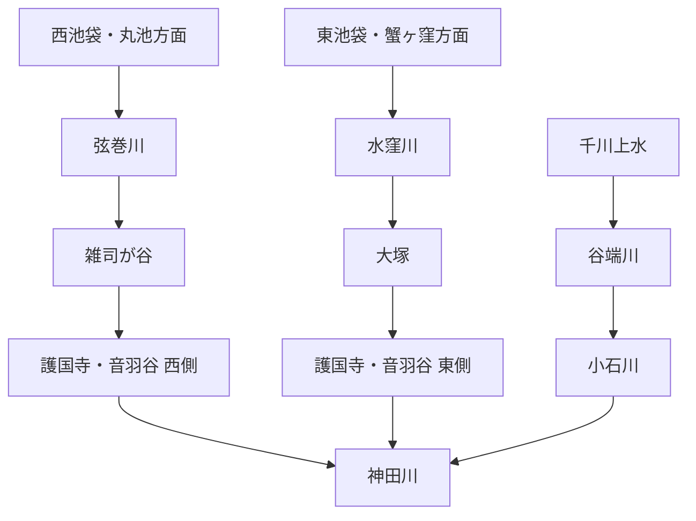

# otowa-ankyoscape

水窪川・弦巻川・谷端川と、その周辺の旧河道・暗渠・湧水・用水・土地利用について調べた記録です。

中心となる範囲は、池袋・雑司が谷・護国寺・音羽・小日向・小石川です。

**追加調査対象：人参川（古茗荷谷川との関係は未確定）** — 2026年10月8日、茗荷谷の西側谷頭について明治初期の地図表示と色別標高図を照合。筑波大学附属中・高の南方にある浅い枝谷が合流する可能性も含め、[人参川の調査ノート](docs/人参川.md)に記録した。**10月8〜9日の現地歩行・二源頭・古地図上の池・筑附南方の分水界候補・還国寺の湧水・水窪川の橋名**は[専用の観察記録](docs/2026-10-09・茗荷谷・人参川現地観察.md)に整理した。名称の史料上の確実性と、水路・谷地形の推定は区別している。

> [!IMPORTANT]
> このリポジトリでは、既知の河川史をまとめるだけでなく、**まだ決着していない流路・接続・成立年代を史料から検証すること**を重視します。
> とくに「水窪川と弦巻川はどこかで合流していたのか」「音羽通り西側の弦巻川下流はいつ成立したのか」「弦巻川・水窪川側と谷端川側の更新世旧河道はどちら向きに流れていたのか」は中心的な未解決問題です。

  

幕末の音羽・雑司ヶ谷周辺を描いた尾張屋版 <i>Otowa ezu</i>。1851年近吾堂板とは別史料。画像をクリックすると合流問題の検討ページへ移動します。

## 未解決問題

このリポジトリの中心です。解決していない問題は川別の概要へ埋め込まず、できるだけ独立した文書として追跡します。

| 問題 | 現状 |
| --- | --- |
| **水窪川と弦巻川は合流していたのか** | [独立文書で検討中](docs/open-questions/水窪川と弦巻川の合流・接続問題.md) |
| **音羽谷西側の弦巻川下流はいつ成立したのか** | [独立文書で検討中](docs/open-questions/音羽谷西側の弦巻川下流の成立年代.md) |
| **更新世の旧河道はどちら向きに流れていたのか** | 滝口志郎（2019）が谷端川側への接続可能性を提示するが、流向は未決着 |
| **千川上水から弦巻川・水窪川へ直接分水したのか** | 谷端川への分水は確認できるが、両河川への直接分水は未確認 |

→ [未解決問題の一覧](docs/open-questions/README.md)

## 水系の全体像

これは近代以降に把握しやすい大まかな配置であり、全時代にそのまま当てはまるとは限りません。近世の造成・灌漑、近代の河川改修、暗渠化、下水道再編によって接続関係や流路が変化した可能性があります。

## 現時点で重要なこと

- **第167回: 御用向諸事日記・触留第20/54冊・屋敷渡預絵図証文・大東京新区町名地番表・東京府文献叢書・中野町誌・戸塚町誌・中野町勢要覧・江戸期随筆・読み物・武蔵名勝図会のfulltext横断で新規13件（[GOV-401](docs/sources/gov/GOV-401.md)〜[GOV-406](docs/sources/gov/GOV-406.md)・[BOOK-195](docs/sources/books/BOOK-195.md)〜[BOOK-199](docs/sources/books/BOOK-199.md)・[GAZ-090](docs/sources/gazetteers/GAZ-090.md)・[GAZ-091](docs/sources/gazetteers/GAZ-091.md)）＋追記4ファイル（[GOV-396](docs/sources/gov/GOV-396.md)・[GOV-398](docs/sources/gov/GOV-398.md)・[BOOK-148](docs/sources/books/BOOK-148.md)・[BOOK-149](docs/sources/books/BOOK-149.md)）＋対照表5行新設3行追記＋[橋名調査](docs/四河川の橋名・橋跡調査.md)第167回追補**。主な新情報は①**[GOV-401](docs/sources/gov/GOV-401.md)（御用向諸事日記24巻[15]・[2577238](https://lab.ndl.go.jp/dl/book/2577238)）＝第166回の触留30冊（[GOV-398](docs/sources/gov/GOV-398.md)）の小金井筋御成と同一御成の独立系統の日記側記録**——直前の条が「**天保十五辰年二月**」の日付を持つことから**[GOV-398](docs/sources/gov/GOV-398.md)の辰年=天保15甲辰（1844）2月25日説が有力候補**に（天保3壬辰〔1832〕説から更新・断定は保留）＋「**中野村小淀山御立場二而雉子御用相済**」＝小淀山の雉子狩の文言候補＋還路の「**井ノ頭弁天境内御通**」・「**浜橋御渡**」（淀橋の崩れ候補）＝**淀橋水車御小休所系列の1844年点が加わり御成ルートの重複確認が取れた**、②**[GOV-402](docs/sources/gov/GOV-402.md)（触留第20冊・[2549597](https://lab.ndl.go.jp/dl/book/2549597)・巳九月・幕末候補）＝中野筋御成の道筋全文（同一道筋が2系統で採録）**: 矢来御門→神楽坂→早稲田町馬場下町→高田越→諏訪谷台（鶴御用）→上戸塚村→**小瀧橋御渡**→上落合村野道（鶉御用）→新井村薬師境内御通抜→**御膳所中野村宝仙寺**→**小淀山御立場脇**→**神田上水御伝橋御渡**→柏木村野道（鶉御用）→成子町→内藤新宿＝**小瀧橋の御成実利用（repo初出）＋「御伝橋」＝神田上水の橋名文言候補（repo初出・淀橋のOCR崩れの可能性を保持し断定しない）＋宝仙寺御膳所・鶴/鶉御用の狩猟地点**、③**[GOV-403](docs/sources/gov/GOV-403.md)（屋敷渡預絵図証文第176冊・寛延3庚午=1750）＝鶏声窪と船河原橋際の実務文書**: 「**駒込鶏声窪加藤三之丞上り地之内…森重治郎屋鋪拝領**」（1750年8月25日）＝**鶏声窪の江戸期実務文書（屋敷渡証文）用例**＋「**船河原橋近所神田川通り河岸に而…阿倍百助揚ケ場御渡之被成**」（8月23日）＝**船河原橋際の神田川河岸の揚場の1750年定点（江戸川水運の河岸の一次文書例・repo初出候補）＋「神田川通り」の18世紀中葉の表記用例**、④**[GOV-404](docs/sources/gov/GOV-404.md)（触留第54冊・辰九月・幕末）＝清光院様御年始の御道筋「巣鴨仮御住居御門ゟ右え鶏声窪白山裏門前通指ケ谷町通…水道橋…一橋御渡平川口御門」＝鶏声窪の御成経路採用の触記録（repo初出候補）＋「笹地軽子橋修復ニ付…往来差留」＝軽子橋の初出候補**、⑤**[GOV-405](docs/sources/gov/GOV-405.md)（大東京新区町名地番表・1932）＝戸塚町三丁目の字名表の「馬尿川」＝1922（[BOOK-190](docs/sources/books/BOOK-190.md)）→1931（[BOOK-149](docs/sources/books/BOOK-149.md)）に次ぐ第3時点（区編入時点の東京市の公式地番表）**、⑥**[BOOK-148](docs/sources/books/BOOK-148.md)追記（中野町誌・1933の史跡条の本文文言群）＝第166回課題④の解決**: 成趣園条の「**成趣園（伏見宮御別邸）中野坂下北側なる字小淀に在り…里俗に天狗山又は小淀山とも云ふ**」＝**小淀山の小字特定（字小淀・中野坂下北側）**＋姿見ず橋条（娘投身〔**十二社の池とも云ふ**〕→**小瀧橋にて遺骸を発見**→「**以來此の橋を姿見ず橋、小瀧橋を姿見の橋**」＋「**一說には…淀橋を姿見ず橋、附近の小淀橋を面影橋と云ふ**」＋「**洲湯水**」転訛口碑＋神田上水の流れ澱む所の命名推測）＋淀橋由来2説（『紫の一本』天和2年刊・『江戸砂子』の家光×春日局の**柏木村邸**説）＋小淀橋条（**淀橋より西二十間許の神田上水引水の灌漑用水堀の小橋・明治期道路改修で埋没・面影橋異説・伏見宮別邸附近の小名**）＋村方書上引用（**三水源〔井ノ頭池・遲野井村善福寺の池・雜色村和田村境〕と流末〔江戸川筋船河原橋より神田川に落〕**・御鷹野御用地御立場2ヶ所・関口二分と萬治年間増鑿の流路論）、⑦**[BOOK-149](docs/sources/books/BOOK-149.md)追記（戸塚町誌の面影橋条）＝面影橋=姿見の橋説（『江戸砂子』引用の「**淀橋を姿見ずの橋と稱せるに對して、之を姿見の橋といふ**」）＋中野長者娘の入水発見説＋『南向閑話』の於戶姫異説＋流螢名所**＝面影橋由来の3系統目、⑧**[BOOK-195](docs/sources/books/BOOK-195.md)（中野町勢要覧・1926）＝四所橋（**柏木中野角筈本◯の四村の境地**）・餘戶橋（**豊島多摩両郡の境の堺・両郡の餘戸を移した**由来）という新橋名2件＋吉宗放鷹説の淀橋由来＋「**洲潟水**」・三重塔転訛説＋小淀山=天狗山・11,750坪**（いずれも二段組OCRで要原画像照合）、⑨**善福寺池＝井頭上水の助水の江戸期随筆2系統（[BOOK-198](docs/sources/books/BOOK-198.md)愚得襍載・[BOOK-199](docs/sources/books/BOOK-199.md)筠庭雑録）＝「江戸の井頭のわたりに小園井村善福寺地といふは井頭上水の助水となるの処**」＝[GOV-377](docs/sources/gov/GOV-377.md)（1877年多水源合流説）・[BOOK-148](docs/sources/books/BOOK-148.md)村方書上の善福寺の池に先行する江戸期の助水認識の裏付け、⑩**[GAZ-090](docs/sources/gazetteers/GAZ-090.md)（東京府文献叢書[4]）＝鶏声窪の旧名「皇角原」説（repo初出・OCR崩れ大で読み保留）＋東西大塚の範囲構造（鶏声窪土井家の辺=東大塚・波切不動=西大塚）**＋[BOOK-197](docs/sources/books/BOOK-197.md)（安永8=1779の読み物）＝宝掘りの「けいせい窪」命名・「傾城は字違い」の**鶏声窪由来譚の18世紀の記録**、⑪[BOOK-196](docs/sources/books/BOOK-196.md)（菊牕偶筆・1881）＝天下名水秤量表の**井頭上水370兩**（[GAZ-066](docs/sources/gazetteers/GAZ-066.md)名水品彙の秤量43・[BOOK-182](docs/sources/books/BOOK-182.md)七碗歌の43匁と並ぶ名水品評系）＋[GOV-406](docs/sources/gov/GOV-406.md)（東京府文献叢書[31]の書目）＝**「井頭上水役由緒書」の所在記録**（静嘉堂『井頭上水由緒』〔GOV-384〕との異同は未確認）＋[GAZ-091](docs/sources/gazetteers/GAZ-091.md)（武蔵名勝図会・1926）＝歸方領目録の善福寺池・妙正寺池等の項目と家光の五倍子樹彫刻譚・遲野井村名由来の文言候補（OCR崩壊大）。重複判定（登録せず）: 763773北豊島郡史概説＝GOV-196系と同一文言系統等（ノートに記録）。監視系はnews_search 6クエリ全0件・kanzyou7.comは2回とも取得不能（次回再試行）・都建設局は引き続き403（R5.3版のまま）・開札2026-12-02はまだ未来。詳細は[第167回ノート](docs/2026-11-18（第167回）・小淀山の字小淀特定と淀橋姿見ず橋由来群・善福寺池助水の江戸期随筆・鶏声窪旧名皇角原・小瀧橋御渡の中野筋御成.md)。〔いずれもOCR由来で文言・人名・数値は要原文照合。小淀山の字特定・皇角原の読み・御伝橋の同定・由来説の対立（淀橋/姿見ず橋/面影橋・家光/吉宗）は断定せず対校案件として記録〕**
- **第166回: 東京市史稿市街篇第九・市街編44・市中取締類集・市中取締書留・触留・書上帳第48冊のfulltext横断で新規6件（[GOV-395](docs/sources/gov/GOV-395.md)〜[GOV-400](docs/sources/gov/GOV-400.md)）＋追記2ファイル（[GOV-384](docs/sources/gov/GOV-384.md)・[GOV-285](docs/sources/gov/GOV-285.md)）＋対照表2行新設＋[橋名調査](docs/四河川の橋名・橋跡調査.md)追補**。主な新情報は①**淀橋水車（柏木淀橋町）の通時系列の確定**——[GOV-395](docs/sources/gov/GOV-395.md)（市街篇第九・1931）の文政町方書上引用「**寛文年中神田御上水助水堀分水仕、水車取立申度段相願**」＝**先祖彌兵衞の寛文年中起立願の回顧文言（[GOV-390](docs/sources/gov/GOV-390.md)の享保4年〔1719〕裁定に先行する町方書上側年代情報の対校案件・断定は保留）**＋[GOV-399](docs/sources/gov/GOV-399.md)（市中取締書留196・文久4＝元治元〔1864〕）の**従弟吉太郎への家業相続願**: 「**神田上水〔西/成〕水堀筋ゟ分水引受**」・**水料米毎年四斗（弐拾俵）**・「**水元井之頭池水門下弐百間之場所自分入用を以埋渡**」＝**享保期家業セット（井之頭池水門＋野方白堀之内長弐百間）の幕末までの継続を示す一次文言・「野方白堀弐百間≒井之頭池水門下二百間」の同定を強める対校案件（原字形照合まで断定しない）**＋同冊の「**安政元寅年右水車ニ而炮薬舂立及出火**」＝嘉永7爆発の後日規制（米穀以外の舂立禁止一札の書替）＋『諸証文言上帳』元文5年（1735）両国橋東広小路証文の「**淀橋水車弥兵衛印付**」（弥兵衛の1735年定点・補足併記）、②**[GOV-396](docs/sources/gov/GOV-396.md)（市街編44・1957）＝嘉永7寅年（1854）の淀橋水車の焔硝製法と爆発事故の一次記録群（repo初出）**: 嘉永6丑7月の焔硝製法仰付・**先行4度の水車火薬事故**（瀧野川村水車・細川の小山村水車・酒井の牛込矢來屋敷の製法・深川六間堀の小細川の雷火）・日当毎日8両・**嘉永7年6月12日朝6時過ぎの水車合藥製場出火・爆発**（小遣人足の焼死・淀橋町過半押潰し・角筈村潰家2軒損家5軒・和泉新田御焔硝藏へ四箱附廿五駄相納直前の類焼・見舞金〔潰家1軒に金3歩・破損家1軒に金1歩〕の実務）＋「**淀橋を昔ハ不姿見橋と申けれハ、地雷火で家を殘らず打崩し、人の姿も見ずの橋なり**」＝**面影橋＝淀橋の異名群に新系統（[GAZ-030](docs/sources/gazetteers/GAZ-030.md)の安見橋・[BOOK-194](docs/sources/books/BOOK-194.md)の姿見数の橋に次ぐ）**＋安政大地震の「**新宿〓四ツ谷御門外迄玉川上水樋震ひ潰し水吹出し、水元を止ル**」（1855・玉川上水の四谷〜新宿間の樋被災・repo初出候補）、③**[GOV-397](docs/sources/gov/GOV-397.md)（市中取締類集208・天保14卯7月）＝淀橋水車久兵衛家の御成施設の仕来（repo初出）**: 「**御成御門壱ケ所右は左来水車江之通用口…御成度々有之御通行…年限不知…自分入用を以取建**」＝**水車通用口の御成御通行用転用**＋**享保年中に御小納戸頭取〔松平伊賀守〕差図の御用高張挑灯2張・「御成御門」掛札の相渡→文政8酉10月の小普請方引替請取→天保14の留**の通時系列＋「**古享保度より当時迄御成之節御小休等**」＝御小休所の享保〜天保14の継続、④**[GOV-398](docs/sources/gov/GOV-398.md)（触留第30冊・辰2月24日・天保3壬辰〔1832〕候補）＝小金井筋御成の往復道筋全文（repo初出）**: 「**大木戸内藤新宿往還通戌子町御小休所淀橋水車久兵衛右相済淀橋御渡中野村小淀山御立場**」＝**淀橋御渡の御成実利用・中野村小淀山の御立場（地名repo初出候補）**＋復路の「**井之頭弁天境内御通抜**」（井之頭池の弁天境内の御成通過・repo初出）＋御膳所吉祥寺村名主十郎左衛門、⑤**[GOV-400](docs/sources/gov/GOV-400.md)（書上帳第48冊・文化11戌〔1814〕）＝野方堀通葭茅刈取見廻りの玉川上水側の下限の文言（repo初出）**: 「**右は神田上水水元井之頭池ゟ関口村迄 玉川上水水元福生村新堀口ゟ四谷内藤宿裏通内藤大和守下屋敷境迄**」＝**玉川上水側見廻り区間の下限＝四谷内藤宿裏＝[GOV-285](docs/sources/gov/GOV-285.md)制限③「玉川側下限不確定」の解消方向**（第49冊以降の系列の2年先行・[GOV-285](docs/sources/gov/GOV-285.md)に追記）、⑥**[GOV-384](docs/sources/gov/GOV-384.md)追記（第165回課題②の消化）**: 寛政5丑（1793）4月20日の「神田上水水銀不差出候町々」の**全町リスト（約70か所・壱町目新道共〜龍門寺門前）**＋別分差出不申の**家主つきリスト**（本代木町壱丁目市郎兵衛・南槙町惣兵衛・北紺屋町義兵衛・常盤町幸右衛門・本紙木町六丁目宇兵衛・南塗師町・西紺屋町藤兵衛・吉川町関次郎〔出火分〕等）＋「**小日向水道町同所川添屋敷右は神田上水御開発之節ゟ右之水に付御役相勤候間是迄水銀取出不申候**（委細書面は元文2巳年類焼で焼失）」＝**水道町の水銀免除の理由の一次文言（repo初出）**＋南方町々の享保6丑7月小使伝左衛門仕法文言（伝右衛門→左衛門→又市の替番の全容）、⑦[GOV-395](docs/sources/gov/GOV-395.md)の神田旅籠町壹丁目の「**古上水跡之儀も、安永九子年中千川上水町内へ相懸り候得共、無程御差留**」＝**千川上水の安永9年（1780）の神田旅籠町への懸かり・短期差止の町方書上側文言（[GAZ-082](docs/sources/gazetteers/GAZ-082.md)④の下谷側安永8年文言群と1年差の対校案件）**＋求涼亭引用の音羽町・櫻木町の町名由来説（京清水寺模倣・**護国寺前の音羽町で牛込音羽町とは別の可能性が高い**・対照表に注意書きつきで新設）。監視系はkanzyou7.comが2026/11/13のまま・都建設局は403（R5.3版が最新のまま）・news_searchは対象河川の直接報道なし（都プレス2026-11-02の環七地下調節池インフラツアー〔2027年1月〜〕と産経2026-10-21の内部見学記事を監視系記録として捕捉）・静嘉堂『井頭上水由緒』の請求記号特定はweb検索で不成立（継続課題）・開札2026-12-02はまだ未来。詳細は[第166回ノート](docs/2026-11-18（第166回）・淀橋水車の通時系列と嘉永7年焔硝爆発・野方堀通見廻りの玉川側下限・未納町全リストと水道町免除理由.md)（淀橋水車の寛文〜元治の通時系列のMermaid図を含む）。〔いずれもOCR由来で文言・人名・数値は要原文照合。寛文年中起立願と享保4年裁定の年代の食い違い・不姿見橋の成立年代・巷説の月日対立（一次記録の六月対年間録の二月）は断定せず対校案件として記録〕**
- **第165回: 類集撰要・正宝事録・享保撰要類集・書上帳群・『井の頭』紀行の横断で新規12件（[GOV-385](docs/sources/gov/GOV-385.md)〜[GOV-394](docs/sources/gov/GOV-394.md)・[GAZ-089](docs/sources/gazetteers/GAZ-089.md)・[BOOK-194](docs/sources/books/BOOK-194.md)）＋追記2ファイル（[GOV-384](docs/sources/gov/GOV-384.md)・[GOV-378](docs/sources/gov/GOV-378.md)）＋対照表2行新設＋[橋名調査](docs/四河川の橋名・橋跡調査.md)追補**。主な新情報は①**白堀浚賃の負担制度の通時系列の充実**——[GOV-385](docs/sources/gov/GOV-385.md)（類集撰要巻七・寛政2戌正月15日）＝**霊岸嶋浜町名主市兵衛の町内年中定式入用答申に「神田上水白堀浚賃」＋「玉川上水水銀」が鐘役銭・晦日銭・名主役金と並ぶ定番項目として計上**（[GOV-378](docs/sources/gov/GOV-378.md)の霊岸島受益構造の受益町側帳簿裏付け・repo初出）、[GOV-386](docs/sources/gov/GOV-386.md)（正宝事録77・寛保4〜宝暦5）＝「**神田上水白堀浚賃銭時相場に而請取度願に付可致返答之事**」（七月廿日）＝**浚賃の相場建て請取交渉**の一次触（年次は収録期間内で未確定）、[GOV-387](docs/sources/gov/GOV-387.md)（天保度御改正諸事留二・天保13寅4月20日町会所触）＝**「神田玉川上水普請入用・同水銀・白堀浚賃銭・鐘役銭」が町入用押切帳に書き加えない「別集」扱い**である実務文言（repo初出）、[GOV-388](docs/sources/gov/GOV-388.md)（町会所一件書留・天保13）＝堺町（猿若町移転関連）の惣小間減に伴い「**神田上水御普請金白堀浚賃銀同小銀三口共相減**」＝**御普請金・白堀浚賃銀・小銀〔水銀OCR候補〕の三口の小間割賦課と減額決算**（repo初出・[GOV-360](docs/sources/gov/GOV-360.md)と時期整合）、＋**[GOV-384](docs/sources/gov/GOV-384.md)追記（制限④の解消）**: 享保17子（1732）正月定の**神田御上水相掛り町方間数帳（〆五千三百四拾三間半）**と年々改訂・月行事印形の運用規定・神田上水浚請負人（永富町六左衛門）の取上げと**小間割（神田辺4分5厘・南方2分5厘）**・**天明7未（1787）11月4日の為役請負差止→御普請方御役所への直納**の町方御訴・**白堀賃銭・水銀の未納町の御調リスト**（龍門寺門前・柳原若井町・神田小泉町・小石川諏訪町・橋本町三丁目等）＝**第163〜164回の白堀制度史の列が18世紀前半〜天保まで接続**、②**[GOV-390](docs/sources/gov/GOV-390.md)（享保撰要類集二十一・延享3亥4月9日の淀橋水車家業譲渡裁定）**＝享保4亥年（1719）に松平伊賀守の相願で水車が仕立ち（大久保佐渡守殿呼出し・道奉行立合）・「**玉川上水通代々村樋口ゟ神田上水江之助水を以水平家業**」＝**代々村樋口から玉川上水を神田上水へ助水（逆送）する水車家業**・家業セット「**井之頭池水門底板幷橋一ケ所・同野方白堀之内長弐百間・玉川通堰料米弐拾俵宛**」＝**「野方白堀」呼称の享保期文言候補（repo初出級・野方堀〔千川系〕か神田上水野方領区間かの比定は原文照合まで断定しない）**＋「**神田上水白垣通小日向金剛寺坂下新仕樋**」の修復往来人留（「白垣通」＝白堀通の異表記候補・対照表に新設）、③**井之頭池管理の書上帳列（repo初出）**: [GOV-393](docs/sources/gov/GOV-393.md)（文政10・水門并柵の御普請・戌11/4〜12/8の35日分）・[GOV-389](docs/sources/gov/GOV-389.md)（天保5・6の**水草刈**・各16日分）・[GOV-394](docs/sources/gov/GOV-394.md)（弘化2・**土留の御普請**・20日分）＝**地割棟梁1人の宿代銀・旅御扶持方代金の勘定所書上の共通形式で1827〜1845年の井之頭池の定常管理業務**（水草刈・水門柵修覆・土留普請）が帳簿レベルで連続、④**[BOOK-194](docs/sources/books/BOOK-194.md)（土岐頼旨撰『井の頭』・天保7申6月22日の紀行・repo初出級）**＝梅雨出水期に「**神田上水の源井の頭池の柵なとの破れ**」を案じた出立の観察＋「**此橋もと面影の橋又姿見数の橋姿か橋ともいふ寛永の度御鷹狩の砌淀橋と改むへしと御供の榊原河某に清ことありしとなん**」＝**面影橋の異名群（姿見数の橋・姿か橋）＋寛永期御鷹狩の淀橋改称伝承**（[GAZ-030](docs/sources/gazetteers/GAZ-030.md)の安見橋異名に次ぐ系統・伝承扱いで断定しない）＋淀橋水車久兵衛の「**享保年中に御小休となる其頃より初るか神田上水へ助水す**」・**樋弐尺五寸×三尺五寸・溜池八百七拾五坪三分**（[GOV-390](docs/sources/gov/GOV-390.md)の享保4年起立文言と一次・紀行の2系統で整合）＋善福寺池水車の神田上水助水の文言候補＋井の頭池の水加持の**天海説vs宝仙寺縁起の雄龍説**（龍頭骨・中野郷の長堀江兵部・船越某家蔵）、⑤**[GAZ-089](docs/sources/gazetteers/GAZ-089.md)（大角筈千駄谷町方書上・文政10亥5月の地誌御調書上）**＝大久保前町の**野方領市ヶ谷村起源→元禄12卯8月（1709）拝領→正徳3己5月（1713）町方化**の年代層＋「**御下屋敷脇横町際より□六上柏木村江流申候横切下水**」（幅弐尺・三百五拾間余・石橋の寸法つき＝柏木村方の水路〔野方堀系候補〕の対校案件・断定しない）＋柏木成子町の**鳴子→成子の町名起りの一次書上**・享保12年石地蔵（地蔵坂→成子坂）・**天正15丁亥年（1587）7月の北条家触書が名主方に現存**（対照表に成子坂行を新設）、⑥[GOV-391](docs/sources/gov/GOV-391.md)（類集撰要巻三十二「神事」・寛政6辰9月調）＝**白山前町千川屋敷の祭礼番組編入**＋小石川「一水川明神」〔OCR候補〕の祭礼（九月十日隔年）の**明和六丑年以降相休**・雑司ヶ谷鬼子母神の**正月十六日祭礼**（日数二日之内・近辺町々幟挑灯差出）・高田一定八幡〔OCR候補〕の明和4亥年以降相休、[GOV-392](docs/sources/gov/GOV-392.md)（類集撰要巻四十九「名主」・領主別名主一覧）＝「**自澄院〔自証院OCR候補〕領雑司ヶ谷町卯二ヶ所名主平次左衛門**」＋**三水道町の名主人名（金杉水道町市郎右衛門・小日向〔水道町OCR候補〕三四郎・関口水道町佐一郎）**＝[GOV-234](docs/sources/gov/GOV-234.md)の三水道町（白堀の藻苅3ヶ所・古来持場）・[GOV-345](docs/sources/gov/GOV-345.md)の雑司ヶ谷名主平次左衛門の系譜の年代遡行資料。重複判定（登録せず）: 2982526『江戸地字集覧』＝GAZ-036と同内容・2587250（安政3年・下谷金杉村等）＝荒川区エリアで対象外・類集撰要の音羽町ヒット＝日本橋音羽町。監視系はnews_search 6クエリ＝全0件・kanzyou7.comは2026/11/13のまま・都建設局は403（神田川流域計画はR5.3版が最新のまま・決定版未公表・環七第3回委員会資料の確認不可）・静嘉堂文庫は到達不能（『井頭上水由緒』請求記号特定は次回課題）・東京都公文書館は403・開札2026-12-02はまだ未来。詳細は[第165回ノート](docs/2026-11-18（第165回）・白堀浚賃の負担制度の通時系列・淀橋水車の享保4年起立と野方白堀文言・井之頭池管理の書上帳列・面影橋の異名群・大久保前町と柏木成子町の地誌御調.md)（白堀浚賃制度の通時系列と淀橋水車の助水構造のMermaid図・井之頭池管理の書上帳列の年表を含む）。〔いずれもOCR由来で文言・人名・数値は要原文照合。改称伝承・下男殺し譚・水加持の二説は伝承として扱っており史実とは断定していない〕**
- **第164回: 『類集撰要』巻之十八「上水一件」（NDL [2571664](https://lab.ndl.go.jp/dl/book/2571664)）の全文精読で[GOV-384](docs/sources/gov/GOV-384.md)を新規登録（当回の目玉）**。主な新情報は①**寛延2巳11月5日の白堀石垣木樋の組合普請文言**（「神田上水大院□〔大洗堰のOCR候補〕より三河町壱丁目川岸迄石垣幷木樋等従古来公儀御入用を以御修復有之候得共**当七月晦日已来**惣門之通御組合普請被成候間…町方は小百弐間に付高百石之積り割合出銀」・能勢肥前守様申渡）＝**[GOV-378](docs/sources/gov/GOV-378.md)（撰要永久録）の同内容触書の月日・申渡人つき独立裏付け**（負担割合も一致）、②**白堀の藻苅（藻刈り）三ヶ所の一次文言〔repo初出〕**（「右白堀藻生候而水大掛に付**例年金杉小日向関口三ヶ所より役人足取出藻苅相勤**候当年も来る七日京刻申付候」＝白堀の定常維持労務が金杉・小日向・関口の3地点で行われていた＝[GOV-234](docs/sources/gov/GOV-234.md)の三水道町「古来持場」と地名レベルで一致・白堀の実水流通の傍証）、③**牛天神下〔OCR〕〜音羽町九丁目橋区間の町方組合普請場所**の文言（瓜生〔?OCR〕六左衛門の年々請負・石垣崩壊・土手損傷・矢来新規過半。区間は[GOV-233](docs/sources/gov/GOV-233.md)の白堀区間と一致）、④元文4年8月の**上水一件の町奉行所（石川土佐守）掛り移管文言**（御願は奈良屋〔円良屋OCR〕御役所経由・町年寄衆掛）＋10月17日の**戸樋入替細則**（名主3人立合吟味・水下え筋違い伏せ禁止）、⑤**内田家（神田上水水元役）の由緒書・願書群**（天明6年11月の内田茂十郎願書）——**御茶之水の茶由来説**（「御茶を煎奉差上候処被為召上甚御機嫌足…至而名水」「**御茶之水と唱来**」＋「**御茶印**」「**上水之水元役**」の役名拝領・御墨印・水道橋の東之屋敷〔2,300坪?OCR〕拝領）＝御茶之水の地名由来の新系統（家伝レベルで断定しない）、**井頭池開発伝承**（武州玉川辺の百姓内田六次郎が「地底ゟ踊水」の試掘・「関所〔関口OCR候補〕之上水出来可仕」）、**野方十六日村堀〔OCR〕の経路文言**（井の頭池→野方→水戸様御屋敷辺→小石川筋→小川町通→猿楽町→神田橋外＝野方堀通研究との対校案件）、**明和6丑年の下役召放文言**（「御分記に相成候砌上水懸り下役とも皆々被召放」）と**明和7寅年5月の退役文言**（久保筑前守様御宅え召呼・夏目和泉守様列座・「拾七ケ年已前明和七寅年休役」）、安永8年9月13日の帰役願＋「**本書願ノ趣ハ記収コレナキ義ニ付平上ケナカリシ由上水記ニ見ユ**」の注記候補（「上水記」という帳簿の存在示唆）、⑥**静嘉堂文庫蔵『井頭上水由緒』（内田六次郎撰・明治写）の書誌所在**（静嘉堂文庫国書分類目録[1879926](https://lab.ndl.go.jp/dl/book/1879926)の書名索引「内田六次郎 井頭上水由緒 三五三」等＋本体地誌部の列＝内田家由来書の写本の現存が目録レベルで確認）＝[GOV-383](docs/sources/gov/GOV-383.md)の江戸上水書類十巻と並ぶ未入手文書の探索目標、⑦寛政元酉6月29日の**水切時の井戸汲取規定**（水切の節は井戸持ちが私井戸を他町民に開放）＋享保6丑年7月の南方惣町の水料非納主張文言。追記: [GOV-378](docs/sources/gov/GOV-378.md)（寛延2年文言の独立裏付け・明和6年文言の同内容対校）・[GOV-381](docs/sources/gov/GOV-381.md)（**2548910/2548911の差分対校完了**＝並行本文・項目番号体系相違・江戸川文言差〔B冊の「汐入ニ無之川内ニ裸身ニ而男女も不分死骸紛手次第片付候様」〕・A冊のみの天明7未年6月非人浮死骸引付規定〔保作事例〕・寛政7大洗堰下浮死骸事例は両冊ほぼ同文＝前回課題の解消）・[GOV-234](docs/sources/gov/GOV-234.md)（明和6丑11月9日の両上水一元化文言の独立裏付け）・[GOV-377](docs/sources/gov/GOV-377.md)（内田六次郎の人物文言・水元役世襲の願書レベル裏付け＝開削文言そのものの照合は今後も課題）・[対照表](docs/地名・河川名対照表.md)（白堀行の第164回追記＋御茶之水行の新設）。重複判定（登録せず）: 2541386=GOV-171・2587468/2587469=GOV-209・2587465=GOV-244[10]・1214832=GAZ-048・1214857=GAZ-049/024。監視系はnews_search 6クエリ＝全0件・kanzyou7.comは2026/11/13のまま・都建設局神田川流域ページは本runは到達不能（R5.3版が最新のまま）＝新情報なし。詳細は[第164回ノート](docs/2026-11-18（第164回）・類集撰要巻十八「上水一件」の精読・白堀藻苅三ヶ所・内田家水元役の由緒書群・静嘉堂井頭上水由緒の書誌所在.md)（白堀の維持制度の追加層と内田家水元役の系譜のMermaid図を含む）。〔いずれもOCR由来で文言・人名は要原文照合。茶由来説・井頭池開発譚は家伝レベルで史実とは断定していない〕**
- **第163回: NDL次世代デジタルライブラリーのfulltext横断の継続回。[BOOK-129](docs/sources/books/BOOK-129.md)（東京市史稿）が抄出していた『享保撰要類集 十九ノ下（堀川浚之部）』の原本を全文精読し[GOV-373](docs/sources/gov/GOV-373.md)として登録（当回の目玉）**。主な新情報は①**船河原橋際の市ヶ谷大下水吐口の枡形石垣＋吐口際の新規高札（芥禁じ）＋芥捨請負16人の流域町名リスト（牛込〜四ツ谷〜小日向25町＝市ヶ谷大下水の集水域の一次記録）＋汐差引の極限「船河原橋辺江汐差引至極末」（寛延3年7月8日の水理観測）**、②**矢来柵1,338間余（うち1,042間余に新規柵）と柳原土手の商床見世230間余の助成地化**＝[GOV-376](docs/sources/gov/GOV-376.md)（三橋以下橋々書類）の柳原土手柵1,042間余の残金報告と新大橋証文（船河原橋〜大洗堰15町＝新大橋掛り）が独立裏付け、③元文3年の**六ヶ所御堀浚の区間別定尺（小日向大橋〜船河原橋は水欠より弐尺・牛込御門〜水道橋は干汐ニ水尾通弐尺五寸・水道橋〜大川口は干汐三尺）＋水道橋の上水戸極の銅葺**＝[GOV-374](docs/sources/gov/GOV-374.md)、④[GOV-375](docs/sources/gov/GOV-375.md)（安永・天明撰要の対校）で**天明6年7月の水道橋外掛樋の樋請石垣崩れと大洗堰石垣急破（桟橋懸置）＋駿河台土手崩落の先例書（明和9・安永2の聖堂西）**、⑤[GOV-377](docs/sources/gov/GOV-377.md)（東京水道改設之概略・1877）で**神田上水の多水源合流説（井の頭池・善福寺池・妙正寺池＋玉川派流が相合して大洗堰に至る）と白堀・桝・潜樋・萬年樋等の行政用語定義・延長5里26町15間**、⑥[GOV-378](docs/sources/gov/GOV-378.md)（撰要永久録・町年寄触書集）で**享保13年大風雨触書の一次文言「目白山邊崩れ白堀埋り」（BOOK-131文言の一次独立裏付け）＋霊岸島町の白堀浚受益構造＋寛延2年の寛延2巳年の石垣木樋の公儀御入用→御組合普請移行＋明和6年の水役請負停止（御普請方一元管理）**＝白堀区間維持制度の転換点、⑦[GOV-379](docs/sources/gov/GOV-379.md)・[GOV-380](docs/sources/gov/GOV-380.md)（触留第12・19冊＋玉川上水留[63]）で**大洗堰左右袖石垣の安政3辰年11月着手→安政4巳年7月13日相済の年次チェーンが2資料の独立文言で確定＋卯年（延享4候補）の袖石垣修復＝「袖石垣」が18世紀中葉〜幕末まで修復の焦点**、⑧[GOV-381](docs/sources/gov/GOV-381.md)（記事条例検使之部）で**白堀通・御茶ノ水の水死検使規定（御普請奉行管轄）と江戸川/神田川の汐入区分（江戸川＝塵芥と盆棚の投棄禁止／神田川＝汐入場所故差構不申）＋寛政7年大洗堰下の浮死骸の水番人実務**、⑨[GOV-382](docs/sources/gov/GOV-382.md)（市街篇29・37）で**天明3年7月17日大洗堰石垣崩れ・神田上水断→天明4年7月11日修復・往来再開（柳営日次記）＋天保2年の「疊石ノ銚子口其外共」普請の褒美〔「銚子口」repo初出候補〕**、⑩[GOV-383](docs/sources/gov/GOV-383.md)（編修地誌備用典籍解題・1878）で**江戸上水書類十巻コレクションの解題目録（白堀浚賃銭取集附・白堀通渡下水橋・水番人給金等）＝未入手の上水行政文書の手がかり**、⑪[GAZ-088](docs/sources/gazetteers/GAZ-088.md)（大江戸志）で**江戸川御留川文言・鯉ヶ崎の位置（立慶橋と中ノ橋の間）・蚊屋淵の蚊帳の怪談本文・船河原橋＝とんど橋・水戸殿一手持・神田川上流の堀割者＝松平陸奥守（正宗＝政宗候補）・二代将軍治世説〔伊達綱宗寛文元年改修説（BOOK-147）より一世代前の候補〕**、⑫[BOOK-193](docs/sources/books/BOOK-193.md)（泉鏡花『蜻蛉集』・1921）で**関口の瀧「去年あたりから公園に成りました」＝江戸川公園開園大正8年（GOV-305）の文学側裏付け候補＋大洗堰旧称の回想**、⑬[GOV-233](docs/sources/gov/GOV-233.md)追記（神田上水留[34]・文久2年願書）で**「去ル卯年」＝安政2乙卯（1855）地震損以来の白堀からの大雨時の溢水と、腐った土俵から逆に御上水へ土砂が落入する双方向汚染の一次文言＋小日向の引取樋の内法寸法と修復履歴（天保4・万延元・文久元）**。対照表の白堀行に追記・文学作品節に蜻蛉集追記、橋名調査に第163回追補（船河原橋＝とんど橋・水道橋の銅葺と樋請石垣・立慶橋の通舟上限・小日向大橋＝定尺起点・水道町の橋の掛直普請）。監視系はnews_search 6クエリ（2026-11-11〜11-18）＝全0件・kanzyou7.comは2026/11/13のまま・都建設局は決定版計画の新公表なし（R5.3版のまま）＝新情報なし（開札2026-12-02はまだ未来）。陰性: 府内備考巻41-43（GAZ-049/083と重複）・江戸叢書巻六（BOOK-151/152重複）・江戸名所図会4（GAZ-047/058重複）・関八州名墓誌（OCR列混線で文言復元不能・神田上水開鑿者の墓誌候補のみノート記録）。詳細は[第163回ノート](docs/2026-11-18（第163回）・享保撰要類集堀川浚之部の原本精読・大洗堰修復年表の追加層・白堀の制度史・大江戸志の江戸川文言群.md)（大洗堰修復年表と白堀制度史のMermaid統合図を含む）。〔いずれもOCR由来で文言は要原文照合。GOV-379の卯年＝延享4候補・GOV-233追記の安政2卯年等の年次は文脈判断を含む推定で断定していない〕**
- **第162回: 環七地下河川計画検討委員会の第2回配布資料PDF（3点）のURLを特定し（第126回課題①の達成・命名規則は第1回のchikakasen-1-*ではなく2nd_*形式）、15頁の委員会資料本文を自作の純Pythonパーサ（PDFオブジェクト解析→zlib解凍→ToUnicode CMap解析→Tf/Tm/TJテキスト演算子の座標付き再構成）で抽出・精読して[GOV-291](docs/sources/gov/GOV-291.md)に大幅追記（新規採番なし・対照表変更なし）。主要な発見は①**設置要綱（第2回版）の附則に「令和８年６月１７日 一部改正」の文言〔repo初出〕＝第2回（7/14）直前の一部改正（改正箇所の特定は未了・本文は第1回版と同一に読める）**＋委員名簿の専門分野・所属（朝日ちさと＝環境経済・小堀洋美＝生態学・知花武佳＝河川工学・土屋十圀＝環境水理・平林由希子＝水文学・山田正＝河川水理・水質）、②**CC1/20の定義〔repo初出〕＝「気候変動候補シナリオを踏まえた超過確率1/20相当の降雨（以後、CC1/20相当の降雨）に対応」※CC＝Climate Change（気候変動）の略**、③**流域面積の内訳〔repo初出〕＝白子川25.0km²・石神井川73.1km²・神田川105.0km²・目黒川45.8km²・呑川17.7km²＝計267km²（対象＝都豪雨対策指針の重点化流域10のうち5流域）**、④**計画降雨の設定方法〔repo初出〕＝実績降雨データから確率雨量を算定のうえ2℃上昇時の降雨量変化倍率（1.1倍）を乗じて設定・降雨形は中央中型降雨形・線状降水帯/アンサンブル降雨/4℃上昇の影響検証予定**、⑤**流出先候補の条件〔repo初出の文言候補〕＝「環七に近い運河や海域沿いの（未判読）公共用地を前提とし、コスト、環境等の視点から抽出」**、⑥**方式選定の根拠〔repo初出・建設通信新聞報道になかった部分〕＝優先順位は「都市河川計画の手引き（立体河川施設計画編）」に基づく／「既設区間のトンネルが排水域（東京湾）の水位以深にあるので①自然流下開水路式は採用不能」「環七地下河川は山の手台地をとおる河川から取水するのでふかし上げが可能と想定し②自然流下圧力管式を採用」**、⑦**事例比較の定量〔repo初出〕＝ジール川トンネル放水路（スイス・チューリッヒ湖・延長計2km・内径6.6m・流量400㎥/s・水位差50m・チューリッヒ州HP）／五反田川放水路（多摩川水系・延長計2km・内径8.7m・流量150㎥/s・水位差計3m・川崎市HP）／首都圏外郭放水路（利根川水系・延長計6.3km・内径10.6〜10.9m・流量200㎥/s）**、⑧**ピーク570㎥/sの一次確認＋「最下流区間はφ12.5mと仮定」「管内貯留効果を考慮/非考慮」「いずれも検討中の値」「いずれの値もピーク時差を考慮」の注記〔repo初出〕**、⑨**断面計画＝流出側区間と管径（φ12.5m）を仮の値として模型実験で最適管径を決める（建設通信新聞の一次裏付け）＋既設管径の図示（白子川地下調節池φ12.5m・神田川・環七地下調節池φ10.0m）＋サージングの定義**、⑩**水理模型実験の常時実験＝150m³/s〜780m³/sの5ケース〔repo初出〕**、⑪**議題計画＝第3回＝流出の水理検討・第4回以降＝トンネルや立坑の水理検討・事業の効果・「地下河川計画（素案）」「地下河川計画（案）」のとりまとめ〔「素案」がrepo初出〕**。監視系はnews_search 6クエリ（2026-11-11〜11-18）＝谷端川・弦巻川・水窪川・千川上水・神田川整備計画は0件・環七地下調節池はインフラツアー第2期の配信社再配信のみ（第123回記録済み）＝新情報なし・kanzyou7.comは2026/11/13のまま・都建設局神田川流域ページの令和6年度末数値は第114回と同一（決定版計画は未公表のまま）・委員会ページに第3回は未掲載・開札2026-12-02はまだ。**前半push後の継続調査で第2回議事要旨（2nd_gijiyoshi-1・1頁）が委員会ページに掲載されているのを発見し全文抽出（7項目の委員意見＝1.1倍は将来予測の平均値で「決して安全側の値とは言えない」・実績・アンサンブル・線状降水帯等の多様な降雨パターン＋雨継続時間・「地下河川に取水した洪水が残っていたとしても、次の洪水を流せることが地下河川の強み」〔連続洪水対応〕・土砂堆積の設計・維持管理上の考え方整理・**放流口の堰＝可動堰など選択肢**〔repo初出の施設文言〕・既存の環状七号線地下調節池の貯留水質の変化調査による放流水の水質影響確認・事業効果の可視化・環境・防災教育への活用）＋2nd_00（議題次第）も直curlで取得・全文抽出（資料2の文書側正式名称＝環七地下河川計画検討委員会説明資料・議事要旨の日時表記「（水）」は議題次第の「（火）」と異なり誤記と推定）＝パーサ改良（TDテキスト移動演算子追跡・リソース辞書/Fx形式のフォント発見）で両PDFともToUnicode判読可。**陰性：NDL横断の特異語群（御普請役用水堀→GOV-371・昌平橋外→トークン分割ノイズ176件・五郞窪・水道向→板橋町関係は全て登録済み・小石川志料→GAZ-083・鬼子母神御調書上→0件）は既知項目のみ・PDF図版の細部ラベルはCIDマッピング欠落で未判読（原典照合が課題）。詳細は[第162回ノート](docs/2026-11-18（第162回）・環七地下河川委員会第2回配布資料PDFの純Python本文抽出（CC1／20・方式選定根拠・水理模型実験150〜780m3）・設置要綱の令和8年6月17日一部改正.md)。〔抽出はPDF本文の機械判読でCIDフォントのマッピング欠落部分は未判読＝文言・数値は原典照合を要する〕**
- **第161回: 第160回の見送り事項を解消し、既登録冊（土地概評価シリーズ）のOCR全文再精読で千川上水の1922年の通過位置文言を板橋〜滝野川〜小石川で連続して抽出した回。新規3件（GOV-370〜372）＋追記7ファイル＋INDEX再生成。主要な発見は①[GOV-370](docs/sources/gov/GOV-370.md)（復興局建築部『復興建築叢書第拾貳號』・1920・建築線路線一覧）＝**字蟹ヶ窪（水窪川源流）を経由する建築線路線が2本・番地つきで指定**（「豐多摩郡內ロ第二十號路線終點ヨリ高田町大字高田千登世町及西巢鴨町大字池袋字蟹ケ窪ヲ經テ大字瀧野川町字飛鳥山前六十八番地ノ二地先ニ至ル」＋「字西山576-1ヨリ同字蟹ヶ窪629-1ヲ經テ同755-1ニ至ル」）＋**高田橋・長崎村字五郞窪経由の路線**（千登世町→高田橋→落合→五郞窪→上板橋村境）＋路線40の「江川橋」〔江戸川橋のOCR変種候補〕・路線61の戸崎町→白山御殿町→氷川下町＝**1920年の復興局建築線の水窪川・千川流域の通過地点の一次記録**、②[GOV-371](docs/sources/gov/GOV-371.md)（沿革図書貮拾壱貞・安政3年10月調）＝上駒込/西ヶ原村境の「**御普請役用水堀**」〔repo初出候補〕＋各村の「之内ニ用水堀有之」定型（西福寺辺・昌林寺辺・金剛寺辺等）＋上尾久村船方村の「**用水堀悪水抜堀敷等有之**」〔「悪水抜堀」repo初出候補〕＋「下板橋宿松平加賀守下屋敷内江石神井川流レ入」＝**安政3年の上駒込〜西ヶ原〜滝野川〜王子〜堀之内〜上尾久の用水・悪水の帳簿文言群**（御普請役用水堀と千川上水西ヶ原区間の同定は保留）、③[GOV-372](docs/sources/gov/GOV-372.md)（同・貮拾壱元下）＝「**新堀村前通用水路**」（駒込千駄木坂下町脇〜根津権現旧地）・延命院脇の「新堀村之内野道并用水堀」＋**宗林寺元地「昌平橋外辺」の元禄14巳年御用ニ付召上・下駒込村新堀村入会地の代地拝領の文言候補**〔昌平橋＝千川上水の昌平橋（千石）の比定候補・御用の内容は断定しない〕＝新堀用水（千川上水系）沿いの安政3年帳簿、④既登録冊の再精読で**千川上水の通過位置を具体的に束ねる1922年文言群**＝[BOOK-110](docs/sources/books/BOOK-110.md)追記「**舊千川上水路を境として字東大原の西に連り**」＝**旧千川上水路が滝野川町の字東大原/字大原嵯峨の字境**・[BOOK-115](docs/sources/books/BOOK-115.md)追記「**字、水道向九六三-一〇四二番地(…川越街道以北舊千川上水以南の全部…)**」＝**字水道向（1911年一覧〔GAZ-052〕既出）が旧千川上水の南側にある位置記録**＋「**大山橋以東の舊千川上水路**」（字山中/境久保間・repo初出）＋「**千川上水路添の道路筋**」の番地群（北谷端2357-58等）・[BOOK-111](docs/sources/books/BOOK-111.md)追記「**低地は更に千川を堺として南北に二分せらる**」＝**戸崎町の低地の千川二分の1922年観察**＋「戶崎橋通」の通名＋大塚仲町〜護国寺前〜江戸川橋の電車通（音羽線）計画・[BOOK-116](docs/sources/books/BOOK-116.md)追記「**字、堰下四〇八-五〇四番地(面影橋以西、戶田平橋に至る神田上水岸の低地…)**」＝**堰関係小字「堰下」（1918年郡誌既出）が淀橋〜落合間の上水岸低地に位置する1922年裏付け**（堰の同定は断定しない）＋池袋駅西→鬼子母神下→金山南→護国寺→音羽の谷筋文言（OCR列崩れ・道路か流路かは原画像照合まで保留＝水窪川流路と同じ谷筋の記述候補）＝**板橋（水道向・大山橋以東）→滝野川（東大原/大原嵯峨境）→小石川（戸崎町）の旧千川上水路・千川の水路跡が、同一シリーズの1922年の評価書で地価区分・字境・道路名の基準線として共通に観察された**（[第161回ノート](docs/2026-11-18（第161回）・復興局建築線の蟹ヶ窪路線・沿革図書安政3年帳の用水堀・土地概評価の千川上水位置文言の追加調査.md)に配列図）、⑤[BOOK-189](docs/sources/books/BOOK-189.md)・[BOOK-191](docs/sources/books/BOOK-191.md)・[BOOK-192](docs/sources/books/BOOK-192.md)の奥付「**大正十一年三月十日 發行**」（東京興信所）を確定＝[BOOK-190](docs/sources/books/BOOK-190.md)（戸塚町）と同日のシリーズ一斉刊行（第160回の見送り事項を解消）。監視系はnews_search 6クエリ（谷端川・弦巻川・水窪川・千川上水・神田川河川整備計画・環状七号線地下調節池・2026-11-11〜11-18）＝全0件・kanzyou7.com WHAT'S NEWは2026/11/13のまま・神田川流域の河川整備計画は令和5年3月版が最新のまま（都建設局ページの直接取得は不可・決定版未公表）。詳細は[第161回ノート](docs/2026-11-18（第161回）・復興局建築線の蟹ヶ窪路線・沿革図書安政3年帳の用水堀・土地概評価の千川上水位置文言の追加調査.md)。〔いずれもOCR由来で文言・数値・番地は原文画像との照合を要する〕**
- **第160回: 監視系はnews_search 6クエリ（2026-11-10〜11-17）＝全0件・kanzyou7.com WHAT'S NEWは2026/11/13のまま・都建設局は今回未再試行（前回403・神田川流域決定版河川整備計画の新公表なし・R5.3版が最新）・開札2026-12-02は未了。NDL次世代DLのfulltext横断で新規10件（[GOV-365](docs/sources/gov/GOV-365.md)〜[GOV-369](docs/sources/gov/GOV-369.md)・[GAZ-087](docs/sources/gazetteers/GAZ-087.md)・[BOOK-189](docs/sources/books/BOOK-189.md)〜[BOOK-192](docs/sources/books/BOOK-192.md)）＋追記4ファイル（[GAZ-012](docs/sources/gazetteers/GAZ-012.md)・[GAZ-073](docs/sources/gazetteers/GAZ-073.md)・[BOOK-149](docs/sources/books/BOOK-149.md)・[対照表](docs/地名・河川名対照表.md)新規3行）＋第160回ノート。主要な成果は①**[GOV-365](docs/sources/gov/GOV-365.md)＝『御府内場末往還其外沿革圖書』貮拾壱元上（安政3年〔1856〕調・NDL [2587248](https://lab.ndl.go.jp/dl/book/2587248)・当回の目玉）**——水戸殿中屋鋪の地所書上に「**本浄寺境内宝永四亥年頃上ケ也に成**」＋「**本浄寺代地は雑司ヶ谷目澄院〔自証院のOCR候補〕領之内ニ而被下**」＝**本浄寺引移宝永4年（1707）説の幕府御普請方帳簿系統の第3傍証**（寛永4年説〔GAZ-072〕に対し宝永4年側がGAZ-073〔市谷寺社書上〕・GAZ-075〔本浄寺側〕と系統を異にする3点で揃ったことを記録。孰れが正しいかは原画像照合まで断定しない・年次対立のMermaid図はノート参照）。②**沿革図書第19〜21部の用水堀文言群＝GAZ-012の「精査未実施」巻の解消**——[GOV-366](docs/sources/gov/GOV-366.md)＝拾九貞（嘉永5年〔1852〕調・NDL [2587243](https://lab.ndl.go.jp/dl/book/2587243)）＝神田上水堀筋の境界文言群（柏木成子町・中野宝仙寺東手・氷川明神社地・上戸塚観音寺・高田松平兵部大輔抱屋鋪・下落合薬王院等）＋上落合・下落合の「**神田上水助水堀筋**」＝**repo初出**（助水堀の実体〔千川上水淀橋分水か他か〕は断定しない）／[GOV-367](docs/sources/gov/GOV-367.md)＝貮拾亨（嘉永7年〔1854〕調・NDL [2587245](https://lab.ndl.go.jp/dl/book/2587245)）＝巣鴨村内用水堀の位置つき文言＋元禄10年護国寺建立収用の「**雑司ヶ谷村代地巣鴨村**」自澄院〔自証院候補〕領文言／[GOV-368](docs/sources/gov/GOV-368.md)＝貮拾壱亨（安政3年調・NDL [2587249](https://lab.ndl.go.jp/dl/book/2587249)）＝駒込妙義坂下町脇・中里・田端・御鷹部屋周辺の用水堀文言群（新堀村を含む帳）／[GOV-369](docs/sources/gov/GOV-369.md)＝貮拾元下（嘉永7年〔1854〕調・NDL [2587266](https://lab.ndl.go.jp/dl/book/2587266)）＝「**酒井修理大夫小日向上水端屋鋪**」の正徳4年代地・白山御殿跡再編・「**御薬閤〔御薬園のOCR候補〕添地**」＝「上水端」立地語の帳簿用例（GAZ-080の関口村「水番屋構并水当人持地」と並ぶ上水沿いの書上語彙）。③**[GAZ-087](docs/sources/gazetteers/GAZ-087.md)＝遞信協會郡部シリーズの高田村＋戸塚村冊（1911・NDL [1089212](https://lab.ndl.go.jp/dl/book/1089212)）**＝「北豊島郡高田村字名一覽表」「豊多摩郡戸塚村字名一覽表」の表題と高田千登世町・高田老桜〔老松〕町・金久保・雑司ヶ谷〔旭出〕町等の字名候補（OCR列崩壊で全候補・要原画像照合）。④**東京興信所『土地概評価』4件（1922）**——[BOOK-190](docs/sources/books/BOOK-190.md)（戸塚町・奥付で大正11年3月発行を確認）＝**字名「馬尿川」（一〇七〇〜一〇七六番地・大字源兵衛字向原と秣川との間の飛地・高田馬場駅から4丁余の窪地）＝repo初出**／[BOOK-149](docs/sources/books/BOOK-149.md)追記＝戸塚町誌（1931）fulltextの小字名「**馬尿川自一〇七〇番至一〇七六番**」＋「**秣川と同じ流れに沿ひ、秣川の名に因ぬるものであらう**」の秣川由来説＝BOOK-190と同一番地で整合／[BOOK-189](docs/sources/books/BOOK-189.md)（落合村）＝「神田上水、妙正寺川等の流域」の山の手に稀な工業地（三越染・東京ゴム等）＋「**落合半紙**の名殘」（字前田付近の和紙製造農家・repo初出候補）／[BOOK-191](docs/sources/books/BOOK-191.md)（淀橋町）＝「**舊神田上水流域**」への傾斜・字小瀧橋・字新堀・字本村（神田上水支流流域）の上水岸文言群／[BOOK-192](docs/sources/books/BOOK-192.md)（中野町）＝「**南に神田上水 北に其支流**」の三分構造＋「**神田上水の上げ堀**」（上水路と上げ堀の間の水田・字五反田・多田神社西北等）の文言群＝**repo初出級**（上げ堀の比定〔野方堀（千川系）候補〕は保留）。⑤[対照表](docs/地名・河川名対照表.md)に新規3行（神田上水助水堀筋・馬尿川・上げ堀）。見送り: 2587262・2587265・9370095〜9370107（断片のみ・画像中心）・1939337（東京区分町鑑・軽微でノート記録のみ）。詳細は[第160回ノート](docs/2026-11-17（第160回）・沿革図書第19〜21部の用水堀文言群・本浄寺宝永4年第3傍証・馬尿川字名・中野の上げ堀の追加調査.md)。〔いずれもOCR由来で文言は要原文照合〕**
- **第159回: 監視系はnews_search 6クエリ（2026-11-10以降）＝全0件・kanzyou7.com WHAT'S NEWは2026/11/13のまま・都建設局はWAF遮断（神田川流域決定版河川整備計画の新公表なし・R5.3版が最新）・開札2026-12-02は未了。第158回の引継ぎ課題を中心に消化: 新規1件（[GOV-364](docs/sources/gov/GOV-364.md)）＋追記7ファイル（[GOV-360](docs/sources/gov/GOV-360.md)・[GAZ-019](docs/sources/gazetteers/GAZ-019.md)・[GAZ-085](docs/sources/gazetteers/GAZ-085.md)・[GAZ-039](docs/sources/gazetteers/GAZ-039.md)・[GAZ-067](docs/sources/gazetteers/GAZ-067.md)・[GAZ-084](docs/sources/gazetteers/GAZ-084.md)・[GAZ-020](docs/sources/gazetteers/GAZ-020.md)）＋[橋名調査](docs/四河川の橋名・橋跡調査.md)第159回追補。主要な成果は①**[GOV-364](docs/sources/gov/GOV-364.md)＝『御府内場末往還其外沿革圖書』[28]貮拾貞（嘉永7年〔1854〕10月調・NDL [2587247](https://lab.ndl.go.jp/dl/book/2587247)・当回の目玉）**——[GOV-360](docs/sources/gov/GOV-360.md)の「沼革弐拾之部ニ出ル」の参照先帳をcontentonly検索「感応寺上ヶ地」の単独hitで特定（目録「**雑司ヶ谷村感応寺上ケ地小出信濃守下屋鋪神職修験拝領地其外下落合村高田村辺之部**」）＋**感応寺上ヶ地の全容年代層**（延宝年中＝安藤但馬守下屋鋪→天和3年上ケ地化（癸亥・OCR「庚」表記との対立は要照合）→**天保5年5月安藤対馬守屋敷の御用召上げと当所の感応寺境内化**＝[GOV-168](docs/sources/gov/GOV-168.md)②NDA「雑司谷安藤対馬守屋敷感応寺江被下一件」と完全整合→**天保12年10月廃寺・上ケ地化の年月文言候補**（GOV-360の感応寺比定問題への新制約）→天保13年正月以降の小出伊勢守上ケ地・代地処分＝GOV-360猿若町文言と整合→弘化3年11月遠山安藝守下屋鋪への下賜と「**右割残池幷同所北濱ニ有之**」→嘉永5年3月まで）＋延宝年中→天和3→天保5→13・14→15→嘉永元→嘉永7年の**多時点絵図の列挙**／「**稲荷社也中丸橋近藤石見守抱屋鋪前弐ヶ村境ニ用水堀有之**」＝**中丸橋の嘉永7年文言候補**（橋名調査第159回追補・架かる川は不記載）＋「千川分水」の図面文言候補（OCR高度崩壊）＋白山御殿取建の代地の文言候補。②**GAZ-072帰属問題の対校の格上げ**——[GAZ-085](docs/sources/gazetteers/GAZ-085.md)追記＝御府内備考大系版（NDL [1214872](https://lab.ndl.go.jp/dl/book/1214872)）の総目次でも**巻之五十二条立て＝雜司ケ谷町・鬼子母神門前・本淨寺門前・本染寺門前（写本と同一）**＋**市谷之部（巻58-60）本文の「雜司」出現ゼロ**＝[GAZ-072](docs/sources/gazetteers/GAZ-072.md)帰属問題（市街篇の雑司谷町条文言の帰属）を豊島郡側とする方向の支持を**写本＋大系版の2系統対校レベルに格上げ**（断定は保留）。③**関口水車2基の江戸期一次書上候補（repo初出）**——[GAZ-019](docs/sources/gazetteers/GAZ-019.md)追記＝大系版巻49関口水道町（小日向水道町）の丁亥書上の**水車半兵衛（元禄11年願出→元禄13年〔1700〕9月取立・樋長23間・神田御上水→北の方へ引取→江戸川へ落水・巻米並粉の商）**と**水車善左衛門（安永3年〔1774〕3月取立・樋長20間余・綿実油絞りの商）**＝関口の水車記録群（[BOOK-139](docs/sources/books/BOOK-139.md)・[GOV-265](docs/sources/gov/GOV-265.md)等）に対し操業内容と樋寸法つきの願許可年代を大きく遡らせる記録候補。④**江戸志系写本2冊の巻分担の対校**——[GAZ-039](docs/sources/gazetteers/GAZ-039.md)追記＝『改正新編江戸志』[6]（NDL [2545217](https://lab.ndl.go.jp/dl/book/2545217)）と[10]（NDL [2545221](https://lab.ndl.go.jp/dl/book/2545221)）で**藤橋・諸橋・ねこまた橋・鍋割坂・祇園橋・虎ヶ橋の各条は[6]のみ（[10]は巻之九＝牛込〜関口の巻分担）**＋[10]の**戸塚の井戸伝承（いもりが池・元禄15年榎柱水涌出・「今は其事なし」）**（repo初出候補）＋[6]の**湯坂の大河入江里談**／[GAZ-067](docs/sources/gazetteers/GAZ-067.md)追記＝[10]巻之九との本文対校で**「護国寺」正読の裏付け**（「護因寺」はOCR誤読候補）・**星下り伝承の物語形の分裂（塚系／像掘出系）**・表記対立（絃巻川／往巻川〔OCR〕・法妙寺／法明寺・鶏／鶉）。⑤[GAZ-084](docs/sources/gazetteers/GAZ-084.md)追記＝四神地名録雑司ヶ谷村条の残余文言（**鬼子母神堂の地の先行稲荷明神小社の追立＝repo初出**・房州客僧の盗難回帰物語・東陽房→大行院改名の文言候補）／[GAZ-020](docs/sources/gazetteers/GAZ-020.md)追記＝大系版細目の巻52に「御嶽畑町」「柳下仲町」の文言候補（OCR要照合）。詳細は[第159回ノート](docs/2026-11-17（第159回）・沿革図書貮拾貞の感応寺上ヶ地全容と中丸橋用水堀・大系版市谷之部対校・関口水車2基の書上・戸塚の井戸伝承の追加調査.md)。〔いずれもOCR由来で文言は要原文照合〕**
- **第158回: 監視系はnews_search 6クエリ（2026-11-10以降）＝全0件（第155〜157回と同じ）。NDL次世代DLのfulltext横断（第21弾）で新規9件（[GAZ-084](docs/sources/gazetteers/GAZ-084.md)〜[086](docs/sources/gazetteers/GAZ-086.md)・[GOV-360](docs/sources/gov/GOV-360.md)〜[363](docs/sources/gov/GOV-363.md)・[BOOK-188](docs/sources/books/BOOK-188.md)・[MAP-180](docs/sources/maps/MAP-180.md)）＋追記3件（[GAZ-036](docs/sources/gazetteers/GAZ-036.md)・[037](docs/sources/gazetteers/GAZ-037.md)・[039](docs/sources/gazetteers/GAZ-039.md)）＋[橋名調査](docs/四河川の橋名・橋跡調査.md)第158回追補。主要な成果は①**[GAZ-085](docs/sources/gazetteers/GAZ-085.md)＝『御府内備考』総目録・凡例（写本・NDL [2553660](https://lab.ndl.go.jp/dl/book/2553660)・当回の目玉）**——凡例の自記「**此書文政九年雨戌冬十月筆を起し今茲己丑秋九月にして漸く全を得たり**」＝**文政9年（1826）起筆→文政12年（1829）完成**＋毎巻末に支干記載の方針の自記＝[GAZ-013](docs/sources/gazetteers/GAZ-013.md)/[GAZ-075](docs/sources/gazetteers/GAZ-075.md)の「丙戌書上」表記の背景となる編纂体例／総目録の**巻之五十二条立てに「雑司ヶ谷町・鬼子母神門前・本浄寺門前」が置かれ、市谷之部（巻58-60）に「雑司谷町」の独立条が見えない**＝[GAZ-072](docs/sources/gazetteers/GAZ-072.md)帰属問題（市街篇の雑司谷町条文言の帰属）を**豊島郡側雑司ヶ谷町条とする解決方向を支持する目録レベルの根拠**〔1写本の目録レベル・大系版底本との対校は次回課題・断定は保留〕／切図22分類（其十一高田雑司ヶ谷・其十三市ヶ谷・其十四四ッ谷）／巻44の目録に「**千川屋鋪**」「大塚窪町」「護国寺領大塚上町」／巻45小日向総説の橋梁群目録（古川橋・琵琶橋・中ノ橋・石切橋・**掃部橋**・万年橋・**立慶橋**・**船河原橋**・獄門橋）＋巻48関口条（**駒止坂・関口橋・江戸川橋・疎儀荘蹟**）＋巻6「**神田上水附助水**」。②**[GAZ-084](docs/sources/gazetteers/GAZ-084.md)＝黄山人古松軒『四神地名録』（寛政6年・東京府文献叢書甲集版・NDL [2577102](https://lab.ndl.go.jp/dl/book/2577102)）**——雑司ヶ谷村条に「**此辺すべて上世の巣鴨の在といふなり しかし古書に見へず たゞ云ひ伝ふのみにて詳かならず**」＝**「巣鴨の在」伝承（repo初出・古書に見えずと断る作者自注＝口伝と明記された広域名伝承として記録）**＋鬼子母神掘出者の**柳下何某／縁起の山本氏の表記対立の作者自記**（「**山本氏と縁起に記しあるは血統なりと**」）＋大行院＝自昌院（前田利常息女・芸州候へ入輿・「天正の頃」）建立の院代の物語＋小幡勘兵衛木像〔人名・年代はOCR要照合〕。③**乞食橋名の江戸期文言と同名異所の系譜（新たな対照軸）**——[GAZ-039](docs/sources/gazetteers/GAZ-039.md)追記＝『改正新編江戸志』別写本候補[6]（NDL [2545217](https://lab.ndl.go.jp/dl/book/2545217)）の「**藤橋 庚申塚の手ゆへ大塚の先巣鴨本村也 一名崩橋といふ 俗に乞食橋といへるは寔の名にあらす**」＝**repo初出の乞食橋名の江戸期文言候補**（[BOOK-186](docs/sources/books/BOOK-186.md)明治18年藤橋→大正11年富士橋改称史に先行。**江戸期の藤橋（小石川にかゝる）と明治18年架橋の谷端川の藤橋とが同一橋か別橋かは未決着**）＋同写本の「**諸橋**」に付く根子説＝[GAZ-083](docs/sources/gazetteers/GAZ-083.md)ねこまた橋語釈の**橋名分裂**＋**虎ヶ橋「元禄寅年初てかけそめし」＝1693年初架年代記録候補（repo初出候補）**／[GAZ-037](docs/sources/gazetteers/GAZ-037.md)追記＝『大江戸志』16巻[1]（神田巻・NDL [2553928](https://lab.ndl.go.jp/dl/book/2553928)）の新革屋町条「**乞食橋北結…神田祭礼第十三番花篭鉾出…文化九年取放**」＝**神田側の乞食橋の江戸期町方記録候補**／[GAZ-036](docs/sources/gazetteers/GAZ-036.md)追記＝対照版スキャン[1187170](https://lab.ndl.go.jp/dl/book/1187170)で「**千川屋敷**」の立項と場所列「**四谷元鮫ケ橋南町**」「**小石川指ケ谷町**」（＝八丁堀〔[GOV-108](docs/sources/gov/GOV-108.md)/[GAZ-082](docs/sources/gazetteers/GAZ-082.md)〕のほか四谷・小石川側の立項候補）＋「**乞食橋**」の立項・場所列「日本橋本銀町一丁目」候補＋乞食藪・乞食阪・猫又橋・猫又阪／[MAP-180](docs/sources/maps/MAP-180.md)＝春陽堂『東京方眼圖』（1909・NDL [764199](https://lab.ndl.go.jp/dl/book/764199)）の町名索引に「**赤坂と六コジキバシ乞食橋**」＝**乞食橋の赤坂区側の立項文言候補**＝**乞食橋名の明治末の第3の所在候補**。**以上で乞食橋名の同名異所の分布（巣鴨〔谷端川〕・神田・赤坂）の対照軸が成立**〔いずれも文言候補レベルで谷端川の乞食橋の俗呼の由来とは断定して結び付けない〕。④帳簿系4件: [GOV-360](docs/sources/gov/GOV-360.md)＝『御府内場末往還其外沿革圖書』貮拾貮上（安政5年調）の「**天保十三寅年正月…小出伊勢守下屋鋪上ケ地 天保十三寅年中雑司ヶ谷感応寺上ヶ地之内にて代地ニ被下 右は沼革弐拾之部ニ出ルに成 同年二月中右上ケ地之内堺町葺屋町両芝居其外引移被仰出 為替地新道仕付…猿若町**」＝**天保13年（1842）の雑司ヶ谷感応寺上地の代地処分と堺町・葺屋町両芝居の猿若町（浅草）移転の土地再編が一連の記録として現れる文言候補**（[GOV-168](docs/sources/gov/GOV-168.md)②天保5年「雑司谷安藤対馬守屋敷感応寺江被下一件」と時系列整合。「沼革弐拾之部」の所在確認と感応寺の比定は次回課題）＋「**塚本喜兵衛 文化元子年中 先代惣兵衛 雑司ヶ谷御鷹部屋同心被仰付**」＝**「御鷹部屋同心」語がrepo初出**（享保4年起立の御鷹部屋〔[GAZ-073](docs/sources/gazetteers/GAZ-073.md)〕の文化期の運用の人物レベル記録候補）／[GOV-361](docs/sources/gov/GOV-361.md)＝『市中取締類集』[66]の天保期の名主支配場10ヶ所の列挙に「**雑司ヶ谷鬼子母神門前**」＋門前の家主仙右衛門外三人の借用金一件＝文政町方書上以降の門前町支配の実務記録候補（OCR崩壊大）／[GOV-362](docs/sources/gov/GOV-362.md)＝『市中取締續類集』[10]の安政3辰年11月19日付名主役願の連署に「**雑司ヶ谷町 十一月 平左衛門印**」＝**安政3年時点の雑司ヶ谷町名主＝平左衛門**の印形記録候補（[GAZ-013](docs/sources/gazetteers/GAZ-013.md)/[GAZ-073](docs/sources/gazetteers/GAZ-073.md)の平次左衛門家の後代候補・同一人物か子孫か未確定）／[GOV-363](docs/sources/gov/GOV-363.md)＝『旧町名主家記』[5]の弘化2年4月8日付文言の橋の列挙に「**渡ル字菊桟橋**」「**渡ル字掃部橋 十(小?)日向水道町より同所へ渡ル字服部坂橋**」＝**菊桟橋が嘉永銘書（[GOV-220](docs/sources/gov/GOV-220.md)）に先行して掃部橋と併記される文言候補＋服部坂橋（repo初出の橋名候補）＋掃部橋の水道町↔対岸の橋渡り文言（[GOV-221](docs/sources/gov/GOV-221.md)と整合）**。⑤[GAZ-086](docs/sources/gazetteers/GAZ-086.md)＝児玉又七『改正東京名細記』（明治14年初版系・NDL [764206](https://lab.ndl.go.jp/dl/book/764206)・OCR高度崩壊）の「**掃部橋 音羽サクラ木丁、ワ九流ニ架ル**」＝**掃部橋を音羽桜木町間の流れに架かると読める文言候補**＝[GAZ-030](docs/sources/gazetteers/GAZ-030.md)が「誤也」と退けた音羽側比定系の明治期残存候補〔対象橋の特定は保留〕＋船河原橋「**俗ニドン**」「**牛込川ト江戸川ノ三流一ッセル**」文言候補＋神田上水の砲兵工廠内通過文言候補／[BOOK-188](docs/sources/books/BOOK-188.md)＝『江戸年中行事』（鶴屋喜右衛門版・江戸後期）の正月8日「**雑司ヶ谷鬼子母神参り 坂本入谷にもあり**」＋5月16日「**雑司ヶ谷法妙寺角力あり**」＝雑司ヶ谷礼俗（8日参詣・寺の角力）の江戸期年中行事記録。見送り: 2547297（寛政町法改正・掃部橋文言はOCR崩壊で所在不明のため見送り）。詳細は[第158回ノート](docs/2026-11-17（第158回）・府内備考総目録の巻構成とGAZ-072帰属問題・四神地名録の巣鴨の在伝承・江戸期の乞食橋文言の追加調査.md)。〔いずれもOCR由来で文言は要原文照合〕**
- **第157回: 監視系はnews_search 6クエリ（2026-11-10以降）＝全0件・kanzyou7.com WHAT'S NEWは2026/11/13のまま・都建設局「河川整備計画について」頁（更新日2026-11-09）を直接取得し**神田川流域河川整備計画は令和5年3月版のまま・決定版（変更版）は依然未公表**と確認・開札2026-12-02はまだ未来。NDL次世代DLのfulltext横断（第20弾）で新規2件（[MAP-178](docs/sources/maps/MAP-178.md)・[MAP-179](docs/sources/maps/MAP-179.md)）＋追記4件（[MAP-055](docs/sources/maps/MAP-055.md)・[GAZ-083](docs/sources/gazetteers/GAZ-083.md)×2・[GOV-170](docs/sources/gov/GOV-170.md)）＋[対照表](docs/地名・河川名対照表.md)新規1行（金會木）。主要な成果は①**[MAP-178](docs/sources/maps/MAP-178.md)＝栗田元次『日本古版地圖集成』（博多成象堂・1932・NDL [1242479](https://lab.ndl.go.jp/dl/book/1242479)・当回の目玉）**——repo未収録の江戸図帖・切絵図・古絵図の**書誌・刊年・縮尺・評価をまとめた昭和前期の地図史解説**を全文確認し、以下を登録: **江戸方角安見圖の書誌**（「**延寶八年の江戶方角安見圖(源有誌、表紙屋市郎兵衞板)は七十八圖の地圖帖二册としたもので、道幅·川·橋等は一分三四間、屋敷は一分五六間として、繪樣·記載の多いこと江戶圖鑑綱目と好一對である**」＝第156回課題④の[GAZ-083](docs/sources/gazetteers/GAZ-083.md)「延宝年中土木せる江戸安見圖」言及の**書誌特定が前進**〔言及先が延宝8年板かは本文対照まで断定しない〕）／**新編江戸安見圖の書誌**（明和6年・宝暦14年序・志村彌次兵衞板・折本・方角総図の外17図＝地図帖型の系譜が明和期まで継承）／**寛文分間圖五枚の解説**（北條安房守正房〔初め氏房〕・**明暦3年（1657）正月27日＝明暦の大火の直後の幕府命**起点・福嶋傳兵衞國隆の助成・「**江戶の實測圖の權輿**」・5枚順次刊行＝寛文10年12月「江戸大繪圖本」→寛文11年霜月「**東は淺草」「北は染井」「西は小石川**」→寛文12年閏6月「小日向」「牛込」「四谷」→寛文13年2月「赤坂」「麻布」「芝筋」＋刊記「**間積り壹分にて五間のつもりに仕候但し六尺五寸之間也**」＝[MAP-055](docs/sources/maps/MAP-055.md)（所在のみだった寛文五枚図）の**刊行年代体系を月次まで具体化**〔目次の「遠近道印 寛文十一年刊」図との対応は原画像照合まで保留〕）／**嘉永板切圖29圖の全図目**（「**小日向繪圖·小石川繪圖·音羽繪圖·駒込繪圖·大久保繪圖·目黑白金邊圖·巢鴨繪圖**」を含む＝**4河川流域のほぼ全域を各1図ずつ持つ切絵図セット**＋「**三十一圖中嘉永三、安政十三、萬延五、文久十**」の版次年内訳＋「**旗本邸まで詳記した點が特色で、幕末の江戶を示すこと最詳悉**」の評価＝[MAP-006](docs/sources/maps/MAP-006.md)/[MAP-021](docs/sources/maps/MAP-021.md)の版元体系対校の基準・同一板判定は未実施）／**長祿年中御江戶古繪圖附記の「金會木は小石川の金杉也」**（文化13年・越前屋板・金杉〔金杉水道町〕の古表記「**金會木**」の考証文言候補＝**repo初出**・[対照表](docs/地名・河川名対照表.md)に金會木行を新設〔長禄古絵図は後代の想像復元で「誤が多い」評価もあるため実在表記かは断定しない〕）／**江戸圖鑑綱目の書誌**（石川流宣・元禄2年刊・安見圖と「好一對」の図帖）。②**[MAP-179](docs/sources/maps/MAP-179.md)＝東京市内外交通ニ關スル調査書附圖（帝国鉄道協会・[1901449](https://lab.ndl.go.jp/dl/book/1901449)・第156回課題③の解消）**——fulltext取得（84コマ）でOCR断片に**蟹ヶ窪（「蟹ケ窪」とのヶ/ケ表記揺れつき）・雑司ヶ谷（OCR「谷ヶ司雜」等の崩れ候補）・鬼子母神・音羽町・金杉公園・白山前町・高田老松町・大塚町・茗荷谷町の地名ラベル**を確認＝**1919年（関東大震災前）の水窪川源流・雑司ヶ谷・音羽・金杉・白山を含む交通調査付図**（水系ラベルはOCR陰性＝谷端・弦巻・水窪の流路確認は原画像読図待ち）。③**[GOV-170](docs/sources/gov/GOV-170.md)（享保撰要類集2572821）のfulltext再取得による文言対校（第156回課題⑤の前進）**——[GAZ-083](docs/sources/gazetteers/GAZ-083.md)の千川上水差止文言（**八月十九日御書付**・「**来る十日より**」）と撰要類集本文（**寅八月十七日安藤対馬守殿御渡**・「**来る十月より**」）は**ほぼ同一の御書付文の転写差**と確認＝**小石川志料の「来る十日より」は「十月」のOCR崩れ候補**（[GOV-171](docs/sources/gov/GOV-171.md)「10月事止」と整合）＋本所上水の「殊二水も不参候故」差止文言・青山三田上水の9月3日水野和泉守渡も再確認＋巻次表記（lab「[66]二十上ノ上」vs 本文OCR「二十七ノ上」「二十一」混在）の照合課題を記録。見送り・取得不能（記録のみ）: 大行院のlab contentonly横断200件＝既登録（GAZ-070/071・ORG-035・BOOK-159）の範囲を超えず・江戸名所図会写本2559051・博文館活字版994941＝GAZ-047/058で本文対校済み・千川上水横断200件の未登録個別資料は2572821＝GOV-170と同一・小石川志料巻之二〜六の所在は東京都公文書館情報検索システムのpkey個別検索が必要（次回課題）・19101449表記は誤り（1901449が正）。詳細は[第157回ノート](docs/2026-11-17（第157回）・日本古版地圖集成の江戸図帖書誌群・江戸方角安見圖の書誌特定・寛文分間圖分割刊記・金會木考証・享保撰要類集再対校.md)。〔いずれもOCR由来で文言は要原文照合〕**
- **第156回: 監視系はnews_search 6クエリ（谷端川・弦巻川・水窪川・千川上水・神田川流域決定版河川整備計画・環状七号線地下調節池・2026-11-10以降）＝全0件・kanzyou7.com WHAT'S NEWは2026/11/13のまま変化なし・都建設局の河川整備計画頁は403（WAF遮断・継続）・開札2026-12-02はまだ未来。NDL次世代DLのfulltext横断（第19弾）で新規1件（[GAZ-083](docs/sources/gazetteers/GAZ-083.md)）＋追記1件（[BOOK-186](docs/sources/books/BOOK-186.md)＝書誌訂正・位置文言・対校版）＋対照表新規4行・追記2行＋[橋名調査](docs/四河川の橋名・橋跡調査.md)第156回追補。主要な成果は①**[GAZ-083](docs/sources/gazetteers/GAZ-083.md)＝『小石川志料』（東京府文献叢書甲集巻之十七・NDL [2577108](https://lab.ndl.go.jp/dl/book/2577108)・当回の目玉）**——repo未収録だった文化期（1811以降）の小石川区域の私撰地誌（[GAZ-081](docs/sources/gazetteers/GAZ-081.md)駿河台志と同シリーズ。序に「**文化八年の冬 風土記を作るへき仰**」＝風土記編纂期の小石川在住者による故老聴取つきの地誌。著者は「純庸」〔OCR・表記要照合〕）を全文確認し、以下の江戸期文言を登録: **蟹ヶ窪の由来2説**（江戸志引用「**愛谷〔OCR・要照合〕の上伝通院前大通り組屋敷の前少き石橋の処 往古は流ありて蟹多く居し故にこの名あり 今は少き窪にて水も無し 次第にひきし地下りて鶯谷に至れり**」＋可児某の居住説〔故老の話として所在既失の注記つき〕）＝**水窪川源流（蟹ヶ窪）の位置（伝通院前大通りの小石橋）・乾枯・鶯谷への地形接続の江戸期文言（repo初出級）**／**小石川川の流路詳述**（「**北方巣鴨里の方より…南流すて水府中に入り水道橋の西合せり 川幅二三間或は五間に過す**」＋正保年中の絵図への言及＋「**此辺にては小石川大下水と云**」〔冨坂町付近〕＝[対照表](docs/地名・河川名対照表.md)小石川大下水行の1854年絵図に先行する地誌用例＋砂利取場→氷川明神前→橋戸町→柳丁→冨坂町の寺名・町名アンカー＝谷端川下流の流路復元の新基礎資料）／**指ヶ谷丁支流の水源＝「水元は〔鶏声〕窪なる酒井雅楽頭下屋敷中の池なりと云」**（巾三四尺若くは五六尺・指ヶ谷丁辺より南流・小石川馬場の脇を過ぎ本流と合し水府に入る）＝[GAZ-034](docs/sources/gazetteers/GAZ-034.md)（御府内備考巻44白山前町条「北之方小石川村酒井雅楽頭様御下屋敷ゟ流出」）と**独立の資料系統で一致**＝指ヶ谷支流の流路・水源池の2系統裏付けが完成／**鶏声窪の位置＝「東大塚は〔鶏声〕窪土井大炊頭屋敷内にあり 西大塚は小日向台森川小左衛門殿屋敷内にあり 右東西の塚の間の地名大塚と云」**＝[BLOG-244](docs/sources/blogs/BLOG-244.md)（六義園の池の排水が鶏声ヶ窪の谷頭に繋がる仮説）・[BLOG-240](docs/sources/blogs/BLOG-240.md)（傾城表記・訂正流路）に先行する**谷頭の屋敷池の江戸期文言（repo初出級）**／**ねこまた橋**（OCR「子コマ夕橋／子コマタ橋」＝実名は要原文照合）の名義「**木の根を以て橋にわたす故の名なり 土民は木の根本を根子と唱ふる也**」＋位置（氷川明神前なる流の上・池田某表門前を西に下れば至る）＋総説の「**わけて伝通院のうしろの流 ぬこまた橋の川筋 小石川の濫觴と云**」＝**「根子」系の橋名由來の文言候補**（[BLOG-156](docs/sources/blogs/BLOG-156.md)の説明板狸伝承とは別系統）／**指江谷の地名由来伝承**（寛永の頃は木立の茂りたる谷→御鷹野の節の指さし→「指江谷と名けし」蓮華寺の寺僧の物語・repo初出候補）／**千川屋鋪の両千川氏説**（「一は千川金七と云ひ練馬に居れり 一は千川某と云ひ此処に居れる 共に千川上水の事を掌りし」＝[GAZ-049](docs/sources/gazetteers/GAZ-049.md)の金七＝本石町善藏店・善藏＝練馬村との居住表記の対立）＋**「享保七年八月十九日御書付 千川上水之儀中興よりかゝり候事故自今相止候…来る十日より上水取不申筆」**＝**享保7年差止の月日つき御書付文言（repo初出）**（「享保七寅年十月止之」〔上水在絕記〕との月次対校は原文照合まで保留）／鶯谷＝「小日向金剛寺坂の上を云」＋一ヶ谷〜四ッ谷の谷名体系／金杉水道町＝「水道の縁故唱へしを其地名漸か広かり」＋旧名金曽大村・綱干坂＝「伝通院前より上水端へ下る坂」／延宝年中『江戸安見圖』の存在言及／小石川筋の橋梁群（祇園橋・丸太橋＝丸太の渡しに由来する非公然橋・立慶橋＝「古大橋立慶の居住なりし故に名く」＋正保絵図の龍慶寺・船河原橋＝「水勢トンと響」〔GAZ-049「俗にどんと」の独立一致〕・仙台橋＝万治年中の仙台侯架設由緒＋「船河原橋を仙台橋と心得しは誤也」・水道橋＝「此橋に並ひて上水の大樋あり故に橋の名とす」＋吉祥寺橋の別称・「延宝初めの頃より水道橋と申たること古絵圖に明白なり」）。②**[BOOK-186](docs/sources/books/BOOK-186.md)の追記（第155回課題③の解消）**: 書誌を**岩波編輯部編『国語 : 学習指導の研究』巻3第1冊（岩波書店・昭和10〔1935〕）に訂正**（第155回登録時の「佐久間政一・目黒書店」は誤り・labメタと冒頭OCRによる訂正）＋**乞食橋（富士橋）の位置文言**「**もと市電大塚終點から十米程先、谷端川に架せられてゐた富士橋…東京府北豐島郡巢鴨町平松（現豐島區巢鴨六丁目）・西巢鴨町宮仲（現西巢鴨二丁目）・同新田（同三丁目）の境**にあつて」＝**第155回制限①「位置特定は要照合」の解消**（谷端川の神田川合流点側でなく巣鴨側＝都電大塚終点の先。書籍記載であり一次測量記録ではない点は留保）＋対校版2件（[1456216](https://lab.ndl.go.jp/dl/book/1456216)・[1458890](https://lab.ndl.go.jp/dl/book/1458890)＝同教材の別版。1454009の「谷繼川」誤読が「谷端川」と正しく採れる）。見送り・陰性（記録のみ）: 1913031＝[BOOK-144](docs/sources/books/BOOK-144.md)の同一テキスト重複・1913658/1051345の「弦卷」は世田谷の弦巻村（無関係）・「御構外往還道造」再検索は既登録[GOV-355](docs/sources/gov/GOV-355.md)のみ（陰性継続）・1901449（東京市内外交通ニ關スル調査書附圖・1919・OCR高度崩壊）は蟹ヶ窪・雑司ヶ谷の地名ラベルが読めるためMAP-178候補として原画像読図を次回課題・924398（板橋町会議員有権者名簿）は縦割OCRで見送り。詳細は[第156回ノート](docs/2026-11-17（第156回）・小石川志料の全文確認・蟹ヶ窪と鶏声窪とねこまた橋の江戸期文言・千川屋鋪享保7年御書付・BOOK-186書誌訂正の追加調査.md)。〔いずれもOCR由来で文言は要原文照合〕**
- **第155回: 監視系はnews_search 6クエリ全0件・kanzyou7.com WHAT'S NEWは2026/11/13のまま・都建設局の神田川流域計画頁は今回の実行環境から「お探しのページを表示できません」（404系）で取得不能（決定版計画の公表有無は今回も未確認・次回再試行）・開札2026-12-02はまだ未来。NDL次世代DLのfulltext横断（第18弾）で新規10件（[GOV-352](docs/sources/gov/GOV-352.md)〜[GOV-359](docs/sources/gov/GOV-359.md)・[GAZ-082](docs/sources/gazetteers/GAZ-082.md)・[BOOK-186](docs/sources/books/BOOK-186.md)/[BOOK-187](docs/sources/books/BOOK-187.md)）＋追記4件（[GOV-215](docs/sources/gov/GOV-215.md)/[GOV-350](docs/sources/gov/GOV-350.md)・[GAZ-043](docs/sources/gazetteers/GAZ-043.md)/[GOV-351](docs/sources/gov/GOV-351.md)）＋対照表2行追記・[橋名調査](docs/四河川の橋名・橋跡調査.md)第155回追補。主要な成果は①**[GOV-352](docs/sources/gov/GOV-352.md)（書上帳[40]・NDL [2547574](https://lab.ndl.go.jp/dl/book/2547574)・当回の目玉）**——昌平橋外堀井戸の請負契約文言群：安永7年（1778）加東屋甚五郎の5ヶ年季30両請負→「**天明二寅年千川上水出来仕候間水汲人無之**」＝**天明2年〔1782〕の千川上水通水開始（「出来」）の独立文言（repo初出）**＝安永9年10月の掛渡仰付（GAZ-041〜045）と実際の通水の間の2年の施工期（堀割普請＝GOV-353と整合）を埋める記録＋通水後は井戸を千川上水請負人共へ無年限預置（牧野大隅守勤役中）→「此度千川上水相止候」で御普請方引渡→中屋七兵衛再請負＝**上水差止が市中の井戸経営に即座に波及した実務の連鎖**＋筋違橋外の「三方商床地所…商床番屋地所の山村信濃守方ゟ請取」（午閏10月）＝[GOV-215](docs/sources/gov/GOV-215.md)の助成地の構造（商床＋番屋）の補充（同ファイルに第155回追記）。②**[GOV-353](docs/sources/gov/GOV-353.md)（天明撰要類集[22]御褒美之部）**——千川上水堀割御普請の御褒美（天明2年12月記写・卯10/11月申渡・水野出羽守殿御差図・牧野大隅守組与力4名＋曲淵甲斐守組2名＋同心12名）＝**堀割普請の実施期（天明2〜3年）と奉行組織の内訳**。**[GOV-354](docs/sources/gov/GOV-354.md)（天明撰要類集[51]火之部）**——「牢屋敷千川上水幷御修復中橋々え駈付人足相止」「千川上水定小屋」「千川上水小屋場駈付人足之義は拙者方に内可申渡候 午三月 山村信濃守」＝**天明6年時点で小屋場が現存し火事の際の人足統制が町奉行一元化されていた実務**。③**[GAZ-082](docs/sources/gazetteers/GAZ-082.md)（『大日本地誌大系 第1巻』所収「御府内備考」巻8-14活字版・1929雄山閣・NDL [1214847](https://lab.ndl.go.jp/dl/book/1214847)・当回のもう一つの目玉）**——写本系（GAZ-024・GAZ-041〜045）と対照する活字版の一括確認：**昌平橋通四ツ角の大桝文言が神田旅籠町壹丁目条**＝[GAZ-043](docs/sources/gazetteers/GAZ-043.md)の帰属未確定の解決（活字版「其儘掘立」vs写本「其侭埋立」の字差も併記・GAZ-043に追記）＋上野山下条の「**水錢月々四百四文宛**」（天明6年正月〜10月・町入用押切帳面）＝**千川上水の市中側の水銭404文/月の実務記録（[GOV-224](docs/sources/gov/GOV-224.md)の駒込側28文と対）**＋平永町の埋小樋（GAZ-044制限③部分解消）・佐久間町3/4丁目・久右衞門町の樋桝の丁目内訳（GAZ-042制限②部分解消・和泉橋際の桝は橋名調査追補）＋丙戌書上の「**安永八亥年中千川上水相掛候得共無程相潰れ**」文言群＝下谷側は安永8年開始・短命＋浅草乙酉書上の千川上水井戸（上平右衞門町河岸1・下平右衞門町河岸2・旅籠町代地3）の「**天明七未年四月十二日御差留**」＝**差止日の4/12（乙酉）vs 4/13（丁亥・GAZ-043）の併記**（粒度差の候補・断定しない）＋「南茅場町 里俗呼名千川屋鋪」＝八丁堀の千川屋敷行への書上レベル裏付け（対照表147行目に追記）＋総説の「元祿年中千川上水を作らしめられしが享保七年…安永九年再び…天明六年廢せられたり」の活字版直接確認。④**幕末〜維新の鉄砲製造所帳簿群**: [GOV-355](docs/sources/gov/GOV-355.md)（市中取締書留[222]）＝慶応2年〔1866〕8月7日の「**関口水道町御鉄砲製造所増御用地御構外往還道造其外御普請**」仰渡（大久保肥前守・陸軍奉行並）＝[GOV-350](docs/sources/gov/GOV-350.md)の一件帳書名と完全対応（両ファイルに追記）＋関口水道町家主の御用提灯貸渡、[GOV-356](docs/sources/gov/GOV-356.md)（検使一件[2]）＝慶応元閏5月の「**湯嶋大小炮裂作場跡也 此度御鉄炮製造所附町屋敷ニ被成置候旨**」仰渡＋学問所（昌平黌）の火除囲込（林大学頭・平岡丹波守・陸軍奉行並町奉行可談）＋新開町屋御取建・道造持場＝**湯島の炮裂作場跡の町屋化・学問所火除地化の実務**、[GOV-357](docs/sources/gov/GOV-357.md)（申出書[10]）＝慶応4年正月の松平肥後守家来の「**元大砲吹立地本郷桜馬場空地三ヶ年拝借願**」＋「**神田川端往還学問所境二武家組合辻番所**」文言＝**GOV-356の町割が頓挫して明地化した桜馬場空地の維新期転用（戊辰戦争期の武器生産の拝借）までの完結例**。⑤**[GOV-358](docs/sources/gov/GOV-358.md)（御府内往還沿革図書拾五之三・弘化2年正月調）**＝「明和四亥年閏九月北之方新堀際明地之内…新道壱ケ所…明和年中橋掛渡ニ成里俗稲荷橋…右明地雑司ヶ谷村百姓平次郎菜園場拝借地弐ヶ所二成同五子年八月拝借地被召上」＝**[GOV-347](docs/sources/gov/GOV-347.md)（四谷市谷側）の平次郎菜園場の浅草側同型文言**＋稲荷橋の成立年代（新堀川系・repo対象外だが併記）。⑥**[GOV-359](docs/sources/gov/GOV-359.md)（御府内沿革圖書第三篇下・小石川小日向之部・1940）**＝音羽町九丁目の四至「北之方神田上水白堀端通迄」＋「延寳以前〓上水端道內に出張有之候處、元祿十丑年十月大塚町法華寺より出火之節、此邊類燒後…北之方切縮メ道內ニ成」＝**神田上水（白堀・開渠区間）の端道の出張→類焼後の切縮め（1697）の土地利用**（[GAZ-012](docs/sources/gazetteers/GAZ-012.md)の活字版側・OCR中程度崩壊）＋白堀端通・茗荷谷・大塚・富坂・蓮華寺坂の地所境界群（[GOV-351](docs/sources/gov/GOV-351.md)に活字版続篇の所在追記＝3436304/3436306/3436308・彩色規定「青=御堀・川」・**3436306図版の「山王千川屋敷旅所」ラベル文言候補〔OCR高度崩壊・要原画像照合〕**）。⑦**[BOOK-186](docs/sources/books/BOOK-186.md)（『国語学習指導の研究』1935）**——「**昭和八年東京市に編入される直前、谷端川が改修され、コンクリートの暗渠となつた**」＝**谷端川のコンクリート暗渠化（1932年直前）の当時書籍記録**＋「**明治十八年架橋の際は藤橋と書いてあつたが、大正十一年改築の際富士橋と改めた**」＝**乞食橋の藤橋→富士橋改称史**（[BOOK-109](docs/sources/books/BOOK-109.md)の1922年改築と整合・橋名調査第155回追補）＋明治の清流→大正の溝川化の実観。⑧**[BOOK-187](docs/sources/books/BOOK-187.md)（『東京市に於ける恩賜並に寄附公園』1943）**＝「千川上水公園三〇〇坪 六義園に引用された千川上水の溜池の用地であつて六義園と共に岩崎家より本市に寄附されたものを…史蹟小公園として保存されて居る」＝千川上水公園の1943年公園行政記録（寄附年月日表の「昭和一三、四、二七」はOCR列崩れで帰属要照合）。見送り（既出・記録のみ）: 1214857=GAZ-024・2571510=GAZ-025・2571554/2553666=GAZ-041/044・2571556=GAZ-042・2571559=GAZ-043・2553672=GAZ-045（安永9/10/27仰付・天明7/4/13差止文言は全て既出）・1087993=[GOV-195](docs/sources/gov/GOV-195.md)の1907年再版・773031『徳川十五代史』の室新助建言=既知。詳細は[第155回ノート](docs/2026-11-17（第155回）・千川上水天明期の通水開始と水銭・活字版御府内備考第1巻・幕末鉄砲製造所跡地再編の追加調査.md)。〔いずれもOCR由来で文言は要原文照合〕**
- **第154回: 監視系はnews_search 6クエリ全0件・kanzyou7.com WHAT'S NEWは2026/11/13のまま・都建設局・都庁ページは今回の実行環境から404で取得不能（神田川流域計画決定版の公表有無は今回未確認・次回再試行）・開札2026-12-02はまだ未来。NDL次世代DLのfulltext横断（第17弾）で新規4件（[GAZ-080](docs/sources/gazetteers/GAZ-080.md)/[GAZ-081](docs/sources/gazetteers/GAZ-081.md)・[GOV-350](docs/sources/gov/GOV-350.md)/[GOV-351](docs/sources/gov/GOV-351.md)）＋対照表3行更新（追記1・新行2）・[橋名調査](docs/四河川の橋名・橋跡調査.md)第154回追補。主要な成果は①**[GAZ-080](docs/sources/gazetteers/GAZ-080.md)（『御府内場末往還其外沿革圖書 拾九利』嘉永5年〔1852〕9月調・牛込御門外側: 早稲田村・小日向村・中里村・高田村・下戸塚村・関口村一円・[2587242](https://lab.ndl.go.jp/dl/book/2587242)）＝沿革図書シリーズ未登録巻（第19部）の今回の登録（当回の目玉）**——関口村の町並化年代層（**貞享2年〔1685〕北手関口村百姓町屋四ヶ所→「関口水道町」の町並地化→元禄10年〔1697〕東手関口村百姓地の護国寺領化〔名主共申立の由緒〕→正徳3年〔1713〕護国寺領百姓町屋の町名化→享保5年〔1720頃〕層→元文2年〔1737頃〕「関口駒井町」の町並地化**＝関口の町並化の年代枠が一帳に集約された由緒記録）＋**「水番屋構并水当人持地神田上水堀筋并…大洗堰下川筋等右一円之地所」＝大洗堰下川筋（江戸川下流部）の水番屋（構）・水当人の持地の嘉永5年調絵図記録（repo初出候補・配置の具体化は原画像読図待ち・関口水道町の「年貢町屋弐ヶ所水番人持地」の文言も）**＋**蓮華寺境内幸神社地の「延宝年中は東手蓮華寺境内幸神社地」＝[GAZ-076](docs/sources/gazetteers/GAZ-076.md)幸神宮の延宝期までさかのぼる図上連続記録候補**（宝永4年〔1707〕隣接百姓地の秋元但馬守抱屋敷化・年次対照列の「幸神」注記が延宝〜文政5年層に反復）＋**下戸塚村神明社の椿山引移伝承「往古当所に有之寛文年中戸塚村椿山江引移…天和年中又当所え立戻候由に候得共事実不詳候間沿革図除之」＝「戸塚村椿山」の地名と社の引移・復帰の伝承（repo初出候補・本帳自身が「事実不詳」として絵図から除外した由緒＝伝承と図記録の区別の好例・関口町椿山〔[GAZ-048](docs/sources/gazetteers/GAZ-048.md)〕との同定は保留）**＋掃部橋際の拝領町屋の年代層（元禄8年〔1695頃〕奥女中駒井屋敷→宝永4年〔1707〕上ケ地→享保8年〔1723〕拝領町屋化）＋「江戸川橋并音羽町九丁目橋通道敷」「目白坂通道敷」の嘉永5年の境界文言（橋名調査第154回追補に反映）＋中里村〜江戸川の用水堀・井伊掃部頭抱屋敷（大洗樋下川筋迄）・下戸塚村水稲荷社地・早稲田村元赤城明神社。②**[GOV-350](docs/sources/gov/GOV-350.md)（『神田玉川上水留』明治2年正月より 分冊ノ二・[2587525](https://lab.ndl.go.jp/dl/book/2587525)）**——明治2年5月19日東京府屋敷役山田六郎持参覚の11冊目録内に「**関口水道町御鉄炮製造所増御用地御構外道造其外一件帳**」＝**幕末〜明治初頭の関口水道町の鉄砲製造所の増用地・構外道造（構外の道路造成）の一件帳の存在記録（repo初出・README/gov全体に鉄砲製造所の記述なしを確認済み・一件帳本体の所在は未確認＝次回以降の探索課題）**＋狹山池助水堀通（一町水堀）の高札建場所6ヶ所リスト（殿ヶ谷村落口西之方・石畑村村山道通橋際西之方・三ツ木村五日市道石橋際東之方・三ツ木村青梅道石橋際西之方・中藤村稲毛道橋際西之方・箱根ヶ崎村日光近辺橋際東之方＝[GOV-283](docs/sources/gov/GOV-283.md)/[GOV-285](docs/sources/gov/GOV-285.md)/[GOV-288](docs/sources/gov/GOV-288.md)/[GOV-290](docs/sources/gov/GOV-290.md)の狹山助水経路比定の明治2年補強・殿ヶ谷村地内の高札の有無はOCR両様で要照合・井之頭池・関口大洗堰の高札文言は[GOV-248](docs/sources/gov/GOV-248.md)/[GOV-264](docs/sources/gov/GOV-264.md)と実質重複で新規性は主張しない）。③**[GAZ-081](docs/sources/gazetteers/GAZ-081.md)（無名氏『駿河台志』東京府文献叢書甲集第五冊・明治11年〔1878〕刊・[2577096](https://lab.ndl.go.jp/dl/book/2577096)）**——神田袋町（駿河台）の**別の「胸突坂」**の考証（「袋町中川飛騨守屋敷ノ坂ナリ…**寛政四年ノ江戸図ニ此處ヲ申賀坂トシルシタリ**」）＝**関口側の胸突坂（[GAZ-076](docs/sources/gazetteers/GAZ-076.md)・元禄10年新道）と神田袋町の胸突坂（寛政4年江戸図の「申賀坂」）は同名異坂＝対照表「胸突坂（関口側）」行に第154回追記（以後「胸突坂」の用例は両側を確認してから対照すること）**＋「今ハ此坂下ニ**樋アリテ**北側ノ下水ヲ皆是ニ流入落ス**三十年程前ニハ坂中ニ樋ナシ北側ハ神田川へ落シ**」＝**1840年代頃まで雁木坂下の北側の下水が神田川へ直接落下し、その後樋経由に変わった変遷の目安（「三十年程前」は明治11年基準の約数）**＋豕ヶ淵の旧観記録＋神田淵の位置考証（今ノ三河町辺ヲ神田村トスヘキカ）。④**[GOV-351](docs/sources/gov/GOV-351.md)（東京市役所編『御府内沿革圖書 第一篇上』東京市史稿・住所篇・1940年〔昭和15年〕3月刊・[3436302](https://lab.ndl.go.jp/dl/book/3436302)）**——昭和15年活字版解題＝**編纂史（文化4年〔1807〕老中牧野忠精・普請奉行小長谷政良・岩瀬氏紀ニ命ジ着手→文化8年〔1811〕政費節約で中止→天保元年〔1830〕12月水野忠成が再開→安政5年〔1858〕全部二通完成→萬延元年〔1860〕一通を紅葉山文庫納入→文久中の調繼〔本所深川へ拡大〕）**＋**現存本所在明細（東京府文庫本43冊附図42葉〔第13図1葉欠〕・帝國圖書館寄托本32冊附図34葉〔府内6冊・場末4冊欠〕・内閣文庫部分本・市史編纂室44冊附図41葉）＝[GAZ-012](docs/sources/gazetteers/GAZ-012.md)/[GAZ-054](docs/sources/gazetteers/GAZ-054.md)・[GOV-343](docs/sources/gov/GOV-343.md)延享期両村絵図面の所在探索の基礎情報**＋22部coverage目録（「**貳拾之部 小石川巢鴨音羽町關口村邊**」＝第20部の対象の活字版側の明記・第19部「四谷内藤宿高田大久保邊」と原本拾九利の表紙文言との対応は未確定）＋駿河臺小川町胸突坂邊の屋敷沿革（文化5年調・延宝以前〜文久元書継）と**元禄6年〔1693〕の「袋町行留道〓續槌坂之方ニ新道出來」**（棺坂＝OCR変種候補）＝GAZ-081の駿河台胸突坂の江戸期側対校。第一篇上は城内+神田橋御門外周辺が対象で、弦巻・水窪・谷端・千川・白堀・川田ヶ窪・雑司ヶ谷＝0件＝**音羽・関口系の第20部の活字化は後篇待ち（収集課題）**。見送り: [2561011](https://lab.ndl.go.jp/dl/book/2561011)（御鷹御用日記・雑司谷は嘉永期の鷹匠の人名・鷹納品記録のみで河川情報なし）・[2587150](https://lab.ndl.go.jp/dl/book/2587150)（町会所一件書留・音羽町の流地・貸付記録で河川と直接関係薄し）。詳細は[第154回ノート](docs/2026-11-17（第154回）・沿革図書拾九利の関口村町並化年代層・明治2年上水留の鉄砲製造所帳簿・駿河台胸突坂の同名異坂対校.md)。〔いずれもOCR由来で文言は要原文照合〕**
- **第153回: 監視系はnews_search 6クエリ全0件・kanzyou7.comは2026/11/13のまま・都建設局ページは今回の実行環境から403で取得不能（次回再試行）・開札2026-12-02はまだ未来。NDL次世代DLのfulltext横断（第16弾）で新規3件（[GOV-347](docs/sources/gov/GOV-347.md)〜[GOV-349](docs/sources/gov/GOV-349.md)）＋追記1件（[GAZ-076](docs/sources/gazetteers/GAZ-076.md)）＋対照表6行追加・駒塚橋行更新・[橋名調査](docs/四河川の橋名・橋跡調査.md)第153回追補。主要な成果は①**[GAZ-076](docs/sources/gazetteers/GAZ-076.md)第153回追記（関口寺社書上・文政10年）＝第152回未精読条の全面精読（制限⑤の解消）**——**水神社条の「元禄十丑年胸突坂新道往行出来ニ付御用地ニ相成地所二ケ所ニ相分替地」＝元禄10年（1697）の胸突坂新道開通による水神社社地の二ヶ所分割替地**（repo初出候補・元禄10年＝護国寺建立に伴う土地再編期〔GAZ-054の蓮光寺堂地の御用地化と同年〕の関口周辺の実務記録）＋**「芭蕉塚え有之能隠庵抔とも相伝候得共公辺へ右庵号等相借不申候」＝水神社境内の芭蕉塚・能隠庵の伝承**（能隠庵・芭蕉塚ともrepo初出の文言候補・庵号の借用なし本尊なしの否認的書上＝README既出の関口芭蕉庵〔文京区ページ〕の江戸期書上レベル対応）＋**蓮光寺条の「芭蕉翁之墓夕可庵馬光書…仍而さみたれ塚と称す寛延三年八月十二日…右芭蕉墓之裏ニ有之候」＝蓮光寺の芭蕉墓之裏の「さみたれ塚」**（repo初出・寛延3年〔1750〕建立＝水神社の芭蕉塚と蓮光寺の芭蕉墓・さみたれ塚の2系統並存の書上レベル構造・両者の関係は断定しない）＋**幸神宮条（関口台町鎮座・猿田彦命）の「御神體神秘駒塚神社とも申伝候」＝駒塚神社伝承**（[GAZ-048](docs/sources/gazetteers/GAZ-048.md)の駒塚橋の「虛誕の傳」考証への神社側伝承の新datapoint）＋正月初庚申を相祭り・社地の庚申石塔（寛文元年候補）＝猿田彦＝庚申信仰の接続候補＋**「一ツ橋様御構之内同所関口台西坂上塚山」の神明宮石祠（貞享4年〔1687〕勧請・除地80坪）＝「塚山」地名repo初出候補**＋神主村上近江の系譜（神田紺屋町から文政7年引移・宮城嶋伊勢から譲請・水主稲荷）＋蓮光寺の元禄11年（1698）替地の詳細（元坪千坪＋増坪五百坪＝御年貢地・寺社奉行井上〔大和守候補〕の仰渡・境内表口24間裏行62間＝[GAZ-054](docs/sources/gazetteers/GAZ-054.md)の蓮光寺文言の書上側詳細版）＋松山稲荷（寺地拝領以前から安置の伝承）＋**長光寺条の富丸稲荷社略縁起（文政4辛巳年〔1821〕・日考）の署部「音羽九丁目長光寺」＝音羽九丁目の1821年定点記録候補（repo初出）**＋上野護国院の御用地化に伴う関口村引移伝承＋**蓮華寺条（泉光山・日蓮宗・小石川の蓮華寺とは別寺）の「元禄元年辰十二月於下高田村拝領仕候」の朱印20石＝下高田村の寺領記録**＋万治元年関口村御年貢地内建立＋**切支丹獄の引取伝承（寛永間の切支丹奉行井上政重〔筑後守〕の獄〔岡本三右衛門・羅馬国伴天連の獄死〕→文化10年〔癸酉〕12月易地→文化12年〔乙亥〕5月の獄碑）＝茗荷谷毛利邸の切支丹獄系記録と接続する土地史**（碑文の「大江政時君」＝間宮士信〔諱・政時〕候補・要照合）＋毘沙門堂施主福井氏末孫の「**水道端中村新之丞地面内住居**」＝水道端の江戸期帳簿用例＋高源寺の庚申石塚（延宝6年作・願主東杉三左衛門）・鎮守白山妙理大権現＋目白不動縁起の「**関口の住人松村氏今其子孫五左衛門と云同しく関口水道町に住**…領主**渡辺石見守**」＝関口水道町の町人の縁起登場＋十二景詩の「**谷口夜雨**」（第152回の瀑布納涼・水田挿袂に加わる3つ目の景名の文言候補）。②**[GOV-347](docs/sources/gov/GOV-347.md)（御府内往還其外沿革図書十一 外四谷市谷牛込小日向辺一円之絵図・天保元寅年調・御普請奉行・[2571702](https://lab.ndl.go.jp/dl/book/2571702)）＝未登録巻の今回の登録**——四谷・市谷の火除明地の条に「**明和四亥年十二月**…**雑司ヶ谷村百姓平次郎菜園場拝借也御勘定方え被成同五子年八月**右平次郎拝借地引渡被召上」の同型文言が繰り返し＝**明和4〜5年（1767-68）に市中の火除明地がまとめて雑司ヶ谷村百姓平次郎の菜園場として貸与され8か月で召上げられた実務記録**（郊外の菜園農家の市中進出の構造・**平次郎と雑司ヶ谷町名主平次左衛門〔[GAZ-075](docs/sources/gazetteers/GAZ-075.md)・[GOV-345](docs/sources/gov/GOV-345.md)〕の同定は本文だけでは不可と明記**）＋市谷柳町の「**川田ヶ窪**」の地名文言（窪系地名の市中側用例の対照資料・成因は断定しない）。③**[GOV-348](docs/sources/gov/GOV-348.md)（御抱屋鋪寄帳[6]・八冊本の第六冊・万延2年〔1861〕の申渡が最深・[2548056](https://lab.ndl.go.jp/dl/book/2548056)）＝幕末の雑司ヶ谷村・高田村・音羽町の抱屋敷帳簿**——「**伝通院領入合自証院領雑司ヶ谷村之内一惣地面八百坪**…松下大學」「**伝通院領雑司ヶ谷村**之内惣地面八拾坪余」等＝**幕末（1861年時点）の雑司ヶ谷村内に伝通院領・自証院領・芳心院領が併存**＝[GAZ-073](docs/sources/gazetteers/GAZ-073.md)/[GAZ-074](docs/sources/gazetteers/GAZ-074.md)/[GAZ-075](docs/sources/gazetteers/GAZ-075.md)・GAZ-048⑭の朱印地構造（寛永18年自証院領→元禄14年芳心院領追加朱印）の幕末延長の帳簿傍証＋「**護国寺領音羽町**之内惣地面五百五拾五坪…一柳倍次郎」「桂林寺〔護国寺領候補〕音羽町之内…田安殿」＝幕末の音羽町＋「**済松寺領早稲田村**」「**済松寺領下戸塚村**」＝済松寺領村の幕末記録＋高田村の芳心院領・春公寺領候補・御台様御膳所小間遣の屋敷群＋冊子目録の「金杉水道町」登載（OCR高度崩壊で全文言要原画像照合・「入合」の法的意味は断定しない）。④**[GOV-349](docs/sources/gov/GOV-349.md)（『御成』3・「安永二己年ゟ…御成一件」＝安永2年〔1773〕以降の御成御触書覚・[2548304](https://lab.ndl.go.jp/dl/book/2548304)）＝第118回見送りからの格上げ**——雑司ヶ谷筋御成の帰路の定型「雑司ヶ谷居村通**護国寺裀門ゟ表門口御通抜 音羽町九町目橋御渡 水道町 江戸川端**左江御堀端 小石川御門…」が10数回＝**音羽九丁目橋が安永期に将軍家（大納言様）御成の帰路の渡河点として定番採用されていた実利用記録**（[BOOK-129](docs/sources/books/BOOK-129.md)の宝暦10年〔1760〕修理の13年後・[BOOK-158](docs/sources/books/BOOK-158.md)の丁目体系〔護国寺門前から数えて神田上水に架かる橋が九丁目橋〕・[GAZ-035](docs/sources/gazetteers/GAZ-035.md)の九丁目橋〔小日向水道町持ち〕とルート構図が整合・「九町目」表記の原字形は要照合）＋**「天神町 中里町 関口町水車え御立寄 夫 耕地土手通 下戸塚村通り 高田馬場」＝御成が関口町の水車に立ち寄った記録候補（repo初出候補・どの水車〔大滝の源兵衛水車等〕かは断定しない）**＋「**雑司ヶ谷道通面影橋御渡**」（面新橋・向影橋・西新橋のOCR変種＝[GAZ-030](docs/sources/gazetteers/GAZ-030.md)の安見橋＝面影橋異名の18世紀の実利用候補）＋「**田嶋橋御渡**」（落合往還の田島橋候補）＋水道橋・淀橋水車への御立寄等の上水関連の通過文言＝[橋名調査](docs/四河川の橋名・橋跡調査.md)に第153回追補（音羽九丁目橋の実利用・面影橋・田嶋橋）。「大納言様」の比定・収録下限年次（「安永二己年ゟ一吉八亥年至」のOCR崩れ）は断定しない。鬼子母神本体の御調書上の探索は陰性（labsearch・継続課題）。詳細は[第153回ノート](docs/2026-11-17（第153回）・関口寺社書上の全面精読・沿革図書十一・抱屋敷寄帳・御成の橋の実利用の追加調査.md)。〔いずれもOCR由来で文言は要原文照合〕**
- **第152回: 監視系はすべて既知・変化なし（news_search 6クエリ・kanzyou7.com・都建設局PDF 403・開札2026-12-02未了）。NDL次世代DLのfulltext横断（第15弾）で新規4件（[GAZ-078](docs/sources/gazetteers/GAZ-078.md)/[GAZ-079](docs/sources/gazetteers/GAZ-079.md)・[GOV-346](docs/sources/gov/GOV-346.md)・[BOOK-185](docs/sources/books/BOOK-185.md)）＋追記2件（GAZ-076・GAZ-012）＋対照表2行追加・谷端行更新。主要な成果は①**遞信協會郡部シリーズ（1911）の滝野川村冊の字名一覧表に「字北谷端」「字南谷端」が現れる＝谷端川北岸の「谷端」字名の1911年公式冊子レベルの直接確認（[GAZ-078](docs/sources/gazetteers/GAZ-078.md)）＝[BOOK-110](docs/sources/books/BOOK-110.md)（1922）・[GOV-255](docs/sources/gov/GOV-255.md)（1930）より11〜19年先行＋[BLOG-062](docs/sources/blogs/BLOG-062.md)の『瀧野川村全図』（1911）言及の原典候補**（同一性は原画像確認が前提で断定しない）＋同シリーズの巣鴨町巣鴨村冊（[GAZ-079](docs/sources/gazetteers/GAZ-079.md)）のOCR列崩れ「字北谷…端谷南字」＝**巣鴨側（南岸側）にも北谷端・南谷端字名候補（両岸構造の示唆・列崩れのため候補に留める）**、②**[BOOK-185](docs/sources/books/BOOK-185.md)（『東京遊行記』1906・大倉書店・著者不詳〔書誌APIでauthor None・田山花袋候補だが断定しない〕）の関口堰の実地観察文言「神田上水は、廃れたれども、水なほ舊によりて流る」「これより以下を江戶川と稱す」＝神田上水廃止（明治36年・[GOV-307](docs/sources/gov/GOV-307.md)）3年後の水流の実地観察**＝[GOV-327](docs/sources/gov/GOV-327.md)（昭和期の行政記録）の20年前・廃止直後の民間側実態の裏付け候補（「水深し」の解釈は原画像精読が前提）＋千川上水の通俗説明の1906年用例、③**[GOV-346](docs/sources/gov/GOV-346.md)（享保撰要類集[51] 神社仏閣之部・写）の市中門前町屋リストに「四ツ谷町雑司ヶ谷法妙寺門前鬼子母神門前放生寺門前」＝享保期帳簿の雑司ヶ谷3門前の記録＝[GAZ-077](docs/sources/gazetteers/GAZ-077.md)（延享度）の前身級**（本条自体の起案年代は記載がなく「享保撰要類集に収録された事例〔年代不詳〕」と置く）、「四ツ谷町」の区切りは原画像照合が前提、④**[GAZ-076](docs/sources/gazetteers/GAZ-076.md)（関口寺社書上・文政10年）の未精読条の精読追記（制限⑤の解消）**＝永泉寺「**山ヲ題ス関口山ト因テ前ノ流水ニ寺ヲ号シテ永泉寺ト**」（寺号が「前の流水」に由来＝repo初出候補・どの川かは特定なし）＋武州忍の御城下18人の奉加建立（18人のうち7人の法名・没年つき・小石川白山御殿跡拝領屋敷＝関口の集落形成の外部移住者集団の帳簿記録候補）・大泉寺の小石川⇔関口村2段階替地（「同国関口村ニ而御替地拝領仕 其節従御公儀為御引料銀拾貫目拝領」）・**目白不動門前町家の寛永6年（1629）起り19軒→享保16年（1731）火災全焼→再建19軒→元文2年（1737）町奉行所支配化の推移文言候補**＋境内十二景詩の「瀑布納涼」「水田挿袂」＝**目白不動境内の瀑布と水田の景観記録候補**（水源は本文に特定なし・断定しない。高源寺・長光寺・幸神社・蓮光寺条は引き続き未精読）、⑤[GAZ-012](docs/sources/gazetteers/GAZ-012.md)追記＝沿革図書貮拾利分冊[27]（[9370096](https://lab.ndl.go.jp/dl/book/9370096)）の表紙文言の読み直し＝**「巣鴨村」「西青柳町」「関口村」が表紙に現れる**（初回読取〔2026-10-30〕の11地名確認＝貮拾利の「一円」が弦巻川中流域の巣鴨村と関口村を含む表紙レベル確認候補・OCR高度崩壊で所在記録にとどめる）。陰性・見送り: 2571702（平次郎菜園場拝借地・平次左衛門家との関係は未確認）・2548056（抱屋敷寄帳）・1242825（千川端の1935年用例）・8369318（江戸歳事記・版年不明）等は第152回ノートに記録のみ。詳細は[第152回ノート](docs/2026-11-17（第152回）・谷端字名の1911年公式冊子確認・関口堰1906年実地観察・享保撰要類集の鬼子母神門前・関口寺社書上未精読条の追加調査.md)。〔いずれもOCR由来で文言は要原文照合〕**
- **第151回: 監視系はすべて既知・変化なし（news_search 6クエリ・kanzyou7.com・神田川流域計画PDF・都プレスインフラツアー本文）。NDL次世代DLのfulltext横断（第14弾）で新規8件（[GOV-341〜345](docs/sources/gov/GOV-343.md)・[GAZ-076](docs/sources/gazetteers/GAZ-076.md)/[GAZ-077](docs/sources/gazetteers/GAZ-077.md)・[BOOK-184](docs/sources/books/BOOK-184.md)）＋追記3件（GOV-340・GAZ-072・GAZ-012）＋対照表2行。主要な成果は①**境水衞所の位置比定（第146回課題②⑤）の前進**: [BOOK-184](docs/sources/books/BOOK-184.md)（東京地方1940＋日本案内記関東篇1930・同一文言系統）の「**玉川上水道の兩側、小川水衞所から境水衞所まで約六粁に亘つて**」＋「境橋附近では後年の補植樹が多く」＝**境水衞所が桜堤の東端（境橋＝武蔵境側）に位置することを示す1930-40年の位置文言候補**＋[GOV-341](docs/sources/gov/GOV-341.md)（東京府史行政篇5・1937）の「東京市水道局小川水衞所から下流同境水衞所に至る間の櫻並木」＋元文2年請負・翌3年6月竣工・川崎平右衞門定孝・嘉永4年補植説＋[GOV-340](docs/sources/gov/GOV-340.md)追記＝昭和10年度年報の境水衞所行「115.500 1,338.300」＝昭和9年度（35.000坪・同金額）との坪数対立。②**[GOV-342](docs/sources/gov/GOV-342.md)（市中取締類集[47]+続類集[4]・嘉永6/7）＝天保13寅年11月の隠商女一件による音羽町9ヶ町名主源次郎の名主役御取放＝音羽岡場所廃止（天保13年8月・GAZ-070）3か月後の行政実務記録（repo初出）**＋嘉永6年貧窮による大塚上町名主への「当分之内支配附」・嘉永7年見立名主願。③**[GOV-343](docs/sources/gov/GOV-343.md)（南撰要類集[147]・享和2年再調）＝延享3寅年8月の雑司ヶ谷村（自証院領）・千駄ヶ谷村の町方支配化の実務の伺書写（「商売売相兼 但百姓町家ハ以来町方御支配二罷成 耕作一通之百姓之分ハ町方御支配ニハ不相成」＝GAZ-075の延享3年町奉行化文言の背後の仰渡の実務記録）**＋延享期両村の絵図面の所在不明記録。④**[GAZ-072](docs/sources/gazetteers/GAZ-072.md)追記＝市谷町方書上[2][3][4]（「三止」全3冊）と四谷町方書上附録[66]のfulltext全走査で雑司谷町条が見えない（陰性）＝「誤帰属」方向の補強観察**（別系列の可能性は残す）。⑤[GOV-345](docs/sources/gov/GOV-345.md)＝嘉永期の雑司谷町名主平次左衛門（GAZ-075の文政書上の名主と同一人物候補）の「支配は雑司谷町之外二 門前地弐ヶ所 村方も御座候」「町方ハ誠之場末二而御用少」＝支配構造と場末性の文言候補。⑥[GOV-344](docs/sources/gov/GOV-344.md)（諸宗作事図帳[61]）＝延宝9年「雑司ヶ谷御薬園之地」の護国寺拝領文言候補（牛込御薬園→護国寺境内説の帳簿側対校）＋境内拝領坪数群＋「門前町家等惣而町方支配」。⑦[GAZ-076](docs/sources/gazetteers/GAZ-076.md)（関口寺社書上・文政10年）＝関口水神社の起立書上（GAZ-048の水神社文言と対校）＋目白不動（「此以前ハ関口不動ト云」）。⑧[GAZ-077](docs/sources/gazetteers/GAZ-077.md)＝鬼子母神門前の幕府帳簿上の名目記録＋[GAZ-012](docs/sources/gazetteers/GAZ-012.md)追記＝貮拾貞分冊[29]の所在確認。陰性: 出火記録系分冊・小石川区地籍台帳・水道統計表等は見送り。鬼子母神本体の御調書上は未発見のまま継続課題。ノート: [第151回](docs/2026-11-17（第151回）・音羽岡場所廃止後の名主行政と境水衞所位置比定・延享3年雑司ヶ谷町方化の実務の追加調査.md)。〔いずれもOCR由来で文言は要原文照合〕
- **第150回: NDL次世代DL 2571626（『町方書上（写）』冊子頭「高田雑司ヶ谷町方書上 同二七ノ第七十三」＝文政9年丙戌の高田四ツ家町・高田四ツ家下も町・雑司谷町・鬼子母神門前・本浄寺門前・本染寺門前の六町の地誌御調書上の写）を発見・登録（[GAZ-075](docs/sources/gazetteers/GAZ-075.md)）＋764148（東京地理沿革誌1890・BOOK-143既登録）の再精読。追記はBOOK-143・GAZ-072・対照表2行・[橋名調査](docs/四河川の橋名・橋跡調査.md)1項。主要な成果は①**雑司谷町条が御府内備考巻52（GAZ-013第149回追記）の採録元（豊島郡側丙戌書上）の写と比定される**（四隣と名主平次左衛門が一致）こと、②**GAZ-072（市史稿市街篇五）が市ヶ谷文脈で採録した寛永18年市谷自証院領（高200石）文言が豊島郡側書上の写自体に実在する**＝帰属問題（市ヶ谷側固有か流用・誤帰属か）が「**豊島郡側帰属**」方向に強く出た（市ヶ谷側書上実物の所在確認まで断定しない・[GAZ-072](docs/sources/gazetteers/GAZ-072.md)第150回追記・対照表雑司ヶ谷行）、③**延享3年（1746）町奉行支配化と「雑式谷町と相認め」の実務表記用例（repo初出候補）**＋本浄寺門前条の宝永4亥年8月拝領（GAZ-073/013と整合＝**宝永4年説側に門前町側書上の傍証**）＋元文3年11月・大岡越前守様御願の門前家作御免（repo初出候補）＋本染寺門前条の享保19年家作御免・延享元年町奉行化（repo初出候補）＋鬼子母神門前条の御見分役人群の追加、④里俗の字（御嶽=「御機権現社有之候故」〔御嶽権現社候補〕・清土=「**川除地**」〔本写〕/「御除地」〔巻52刊本〕の表記対立候補・柳下=柳下若狛住居地・大門けやき）と川口屋飴文言の写レベル確認（正徳年中・弦巻川「流尽せぬ」・川岸忠治ら実体者の追加文言候補）、⑤高田四ツ家町の寛永10年替地拝領の町名起原と高田四ツ家下も町の元禄15年芳心院領化・伊奈半左衛門様御手代検地（GAZ-074と対校）、⑥BOOK-143再精読＝**裏青柳橋の1890年独立裏付け**（「東靑柳町に裏靑柳橋あり」＝橋名調査の未裏付け課題を解消。架かる水路の特定は断定しない）＋雜司ケ谷町の社寺列挙（豐川神社・本淨寺・本納寺・本染寺）＋役女3人由来説・享保8年廃町の1890年継承（GAZ-016/035系）＋櫻木町=關口小日向兩村入會地説＋高田老松町=舊「高田下四ツ谷町」・髙田豊川町=舊「小石川四ツ谷町」（「四ツ家/四ツ谷」表記対立候補）、⑦2571382（寺社書上・写）は雑司ヶ谷関係全陰性（「本浄寺」hitは三河幡豆郡上新井村の別寺）＝対象外。⑧監視系は全変化なし（news_search 6クエリ〔2026-11-10〜17〕全0件・kanzyou7.com WHAT'S NEWは2026/11/13のまま・開札2026-12-02未了）。詳細は[第150回ノート](docs/2026-11-17（第150回）・高田雑司ヶ谷町方書上写の登録と市ヶ谷文言の帰属問題・裏青柳橋1890年裏付けの追加調査.md)。〔いずれもOCR由来で文言は原画像との照合を要する〕**
- **第149回（並走実行分）: 御府内備考（大系版第3巻・NDL次世代DL 1214872）のOCR全文精読で巻之五十二「雜司ケ谷町」条（丙戌書上＝文政9年・豊島郡側）を確認＋市街篇第五（GAZ-072）の豊島郡関係条の走査＋風土記稿村名由来説の本文側確認。追記4件（GAZ-013・GAZ-072・GAZ-048・GOV-022）＋対照表追記3行・新行2。主要な成果は①**巻52雑司ケ谷町条の町名起立伝承（禁中雜式・柳下若狹・戶張平司左衛門・長島內匠・南朝流浪・雜式谷・藏主ケ谷/僧司谷/會子谷・有德院樣御成の「雜の字」上意説・慥成義無御座候）・名主平次左衛門の幌→戸張先祖譚・寛永18年（1641）自証院領化・延享3年町奉行化の文言が、[GAZ-072](docs/sources/gazetteers/GAZ-072.md)の「市ヶ谷雑司谷町」条（文政町方書上引用）の文言とほぼ同一であることを対校**（表記揺れの第三例は「會子谷」〔御府内備考〕と「曾子ケ谷」〔市街篇第五〕で対立。両書の採録先の相違＝同一文言の帰属の問題として残し断定しない）＝第148回の同型伝承記録の位置づけを更新。②**大門のけやき並木の「天正之頃・長島內匠の鬼子母神への奉納植付・子孫は文政9年の村方年寄文左衛門」伝承**（[GOV-022](docs/sources/gov/GOV-022.md)追記・1937年18本・1940年都指定に先行する約110年前の江戸期書上由来譚〔repo初出候補〕）＋〓土（清土）の字＝鬼子母神出現地説の巻52文言（「先達而御調之節書上申候」＝文政期に先行する御調書上の存在を示唆）＋柳下の字の由来＋鬼子母神門前条（天正6年門前百姓→宝永7年家作願→延享2年町御支配）＋**本淨寺門前条の宝永4亥年（1707）当地拝領**（[GAZ-072]の文政寺社書上「寛永4年引移」との対立。並走実行の[GAZ-073](docs/sources/gazetteers/GAZ-073.md)圓融寺自證院書上の「宝永四亥年八月中」と合わせ宝永4年を支持する独立2書上候補）＋本染寺門前条（慶長建立→享保19年門前家作御免→延享元年町御支配）。③**巻50東青柳町条の「寛文13丑年頃は元御藥園…元祿五申年護國寺觀音堂御建立」文言**＝護国寺観音堂建立年次（元禄5年＝1692）の対校記録群（延宝8年〔東京通志〕・天和2梵鐘〔BOOK-163〕・元禄年中〔芥川文書〕・元禄10年〔GAZ-054・GAZ-073〕）への追加。④**市街篇第五の豊島郡関係条の走査**＝茅場町条（東京府志料引用）の「裏茅場町＝海運橋通筋＝千川屋敷」所在文言（八丁堀の第二千川屋敷の比定資料）・高田馬場条の高田殿（忠輝母公・長勝院候補）由来説と下高田村由来説の否定・寛永13年築立・元文3年流鏑馬図奥書・御殿跡条（東京通志引用）の北薬園＝高田殿別殿説と延宝8年護国寺建立説・筑波山護持院条（江戸紀聞引用・「音羽町の北」＝[GAZ-009/012]の地図「護持院」ラベルの実体裏付け）。⑤**風土記稿（大系版）巻16雑司ケ谷村条冒頭の村名由来説の本文側確認**（[GAZ-048](docs/sources/gazetteers/GAZ-048.md)⑰）＝雜司料説（法明寺・小日向金剛寺）・雜士説（元弘建武）・表記揺れ・御放鷹の表記統一＋**小田原役帳「江戶雜司ケ谷」＝中世の点名の文言〔repo初出候補・草体原典照合を要す〕**。⑥対照表＝雑司ヶ谷（歴史的表記）行（巻52対校）・千川屋敷（八丁堀）行（裏茅場町文言）・清土行（巻52〓土由来文言）の追記＋高田馬場（地名由来）行・高田殿／北薬園行の新行2。⑦監視系は全変化なし（news_search 6クエリ〔2026-11-10〜17〕全0件・kanzyou7.com WHAT'S NEWは2026/11/13のまま・都建設局の神田川流域頁は403遮断のまま・開札2026-12-02未了）。**同一第149回の並走実行（2026-11-17 12:06push・GAZ-073/074新規・GAZ-072追記・対照表2行・別ノート）を検出したため最新mainを取り直して3wayマージで統合反映**（重複した高田殿址条は対校の補足に整理）。詳細は[第149回ノート（並走実行分）](docs/2026-11-17（第149回）・御府内備考巻52雑司ケ谷町条の対校・高田馬場高田殿説・延宝8年護国寺建立説の追加調査.md)。〔いずれもOCR由来で文言は原画像との照合を要する〕**
- **第149回: 『寺社書上』諸分冊のfulltext横断（第12弾・市谷・牛込分冊）で雑司ヶ谷村の朱印地構造と代地履歴の実務記録を新規2件＋追記1件（GAZ-072）＋対照表2行。主要な成果は①**[GAZ-073](docs/sources/gazetteers/GAZ-073.md)（市谷寺社書上・文政期・NDL次世代DL 2571395）＝市ヶ谷鎮護山圓融寺自證院（尾州徳川光友室・千代姫が母堂於振の菩提寺として創建・天台宗・牛込榎町の旧日蓮宗不受不施の寺が寛永17年市ヶ谷へ移転）の御調書上——豊島郡雑司ヶ谷村**200石の朱印**（「依為松寿院禅尼蓋提所〔菩提所のOCR崩れ候補〕」・正保4年〔1647〕正月17日発給開始・寛文6年・貞享2年再発出）と**代地履歴の全容**＝**元禄10年（1697）5月「護国寺御建立之切」に高199石余を御用地収上→代地は巣鴨五軒町（雑司ヶ谷村名主支配内・御代官細井九左衛門）→同年11月一部が「護国寺境内門前地」に→元禄12年「護国寺境内御添地」で収上**（[GAZ-054]の蓮光寺「元禄10年護国寺建立の節被召上」と対照＝**護国寺門前町造成の土地収用の実務記録**）＋**宝永4年（1707）8月「根津権現在御造営に付駒込ニ有之候本浄寺当村引移候に付」収上→代地は下板橋村御林跡（御代官雨宮勘兵衛・残地高7石9斗1升余）**＝**本浄寺の雑司ヶ谷村引移の年次「宝永4年亥年・根津権現御造営に付」**（干支〔丁亥〕と根津権現宝永期造営〔現・重要文化財社殿〕が整合）＝**文政寺社書上の本淨寺条「寛永四年」引移（[GAZ-072]）と対立する年次情報候補**＋享保4年正月「御鷹部屋御用屋敷御取立」・同年9月「御鷹部屋道敷」収用（代地・上戸塚村）＝**雑司ヶ谷御鷹部屋（享保4年起立・構内9,088坪余〔GAZ-048〕）の用屋敷・道敷の収用実務**＋**享保18年（1733）10月「御大部屋御取建」収用（代地・上戸塚村）＝「犬小屋」のOCR崩れ候補**（風土記稿「同十八年犬小屋御用地に定められ」〔GAZ-048〕と干支〔癸丑〕整合・[GOV-208]1938の先行文言候補＝**雑司ヶ谷犬小屋建立の実務記録候補**）＋延享3年（1746）「往還付之分」の町奉行化（寺社奉行・山名因幡守）＋**雑司ヶ谷村名主平次左衛門・上戸塚村名主甚右衛門の実名**＋千代姫御霊廟の御棟札（慶安5年7月26日表書・大工甲良豊前守宗清・承応元年完成）＝**風土記稿の領属変遷「寛永十八年市ヶ谷自證院領…元祿十四年牛込芳心院領に附られ、其後享保四年御鷹部屋御用地となり、同十八年犬小屋…」〔GAZ-048〕と収用年次が完全に一致する朱印地側（寺院側）実務記録**。②**[GAZ-074](docs/sources/gazetteers/GAZ-074.md)（牛込寺社書上五・文政期・2571389）＝牛込蔭涼山済松禅寺（祖心尼開基・臨済宗妙心寺派）と塔頭芳心院（桂昌院ゆかりの尼寺・家光御霊屋別当）の書上——元禄14年（1701）6月13日の朱印文言「**此外同郡雑司ヶ谷村之内弐拾石今度令新加之是ハ芳心院可収納之**」（「弐拾召」「雑用ケ谷」はOCR崩れ候補・享保3年〔1718〕にも再発出）＝**雑司ヶ谷村20石の追加朱印の発給文言＝風土記稿「元祿十四年牛込芳心院領」の朱印側対応**＋芳心院の元禄15年（1702）高田村込高94石余の足高（御月番・永井伊賀守が仰渡・都合高114石余）＝**雑司ヶ谷村・高田村の朱印地構造の新情報**（水窪川源流域の高田村との関係は今後課題）＋祖心尼の娘「お帰りの方」＝「尾州霊仙院様御母儀に而市ヶ谷自澄院〔自證院〕開基之由」の系譜譚（「御母儀」の帰属はOCR崩れ・断定せず＝圓融寺条〔GAZ-073〕と同族譚でつながる）。③**[GAZ-072](docs/sources/gazetteers/GAZ-072.md)追記＝市街篇第五の「音羽」3件・「護國寺」10数条の全走査（第148回課題⑥解消）**——「**高田殿址 北藥園址。小石川區大塚坂下町ニアリ。即護國寺ノ地ナリ。寛永中德川氏別殿ヲ此ニ置キ、後藥園トナシ、北藥園ト稱ス。延寶八年庚申德川氏護國寺ヲ建テ之ヲ廢ス**」（東京通志・風土記稿引用）＝**護国寺の地＝寛永中の徳川氏別殿（高田殿）→北薬園→延宝8年〔1680〕護国寺建立で廃止＝護国寺創建延宝8年説の文言候補**（芥川文書「元祿年中建立」・GAZ-073「元禄10年御建立之切」とのずれは創建と本格造営・門前町造成の段階差として整理できるが断定しない）、**音羽町・護国寺門前の独立起立条は本書に見えず（陰性・OCR見落としの可能性は残す）**＋第148回の注意書き⑥を解消済みに更新。④[対照表](docs/地名・河川名対照表.md)2行追記（雑司ヶ谷行＝朱印地構造〔自證院200石＋芳心院20石〕・代地履歴・「曹司を谷」「雑用ケ谷」のOCR表記揺れ／清土行＝本浄寺引移年次の対立〔寛永4年vs宝永4年〕・干支・根津権現造営との整合から宝永4年説が有力候補の観察・断定せず）。⑤陰性・見送り: 2571404（大久保ヶ谷分冊）の「ヶ谷村」は幡ヶ谷・千駄ヶ谷のみ＝雑司ヶ谷と無関係・**雑司ヶ谷鬼子母神本体の御調書上は寺社書上諸分冊（2571362〜2571476の14冊）に見つからず**（御府内寺院中心のシリーズのため地誌取調帳系の探索が残課題）・「御鷹部屋」横断検索は玉川上水留・餌鳥会記録等の鷹帳簿中心で新規性なし・2571423（小石川分冊三）称名寺条の「護国寺後ニ而小川物左衛門殿上り屋鋪之内元坪之通寛延二己年三月拝領」は「護国寺（建立）後に」か「護国寺の後ろに」かOCRレベルで確定できず見送り（護国寺周辺土地の傍証として第149回ノートにのみ記録）。監視系は全変化なし（news_search 6クエリ〔2026-11-10〜17〕全0件・kanzyou7.com WHAT'S NEWは2026/11/13のまま・都建設局の神田川流域計画頁は令和5年3月版のまま・調節池広域整備検討委託〔その2〕開札は2026-12-02予定のまま）。詳細は[第149回ノート](docs/2026-11-17（第149回）・雑司ヶ谷村朱印地の代地履歴と本浄寺引移年次の対立・護国寺門前町造成の実務記録の追加調査.md)。〔いずれもOCR由来で文言は原画像との照合を要する〕**

- **第148回: 第147回のGAZ-071の帰属の誤りを訂正（全面改訂）＋告示28号「東京市下水道設計」の帰属特定。新規2件（[ORG-035](docs/sources/org/ORG-035.md)＋[GAZ-072](docs/sources/gazetteers/GAZ-072.md)）＋GAZ-071全面改訂＋GOV-338/GOV-339/GOV-340/BOOK-182追記＋対照表2行訂正。主要な成果は①**[GAZ-071](docs/sources/gazetteers/GAZ-071.md)（『寺社書上』・文政11年・lab 2571450）は冊子冒頭文言「本所寺社書上六 本仏寺去恩寺本法寺永隆寺霊山寺…本所出村」から**本所出村の寺社群の御調書上綴で、該当条は本所出村・安楽山日蓮宗本仏寺（甲州手延山久遠寺末・寛永8年谷中三崎起立→元禄3年代地拝領1,250坪）の書上**＝**第147回の「雑司ヶ谷鬼子母神（大行院）の御調書上」への帰属は誤り**（**第147回bullet②の記述は取り下げ**）。天明4年正月21日夜類焼→享和2年9月18日再建立は本仏寺の**本堂**、天明4正月21日夜類焼→**寛政3辛亥年4月再建立は本仏寺境内の鬼子母神堂**（梁間三間＋拝殿）＝**雑司ヶ谷鬼子母神堂の建物史ではない**（**雑司ヶ谷鬼子母神堂は寛文4年〔1664〕本殿建立〔浅野光晟正室・自昌院寄進〕・元禄13年〔1700〕相の間拝殿増築の現存建物・2016年7月25日国指定**＝[ORG-035](docs/sources/org/ORG-035.md)豊島区公式HPで直接確認・本回新規登録）＋略縁起「**延宝五年丁巳（1677・第147回の1675表記は誤り）四月八日小網町三又川ヨリ出現シ給フ**」は**本所本仏寺の神体（子授鬼子母神・像高二寸余・延宝6戊午年4月安置・「浅草川筋三ッ又川ニ而垢離を取るものへ髻にかゝりて上り候を当寺へあ置」）の由来譚**で**武江年表巻之三延宝5年条（[BOOK-157](docs/sources/books/BOOK-157.md)⑬「翌年此像を本所本佛寺に安置す」）と同一故事**＝**永禄4年清土掘出説（雑司ヶ谷鬼子母神本体）との「対立構造」ではなく別神像の譚**（対照表清土行の対立構造は取り下げ）＋縁起中の「**雑司谷鬼子母神へ日参**」（百日参詣）＝**1677年時点の雑司ヶ谷鬼子母神の実在の傍証**（寛文4年建立と整合）＋星跡系文言の陰性も本仏寺条の陰性であって雑司ヶ谷側書上の陰性ではない（対照表星の井行で取り下げ）、②**[GOV-338](docs/sources/gov/GOV-338.md)（東京市例規類集1913）の千川線・雑司ヶ谷線文言の帰属特定**＝文言は「**東京市下水道設計　明治四十一年四月十一日市告示第二十八號…右明治二十一年勅令第六十二號東京市區改正條例第二條ニ據リ告示ス**」の見出しで収録された**告示28号の収録本文（大正2年告示67号の但書追加・改正込みの1913年現行形）＝[BOOK-126](docs/sources/books/BOOK-126.md)（小石川区史）の引用元告示の本体側テキスト**＋「**汚水量ハ全市ノ人口ヲ三百万ト假定シ一人一日平均六立方尺ヲ八時間內ニ排泄スルモノトシ雨水量ハ一時間ノ最大降雨量ヲ二吋トセリ**」＝**雨水量2吋/h（≈50.8mm/h）の設計基準文言＝[BLOG-115](docs/sources/blogs/BLOG-115.md)「下水道50mm/h設計基準」の源流候補（観察・断定せず）**＋「**小石川雜司ケ谷ヨリ起ルモノハ在來ノ開渠ヲ改修シテ江戶川橋ニ出テ雨水ヲ江戶川ニ放流シ…**」「**大塚ヨリ起ルモノハ在來ノ開渠ヲ改修シテ…雜司ケ谷線ヲ合シ…砲兵工廠內ヲ燧道（隧道候補）ヲ以テ富坂ニ出テ千川線ニ合ス**」＝**雑司ヶ谷線の起点＝小石川雑司ヶ谷の在来開渠（弦巻川系）の改修・大塚線の起点＝大塚の在来開渠（谷端川系）の改修**の文言＝**弦巻川・谷端川の下水道転用計画の明治41年告示レベルの年代上限を画する記録**（文言候補・「在來ノ開渠」の区間は告示図面の確認を要する）、③[GOV-339](docs/sources/gov/GOV-339.md)追記＝1943年都版史蹟名勝案内のOCR全文で「弦卷」「弦巻」「水窪」**0件**・「谷端川」は千川上水阯条内のみ＝**旧市域の都版案内で千川上水阯のみ独立立項し3河川の立項なし（陰性）**、④[GOV-340](docs/sources/gov/GOV-340.md)追記＝建物台帳に「**境淨水所 木造瓦葺平家 門衞外26棟及附屬設備 440.676 94,476.160**」と境水衞所（35坪・1,338.300円）が**別施設として並存**、境水衞所は和田堀・幡ヶ谷等の玉川系水衞所群の同型行として並ぶ＋所掌規程「**境淨水所…玉川上水路,羽村村山線,境和田堀線の維持管理**」＝**境浄水所は玉川上水系の拠点＝境水衞所の境地区（玉川上水沿い）比定を補強する観察**＋「**境和田堀線**」＝境〜和田堀間路線名の1936年組織内用例（repo初出候補・文言候補）、⑤[BOOK-182](docs/sources/books/BOOK-182.md)＝表紙OCR「**小品十種 幸田露伴著**」で作者確認、附錄「七碗歌」は**茶道に凝る老翁を妾と密夫が語り合う咄で盧仝「七碗茶歌」の句を章立てに用いた小品**（名水列挙＝老翁が水汲みを命じる場面の文言）＝**第147回の「江戸の名水を列挙する茶道口伝歌」解釈は取り下げ、明治期文芸作品内の名水列挙と位置づけ直す**（弦巻川の名水評価の1908年文芸用例としての価値は残る）、⑥対照表の清土行・星の井行の第147回追記分を訂正（対立構造の解消・陰性の取り下げ）＋対照表の雑司ヶ谷歴史的表記行に市ヶ谷側同型伝承を追記、⑦[GAZ-072](docs/sources/gazetteers/GAZ-072.md)（東京市史稿市街篇第五・1928・lab 3450784・repo未登録だった巻）＝**市ヶ谷雑司谷町条（文政町方書上引用）**の南朝流浪の禁中雑式職者たちの「雜式谷」説・藏主ケ谷/僧司谷/曾子ケ谷の表記揺れ・有德院樣御成の「雜ノ字」統一上意説（「慥成義無御座い」の留保付き）＝**BOOK-144の豊島郡側の村名由来説と同型の伝承が文政町方書上レベルで市ヶ谷の同名町にもある**対照記録（混同注意・両者の関係は断定せず）＋**文政寺社書上引用の雑司谷本淨寺条**（寛永中駒込起立→根津権現建立で御用地→寛永4年豊島郡雑司ヶ谷村引移・開山眞珠院日要）＝**BOOK-144の掘出地「本淨寺の南の林中」の寺の書上レベル沿革（repo初出候補）**＋芥川文書引用の「牛込藥園ハ今ノ音羽護國寺境內ニシテ」＝護国寺境内＝旧牛込御薬園説と正徳3年3月11日廃止・小石川白山御殿跡への移転文言（文言候補）。監視系は全変化なし（news_search 6クエリ〔2026-11-10〜17〕全0件・kanzyou7.com WHAT'S NEWは2026/11/13のまま・都建設局の神田川流域頁は自動取得遮断のまま〔令和5年3月版のまま〕・調節池広域整備検討委託（その2）開札は2026-12-02予定のまま）。詳細は[第148回ノート](docs/2026-11-17（第148回）・本所寺社書上六の帰属訂正と雑司ヶ谷鬼子母神堂建物史・下水道設計告示28号帰属・七碗歌実体の追加調査.md)。〔いずれもOCR由来の文言は原画像との照合を要する〕**
- **第147回: NDL次世代デジタルライブラリーfulltext横断（第13弾）。新規6件（[GAZ-070](docs/sources/gazetteers/GAZ-070.md)・[GAZ-071](docs/sources/gazetteers/GAZ-071.md)・[BOOK-182](docs/sources/books/BOOK-182.md)・[BOOK-183](docs/sources/books/BOOK-183.md)・[GOV-339](docs/sources/gov/GOV-339.md)・[GOV-340](docs/sources/gov/GOV-340.md)）＋[GOV-338](docs/sources/gov/GOV-338.md)追記＋対照表3行追記。主要な発見は①[GAZ-070](docs/sources/gazetteers/GAZ-070.md)（『江都近郊名勝一覧』安政5・1858・三河屋善兵衛・著者不詳）＝「**弦卷川當寺の仁王門の前を流る川を云、古へは布引川とも唱へけるといふ**」（**當寺＝大行院・鬼子母神の別当・天正年間加藤清正開創説**）＝**布引川古名説の1858年本文文言**＝[GAZ-066](docs/sources/gazetteers/GAZ-066.md)（名水品彙「一名布引川」・幕末〔1836〜1867〕説）に先行する年代基準点＋鬼子母神堂条の「**此尊像出現の地、護國寺より坤の方にあたる、此の所を〓土といふ…傍に井あり、里俗三ヶ用井と云、始め此神出現のとき、この井に星の影を顯し給ふ**」＝**出現地の南西方角指定と「三ヶ用井」の里俗名・星の影伝承の1858年本文**（[BOOK-144](docs/sources/books/BOOK-144.md)三角の井筒・文政7年より34年後の定点）＋**根子股橋の由来説**（「むかし大木の根を以て橋にかえて渡したるより名とす」＝小石川の流れに架す）＋**天保13年8月の岡場所引移り記事**（「深川永代寺（門前仲町）をはじめ根津谷中音羽町にいたるまで皆引移り」＝音羽岡場所の天保13年廃止〔BOOK-009〕の引き移された側の実態裏付け）＋対校活字版として[『江戸年中行事』（1927・1464045）](https://lab.ndl.go.jp/dl/book/1464045)が本書を引用収録（原本OCRの「陸巻川」「無用井」等の誤読を活字版で校訂・最終確定は原画像照合待ち）、②[GAZ-071](docs/sources/gazetteers/GAZ-071.md)（『寺社書上』写・文政11年11月・本仏寺提出の雑司ヶ谷鬼子母神御調書上）＝**鬼子母神堂の天明4年正月21日夜類焼（由緒書類・棟札焼失の申告）→寛政3年4月再建立の年代定点（repo初出候補）**＋神体の延宝6年4月安置申告＋略縁起「**延宝五年丁巳四月八日小網町三又川ヨリ出現シ給フ**」＝**永禄4年雑司ヶ谷掘出説（BOOK-144・風土記稿系）と対立する別系統の出現伝承の1828年書上本文（repo初出候補・出現地の対立構造は断定せず）**＋星跡の井・清土系文言の陰性（火災による由緒消失の申立と整合）、③[BOOK-182](docs/sources/books/BOOK-182.md)（『小品十種』1908・附錄「七碗歌」）＝江戸の名水列挙の口伝歌に「**音羽の弦卷川**」＝**弦巻川の名水評価の文芸用例（repo初出候補）**＋「隅田川の水は四十二匁、玉川上水神田上水は四十三匁」の秤量比較口伝、④[BOOK-183](docs/sources/books/BOOK-183.md)（『東京名物志』1901）＝雑司谷八境の全8項目（星跡〓水・威光山花・御嶽夜雪・姿見橋鷺・絃卷川螢・三島神籬・鼠山木玉・池箇谷月）の1901年継承定点、⑤[GOV-339](docs/sources/gov/GOV-339.md)（『東京都史蹟名勝天然紀念物（旧市域内）』1943）＝「**千川上水阯**」条＝元禄9年起り→享保→明和6年再起→天明6年廃止の沿革と「**一つは東流して谷端川となり、暗渠となりる**」＝**千川上水の谷端川東流分岐説の1943年都版公式文言（第117回の要照合候補の資料化・OCR高度崩れで文言候補）**、⑥[GOV-340](docs/sources/gov/GOV-340.md)（『東京市水道事業年報』1936）＝建物台帳に「**境水衞所 木造平板葺平家 水衞所外3棟竝附屬設備 35.000 1,338.300**」＝**境水衞所の建物実在の1936年定点（列崩れで文言候補・位置帰属は保留＝第146回課題②の照合資料）**、⑦[GOV-338](docs/sources/gov/GOV-338.md)追記＝1922年版例規類集（[913872](https://lab.ndl.go.jp/dl/book/913872)）に同一の水衞心得（明治31年設定）が再録＝**千川水道・千川用水の分水樋鍵保管制度の1913→1922継続の確認**。見送り・陰性: [837097](https://lab.ndl.go.jp/dl/book/837097)（衛生試験所報告1911・境水衞所は玉川上水の小平面で千川無関係）・[2571466](https://lab.ndl.go.jp/dl/book/2571466)（寺社書上・谷中分冊・本尊像のみ）・[2563010](https://lab.ndl.go.jp/dl/book/2563010)（増補歌枕秋の寝覚1714・摂津布引の滝の歌枕で江戸の弦巻川無関係）・[937205](https://lab.ndl.go.jp/dl/book/937205)（大正博覧会と東京遊覧1914「弦卷川等の諸流」の一行・第147回ノートに記録）。監視系は全変化なし（news_search 6クエリ〔2026-11-10〜17〕全0件・kanzyou7.com WHAT'S NEWは2026/11/13のまま・神田川流域計画は令和5年3月版のまま〔第146回のcurl 403と同状況〕・調節池広域整備検討委託（その2）開札は2026-12-02予定のまま）。詳細は[第147回ノート](docs/2026-11-17（第147回）・江都近郊名勝一覧の弦巻川布引川文言・鬼子母神書上の三又川出現説・千川上水阯1943・境水衞所建物台帳1936の追加調査.md)。〔いずれもOCR由来で文言は原文画像との照合を要する〕**
- **第146回: 東京市例規類集（1913）の「水衞心得」（明治31年2月21日設定）に「**品川用水.千川水道、千川用水分水樋鍵境水衞所詰水衞保管**」＝千川水道・千川用水の分水樋の鍵を境水衞所の水衞が保管した制度文言（**repo初出**・「水衞」語もrepo初出・受持区域は四谷大木戸〜和田堀内〜久我山〜境〜小川〜砂川〜熊川〜羽村派出所の玉川上水沿い・境水衞所の位置は比定保留・文言はOCR要照合）を発見。あわせて①高田町現状調査（1931）で高田町下水道の昭和4年度調査費計上（4,900余円）→昭和5年1月18日実地着手・既設石神井系統・新設三河島系統の文言候補と弦巻川・水窪川・千川・谷端川の記述の陰性（4河川とも0件）・王子電車水久保停留場の現勢、②田山花袋『東京の近郊 一日二日の旅』（1920）で「**三寶寺池から出て東に流れてゐる千川**」＝千川用水の水源を三宝寺池とする現地観察文言＋神田上水（白堀区間・下落合〜新井薬師）の橋・休茶屋・芦荻の現勢＋「落合の水車」の観察、③『三府及近郊名所名物案内』（1918）で千川堤桜（新小金井・兩岸二里餘）の1918年観察（[BOOK-153](docs/sources/books/BOOK-153.md)の1919年文言の1年前倒し）、④『牛込小日向音羽町辺場末絵図』（天保13年6月之形・凡例「**此色堀川**」・音羽岡場所廃止と同年・読図未実施・所在記録のみ）を新規登録。新規5件（[GOV-337](docs/sources/gov/GOV-337.md)・[GOV-338](docs/sources/gov/GOV-338.md)・[BOOK-180](docs/sources/books/BOOK-180.md)・[BOOK-181](docs/sources/books/BOOK-181.md)・[MAP-177](docs/sources/maps/MAP-177.md)）＋[BOOK-002](docs/sources/books/BOOK-002.md)追記（千川上水の成立を玉川上水以後の「後年」とする1941年教材側の序列文言＝成立年代論の対立構造へのdatapoint）＋[地名対照表](docs/地名・河川名対照表.md)の千川用水行への追記。詳細は[第146回ノート](docs/2026-11-17（第146回）・境水衞所の分水樋鍵保管・高田町下水道1931年着手・千川堤桜1918・花袋千川観察1920の追加調査.md)。

- **第145回: 第144回で見送った東京府地誌略（1881）・東京誌略（1877）のfulltext精読と都水道局側の廃止年次の確認で、新規3件（[GAZ-068](docs/sources/gazetteers/GAZ-068.md)・[GAZ-069](docs/sources/gazetteers/GAZ-069.md)・[ORG-034](docs/sources/org/ORG-034.md)）＋追記2件（[GAZ-065](docs/sources/gazetteers/GAZ-065.md)・[GAZ-066](docs/sources/gazetteers/GAZ-066.md)）＋対照表4行。主要な発見は①[GAZ-068](docs/sources/gazetteers/GAZ-068.md)（東京府学務課編・1881）の「**承應年間始メテ玉川神田ノ両上水ヲ設ク**」＝**両上水の承応年間設置説の1881年府編纂版**と、神田上水の1881年現勢流路「**井頭池ヨリ發シ北流シテ十二所社ノ下ニ至リ玉川上水ノ支流ヲ合セ、上落合村ニ至リテ又井草川ヲ合セ、小石川砲兵本廠ニ至リ、伏管之ヲ受ケテ、御茶ノ水ニ至リ、神田川ニ架スル萬年樋ヲ經テ城内ニ入ル**」＝**千川用水（玉川上水の支流）の神田上水合流地点を「十二所社の下」まで具体化する文言候補（repo初出級）**（明治10年府統計の「上落合村ニテ合ス」の一段上流側への具体化）＋「**善福寺池アリ、其流井草川トナリ、神田上水ニ合ス**」＝**井草川の帰属（善福寺池流下の別称説〔本書〕vs千川用水の井荻村区間呼称〔GAZ-051〕）の対立候補**＋関口二派・御茶ノ水・鼠山（練兵地→田圃の1881年観察）の各文言、②[GAZ-069](docs/sources/gazetteers/GAZ-069.md)（大滝確荘編・1877）の「**神田川ハ江戶川大洗堰ノ下流ニシテ…明曆万治ノ間、仙臺矦ノ疏スル所ナリ**」＝**江戸川区間（関口大洗堰〜神田）の開掘・疏浚を明暦〜万治（1655〜1661）の仙台侯の所為とする1877年の説＝repo初出候補の文言**（江戸川開削年代の未解決事案への年代・実行者の両面の新datapoint）＋「**井頭ノ上水ハ目白小石川ヲ經テ神田以南ノ飮料ニ供シ、俗此レヲ神田上水ト稱セリ**」＝「神田上水」を俗呼と明示する流路文言、③[ORG-034](docs/sources/org/ORG-034.md)（都水道局2021プレスリリース）の「**明治34（1901）年の神田・玉川上水廃止から120年**」＝**神田上水廃止年次の対立（明治33年説〔GAZ-065〕vs明治34年6月説〔GOV-307〕）において、都水道局側は明治34年説を公式採用**（玉川上水の歴史頁・STEP21・水道歴史館サイトで一貫）、④[GAZ-066](docs/sources/gazetteers/GAZ-066.md)（名水品彙）の**刊年推定の修正**: 「濵田侯ハ本上州館林」の前回解釈（明治元年以降）を撤回し、浜田藩主・越智松平家の館林→浜田移封は天保7年（1836）・慶応3年（1867）に美作鶴田藩を立藩した事実から、「**今ハ浜田ノ内ト成ル**」の江戸/東京邸実在の観察と「浜田侯」呼称により**成立は幕末（1836〜1867年頃）説が有力候補**と推定し直した（明治初期の慣用の可能性は残す）。いずれの明治期書2冊もOCRが高度に乱れており全文言要原文照合。
- **第144回: NDL次世代デジタルライブラリーfulltext横断（第11弾）で名水品評録・実録体・帳簿・散策記の4系統を精査し新規7件（[BOOK-178](docs/sources/books/BOOK-178.md)・[BOOK-179](docs/sources/books/BOOK-179.md)・[GAZ-066](docs/sources/gazetteers/GAZ-066.md)・[GAZ-067](docs/sources/gazetteers/GAZ-067.md)・[GOV-334](docs/sources/gov/GOV-334.md)〜[GOV-336](docs/sources/gov/GOV-336.md)）＋対照表3行追記。主要な発見は①[GAZ-066](docs/sources/gazetteers/GAZ-066.md)（乗化亭著『名水品彙』・1枚・刊年未詳・幕末〜明治初期候補）の「**張巻川一名布引川 源は二流あり一流は雑司谷丸池の濫泉一流ハ護国寺西岸ノ沃泉也 二水落会テ一河ト成り音羽ヲ過テ下流ハ神田上水ニ入ナリ**」＝**弦巻川の源流二流説（丸池＋護国寺西岸の湧泉）の本文文言候補**＝1772年絵図の護国寺裏門水源仮説（[弦巻川](docs/弦巻川.md)）を名水品評録という独立系統から支える＋護国寺星谷系3湧水（三角井一名星之清水〔護国寺西雑司谷の東青折町〕・星清水〔三角井の西の野中・今宮崎氏の部内に引水〕・星之井〔護国寺西の山麓〕）＋神田上水の源泉「**其源泉ハ農夫長内田氏ノ舊家地ヨリ流注ス**」〔repo初出候補〕・井頭池七井の湧泉・寛永大帝遊歴→井頭の称・善福寺妙正寺の三水合流→関口分流、②[BOOK-178](docs/sources/books/BOOK-178.md)（『田沼実記：今古実録』1884・実録体・OCR高度崩れ）の目録「**千川上水堀割松平伊豆守殿名言の事**」＝千川上水の「**慶安の頃**」願出〔通説の元禄期開設より約50年遡る年代情報候補・老中松平伊豆守＝松平信綱候補〕→「**千川上水堀割の儀相止サベシ**」の町奉行経由の停止（「玉川神田の上水のための出金」の理由文言候補）→天明年中の**大隅守殿の願いの火防の水地通し**（「**水の掛る處ハ小間一間廿七文宛ノ割合ニテ月々出金**」の給水料金文言候補）→結局全く止られし＝天明期停止・再興試行の実録体系統、③[BOOK-179](docs/sources/books/BOOK-179.md)（横山信著『撮影探勝武蔵野めぐり』1922）の千川用水の現地観察＝上石神井字出店の青梅街道交差点で「**ゴー〓〓と音を立てゝ流れる野水**」・境駅〜田無街道の「**柳橋**」橋畔の水車＝**大正末期の千川用水開渠通水実態の位置・水量付き観察**＋流路（境橋→石神井村→練馬村→中新井村→長崎村→板橋町→巣鴨→滝野川→飛鳥山西で石神井川に合流）＋沿革通説の大正期一般書への定着、④[GOV-334](docs/sources/gov/GOV-334.md)〜[GOV-336](docs/sources/gov/GOV-336.md)（『神田上水留』帳簿群）＝明治2年（1869）井の頭の刈所・土留柵修復と弁天社・聖天社廻りの石橋群（相詰長延七拾六間）・「**品川県支配所 武州多摩郡…吉祥寺村**」の行政所属文言／明治3年（1870）井の頭池の藻草刈取・茶苅船の**土木司の入札公告**と吉祥寺村・久我山村・野川村・西窪村・北野村・下連村の**名主百姓代連署**／元治元年（1864）神田橋御門外騎兵当番所構内の**灌馬堀掛樋の新規普請**（「最寄上水ヲ以取建度」＝神田上水からの幕末騎兵屯所給水・[GOV-326](docs/sources/gov/GOV-326.md)の関口水車塲と同年）、⑤[GAZ-067](docs/sources/gazetteers/GAZ-067.md)（『江戸志（写）』＝新編江戸志巻之九・十）の「**御鷹へや前絃巻川法妙寺前の細き流れをいふ**」（「絃」字の文言候補）と星跡清水の**星下り伝承**（「夜毎に此所に星下りを…鬼子母神の塚有となり」＝[GAZ-027](docs/sources/gazetteers/GAZ-027.md)系統の原典系写本の対照記録）。監視系はnews_search 6クエリ全0件・kanzyou7.com WHAT'S NEWは2026/11/13のまま・都建設局「河川整備計画について」ページ（2026-11-09更新）は神田川流域計画がR5.3版のまま＝決定版は依然未公表（変更原案PDFの旧URLは404化のまま）・開札2026-12-02はまだ。対照表の布引川行・星谷の井行・星の井行に追記、INDEX再生成（1118項目）。詳細は[第144回ノート](docs/2026-11-17（第144回）・名水品彙の源流二流説と星谷3湧水・田沼実記の千川堀停止・神田上水留明治帳簿の追加調査.md)。〔いずれもOCR由来で文言は要原文照合〕**
- **第143回: 吉田東伍『大日本地名辞書』中巻二版（1907）のfulltext精読（contentonly「榑橋」検索で発見）と板橋区・練馬区の公式HP調査で、白子川源流=井頭池の1907年裏付け・神田上水廃止の明治33年説・井頭溜池の現在位置・千川用水の「板橋町山中」の小字特定を新規登録。新規1件＋追記2件。主要な発見は①[GAZ-065](docs/sources/gazetteers/GAZ-065.md)（大日本地名辞書・1907）の白子川条「**郡土支田村との界、水路凡一里半餘、井頭池より出て、川幅二間より四五間に郡界を流れ…下流新倉村、成增村、赤塚村の邊にては矢川と呼ぶ、此川豐島郡赤塚村中の用水に引注く**」（OCR高度崩れ・要照合）＝**白子川の源流=井頭池の記録が1907・1918（北豊島郡誌）・1931（大泉村現状調査）の3時点で揃った**＋**白子川下流の呼称「矢川」＝repo初出**（白子村条四至の「豐島郡白子赤塚村と一溝(矢川と名つく)を以て相隔つ」＝矢川が郡界をなす文言と対）＋橋戸村条「**橋戶村は天正十九年、榑橋村と改む、伊賀組へ賜りしより**」（小樽記引・OCR高度乱れ）＝**榑橋の名が天正19年に遡る旧名説（1907）と明治22年の新命名説（GOV-198）の対立候補**＋廣澤庄条（史學雜誌引「東は白子、榑橋より、西は館村、南は片山に至り、北は柳瀨川に臨む」）＝中世荘園四至の東端の榑橋、②同書の井頭条（豊多摩郡＝吉祥寺の井の頭で**大泉村の井頭池とは別水域**）「**明治三十三年に至り、其府內の給水を廢するも、小石川區…後樂園に至る迄の水道は舊に仍る**」＋水道町条「明治三十三年に至り、其給水を停止したり、然れとも關口より水道町を經て、**水戶邸(即造兵廠)後樂園に至る水道は、舊に仍りて保存せらる**」＝**神田上水の府内給水廃止の「明治33年」説＝[GOV-307](docs/sources/gov/GOV-307.md)の明治34年6月説との年次対立の新候補（断定せず併記）**＋**後楽園（水戸邸→造兵廠）水道の1907年現役観察**＝README既記録の「砲兵工廠の工業用水として1935年頃まで」の1907年の前史＋寛永6年疏通説・神田上水自然水脉起源説・江戸砂子引（井頭池の七井の池・辨天社・慶長11年/寛永6年御成）・府内備考引（武德記の天正18年説は誤りとの考証）・砂子補引（大久保主水言上説＋編者考証「井頭池を源とする上水は、寛永六年の修築とす」）＝神田上水起源論の1907年時点の整理＋関口条「**堰を設くるを以て、關口の稱あり**」＝関口地名由来の堰説の1907年辞典版＋「關口より以上の上游には、井頭川をも神田上水と呼ぶ」呼称区間＋大曲（牛込新小川町の北）、③[GOV-331](docs/sources/gov/GOV-331.md)追記＝井頭溜池の現在位置を**練馬区立大泉井頭公園（東大泉7丁目・南大泉4丁目の境・井頭橋）に比定**〔観察〕（練馬区公式HP「大泉井頭公園は白子川の源流部にある公園」＋白子川源流・水辺の会）＝第142回課題③の解決（「井頭」の地名は公園名・橋名として現存・読み「いがしら」。旧溜池の池体の現存形態は未確認）、④[GOV-198](docs/sources/gov/GOV-198.md)追記＝千川用水「**板橋町山中**より下流を悉く暗渠し」の「山中」を**板橋区公式HP「北豊島郡時代の板橋の地名」の大字下板橋の字名一覧で公式確認**（「山中」＝明治〜昭和初期の板橋町大字下板橋の実在した小字・GAZ-052の1911年一覧のOCRで読み取れていなかった字名の補完）＋Wikipedia板橋町（三次資料）の江戸初期の小名「山中」＝仲宿（中宿）担当説から**「山中」＝現在の仲宿周辺（板橋区役所前・仲宿交差点付近）の比定候補**（地番範囲の直接確認までは至らず断定しない）＝第142回課題④の解決、⑤境橋の「境」の対校整理（BOOK-153の保谷村西南隅説・BOOK-137の両上水分岐説・GAZ-064の上保谷村条の千川上水村境文言の3要素は排反でなく「分岐点が保谷村の南西端にあり千川上水の流れが村境に沿う」統合理解が可能・単一由来への確定は既存の留保どおり行わない）。陰性: 官報明治24年の榑橋村移管告示は未発見（法令全書明治24年は索引版のみ・東京府統計書明治25/26年は統計表のみ・Commons官報PDFは断片的・dl.ndl.go.jpはSPAで取得不可＝次回課題継続）・NDL Search opensearch APIはタイムアウトで環境リセット1件（**使用禁止**）。監視系はnews_search 6クエリ全0件・kanzyou7.com WHAT'S NEWは2026/11/13のまま・都建設局「河川整備計画について」ページ（2026-11-09更新）の直接取得に成功し**神田川流域計画はR5.3版・新河岸川及び白子川計画はR4.12版のまま＝変更の決定版は依然未公表**（変更原案PDFの旧URLは404化）を再確認・開札2026-12-02はまだ。対照表の大泉村行（井頭池の現在位置・矢川・橋戸村条）と関口行（堰説の1907年辞典版）に追記、INDEX再生成（1111項目）。詳細は[第143回ノート](docs/2026-11-17（第143回）・大日本地名辞書の白子川矢川呼称と神田上水明治33年説・井頭溜池の現在位置・板橋町山中の特定.md)。〔いずれもOCR由来で文言は要原文照合〕**
- **第142回: NDL次世代デジタルライブラリーの「大泉村」単独検索で大泉村周辺の行政史料3冊（明治39年埼玉県統計書・北豊島郡総覧の大泉村章・北豊島郡大泉村現状調査）のfulltextを確認し、大泉村成立（明治24年）の「月の対立」（6月/9月）の構図と白子川源流=井頭溜池・千川用水の1931年暗渠現状を新規登録。新規2件＋追記2件（北豊島郡総覧は[GOV-198](docs/sources/gov/GOV-198.md)として既登録のため追記処理・GOV-332は欠番）。主要な発見は①[GOV-333](docs/sources/gov/GOV-333.md)（明治39年埼玉県統計書・1907・移管元の県）の管轄地沿革「**二十四年六月新座郡榑橋村ヲ東京府北豐島郡石神井村ノ內元上土支田村ト合併シ大泉村ト稱シ**」＝榑橋村の東京府移管の明治24年6月を移管元（埼玉県）の統計書が明記＋「樽橋」を介さない「榑橋村」表記が正確に現れる（[GAZ-063](docs/sources/gazetteers/GAZ-063.md)のOCR誤読説を補強）、②[GOV-331](docs/sources/gov/GOV-331.md)（大泉村現状調査・1931）の沿革「(明治二十)四年六月前記三大字ヲ合併シテ現在ノ大泉村ヲ創設」＝6月支持＋「**白子川ハ其ノ源ヲ本村井頭溜池ニ(発)シ土支田小樾ヲ経テ東流**」＝**白子川の源流=井頭溜池の1931年公式文言（repo初出・README既記録の田柄川・白子川の大泉村発源の源流位置の具体化）**、③[GOV-198](docs/sources/gov/GOV-198.md)追記（北豊島郡総覧・1931）の大泉村章沿革「小樾、橋戶、下保谷、上保谷、上保谷新田の五ヶ村聯合の戶長役場…同二十二年町村制施行に際し**橋戶小樾兩村を合して榑橋村と稱し**」＝**明治22年の榑橋村命名の文言＋5ヶ村連合戸長役場（repo初出）**＋小榑村旧記の県庁変遷（品川県→入間県→熊谷県）＋「**明治二十四年九月村の組織を定めらるゝと共に第一次の村長として鈴木政和氏**」＝9月支持＋千川用水の1931年現状「**上板橋以東水田無く、板橋町山中より下流を悉く暗渠し河身を道路に併用せり**」（既記録の板橋宿埋立てに加えて暗渠化範囲を「山中より下流」と明示）＋「**瀧野川堀割にて(瀧野川三軒家と西巢鴨庚中塚境界地點)暗渠とし上駒込岩崎邸鴨池に引く清冽の水も亦千川用水の一支流たり**」＝六義園（旧岩崎邸）鴨池への引水の1931年現勢＝[GOV-329](docs/sources/gov/GOV-329.md)（本郷区勢要覧・同年刊）の「六義園の大池に千川上水の余水を注ぐ現勢」の独立出典による裏付け＋谷端川「**東京市は曩に板橋驛傍より隧道を石神井川に貫き、堰を以て之に分落せしめ**」＝[BOOK-126](docs/sources/books/BOOK-126.md)の明治41年下水道設計文言（千川上流ノ放水路ハ板橋停車場附近ヨリ石神井川ニ通ゼシメ）の実施済みの確認（実施年月は特定できない）、④[GAZ-002](docs/sources/gazetteers/GAZ-002.md)追記（北豊島郡誌・1918）の大泉村章沿革「**明治二十四年九月埼玉縣新座郡樽橋(榑?)村と新倉村の一部字長久保の地、東京府の管轄に移り、北豐島郡に編入せられ、石神井村に屬せし大字上土支田と合して一村となり、大泉村と稱せり**」＝9月支持＋**新倉村の一部（字長久保）の同時移管の文言（repo初出）**＋大泉村名の由来「**村内に井頭と稱する小池あり、泉水四時滾々として湧出するを以て、名づけしと云ふ**」＝井頭池＝大泉村名由来（repo初出・[GOV-331](docs/sources/gov/GOV-331.md)の井頭溜池と対校＝井頭池=井頭溜池=白子川源流の対応が1918・1931の2書で揃う）＋「**水利は白子川にこれ賴る**」＝**旧榑橋村域は白子川水系の受益村で千川用水の受益範囲外にある方向の裏付け（第141回記録の「未確認で断定しない」を前進）**、⑤大泉村成立の「月の対立」が6月派（埼玉県統計書1907・北足立郡誌1924・大泉村現状調査1931・Wikipedia）と9月派（北豊島郡誌1918・北豊島郡総覧1931）に整理＝**「移管・合併（6月）と村組織確定・初代村長鈴木政和の選任（9月）の2段階」が最も整合するが断定せず併記**（官報明治24年の告示は未発見・次回課題）。対照表に大泉村の新設行＋榑橋村行の追記、INDEX再生成（1110項目）。詳細は[第142回ノート](docs/2026-11-17（第142回）・大泉村成立の月の対立（6月・9月）と井頭溜池=白子川源流・千川用水1931年暗渠現状の追加調査.md)。〔いずれもOCR由来で文言は要原文照合〕**

- **第141回: 第140回ノートの未消化課題（①法令全書明治40年・②境橋と村境・⑥パブコメ対象河川）の消化とNDL次世代DLの追加取得（風土記稿新座郡巻・北足立郡誌・法令全書明治40年）で保谷周辺の行政史と千川上水の上流端の地形記述を一挙に精密化。新規2件＋追記1件。主要な発見は①[GAZ-064](docs/sources/gazetteers/GAZ-064.md)（風土記稿・新座郡巻・1884刊）の上保谷村条の四至に「**東西ハ千川上水ノ流ヲ隔テ**」＝**千川上水の流れが上保谷村の村境（多磨郡關前村との間と読める）を区切る幕末官撰地誌の文言候補**＝境橋の「境」考察（第140回課題②）への初の四至文言（「東西」の読み・「關前村」の帰属は原画像照合まで留保）、②同条の**保谷氏開発説**（「保谷氏ノ人主トシテ開墾セシ故ニコノ名アリ」＋下田・岩崎・桃井・野口・中村・**瀧島**氏の6家系の開発関与伝承＋北条分限帳不載＝永禄以後の開発・東祥寺開基保谷出雲守直政〔元和7年卒〕の領知期開発説）、③上保谷新田条（開発者「本村ノ民**伊右衛門**」・**元文元年（1736）大岡越前守検地**〔下保谷新田も同時〕・「地形ハ東ノ方ヘ長ク**千川上水ノ水涯ニ至リ凡十八町許**」＝幕末の上保谷新田名主**伊左衛門**（[GOV-251](docs/sources/gov/GOV-251.md)・[GOV-254](docs/sources/gov/GOV-254.md)）との対応は同一人物・家系か未確認）、④小榑村条（OCR「小樽村」）・橋戸村条の四至＝**豊島郡の村々に囲まれた飛地状の村**＝**1891年（明治24年）6月15日の榑橋村（小榑＋橋戸）の東京府北豊島郡大泉村編入の地理的基礎**（小榑・橋戸村条に千川上水の文言なし）、⑤[GAZ-063](docs/sources/gazetteers/GAZ-063.md)（北足立郡誌・1924）の沿革年表「**(六月樽橋村を東京府に移す)**」（樽橋＝榑橋のOCR誤読候補）＋新座郡章「**(今は樽橋、保谷の二村東京府に入れり)**」＋郡会議員**保谷半六**（保谷村・明治31年の補欠/増員選挙＝1898年時点で保谷村が埼玉県北足立郡の郡会選挙区を構成）＝**「埼玉県から東京府へ移ったのは保谷村のみ」という第140回観察は「保谷村・榑橋村の2村」に修正＝1891〜1907年の16年間は水元の保谷村のみ埼玉県残置**（榑橋村の移管年月日・大泉村発足の細目はWikipedia「榑橋村」等の三次資料で行政史料レベルの一次確認は未了・断定しない）、⑥[GOV-330](docs/sources/gov/GOV-330.md)追記＝[法令全書明治40年](https://lab.ndl.go.jp/dl/book/788052)で法律第8号の条文対校一致＋「(官報三月十八日)」＝**官報掲載日明治40年3月18日の新datapoint**（第140回課題①解消）、⑦2026-04-28都プレスの河川整備計画（変更原案）パブコメの対象河川を[Waybackスナップショット](http://web.archive.org/web/20260512121132id_/https://www.metro.tokyo.lg.jp/information/press/2026/04/2026042811)の本文で特定＝**神田川流域・石神井川・目黒川流域**（意見募集R8.5.15〜6.15・「2050東京戦略」戦略21・第2弾2026-06-26プレスは新河岸川及び白子川・柳瀬川流域・渋谷川・古川及び呑川流域）＝**千川上水・谷端川は対象外**・[都建設局の河川整備計画ページ](https://www.kensetsu.metro.tokyo.lg.jp/river/jigyo/kasenseibikeikaku)（2026-11-09更新）はパブコメ終了を明記し**神田川流域計画の決定版は令和5年3月版のまま未公表**（第140回課題⑥解決）。対照表に榑橋村・上保谷村の新設行＋保谷村行・保谷新田／上保谷新田行の追記、INDEX再生成。詳細は[第141回ノート](docs/2026-11-17（第141回）・風土記稿新座郡巻の千川上水村境文言と保谷氏開発説・榑橋村の先行移管・法令全書明治40年対校.md)。〔いずれもOCR由来で文言は要原文照合〕**
- **第140回: 第139回ノートの未消化課題の消化とNDL次世代DLの追加取得（法令全書明治26年・府県及北海道境域沿革一覧）で**保谷村の東京府移管の法律本体を特定**。新規1件（[GOV-330](docs/sources/gov/GOV-330.md)）＋追記3件（[GOV-324](docs/sources/gov/GOV-324.md)・[GOV-326](docs/sources/gov/GOV-326.md)・[BOOK-174](docs/sources/books/BOOK-174.md)）＋対照表3行（狹山池・蟹川・保谷村の郡変換の新設行）。主要な成果は①[GOV-330](docs/sources/gov/GOV-330.md)（府県及北海道境域沿革一覧・内閣統計局編・1910）＝**明治40年3月16日法律第8号「東京府北多摩郡埼玉縣北足立郡境界變更法律」の条文採録**（「**埼玉縣北足立郡保谷村ヲ東京府北多摩郡ニ編入ス**」・附則「**本法ハ明治四十年四月一日ヨリ之ヲ施行ス**」・西園寺公望・原敬）＋明治29年法律第40号（新座郡廃止・北足立郡統合・施行明治29年4月1日）＝**千川用水の水元（保谷村）の埼玉県→東京府移管の年次（明治40年4月1日）と法的根拠が法律条文レベルで確定**＝[BOOK-174](docs/sources/books/BOOK-174.md)の「明治年間該村ハ北多摩郡ニ變換セラル」注記の年次確定・第139回課題④の解決。**田無町は神奈川県北多摩郡（1878年以降）→1893年4月1日東京府（明治26年法律第12号）で、埼玉県から東京府へ移ったのは保谷村のみ**＝千川用水の流路は〜1893年が埼玉・神奈川・東京の3府県跨ぎ、1893〜1907年が水元の保谷村のみ埼玉県残留の2府県跨ぎ（14年間）、1907年4月1日以降が全線東京府という時期構造（境橋の「境」が府県境由来かは本書からは確認できず断定しない）、②[GOV-324](docs/sources/gov/GOV-324.md)追記＝明治15年11月水量文言（千川分水13立方尺・神田32・戸田0.9・大木戸到達38・計83.9）が**明治21年12月「東京市區上水設計第一報告」（調査主任バルトン）の水源論**（玉川の水量十分性の根拠としての引用）の中の文言と帰属確定＝目的（改良水道の水源選定の前提調査）と測定の性格（水渠の分岐点群での配水構造）が判明（制限③解消）＋**狹山池の1888年実地観察**（「**羽村ノ近傍ニ狭山ノ池ナルモノアリテ其水ヲ上水渠ニ排出ス…瀦水ヲ水渠ニ排出スルノ小溝ハ近傍人家ノ下水ヲ受ク…是汚水侵入ノ一例ナリ**」）と改良案（「**前記ノ狭山池ハ水渠ヲ越ヘテ玉川ノ下流ヘ放流セシムルカ又ハ此池ヲ埋立テ平地ト爲スコト**」）＝**狹山池助水堀系（GOV-283）の水質問題を指摘し池を玉川上水系から外す2案を提示した1888年の行政側検分**（実施の有無は断定しない）＋四ツ谷大木戸樋口の玉川上水分析表（明治17年4月〜18年5月）の所在、③[GOV-326](docs/sources/gov/GOV-326.md)追記＝「子七月」書付の周辺文書群が「**元治元年甲子**」の記載で統一＝**元治元年（1864年7月候補）が文書群の年次体系として強く支持**（原画像照合まで確定は留保）＋「**湯島鑄立塲關口水車塲等…江川太郎左衞門義ハ右御用御免被成候間…大小砲製造塲之義此度御仕法替被仰出**」＋目録「**一關口水車塲取建地請取方ノ上申**」＝**関口水車（水車場）の元治元年の行政記録**＝関口水車通時系列（安永5年〔BOOK-168〕→**元治元年**→明治2年→明治5年〔BOOK-176〕→1912年地籍〔BOOK-139〕）の幕末側の中間点、④対照表＝**保谷村（新座郡→北足立郡→北多摩郡）行を新設**（府県所属の通時系列）・狹山池行に1888年観察追記・蟹川行に元治元年文言追記。陰性: 法令全書明治26年（中巻）の「保谷」ヒット3件は比企郡三保谷村のfalse positive・「田無」ヒットは司法省令管轄リストのみで移管法令はなく、法律目録（第1〜19号）に埼玉県関係の境域変更法律なし＝保谷村移管が明治26年ではない傍証。監視系はnews 6クエリ陰性・kanzyou7.com WHAT'S NEWは2026/11/13のまま・神田川流域計画は検索上令和5年3月版のまま（2026-04-28の河川整備計画変更原案パブコメの対象河川はページ削除済みで未確認・次回監視）・開札2026-12-02はまだ。第140回ノート: [docs/2026-11-17（第140回）・保谷村移管の法律第8号・上水設計第一報告の狹山池観察・元治元年の關口水車塲の追加調査.md](docs/2026-11-17（第140回）・保谷村移管の法律第8号・上水設計第一報告の狹山池観察・元治元年の關口水車塲の追加調査.md)。〔いずれもOCR由来で文言・数値は原文画像との照合を要する〕**
- **第139回: NDL次世代デジタルライブラリー横断（第5弾・16冊のfulltext精読）で千川水道會社の解散時期の決め手と上野陰樋の行政記録・谷端川暗渠化の住民陳情を新規登録。新規16件（[BOOK-170](docs/sources/books/BOOK-170.md)〜[BOOK-177](docs/sources/books/BOOK-177.md)・[GOV-323](docs/sources/gov/GOV-323.md)〜[GOV-329](docs/sources/gov/GOV-329.md)・[GAZ-062](docs/sources/gazetteers/GAZ-062.md)）＋追記3件（[GOV-290](docs/sources/gov/GOV-290.md)・[BOOK-169](docs/sources/books/BOOK-169.md)・[BOOK-161](docs/sources/books/BOOK-161.md)）＋[橋名調査](docs/四河川の橋名・橋跡調査.md)追補（庚申橋・千川町）＋[INDEX](docs/sources/INDEX.md)再生成。主要な成果は①[BOOK-170](docs/sources/books/BOOK-170.md)（莊田平五郎傳・1932）の年譜「**（明治四十二年十二月）同二十四日、千川水道會社解散記念靑銅花盛器贈與セラル**」＝**解散記念品の贈与が明治42年12月24日**＝第138回課題②（第12版〔明治41年〕最終掲載→第13版〔明治42年〕欠載の間）の決め手（解散の登記年月日ではないため断定しない）＋明治19年3月29日の三菱社届書の後に千川水道會社が「其ノ統轄スル所」に列する記述（『三菱創世物語』1935の対校）、②[GOV-323](docs/sources/gov/GOV-323.md)（第三回内国勧業博覧会事務報告・1891）＝**帝國博物館用水ハ千川水道會社ノ給水ヲ分取スル者ニシテ…水管架設ノ工事ヲ請負ハシメタリ**（**樋長八百二十間・吹井四所並井四所**・博物館3,357立方尺/12h・動物園7,520余立方尺・博覧会局が動物園用水から4,983立方尺を分取）＝[BOOK-161](docs/sources/books/BOOK-161.md)「巣鴨から陰樋を以て上野公園へ送水」の行政記録側の裏付け、③[GOV-324](docs/sources/gov/GOV-324.md)（東京市区改正委員会議事録・1900）＝明治15年11月調査で**千川水道ニ分水スルモノ十三立方尺**（神田上水32・四ツ谷大木戸到達38・戸田0.9・合計83.9立方尺/秒）＝**千川分水量の1882年の行政側定量**、④[GOV-325](docs/sources/gov/GOV-325.md)（法規分類大全・1891）＝千川水道會社の水源及水路費賦課（**分水寸積150坪・納付額142圓89錢1釐→151圓3錢1釐→226圓54錢7釐**）＋**井賦金の定量（井数6,734箇所・1井4圓85錢5釐・瀧は通常井の10倍・吹井は2倍・明治15年7月1日現在）**＋**印刷局抄紙部83坪4合＋千束村外22箇村33坪4合＝116坪8合**＝[BLOG-095](docs/sources/blogs/BLOG-095.md)分配堰碑の樋口寸積の帳簿側対応、⑤[GOV-326](docs/sources/gov/GOV-326.md)（陸軍歴史巻七・1889）＝幕末文書の採録「**千川堀割長九百間餘**」・「**百姓持用水呑水等之名義ヲ以テ上水引入候分四拾餘箇所モ有之趣**（瀑布・泉水等の無用引水の指摘）」＝[GOV-144](docs/sources/gov/GOV-144.md)（NDA一次記録群・本文未判読）の引用文言側の対応候補、⑥[GOV-327](docs/sources/gov/GOV-327.md)（東京市政概要・1926）＝「千川上水ハ近年迄**本〓下谷ノ一部ニ給水セシモ明治四十年六月岩崎久彌ノ所有トナリ同時ニ之ヲ廢セリ**」＋神田上水は明治34年6月飲用廃止後も**沿岸の水車業及東京砲兵工廠ニ供給**＋下水管網の「**千川線**」（富坂下で合流・水道橋で神田川を伏越）、⑦[GOV-328](docs/sources/gov/GOV-328.md)（豊島区政読本・1936）＝**谷端川暗渠工事陳情委員（七名）**（改良下水工事の幅員拡張に伴い**暗渠式又は覆蓋式**として道路上に供するよう府市当局に陳情・「目的ハ進捗シツ〓アル」）＝**谷端川暗渠化の住民側運動の初の区政記録**＋千川沿岸の緑地計画の要請＋「**昭和十一年度造修豫定橋ハ（庚申橋）千川町地内**」＝千川町の庚申橋の橋梁帳簿記録（橋名調査に追補・茗荷谷の庚申橋とは同名異橋候補）、⑧[GOV-329](docs/sources/gov/GOV-329.md)（本郷区勢要覧・1931）＝**六義園の大池に千川上水の余水を注ぐ（1931年現勢）**＝上水廃止後の岩崎家所有の千川余水の本郷区側の利用観察＋続江戸砂子引用の流路説（駒込富士前→本郷湯島→上野山谷中下谷→柳原浅草）＋再興明治13年8月・翌年工事完成、⑨[BOOK-171](docs/sources/books/BOOK-171.md)（日本会社銀行録・1900）＝**明治26年10月商法による設立登記**（起業明治13年8月との二段構え）＋**水道樋線起業資金46,975圓**（資本金4萬圓超え）＋積立金25,887圓・配当率年一割・役員（莊田平五郎・橋元長・豐川良平・瓜生震）、⑩[BOOK-177](docs/sources/books/BOOK-177.md)（南梁遺稿・1911）＝年代記「**十三年八月千川水道を用興（再興のOCR誤候補）す 九月麻布水道を開鑿す**」＝**明治13年8月再興の独立系裏付け**、⑪[BOOK-176](docs/sources/books/BOOK-176.md)（英字新選東京方方・1872）＝**関口水車のローマ字付き地図ランドマーク記載**＝関口水車通時系列（安永5年→明治2年→**明治5年**→1912年地籍図）の補間点、⑫[BOOK-173](docs/sources/books/BOOK-173.md)〜[BOOK-175](docs/sources/books/BOOK-175.md)＝「**本〓下谷ノ一部ニ給水**」系沿革説の1907年・1926年の採録（[GOV-290](docs/sources/gov/GOV-290.md)追記：1905〜1931年の5文献一致で**「本〓」＝本郷区読みを大幅強化**）＋[BOOK-174](docs/sources/books/BOOK-174.md)の**保谷村の新座郡→北多摩郡変換の明示注記**と「**改良水道給水開始ノ頃迄營業ヲ繼續セリ**」＝営業終期の説明原理、⑬[BOOK-172](docs/sources/books/BOOK-172.md)（財閥研究第2輯・1930）＝千川水道株式會社の三菱傍系事業記載（OCR崩壊箇所は采用不可の記録）、⑭[GAZ-062](docs/sources/gazetteers/GAZ-062.md)（日本地名大辞典第5巻・1938）＝**千川溪谷の断層谷説**（東北-西南行断層に沿う＝断層系の帰属にOCR由来の対立があり要照合）・山ノ手台地区画と千川上水。陰性: 801532東京府農商工要覧の千川行はOCR崩壊で見送り・1116352の水窪川は静岡県の同名川（false positive）。監視系はnews 6クエリ陰性・kanzyou7.com WHAT'S NEWは2026/11/13のまま・都建設局ページは403（ボット対策）だが変更なし・開札2026-12-02はまだ。第139回ノート: [docs/2026-11-17（第139回）・NDL横断第5弾・千川水道解散記念品と上野陰樋の行政記録・谷端川暗渠陳情・千川分水量1882.md](docs/2026-11-17（第139回）・NDL横断第5弾・千川水道解散記念品と上野陰樋の行政記録・谷端川暗渠陳情・千川分水量1882.md)。〔いずれもOCR由来で文言・数値は原文画像との照合を要する〕**
- **第138回: 東京市史稿の未精読冊（変災編第1・第4・橋梁篇第一・第二の再精読）と警視庁令類纂第6版・銀行会社要録第2〜12版のfulltext調査。江戸川橋の工事史の層を追加——正保2年（1645）9月6日の江戸川橋構造の命（奉行＝土屋勘左衞門、所労のため代・久保平左衞門勝時〔正保錄・大猷院殿御實紀・寛政重修諸家譜〕）＝repo初出の江戸川橋の最初の構造記録候補、江戸川橋修覆入札町触の年次＝正徳5年（1715）候補に判読更新（「松野壹岐守樣御番所」文言・OCR日付列「十一月五年。○正德」）、享保13年（1728）洪水の武江年表「目白山崩れて上水の白堀埋る」＝白堀の洪水被災文言（repo初出候補）・10月4日の大橋・中之橋普請小屋場渡預証文・11月晦日の江戸川橋再架（往来再開）と船河原橋修復（11月5日人留→7日往来）＝享保13年出水の復旧工程の確定、寛延2年（1749）江戸川大橋の再架完了（12月27日歩み板取払候補・12月28日届出・目次「改架ス。寛延二年巳十月晦日」）＝[GOV-241](docs/sources/gov/GOV-241.md)制限②（本橋の再架時期）の部分的解決。変災編第1の安政2年（1855）大地震の逃走路記録「白堀上水にそひて」＝1855年時点で白堀上水が現地のランドマークとして実在した観察文言（repo初出・[BOOK-167](docs/sources/books/BOOK-167.md)）＋江戸川通りの道路割れ・河岸の2尺段違い・関谷博士調査の「江戸川筋神田淵跡」の武家死者約900人、天明2年（1782）「小日向の江戸川岸三尺ほども震ひらきけり」。変災編第4の安永5年（1776）除夜の出火「關口水道町水車之三四軒東隣より出火」＝関口水車の1776年の存在を示す独立文字史料（repo初出候補・[BOOK-139](docs/sources/books/BOOK-139.md)の1912年地籍図「關口水車西隣地」と対・[BOOK-168](docs/sources/books/BOOK-168.md)）＋正徳3年「隆慶橋之東堀端まで燒る」・元文2年の瓦葺拜借金対象＝水道町系6町のリスト。兩上水取締禁例への罰則一括追加布達＝甲第58号・明治14年12月22日候補・施行明治15年1月1日（[GOV-312](docs/sources/gov/GOV-312.md)追記＝第137回課題の解決）、警視庁令類纂第6版（明治31年12月25日発行）で兩上水禁例・取締心得・巡査交番達・千川禁例・訓令甲62号の全再録＝明治31年12月時点でも現行（[GOV-322](docs/sources/gov/GOV-322.md)・NDL所蔵は第6版までで以降の版のデジタル化なし）、銀行会社要録の千川水道の最終掲載版＝第12版（明治41年刊）で確定＋上水廃止（明治40年6月）後も決算継続の観察（決算日明治40年12月31日）＋新役員・橋元長（千川水道取締役・東京海上監査役・南葛飾郡隅田村）（[BOOK-169](docs/sources/books/BOOK-169.md)）。新規4件（[BOOK-167](docs/sources/books/BOOK-167.md)〜[BOOK-169](docs/sources/books/BOOK-169.md)・[GOV-322](docs/sources/gov/GOV-322.md)）＋追記5件（BOOK-131・BOOK-129・GOV-312・GOV-315・GOV-241）＋対照表3行（白堀・千川屋敷（八丁堀）・蟹川）＋橋名調査追補。引用はすべてNDL次世代デジタルライブラリーのOCR由来で、原画像照合まで文言候補扱い**。
- **第137回: 兩上水取締禁例の最終形全文5か条の確定と兩上水取締心得・三上水巡視訓令・明治10年飮用水營業人心得・第三方面第四分署所轄の解明。新規8件（[GOV-315](docs/sources/gov/GOV-315.md)〜[GOV-321](docs/sources/gov/GOV-321.md)・[BOOK-166](docs/sources/books/BOOK-166.md)）＋追記4件（[GOV-311](docs/sources/gov/GOV-311.md)〜[GOV-314](docs/sources/gov/GOV-314.md)）＋対照表1行（「神田玉川千川三上水」統称行を新設）。主要な成果は①『警視庁令類纂』第5版（明治29年4月末日現行・1898）のfulltext精読で**兩上水取締禁例の最終形全文5か条を取得**（第5条＝「此規則ニ違背シタル者ハ違警罪ヲ以テ罰セラルヘシ」＝罰則条。旧第5条〔堤防破損告知条〕刪除後に罰則が新第5条として置かれた構成＝第136回課題①解決・罰則条の追加布達の番号・年次は未確認のまま次回課題）＋**千川水道取締禁例が6か条構成と確定**（第4条堤上竹木下草伐採禁止の独立条化・第6条違警罪罰則条の禁例内内蔵＝[GOV-311](docs/sources/gov/GOV-311.md)の制限①④解決。兩上水禁例〔罰則は当初外部の違式罪目経由→後に第5条内蔵〕と千川禁例〔布達当初から罰則条内蔵〕の形式の対比〔観察〕）＋**「神田玉川兩上水取締心得」（明治12年2月26日番外・第三方面第四分署）全文3か条＝repo初出文書**（兩上水路敷地の神奈川県下区画の違犯者は同県警察署へ送付・変死人の通知・**沿面の従来の下水溝渠の流溢は禁例第3条に触れても「當分不問」**＝下水流入の実態を運用細則で不問とした一次記録・神田上水の汚染史の証拠群を補強）＋**訓令明治26年12月13日甲第62号「神田玉川千川三上水水路取締狀況申報方」＝repo初出**（三上水統称の公式文言・三上水の水路巡視を每月2回以上・署員派遣で実施し都度申報させる制度化）②『衛生法規 : 沿革類纂』（1880）で**明治10年9月19日丙第5号「飮用水營業人心得」全文＝repo初出の規則**（神田玉川兩上水及ヒ利根川を汲売水源に指定・他川での飮水汲取禁止・板蓋・「上水樋口ヨリ汲取候節ハ微塵鐵網或ハ麻布張枠等ノ水漉器具ヲ用ユベシ」＝上水の樋口で水商人が直接汲取していた運用の一次文言）＋明治11年5月9日乙第18号「飮料水注意法」全文で取締行政の通時系列の前端を明治10年まで拡張③**番外達（巡査交番）の「（明治十一年十月廿九日）」付を支持する再録3系統**（『東京警吏要覧』2版1879〔第二方面第四分署編・禁例の「十二月廿六日改正」注記つき再録〕・『警視類聚規則』坤1879〔「第六號ヲ以テ改正 十二年二月廿六日甲」注記・境村外5か村新田の玉川上水際汲取場許可の再録〕・令類纂第5版）＝[GOV-314](docs/sources/gov/GOV-314.md)の「十月十七日」説への独立裏付け（判読対立は原画像照合まで保留）＋1887年『現行規則万民法典』（両禁例の現行規則リスト収録・「以上諸規則ニ違背シタル者ハ何レモ違警罪ヲ以テ罰セラルヘシ」の適用文言＝罰則が違式罪目第76条刪除〔明治12年11月〕後に遅くとも明治20年頃までに違警罪体系で運用に復帰）と1894年『現行日本衛生類典』（沿革目次・千川禁例6か条の第2の独立系統）で現行性の定点を2点追加＋『法規分類大全』刑法門（1891）の「兩上水取締禁例罰則（甲第五十八號警視廳布達節錄）」項目（[GOV-312](docs/sources/gov/GOV-312.md)追記・罰則の再整備の書誌記録・日付列の割付は要照合）④『警視庁史稿』下巻（1894）で**第三方面第四分署＝新宿警察署の前身**と所轄区域（明治11年11月2日改め後：**牛込區若松町外5ケ町・小石川區關口町〔神田上水の取水地〕・四ツ谷區〔永住町?〕・東多摩郡上高井戶村外31ヶ村〔玉川上水沿線〕**・文言候補・2ブロックの帰属は原表照合まで保留）を取得＝**兩上水の水源・幹線の治安を一手に管轄した分署が取締達の宛先だったことの行政的背景**〔観察〕（第136回課題⑤解決）＋方面分署制は明治14年1月14日の警視庁再置で終了＝心得・番外が明治11〜13年の分署期の文書である制度史の位置づけ⑤『銀行会社要録』第四版（明治33年5月刊）で**莊田平五郎（取締役）・豊川良平（監査役）の三菱系役員の続投を確認**、第十三版（明治42年）で**千川水道株式會社の記載が統計・役員録ともに消滅**（grep陰性）＝明治40年6月の上水廃止後の会社消滅と整合（解散・吸収・漏載の別は断定しない・中間版の最終掲載版の特定は次回課題）。監視系（news 6クエリ・kanzyou7.com・都建設局神田川流域ページ・環七開札2026-12-02）はいずれも前回値のまま変化なし。
- **第136回: 神田玉川両上水取締行政の通時系列の確定と増補江戸惣鹿子名所大全（元禄3年・1690）の初精読。新規5件（[GOV-312](docs/sources/gov/GOV-312.md)〜314・[BOOK-164](docs/sources/books/BOOK-164.md)〜165）＋追記3件（[GOV-311](docs/sources/gov/GOV-311.md)・[BOOK-151](docs/sources/books/BOOK-151.md)・[BOOK-162](docs/sources/books/BOOK-162.md)）＋対照表1行＋橋名調査追補。主要な成果は①『東京警視本署布達全書』明治11年分・明治11年坤（警視局藏版）・明治12年分の3冊のfulltext精読で、**両上水取締の仮規則（明治11年10月29日甲第57号全文5か条〔GOV-313〕・12月1日施行）→施行前の運用細目（第三方面第四分署の巡査交番設定・最寄水番人への通達〔GOV-314〕）→禁例化＋罰則化（明治12年2月26日甲第6号・第7号・違式罪目第76条〔GOV-312〕）→同年11月10日の罰則刪除（甲第38号）→千川水道取締禁例（明治14年〔GOV-311〕）**の通時系列が布達本文レベルで初めて通った（千川禁例の第1〜4条が両上水仮規則と文言対応・第5条の車牛馬牽入禁止は千川固有の拡張候補）＋玉川側の運用実例として**多摩郡境村外5か村新田の玉川上水際飲用水汲取場許可（明治11年12月・「自然水路御取締」）**。②BOOK-151の増補名所大全側（1690）の川・橋の条を初精読し、**「關口の川（江戶へ取所のすいどの殘り水・末はすいど橋）」**＝1690年の関口残余水の流路文言、**「推懸橋（高田馬塲より僧司谷行・高田川の橋）」**＝**高田川呼称（弦巻川の古称候補・対照表に新設行）と推懸橋の橋名（NDL横断で他用例なし・文言候補・橋名調査に追補）**の両方をrepo初出で取得＋**同書に「弦巻」用例なし（陰性・弦巻川呼称の成立時期の下限を切る材料）**・玉水井は江戸城三の丸内の井で音羽とは無関係（false positive）。③三田村鳶魚『江戸の生活』の玉水簾寸法・弦巻川流路の引用文言が『十方庵遊歴雑記』初編と**文言一致で引用元同定**（第135回課題③④の解決・高さ対立は「武江年表系（1丈5-6尺）vs 遊歴雑記系（5尺余）」の2系統に整理）。④『銀行会社要録』第一版（明治30年9月刊）・第三版（明治32年1月調）の**千川水道株式會社の会社統計**（設立明治13年8月・資本金40,000円・株主人員7名・決算期年2回・事務所麹町区八重洲町1丁目1番地・明治31年決算積立金21,026候補）と**三菱系役員**（莊田平五郎＝取締役・豊川良平・瓜生震＝監査役・深津鋼作＝専務〔第三版で人物録確定文言〕）＝**明治30年時点で経営実権が既に三菱側にあった観察**（明治40年岩崎所有化の前段）＋大株主欄の「岩崎久彌・岩崎彌之助」は**帰属未確定（東京製氷の欄の可能性・断定しない・原画像照合が課題）**。陰性: 800753『明治生命保険報告』第13回の千川水道は株主名簿の肩書きのみ（見送り）・砲兵工廠・板橋火薬製造所横断は新規なし・推懸橋変種横断0件。監視系はnews 6クエリ陰性・kanzyou7 WHAT'S NEWは2026/11/13のまま・神田川流域ページはR5.3版のまま・環七インフラツアーページ404化（申込終了済み・実害なし）・開札2026-12-02はまだ。第136回ノート: [docs/2026-11-16（第136回）・両上水取締規則の通時系列・推懸橋高田川1690・銀行会社要録千川水道統計の追加調査.md](docs/2026-11-16（第136回）・両上水取締規則の通時系列・推懸橋高田川1690・銀行会社要録千川水道統計の追加調査.md)。〔いずれもOCR由来で文言・数値は原文画像との照合を要する〕**
- **第135回: 1941年刊『千川上水』（武蔵高等学校報国団民族文化部門編・非売品・生徒実測の全流踏査記録）の発見で、千川文書の「長崎村分水」＝**谷端川**の同一性を1941年実測文言（分岐点＝千川と武蔵野線交叉点より約1km下流・板橋区要町4丁目・水口7寸→3寸・全長11km）で初めて明示。取水口の明治3〜5年改造史・巣鴨庚申塚の濾過池と明治15年分配石標現存・水車小屋6→3ヶ所・千川家当主惣平氏の1941年現況も記録。あわせて明治14年「千川水道取締禁例」全文（[GOV-311](docs/sources/gov/GOV-311.md)）・三田村鳶魚の玉水簾「音羽町一丁目の崖下」第4説と弦巻川伏越交差本文（[BOOK-162](docs/sources/books/BOOK-162.md)）・神齡山梵鐘銘（天和2年・実物最古級）と観音堂銅燈籠銘＝造営元禄10年確定（[BOOK-163](docs/sources/books/BOOK-163.md)）を登録。新規4件（[BOOK-161](docs/sources/books/BOOK-161.md)〜163・[GOV-311](docs/sources/gov/GOV-311.md)）＋追記2ファイル（対照表・橋名調査）。
- **第134回: 武江年表（江戸叢書巻の十二活字版）の四河川関連全条の初の体系的走査と江戸名所花暦・絵本江戸土産・和歌作法指南の精読。新規4件（[BOOK-157](docs/sources/books/BOOK-157.md)〜160）＋追記4件（[GAZ-027](docs/sources/gazetteers/GAZ-027.md)・[BOOK-154](docs/sources/books/BOOK-154.md)・[BOOK-155](docs/sources/books/BOOK-155.md)・対照表）＋橋名調査追補。主要な成果は①[BOOK-157](docs/sources/books/BOOK-157.md)（江戸叢書巻の十二・1917・斎藤幸成〔月岑〕輯武江年表全巻活字版）＝巻之二〜八の四河川関連全16条の一括登録——**白堀の定義「すべて牟禮村より爰に至るの間樋なくして流るゝを白堀と號す」**（樋なし開渠の呼称＝repo初出級・[BOOK-147](docs/sources/books/BOOK-147.md)「樋なくてながるゝ所を白堀といふ」と江戸期年代記レベルで一致）＋**落合村の地名由来「水流落合ふ故の名」**＋**千川上水起立「延寳天和の頃なるべし」説**（元禄9年説〔GOV-171・GAZ-049⑫〕と対立する新候補・帰属解釈は断定せず）＋**本所側の「白堀上水」**（綾瀨川→業平橋・世繼村の残流＝白堀の第4の別地用例）＋享保7年千川・青山・三田三上水一斉停止＋安永9年再興＋天明6年停止の通史＋**享保8年音羽九丁目靑柳町家作取払と売女の発生「音羽のくつわ虫」**（音羽岡場所〔BOOK-009〕起源の年代記・repo初出級）＋**寛延2年8月13日大水**（高田関口・江戸川通り橋々押流し・神田上水掛樋流失＝[GOV-241](docs/sources/gov/GOV-241.md)帳簿側の対側）＋**天明6年7月12日大水**（江戸川橋流失・神田上水掛樋が危うく人夫防衛・樋の上1尺の水・目白下山崩れで上水樋潰れ・水道1ヶ月余断絶・雑司ヶ谷大水＝神田上水最大級被災の年代記記録）＋安政2年地震の立慶橋手前・江戸川続き・上水端（白堀端）焼亡＋**巻之一の平川＝江戸川流路考証**（龍慶橋→水道橋→魚板橋→一ツ橋→常盤橋）＋寛文遠近道印図の**郊外加載（雑司谷）の始まり**＋**元禄初めの雑司ヶ谷鬼子母神参詣群集の開始と伊勢屋式兵衛の社再建**（参詣起源の年代記記録・repo初出級）＋延享期流行物（会式飾物・百度参・風車）。②[BOOK-158](docs/sources/books/BOOK-158.md)（江戸名所花暦・別称江戸遊覧花暦・岡山鳥著・長谷川雪旦画・文政10年〔1827〕頃刊・前セッションの「寛政期」書誌を訂正）＝**音羽九丁目橋の丁目体系の由来「音羽町は護固寺門前の方を一丁目と定む故に順を追ひて目白のした神田上水へ懸りたるはしは九丁目の橋といふ」（repo初出）**＋護国寺「山号は神齢山」・元御薬園（白山へ移す）＋蛍の条「**上水川と雑司谷の細流との間**」（神田上水×弦巻川並行区間の蛫の観察）・落合すかたみ橋・一枚岩・小日向龍慶橋の川。③[BOOK-159](docs/sources/books/BOOK-159.md)（絵本江戸土産・菊池純編・明治期・第118回見送りからの格上げ）＝**清土＝鬼子母神出現地の文言「この神出現の地は護国寺より神にあたり清土といへる所の義に小さき程ありて始めその処に死れりとぞ」**（第128回対照表の清土行の裏付け・OCR崩れ要照合）＋「音羽町 神齢山悉地院と号す」＋**姿見橋の名称由来「むかしこの橋の左右に池あり其永淀みて流れず故に行人この橋にて姿を模し見たるよりの名也」（repo初出級）**＋巣鴨〜板橋間の庚申塚の明治期の風景。④[BOOK-160](docs/sources/books/BOOK-160.md)（正調新案和歌作法指南・笹村良昌・明治25年〔1892〕・第133回見送りからの格上げ）＝附錄武藏名所の弦巻川和歌2首「梓弓つるまき川の本末をさやにてらして飛ほたるかな」「もの〓ふの腰に付ゑる弦卷い里の名にのみ殘りける哉」＝明治期の歌題としての弦巻川（蛫・地名由来の意識「名にのみ残る」）の残存例。⑤**[BOOK-155](docs/sources/books/BOOK-155.md)詞書の「神齡山」＝護国寺の山号「神齢山」と比定が確定**（第133回課題②の解決・[GAZ-027](docs/sources/gazetteers/GAZ-027.md)〔明和9年「神齢山護国寺領千二百石音羽町」＋本尊伝来譚・元御薬園→白山移転の縁起文言をfulltextで新確認〕・BOOK-158〔文政10年〕・BOOK-159〔明治期〕の4系統一致＝詞書の地理観察〔護国寺裏手の音羽谷に玉水簾〕が自然に読める）＋[対照表](docs/地名・河川名対照表.md)に神齢山／神齡山・白堀上水（本所・業平橋筋）・平川・蛍川（谷中三崎・宗林寺）・つるまき川／弦卷い里の5行を新設し清土行・音羽の瀬行を追記＋[橋名調査](docs/四河川の橋名・橋跡調査.md)に第134回追補（九丁目橋の丁目体系・寛延2年/天明6年の橋流失群・安政2年の江戸川・立慶橋被災・延宝8年江戸川浚・龍慶橋の流路考証文言・姿見橋の名称由来）。監視系はnews_search 6クエリ全0件・kanzyou7.comは2026/11/13のまま・都建設局「河川整備計画について」ページは2026年11月9日更新だが神田川流域決定版はR5.3版のまま・環七委員会は第2回（2026年6月30日）まで・開札2026-12-02はまだ。第134回ノート: [docs/2026-11-16（第134回）・武江年表全条走査・白堀の定義・千川起立延宝天和説・神齢山比定・清土出現地の追加調査.md](docs/2026-11-16（第134回）・武江年表全条走査・白堀の定義・千川起立延宝天和説・神齢山比定・清土出現地の追加調査.md)。〔いずれもOCR由来で文言は原文画像との照合を要する〕**
- **第133回: 音羽玉水簾（音羽の滝）の江戸期史料の深掘り。新規5件（[BOOK-154](docs/sources/books/BOOK-154.md)〜156・[GAZ-061](docs/sources/gazetteers/GAZ-061.md)・[GOV-310](docs/sources/gov/GOV-310.md)）＋追記5件（[BOOK-151](docs/sources/books/BOOK-151.md)・[GAZ-035](docs/sources/gazetteers/GAZ-035.md)・[GAZ-056](docs/sources/gazetteers/GAZ-056.md)・[BLOG-185](docs/sources/blogs/BLOG-185.md)・対照表）。主要な成果は①[BOOK-154](docs/sources/books/BOOK-154.md)（武江年表巻之七・1849）＝文化9年（1812）秋「**上水の餘りを引て瀧を拵へ玉水簾と號す**」（高一丈五六尺・幅一間余・左右山・茶店・往来人の休み所）＋「**天保の始より廢たり**」＝**玉水簾が上水（神田上水）の余水引水による人工滝であることの年代記系文言**（造営年代は「文化初年」〔BOOK-151〕・「文化13年5月」〔GAZ-035〕と対立し併記・断定しない）。②[BOOK-155](docs/sources/books/BOOK-155.md)（蜀山人全集巻2・1908）＝**詞書「神齡山の麓に音羽町瀧あり玉簾と名づく」付きの南畝自署狂歌2首**（「深山より…」の末句は武江年表版「水無月の空」vs全集版「水無月の雪」の異同）＝[BOOK-151](docs/sources/books/BOOK-151.md)の南畝命名説を一次資料レベルで強化、[BLOG-185](docs/sources/blogs/BLOG-185.md)の北大路魯山人命名句説（1883年生まれ・時代不合）は大幅に弱まる。③[BOOK-156](docs/sources/books/BOOK-156.md)（寝ぬ夜のすさび下・天保2年写）＝**命名由来譚**（音羽3丁目の道具屋半兵衛が蜀山に頼んで「玉水簾」と命名・留山が矢立の墨で狂歌を木に書き・通称「**音羽の瀬**」repo初出・天保2年時点で「二十年にも余り」忘れられた・半兵衛はGAZ-035の「家持半兵衛」と同人か要照合）。④[GAZ-061](docs/sources/gazetteers/GAZ-061.md)（東京市史稿遊園篇第3・1929）＝「**附記一 音羽玉水簾**」の独立節（武江年表の転記）。⑤[GOV-310](docs/sources/gov/GOV-310.md)（玉川上水留[26][27]・弘化2年）＝四谷代官町「**吹上御鷹部屋**」への玉川上水給水樋の普請帳簿（工費389両2分・104日）＝「御鷹部屋」が一般名詞であることの対照資料（[GAZ-048](docs/sources/gazetteers/GAZ-048.md)の雑司ヶ谷御鷹部屋・[BOOK-152](docs/sources/books/BOOK-152.md)の御鷹部屋東の小溝との混同注意）。⑥明治35年『郵便区画町村便覧』の「金ヶ窪」は**山梨県下吉田村の小字**（false positive）と陰性確定・対照表に注意書き。「神田上水」「音羽谷」contentonly横断も既登録冊・false positiveで新情報なし。監視系（news 6クエリ・kanzyou7・都建設局神田川流域ページ）は変化なし。**採番: GOV-310・GAZ-061・BOOK-154〜156を使用**。
- **第132回: 千川上水・神田上水の近代行政史料と音羽谷の江戸期地誌のfulltext精読。新規10件（[GOV-306](docs/sources/gov/GOV-306.md)〜309・[GAZ-058](docs/sources/gazetteers/GAZ-058.md)〜060・[BOOK-151](docs/sources/books/BOOK-151.md)〜153）＋[GAZ-013](docs/sources/gazetteers/GAZ-013.md)・[GAZ-047](docs/sources/gazetteers/GAZ-047.md)の追記＋対照表・橋名調査の更新。主要な成果は①**神田上水・千川上水の廃止の年月日の確定**＝[GOV-307](docs/sources/gov/GOV-307.md)（東京市水道小誌・1911）の「**神田上水ハ明治三十四年六月其飮用ヲ廢ス**（以後は沿岸の水車業と東京砲兵工廠に供給のみ）」・「**千川上水ハ明治四十年六月岩崎久彌ノ所有トナリ同時ニ之ヲ廃セリ**」＝[GOV-290](docs/sources/gov/GOV-290.md)（1905現役）と[BOOK-140](docs/sources/books/BOOK-140.md)（明治40所有化）の間を埋める市側公式記録。②[GOV-306](docs/sources/gov/GOV-306.md)（東京水道の沿革・1896）の「**現時給水する所の水道三條＝神田・玉川・千川**」＝1896年時点の千川上水現役給水の明言＋樋管凡3,707間・井数凡1,129＋「多摩郡**仙石村**農徳兵衛、太兵衛」（仙川村系文言と対立する表記変種・原字照合まで断定しない）＋神田上水の1896年流路（関口大洗堰→目白台下→砲兵工廠内→樋管で神田川を横断→神田・日本橋両区）。③[GOV-308](docs/sources/gov/GOV-308.md)（衛生試驗彙報第3號・1888）の「**千川上水ハ近年ノ創設ニ係リ亦木樋ヲ用ヒテ小石川區巢鴨ヨリ本〓下谷ノ兩區ニ派流スト雖其供用尚タタラス**」＝1888年時点の給水経路・設備・供用状況の一次文言＋明治17-18年の千川上水分析表（極口他2ヶ所・2回・数値は列崩れで未採録）。④[GOV-309](docs/sources/gov/GOV-309.md)（町会所一件書留・寛政6年）＝湯島三組町の町入用・七分積金の書出に現れる「**千川上水出銀**」（水銭分・年額九両十匁余・寛政4年3月引除）＝**千川上水の受益町（湯島側）の負担の実務帳簿の一次記録**。⑤[GAZ-013](docs/sources/gazetteers/GAZ-013.md)（御府内備考巻50・大系版）の次世代DL OCR対校追記＝東青柳町条の地震橋の全文文言「**里俗は芋洗橋と唱候由**」・寛政9年11月石橋化・以前は土橋（[GAZ-035](docs/sources/gazetteers/GAZ-035.md)の判読不能部分の前進）＋音羽町九丁目条の神田御上水堀（承応2年御堀割）・駒止橋・九丁目橋・**萬年樋**＋五丁目条の壱貫橋・鼠坂（[GAZ-035](docs/sources/gazetteers/GAZ-035.md)と対校一致）＋西青柳町条の松屋橋（駒寄は護国寺掛）＋**関口之一（巻48）の関口の地名由来（宿坂の関／「堰を仮借して関と書く」の2説）と駒止橋の橋名由来（丸木橋→板橋・駒込馬市の白馬「目白はめ白」）**＋**関口之二（巻49）の御水屋敷（御水奉行大田新左衛門の屋敷・里俗水屋舗・大田稲荷）**。⑥[GAZ-058](docs/sources/gazetteers/GAZ-058.md)（江戸名所図会・有朋堂版1927）の法明寺条「**水源は池谷〔イケヤド〕の邊に發し、下流は〓土の邊へ出て、音羽町の西の方を歷て、江戶川に會せり**」＝[GAZ-047](docs/sources/gazetteers/GAZ-047.md)（1893覆刻版）のOCR崩れ「源ハ弛谷ノ辺」「下流ハ清主ノ辺」の**判読の前進（弛谷→池谷〔イケヤド〕・清主→清土）**＋布引川の異名文言。⑦[BOOK-151](docs/sources/books/BOOK-151.md)（十方庵遊歴雑記初編・江戸叢書）＝音羽の瀧の**造営年代（文化初年）・規模（幅6尺・高さ5尺余）・人工性**の文言＋「**末は目白下上水の埋み樋を流れて江戶川に合流せり**」＝**弦巻川の伏越交差文言の第4系統**（石樋〔GAZ-048〕・万年樋〔GAZ-035/013〕・渡石樋〔GOV-232/233〕に加わる）＋南畝の「玉水簾」命名＋潭弦亭（長田右兵衛督抱屋敷・音羽の瀧の北四丁・清土町北側）と南畝の詠歌（[BLOG-185](docs/sources/blogs/BLOG-185.md)の魯山人句説との対校課題）。⑧[BOOK-152](docs/sources/books/BOOK-152.md)（十方庵遊歴雑記四編‖江戸雀後編）＝「**金が窪村より御鷹部屋の東を流るゝ小溝の水双方、護國寺角西門前石橋下にて合流し、弦卷川と成て**」＝**金ヶ窪村・御鷹部屋の新地名と護国寺角西門前石橋下の合流点**＋「**觀世音に因み町名を所緣に、音羽の瀧とは作りしもの也**」＝音羽の瀧の観音由来説の江戸期文言。⑨[GAZ-059](docs/sources/gazetteers/GAZ-059.md)（新撰名勝地誌・1914）の「**弦巻川は關口臺と小日向臺との間に流れたり**」＝[GAZ-029](docs/sources/gazetteers/GAZ-029.md)（1925）の11年先行の同型文言。⑩[GAZ-060](docs/sources/gazetteers/GAZ-060.md)（東都新繁昌記・1918）の「**小石川は源を北豊島郡長崎村に發し、田柄川・羽田川の小溝を合せて巢鴨村に入りて谷端川と云ひ…後樂園の池水と合し、水道橋の西に出で、神田川に注ぐ、長さ二里三十二丁**」＝1918年の谷端川流路現勢＋**羽田川**（支川名として資料ファイルではrepo初出）。⑪[BOOK-153](docs/sources/books/BOOK-153.md)（遠足の栞・1919）＝千川堤桜の「**新小金井**」の1919年用例＋保谷村の境橋分岐・「仙川の人」起源説＋板橋町「**南には千川上水、北には石神井川**」＝1919年時点の千川上水現役の傍証。監視系は全陰性（news_search 0件・kanzyou7は週次工程表更新のみ・都建設局神田川流域ページは従来どおり・開札2026-12-02は未了）。第132回ノート: [docs/2026-11-16（第132回）・廃止年月・千川出銀・大系版対校・名所図会・遊歴雑記初編四編の追加調査.md](docs/2026-11-16（第132回）・廃止年月・千川出銀・大系版対校・名所図会・遊歴雑記初編四編の追加調査.md)。〔いずれもOCR由来で文言・数値は原文画像との照合を要する〕
- **第131回: 神田川中流域の昭和初期の町誌・行政資料のfulltext精読。新規7件（[GOV-303](docs/sources/gov/GOV-303.md)〜305・[BOOK-147](docs/sources/books/BOOK-147.md)〜150）＋GOV-184追記＋対照表4行更新2行追加＋橋名調査追補。主要な成果は①**壽橋・あやめ橋の位置特定（第130回課題②③の解消）**＝[BOOK-148](docs/sources/books/BOOK-148.md)（中野町誌・1933）の橋梁表の「**あやめ橋**」＋神田川改修事業の記録「**改修區域 中野町藥師堂地内壽橋ヨリ早稻田地內郡界ニ至ル延長約二里**（昭和5年度〜8年度・事業費285万2600円・**失業救濟事業**・昭和5年12月1日着手）」＋改修幅員区間文言（毒橋→田替橋6間→妙正寺川合流6間5分→高田馬場驛7間→面影橋7間5分→**郡市界駒振橋8間**）と[GOV-303](docs/sources/gov/GOV-303.md)（報告第14回・1937・進捗表「至中野區本町通三丁目壽橋」・橋梁進捗表の「**神田上水ニ架ス 中野區千代田町地内**」）で、告示768号（[GOV-184](docs/sources/gov/GOV-184.md)）の負担区両端橋が**府告示・町誌・進捗表の3系統で相互裏付け**（あやめ橋＝本町通1丁目＝現・菖蒲橋の位置〔web確認〕）。②[BOOK-149](docs/sources/books/BOOK-149.md)（戸塚町誌・1931）の「**蟹川…金川、加奈川、加二川とも書かれてゐる、下戶塚舊尾州藩戶山の池より發し…江戶川に入る、一名戶山落とも云ふ**」＝第118回蟹川文言候補の**本文側・流路つき確定文言**（[BOOK-139](docs/sources/books/BOOK-139.md)の関口付近文言とは同名異川の可能性を注意書き）＋**秣川（諏訪の森辨天池→源兵衞地内で神田上水）・清水川（戸山→山手線ガード下で神田上水）**の2支流の本文文言＋神田上水章の**戸塚区間765間・水車明治末期まで・久保田の堰張・5〜9月官許分水・慶応3年賦金2円90銭2厘**。③[BOOK-147](docs/sources/books/BOOK-147.md)（三田村鳶魚・1942）の「**樋なくてながるゝ所を白堀といふ、地方にて素樋といふ**」＝**白堀の定義文言＋別称「素樋」**（潜樋・渡樋・懸樋・萬年樋の語彙系列）＋「**舊時花水橋より工廠構外までは白堀なりしを、明治十年に卷石蓋を設けらる、凡八百五十九間三尺なり**」＝**白堀区間の巻石蓋化の年代・区間長の文言候補**（[対照表 巻石白堀行](docs/地名・河川名対照表.md)と対校案件）＋**寛文元年神田上水改修説**（伊達綱宗・萬治3年2月〜寛文元年4月・14ヶ月＝repo初出の年代説）＋「**綾瀨川の水を取入れた白堀上水**」＝綾瀨川系の白堀呼称の別系統用例＋水源〜花水橋＝五里二十六町十五間・樋管36,452間・井桁3,663の上水記系数値＋千川上水（玉川分水＋三寶寺池・享保廃止・明治再興も遂に廃れた）の叙述。④[GOV-304](docs/sources/gov/GOV-304.md)（新市域不良住宅地区調査・1936）の「**大正九年頃迄谷田川ノ水害多カリキ**」「**昭和七年ノ千川ノ工事前ハ洪水ニ床下ニノアリシ地**」＝谷田川（千川）の水害の年次つき文言候補と「昭和七年ノ千川ノ工事」の地区側呼称（OCR高度崩壊・地区帰属保留）。⑤[GOV-305](docs/sources/gov/GOV-305.md)（公園概観・1923）＝**江戸川公園＝舊神田上水路關口洗堰の附屬地・開園大正8年3月15日**・「洗堰は關口の大堰とて、納涼に、水泳に、古來有名な所」の1923年実況・「舊神田上水路」の行政側呼称用例。⑥[BOOK-150](docs/sources/books/BOOK-150.md)（閑日月・1908）「**舊神田上水をわたりて、田間を步す。一面の凹地。稻生ひ出でゝ、湖の如し**」＝落合の水田景観の定点観察。監視系は全陰性（news_search 6クエリ0件・kanzyou7 WHAT'S NEW不変・都建設局サイトは403/WAFで今回も取得不能・開札2026-12-02は未了）。第131回ノート: [docs/2026-11-16（第131回）・中野町誌のあやめ橋・戸塚町誌の蟹川本文・安松金右衞門の白堀定義と明治10年巻石蓋の追加調査.md](docs/2026-11-16（第131回）・中野町誌のあやめ橋・戸塚町誌の蟹川本文・安松金右衞門の白堀定義と明治10年巻石蓋の追加調査.md)。〔いずれもOCR由来で文言・数値は原文画像との照合を要する〕
- **第130回: 風土記稿多磨郡巻の大系版対校と受益者負担細則の条文全文確認。新規登録ゼロ（取得6冊は全て既登録〔GOV-159/201/161/181/183/184〕・重複確認の教訓）で、追記5件＋対照表1行の更新。主要な成果は①[GAZ-057](docs/sources/gazetteers/GAZ-057.md)への大系版（1214867・1214877）対校追記＝「仙川用水」の経路文言（上保谷→竹下新田→葛ヶ谷）は**江古田村条（巻之百二十四・野方領）に帰属が確定**（第129回までの下祖師ヶ谷村条帰属は誤認を修正）し、下祖師ヶ谷村条（堀幅六尺・水車）は上祖師ヶ谷→喜多見の別系統の用水、岡本村条の「六〓用水に合す」（古名次太夫堀・和泉村泉龍寺境内湧水水源・13ヶ村受益）と合わせて**千川上水系末端と世田ヶ谷領の次太夫堀網の2層構造**を判読（[地名・河川名対照表](docs/地名・河川名対照表.md)の仙川用水行も更新）。②[GOV-183](docs/sources/gov/GOV-183.md)（報告第12回）に受益者負担施行細則の**条文構造の全文追記**（第1〜14条＋附則＋様式・受益者の負担金額＝省令第4条算出額の50%・分担割合〔文言候補〕・期日＝毎年4月1日・10月1日の年2期徴収〔repo初出〕・「(板橋区地内)」と「(豊島区及滝野川区地内)」が同一指数表内の別行として並存した可能性）。③[GOV-184](docs/sources/gov/GOV-184.md)（報告第13回）に**東京府告示第768号**の確認追記（神田上水第一負担区・壽橋→あやめ橋・根拠法令の引用で**施行細則＝東京府令第28号**と確認・**事業費予算額102,682円34銭1厘**）。④[GOV-296](docs/sources/gov/GOV-296.md)の第128回課題⑤「施行細則の所在」が**解消**（本文は報告第12回〔GOV-183〕・番号は告示768号〔GOV-184〕の引用で確認）。監視系は全陰性（news_search 6クエリ0件・kanzyou7 WHAT'S NEW不変・神田川流域ページ不変・環七委員会ページはopen_urlで404・開札2026-12-02は未了）。第130回ノート: [docs/2026-11-16（第130回）・風土記稿大系版対校で仙川用水の条帰属確定・府令28号施行細則全文の追加調査.md](docs/2026-11-16（第130回）・風土記稿大系版対校で仙川用水の条帰属確定・府令28号施行細則全文の追加調査.md)。
- **第129回: NDL次世代DLのfulltext精読第5弾。**「仙川用水」の通時的用例解明と谷端川改修×失業救済事業の2本が中心。新規7件（GAZ-057・GOV-299〜302・BOOK-145〜146）＋追記4件（GAZ-046・GAZ-048・GAZ-015・GOV-296）＋対照表1行。主要な発見は①[GAZ-057](docs/sources/gazetteers/GAZ-057.md)（風土記稿巻122-128・多磨郡・1884刊・[book/763995](https://lab.ndl.go.jp/dl/book/763995)）＝**「仙川用水」の多磨郡側の用例群**——下祖師ヶ谷村条（と見られる文言）「**新座郡上保谷村ユリ入 同郡竹下新田ヲ經テ 此ホ（とり?）ニ至リテハ仙川用水ト云 豊島郡中荒井村ヨリ引入 石神井村三實寺ノ池水落合 上鷺ノ宮村ノ比ノ方ヨリナカレ來リ…流末ハ豊嶋郡葛ケ谷村…八町許**」（上保谷→竹下新田＝千川上水上流部と同じ経路・中荒井村＝千川上水跡の堀残存村・「石神井村三實寺ノ池水落合」＝石神井池引水説の否定〔GAZ-048⑩〕・北豊島郡誌の柳窪湧水説〔GAZ-002〕と対照できる文言候補・流末葛ヶ谷村＝千川受益20か村〔GOV-284〕と対応）＋橫根村条の堀幅六尺・水車・小名池淵＋大藏・鎌田村条の川幅2間・「專ラ引用ユ」・懸樋候補（本巻は活字崩れが特に激しく文言候補）、②[GAZ-046](docs/sources/gazetteers/GAZ-046.md)・[GAZ-048](docs/sources/gazetteers/GAZ-048.md)追記＝巻之12（豊島郡之4）の池袋村条「**用水ハ仙川用水ヲ引沃ク**」・中丸村条「**用水ハ仙川用水ヲ引用ユ**」＝**1884刊版と大系版の2版本で文言一致**（[GAZ-015](docs/sources/gazetteers/GAZ-015.md)の二次転記→本文側確認完了・「仙川／千川」の原字は要照合）＋下板橋宿条＝石神井川幅7間・**板橋（長9間幅3間・中山道）**・**水車（名主市左衞門が地内・重吉持・車輪径1丈6尺5寸・杵53本・挽臼1組・「水車ハ關東第一ニシテ勝レルモノナシト云」〔repo初出の規模記録〕）**・「○仙川用水」見出し文言候補（OCR二重化崩壊）＋上板橋村条の用水＝石神井川、③[GOV-302](docs/sources/gov/GOV-302.md)（東京府統計表明治10年度分・1882）＝河川・用水表の「**仙川用水**」行「**竹下新田ヨリ分流シ 上落合村ニテ神田上水ニ合ス**」（列崩れで文言候補）＝**明治10年度（1877）の府統計に「仙川用水」が独立項目として掲載**（明治13年度分〔806596〕にも同項目を確認・対校記録）、④[BOOK-145](docs/sources/books/BOOK-145.md)（大井町史・1932）＝品川用水起源記事「**寛文二年…細川越中守が抱屋敷四萬五千坪を拜領し、同三年より四年に亙り、玉川上水を境新田より分水する仙川用水を、野川村にて分水する**」＝**「仙川用水」の名称が寛文2〜4年（1662-65）の玉川上水分水に遡るとする町史記録**（千川上水の元禄9年〔1696〕起立説より30余年先行。典拠未確認で千川上水との関係は断定しない。碑衾町誌の同記事は「（以上、品川町史）」明記の二次記録）、⑤[BOOK-146](docs/sources/books/BOOK-146.md)（東京豊島史・1915）＝池袋・中丸・金井久保村条の「仙川用水」文言の郡史レベルの継承＝**幕府編纂→1884活字版→1915郡史→1938町名沿革史〔GOV-293〕の転記系譜の中間リンクが揃った**＋下板橋宿条の「板橋の名ここに發す」（石神井川架橋に地名発祥を求め【義經記】を引く候補）、⑥谷端川改修×失業救済事業＝[GOV-299](docs/sources/gov/GOV-299.md)（失業対策資料第1輯・1934）＝巣鴨町下水道築造工事（**事業費23万5071円・労力費5万2402円**）の昭和4年度計画→5年度繰越（本文文言）＋昭和5年度改良下水道20万円＋昭和6年度の巣鴨町・西巣鴨町下水道敷設（六年度認可）・高田町40万3380円・東部下水道町村組合88万9000円＋府施行種目「**立會川改修・神田上水改修・谷端川改修**」文言候補（表OCR全面崩壊）＋備考「**河川工事ハ大體完**」文言候補＋[GOV-300](docs/sources/gov/GOV-300.md)（昭和8年度失業応急事業施行状況調・1933）＝p.40の東京府（起債事業）種目「**谷端川改修工**」の所在記録（**第104回の陰性記録〔不採用・所在のみ〕の資料化**・数値は全く読めず）＋[GOV-301](docs/sources/gov/GOV-301.md)（日本都市年鑑第3・1933）＝都市計画河川表「**立會川、神田上水、谷端川改修3線、埋立2線**（全部事業決定）**7.3.31變更**」文言候補＋下水道表の巣鴨町下水道＝「**失業救済事業（第一期・第二期）**」＝**谷端川流域の下水道整備の初期（1929-31）と谷端川改修（1930決定）が失業救済事業の財政枠組みと重複していた**記録群（GOV-258〔1927府諮問〕→GOV-159〔1930決定〕→GOV-301〔1932.3.31変更候補〕→GOV-300〔1933施行〕→GOV-135〔1940完成〕の通時系列の中間の補強）、⑦[GOV-296](docs/sources/gov/GOV-296.md)追記＝『現行法令輯覧』目録索引（1450280/1450299）で省令12号の**土地篇・輯一五二掲載**（昭和17年2月時点で収録）を確認＋『法律年鑑 第12巻』の書誌記録（**目録のみで本文なし＝施行細則の所在確認には至らず**）、⑧対照表に**仙川用水**の1行を追加（「千川口用水」〔1845〕・「井草川」〔井荻〕・「千川用水」〔杉並〕と並ぶ千川上水系の呼称の地理的分散の文言群として管理）。見送り: 明治13年度分府統計（対校記録）・碑衾町誌（品川町史経由の二次）・大系版多磨郡巻〔1214867〕の本文対校（次回）・昭和8年用年鑑〔1465033〕・橋名調査追補（**板橋・水車は石神井川で四河川の対象外**のためGAZ-046/048の記録で足りると判断）。監視系はnews_search 6クエリ全0件・kanzyou7.comはWHAT'S NEW 2026/11/11のまま・**都建設局の神田川流域河川整備計画の新URLを特定**（R5.3版のまま）・環七委員会ページの新URLは次回・開札2026-12-02はまだ。詳細は[第129回ノート](docs/2026-11-16（第129回）・風土記稿仙川用水の全用例と明治10年府統計・谷端川改修の失業救済事業記録の追加調査.md)。〔いずれもOCR由来で文言・数値は原文画像との照合を要する〕**
- **第128回: NDL次世代DLのfulltext精読第4弾。新規4件（GOV-296〜298・BOOK-144）＋追記2件＋対照表3行。主要な発見は①[GOV-296](docs/sources/gov/GOV-296.md)（東京市例規類集・1940）＝**昭和11年4月14日内務省令第12号「立會川、神田上水及谷端川改修受益者負擔」の本文全文**＝受益者負担総額＝**事業費の4分の1**・**均等20分・年2回徴収**・受益者＝負担区劃内土地の権利者群・**負担区劃図の東京府庁・市役所縦覧**・減免規定＋同日公布の**省令第11号「江戶川改修受益者負擔」＝14分の1・均等10分・年1回・市執行**との対比（[GOV-102](docs/sources/gov/GOV-102.md)の「本文未読」制限を解消）＋江戸川施行細則の**色分け負担指数（黄2・緑3・白6・紫12）**、②[GOV-297](docs/sources/gov/GOV-297.md)（帝都復興史第2巻・1930）＝谷端川改修計畫＝**工費予算130万圓**（[GOV-258](docs/sources/gov/GOV-258.md)府史の265.7万との対立＝同書の神田上水改修費265.7万と一致することから**265.7万は神田上水の数値混入の可能性が強まった**・断定は原画像対校まで保留）・区間＝市郡境界より板橋町を経て**田端橋**に至る1,983間（府史「田樂橋」との表記対立・延長は府史と一致）・幅員**12〜20尺→18〜26尺**（府史と整合の独立確認）・「沿岸ハ板橋ヨリ下流市街地ニ於テ**荒廢甚ダシク**」＋江戶川改修計畫＝585万圓・**船河原橋下流川口〜駒塚橋上流郡市境界1,493間**・浚渫深＝川口7尺7寸・白鳥橋及江戶川橋附近7尺6寸・**大洗堰下流7尺3寸・同上流8尺**・「改修ニ依リ江戶川附近マデ**舟筏ノ便ヲ開カシム**」＝**船河原橋＝江戸川下流端の橋の確認〔第122回課題③の前進〕**＋神田上水路改修＝**大正10〜15年5ヶ年間被害見積約242万圓**（年平均約48.4万＝府史の「年々の被害平均48万円」と算術整合）・河幅下流8間・上流壽橋4間→8/6間・深さ12尺〜6尺5寸→**下流13尺・上流8尺**＋**大正14年8・9・10月豪雨の被害主箇所「江戶川沿岸、千川附近、溜池附近、藍染川」＝千川・藍染川の氾濫指定〔repo初出〕**・浸水家屋江西23,060戸/江東10,659戸（8月）・江西30,248戸/江東12,979戸（10月）＋**明治43年洪水＝江戸川・旧神田上水で小石川・牛込浸水家屋5,296戸**（BOOK-126の9,369棟と対立併記）＋千川＝「**舟運の便なく單に一大下水として存在**」の1930年観察、③[GOV-298](docs/sources/gov/GOV-298.md)（消防年鑑昭和2年版・1927）＝「**巢鴨町消防組谷端川、矢田川に各一箇所の堰止施設を構築し貯水池代用とした**」＝**谷端川の堰止の消防水利利用〔repo初出〕**（府史の防火堰5〜6ヶ所・改修で撤去決定〔GOV-258〕の対側・1926年度の消防組側記録）＋**大正15年3月19日雑司ヶ谷大火**＝西巣鴨町字向原3069出火→高田町字雑司ヶ谷旭出の大部・**水久保**・**水原**の一部707戸全焼・罹災者2,228人・「**通路狹隘且ツ消防水利皆無**」＝**水窪（水久保）方面の1926年時点の市街化と水利整備の遅れの一次記録〔repo初出〕**、④[BOOK-144](docs/sources/books/BOOK-144.md)（遊歴雑記五編・江戸叢書第7巻活字版・文政7年草稿）＝**弦巻川流路の本文文言〔repo初の本文側確認〕**「水源は…池ヶ谷といえる處に丸池といふあり、**方凡五六間**…法明寺の門前より御嶽の下を過て…中程にいたりて里俗弦卷川と稱し、末は西靑柳町より音羽町西裏通りを過、**目白坂より上水の下を潜りて江戶川に合流す**」＝**弦巻川×神田上水（白堀）の伏越交差の直接文言〔repo初出〕**（GAZ-048石樋・GAZ-035万年樋・GOV-232/233桜木町渡石樋と同じ交差構造を指す第4系統）＋**雑司ヶ谷19小名**（水久保・弦卷・星谷を含む）＋町方里俗6称（…〓土）＋村高288石2斗8升7合9勺・家数161軒・四至＋村名由来説（雜式谷説・藏主ヶ谷説・**有徳院御成の「雜の字」上意説**）＋鬼子母神掘出の年代つき本文（永禄4年・山本丹右衛門の深田・產湯の釜・三角の井筒＝星跡の〓水・寛文6年社建立）＋**雑司谷八景の「絃卷川螢」**＋**「東武白堀鮮僧」の署名**＋「文政七甲申年八月壹日草稿畢」（1824）、⑤[GOV-258](docs/sources/gov/GOV-258.md)追記＝帝都復興史との対校（工費対立・田端橋/田樂橋・幅員整合・242万/48万の算術整合・神田上水の河幅深さ）、⑥対照表に**池ヶ谷／池箇谷・水原・清土／〓土**の3行を追加、⑦[橋名調査](docs/四河川の橋名・橋跡調査.md)第128回追補＝**田端橋（／田樂橋）・船河原橋（1930改修起点）・駒塚橋（郡市境界）・大洗堰（浚渫深の水準点）**。見送り: 市史稿宗教篇第二の武江図説・江戸紀聞引用（星跡の井・三角の井はBOOK-144本文・GAZ-002で既にカバー。**江戸紀聞の掘出地＝村内小名〓土の畠中・地主柳下某**の細部はノートに記録）・土地概評価（陰性）・官報p.413の原画像判読（環境制約）。監視系はnews_search 6クエリ全0件・kanzyou7.comは2026/11/13のまま・**都建設局サイトの環七委員会・神田川流域ページが全て取得不能に変化（第126回は取得可）＝次回の新URL特定が課題**・開札2026-12-02はまだ。詳細は[第128回ノート](docs/2026-11-16（第128回）・省令12号本文・帝都復興史130万対立・消防年鑑の谷端川堰止・遊歴雑記の弦巻川伏越文言の追加調査.md)。〔いずれもOCR由来で文言・数値は原文画像との照合を要する〕**
- **第127回: NDL次世代DL横断のfulltext棚卸しの続き。既登録冊の再精読による追記が中心で、新規7件（GOV-292〜295・GAZ-055〜056・BOOK-143）＋追記4件。主要な発見は①[BOOK-009](docs/sources/books/BOOK-009.md)（礫川要覧1910）橋梁章の再精読で1910年時点の千川（小石川下流）橋梁群の一次明細＝千川橋（**明治13〜14年架換**・長幅とも三間半の土橋）・戸崎橋・久堅橋（極楽水〜植物園下「**每年大雨の節毎に住民の迷惑少なからず**」）・新久堅橋・裏柳橋（三間余・「**夜店等いでゝ、夜は甚だ賑へり**」）・嫁入橋（**＝源覚寺橋の別称・明治10年架換・明治34年修繕・橋柱銘「嫁入橋」**）＝**千川橋の1880年10月4日流失（[BOOK-120](docs/sources/books/BOOK-120.md)）→明治13〜14年架換の流失→架換の連結候補**・2014年町会記念誌の「嫁入り橋」の橋柱側一次記録（[橋名調査](docs/四河川の橋名・橋跡調査.md)に第127回追補）、②同書音羽町条の「**七丁目以下は、文化天保の頃は遊女ありて頗る雜開せしが、同十三年これを廢してより、頓に寂寥に傾きしといふ**」＝**音羽の遊女（岡場所）の文化〜天保期の存続と天保13年（1842）廃止の文言**（享保8年取締〔既出〕→天保13年廃止の119年間が同一書内でつながる）＋[GAZ-056](docs/sources/gazetteers/GAZ-056.md)（東京市史稿遊園篇・昭和4年刊）の**正徳4年（1714）護国寺門前の茶肆の娼婦→尊祐の遠慮命令（有章院殿御實紀引用）**＝享保8年取締の9年前の音羽岡場所前史の公的記録、③[GOV-292](docs/sources/gov/GOV-292.md)（会計検査院決算検査報告昭和40年度・1966）＝**東京都道幹線新設「豊島区谷端川下水」のコンクリート暗きょ435m新設・路面復旧舗装の施行不良（上層路盤厚不足）の会計検査記録**＝「谷端川下水」幹線の1960年代整備年代の傍証、④[GOV-293](docs/sources/gov/GOV-293.md)（東京市町名沿革史続巻1938・豊島区ほか）＝**千川町一丁目「本町は字境窪の地なり。千川は域內を流るゝ舊千川上水に取る」＝千川町の町名が旧千川上水に由来する官撰文言**＋千川町の小字（境窪・北原・水道向）＋西巣鴨二〜三丁目境の谷端川＋池袋村の「用水は仙川用水を引注ぐ」（風土記稿引用）、⑤[GOV-295](docs/sources/gov/GOV-295.md)（厚生省調査上下水道統計報告・昭和14年度・1939刊）＝**旧滝野川町・旧西巣鴨町等の下水の放流先としての「谷端川」の統計記録**（「自然流下ニヨリ谷端川（及）谷田川並日暮里町下水道ニ放流ス、尚一部ハ石神井川ニ放流ス」等・OCR列崩れで行対応は原表照合まで保留）、⑥[GOV-294](docs/sources/gov/GOV-294.md)（豊島区勢要覧昭和11年版・1936）＝長崎町条「**千川堤の櫻花は最近大分都人士を招いて居る**」＝千川堤桜の花見客の1936年時点の記録（[GOV-199](docs/sources/gov/GOV-199.md)昭和10年版の翌年版）、⑦[GAZ-055](docs/sources/gazetteers/GAZ-055.md)（東京市史稿市街篇第一・1914）＝河川総説の「**小石川ハ今千川ヲ通稱トス。上流ヲ谷端川ト呼ビ**」＋藍染川（上流谷戸川・堺川・発源巣鴨町上駒込）の流路文言、⑧[BOOK-143](docs/sources/books/BOOK-143.md)（東京地理沿革誌・1890）＝雑司ヶ谷町「**此地御嶽と唱ふる丘下に小流あり弦卷川と云ふ**」＝1890年の弦巻川の町名沿革記述、⑨[GOV-252](docs/sources/gov/GOV-252.md)追記＝**3,879間＝無葢溝172間＋樋管3,707間（[GOV-173](docs/sources/gov/GOV-173.md)1891談話筆記）の算術一致**＝3,707間系（GOV-226/228）との対立の「集計範囲の差」説の候補（断定は原典対校まで保留）、⑩[BOOK-111](docs/sources/books/BOOK-111.md)（土地概評価小石川区1922）追記＝弦巻川流域低地（音羽通）・千川流域低地の総説・丸山町の谷端川岸の川崎邸（山林状邸宅）・**餌差町停留場〜千川端〜植物園下〜氷川下町の小道**・西富坂町「千川以西」＋[BOOK-120](docs/sources/books/BOOK-120.md)追記＝「入家床上を浸すこと**二尺餘**」の再判読候補。**今回の重要な教訓: 調査開始時点の「未登録有力資料」リストの大半（礫川要覧・絵入暴風見聞誌・徳川禁令考・談話筆記・下水道沿革誌・印刷局沿革録・農業志料・土地概評価・東京府地誌等）は第105〜118回登録済みだったことがpush前の個別照合で判明**（重複登録は不発生・registered_idsリストのINDEX.mdからの再生成を次回必須課題に）。見送り: 北豊島郡史概説（GOV-196と同文）・明治工業史（GOV-195と同文）・杉並区勢概要・滝野川区勢要覧・東京案内下の千川屋敷条（GOV-208/229既出）・市街篇25（川口屋＝GAZ-013既出と同文）・遊園篇の音羽玉水簾（戸山園）・無言歌（OCRノイズ）。監視系はnews_search（谷端川・千川・弦巻川・水窪川の4クエリ・2026-11-09以降）全て0件・kanzyou7.comはWHAT'S NEW 2026/11/13のまま・神田川流域決定版は都建設局ページが今回到達不能のため未確認（次回現URL特定から）・環七委員会第2回配布資料はWayback待ち。詳細は[第127回ノート](docs/2026-11-16（第127回）・千川橋梁群1910・音羽遊女天保13年廃止・谷端川下水の会計検査・町名沿革史千川町の追加調査.md)。〔いずれもOCR由来で文言・数値は原文画像との照合を要する〕**
- **第126回: 環七地下河川計画検討委員会の配布資料本文を初取得（第125回課題①の達成）し、[GOV-291](docs/sources/gov/GOV-291.md)に大幅追記（新規採番なし・対照表変更なし）。都建設局サイトは直curlが403/WAFだがopen_url経由でページ本文・PDFテキストが取得できることを発見し、①設置要綱＝所掌（基本構造・水理・その他）・任期2年以内・原則公開・事務局＝河川部計画課・**施行令和8年2月16日**、②委員会資料（第1回）＝**「調節池容量の相互融通機能を拡充（約190万m3）」〔repo初出〕**＋平面ルート構成（東京湾＋相互融通＋目黒川流域調節池〔仮称〕＋環七地下広域調節池＋白子川地下調節池＋石神井川区間＋環七地下調節池）＋「"貯める"から"流す"に進化」＋議題計画（第2回＝計画諸元の設定→第3回以降＝放流水理・トンネル立坑水理・効果整理→**「地下河川計画（案）」のとりまとめ**）＋有識者ヒアリング（小堀洋美・二瓶泰雄〔東京理科大〕・風呂田利夫〔東邦大名誉教授〕）＋**水理模型実験で「全体約30kmを模型で確認」**、③委員名簿6名（朝日ちさと・小堀洋美・知花武佳・土屋十圀・平林由希子・山田正〔委員長〕）、④第1回議事要旨＝**運用中の神田川・環七地下調節池等の泥の堆積状況を参考にメンテナンスしやすい構造の検討**・**完成後の利用はインフラツアーなど多目的な活用**（第123-124回の環七インフラツアーと対応）・線状降水帯・海外類似事例・模型実験の現場視察希望、⑤第2回＝プレス2026-06-30（7/14 15:00〜16:20・冒頭のみ公開）＋[建設通信新聞2026-08-05](https://digital.kentsu.co.jp/articles/artcl_rglr/01KZ7YKTPSNQCRRVFW8HGM8WP5)（第2回報告資料〔8/4公表〕の要約報道・本文全文確認）＝**自然流下圧力管方式・最下流区間内径12.5m（仮設定）・5流域約267km²＝白子川・石神井川・神田川・目黒川・呑川〔5河川名が初めて全部確定・repo初出〕・構成＝環七地下広域調節池13.1km＋目黒川流域調節池（仮称・4.2km・事業中）＋最下流区間12.7km（今後の事業化予定）＝約30km・1時間約83mm対応〔repo初出〕・事例＝川崎市五反田川放水路・土かぶり約35〜50m・ピーク流入量約570m³/s・日本工営（水理模型実験）・エイト日本技術開発（基礎調査）〔repo初出〕**、⑥[テレビ朝日2024-06-21](https://news.tv-asahi.co.jp/news_society/articles/900004366.html)（Wayback取得）＝**1985年鈴木俊一所信表明「新たに環状七号線の青海街道から甲州街道までの地下に約3kmの巨大調節池を設置…将来区部各河川の地下調節池群を連結させ、放水路として利用する地下河川構想の第一歩」〔repo初出〕**・1986年神田川・環七地下調節池の最初の都市計画決定・2010年建設局長答弁を最後に都議会会議録から「地下河川」が消失・2021年小池都知事所信表明で36年ぶり復活・TOKYO強靭化プロジェクト水害対策費7.1兆円・白子川49万m³（台風19号で9割貯水）・2027年度までにシールド掘削終了予定、⑦東京新聞2025-02-18＝**環状七号線地下広域調節池の総事業費1252億円・2027年度末使用開始目標〔repo初出〕**・3調節池2500億円ほど・調節池12河川27カ所264万m³運用・2024年都水防本部19回・2025年度当初予算案整備費約550億円、を登録。潜樋・伏下ヶ冊（2587366・2587432・2587433）のfulltext内容を確認し参照候補化（**上掛半蔵口御門前段堀内潜樋出枡・清水御屋敷内北之方奥向御泉水掛樋枡伏下ヶ〔一樋長114間1尺5寸・高枡内法2尺5寸四方深1丈2尺9寸・弐重蓋・粕土詰上蓋掛埋立〕・安政6年神田橋御門内御普請所の古樋の払い下げ材転用・落札109両2分**・OCR要原文照合）。原画像照合用ページ（jp2番号）を特定（845983=0022・1178661=0273/0345-0346・983038=0018〜0022）。陰性：news_search 6クエリ全0件・kanzyou7.comは2026/11/13のまま・第2回配布資料PDFのURLは推測11種すべて404（命名規則が第1回と異なる＝次回課題）・決定版神田川流域計画はR5.3版のまま・開札2026-12-02はまだ・官報p.233のOCR判読は実行環境のパッケージ導入禁止で不可。詳細は[第126回ノート](docs/2026-11-16（第126回）・環七地下河川委員会配布資料の取得・1985年起源報道・潜樋伏下ヶ冊・原画像照合ページの特定.md)。〔いずれも取得本文・報道文言に基づくが、OCR・Wayback・会員限定冒頭由来の文言は要原文/本文確認〕**
- **第125回: 『玉川上水留』天保6-7年冊の分冊二・三（2587340・2587341）の精読と狹山池助水堀の経路比定の裏付けで新規2件（GOV-291・BOOK-142）＋既存4件追記（GOV-283・GOV-288・GOV-290・BOOK-138）・対照表4行新設1行追記を登録。主要な発見は①[GOV-288](docs/sources/gov/GOV-288.md)追記＝分冊二（2587340）の「**神田上水小川町裏猿楽町通り石垣辺御普請ニ付水道橋内小屋場御矢来木戸門江壱ケ所同所外神田川揚場竹矢来木戸門江壱ケ所都合弐ヶ所**」＝**白堀（神田上水）末端の小川町裏猿楽町通り（御茶ノ水の水道橋・神田川揚場周辺候補・比定は保留）の石垣普請の矢来・木戸門の設置記録**（[GOV-232](docs/sources/gov/GOV-232.md)/[GOV-233](docs/sources/gov/GOV-233.md)の桜木町の白堀普請の矢来・木戸門と対校）＋「**投渡木長七間余…上野国勢多郡宮田村ニ而伐出利根川を来春早々川下ヶ之積有之候**」＋「**関宿御関所**」＝**御本丸掛用材の長7間余の巨木を上州勢多郡宮田村で伐出し利根川を筏流し・関宿経由で運ぶ計画の一次記録・repo初出級**、分冊三（2587341）＝**吹上掛樋筋の仮樋→本樋への水移しの実務**（二月20-23日・三月5-7日の水留・「**西丸奥之番衆えは別段御掛合書差出申候一御本丸掛は水留不致候間不相洩様元略者為致候**」＝西丸大奥への別段掛合と御本丸掛は水留しない系統の元絞り＝**系統別断水管理**・雨天延期・「**半蔵御門外木出掛二而水差略いたし候間**」の立合い）、②[GOV-290](docs/sources/gov/GOV-290.md)追記＝遠山椿吉『東京市改良水道ノ衛生学的観察』（1905）に**狹山助水の章を発見**——「**狹山ケ池ハ羽村ノ北方約一里二十餘丁、箱根ヶ崎村ノ畑中ニ在リ、約千坪餘ノ沼池ナリ**」（往昔は周囲数里の大湖沼）＋「**池水ハ之ヨリ石畑殿ケ谷、岸、三ツ木等ノ諸村落ヲ經テ砂川村ニ至リ玉川上水ノ右側ニ開口ス、河長約二里强**」＋「**三ツ木村即チ殘堀川ナリ**」＝**助水堀の経路と「三ツ木村から下流＝残堀川」の別称の1905年の明記・repo初出**＋助水の称の由来（「**往古ハ〓流漾々タル泉流ニシテ羽村引入口ニ故障アルニ際シ一時此水ヲ以テ補充シタルモノナリシ、故ニ助水ノ稱アリ**」）＋明治35年10月・36年3月の水質試験＝**狹山助水（七ヶ所平均）3,082 vs 多摩川1,010・玉川上水2,700・新水路1,531**（狹山池自体は380-500＝池の水は飲料水準だが堀を流れる間に汚染）＋糞桶洗い・「**岸村殿ケ谷村石畑村セル屎尿亦之ニ混入ス**」・大雨後の赤褐色汚濁の実況＝**Wikipedia「玉川上水」脚注（[GOV-283](docs/sources/gov/GOV-283.md)の三次資料）の「明治期の水質悪化」の1905年の同時代的裏付け**＋**「本〓區」＝本郷區の同定の強化**（細菌数表の区名配列「麴町…小石川・本〓・下谷…」＝東京15区の標準順で小石川區と下谷區の間・原画像照合まで断定せず）、③[GOV-283](docs/sources/gov/GOV-283.md)追記＝**狹山池助水堀の経路比定（第123回課題④）の大幅前進**——狹山池（瑞穂町箱根ヶ崎）→石畑・殿ケ谷・岸・三ツ木（ここから「残堀川」）→中藤・砂川→玉川上水合流点（砂川村）の経路が、江戸期の幕府帳簿と**遠山1905（経路と「三ツ木村即チ殘堀川ナリ」）・武蔵野歴史地理1930（「**承應年中玉川上水を開通した際箱の池を浚へ、此水を助水として玉川上水に引入れて居つたが、今は…砂川村一番の裏手にて暗渠を以て上水の下を通じ、立川村方面に導いて居る**」＝承応年中の助水化＋伏せ越しの位置）・鳥居1924（多摩川直接合流の観察）の3系統**で整合的に裏付けられた（OCR由来で文言は要原文照合・経路の確定は断定しない）、④[BOOK-142](docs/sources/books/BOOK-142.md)〔新規〕＝鳥居竜蔵『武藏野及其周圍』（磯部甲陽堂・1924・[983038](https://lab.ndl.go.jp/dl/book/983038)）——「**狹山の丘陵の出鼻の下に箱根ケ崎といふ所があつて、其處に古池が殘つて居る。此の古池は昔の所謂狹山池の跡であらうと思ふ。今は纔に水溜り…此の池の水は殘堀川といふ流れになつて…立川の普濟寺の西に至つて多摩川に注いで居る**」＝**1924年時点で残堀川が玉川上水に合流せず多摩川に直接注ぐ＝伏せ越し化後の状態の学術観察・repo初出級**＋標高列（狹山の池144m→残堀川中央部108m→多摩川合流点75m）＋残堀川・柳瀬川を伝った有史以前の交通路の議論、⑤[BOOK-138](docs/sources/books/BOOK-138.md)追記＝武蔵野歴史地理第3冊（1930）第六篇村山地方に**残堀川条を発見**（既登録内容に含まず）——「**殘堀川又は蛇堀川…狹山の西麓にある箱の池といふ小池より流れ出る**」＝**①「箱の池」＝狹山池の別称候補（repo初出）②承応年中の助水化（Wikipedia脚注「上水開設時に作り変え」の直接の源流候補）③砂川村一番の裏手の暗渠＝伏せ越しの1930年観察**＋元和3年（1617）秋洪水伝説（府中の高安寺観音堂流失）＋小字残堀の部落＋「蛇堀」語源説（「發といふは土地の崩壊せるところを稱する語…目黑附近の蛇崩川といふも同語」）＋「惡水堀」「砂川」の別称、⑥[GOV-291](docs/sources/gov/GOV-291.md)〔新規〕＝東京都建設局「**環七地下河川計画検討委員会**」（第1回R8.3.4・第2回R8.7.14・配布資料・議事要旨・委員名簿公開・委員長山田正・中央大学研究開発機構教授・都プレス2026-02-19・06-30）——環状七号線地下河川（仮称）＝**総延長約30km・神田川・環状七号線地下調節池（中野区・杉並区）を延伸し複数の地下箱式調節池と連結・東京湾放流・荒川放水路（約22km）以来の人工河川**（日経クロステック2026-03-12・日刊建設工業新聞2026-03-05）＋**洪水時にポンプ不使用・サイホンの原理で東京湾へ放流・内径12.5mの圧力管・最大570m³/s・水理模型実験と数値シミュレーションの実施予定**（[日経クロステック2026-11-04](https://xtech.nikkei.com/atcl/nxt/column/18/00110/00529/)）＝**第121回のFNN報道の「地下河川構想」が公式の計画検討委員会に進んだ段階の記録**（都建設局ページはWAF・SPAで本文読み取り不可・配布資料の精読は次回課題）。地名対照表に「残堀川」「蛇堀川」「箱の池」「惡水堀／砂川」の4行を新設し「狭山池」行に第125回の裏付けを追記。陰性・棚卸し：news_search（四河川・狹山池等6クエリ）全0件・kanzyou7.comは2026/11/13のまま・都建設局はWAF/SPA殻（決定版神田川流域計画はR5.3版のまま未公表）・玉川上水留横断154ヒットの上位100冊のうち53冊がrepo未登録と判明したがいずれも江戸城内の給水樋枡普請冊で四河川・千川・狹山池・白堀の直接記述なし（2587366〔半蔵口御門前段堀内潜樋出枡〕・2587432/2587433〔清水御屋敷内御泉水掛樋枡伏下ヶ〕に潜樋・伏下ヶの語＝伏せ越し用例の将来参照候補）。詳細は[第125回ノート](docs/2026-11-16（第125回）・玉川上水留分冊二・三の精読と狹山池助水堀の経路比定（遠山1905・武蔵野歴史地理1930・鳥居1924）・環七地下河川計画検討委員会の追加調査.md)。〔いずれもOCR由来で文言は要原文照合〕**
- **第124回: 第123回棚卸しの『玉川上水留』未登録冊4件のfulltext精読と1905年の水道衛生学書（遠山椿吉『東京市改良水道ノ衛生学的観察』）の確認で新規5件（GOV-286〜290）＋既存4件追記・対照表1行新設を登録。主要な発見は①[GOV-286](docs/sources/gov/GOV-286.md)＝慶応元〜2年（1865-66）**「玉川上水赤坂弁慶堀際下水掛樋模様替并町屋後除地附板柵其外共御普請一件」**——「**四谷鮫ヶ橋辺高臺ゟ流入候大下水…強雨之節者水押開 悪水不浄物等流込**」＝**四谷鮫ヶ橋の高台から流入する大下水が赤坂弁慶堀際で玉川上水堀（白堀）と交差し大雨時に悪水・不浄物が上水堀に流れ込む構造問題（安政5年以前から継続）**の慶応期の帳簿＋「**白堀上一掛樋長九間…朽損…石掛極ニ模様替之積**」＝**白堀上の下水掛樋9間の石掛樋への模様替**（下幅壱丈深壱尺の根切り・地杭松丸太・袖8ヶ所の側石）＋**掛極上の渡橋（従来木橋）の石橋化（長五尺幅四尺）と四谷大木戸水番屋内の古岩崎石2枚の再利用**＋安政5年8月（9両）と万延2年9月（4両3分2朱・入子極杉板）の応急修復履歴＋除地附板柵80間高3尺＋御組合入用318両（公義出銀凡6両3分＋武家町出銀凡311両）＋安政4年神田上水神田橋御門外御城内潜樋普請380両の例規参照＝**下水×上水の交差構造の幕末の実務帳簿・repo初出級**（[GOV-274](docs/sources/gov/GOV-274.md)・[GOV-278](docs/sources/gov/GOV-278.md)の赤坂の下水干渉文言と対校・対照表に「**鮫ヶ橋（四谷）**」の行を新設）、②[GOV-287](docs/sources/gov/GOV-287.md)＝明治2年7月・9月＋明治3年7月初度・9月再度の**羽村出水御修復2冊（土木司・土木司役所）**——「**大堰通牛弐拾組不残流失 但前引籠裏籠(?)共長六拾五間之内長三拾五(間)同程流失…深堀之相成**」＝大堰通の牛20組流失・65間中35間流失＋明治2年7月13日亥刻の「玉川一盃(?)之出水」＋**土木司権判事岡橋宝助の現地対応**（7月20日東京出立→砂川村止宿→21日着）＋応急凡149両2分・35間の切所に牛棹12組の再取建＋明治3年は壱弐之水門の堤水防・**仮水門取建・〆切堰入・羽村橋上之方の坂水門（長五間幅弐間四尺高八尺五寸）**＝[GOV-271](docs/sources/gov/GOV-271.md)（神田玉川上水留側の明治2羽村出水）の**水元側の対校冊**・維新直後の水元行政の移行期の一次記録、③[GOV-288](docs/sources/gov/GOV-288.md)＝天保6-7年の「御本丸掛吹上掛…四谷御門外掛樋高枡」4分冊＋天保9年の「代官町土手上御本丸掛矢来樋枡弐之枡樋筋」2分冊——分冊一冒頭の「**御普請幷御修復有之候年月覚書**」＝寛政元酉年御普請（1,598両の帰属は割付要照合）→寛政11-12年（11ヶ年目）→文化7年（11ヶ年目・1,235両・他に1,287両2分2朱）→文化11年正月〜九月（15ヶ年目）→文政6年（10ヶ年目・1,568両2分）→文政7年（1,279両）→**天保6年新規（「惣体朽腐…此上取繕方仕法も無之」）＝江戸城内給水樋の10〜15年サイクル・1,200〜1,600両規模の修復の年次覚書・repo初出級**（工期凡300日）＋分冊四の附切帳に**神田上水側の記録**——水戸殿屋敷脇本郷壱岐坂下通石垣普請794両（天保5年8月〜翌6年4月・御褒美つき）・小川町御住居(?)掛新規樋枡690両（天保5年8月〜12月）＝**玉川上水の地割棟梁渡辺甚十郎が神田上水側の普請に「兼合」で派遣された附切記録＝両上水普請の一元運用の帳簿上の裏付け候補**（[GAZ-049](docs/sources/gazetteers/GAZ-049.md)の白堀の水戸殿屋敷区間・[GOV-232](docs/sources/gov/GOV-232.md)/[GOV-233](docs/sources/gov/GOV-233.md)の桜木町の石垣樋と対校）＋天保9年の矢来樋枡＝**樋長217間（内法5寸四方）・埋石枡（内法3尺四方深5尺）**（代官町土手上ルートの幕末直前の定量・[GOV-271](docs/sources/gov/GOV-271.md)の明治2年文言の対校）、④[GOV-289](docs/sources/gov/GOV-289.md)＝天保10-11年の「**四谷御門外町方引取樋枡新規伏渡一件**」——麹町11丁目家主徳兵衛の埋樋（**内法1尺8寸四方・深6尺**・私店前）の新規入替の願〜伺（工期15日限・五人組・名主の連署）＋四谷伝馬町の「**万年樋筋**」分水の起立願人名簿が先年の類焼で焼失し絵図面で再取調＝**「万年樋」の玉川上水側の用例**（[GOV-232](docs/sources/gov/GOV-232.md)の桜木町の万年樋〔神田上水側〕との語彙対校）＋**無願の分水井戸の取潰しと「願済井戸之分も畢竟銘々引取板数多過分之水懸り」＝上水末端の需要管理（町方の過剰引取の締め付け・浅水吹水の申渡）の一次記録・repo初出級**＋塩町・忍町・伝馬町らの町別の出銀・請高リスト、⑤[GOV-290](docs/sources/gov/GOV-290.md)＝遠山椿吉『東京市改良水道ノ衛生学的観察』（掬精書屋・1905・[845983](https://lab.ndl.go.jp/dl/book/845983)）——「**六派トハ即チ玉川上水神田上水、千川上水、三田上水、靑山上水及龜有上水之ナリ**」＋「**龜有上水ハ元祿年間ニ起リ本所方面ニ給水シタルカ、享保ニ至リテ廢セラル**」＝**亀有上水（元禄起・本所方面給水・享保廃）の文言＝[BOOK-140](docs/sources/books/BOOK-140.md)の裏付け**＋「此三派中ノ二派ハ昨三十六年六月ニ廃セラレタ(レトモ)…**千川上水本〓區內ニ遺殘シテ、現ニ同區民一部ノ用水ニ供セラル**」＝**神田・玉川両上水廃止（明治36年6月）後も千川上水が1905年時点で現役給水＝千川上水の実在給水の終期論（明治40年岩崎所有化〔BOOK-140〕・明治40-41年会社解散〔GOV-077〕）の中間点の生存確認・repo初出級**（「本〓區」＝本郷区と推定〔同書の表の区名列挙で本所区と別個に並ぶ〕だがOCR欠字で断定せず要照合）＋「**本〓區ニ千川上水ノ井戶七十六個アリ**」＋「**千川上水ノ細菌數ハ三種中最モ多ク…最多六一六〇〇 最少一六〇〇**」＝**1905年の千川上水の水質定量（1cc中）・repo初出**（[GOV-252](docs/sources/gov/GOV-252.md)（1892）の「二上水よりも甚し」の定性批判の定量版）＋千川上水＝元禄年間河村瑞賢の計画に係る説の1905年採録・明治13年千川水道会社（岩崎弥太郎等）の整理＋神田上水＝小石川水道・大久保主水創立説「稍信スヘシ」・井の頭池＋善福寺池・妙正寺池流末＋淀橋で玉川上水の助水(?)を分岐の構造説、⑥既存追記：[GOV-273](docs/sources/gov/GOV-273.md)に天保7年（1836）3月〜の**紀伊国坂下の出火（同所坂下ゟ赤坂御門外迄）で石垣樋の人除矢来92間のうち77間余が焼失・往来人の落入れ防止の即日仮囲い・柳堤通り田町1丁目町屋前も廻り焼損・56両3分修復**（2587343）＝天保9-10年の石樋枡修復の2年前・天保14年の石垣樋崩落（GOV-274）の7年前の同地点の災害史の前史、[GOV-270](docs/sources/gov/GOV-270.md)に天保11年4月の**呉服橋御門大番所掛樋枡の沿革（天明3卯年→文化12年→天保11年＝27年目・元積74両2分に對し67両落札）と「大名小路組合…ゟ呉服橋御門大番所角埋枡迄一樋長百弐拾七間 内法三寸四方七寸角彫樋」**（2587352）＝文久2年11月の新規伏替の前史、[GOV-283](docs/sources/gov/GOV-283.md)にWikipedia「玉川上水」脚注の**狹山池＝瑞穂町所在・残堀川筋を経て羽村の上水に合流する形に作り変え・明治期の水質悪化で伏せ越し化（汚れた水は多摩川へ排水）**の記述を**三次資料**（脚注の出典の一次確認が未了・断定しない）として追記＝第123回課題④（助水堀経路比定）の前進、[GOV-284](docs/sources/gov/GOV-284.md)に明和6丑年〜7寅年の**振料米29石余の支払経路＝9ヶ月分は請負人（茂兵衛・伊左衛門）へ差遣・3ヶ月分は未納のまま、請負人との村方相対による取立を廃して野方村々から浅草御蔵への直納（御蔵納）へ変更する伺**（寅4月2日の仰渡文言）を追記（「野方拾四ヶ村」の構成村の特定は依然未了）。監視系：news_search（四河川6クエリ）全0件・kanzyou7.comのWHAT'S NEWは2026/11/13のまま・神田川流域河川整備計画決定版はR5.3版のまま・**環状七号線地下調節池インフラツアーの第1期（東京ジャーミイ・プラネタリウム・外郭放水路・やまびこ・女性落語家の5プラン）が2026年1月10日〜3月1日（土日12日間）に既に開催済み**（[atpress 2026-01-20配信](https://www.atpress.ne.jp/news/3389146)＝第123回記録の2027年1月9日〜2月28日は**第2期**にあたる・第123回の「初の一般見学会」の理解を修正）・7712072.comの谷端川長崎支流は[BLOG-056](docs/sources/blogs/BLOG-056.md)で既登録・谷端川暗渠マルシェ（いたばしデザイン同好会）はイベント情報として保留。詳細は[第124回ノート](docs/2026-11-16（第124回）・玉川上水留未登録冊精読（弁慶堀際下水掛樋・羽村出水と土木司・御本丸掛樋高枡修復サイクル・四谷町方引取樋枡）と1905年千川上水残存給水の観察.md)。〔いずれもOCR由来で文言は要原文照合〕**
- **第123回: 『玉川上水留』119冊（2587336〜2587454）の書誌棚卸し（第122回課題①）を実施し、未登録冊から新規3件＋対照表2行新設・2行追記を登録。主要な発見は①[GOV-284](docs/sources/gov/GOV-284.md)＝文久元年（1861）**「玉川上水野方堀通村々引取分水口広書」**——野方堀通（玉川上水の武蔵野区間）の村々引取分水口の全リスト（岸嶋村七寸四方から殿ヶ谷新田・上河原村・砂川村地元・野火止村五ヶ村組合・小川村・野中新田・鈴木新田・国分寺村・関野新田八ヶ村組合・梶野新田七ヶ村組合〔梶野・染谷・南関野・井口・仙川新田〕を経て**保谷村地先の「弐拾ヶ村組合」分水口**に至る体系）と、**20か村組合の受益村の実名リスト（荒井村(?)・上石神井村・下石神井村・巣鴨村・瀧野川村・金井窪村・中丸村・池袋村・長崎村・葛ヶ谷村・江古田村・天沼村・阿佐ヶ谷村・萩ヶ谷村・遅野井村(?)・井栄村〔井荻?〕・鷲野宮村〔鷺宮?〕・中林+OCR欠落2村）＝千川上水受益村の幕府帳簿上の第一次リスト・repo初出**（[GOV-067](docs/sources/gov/GOV-067.md)・[BOOK-077](docs/sources/books/BOOK-077.md)の制度的裏付け・樋寸法「巾弐尺」部分はOCR高度崩れで要原画像照合）＋品川用水九ヶ村組合（境村地内・入樋長五間内法弐尺五寸四方・文政8年修復・寛文年中石垣の言及）・三田用水14ヶ村組合（三尺四方・嘉永2年下北沢村地内の石樋模様替）・千駄ヶ谷水車・田安殿・内藤宿・大木戸の給水樋寸法＋**代田村分水口の起立史（明和7年四ヶ村組合の水末不利→安永元年単独口〔五寸四方・堰料米四斗入拾俵・堀幅壱間〕→天明5年上北沢村へ増樋・上納五俵減→文久元年引取分水口の消滅・上郷分水口への増樋）＝千川上水の流末の村の水利の盛衰の個別事例**＋明和6年「野方拾四ヶ村」の振料米29石余の文言候補、②[GOV-283](docs/sources/gov/GOV-283.md)＝文化5年4月〜慶応元年8月（1808-65）**「箱根ヶ崎村狭山池助水堀通見廻役起立代替申渡一件」**——狭山池→玉川上水（羽村）の**助水堀通見廻役の57年分の人事史**（箱根ヶ崎村次郎右衛門〔文政6年入牢で差免〕→羽村半平→同八十八〔嘉永2年11歳で相続・附添同村名主与市・水番人茂十郎・米蔵〕→為一郎〔慶応元年8月差免〕）・手当年々金壱両7月支給・元治丑年の「凶気」と狭山池浚・支配代官中村八太夫→**江川太郎左衛門**＋**文政元年「玉川口上水野方堀通見廻役」＝砂川村名主源五右衛門の御請書**（壱ヶ年限・年次更新・「秋分水引取候節は弥正に用ひ繁々相廻」・「御上水堀江相渡有之候橋々掛直し修復」・堀内の水死人の届出は代田村水番人方江村庄屋を以差出）＝**野方堀通の常設見廻役の一次記録・repo初出**。文政元年までは砂川村助左衛門が兼勤（手当年々金壱両・御組合入用）で、跡役が狭山池助水堀見廻役と同一人事＋「狹山池」の字形が38+4ヒットで一貫（狹山地・横山池・牧山池・穂山池はOCR崩れ候補）＝[GOV-268](docs/sources/gov/GOV-268.md)の砂川村地内「助水落口」の「狭山池(?)」の読みの補強、③[GOV-285](docs/sources/gov/GOV-285.md)＝『御普請方書上帳』第49〜65冊のうち野方堀ヒット12冊（文化13〜安政4・2587274〜2587284・2547577〜2547582）——「**神田玉川両上水野方堀通 幷箱根ヶ崎村狹山池ゟ玉川上水江之助水堀通**」の**洲浚・葭茅刈取見廻りの恒例業務**（地割棟梁2名の年次派遣・文政11年例で8月19日出立〜9月7日帰着・1人銀半枚＋米・代金3両壱分弐朱余・御勘定所経理・御普請方下奉行の裁可）が約40年で反復＋派遣範囲文言「**右は神田上水水元井之頭池ゟ関口村迄 玉川上水水元福生村新堀…**」＝**「野方堀通」が神田上水区間（井之頭池〜関口）を含む幕府側の業務呼称であることの一次記録**＝村方の常設見廻役（GOV-283）と幕府からの年次派遣の二系統の併存候補（分担の断定は原文照合待ち）、④地名対照表に「**狭山池（狹山池）**」（施設名・助水の水源池）と「**野方堀通（神田玉川両上水）**」（区間名・幕府側の業務呼称）の2行を新設し、「助水道／助水落口」行に狹山池文言の補強を、「仙川村・砂川村の名主層」行に文政元年の砂川村名主源五右衛門（野方堀通見廻役）のdatapointを追記。監視系：news_search（四河川6クエリ）全0件・kanzyou7.comのWHAT'S NEWは2026/11/13のまま・**神田川・環状七号線地下調節池インフラツアーが2027年1月9日〜2月28日（土日祝全12日間）に正式発表**（東京都公園協会プレスリリース2026-11-11・外郭放水路とのバスツアー・地下空間でのプラネタリウム・和楽器鑑賞会の3プラン）・日経クロステックの「東京都は地下河川具体化へ 水害対策債で資金調達も」（レジリエンス債・石神井川区間内径12.5m延長約5.4kmが環七地下河川の一部）・調節池広域整備検討委託（その２）は入札締切2026-11-13（開札2026-12-02は次回確認）・神田川流域河川整備計画決定版はR5.3版のまま。詳細は[第123回ノート](docs/2026-11-16（第123回）・玉川上水留119冊棚卸し・狭山池助水堀見廻役57年分・野方堀通分水口広書と千川受益20か村リスト・書上帳野方堀通洲浚12冊.md)。〔いずれもOCR由来で文言は要原文照合〕**
- **第122回: NDL次世代DLのfulltext横断検索（「薩摩小路」「山下御門」「御本城」）で『玉川上水留』シリーズ（2587336〜2587450）と『書上帳』3冊（2547565・2547572・2547573）がほぼ全冊repo未登録と判明し、新規11件＋[GOV-271](docs/sources/gov/GOV-271.md)追記を登録。主要な発見は①[GOV-276](docs/sources/gov/GOV-276.md)＝嘉永5年（1852）**「玉川上水山下御門掛樋枡御修復一件」**——**山下御門に掛かる樋123間3尺（注文125間）・埋枡3ヶ所（内法2尺5寸四方深4尺）・石縁枡・石積6尺四方の井戸**の仕様、**天保9年修理から15年目（13年サイクル）の定期修復管理**（前回仕様内訳の写しとの比較実務）、落札72両（元積75両）・**公儀出銀僅少でほぼ武家町出銀**、**昼水留＋夜は繋樋（迂回給水）**、**日比谷御堀浚揚土を山下御門外〜数寄屋橋御門外の小土手に腹附**、御門内土手通の竹矢来・箱番屋・山下御門大番所掛、**山下丁・難波丁の町人（湯屋）の古物入札**＝**第121回の薩摩小路組合樋筋流末山下御門（GOV-270）の設備・経理・修繕サイクルの実像（repo初出の定量記録）**、②[GOV-277](docs/sources/gov/GOV-277.md)＝安政3年の**四谷御門外南之方御堀端通石垣樋の修復**——「**去卯十月中地震之節崩落**」（暦の整合で安政江戸地震=安政2年10月2日と推定・月日はOCR要照合）による**万年石垣樋筋の被災**（天徳寺門前〜松平佐渡守屋敷辻番所前・仮養→赤坂柳堤通の古仮樋で応急迂回→修復・落札412両元積681両）＋**「赤坂紀伊国坂下より柳堤通溜池葵坂下通御勘定奉行御役宅脇地形一面枡ゟ濱御殿地掛り并愛宕下辺築地一圓ニ相掛り一方者虎御門内より外桜田辺」＝赤坂→溜池→虎御門・外桜田・浜御殿・築地の給水経路の経由地の列挙（repo初出）**＋四谷伝馬町の万年樋筋と町下水浚の接点、③[GOV-279](docs/sources/gov/GOV-279.md)/[GOV-280](docs/sources/gov/GOV-280.md)＝安政4-5年の**四谷大通万年石垣樋枡の地震損修復**（四谷塩町三丁目〜御堀端・四谷大木戸際）と**「御本丸懸吹上懸共代官町土手上…定寸ニ相掛申候」「代官町土手上ゟ御本丸掛矢来桝弐之枡…清水御門山張番所脇」＝御本丸・吹上への給水樋の代官町土手上経由**・城内御門群13か所への触出し（山下御門を含む）・大奥・増上寺・講武所への水留通知・駒場野御成による延期・水留集約（1度に4-5ヶ所）の運用、④[GOV-271](docs/sources/gov/GOV-271.md)追記＝『玉川上水留』明治2年分冊ノ四（2587348・GOV-237に書誌リンクのみの未収録冊）に**御本城掛樋筋の文言**——四谷御門外元組合持掛廻の朽損浅水→模様替取潰・御門内で**御本城掛樋並びに新規帳平樋仕付・組合通への分水**、「御本城掛之方は四谷御門外峰行町(?)元掛二而掛ヶ増(?)代官町二手上扣々掛板」＝**代官町土手上経由の明示（安政期文言と3点対応）**、「御城内掛**西城掛**共丈樋御出来る六日水留」＝**「西城掛」（西之丸給水）の文言がrepo初出級＝御本城・西城・吹上の複数系統の存在**＝第121回課題①（御本城掛樋筋の経路）が大きく前進、⑤[GOV-272](docs/sources/gov/GOV-272.md)〜[GOV-275](docs/sources/gov/GOV-275.md)/[GOV-278](docs/sources/gov/GOV-278.md)＝天保4-5年の**赤坂柳堤田町三〜五丁目并溜池端通の樋枡普請**（樋172間・内法幅4尺5寸深3尺・落札980両・天保4年4月〜12月・赤坂溜池明地の御普請会所・文政12年の赤坂堀端通石樋築直の言及）・天保9-10年の**紀伊国坂通石樋77間3尺への入子木樋の挿入（二重管構造）と紀伊殿辻番所前石枡**・天保14-15年の**紀伊国坂下石垣樋の上水堀への崩落**（1日水留）と嘉永2年・安政3年の2時点の**「溜池端通大下水・榎坂上埋下水」の干渉文言**（石垣孕押れ・悪水の明地への溢出＝赤坂の下水網〔大下水=幹線・埋下水=暗渠下水〕の実態）・弘化3年の**虎御門外通入子樋枡普請と葵坂下〜虎御門外の樋筋の土持込道直し**、⑥[GOV-281](docs/sources/gov/GOV-281.md)＝慶応元-3年の**武家方水銀帳・出銀取集帳**——水料の**段階料率（高10万石迄=100石に付銀2分2厘→10-30万石→30-50万石→50万石以上の累退構造）**・**薩摩小路組合惣高35万7036石・佐賀藩松平肥前守17万8518石の水銀428匁4分4厘＋虎御門外中屋敷分・幸橋御門内屋敷分**（=GOV-270の幸橋御門内鍋島屋敷の帳簿側対応候補）・紀伊殿麹町屋敷分27万7500石・**一橋殿10万石+四谷屋敷分**（=GOV-270の一橋屋形の帳簿側対応）・公儀・尾張殿の水元普請金＝**天保4年から慶応までの薩摩小路組合の年番交代系列（小笠原佐渡守・亀井能登守・北條相模守→松平甲斐守・石川近江守→鍋嶋紀伊守・松木近江守→鍋嶋加賀守・朽木近江守→小笠原佐渡守・亀井隠岐守・北條美濃守→松平阿波守・三浦志摩守）がほぼ途切れず追える**ようになった、⑦[GOV-282](docs/sources/gov/GOV-282.md)＝18世紀の書上帳3冊——**山下御門外東之方町屋前の堀端石垣崩**（明和3・長4間高5尺）→**数寄屋橋御門外の「洗関(?)掛ケ板」（堰板）を取り除いて堀水を減らして見分**、**山下御門外南之方〜虎御門間の外堀小土手の損所**（安永9＝GOV-276嘉永5年の小土手の75年前の先行記録）、**四ツ谷御門外南之方の溜枡吐口と大土手内の沈穴**（安永10＝GOV-277安政3年修復区域の75年前）、明和3年の赤坂溜池端柳堤通上水樋修復（西紺屋町の小屋場）＝**幕末の帳簿群の各工区（山下御門外・四谷南之方・柳堤通）が18世紀から恒常的な維持管理の対象だったことの遡及裏付け**＋千川上水の樋掛渡小屋場（筋違橋御門外→柳原土手下→佐久間町裏通への引直）。監視系：news_search 6クエリ（2026-11-14以降）全0件・kanzyou7.comはWHAT'S NEW 2026/11/13のまま・都プレスリリースに調節池関連の新規なし（決定版神田川流域計画はR5.3版のまま未公表）。詳細は[第122回ノート](docs/2026-11-16（第122回）・玉川上水留薩摩小路横断・山下御門掛樋枡嘉永5年修復・四谷万年石垣樋筋安政地震被害・御本丸掛吹上掛・武家方水銀帳・書上帳山下御門外小土手の追加調査.md)。〔いずれもOCR由来で文言は要原文照合〕**
- **第121回: [GOV-267〜269](docs/sources/gov/GOV-267.md)登録時の未精読部分の解消として『神田玉川上水留』文久3年冊（2587518・2587519）と明治2年下半期冊（2587537・2587543・2587544）のfulltextを再精読し、新規2件＋追記2件登録。主要な発見は①[GOV-270](docs/sources/gov/GOV-270.md)＝文久3年の**御三卿屋形と江戸城内・市中末端への玉川上水給水の実務**——**田安屋形掛の玉川上水極枡の絵図面つき伏替修復**（「田安屋形掛代官町土手上玉川上水極枡絵図面来引之通伏替修復…明後十九日…一日限相済候ニ付御断返」＝8月19日一日限りの水留・御作事奉行衆の立合い）・**一橋屋形掛の樋枡伏替**（竹橋御門内大番所前芝間出掛〜御橋台下潜樋〜**平川口前通**〜屋形西切抜〜外埋榊迄・10月3日から3日断水・竹橋御門・一橋御門の門番へ御断）＝**江戸城竹橋御門内から一橋屋形西門に至る給水樋の経路の一次記録（repo初出）**・**清水御屋敷の埋枡（内法2尺5寸四方・深4尺・両蓋銅削）と弐重塀内高枡（内法3尺四方・深1丈6尺5寸・地形出7尺5寸・「大奥掛」の文言）**・**呉服橋御門大番所樋掛井戸**（文久2年11月新規伏替）・**薩摩小路組合樋筋流末＝江戸城山下御門への給水が「不残埋ミ相成」不通**になり幸橋御門内鍋島加賀守屋敷長屋下の吐樋口を留めたが水勢が強く留め切れなかった一件＝**市中組合樋の流末が城内まで達していた記録（repo初出）**・木挽町六七丁目間の九組分水組合樋の修復（馬駕籠の1人立往来規制）・大木戸上水吐水と御塩蔵御構堀、②[GOV-271](docs/sources/gov/GOV-271.md)＝明治2年の**神田上水浜町元組合樋筋の全線修復**（壱番埋枡〜拾六番の番号つき樋管群・**惣延365間余・2間樋68本**・樋枡伏渡後に**昌平橋御門内**の土手裾修繕＝上水末端の樋管網の規模の定量記録〔数字はOCR要照合〕）と**麹町大通元組合樋筋→御本城掛樋筋への新規繋樋**（明治2年12月・樋長5間・実測1丈3尺5寸・麹町五丁目・四谷御門内）＝**維新後も皇城（御本城）への上水給水が現役で新規樋掛が行われた実務記録（repo初出）**＋四谷御門外元組合樋筋の取り壊し・四谷粟留町御本城掛分レ掛・四ツ谷大木戸水番屋構内の投渡橋・羽村出水の大堰通急破修復（水番人久茂十郎）、③[GOV-268](docs/sources/gov/GOV-268.md)追記＝**小川村引取分水口の樋伏替見分**（文久3年9月28日・関口三平・棟梁河合歓助）と小川村引取の浅水鉄朽損の伏替勧奨・品川用水口の大破点検＝**千川家関連村（GOV-215の天明6年千川上水請負人＝小川村名主弥次郎の村）の玉川上水分水口の幕末の一次記録（repo初出）**＋**見廻りの成果の復命**（「不取締之義無御座」・9月21日帰着）と羽村の水仕掛の状況報告（制限④の集計）＋井之頭池の柵修復の出来形見分（両村請負）＋**「野方堀通」の語の使われ方の注意**（見廻りの行程が高井戸村・境村・鈴木新田・山川村・砂川村・熊川村の継送で羽村表に至る＝この文脈の野方堀通は玉川上水本流の多摩〜江戸区間と読める・慶応4年GOV-246の野方堀〔千川・神田上水系〕と呼称の指す堀が異なる可能性・原文照合まで併記〔推定〕）、④[GOV-269](docs/sources/gov/GOV-269.md)追記＝**水戸屋敷内掛樋の前後両側の石垣**（長13間半・高5尺・面坪11坪2合5勺・土台栗押5寸角14本・面杭栗丸太14本・間地石193本の部材内訳つき）＝掛樋が地上の水路橋である第120回の解釈を擁壁の存在が裏付ける定量記録。陰性：2587537/2587543の白堀通文言はGOV-267既載と重複・2587544の麻布方面（仙台坂道造・春桃院門前下水石垣・兵部省前の焼失跡）は上水系と無関係。監視系：news_search 6クエリ（2026-11-14以降）全0件・kanzyou7.comはWHAT'S NEW 2026/11/13のまま・都建設局の決定版神田川流域計画は未公表のまま・[FNNプライムオンライン2026-10-30](https://www.fnn.jp/articles/-/1142045)＝環状七号線地下広域調節池の一般報道（内径12.5m・延長約5.4km・容量約68万m³・完成で神田川側と白子川側が接続し**総容量143万m³の国内最大級**・1時間100mmに5河川で融通・**東京湾までの「地下河川」構想〔目黒川流域側経由・事業化検討段階〕の言及**）。詳細は[第121回ノート](docs/2026-11-16（第121回）・神田玉川上水留の末端給水精読・御三卿屋形の樋枡・江戸城内給水・浜町元組合樋筋・麹町御本城繋樋・小川村引取分水口・水戸屋敷掛樋石垣の追加調査.md)。〔いずれもOCR由来で文言は要原文照合〕**
- **第120回: 『神田上水留』61冊＋『神田玉川上水留』30冊（計91冊・[2587456〜2587546](https://lab.ndl.go.jp/dl/book/2587456)）のfulltext一括取得で未精読12冊を棚卸しし、白堀・助水の新規3件登録（GOV-267〜269）＋[GOV-242](docs/sources/gov/GOV-242.md)追記。主要な発見は①[GOV-267](docs/sources/gov/GOV-267.md)＝明治2年下半期の**白堀通修復が仕様注文帳（2587535）→御入用帳（2587537）→出来形仕上帳（2587543）の3段階の帳簿で揃った初例**（同一案件の文言の帳簿種別ごとの対校が可能に）——小石川金富町町屋前の**余垂板損所**（長4間高5尺・「余乗板間に弐枚半遣ひ」＝杭1本あたり2枚半の定量文言・同一帳簿内で「余垂板」「余乗板」が混在）＋小日向白堀通渡**箱下水仕直の仕様群**（**金杉橋脇：長6間・内法巾2尺7寸**・下水請桝内法3尺4寸・**服部坂下2ヶ所：長5間1尺**・金杉橋上之方：長5間）＋**新坂手前と金杉橋脇の下水2ヶ所の埋まり**（白堀流末の閉塞文言・[GOV-237](docs/sources/gov/GOV-237.md)の「白堀埋増」と対校）＋**「余垂板/余乗板」等のOCR変種の91冊横断統計**（余垂板428回・余乗板378回・余置板94回・**「白泥」0回＝白泥文言は享保撰要類集[GOV-241](docs/sources/gov/GOV-241.md)のみ＝原画像照合まで変種併記の方針）、②[GOV-268](docs/sources/gov/GOV-268.md)＝文久3年の**玉川上水羽村出水に伴う神田上水への「助水」行政**——助水の**差塞→8月12日半減→9月4日皆明け**の通時記録・**淀橋町水車持久兵衛の難渋歎願**（堀井なく上水の呑水）・**野方堀通村々分水口見廻りの実務**（山口清三郎・天野勝右衛門・四谷大木戸から羽村まで宿村継送）・**砂川村地内「狭山池(?)より之助水落口」と高札2ヶ所**・**「助水道」の制札文言**（魚鳥捕獲・芥捨禁止）＝**「助水道」「助水落口」という野方堀（千川上水）の助水機能の呼称がrepo初出**（[地名対照表](docs/地名・河川名対照表.md)に新行・経路の全体像は原文照合まで断定しない）＋井之頭池の水草刈（神田上水の水元）・関口水番人喜三、③[GOV-269](docs/sources/gov/GOV-269.md)＝**小石川水戸屋敷内の神田上水「掛樋」の普請出来形内訳帳**（樋長17間4尺＝2間樋8本・幅5尺・深(?)4尺・側板敷板・内柱梁・流板・護木・押柱・笠木の部材内訳つき）＝**白堀の水戸屋敷区間が地上に架けた木樋（水路橋）で通過していたことを示す明治2年の定量記録**（[GAZ-049](docs/sources/gazetteers/GAZ-049.md)⑬「水戶殿屋敷に入る」・[GOV-262](docs/sources/gov/GOV-262.md)の水戸屋敷内水留一件と対校・新規か修繕かは断定しない）＋神田橋御門外白川神祇大副拝借地の竹樋56間4尺（上水末端の町屋給水）＋「関口大令史」は維新期の技師の人名（false positiveの記録）、④[GOV-242](docs/sources/gov/GOV-242.md)追記＝2587531の**龍閑橋石垣樋脇の余垂板普請の入札記録**（長12間高5尺・**落札35両1分**・下総屋清兵衛・明治2年6月7日・虎御門外からの引込の文言＝入用高38両と整合）＋**同一文言が同一冊内で「余垂板」「余乗板」「参垂板」「金垂板」「余無恙板」等のOCR変種で表記される実例**。[橋名調査](docs/四河川の橋名・橋跡調査.md)に第120回追補（箱下水の位置群・龍閑橋入札・水戸屋敷内掛樋）・対照表に「助水道／助水落口」行を追加。陰性：2587521（人事名簿）は下谷金杉住居の人名のfalse positive・2587530（竹橋御門仮竹樋）・2587532（小川町御用屋敷）・2587536（麹町樋筋）は新datapointなし・2587538の「関口土木大令史」は人名・2587537/2587543/2587544の玉川上水側の内容（田安屋形掛極枡の絵図面伏替等）は次回課題。監視系：news_search 6クエリ全0件・kanzyou7は11/13のまま・神田川流域計画決定版は未公表のまま・**[都プレスリリース2026-11-02](https://www.metro.tokyo.lg.jp/information/press/2026/11/2026110202)＝「神田川・環状七号線地下調節池インフラツアー」の開催告知（2027年1〜2月全12日・クラブツーリズム・東武トップツアーズ連携＝内部構造の資料公開が期待できる初の一般見学会）**・[建設通信新聞2026-11-11](https://www.kensetsunews.com/archives/1307376)＝調節池広域整備検討委託（その２）の追加詳細（**神田川流域：河川延長約52.3km・流域面積約105km²**・2023年12月策定「気候変動を踏まえた河川施設のあり方」に基づく・開札2026-12-02）。詳細は[第120回ノート](docs/2026-11-16（第120回）・神田玉川上水留未精読12冊の棚卸し・白堀修復の3段階帳簿・文久3年助水行政・水戸屋敷内掛樋・OCR変種統計の追加調査.md)。〔いずれもOCR由来で文言は要原文照合〕**
- **第119回: 『神田玉川上水留』明治2年冊（2587522〜2587528・2587539・2587540）のfulltext精読で明治2年の水車行政の記録群を新規5件登録（GOV-262〜266）＋MAP-176登録・GOV-237/BOOK-141追記。主要な発見は①[GOV-262](docs/sources/gov/GOV-262.md)小石川御門外御堀端（白堀の水戸家屋敷下流側）の「**西洋風水輪車**」新規取建願の全過程（慶応4年12月願→明治2年5月3日許可・年冥加金50両→**「泥水・巾1間の水引取口・神田上水差支」で水留切・6月見合**）＋江戸川筋船河原橋際の水車願の却下文言（出水のたびの落水が多く水吐きが悪い場所）、②[GOV-263](docs/sources/gov/GOV-263.md)両上水の余水を「御益」として水車取建を図る民部官土木司の方針文言・**田安中納言物揚場の水車場地所（長60間余×幅15間・樋87間4尺）**・**民部省の牛込船河原橋際水車取立→川上大町村々の「水行不宜難儀」申立**・**赤坂紀伊国坂下「御上水白堀」の新規水車願（品川県経由・穏田村吉兵衛）＝「白堀」呼称が神田上水固有でない第3の用例**（[地名対照表](docs/地名・河川名対照表.md)の白堀行の注意書きを補強）、③[GOV-264](docs/sources/gov/GOV-264.md)両上水の高札建場所の全リスト（関口村大洗堰上水神前＋大洗堰入口木戸門前の2ヶ所等）＋白堀損所取調書の**「切支丹組屋敷前の一橋」（橋名不明・位置対校課題）・「金剛寺坂本一渡橋大破」・「荒ケ谷土手石垣」**（[橋名調査](docs/四河川の橋名・橋跡調査.md)に第119回追補）、④[GOV-265](docs/sources/gov/GOV-265.md)両上水の帳簿引継ぎ目録（「両上水御門之其外持場絵図」・**「関口水車持善左衛門一件」「関口水車持半兵衛一件」**＝関口の水車所有者2名の実名の一次記録）、⑤[GOV-266](docs/sources/gov/GOV-266.md)玉川上水宿方助郷免除願の連名に**砂川村源右衛門・仙川村源五右衛門・八郎右衛門**＝千川家関係村（砂川村・仙川村）の明治2年の名主層の実名、⑥[GOV-237](docs/sources/gov/GOV-237.md)追記＝明治2年4月15日付で**一橋御門外開成所表門脇の神田上水掛樋の出払い**が玉川上水側の普請と併せて取掛（文言候補・要照合）＋**桜田太左衛門町外三ヶ町の井戸引取竹樋8ヶ所願**（枝3＋竹樋5＝上水末端の町屋給水の具体像）、⑦[MAP-176](docs/sources/maps/MAP-176.md)＝第118回見送りの滝野川村・西ヶ原村・上中里村近傍絵図（8369301）を**OCR語群レベルの所在記録＋判読未実施の明記**で登録（「西ヶ原村御門主御菜園場」「上中里村御林字御殿山」等・図面本体の読図は次回課題）、⑧[BOOK-141](docs/sources/books/BOOK-141.md)追記＝同著者（石塚豊芥子）の写本『かくれ閭』第1冊（1286820）に『岡場所考』と同じ「東都廓外艶郷分野之図」の摸写・総目録が再出し「**喜羽谷中大見世総国**」（＝音羽谷中大見世総圖のOCR崩れ候補）＝**音羽岡場所伝承の文献側先例の第二次テキストの所在**（本冊の図版タグに錦絵17件等＝摸写図本体の含まれる可能性・原画像確認は次回課題）。陰性：蟹川のNDL横断全文検索（約790hit）は各地の蟹川のノイズ主体・白堀橋の新hitは既登録GOV-244内・音羽大見世の全文0件。監視系：news_search 6クエリ全0件・kanzyou7は11/13のまま・神田川流域計画決定版は未公表のまま・**[建設通信新聞2026-11-11](https://www.kensetsunews.com/archives/1307376)＝東京都財務局が11月10日「調節池の広域的な整備に向けた検討委託（その２）」を公告**（対象流域＝神田川流域・石神井川流域・野川流域・開札2026-12-02・履行期間2027-12-10まで＝環七地下調節池の広域整備検討の継続）。詳細は[第119回ノート](docs/2026-11-16（第119回）・明治2年神田玉川上水留水車行政・白堀呼称の別地用例・艶郷図目録の第二次テキスト・滝野川村絵図の追加調査.md)。〔いずれもOCR由来で文言は要原文照合〕**
- **第118回: 第117回に続いてNDL横断のfulltext精読で新規3件＋既存4件追記（GAZ-054・GOV-261・BOOK-141・BOOK-139/BOOK-002/GAZ-012/GAZ-037）。主要な発見は①[BOOK-139](docs/sources/books/BOOK-139.md)小石川區會史上巻の再精読で「千川流域明治四十年九月十八日浸水家屋調査表」の表名＝**明治40年9月18日の千川流域浸水の年月日が確定**（明治39年8月24日との比較・「白山御殿町百二番地ヨリ柳町二十七番地ニ至ル」間の地主の護岸・埋立による**川幅蚕食の指摘**・地番つき改修順序〔白山御殿町101→76番地間屈曲直線化・76番地→掃除町23番地間浚渫・柳町27番地→下富坂町間の橋・蓋板の引上げ〕・初音町暗渠の「**舊溝渠三分ノ二埋立…排水口ノ一ヲ閉塞**」＝浸水原因認定と「旧形に復す」決定）、②同答申関口町分に「**關口町百四番地關口水道町三十九番地間（關口水車西隣地）…江戶川上流字大瀧下ヘ凡ソ四十間ヲ開鑿シ蟹川ノ水流ヲ江戶川ニ落スコト**」＝**「蟹川」の文字史料としての初出候補**（1912年地籍図564・572コマの蟹川読図区域〔関口・松枝町・小日向町側〕と位置が整合・OCR要原文照合・[地名対照表](docs/地名・河川名対照表.md)の出典欄を更新）、③同書の**明治43年旧神田上水二區一村聯合委員會**（小石川区・牛込区・高田村・大井玄洞会長・明治43年9月以降17回）＝関口の堰撤去→不可能なら**はんどる式水門拡大**→**堰上流から鶴卷町大下水（弦巻川域）への分水案**→豐橋附近河身屈曲矯正→淀橋浄水場出張→府市技師意見不一致→**内務省技師出張調査**＝[BOOK-123](docs/sources/books/BOOK-123.md)（下巻・大正期）の先駆記録＋明治22年市制施行時の「**千川流域の田地**」（小石川村・高田村・雑司ヶ谷村の村地）市内編入・白山御殿町・氷川下町新町設置の沿革、④[GAZ-054](docs/sources/gazetteers/GAZ-054.md)で沿革図書第20部貮拾利分冊[26]（嘉永7年・163コマ）の地所書上本文が初めて読めるようになった＝関口村東南之方の**神田上水堀筋**・「**音羽町九丁目脇ゟ大泉寺前通八幡社地前迄目白坂**」通道・神田上水堀筋「**御普請中土取場**」の**寛延2年→宝暦7年松平大学頭御預→天明3年**変遷・**蓮光寺境内「元目白坂下」→元禄10年護国寺建立の節被召上→元禄11年代地**（寺地移転）・巣鴨辻町後の「用水堀」（貮拾貞側29箇所の音羽・雑司ヶ谷側対）・御鷹部屋・延宝〜天保の地割変遷の年代層、⑤[BOOK-002](docs/sources/books/BOOK-002.md)（旧B03・1941指導体系）の「音羽谷の溝水」全文文言＝**東側細流（水窪川に対応）の川名が1941年時点で「はつきりしない」同時代的証言**＋「**寛文十年の古圖では護國寺前で合流して一川**」＋「**元來一川であつたものが、この溪谷の水田に開發された時、灌漑のために二分されたものであらう**」形成仮説＋「**今日では下水として痕跡をとゞめてゐるばかり**」＝1941年時点の下水化観察＋「小石川＝江戸川の支流で千川ともいふ」の教材用例、⑥[GOV-261](docs/sources/gov/GOV-261.md)1928年府集団的不良住宅地区図集で「**高田町水窪一六九番地附近**」＝**水窪（水窪川源流域）の1926年府調査記録**＋千川上水・谷端川沿線の地区（向原3-3371/2-2997番地・雑司ケ谷飛地1-1179番地・宮下1-602番地・**庚申塚616番地の写真図版**〔外景・通路・判読未実施〕）、⑦[BOOK-141](docs/sources/books/BOOK-141.md)石塚豊芥子『岡場所考』（幕末・安政4年記事を含む）の廓外艶郷図目録に「**音羽大見世長屋**」「**音羽谷中大見世総圖**」（根津・芝三田・赤坂田町・品川・内藤新宿と並ぶ）＝**[BLOG-045](docs/sources/blogs/BLOG-045.md)の音羽九丁目岡場所伝承への幕末の文献側の先例候補**（図そのものは未確認・文言候補として扱い断定しない）、⑧[GAZ-037](docs/sources/gazetteers/GAZ-037.md)追記＝大江戸志16巻[2]（2553929）の「**十四番組**」町列挙にも「同千川屋敷」〔九番組〔タ〕組の[5]とは別巻・別番組・対応は未確定〕、⑨[GAZ-012](docs/sources/gazetteers/GAZ-012.md)追記＝御府内沿革圖書**第三篇上**（3436310・小石川・小日向側）の所在確認（「白堀端通」「音羽町九丁目橋通限南之方江戶川限」文言候補ありだが**OCRが高度に崩壊のため所在記録のみ**）＋貮拾利[26]の精読結果のGAZ-054への分離記録。見送り（誤同定注意を含む）：改正新編江戸志別冊（言及なし）・御成御触書（道筋記録のみ）・四神地名録（なし）・寺社門前帳・寺社書上（寺領のみ）・江都古墳志（音羽谷中は**塚分布帯**の記録で水系直接資料でない）・絵本江戸土産・農事要覧（石神井川分水）・趣味の北部東京案内（庚申塚案内のみ）・秋雨夜話（読本舞台）・**十条村の丸池は雑司ヶ谷丸池と別池**・山州名跡志の音羽は**京都**・世田ヶ谷の弦巻村は無関係・滝野川村絵図（8369301）は**OCRで流路判読不能・画像確認を次回課題（MAP-176候補）**。監視系は変化なし（news_search 6クエリ全0件・kanzyou7は11/13のまま・神田川流域計画決定版は未公表）。詳細は[第118回ノート](docs/2026-11-16（第118回）・小石川區會史再精読蟹川文言・沿革図書貮拾利本文・音羽谷二細流の1941年観察・水窪不良住宅地区・音羽岡場所図目録の追加調査.md)。〔いずれもOCR由来で文言は要原文照合〕**
- **第117回: NDL横断で『東京市史稿』市街篇12・15・東京府史府會篇第4・8巻・東京市域拡張史・東京都市計画報告7・小石川區會史上巻・小田内通敏『帝都と近郊』のOCR全文を確認し、新規8件登録＋GAZ-016格上げ（GOV-256〜260・GAZ-053・BOOK-139〜140）。主要な発見は①[GAZ-016](docs/sources/gazetteers/GAZ-016.md)で**明和5年12月2日千川幸治願書の市街篇採録全文**（宝永4年20か村・道奉行4人・高札16ヶ所の内8ヶ所修覆）を確認し、水料米「**田壹反歩ニ付米三斗宛**」が[GOV-098](docs/sources/gov/GOV-098.md)・[BOOK-138](docs/sources/books/BOOK-138.md)の「米三升」と対立することの特定（断定せず併記）、「五里五拾四町堀割」と「五里廿四町餘」の対立文言も新規、②[GAZ-053](docs/sources/gazetteers/GAZ-053.md)で**宝永元年8月23日の屋鋪渡預繪圖證文**＝白山下333坪の内213坪を「巢鴨拜借屋敷指上い爲代地」として上水請負人**4人（千川德兵衞・太兵衞・善九郎・善左衞門）**に渡す一次証文、③[GOV-256](docs/sources/gov/GOV-256.md)で**明治34年「千川用水組合負擔ノ橋梁ヲ府費支辨ニ移スノ件」**の別表＝江古田橋・青梅街道橋・川越街道橋・下五兵衞橋・筋違橋・伊勢橋・石橋・大山橋の8橋（千川家負担→組合負担→府費の維持負担変遷の最初の行政記録・[橋名調査](docs/四河川の橋名・橋跡調査.md)に追補）、④[GOV-258](docs/sources/gov/GOV-258.md)で谷端川改修の府會過程（大正14年建議→昭和2年府諮問第二號答申→昭和3年7箇年489万5,000円）と**改修計畫說明書**＝「舊千川上水ヨリ分流シ」・**防火堰5〜6ヶ所の存在と撤去決定〔repo初出〕**・改修区間1,983間（[GOV-159](docs/sources/gov/GOV-159.md)の3,001.8mと対立・断定せず併記）、⑤[BOOK-139](docs/sources/books/BOOK-139.md)小石川區會史で**明治40年「千川大下水出水」**（18日・21日の2回・水害年表に新規datapoint）と**排水方法答申「千川上水分水口（北豊島郡長崎村字樋口）ニ水門ヲ設ケ」〔分水口の字名の初出級〕**、⑥[GAZ-016](docs/sources/gazetteers/GAZ-016.md)で東青柳町・音羽町・櫻木町の**御城奧女中衆（靑柳・音羽樣・櫻木）の家作拝領による町名由来**の文政町方書上の同型文言3件（元禄10年8月町屋仰付け・青柳・櫻木説はrepo初出候補）、⑦[BOOK-140](docs/sources/books/BOOK-140.md)小田内通敏の「玉川上水の分派たる千川用水は、大部此臺地の脊梁を通り…石神井川に入る通路なり」の1918年地形学記述と「明治四十年岩崎氏の所有に歸し」、⑧[GOV-259](docs/sources/gov/GOV-259.md)市域拡張史の長崎町「當町用惡水路ノ幹線タル谷端川ノ改修ヲ速カニ施行シ」の1932年編入時要望（監視系：news_search 6クエリ全0件・kanzyou7は11/13のまま・神田川流域計画決定版は引き続き未公表）。詳細は[第117回ノート](docs/2026-11-16（第117回）・市街篇の千川文書全文・明和5年幸治願書・千川用水橋梁の府費移管・谷端川改修の議会過程の追加調査.md)。〔いずれもOCR由来で文言は要原文照合〕**
- **第116回: NDL横断で千川用水の幕末帳簿・樋規格・明治期郡誌・案内記の新規資料群を11件登録（GOV-250〜255・MAP-175・GAZ-051〜052・BOOK-137〜138）。主要な発見は①千川上水の取水口の対立文言が4系統揃ったこと、②樋寸法（長3間・内法1尺7寸）の弘化2年〜慶応3年の通時一致、③「井草川」＝千川用水の村別呼称の初出、④千川家系譜の1930年記録（播州姫路産の初代玄海・入夫・「両人は江戸の商人であらう」）**。①慶応3年『玉川上水留』[116][117]（福生村名主十兵衛呼井一件の評価文書）に「**千川用水組合拾七ヶ村…年々秋ゟ翌春まて保谷新田地先元樋口にて皆留之場所…天保二卯年願済以来 水料書面之通上納**」＝千川用水の取水実務（17ヶ村組合・皆留運用・水料）の幕末の一次文言＋樋寸法「**樋長三間大御内法竪壱尺七寸（か）**」・三田用水（北沢村地先元樋口・嘉永5子年願済）との対比（[GOV-250](docs/sources/gov/GOV-250.md)新規・数値はOCRで要原文照合）②慶応4年『水料堰料諸上納金銭取立押切帳』に「**千川平吉・同の川善蔵 是は玉川十九分水増水口共堰科**」金4両1分＝千川家の玉川上水側の堰維持費分担の帳簿記録＋上保谷新田伊左衛門の「四分水壱分呑水料」（[GOV-251](docs/sources/gov/GOV-251.md)新規・[GOV-246](docs/sources/gov/GOV-246.md)/[GOV-247](docs/sources/gov/GOV-247.md)の千川家水料と合わせ費用負担の両面が確認できた）③『玉川上水神田上水線路圖』（根岸信輔氏寄贈・写）に「**井之頭池落口水門ヨリ関口村大洗堰水門マテ堀通里数合五里弐拾壱町余**」＝野方堀距離の新数値＋野方堀の葭茅村役（苅取）30余村リスト＋**弘化2卯年11月12日「多摩郡上大神村地先千川口用水 水車弐ケ所 弐拾ヶ村江掛ル 一樋長三間 内法壱尺七寸」**＝千川口用水の1845年の一次文言（[MAP-175](docs/sources/maps/MAP-175.md)新規）④東京府豊多摩郡誌（1916）の千川用水流路「**石神井村大字竹下地內出棚橋に於て玉川上水を分ち…享保七年廃せられて**」＋**井荻村条の「『井草川』（千川用水）」＝千川用水の村別呼称のrepo初出**＋杉並村の「千川用水支流（成宗、天沼）」（[GAZ-051](docs/sources/gazetteers/GAZ-051.md)新規・「出棚橋」は保谷取水説と食い違いOCR由来で比定保留）⑤伴直之助『東京市水道改良意見』（1892）「**保谷新田に於て玉川より分派し五里六丁餘にして巢鴨に至り、巢鴨より溝樋總長三千八百七十九間**」＝樋管延長3,879間の新数値（GOV-226/228の3,707間と対立・併記）＋千川水道会社の実務数値（井数6,667・吹井116か所）（[GOV-252](docs/sources/gov/GOV-252.md)新規）⑥並木仙太郎編『武蔵野』（1913）「**玉川上水と千川上水と相岐るゝさかい所 茲に境橋を架けたり**」＝分岐点の境橋の1913年観察＋「西久保關前、是に千川上水堀六百年割の樋の口あり、今は絕て埋れたり」＝関前側の樋口の埋没観察（[BOOK-137](docs/sources/books/BOOK-137.md)新規・「六百年割」は原字形要照合）⑦武蔵野歴史地理第3冊（1930）の千川用水沿革概説（宝永4年20か村・田1反に付米3升→安永8年許可樋の掛渡→天明6年再廃止→明治13年三たび興復→岩崎邸私有）＋**千川家系譜の1930年記録**（初代玄海は播州姫路産・三代徳兵衛は未亡人に入夫・明和5年幸治郎由緒書に仙川百姓説なし）＝仙川村説への批評（[BOOK-138](docs/sources/books/BOOK-138.md)新規・第1冊[BOOK-122](docs/sources/books/BOOK-122.md)の続編）⑧安政3年『市中取締書留』[127]の「**水車稼六拾壱人惣代**」に上保谷新田名主伊左衛門の連印・粉屋再興願の「文化以来之仕法」による却下（[GOV-254](docs/sources/gov/GOV-254.md)新規）⑨1911年『東京府北豐島郡板橋町』の字名一覧表（**字北谷端・字水道向**・字境久保等＝千川上水・谷端川沿いの字名の1911年所在記録・[GAZ-052](docs/sources/gazetteers/GAZ-052.md)新規）＋1930年特別都市計画委員会速記録の字北谷端の地番（2379番地等・[GOV-255](docs/sources/gov/GOV-255.md)新規）＋1931年板橋町現状調査の明治22年町形成沿革（[GOV-253](docs/sources/gov/GOV-253.md)新規）。既存更新：地名対照表に8行（井草川・千川口用水・出棚橋・六百年割・保谷新田・字名群等）・橋名調査に第116回追補（出棚橋・境橋）。見送り：武蔵野歴史地理第2冊（千川言及なし・「谷端」は碑衾村で対象外）・保谷村土地宝典（言及なし）・西巣鴨町現状調査（水路言及なし）。監視系は変化なし（news_search 6クエリ全0件・kanzyou7は11/13のまま・神田川流域計画決定版は未公表。東京新聞2026-09-30都議会代表質問の環七地下調節池連結地下河川「2030年ごろ目標」方針答弁の報道をノートに記録・都公式資料での確認は次回課題）。詳細は[第116回ノート](docs/2026-11-16（第116回）・玉川上水留千川用水一件・樋寸法の通時対校・豊多摩郡誌井草川・武蔵野歴史地理第3冊の追加調査.md)。
- **第115回: 神田玉川上水留33冊（NDL次世代DL・[2587517〜2587546](https://lab.ndl.go.jp/dl/book/2587517)の文久3〜明治2年の冊群）の全文走査（第114回課題④）で、維新期の上水行政の移管と白堀渡賃銭制度の全貌・千川家の水料実務を新規登録。①文久3年「**神田上水白堀通掛渡有之候組合橋七ヶ所之内小石川金杉橋朽損**」＝白堀通組合橋の橋数を文久3年（1863）に明記する一次文言（[GOV-234](docs/sources/gov/GOV-234.md)の6→7ヶ所問題への datapoint）＋金杉橋掛直の仕様（橋渡3間3尺幅2間）・入札21両1分3朱・**白堀通渡賃銭残金を財源**・箱番屋1ヶ所（[GOV-245](docs/sources/gov/GOV-245.md)新規）②慶応4年市政南裁判所あて上水方引継ぎ書上「**江戸ゟ五里西之方吉祥寺村井之頭弁天池湧出水ニ而野方堀通村々流水目白下関口村迄堀通并同所ゟ牛天神下迄ハ左右石垣白堀ニ有之**」＝神田上水全体の経路の一次文言＋引継帳面目録（白堀浚賃銭取集帳・渡橋箱下水組合帳・上水記絵図）＋**玉川上水水料堰料上納帳の「砂川村千川善蔵・千川平吉」**＝千川家と玉川上水の水料関係の一次記録（repo初出）＋見守武兵衛・関口水道町の水車持ち（[GOV-246](docs/sources/gov/GOV-246.md)新規）③明治2年正月の会計官営繕司への帳簿引継ぎ目録（「白堀渡賃銭取集帳」・武家町出銀取集帳・水銀取集帳・両上水御門々持場絵図）＝上水行政の明治新政府移管の一次記録＋千川善蔵・千川平吉の玉川上水料代金4両1分の東京府上水屋敷改役所への上納（[GOV-247](docs/sources/gov/GOV-247.md)新規）④明治2年白堀通損所修復の**箇所別縦断リスト（駒塚橋上之方→桜木橋土之方→桜木町上之方→大日坂下→水道町裏通り→中堤）**＝白堀通経路復元の新基礎資料＋金剛寺橋掛直の年月日（6月20日往来差留→22日取掛→29日相通）＋「**大日坂橋 見守勘助**」の在職（repo初出・八幡坂=大日坂の坂下に橋があった傍証）＋神田上水高札建場所（井之頭池上水口〜堀通関口村大洗堰）＋小日向江戸川端の水車御取立（[GOV-248](docs/sources/gov/GOV-248.md)新規・[GOV-242](docs/sources/gov/GOV-242.md)へ年月日追記）⑤明治2年9月の**白堀浚賃銀（渡賃銭）取集上納帳の全貌**＝民部省上水屋敷改への上納触書・番組別（元壱番組〜三拾七番組）・町別・家主別の銀銭高全リスト・市中御改正（町村合併）に伴う番組再編の伺い（[GOV-249](docs/sources/gov/GOV-249.md)新規）⑥[GOV-243](docs/sources/gov/GOV-243.md)に続冊[53][54][57][58]（町方出銀取集帳・慶応3〜4年）の所在を追記＋「音羽町」のhitは神田音羽町で文京区音羽町とは無関係の注意書き。**白堀渡賃銭制度が文久3年（財源）→慶応4年（帳面目録）→明治2年正月（引継ぎ）→明治2年9月（取集上納の全リスト）と帳簿レベルで連続し、[GOV-237](docs/sources/gov/GOV-237.md)の支出側（浚費67両2分）と合わせ収支の両面が揃った**。赤坂の「弁慶堀端白堀通」（2587529）＝「白堀通」呼称が神田上水固有でないことの対照例も記録。対照表に「大日坂橋」「駒塚橋・桜木橋」「白堀浚賃銀／白堀渡賃銭」の3行・橋名調査に第115回追補を追加。監視系（news_search 6クエリ・神田川流域決定版河川整備計画=R5.3版のまま・kanzyou7.com=2026/11/13のまま）は全て変化なし。いずれもOCR由来で原文照合を要する。経緯は[第115回ノート](docs/2026-11-15（第115回）・神田玉川上水留33冊横断・白堀渡賃銭制度・千川家の水料・大日坂橋の追加調査.md)に整理した。**

- **第114回: 神田上水留61冊（NDL次世代DL・[2587456〜2587516](https://lab.ndl.go.jp/dl/book/2587456)の連番冊群）の全文横断検索で白堀・鼠ヶ谷・大洗堰・金剛寺橋・桜木町の残冊文言を一括棚卸し。①弘化3〜4年・文久2年の白堀通普請冊に鼠ヶ谷大下×桜木町大下の「水上渡石樋」の修復仕様（桜木町大下＝長7間・幅9尺5寸・高5尺／鼠ヶ谷大下＝幅5尺7寸＋矢来60間・木戸門）＝白堀（神田上水）と鼠ヶ谷下水の交差構造の幕府側一次記録（repo初出・風土記稿の「石樋」・町方書上の「万年樋」と対になる。[GOV-232](docs/sources/gov/GOV-232.md)・[GOV-233](docs/sources/gov/GOV-233.md)追記・対照表・橋名調査へ反映。「荒ヶ谷」「承ヶ谷」は鼠ヶ谷のOCR変種候補）②天保5年牛天神下白堀水面の実測・白堀浚の水留・「白堀端通」「白堀橋通」の組合年番・文政12年大洗堰石垣急破普請1111両2分・「目白下大洗堰ゟ江戸川え水落」の廻状定型文言（[GOV-244](docs/sources/gov/GOV-244.md)新規）③慶応3年白堀通銘々出銀取集帳＝石高割の普請組合の幕末の実態（武家方1251両余・公儀10万石・水戸殿35万石）（[GOV-243](docs/sources/gov/GOV-243.md)新規）④明治2年金剛寺橋掛直の仕様（橋渡長3間4尺・高2尺5寸）・総入用62両1分余・「小日向金剛寺橋」の表記（[GOV-242](docs/sources/gov/GOV-242.md)新規）⑤寛延2年8月13日出水の関口橋・江戸川大橋の流失・小日向古川橋懸直・牛込馬場下石橋＋延享4年「神田上水白堀ニ相懸り候金剛寺橋」の人留＋寛延3年小石川指谷町下水橋（[GOV-241](docs/sources/gov/GOV-241.md)新規・享保撰要類集[60]）⑥[GAZ-034](docs/sources/gazetteers/GAZ-034.md)追記の白山前町条の下水堀（巾3尺・酒井雅楽頭下屋敷流出→指谷町通り→小石川馬場方）・下水上橋・千川屋敷の四隣・陸尺衆拝領＋東京府史行政篇第一巻の書誌紹介（[BOOK-136](docs/sources/books/BOOK-136.md)）。監視系（ニュース・河川整備計画・都建設局ページ）は全て変化なし。いずれもOCR由来で原文照合を要する（「白泥」/「白堀」・「承ヶ谷」等のOCR対立を含む）。**- **第113回: 「白堀」（神田上水の小日向〜小石川区間の通称・[GAZ-049](docs/sources/gazetteers/GAZ-049.md)⑬でrepo初出）が幕府・東京府側の一次記録の件名そのものだったことを、NDL次世代デジタルライブラリー横断検索で確認し、白堀通の普請・見守・維持・橋の記録群（[GOV-232](docs/sources/gov/GOV-232.md)〜[GOV-240](docs/sources/gov/GOV-240.md)新規・[GAZ-049](docs/sources/gazetteers/GAZ-049.md)追記）を一括登録した。①『神田上水留』[13][14][15]（弘化3〜4年・[GOV-232](docs/sources/gov/GOV-232.md)）＝件名「**神田上水白堀通余垂板其外共御普請一件**」——白堀通の**余垂板801間**（注文785間+16間・高平均5尺）・区間「**小日向川添屋敷前通〜小石川牛天神下**」・金剛寺坂下石垣（長4間高6尺）・水戸殿屋敷後口矢来・茗荷谷坂下并新坂下高札・**工費1,204両余**＝白堀通の大規模修復の第一次記録（repo初出）、②『神田上水留』[33]〜[37]（文久2年・[GOV-233](docs/sources/gov/GOV-233.md)）＝区間「**音羽町九丁目橋上之方ゟ小石川牛天神下水戸殿屋敷際迄**」・弘化普請後の**潰水・浅水**（堀内水面の低位・土手内土の洗流し）・入札**落札直段545両**＝弘化から16年で再修が必要だった経緯、③『明和撰要集』上水之部（[GOV-234](docs/sources/gov/GOV-234.md)）＝**明和6年白堀通并御茶ノ水懸樋の流死倒者検使一件**（久松筑前守・大岡主水正・牧野大隅守＝千川上水明和6年再興願と同時期・同役人）＋**金杉・小日向・関口の三水道町が白堀通を「古来持場」とする文言**＋検使例書（正徳5年「松平対馬守屋敷前白堀内」水死・享保4年「関口中堤入口矢来際長光寺脇白堀内」水死等）＝**18世紀を通じて白堀に流水があり水死が繰り返された**ことの幕府記録＋**服部屋太兵衛の白堀通渡橋六ヶ所請負→新坂下橋含め七ヶ所化**＋渡橋渡下水の**新規組合の石高附リスト**（久世出雲守・安藤対馬守・大久保長門守ら・安永元年）、④『市中取締類集』上水番等之部（弘化3年・[GOV-235](docs/sources/gov/GOV-235.md)）＝神田上水**見守番屋取調**（赤坂御門外・榎坂水道橋・**白堀通**の商番屋5ヶ所・冥加金3両/年・小石川諏訪町角の1両2分/年）、⑤『諸証文留帳』（旧幕引継書・[GOV-236](docs/sources/gov/GOV-236.md)）＝見守喜兵衛・武兵衛の御請書「**古来より神田御上水白堀通渡る橋并箱下水見守相勤**」・天保14年取払→弘化3年再拝借（地代金3両宛・**七月十二月両度に割合前上納**＝GAZ-049⑬⑦の「冥加金3両・年2回上納」と完全一致）＋**巡視路「目白下大洗堰中堤東之方柵矢来際ゟ牛天神下水戸様御屋敷境迄御上水土手通繁々見廻り、同所金杉橋芥留」**＝白堀通の見守制度（業務・区間・料金・沿革）を証文レベルで初記録、⑥『神田玉川上水留』（明治2年・[GOV-237](docs/sources/gov/GOV-237.md)）＝明治2年4月（小石川諏訪町の下水吐押埋・金杉橋脇の浚詰）・9月（「**金剛寺橋上之方神田上水白堀通堤急破**」の御普請取掛・車差留・制札）＋**白堀埋増による流末差支→藻刈并埋浚3日間・入用金67両2分を水下町々の渡賃銭で支払**＋上水屋敷改（東京府・民部省土木司）＝**神田上水廃止（大下水化）直前の白堀の実態を府の一次記録で裏付け**（[BOOK-123](docs/sources/books/BOOK-123.md)明治2年10月の大下水設計変更陳情と同年）、⑦『享保撰要類集』諸所橋々之部（[GOV-238](docs/sources/gov/GOV-238.md)）＝**石河土佐守の定請負橋数書付に「音羽町九丁目橋」「金剛寺坂下橋」「金杉橋」「江戸川橋」「関口橋」が含まれる**（文金千両の公役金）＝音羽町九丁目橋の初出を宝暦10年（[BOOK-129](docs/sources/books/BOOK-129.md)）から約15年先行＋**延享元年〜2年の音羽町九丁目の坂渡り小橋2基の修復**（「目四坂駒井町え渡る」「目田坂福井町え渡る」・長3間1尺幅2間1尺・落札34両1分）＝音羽谷南縁の谷横断の小橋群の新記録、⑧『川浚』第2冊（明和4〜享和2年・[GOV-239](docs/sources/gov/GOV-239.md)）＝**江戸川（神田川）の川原管理区画「舟河原橋ゟ関口大洗堰迄拾五町・柳橋ゟ牛込御門下迄三拾四町・都合四拾九町」**（永代橋掛／新橋掛の区分・橋渡銭・外引高助成地）＝大洗堰までの上流区間の川政の定量的記録（repo初出）、⑨『駒込町方書上』[18]肆止（[GOV-240](docs/sources/gov/GOV-240.md)）＝千駄木坂下町の書上で**石橋「合染橋（藍染橋候）」（長2間巾8尺）の文言が御府内備考巻32-40（[GAZ-033](docs/sources/gazetteers/GAZ-033.md)）とほぼ同文**＝谷戸川（谷田川・藍染川系）の元資料側の対校＋字谷戸川の渋江長伯御預り地、⑩『御府内往還其外沿革図書 十二之二』（小日向台大塚小石川辺一円之絵図・[GAZ-050](docs/sources/gazetteers/GAZ-050.md)新規）＝目録に**「白堀端」を境目とする大縄地の列挙**（水戸殿屋敷境〜白堀端／牛天神脇〜白堀端通金剛寺坂／白堀端字服部坂通東側茗荷谷／白堀端通音羽町九町目橋／白堀端通桜木町横町田中八幡前）＝**白堀が町割の境目の基準線**であることの幕府の地図帳レベルの確認＋小日向竹嶋町の「延宝以前ゟ上水端道内え出張→元禄十七年十月大塚法華寺出火類焼後…道内ニ成」＝白堀端の道路整備史。**【上水在絕記】の同定候補**: [GAZ-049](docs/sources/gazetteers/GAZ-049.md)⑫1の引用史料【上水在絕記】の文言が[GOV-171](docs/sources/gov/GOV-171.md)（御府内上水在絶略記・多摩官渠図本）の千川上水条と**ほぼ逐語一致**＝【上水在絕記】＝御府内上水在絶略記である可能性が強い（GAZ-049の制限⑪に追記）。堀割延長も同略記のOCR「五里弐拾四町」（＝[GOV-222](docs/sources/gov/GOV-222.md)「5里24町余」と一致）がGAZ-049の「五里五拾四町」と対立＝**「24町」系を支持する方向**（原字形照合まで断定しない）。[MAP-027](docs/sources/maps/MAP-027.md)には**郵便局版『東亰市小石川區全圖』3種の次世代DL所在**（明治28年12月調査〔1905刊・1088869〕・明治40年1月調査〔1907・1088871〕・明治41年3月調査〔1908・1088868〕）を追記し、版次の不一致問題に対校材料を加えた。対照表に「白堀端」の行を追加し、石神井川（谷田川）行にGOV-240の対校を追記。橋名調査に2026-11-15追補（第113回）を追加（定請負橋数書付の音羽町九丁目橋・延享期の坂渡り小橋2基・白堀通渡橋6〜7ヶ所と新坂下橋・「音羽町九丁目橋上之方」の区間文言・金剛寺橋〔明治2年〕・見守巡視路の金杉橋）。外部監視はnews_search（2026-11-08以降の6クエリ）全て0件・神田川流域決定版河川整備計画は未公表（R5.3版のまま）・kanzyou7.comは2026/11/13のまま。経緯と文献リストは[第113回ノート](docs/2026-11-15（第113回）・白堀通幕府普請記録群・見守制度・【上水在絕記】同定の追加調査.md)に整理した。**弘化（801間・1,204両）→文久（潰水・545両）→明治2年（堤急破・渡賃銭）という白堀通の幕末〜明治初頭の通史と、見守・持場・石高割という維持制度が、いずれも幕府・東京府側の一次記録で固定された回。**〔いずれもOCRテキスト由来で文言は要原文照合〕

- **第112回: NDL次世代デジタルライブラリーの大日本地誌大系版の精読第2弾（[GAZ-048](docs/sources/gazetteers/GAZ-048.md)追記・[GAZ-049](docs/sources/gazetteers/GAZ-049.md)新規・[BOOK-135](docs/sources/books/BOOK-135.md)追記）で、①『新編武蔵風土記稿』大系版（巻16）の**関口町在方分の精読**＝**地名由来の考証「土人の傳に昔此邊奧州街道にして關ありし地なれば…（と云へど）、當所は神田上水江戶川へ分派の爲堰を日本橋より設けられし地なればこの名は起りしならん」**（奥州街道の関説を退け堰の地に由来を求める官撰考証）＋**余水放流2所＝里俗「関口の瀧」（幅九尺）＋「摺鉢の瀧」（水幅五尺・瀧壺いと深し・古川町の方へ沃く・【徳川編年集成】にも載る・「今も纔に小渠殘れり」）＝repo初出の関口の給水地の滝文言**＋「古川町は小日向川跡を埋立し所・**承應二年よりのこと**」（古川町の成立と承応直流化＝巻9の承応水路変更文言と同条内対校）＋江戸川（幅十間餘・小日向水道町を経て神田川に合す）＋**大洗堰（幅七間の内水口八尺餘・石築・御普請所・水番人小屋＝構造数値はrepo初出）**＋駒塚橋（長九間・駒繫橋→呼誤り伝承＝[BOOK-131](docs/sources/books/BOOK-131.md)橋梁篇第一の引用元と同文の対校）＋**水神社（八幡合殿・本地妙見・関口洞雲寺持＝repo初出）**＋**椿山（八幡・稲荷2社・龍隠庵・俗に芭蕉庵・誹人芭蕉の塚・「前は上水の流を帶」＝repo初出）**、②**小日向町在方分の精読**＝【北條役帳】の太田系知行＋【江戸砂子】「鶴高日向→太田家絕→古日向跡→小日向」説の引用と「其據を知らず」という留保つき考証＋**「用水は神田上水を引沃く」＝小日向町側の用水の官撰文言（repo初出）**＋明暦2年町屋起立→正德3年町方支配・11町分離→在方分五町六段四畢十五歩、③**巣鴨村条の残り**＝**大根原小名（寛永〜享保・六郎知行二貫五百文・江戸図に「大根原村」・【北條分限帳】太田新六郎＝repo初出）**＋**御立場（村の北・中山道の西・馬踏の徑三間二尺・敷八間二尺・高七尺・寛延3年伊奈半左衞門新築＝repo初出）**＋**御薬園（一萬二千六百十坪餘・御医師渋江長伯御預り・元藤堂和泉守抱地→宝暦4年御用地〔代地は大久保新田〕→伊奈半左衞門御林→寛政年中御薬園＝repo初出）**＋霊感院（稲荷山・法華宗・小石川蓮華寺末・元禄9年起立＝庚申塚稲荷の由緒）、④**雑司ヶ谷村条の村概況**＝**領属変遷（寛永18年自証院領→元禄10年伝通院領→同14年芳心院領→享保4年御鷹部屋→享保18年犬小屋御用地→宝暦2年犬小屋廃・御料復帰＝享保18〜宝暦2年に雑司ヶ谷村が犬小屋御用地だった記録＝repo初出）**＋**「村の中程に古の奧州道係れり」＝古奥州道が雑司ヶ谷村の中程を通る官撰文言（repo初出・町方書上の「奧州の古道」〔下戸塚村条〕・郡誌の氷柱ヶ谷の古道と対照できる古奥州道ルートの第3の独立記録）**＋御鷹部屋（9,088坪余・享保4年起立）・御鷹方組屋敷（14,530坪余）＋鬼子母神社縁起（永禄4年佛像掘出→天正6年本地堂建立・棟札現存・寛文6年宮殿拝殿造營）、を、②『御府内備考貳』大系版（蘆田伊人編・雄山閣・1929年12月刊・巻25-46・[GAZ-049](docs/sources/gazetteers/GAZ-049.md)）を新規登録＝**日光御成道町の古上水跡条（「千川上水と唱」・水元は武藏野原保田新田・**再興願人3人の店先つき氏名＝淺草田原町三丁目小兵衞店忠兵衞・同町壹丁目嘉右衞門店孫兵衞・高砂町三郞兵衞店幸左衞門**＝[GOV-218](docs/sources/gov/GOV-218.md)「幸島」との表記対立〔幸左衞門／幸島〕・明和6年2月御訴訟→安永8年11月28日巣鴨庚申塚よりの御見分→樋掛渡→天明2年8月水銭28文を牧野大隅守御番所へ上納→天明6年5月半減・9月御止・**町内え壹町四拾九間壹尺相掛**）＝明和〜天明の再興〜差止の全過程が1つの町の書上で完結**＝[GOV-215](docs/sources/gov/GOV-215.md)〜[GOV-218](docs/sources/gov/GOV-218.md)の対校資料**＋**日光三ッ家町の「委細は追分町にて申上候、幅貳間半」＝町方書上の相互参照構造と幅の記録（repo初出）**＋**巣鴨仲町の古上水蹟（「千川上水と唱、巢鴨町往還通りより當町往還通東の方駒込富士前町通え掛、右安永の頃迄有之候由」）＝巣鴨区間の千川上水の流路（庚申塚〜駒込富士前町間）の町方側の位置記録（repo初出）**＋巣鴨之一の御立場・御薬園の**風土記稿との対校一致**（「御立場寛延三年伊奈半左衞門に仰せて新に築立らる、御藥園元藤堂和泉守の抱地なりしを寶曆四年御林と成り、寬政年中御藥園に改めらる」＝系列の異なる両書で年代・人物が一致）＋**小日向之一の石切橋（「大橋ともいへり…長さ十間ほどなり、江戶川へかゝる橋にてはもつとも大なるはしなり」）・古川橋・中ノ橋・掃部橋・萬年橋・立慶橋の【江戶志】【改撰江戸志】引用文言の活字版**（紺屋由来説の第4テキスト体制・萬年橋＝水道端の方より中の橋へ出る石橋）＋**小日向之二の八幡坂→大日坂の改名文言（田中八幡宮が久世長門守抱屋敷化の後・音羽町八丁目裏通りへ移転→坂下の大日堂により大日坂へ＝[GAZ-035](docs/sources/gazetteers/GAZ-035.md)音羽8丁目条〔移転先側〕と対照して八幡坂側〔旧地側〕の記録が揃った）・「鼠ケ谷下水と里俗相唱」＝鼠ケ谷下水呼称の小日向側用例（repo初出）・神田御上水の「白堀」通称と流路（龍光院境内附・幅凡2間半・repo初出）**、を、③棚橋源太郎『尋常小学に於ける実科教授法講義要領』（**1902・育成会・[810544](https://lab.ndl.go.jp/dl/book/810544)＝1903年版〔BOOK-135〕の1年前の別冊**）の対校＝第二学期第3-4週の教材配列「**藍染川-位置水源河口支流利用(排水灌漑)流水の作用大雨後の狀况**」＋根津の平地・地図模型製作＋隅田川教材内「**神田川及ひ藍染川との比較**」＝藍染川の教材化が1902年に遡ることを確認、を反映した。**関口の給水地（大洗堰の構造数値・関口の瀧・摺鉢の瀧・水神社）、小日向側の用水（神田上水引沃・白堀）、巣鴨の施設群（御立場・御薬園・大根原）、雑司ヶ谷の古奥州道と犬小屋、千川上水の日光御成道・巣鴨区間の流路と願人、がいずれも一次文言レベルで固定された回。**〔いずれもOCRテキスト由来で文言は要原文照合〕 対照表に関口の瀧・摺鉢の瀧・水神社・椿山・白堀・鼠ヶ谷下水（小日向側）の行を、橋名調査に2026-11-15追補（第112回）を追加した。外部監視はnews_search（四河川・周辺の11クエリ・2026-11-01〜15）が全て0件・kanzyou7.comが2026/11/13のまま変化なし・神田川流域決定版河川整備計画は未公表（都建設局ページ2026-11-09更新でもR5.3版のまま）。『東京市下水道事業年報』（1923・[975642](https://lab.ndl.go.jp/dl/book/975642)）の四河川キーワード（弦巻川・音羽・谷端川・千川）は全て0件＝陰性（[GOV-163](docs/sources/gov/GOV-163.md)1924年報告書とは別書と同定のみ記録）。経緯と文献リストは[第112回ノート](docs/2026-11-15（第112回）・大日本地誌大系版の精読第2弾・関口の瀧と摺鉢の瀧・御薬園と御立場・御府内備考貳の千川上水日光御成道条の追加調査.md)に整理した。**push後の追加精読2では[GAZ-049](docs/sources/gazetteers/GAZ-049.md)に⑨〜⑫を追記し、御府内備考貳の全千川上水関係条項を精読した**: ①**巻37-38（駒込区間）**＝千川上水の書上の委細の参照先が**追分町（7町以上）と淺嘉町（3町）の2系統**（追分町条・淺嘉町条の町名起立部分は巻37に収録確認・委細の項はOCR全文で未検出＝原画像照合の課題）＋願人第3人の表記変種（**幸右衞門**〔巻38・丸山淨心寺門前〕／**幸兵衞門**〔白山前町〕を追加し**4変種**に）＋巣鴨仲町の「下水堀幅三尺」、②**巻30-31（湯島・根津・神田明神下区間）**＝各町の埋中樋の延長（11〜105間）と桝（大桝・中桝・小桝）の位置の町別記録＝[GAZ-045](docs/sources/gazetteers/GAZ-045.md)写本系の湯島横町68間余との数値一致対校＋**切通町の「奥州街道脇道」文言**（古奥州道系伝承の第4の記録候補・ただし当時から比定不確かの文言）＋**神田明神下2町の「無程御差留」**（短期間で差止の下流末端の実態）＋下流の委細参照先＝天神門前町（中流2系統とあわせ3層の参照構造）、③**巻33-35（本郷区間）**＝**竹町・河岸通が元禄第1期→相潰→安永第2期→天明7年4月差止の2期構造を明示**＋**河岸通の流路の折れ線（本郷一町目往還の大桝→竹町東通往還→町中程西の横町際小桝→西通り）＝下流流路の具体的経路（repo初出）**＋本郷三町目の「元祿年中の儀申傳〓書留無之」＝第1期の町方側伝承の喪失の文言、④**巻44（小石川之四）＝千川上水の根本資料群**: **千川上水由來条（【上水在絕記】引用）**＝元禄9年の給水先4施設（小石川御殿・湯島聖堂・東叡山・浅草御殿）・**水元「多摩郡保谷村より玉川上水を引」＝「武藏野原保田新田」説（日光御成道町条・[GOV-224](docs/sources/gov/GOV-224.md)/225）との表記対立〔保谷村／保田新田〕**・堀割「五里五拾四町」（第4の数値候補）・**「仙川村太兵衞、德兵衞開發被仰付、仙の字を改め千川となし兩人の姓に給はる」＝千川姓・上水名の由来の公式文言**・「享保七寅年十月止之」・「又安永九子年〓江戶へ掛る」（安永8年見分→安永9年通水の2段階統合）・「**天明六午年十一月また止みて**」（差止「十一月」説に御府内備考版の1票・ただし同書内で日光御成道町条は「九月中より御止」＝月次対立は残る）；**白山前町千川屋敷条**＝小石川村百姓地→余語古庵拝領→元禄9年太兵衞拝領→上水差止で上り地→**正徳4年2月27日「小石川御殿地上水請負人役屋敷上り地」→白山前町名主六之丞御預地**→根津惣門前橋3ヶ所修復で再び元地拝領→文政9年時点で金七拝領＝[GOV-208](docs/sources/gov/GOV-208.md)/210/211/212に先行する元禄〜正徳〜文政期の変遷の初出級記録；**千川金七由緒書（文政9年11月）**＝「**自分入用金四百八拾貮兩壹分差出**」（482両問題の新テキスト・「壹分」つき）・「千川村と申處〓御上水開發仕候に付千川と申名目被下置」＝千川姓由来の由緒の二面（仙→千の改字説と千川村の名目説）・**享保の6橋化の具体的内容（御成橋1橋の幅減少＋谷中通り3橋増設）と明和5年の2橋減少（4橋化）＋年17貫文・金4両1分の上納代替＝千川家橋数問題（3ヶ所/4ヶ所/6橋の対立）の少なくとも一部が「3ヶ所（初期）→6橋（享保）→4ヶ所（明和5以降）」という時期差であることを1つの由緒書が説明**（原文照合後に確定判断）；**白山前町・丸山淨心寺門前の「町内並駒込片町往還中央相通」**＝小石川〜駒込区間の接続部の流路の町方側記録＋丸山側1項の「**寛政年中相止申候**」＝差止年代の新変種（断定しない）。**本郷・湯島区間の「天明七未年四月中」差止＝[GAZ-041](docs/sources/gazetteers/GAZ-041.md)〜[GAZ-043](docs/sources/gazetteers/GAZ-043.md)（外神田）の「四月十三日」と整合**し、「天明六午年十一月」（由來条）/「九月中より御止」（日光御成道町）との間に**天明6年（水銭・通水停止）→天明7年4月（樋の取潰し・埋立）の段階的時系列の可能性**（区間差・政策の別過程かは原文照合後に判断・断定しない）。対照表に保田新田／保谷村・仙川村の行を追加し、千川屋敷（小石川）の行に巻44白山前町条の変遷を追記した。**push後の追加精読3では[GAZ-049](docs/sources/gazetteers/GAZ-049.md)に⑬（小日向区間の神田上水〔白堀〕・江戸川の記録）を追記した**: ①**巻45小日向之一総説**＝「白堀上水關口の方より流れ來り、東流して小石川にかゝり、水戶殿屋敷に入る」＝白堀区間が関口〜小石川まで及ぶ観察文言＋**江戸川の枝流考証**「江戶川は神田上水の枝流なり、關口水道町の西にて分流し…按に此川全く上水の枝流とせば慶長以後の川なれど、恐くは左にはあらざるべし…上水堀割の時たま〓〓此川に餘水を落せしにあらずや」＝**上水堀割以前から用水の川があり上水の余水を受けたのではないかという江戸川の原初形態の編者考証（repo初出級・分派点・大曲り→船河原橋→御堀の流路つき＝関口の瀧比定の新基礎資料）**＋鯉ケ崎・蚊屋ヶ淵・**白鳥池**（中の橋下曲江の旧池が久永氏の宅地に名残＝江戸川筋の湮没池の記録）、②**巻46水道町条(?)**＝**神田御上水の堀割年代「承応2年（1653）の頃」説（repo初出・慶長期神田川由来説との対校案件・由聞文言につき断定しない）**＋「白堀通」呼称（訳は当時すでに不明）＋**「江戶川大橋と相唱、又里俗石切」＝江戸川大橋（公式呼称）＝石切橋（里俗）の同文対校の完了**＋音羽九丁目え相掛橋（長6間・幅3間・町方掛定川掛）・大日坂え渡る橋・服部坂え渡る橋・関口橋（長10間余）、③**巻42稱名寺門前条**＝神田上水堀の幅3間・「**向堀**」呼称・**浚の町方負担区分**（金杉町持／小日向水道町持）、④**巻46の町条(?)**＝**中堤3ヶ所**（長30〜50間・高7尺・幅5尺・御普請方御掛・異変時は御番所へ届出）＋**神田御上水見守番屋**（16坪2合5勺・番人の冥加金3両を年2回上納）＋第六天社が上水土手上、⑤**龍光院門前条(?)**＝鼠ケ谷下水の幅6尺（呼称由来は当時すでに不明）＋江戸川の委細は水道町条参照（千川上水の追分町・淺嘉町参照と同型の参照構造）、⑥神田上水（幅5間）と江戸川（幅10間余）を同書上で区別して併記。対照表に白堀上水／白堀通・向堀（小石川）・江戶川大橋／石切橋の行を、橋名調査に追記3の追補を追加した。〔いずれもOCRテキスト由来で文言は要原文照合〕
- **第111回: NDL次世代デジタルライブラリー全文横断の第11弾で、①『新編武蔵風土記稿』**大日本地誌大系版**（蘆田伊人編・雄山閣・1929・首巻〜巻20・[GAZ-048](docs/sources/gazetteers/GAZ-048.md)・1884刊版〔[GAZ-046](docs/sources/gazetteers/GAZ-046.md)〕よりOCRが格段に清明）を新規登録＝青柳町在方分（音羽町・桜木町）条の二細流のほぼ全文「**堀二（つ）より流れ來り、一は東の方耕地際を流る、櫻木町にて神田上水の石樋を通して江戶(川に入・水元は巣鴨雑司ヶ谷接地处の田間)、一は西の方畑地際を流る、雜司ヶ谷村丸池の下流弦卷川より流れ來り、是も櫻木町に至て前流と同く江戶川に合（二流共音羽町二町目の邊より）、幅一間より九尺程に及ふ、九町目迄を鼠ヶ谷下水と號す**」＝**①東流が桜木町で神田上水の「石樋」（伏越）を通って江戸川に入る＝[GAZ-035](docs/sources/gazetteers/GAZ-035.md)桜木町の万年樋と独立系統で照応する官撰側の伏越明記、②西流＝「雑司ヶ谷村丸池の下流弦巻川」＝丸池→弦巻川の流脈を音羽側から明記、③鼠ヶ谷下水呼称区間＝音羽2〜9丁目、④石橋2の一方＝「庚申橋」（長一間・小流・西青柳町の西・護国寺持）＝1884刊版「申橋」の原字候補が庚申橋に確定し町方書上の「こうしん橋」と一致、⑤板橋2の一方＝「千貫橋」（音羽6丁目東裏鼠坂下・長七尺）＝町方書上「壱貫橋」との表記分岐**、⑥雑司ヶ谷村条（巻16）＝小名「**弦卷**」「星谷」「池谷」「淺井原」らしき列＋「水久保」らしき語（原字形要照合・小字節のSpidersweb二次転記の**原本側確認**）＋丸池（村の西北・長五間餘）＋**「弦卷川（丸池の下流なり）七尺計、村の用水とす」＝丸池→弦巻川源流の官撰地誌文言が北豊島郡誌1918〔[GAZ-002](docs/sources/gazetteers/GAZ-002.md)〕の約90年先行して確認**、⑦巣鴨村条＝小名末尾の「水久保」らしき語＋**川「小谷端川」（北は滝野川村より入・南は小石川村に達す＝小石川の上流・幅三間或は六間・橋4＝藤橋〔板橋・王子道・長五間〕・上橋〔土橋・中山道東側〕・寂法橋・東福寺橋〔土橋・長四間・**碑に明暦三年三月吉祥日**〕〕＝「小谷端川」の語repo初出＋谷端川上流の架橋群の17世紀中葉（1657）の実年代の初出＋郡誌の「矢端川の藤橋」表記との帰属川名の食い違いが新照合課題**、⑧小石川村条＝谷端川（幅三四間・巣鴨村より入て橋戸町へ橋2＝**氷川橋（板橋）・猫俣橋（石橋）・各長二間**＝江戸期の谷端川の橋の文言repo初出・[BLOG-133](docs/sources/blogs/BLOG-133.md)「氷川橋は明治期新設」説との新旧検討課題・[BOOK-126](docs/sources/books/BOOK-126.md)明治19年調「猫俣/猫股」の江戸期先行例）、⑨小石川新田条＝護国寺砂利取場→享保開墾の原文文言＋砂利場橋（土橋・幅二三間）＝BLOG-133引用の原本確認、⑩小石川大塚村条＝**「川 村西雜司ケ谷の方より流れ來り、村內にて南に折れ、靑柳町の間に達す、川幅九尺」＝弦巻川（西流）の大塚村（大塚〜音羽の谷）区間の一次記録候補（川名不記載・断定は避ける）＝風土記稿の3村条で丸池→大塚村西（南折）→青柳町の間→音羽町西→桜木町→江戸川という弦巻川流路の各segmentが初めて官撰地誌でつながる**、⑪巻9の「小石川（并）谷端川」条＝「**長崎村より出る細流…小石川村に至て此名起り、橋戶町、柳町より傳通院東の方を流れ、水戶殿屋敷內にかゝり、仙臺橋の邊にて神田川の上流に合す…江戶川神田上水の分流なり**」＝谷端川条の直接文言のrepo初出（[GOV-208](docs/sources/gov/GOV-208.md)1938の先行）＋谷端川=神田上水の分流説の官撰側文言＋承応の頃の関口水路変更（旧水路は今より南・石堰で神田上水と江戸川の二流に分派）、⑫同巻9神田上水条＝井ノ頭池水源→関口町→水戸殿舘地→御茶水の神田川に架かる「**萬年樋**」（桜木町の万年樋とは別樋の江戸期用例・風土記稿は音羽側を「石樋」と表記する表記差の記録）、⑬同千川上水跡条＝元禄9年起立・太兵衞德兵衞・享保7年廃止・**明和6年再興→安永年中落成→天明6年再廃**＋堀跡現状（流末は滝野川村で石神井川に・堀幅4-5尺〜9尺）＝[GOV-215](docs/sources/gov/GOV-215.md)〜[GOV-218](docs/sources/gov/GOV-218.md)の町方書上群の年代枠の官撰側確認、⑭谷戸川条の対校（[GAZ-032](docs/sources/gazetteers/GAZ-032.md)と文言ほぼ一致）、を、②町方書上[149]（[GAZ-035](docs/sources/gazetteers/GAZ-035.md)）の精読追記＝**書上年が「文政十亥年三月」（1827）と確定（yearを1827に修正）**＋西青柳町条の「**清水之流**」（雑司ヶ谷蛭谷〔OCR・蛍谷か〕ゟ護国寺境内際の往来に交差・里俗こうしん橋〔長壱間巾四尺〕・**橋下で弦巻川へ落入**）＝谷頭の清水が弦巻川へ落ち込む一次記録＋庚申橋の町方側傍証、東青柳町条の**富士見坂**（大塚上町→坂下町・長40間幅4間余＝弦巻川がまたぐ坂の幕府側一次記録）、音羽8丁目の**八幡坂**（「古キ唱ニハ御座ナク田中八幡宮当所江引移リ候已後之唱」＝[BLOG-198](docs/sources/blogs/BLOG-198.md)区教委標識と独立の移転由来一次文言）、音羽7丁目の稲荷2社（文政3年2月・**以前鼠ヶ谷下水際ゟ堀出し**像〔勘七持〕＋文化12年2月仙右衛門稲荷）＝鼠ヶ谷下水際堀出し像の第二例、を、③棚橋源太郎『尋常小学に於ける実科教授法』（1903・金港堂・[BOOK-135](docs/sources/books/BOOK-135.md)）＝東京高等師範学校附属小学校の実科地理教授で**藍染川を「一の河系」教材**とし「曾て涸るゝことなき」水源・支流群・大雨後の濁流と土砂運搬（不忍池への堆積）・水田と灌漑・**住民の職業「農業染工」**を記録＝1903年時点の藍染川の現勢観察の集成、を新規確認し、GAZ-048・BOOK-135として登録・GAZ-035/046に追記した。**弦巻川の流路（丸池→大塚村→青柳町の間→音羽町西→桜木町→江戸川）と水源論（丸池＝官撰地誌レベルの源流記述）、谷端川の上流架橋群（小谷端川・明暦3年碑）と橋戸町の橋（氷川橋・猫俣橋）、鼠ヶ谷下水の呼称区間（音羽2〜9丁目）が、いずれも幕府官撰地誌の一次文言レベルで固定された回。**〔いずれもOCRテキスト由来で文言は要原文照合〕 対照表に小谷端川・庚申橋・千貫橋・清水之流・石樋の行を、橋名調査に2026-11-15追補（庚申橋・千貫橋・藤橋・上橋・寂法橋・東福寺橋・氷川橋・猫俣橋・砂利場橋・明暦3年碑）を追加した。外部監視はkanzyou7.comのWHAT'S NEWが2026/11/13のまま（[GOV-156](docs/sources/gov/GOV-156.md)と変化なし）・神田川流域決定版河川整備計画は未公表。経緯と文献リストは[第111回ノート](docs/2026-11-15（第111回）・NDL全文横断第11弾・大日本地誌大系版風土記稿の精読・弦巻川流路の官撰文言・小谷端川・藍染川河系教材の追加調査.md)に整理した。
- **第110回: NDL次世代デジタルライブラリー全文横断の第10弾（外神田町方書上・駒込町方書上・府内備考写本・明治期上水行政書・新編武蔵風土記稿・江戸名所図会の棚卸し）で、①外神田町方書上[73][75][78]・御府内備考巻11-12（神田之四）・同巻29-31（湯島区間写本）の**千川上水の市中樋管の町別書上群**（GAZ-041〜045）＝**共通書式「安永九子年十月廿七日牧野大隅守様御番所御掛にて上水掛渡之儀被仰付…天明七未年四月十三日御差止ニ相成…其節取潰し埋立申候但元禄之度千川上水御掛渡之儀相分不申候」で①**掛渡開始（安永9年10月27日）と差止（天明7年4月13日）の年月日が日レベルで確定**（[GOV-215](docs/sources/gov/GOV-215.md)〜[GOV-218](docs/sources/gov/GOV-218.md)の天明6閏10月上水差止の翌年4月に市中樋管の差止→取潰が行われた過程の完成）・②**再興の「発願人宇田川長十郎」を記した稲荷の封子文言**（神田仲町・都稲荷〔水野隼人正屋敷跡〕・repo初出の人物名）・③**町別の樋延長＝神田仲町（中樋凡50間・小樋凡72間）・佐久間町（138間1尺5寸・往来中程の埋樋）・神田相生町（上野町代地境〜佐久間町2丁目境凡68間余＋相生町地境〜藤堂和泉守屋敷脇凡80間余）・通船屋敷（筋違橋外・三方折廻し凡130間）・湯島横町（本郷1丁目境〜湯島5丁目境68間余）**＝GOV-172の陰樋総延長の分解が進む・④**神田旅籠町弐丁目「古上水跡…樋跡今以町内南之方土中ニ相残有之候」＝文政10年時点で樋跡が土中に残存**（repo初出）・⑤湯島区間の写本（2553672）は[GAZ-024](docs/sources/gazetteers/GAZ-024.md)雄山閣刊本と**独立の系統**で数値の町名対応（湯島六町目23間等）が進む（差止は湯島側「四月中」のまま＝通達日の記憶の粒度差の記録）を、②『駒込町方書上』[15]壱・[16]弐（GOV-224/225）の**古上水跡条**＝**水元「武蔵野原保田新田」文言**（町方側では初出・[GOV-212](docs/sources/gov/GOV-212.md)千川家由緒書と対応）・**安永八亥年十一月廿八日の巣鴨広小路からの御見分→板樋掛渡**（[GOV-217](docs/sources/gov/GOV-217.md)のOCR「安永一同十一年」は干支整合で安永8説が優る旨を対校追記）・**水銭28文を牧野大隅守様御番所へ上納**（納付先の初の文言・牧野大隅守が神田側の掛渡仰付と同じ奉行）・天明6年5月10日半減・**千川上水跡の通過町（追分町・浅嘉町・吉町・吉祥寺門前・天台寺門前・石町）**＝中流域の流路が通過町レベルで具体化、を、③明治期の上水行政書3点（GOV-226〜228）＝1893年『東京市水道要覧』の**千川上水条に「河村瑞賢ノ計画ニ係リ」＝瑞賢計画説の官撰採録が1912年（BOOK-118）に先行して1893年から存在**＋改良水道の根拠文言「**其千川上水ノ如キハ固ヨリ玉川上水ノ一分派タリ**」「神田千川兩上水ニ於テ殊ニ之ヲ見ル（汚物混入）」＋1899年『東京市水道小誌』の「**其幾分ヲ千川、神田兩上水ニ分割シ以テ四ツ谷大木戶ニ達シ**」（1899年時点の現役分水）・**仙川→千川の姓賜り・江戸府中邸地拝領（千川屋敷）の沿革文言**・1894年『東京府史談』の**給水人口凡そ1.7万余**（独立の新数値）＝明治20〜30年代の千川上水の実態と水源統合議論の起点の公式文言を、④『大東京町名沿革』（1934・東京府編・GOV-229）＝千川屋敷条（**明治五年併合説＝[GOV-208](docs/sources/gov/GOV-208.md)（1938）「明治2年5月」説と対立**・元禄9年太兵衞德兵衞文言の府編系統）＋**音羽町条「以前鼠ヶ谷ト稱セシト傳フ」＝鼠ヶ谷の所在を音羽町側に置く1934年府編文言**（[GAZ-013](docs/sources/gazetteers/GAZ-013.md)/[GAZ-035](docs/sources/gazetteers/GAZ-035.md)の伝承の官撰側採録）、を、⑤『新編武蔵風土記稿』豊島郡（1884刊・GAZ-046）＝音羽町（西青柳町）条の「**水元巢鴨雜司ケ谷接地ノ田間…堀**」＋「**松屋橋ト號ス長九尺弦卷川下流ニ架ス**」（橋長がGAZ-013の御府内備考と一致）＋**申橋（長一間・小流・橋名候補）**、『江戸名所図会』十二（GAZ-047）＝実相寺条周辺の**弦巻川言及の存在**（「源ハ弛谷ノ辺…下流ハ清主ノ辺へゆく」・OCR乱れにつき文言は留保）、[GAZ-013](docs/sources/gazetteers/GAZ-013.md)追記＝雑司ヶ谷条の**川口屋（川口飴・正徳年中の忠治）の家名の由来が弦巻川**（「弦卷川之流盡せぬと申祝して川口屋被付候よし 弦の字を鶴に祝して霧の丸を紋所に付候よし」・BLOG-190の元資料系統・repo初出）、を、⑥千川屋敷系の追補＝『諸問屋名前帳』[13]の**舂米屋「越後屋庄次郎」**（GOV-230）・『日本橋区史』参考画帖（1916）の**「千川屋敷」図版（図版26）の収録**（BOOK-134・八丁堀側の画像人手確認待ち）、⑦『天保撰要類集』[308]の「**室大下水万年樋辻損**」＝**万年樋の大下水側帳簿での普通名詞用例**（GOV-231・GOV-226の「市内ノ配水ハ萬年樋及木極ヲ用ヒ」と併せGAZ-035の固有名読みの吟味資料）、を新規確認し、GOV-224〜231・GAZ-041〜047・BOOK-134として登録した。**千川上水の安永9年再興〜天明7年再廃止の過程（掛渡開始・差止の年月日・町別の樋延長・発願人・水銭の上納先・水元・通過町）が、神田・湯島・駒込の町方書上群でほぼ全域つながり、明治期の官書（瑞賢説・一分派・現役分水・千川屋敷沿革・給水人口）と1860年代の帳簿・画帖まで裏付けが伸びた。**〔いずれもOCRテキスト由来（写本を含む）で文言は要原文照合・安永8年vs安永11年・明治五年vs明治2年5月の対立は併記〕** 対照表・橋名調査への追記（申橋・松屋橋の風土記稿側文言・万年樋の語の用例）は次回ノートに整理する。外部監視はkanzyou7.comが2026/10/16のWHAT'S NEWのまま変化なし・神田川流域決定版河川整備計画は未公表（2026年4-8月のパブリックコメント終了済み・公表待ち）・news_search（2026-11-08以降）は全クエリ0件。経緯と文献リストは[第110回ノート](docs/2026-11-15（第110回）・NDL全文横断第10弾・千川上水再興の発願人と差止年月日・神田区間の町別樋延長・弦巻川の川口屋家名由来の追加調査.md)に整理した。
- **第109回: NDL次世代デジタルライブラリー全文横断の第9弾（撰要類集群・諸事留帳・大赦調書・諸問屋名前帳・玉川上水留・駒込町方書上・大江戸志・町鑑・江戸志系の棚卸し）で、①『天保撰要類集』橋之部の**掃部橋の天保6年（1835）7月1日出水流失と町内入用での再建の一次記録**（橋長6間＋橋台で都合7間2尺・幅1間・**堰板は水道町側高1丈4尺幅2間半・西古川町側高1丈2尺幅3間**・願→見分〔服部嘉太夫・人見脩助〕→往来留→普請→完成見分〔中村元右衛門・永谷兵吉〕→往来再開の全過程・**「東之方古川橋江三拾間程西之方江戸川橋江壱町程」＝掃部橋〜古川橋〔麁朶橋〕30間・〜江戸川橋〔名残橋〕1町の距離の初の数値記録**・流失史の4時点目）を、②『天明撰要類集[49]明地之部』・『安永撰要類集[40]』の**筋違橋御門外明地2ヶ所の千川上水請負人助成地・昌平橋〜筋違橋外での揚場銭取立と米屋の訴訟・「天明六午年八月十九日初而千川上水出浅取立」**（repo初出）・**差止直後（閏10月22日）の請負人リスト＝神田相生町・平永町・佐久間町の町方＋武州多摩郡小川村名主弥次郎**（水源付近の村方の参画・repo初出）を、③『南撰要類集[3]町奉行所之部』の「**同年閏十月千川上水之儀も御差止被仰付候**」＝**天明6閏十月差止の第三次独立資料（府史「閏十月」を支持・GOV-171「十一月」との対立の整理に寄与）**と**千川上水普請入用の山村信濃守御役所貸附金2,753両2朱の繰替流用**（差止後、宝町3・本町3・瀬戸物町・小船町1の元養育所手当地面4屋敷の町奉行両役所預かりを経て地代金で皆済〔天明7に2,416両+銀・天明8に残金337両〕・以後の地代金は町方御救・不時御入用の永久御手当へ＝**再興の財源が町奉行役所の貸附金流用であり、田沼期の養育所廃止の波及と絡みながら決着した実務記録・repo初出**）を、④『駒込町方書上[参]』（文政9年地誌御調）の**駒込肴町・富士前町の「千川上水跡」のmicro-history**（明和6年2月浅草田原町3人〔忠兵衛・孫兵衛・幸島〕の掛渡願出→安永11〔=天明2〕年11月28日御検地・掛渡出来→水銭28文/間→天明6年5月半減→9月出浅止→**埋立被仰付**＝中流域での再興の完成と再廃止の年月日つき年表・repo初出）を、⑤『類集撰要[1]地面』（拝領屋敷調査の例示に「千川屋敷藤兵衛」「茅場町千川屋敷地主」の**両屋敷の同文書内並記**）・『玉川上水留』（慶応3年の組合普請金に「南茅場町千川屋敷 一合銀29匁3分8厘5毛」の出銀）・『大赦調書[184]』（文政12年「小石川白山前町**千川屋敷家主亀次郎**」）・『諸問屋名前帳[39]』（千川屋敷の**両替屋**・嘉永5〜慶応3の層歴・文久3に雑司ヶ谷の家主与兵衛方へ同居替え）＝**両「千川屋敷」（小石川白山前町・南茅場町）が地誌〔大江戸志の九番組町火消組合〕・行政文書・町鑑〔「南茅場町里俗裏通り千川屋敷**裏茅場町**と唱候」＝茅場町側の位置の確定文言〕・実務帳簿の4系統で並存確認**を、⑥『嘉永撰要類集[13]橋之部』の銘書リスト（都合四拾五橋）に「**里俗掃部橋**」＝嘉永期の公式橋帳登録、⑦『諸事留帳43巻[7]』の「**掃部橋は惣水落と申名目無之**」＝掃部橋が下水ではなく神田上水の川橋として扱われた先例言及（千駄ヶ谷の「坂下川」の対比例文言あり・周辺情報）を、⑧『改正新編江戸志』（天保3）・『江戸志』（近藤義休撰・写）の橋名由来文言群——**掃部橋「吉岡掃部と云紺屋ある故名とす」の独立テキスト（紺屋由来説が江戸志系〜天保3に存在）**・**古川橋の俗名の字形分岐「麁朶橋」（江戸志）vs「麁栗橋」（改正新編江戸志）**（第108回課題②の原字形問題に新変種）・江戸川橋＝名残橋（一休名残蕎麦）・大橋＝石切橋（石切の居住由来・repo初出）・九丁目橋（「音羽九十目へゆくはし」）——を新規確認し、GOV-213〜223・GAZ-037〜040として登録した。**掃部橋の流失史に天保6が加わり4時点・構造寸法と隣橋との距離が数値で固定された。千川上水の天明再興の下流域（神田側）の収入と紛争・差止の月（閏10月）・再興財源の貸附金流用の決着・駒込の中流域の再興〜埋立の年表が、いずれも一次文言で固まった。両「千川屋敷」の並存が4系統の資料種別で裏付けられ、幕末期まで屋敷（賃貸・両替商・賦課主体）として存続した実態が確認された。**〔いずれもOCRテキスト由来（写本を含む）で文言は要原文照合〕** 橋名調査に第109回追補（掃部橋1835流失・嘉永銘書・惣水落名目無之・紺屋由来の独立文言・麁朶/麁栗分岐・石切橋・九丁目橋）を追加した。外部監視はkanzyou7.comが2026/11/13定例更新のみ・神田川流域決定版河川整備計画は未公表。経緯と文献リストは[第109回ノート](docs/2026-11-15（第109回）・NDL全文横断第9弾・掃部橋天保6年流失の一次記録・千川上水天明再興の財務と差止月・両千川屋敷の町方組織の追加調査.md)に整理した。

- **第108回: NDL次世代デジタルライブラリー全文横断の第8弾で、①『東京市史稿 橋梁篇第一』（1936）の掃部橋の由緒（「吉岡掃部と云紺屋」・橋長7間幅1間1尺・両町補理）・古川橋の里俗麁朶橋の由来（往古この所で麁朶の持出商売）・四郎橋＝後の江戸川橋（俗に名残橋・一休名残蕎麦）・享保13年9月洪水の流失橋の訴出（享保撰要類集）・元禄12年龜島川入堀半埋立でできた「千川屋敷」（八丁堀側）・駒留橋・駒塚橋（神田上水系）を、②『同 変災編第3』（1916）の明治6年9月23日千川出水（裏柳橋流失・鶯橋浮上り・町別床上浸水戸数）・明治8年8月10日の裏柳橋・鶯橋・丸太橋の三橋流失（「古角材にて仮に掛け渡し」の仮橋）・**明治10年9月14日夜の掃除橋流失＋弦卷川筋増水6尺余・音羽町8丁目12戸・9丁目45戸・櫻木町5戸の床上浸水**（弦巻川の明治10年氾濫の町別明細はrepo初出）・明治43年・44年の千川・大下水氾濫集計を、③『同 変災編第5』（1917）の万延元年2月4日「八丁堀千川屋敷より出火」と**明治31年3月23日本郷・湯島大火で蒸気唧筒を「本郷警察署前千川上水に据付けしも、水利不便」**（1898年時点で本郷側に千川上水の残存した記録・repo初出）を、④『御府内備考』巻44-46（OCR版）の**千川金七由緒書（文政9年）**（太兵衛の私財482両1分・享保年中の根津惣門前御成橋の橋巾減少と谷中側増橋・**千川田水の増水口1尺四方と水料金4両1分/年を千川金七〔小石川〕・千川善蔵〔練馬村〕の両人で上納**）・白山前町条の千川上水跡（明和6年再興→天明2年水銭28文→天明6年9月停止→埋立＝享保7年廃止後の再興と終焉の過程・repo初出）・手代不知堂町条の「**鼠谷村**」（小日向側・repo初出）・小日向川添屋敷町条の**関口橋＝一休橋**を、⑤町方書上[149]（桜木町・音羽町・東青柳町・御府内備考巻50の元資料側）の**万年樋**（桜木町の埋樋2ヶ所の固有名称・神田上水御堀割の節の御公儀普請・repo初出）・**鼠ヶ谷稲荷**（寛政10年・土中から堀出した像）・鼠坂（音羽町5丁目堺・長50間余）・壱貫橋（板橋長7尺・**護国寺持**）・**地震橋の寛政9年11月石橋化（それ以前は土橋）**・駒止橋・九丁目橋（**小日向水道町持**）・**目白坂（桜木町橋際〜大泉寺門前・文政12年目白坂上崖崩落の位置検討の基準資料）**・音羽町の小滝（文化13年5月・「玉簾」）を、⑥『江戸地名字集覧』（1929）の「鼠ケ谷（ねずみがや）」立項（音羽五丁目比定）を、⑦『神田上水留[13]/[14]』（弘化3-4年）の**鼠ヶ谷大下家上の渡石樋の修復仕様と矢来30間×2・白堀通の引取樋5ヶ所**（小日向川添屋敷・大日坂下・服部坂下の内法寸法と伏替年次）を、⑧『市中取締類集[201] 河岸地調之部』（嘉永3年）・『年番取拝十一[11]』（同年）・『七十冊物類集廿一[22]』（嘉永4〜万延元年）の**千川屋敷上納地の請負替の一件**（元祖太兵衛の由緒＝素堀区間「保谷新田〜巣鴨村」凡5里24町余＋埋樋掛渡・千川屋敷寸法・**天保14年7月29日の橋普請・上納免除と拝領地取上げ＝上納地化〔地代年11両〕・水野忠邦の身分改正が契機**・嘉永3年宇兵衛→甥三左衛門〔37才〕・嘉永6年頃三左衛門→平吉への再譲渡・証人の谷中天王寺門前家主久四郎への交替・**千川家負担の根津側4橋の位置列挙**〔根津宮永町→惣門・宮永町西裏通→根津門前町堀端→谷中通り→善光寺前町〕）を新規確認し、BOOK-131〜133・GAZ-034〜036・GOV-209〜212として登録した。**千川家の元禄9年開削から嘉永6年までの負担・屋敷の変遷が4系統の一次文言でほぼつながり、千川上水の素堀／埋樋の区区分け・根津・谷中側の下流流路・享保7年廃止後の明和〜天明の再興期の実態が初めて一次資料で固定された。**〔いずれもOCRテキスト由来で文言は要原文照合〕** また八丁堀・茅場町側に第二の「千川屋敷」が存在したこと（元禄12年入堀半埋立→万延元年出火）が判明し、小石川の千川屋敷との関係（同一千川家か）は未確認として対照表に注意行を設けた。** 対照表に万年樋・鼠谷村・千川屋敷（小石川）・千川屋敷（八丁堀）の4行を、橋名調査に第108回追補（掃部橋由来・麁朶橋＝古川橋・四郎橋＝名残橋・関口橋＝一休橋・万年樋・壱貫橋・地震橋・駒止橋・九丁目橋・目白坂・根津4橋）を追加した。経緯と文献リストは[第108回ノート](docs/2026-11-15（第108回）・NDL全文横断第8弾・千川家由緒の確定・万年樋と鼠谷村・明治期弦巻川氾濫明細・八丁堀の第二千川屋敷の追加調査.md)に整理した。

- **第107回: NDL次世代デジタルライブラリー全文横断の第7弾で、『小石川区史』（1935）の変災章・橋梁章・下水道章の本文をOCR全文確認し、①享保13年（1728）江戸川洪水の『江戸洪水記』抄出（掃部橋を含む大小の橋の全流失・小日向・関口の浸水・死者7,988人）、②明治6年（1873）千川出水（裏柳橋流失・千川流域床上浸水約300戸・死者2）、③明治13年（1880）10月4日の千川・鶴巻川洪水の区史側集計（掃除橋流失・鶴巻川増水6尺床上浸水64・全潰61棟＝弦巻川の氾濫被害明細はrepo初出）、④明治19年橋梁明細調（東京府文献叢書乙集十八）の所在、⑤東京市下水道設計の千川線・雑司谷線の経路文言（初音町→富坂→水道端線→原町線、雨水は砲兵工廠内大溝渠→神田川）、⑥昭和6年度江戸川改修の設計数値（延長2,660m・幅員16.36-23.64m・神田川舟運の関口大瀧下延長計画）、⑦BLOG-119引用の小石川流路文言の原本側（OCR）確認の7点を新規確認し、BOOK-126として登録した。**〔いずれもOCRテキスト由来で、数値・文言は原文画像との照合を要する旨を資料ファイルに明記〕** 同じ実行の後半には、①高田町政概要1930の鶴巻川漂白工業文言（GOV-167追記）、②『江戸洪水記』写本の所在（BOOK-126追記）、③1922年土地概評価・板橋町の谷端川「其支流」（BOOK-115追記）、④嘉永期の村方書上『御府内場末往還其外沿革圖書』の対象域分冊の同定（GAZ-012追記）、⑤明和9年『江戸砂子温故名蹟誌』[3]巻の千川上水・逆川・祇園橋条（GAZ-027追記）、⑥谷戸川（石神井川系）の江戸期一次文言（GAZ-032・GAZ-033新規）、⑦明治工業史の滝野川反射炉の着工年代・未完成評価（BOOK-127新規）を追加確認・登録した（対照表にも石神井川系の行を追記）。さらに第3次以降には、帝国図書館和漢図書書名目録第3編（1913）で**明治19年橋梁明細調（東京府文献叢書乙集十八）の原典が1913年時点で帝国図書館に写本として目録化されていた書誌記録**と「東京府文獻叢書」の欠巻注記（BOOK-128新規）を確認し、続いて『東京市史稿 橋梁篇第二』（1936）で**寛延2年洪水の「神田上水掛樋流れ」・江戸川浚49町（柳橋→牛込御門下・舟河原橋→大洗堰）・延享4年水道橋修理の明細（69両・長14間半・幅4間）・宝暦10年「音羽町九丁目橋」修理**（BOOK-129新規）を確認し、さらに『東京市史稿 変災編第2』（1915）で**文政12年8月2日の目白坂上崖崩落→神田上水崩込→江戸川出水・掃部橋・麁朶橋流失・内神田の水道「水切」・天明6年の掃部橋流失**（BOOK-130新規）を確認した。
  - **変災章の水害年表〔確認・repo初出〕**: [BOOK-126](docs/sources/books/BOOK-126.md)（東京市小石川区編『小石川区史』1935・[lab id 1875569](https://lab.ndl.go.jp/dl/book/1875569)）。第七章雑纂第四節「変災」の水災が①**享保13年9月2日の江戸川・隅田川出水**＝『江戸洪水記』抄出で「江戸川沿岸の小日向、小石川の低地が被害最も甚だしく」「**どんど橋（船河原橋）、龍慶橋、中之橋、石切橋、龍興寺下之橋、掃部橋、水道町之橋、惣じ而彼邊之小橋は不及申、大中小之橋共、一ケ所も不殘押破られ**」〔**掃部橋の享保13年流失＝[GAZ-030](docs/sources/gazetteers/GAZ-030.md)の掃部橋（江戸川に架かる）の18世紀前半の流失・実在記録で、流失文言の原典が『江戸洪水記』と特定**〕・『柳營日錄』死者7,988人（小石川・小日向辺引取618・関口中里辺460）、②**寛延2年8月13日**（江戸川橋・中之橋流失、「小石川極樂水…柳町水七尺計」）、③**天明3年6月**（『柳營日次記』境橋・江戸川橋・古川橋・中之橋流失）、④**天明6年7月**（「小石川柳町、關口水道町、小日向改代町、松枝町、床上二尺三寸餘」）、⑤**明治6年9月の神田川筋出水**＝「千川では**裏柳橋**、江戶川筋では中之橋を押流し、**千川流域では戶崎町、掃除町、柳町、初音町、餌差町、下富坂町等まで床上浸水約三百戶**…死者二人」〔明治6年の千川氾濫の被害町名・戸数・裏柳橋流失はrepo初出〕、⑥**明治13年10月4日の千川筋及鶴巻川筋洪水**＝「兩川共增水八尺、**千川筋掃除橋流失**／**鶴卷川增水六尺床上浸水六十四、全潰六十一棟、半潰五、死傷**」〔**弦巻川（鶴巻川）の氾濫被害明細はrepo初出**で、[BOOK-120](docs/sources/books/BOOK-120.md)（絵入暴風見聞誌・同日の千川橋流失）の区史側集計による裏付け。**掃除橋の1880年流失＝1883年測量図（[BLOG-133](docs/sources/blogs/BLOG-133.md)）より前の年代付き記録**〕、⑦**明治29年9月**（「江戶川千川出水、床上浸水二百餘棟橋梁破潰四、田畑損害十六町步」）・**明治30年**（「千川筋最大約三尺」）・**明治43年8月**（区内浸水9,369棟・死者3・傷者3＝[BOOK-045](docs/sources/books/BOOK-045.md)の指ヶ谷出水絵葉書と同年の区別集計）の年次群を一冊の区史が一覧化〔明治年間風水災表は列崩れあり・行対応は原表照合まで保留〕。**千川・鶴巻川（弦巻川）の明治期水害が年次・被害戸数・流失橋名つきで確認された初の資料**で、1930-34年千川改修（[GOV-094](docs/sources/gov/GOV-094.md)）・大正期区会の千川浚渫（[GOV-208](docs/sources/gov/GOV-208.md)）に至る治水要求の背景の被害実績のデータポイント。
  - **橋梁章・下水道章・地形章〔確認・repo初出の文言を含む〕**: 同書。①**明治19年橋梁明細調**（「東京府文献叢書乙集十八ニヨル」）に江戸川・千川筋の橋（礫川橋・隆慶橋・中之橋・石切橋・古川橋・掃部橋・江戸川橋・丸太橋・鶯橋・嫁入橋・裏柳橋ほか）の橋名・長巾・架換・修繕年次・工費が一覧化される〔**千川下流の橋の1886年時点の府調査の存在と原本の所在（東京府文献叢書乙集十八）が判明**。OCR列崩れのため行対応は原表照合まで保留。現行橋梁一覧に葭簀橋・猫俣橋・掃除橋・千川橋・仙臺橋・指ケ谷橋、名橋解説に「千川の猫股橋」の表記＝[BOOK-009](docs/sources/books/BOOK-009.md)の「猫又橋」との表記差〕。②**東京市下水道設計の千川線・雑司谷線**（区史は明治41年市告示28号の設計として抜粋）——雑司谷線・大塚線は護国寺前で合流→江戸川橋→水道端町→牛天神社前→**砲兵工廠内を隧道で富坂**→千川線に合流、**千川線は鉄道以南の郡部流域及沿路の雨水汚水を合わせ、都市計画路線に沿い初音町を経て富坂に来り水道端線と合流、汚水のみ富坂下で原町線に合流、雨水は砲兵工廠内の大溝渠で神田川に注ぐ**。「千川上流ノ放水路ハ板橋停車場附近ヨリ山手線ニ沿ヒ、石神井川ニ通ゼシメ」〔**千川幹線の設計経路と雨水放流先の文言**。抜粋に「都市計畫路線」の語があるため版年（明治41年告示時点か1919年以降の改訂か）は要確認だが、[GOV-163](docs/sources/gov/GOV-163.md)（1924年「既定計画」）に先行する言及の候補〕。③**昭和6年度から3箇年継続の江戸川改修**の設計数値——「江戶川／神田上水終點ヨリ神田川合流點ニ至ル／延長**二、六六〇米**／新幅員**一六・三六-二三・六四米**／深度**五・一五-五・四五米**」＋「從來**船河原橋を終點としてゐた神田川舟運が、關口大瀧下まで延長される**」〔1931-33年の江戸川（神田川）改修の設計数値・舟運延長計画で、README既出の1932年9月写真帖の「神田川改修工事」に対応する設計側文言〕。④地形章の音羽谷記述——「雜司谷臺地の左右から發した**二細流**が護國寺前で音羽谷頭に出で、**音羽通りの東西を略並行して南流し、櫻木町で江戶川に注ぐ**」〔水窪川・弦巻川に対応する谷筋の1935年区史の地形記述〕＋千川河谷の沖積層厚（富坂町約8m・柳町〜植物園下辺4-5m・指ヶ谷4m）。⑤[BLOG-119](docs/sources/blogs/BLOG-119.md)が二次引用した小石川流路文言（長崎町源流→谷端川→丸山町→千川→柳町で指ヶ谷溝水合流→神田川）が**OCRテキスト上で原本と一致**〔BLOG-119の「原本未確認」の留保が部分解消。原文画像照合は今後課題〕。⑥『御府内備考』小日向水道町の条の神田上水「**中堤**」（高さ7尺・幅5尺・長さ4町）の維持持分が小日向水道町・関口水道町・小石川金杉水道町の三ヶ町制だった文言（享保14年書上）〔神田上水の堤の維持管理体制の一次文言〕。
  - **既存更新〔確認〕**: [GOV-167](docs/sources/gov/GOV-167.md)（高田町政概要1930）＝OCR全文を再取得し、第一章位置面積の「**町の中央部には鶴卷川の細流ありて、東に流れ戶塚町との〔境〕を爲す、舊神田川も亦東流す。其の沿岸は低地にして自ら工塲地を爲す、殊に此の一帶は水質良好なるを以て、漂白工業に適し**」を追記〔**1930年時点の鶴巻川（弦巻川）が高田町中央部を東流し戸塚町との境をなす位置記述＋沿岸低地の漂白工業適性（水質良好）の町側公認記録**。OCR・要照合〕。
  - **『江戸洪水記』写本の所在〔確認・repo初出: 公的目録〕**: 内閣文庫（現・国立公文書館）に「江戶洪水記 寫本**自享保十三年至天明六年一卷 御城書寫文政十一年**」＋「**寛保**江戶洪水記二卷 寫本」の2系統（内閣文庫図書目録1890/1900）、東京帝国大学に「享保十三年戊申江戶洪水記 寫本」（和漢図書目録1941）、学習院図書館に「享保十三年江戶洪水記 寫本」（1913）＝**享保13年〜天明6年を1巻に収めた御城書写系と寛保2年出水の別本の所在が目録レベルで特定**〔写本本文は未見〕。また**東京市史稿 変災編第2（1915）・橋梁篇第二（1936）**が『江戸洪水記』『柳營日次記』を引用して水災・橋梁被害を集成（橋梁篇に寛延2年「小日向筋小石川筋出水いたし、所々橋損しい」のOCR文言）＝**区史抄出の水害文言の原典照合の有力先（repo未登録）**。〔[BOOK-126](docs/sources/books/BOOK-126.md)原典の所在の節〕
  - **1922年土地概評価・板橋町の谷端川「其支流」〔確認・repo初出・既存BOOK-115追記〕**: [BOOK-115](docs/sources/books/BOOK-115.md)（[lab id 921578](https://lab.ndl.go.jp/dl/book/921578)）の大字中丸条をOCR全文で再確認——「**南は谷端川を距て、西巢鴨町大字池袋の高臺と相對し北は其支流々域の低地を挾んで大字金井窪の高臺と相對する**」＋字川原「**東上鐵道板橋驛の西南…其下谷端川と其支流との間に在る窪地**…**東には中丸橋通**其他新道二三ありて池袋に通じ」＝**中丸高台の南＝谷端川本流（対岸は西巣鴨町大字池袋の高台・GOV-159の「板橋町及西巣鴨町ノ境界」と整合）・北＝支流の谷（対岸は金井窪高台）という対称的な谷構造が1922年時点で明示**〔**谷端川の支流（中丸〜金井窪間の谷筋）の存在を示す府の査定文書レベルの文言で、滝野川側の「逆川」（BLOG-087）とは別系統の支流候補**。中丸橋通りの「中丸橋」は谷端川（または支流）に架かる橋名候補〕。あわせて「谷端川岸の田地には旣に一部工事を完りたる處あり」「低地は目下**耕地整理中**」＝**谷端川岸低地の耕地整理が1922年に一部完工・進行中**の記録〔板橋放水路着工時期問題と同時期の谷端川岸の土地改変データ〕。〔OCR・要照合〕
  - **嘉永期の村方書上『御府内場末往還其外沿革圖書』の対象域分冊の同定〔確認・repo初出・既存GAZ-012追記〕**: [GAZ-012](docs/sources/gazetteers/GAZ-012.md)。①**第19部拾九利（嘉永5年・[lab id 2587242](https://lab.ndl.go.jp/dl/book/2587242)）＝牛込関口村・早稲田・小日向・中里・高田・下戸塚一円の嘉永5年絵図＋地所書上**——下戸塚村の井伊掃部頭抱屋敷周辺の四隣に「**神田上水堀筋并同所大洗樋（大洗堰）下川筋迄**」の境界文言〔**大洗堰（関口の堰）の下の川筋が嘉永5年の村方地所の境界に現れる一次文言**〕＋関口村「**水番屋構并水当人持地**」（神田上水の水番屋の嘉永期の存在記録候補）＋小日向西古川町の地所沿革「**元禄八亥年頃 北手掃部橋際**」〔**掃部橋際の元禄8年（1695）頃の存在を示す旧時点記述＝享保13年（1728）『江戸洪水記』の流失記録を33年さかのぼる、掃部橋の最古の年代付き記録候補**〕＋貞享〜正徳（1685-1713）の関口村の町並発達年代の記述。②**第20部貮拾貞（嘉永7年・[lab id 2587247](https://lab.ndl.go.jp/dl/book/2587247)＝150コマ）＝雑司ヶ谷・高田・下落合・巣鴨・下板橋宿・池袋・前野村新田・堀之内・滝野川・金井窪・中丸・長崎・上板橋一円の嘉永7年絵図2枚＋地所書上**〔**弦巻川中流域と谷端川上流域を一円に収める嘉永7年絵図の現存・公開＝第20部「貞」分冊の擔当域確定。絵図の読図は未実施**〕——地所書上に「用水堀」29箇所（巣鴨・池袋・滝野川・中丸・長崎・下板橋宿の境界）＋「延宝年中用水堀等地形不明之ケ所は同年中之絵図書入」の対比文言〔**嘉永7年時点の谷端川上流域の村方境界に用水堀網があった書上記録（個々の用水の同定はしない）**〕。③周辺分冊の所在確認（貮拾元2587244＝小石川巣鴨一円〔白山前町・指谷町〕・貮拾亨2587245・貮拾壱亨2587249＝安政3年駒込・巣鴨・新堀・田端・西ヶ原一円・精査未実施）。〔OCR・要原文照合〕
  - **明和9年『江戸砂子温故名蹟誌』[3]巻の千川上水・逆川・祇園橋の各条〔確認・repo初出・既存GAZ-027追記〕**: [GAZ-027](docs/sources/gazetteers/GAZ-027.md)。同一書の[3]巻全文コピー2点（[lab id 2563639](https://lab.ndl.go.jp/dl/book/2563639)・[2565899](https://lab.ndl.go.jp/dl/book/2565899)）のOCRテキストに、既登録の抄本（2565900・2563640）にない3条を確認。①**千川上水条**＝「**千川上水の玉川より練馬を歴て巣鴨にわたり駒込富士前より本郷湯島にいたり上野山上・谷中・下谷・柳原・浅草辺へかゝりし也 享保七八年の比絶**」〔**享保7年（1722）廃止→安永8年（1779）再興の間＝千川上水が廃止されていた時期の地誌（明和9年・1772）が、廃止年代を「享保七八年」の幅で記す同時代的記録**＋市中樋管経路（湯島→上野山上→谷中→下谷→柳原→浅草）の1772年記述＝GAZ-024（御府内備考の千川上水跡条）・森島2021（帝大文書）と対照〕。②**石神井川＝「逆川」条**＝「**石神井川又逆川といふ 王子山のふもと也 王子村に堰ありこれより西ヶ原・中里・田畑・根岸・金杉・箕輪辺の用水にしゝる也 元相日夜東流去なとあるに此川西へ流るゝゆへに逆川といふにや**」〔**「逆川」の語の18世紀の定義＝石神井川系の王子村堰から西流する用水**。GOV-194（1909・滝野川村字逆川97番官有地）の小字「逆川」の由来説明の有力候補で、BLOG-241（板橋区の「逆川たち」＝北流支川の総称）とは別系統の語。三者の関係は断定しない〕。③**祇園橋条**＝「**祇園橋 同所小石川にわたす七八間の土橋なり 氷川の相殿に祇園牛頭天王をまつるゆへにいふにや**」〔BOOK-009（礫川要覧1910）の祇園橋（小石川氷川社前の七八間の土橋）と**規模・所在が一致する138年先行の記録**＝祇園橋の橋名由来（祇園天王）の18世紀の説明〕。④**網干坂条**＝「網干坂 伝通院の前より上水端へゆく坂」〔千石の網干坂の1772年の坂名記録（1910年礫川要覧の入江由来推測・1923年植物園案内の伝承への疑問というREADME既出の対立に、**「上水端」への方向を記す明和期の地誌記録**を加える〕。〔いずれもOCR・要原文照合〕
  - **谷戸川（石神井川系・隣接水系）の江戸期一次文言＝風土記稿の石神井用水条・谷戸川条＋御府内備考の谷戸川条〔確認・repo初出・GAZ-032/033新規〕**: ①[GAZ-032](docs/sources/gazetteers/GAZ-032.md)（『新編武蔵風土記稿』内務省地理局1884年刊・巻之6〜10のOCR版・[lab id 763976](https://lab.ndl.go.jp/dl/book/763976)）——**石神井用水条**＝「一ハ下坂橋宿ノ内字根村ト云所ヨリ石神井川ヲ引分チ…**是ヲ根村用水ト稱ス 一ハ王子村石堰ヨリ十間許上流ニテ分泒シ 飛鳥山下ヲ流レ西ケ原・梶原・堀之内・田端・新堀・三河島・金杉・龍泉寺・山谷・橋塲數村ヲ歷テ淺草川ニ達ス**」〔**王子の堰から西〜南へ流れる石神井用水の江戸期官撰地誌レベルの流路記録。千川上水の王子分水（千川→王子→石神井川）とは向きが逆の水利で、混同しない**〕＋**谷戸川条**＝「**谷戶川 巣鴨上駒込ノ接地ニ長池ト云アリ 此池ヨリ流レ出テ上駒込西ケ原村ヲ束ニ屈曲ン…夫ヨリ中里・田端・谷中ニ添テ南ニ流レ 流末不忍池ニ落入レリ 根津谷中ノ邊ニテハ藍染川ト唱フ 川幅一間ヨリ二間許**」〔**長池起源・不忍池流末・「根津谷中の辺では藍染川」の江戸期記録**＝GOV-133（2019年区映像「谷戸川→谷田川→藍染川」の古老証言）の江戸期対応文言〕＋小石川（谷端川）「長崎村ヨリ出ル細流」の原典側（OCR）確認。②[GAZ-033](docs/sources/gazetteers/GAZ-033.md)（『御府内備考』巻32〜40のOCR版・[lab id 2553673](https://lab.ndl.go.jp/dl/book/2553673)）——谷中の町の四隣書上に「**字谷戸川**と唱〔堀幅九尺程〕…**巣鴨御茶岡ゟ出田端村・新堀村・下駒込村ゟ町内東之方…相流**」＋谷戸川に架かる「**石橋 長サ弐間幅八尺 …合染橋と唱候者も有之由**」（**「合染橋」＝藍染橋のOCR表記差の可能性・要原文照合＝藍染橋の文政期の一次記録候補**）＋「**板橋長二間 …立合橋に相唱申候**」〔**谷戸川の流路（御茶岡→田端→新堀→下駒込→谷中）・堀幅・2橋の文政期の市中側書上記録**〕。③この3点（風土記稿・御府内備考・明和9年誌の逆川条）で、谷端川の北側を並走する谷戸川/石神井用水系統の江戸期の記録列が明和9年（1772）→文政期→幕末まで揃った〔**谷戸川と石神井用水・明和9年の「逆川」の水路的な異同は断定しない**〕。対照表の支流・関連水路に石神井川系の行を追記。〔OCR・要原文照合〕
  - **明治工業史の滝野川反射炉の着工年代・未完成評価〔確認・repo初出・BOOK-127新規〕**: [BOOK-127](docs/sources/books/BOOK-127.md)（『明治工業史』火兵・鉄鋼篇・1929・[lab id 1226043](https://lab.ndl.go.jp/dl/book/1226043)）＝「幕府は伊豆江川家の反射爐及び大砲製造所、竝に**關口大砲製造所を合して一大鑄鐵所と大砲製造所を設立せんとし、元治元年（1864）府下瀧野川村地内に反射爐と錐臺との建設工事に著手す**。該工事は地域の決定を了へ、**反射爐用煉瓦の一部を豆州天城山產白土を以て製造せしも、外圍の出來るのみにして完成を見る能はざりき**」〔**①関口大砲製造所と韮山系統の統合計画、②元治元年の滝野川村着工の年代記録（GOV-144の一次記録列の上知達と同年）、③天城山産白土の煉瓦原料、④「外郭のみで完成に至らず」の1929年側の未完成評価**＝BOOK-104（飛鳥山展図録・慶応2年10月頃完成説）・PAP-079（馬場永子2014）の完成時期論と対照する1929年の工業史集成の記録。完成説と未完成評価の優劣はこの一文では決めない〕。〔OCR・要原文照合〕
  - **帝国図書館和漢図書書名目録第3編の「東京府橋梁明細調（明治十八年迄）」寫本の書誌〔確認・repo初出・BOOK-128新規〕**: [BOOK-128](docs/sources/books/BOOK-128.md)（帝国図書館編・1913・[lab id 991348](https://lab.ndl.go.jp/dl/book/991348)）＝明治19年橋梁明細調（東京府文献叢書乙集十八＝BOOK-126橋梁章の原本）が、**1913年時点で帝国図書館（現・国立国会図書館の前身機関）に写本として蔵書・目録化されていた記録**。「(明治十八年迄)」注記＝調査対象が明治18年までであることを示し、区史の「明治十九年の調査に係る」文言と整合。同目録の「東京府文獻叢書」項（小宮山綏介等編・寫本）には**欠巻注記「缺乏 一九、二三、二八、三〇、四…」**（19を含む）があり、「東京府文獻叢書總目 東京府記錄課編 寫本」の書誌も確認〔**甲集・乙集の冊号と欠巻番号の対応は未確認のため、帝国図書館所蔵分に乙集十八が欠けていたかは断定しない**。OCR jsonlの文字座標で「缺乏」→「一九」→「、二三、二八、三〇、四」の縦連続を確認〕〔OCR・要原文照合〕。
  - **『東京市史稿 橋梁篇第二』（1936）の江戸川・神田上水の18世紀記録〔確認・repo初出の文言を含む・BOOK-129新規〕**: [BOOK-129](docs/sources/books/BOOK-129.md)（東京市役所編・[lab id 1915642](https://lab.ndl.go.jp/dl/book/1915642)）＝享保撰要類集・柳營日次記・惇信院殿御實紀・武江年表からの抄出で、①**寛延2年（1749）8月13日洪水の「神田上水掛樋流れ」**（惇信院殿御實紀・武江年表＝BOOK-126の『江戸洪水記』抄出と同日の御実紀系統・**神田上水の樋管流失の一次文言**）、②**寛延2年出水後の江戸川浚49町**（柳橋入口→牛込御門下34町＋舟河原橋→関口大洗堰15町＝計49町・水下5尺浚・「船河原橋下洗堰」の取払い吟味・新大橋の町橋化と浚渫引受）、③**延享4年（1747）水道橋修理の明細**（**御入用金69兩・渡り14間半・橋幅4間・袖間7尺8寸**＝水道橋の18世紀の構造・工費記録）、④**「神田上水白堀に相懸かりい金剛寺橋」**の延享4年破損・修復（「白堀」語は要照合）、⑤**宝暦10年（1760）「音羽町九丁目橋」の修理・朽損・修覆記録**（柳營日次記＝**「音羽町九丁目橋」という橋名の18世紀の実在記録**。GAZ-030の掃部橋「音羽町九丁目上水説は誤也」の文脈の資料。当橋が江戸川の橋か上水樋管上の橋かはこの文言からは特定できず断定しない）、⑥天明6年洪水の水道橋周辺の被害、を確認〔**OCR列崩れが激しく、数値・文言の行対応は原文照合まで保留**〕。BOOK-126の関連に追記し、[橋名調査](docs/四河川の橋名・橋跡調査.md)に音羽町九丁目橋（repo初出の橋名候補）を追補した。
  - **『東京市史稿 変災編第2』（1915）の文政12年水害の「神田上水に崩込」〔確認・repo初出・BOOK-130新規〕**: [BOOK-130](docs/sources/books/BOOK-130.md)（東京市役所編・[lab id 1915633](https://lab.ndl.go.jp/dl/book/1915633)）＝①**文政12年（1829）8月2日大風雨**——「**目白坂上家作二三軒崖崩落、神田上水に崩込、江戶川口水あふれ、小日向內…關口改代町、市一圓出水、掃部橋・麁朶橋中の橋流失、江戶川端水道橋邊小日向水道町邊…床上三四尺水上り…上水流崩込にて留たる故、一時に出水しけり**」＝**目白坂上の崖崩落が神田上水（の流路）を堰き止めた後の一時決壊型出水の因果記録＋掃部橋・麁朶橋（repo初出候補）・中之橋の流失**。②同夜の**内神田の水道「水切」**——「內神田內…井下町邊は、夜中より俄に水切と成、春中の出火後、堀井未だ修復も無之、**水道計を一圓に用ひし處、俄の水切ゆゑ狼狽せり**」＝**1829年時点で内神田側まで神田上水の給水が機能していたと読める一次文言（repo初出）**〔廃止（享保7年）後107年の給水実態・残流路か本流かは断定せず〕。③**享保13年の『江戸洪水記』の書付**に「**水道橋無別條往來アリ**」＝享保13年洪水で水道橋は無事だった旨の文言（BOOK-126抄出になくrepo初出）。④**天明6年（1786）7月洪水**「江戶川・神田川筋ノ**掃部橋・粗朶橋・中之橋・和泉橋**等其數頗ル巨多ニ上ル」＝**掃部橋の天明6年流失のrepo初出記録**〔以上、掃部橋の流失史が享保13年・天明6年・文政12年の3時点で確認〕。⑤「千川」「鶴卷」「弦卷」「水窪」「谷端」は全文走査で陰性（江戸川・神田川下流系の集成）。〔OCR・列崩れあり・文言の句割れと出典表記は要原文照合〕。
- **第106回: NDL次世代デジタルライブラリー全文横断の第6弾（第105回ノートの次回登録候補の消化）で、千川屋敷の位置特定（白山前町の内・元禄9年太兵衞・徳兵衞の宅地拝領・蓮華寺坂〜伊賀坂間）、小石川（千川）流路の1938年町列記録（凡そ二里三十二町五十間）、大正期の「牛込区鶴巻町ヨリ本区関口町ヘ貫通ノ大下水」設計変更と千川浚渫・音羽大下水治水の区会記録、丸池→弦巻川源流の1918年明言（明治5年調「無名池 六百坪」）、掃部橋（音羽町九丁目上水説の否定）と安見橋＝面影橋異名（いずれもrepo初出）の7点（GOV-208・BOOK-123〜125・GAZ-029〜031）を登録し、BOOK-009・GAZ-002・GOV-156を更新した。**〔いずれもOCRテキスト由来で、数値・文言は原文画像との照合を要する旨を各資料ファイルに明記〕
  - **千川屋敷の位置特定〔確認・第102回課題への前進〕**: [GOV-208](docs/sources/gov/GOV-208.md)（東京市『東京市町名沿革史』1938・[lab id 1231150](https://lab.ndl.go.jp/dl/book/1231150)）。①指ヶ谷町条「明治二年五月**白山前町の內千川屋敷**及圓乘寺蓮華寺淨雲寺正福院の門前…を併せて今の稱に改め」＝**千川屋敷は白山前町の内にあり明治2年5月指ヶ谷町へ併合**。②「**千川屋敷は元祿九年多摩郡仙川村の民太兵衞、德兵衞命を受けて千川上水を通じ、村名を姓とし、宅地を給せられしもの是なり。蓮華寺の北に在る坂を蓮華寺坂と曰ひ、南に在る坂を伊賀坂と言ふ**」＝**元禄9年請負人の拝領宅地が蓮華寺坂〜伊賀坂間**〔[GOV-175](docs/sources/gov/GOV-175.md)「西千川」位置課題への回答候補。②の親町名はOCR頁境界で欠落・要照合〕。③小石川流路＝源豊島区長崎町→巣鴨町で谷端川→小石川区で小石川→久堅・戸崎・八千代・柳・初音・餌差・下富坂町経由→大下水→仙台橋経て神田川、**長さ凡そ二里三十二町五十間**＋風土記稿「往古は頗る大川」引用＋1938年時点の規模。④戸崎町の由来「**指ヶ谷、千川谷間の突端**」。⑤音羽町各丁の弦巻川現勢（1938年時点で開渠残存）。
  - **大正期の千川・音羽大下水の治水行動〔確認・repo初出〕**: [BOOK-123](docs/sources/books/BOOK-123.md)（『小石川區會史』下巻1939・[lab id 1277818](https://lab.ndl.go.jp/dl/book/1277818)）。①大正3年10月22日聯合会「**目下計劃中ノ牛込區鶴卷町ヨリ本區關口町ヘ貫通ノ大下水**」設計変更陳情→**同年12月現設計より下流へ下水新設に設計変更決定**〔旧神田上水筋（鶴巻町〜関口町）の近代下水の設計変更の一次記録〕。②大正3年9月21日委員会＝**千川浚渫＋屈曲直しの陳情・小櫻橋11間→8間の照会・音羽町両側大下水改修の陳情・千川への塵芥投入取締**。③千川大下水委員会＝**砲兵工廠内水路・下富坂町〜餌差町新工事の視察・工廠前無名橋下の掘下げ要求・音羽大下水の江戸川排水口拡大＋旧水道（千川上水の市内残流路）の鉄管化の陳情**。④旧神田上水治水の府知事宛意見書（関口町の堰の排水口拡大・開閉自在化・江戸川橋の水道鉄管引き上げ等）＋江戸川改修寄附金3万5千円超（大正3.2.10市へ申込・市の予算12万→22万円拡大・高田村川敷提供）＋大正5年豊橋〜面影橋間堤防応急手当。
  - **谷端川＝「下水道工事によって暗渠」と1937年註記・丸池・蜀山人狂歌・矢端川〔確認〕**: [BOOK-124](docs/sources/books/BOOK-124.md)（『豊島区大総覧』1937・[lab id 1222049](https://lab.ndl.go.jp/dl/book/1222049)）。①「**註 谷端川は下水道工事によつて暗渠となつて居る**」＝1937年区勢書レベルの暗渠化の明文。②丸池＝豊島師範付近の窪地（今の鉄道学校）・白蛇が主・「小沼の水は雜司ケ谷に流れて灌漑用水の源」＋遊歴雑記引用＋「**今の雜司ケ谷六丁目から三丁目を過ぎ音羽の方へ流れて居た**」＋**蜀山人の狂歌「流れ出るみなかみ清き土なれやつる巻川の瀧の白糸」〔repo初出〕**。③**矢端川**「池袋田甫は矢端川を挾んで板橋田團と相對した」＝谷端川下流域の川名記録（対照表に同一性未確定で登録）。
  - **千川上水の流末と千川堤桜の第3の植樹時期記述（1932）〔確認〕**: [BOOK-125](docs/sources/books/BOOK-125.md)（府立九中三十五会『九中を中心としたる史蹟名勝』1932・[lab id 1209254](https://lab.ndl.go.jp/dl/book/1209254)）。①千川上水＝元禄9年保谷から**石神井・妙正寺両川の中間台地を一直線**に引かれ、1932年時点では「板橋、瀧野川に於ては埋められて地下水道となり、**王子に到つて荒川にその汚水を放流**」。②千川堤桜＝「**大正年間に**、江古田町から練馬を通つて中村町迄…櫻を植え、八重櫻、吉野櫻を主として」＝植樹時期の第3の変遷記述（[BLOG-101](docs/sources/blogs/BLOG-101.md)大正4年11月・[BOOK-122](docs/sources/books/BOOK-122.md)「大正の初年」に続き品種一致で同一植樹説を補強）。③板橋火薬製造所の水車＝石神井川分疏・明治5年2月創設〜39年11月廃（碑文引用）。
  - **弦巻川の1925年現勢〔確認〕**: [GAZ-029](docs/sources/gazetteers/GAZ-029.md)（東京府『東京府地誌』1925・[lab id 925443](https://lab.ndl.go.jp/dl/book/925443)）。「**弦卷川ハ關口臺ト小日向臺トノ間ヲ流ル**」＋小石川＝小日向台・白山台の間＝[BOOK-009](docs/sources/books/BOOK-009.md)（1910）と[GOV-208](docs/sources/gov/GOV-208.md)（1938）の間を埋める府編纂地誌レベルの現勢記録。
  - **掃部橋・安見橋＝面影橋異名〔確認・repo初出〕**: [GAZ-030](docs/sources/gazetteers/GAZ-030.md)（藤原之廉輯『江戸名勝志』二・明治11年輯・[lab id 2577117](https://lab.ndl.go.jp/dl/book/2577117)）。①**掃部橋**＝江戸川に懸り古川町・水屋町へ渡す橋。**「音羽町九丁目上水に懸ると云説は誤也」**＝九丁目橋（[GAZ-013](docs/sources/gazetteers/GAZ-013.md)の上水の橋）との混同を江戸期集成の側が否定した記録〔千川上水の市中樋管経路問題の周辺史料として記録・断定せず〕。②**安見橋**＝高田馬場二町余・上水川に懸る・長さ十二間四尺・**「面影橋とも云」**＝面影橋の異名候補。③絃巻川＝法明寺の前の細流・星跡清水＝絃巻川の下流。④江戸川＝関口上水の余流・**昔は飯田町の下を流れ神田川出現で川筋替え**・仙台橋「和平陸奥守、神田川を掘れし時掛るる」＝[BLOG-154](docs/sources/blogs/BLOG-154.md)の仙台藩架設説の近世集成系裏付け。⑤水門＝大洗堰＋**「此上水承応年中に掘はじまる」〔repo初出文言候補〕**〔江戸名勝志は江戸期地誌の明治11年集成で、各条の原本特定が課題〕。
  - **弦巻川の和歌2首〔確認・repo初出〕**: [GAZ-031](docs/sources/gazetteers/GAZ-031.md)（『江戸名所和歌集』〔18--〕写本・[lab id 2563039](https://lab.ndl.go.jp/dl/book/2563039)）。「**弦巻川**」が独立項目（山吹の里→弦巻川→鼠山の配列）で「あつさ弓つるまや川の…」「駅梓弓つるまゆき川の…」の2首＝**江戸期和歌集成レベルでの弦巻川立項の初確認**〔和歌本文・歌人はOCR不確定・要原本照合。BOOK-124の蜀山人狂歌と合わせ弦巻川が江戸期に「名所」として詠まれた痕跡〕。
  - **既存更新〔確認〕**: ①[BOOK-009](docs/sources/books/BOOK-009.md)（礫川要覧1910）＝次世代DL OCR全文確認で1910年三河川現勢（弦巻川＝雑司ヶ谷村→音羽の瀧→櫻木町西→江戸川。千川＝**砲兵工廠内通過**・氾濫しやすい）・**祇園橋＝小石川氷川社前の七八間の土橋（府内備考・猫又橋のならび）**・大洗堰の石垣＋飛瀑の実況・享保8年護国寺門前遊女取締・**水川田圃**（明治末埋立）を追記。②[GAZ-002](docs/sources/gazetteers/GAZ-002.md)（北豊島郡誌1918）＝**【溜池】条「丸池と稱す…明治五年の調には『無名池 廣さ六百坪』と記さる…此池より細流を出す、弦卷川これなり」＝丸池→弦巻川源流の1918年明言**〔遊歴雑記「三百餘坪」との対照も記録〕＋法明寺条「古へは布引川とも稱せしよし、水源は池谷の邊に發し」＋東京府誌引用「御嶽の下に幅九尺餘の小川あり…西青柳町より音羽の西を下りて關口に合す」＋高田村小字リスト（**堰下**ほか）＋**星跡の井・氷柱ヶ谷の古道（字威光・古の鎌倉街道）**＋**矢端川に架かる藤橋・熊之窪橋・東福寺橋**を追記。③[GOV-156](docs/sources/gov/GOV-156.md)（kanzyou7）＝2026-11-13作成の工程表PDF2件（発進立坑版＋中間立坑版・**中間立坑では先行連絡管の推進工と凍結工に伴う計測管理**）を抽出登録、**シールド進捗図は2026-11-12版のまま変化なし**。対照表に矢端川・氷柱ヶ谷・堰下を、橋名調査に掃部橋・安見橋を追記。
- **第105回: NDL次世代デジタルライブラリー全文横断の第5弾で、千川用水1880年氾濫・千川橋流失の一次記録（絵入暴風見聞誌）・正徳3年神田上水高札の音羽町橋際と千川按語（徳川禁令考）・高田町4排水区と西巣鴨町4排水区の一次文言（東京市水道事業年報1938）・明和9年の弦巻川独立項目（江戸砂子温故名蹟誌）・1907年東京案内の音羽町各丁の弦巻川記録・千川堤桜の植樹主体と品種（武蔵野歴史地理）の6点（BOOK-120〜122・GAZ-027〜028・GOV-207）を登録した。**〔いずれもOCRテキスト由来で、数値・文言は原文画像との照合を要する旨を各資料ファイルに明記〕
  - **千川用水氾濫・床上浸水・千川橋流失の一次記録（1880）〔確認・repo初出〕**: [BOOK-120](docs/sources/books/BOOK-120.md)（大島真治郎編『絵入暴風見聞誌』明治13年10月出版・塵積堂・[lab id 901800](https://lab.ndl.go.jp/dl/book/901800)）。明治13-10-4午前1時〜の東京暴風雨の実況記録（災害4日後の10-8屆出出版）で、小石川区被害リスト末尾「**久堅町柳町音羽町邊 千川用水溢れ入家床上を浸し…千川橋流失す**」〔OCR判読不能部分あり・要原文照合〕。①**千川橋の年代付き橋名記録を1883年（東京図測量原図=[BLOG-133](docs/sources/blogs/BLOG-133.md)・柳町→掃除町）から1880年に3年前倒し**し、氾濫地点が同位置と整合。②1880年時点の「千川用水」呼称印刷記録＝谷端川下流の千川呼称への加証（千川水道会社開業の同年・営運中水路の災害記録）。③氾濫流が千川上水本流か谷端川下流（千川呼称）かは断定せず並記。根津藍染町「田水一時道路切る」の浸水記録（藍染川〔谷田川下流〕corridorの災害記録候補）も同書。
  - **正徳3年神田上水高札の橋地名群と千川按語（1713高札・1890編）〔確認・repo初出〕**: [BOOK-121](docs/sources/books/BOOK-121.md)（司法省『徳川禁令考』巻16・明治23年・[lab id 786982](https://lab.ndl.go.jp/dl/book/786982)）。①**正徳3癸巳年8月の神田上水高札**: 魚洗い・塵芥投棄禁止場所「金杉橋際・金剛寺坂下・大六天前・小日向村・服部坂下・**音羽町橋際**・関口村**大洗堰**・曾我周防守屋敷前・**髙田橋際**・下落合村橋際・戸塚村橋際」＝**1713年時点の神田上水沿線の橋・堰の地名群**（小日向・音羽・関区間は弦巻川下流域との並走区間で、弦巻川下流の神田上水沿線橋梁史への一次傍証）。②按語「其水源井ノ頭ノ隣地ニ故ノ千川用水ノ廃溝アリ〓**上野堀ト云**」＝**「上野堀」呼称repo初出**（井ノ頭近隣の廃溝を千川用水とする系統）。③享保7年廃止達書「千川用水之儀中興より掛り候事…」の教令類纂経由引用＝[GOV-170](docs/sources/gov/GOV-170.md)（享保撰要類集）と同文の独立系統確認。④「**中興トハ明暦年間ヲ謂フ**」＝千川用水中興を明暦年間とする江戸期学説（元禄9年開削説との対立点・断定せず）。⑤儒官室新助の上申＝室鳩巣献策説（[PAP-023](docs/sources/papers/PAP-023.md)）の一次側説明候補（人物比定は要照合）。
  - **高田町4排水区・西巣鴨町4排水区の一次文言（1938）〔確認・repo初出〕**: [GOV-207](docs/sources/gov/GOV-207.md)（東京市『東京市水道事業年報』昭和12年度・[lab id 1073692](https://lab.ndl.go.jp/dl/book/1073692)）。①高田町下水道＝「**音羽排水區、鶴卷川排水區、神田上水路排水區及谷端川排水區ノ4區ニ分劃ス**」＝**[GOV-166](docs/sources/gov/GOV-166.md)（1937年報・2区扱い）と[GOV-167](docs/sources/gov/GOV-167.md)（1930・4流域）の食い違いに答える1938年の一次文言**（1937年報が部分抜粋だった可能性）。②西巣鴨町4排水区（石神井川・谷端川・音羽・谷田川）の区域・面積・延長（谷端川区約138ha・30,770m、音羽区約100ha・19,970m、谷田川区約17ha・4,460m、石神井川区約200ha・43,070m、総区域約455ha）＝**rzeka 2012年二次転記（1932西巣鴨町誌由来）の数値群と近似する一次側文言**＝[GOV-200](docs/sources/gov/GOV-200.md)（滝野川1932・田端区で音羽なし）とGOV-166（滝野川・音羽を含む）の照合課題に町別差の整理材料を提供。〔各区面積の行対応はOCR列崩れで要照合〕
  - **弦巻川の独立項目「法明寺前の細流をいふ そのゆへをしらす」（1772）〔確認・repo初出〕**: [GAZ-027](docs/sources/gazetteers/GAZ-027.md)（菊岡沾涼『江戸砂子温故名蹟誌』6巻・明和9年・[lab id 2565900](https://lab.ndl.go.jp/dl/book/2565900)・別抄本[2563640](https://lab.ndl.go.jp/dl/book/2563640)）。①**「法明寺前の細流」文言の系譜を風土記稿より50年以上さかのぼる**。②当時すでに由来「知らず」＝義家弓弦説が後世の出であることの傍証材料。③「星跡清水…（つ）まき川の流のしも也」＝星跡清水の弦巻川下流属性の明和期記述。④雑司谷八境に弦巻川・蛍の列挙＝[BOOK-113](docs/sources/books/BOOK-113.md)（弦巻川観螢1890）に先行する螢語列候補。〔くずし字OCR由来・全て要原文照合〕
  - **音羽町各丁の弦巻川の町別位置記録（1907）〔確認・repo初出〕**: [GAZ-028](docs/sources/gazetteers/GAZ-028.md)（『東京案内』明治40年・[lab id 764078](https://lab.ndl.go.jp/dl/book/764078)・別版[900276](https://lab.ndl.go.jp/dl/book/900276)）。音羽町2〜9丁目各丁「**弦卷川西を流る**」「**下流音羽瀧となる**」＋櫻木町「町の西には弦卷川あり」＝**1907年時点の弦巻川開渠の最も早い市販地誌レベルの町別位置記録**（1931年起工・1932年道路化以前の流路資料）。
  - **千川堤桜の植樹主体・品種の1930年記録〔確認・repo初出〕**: [BOOK-122](docs/sources/books/BOOK-122.md)（高橋源一郎編『武蔵野歴史地理』第1冊・1930・[lab id 1178635](https://lab.ndl.go.jp/dl/book/1178635)）。中新井村「練馬停車場の近くに一里半ばかりも連なつて稚櫻…**大正の初年、中新井軍人會や靑年會**で植ゑた…**八重と吉野**」＝千川堤桜の植樹主体・品種の記録（[BLOG-101](docs/sources/blogs/BLOG-101.md)の1915年4村合同植樹と同一事件かは未確定・要照合）。岩崎氏巣鴨別邸専用水→「今は瀧野川を經て王子町に落して居る」の流末処理、長崎町「殆ど中央に谷端川の小低地」（[GOV-165](docs/sources/gov/GOV-165.md)補強）、慶応期反射炉の千川上水利用計画と作事奉行の対立の記述も併せて収録。
- **第104回: NDL次世代デジタルライブラリーの都市計画委員会速記録・報告書シリーズの精読で、東京都市計画瀧野川町下水道決定（1932・内務省告示第242号）の告示全文、谷端川改修の完成時系列（デフレ期の2段階予算削減→1934年「暗渠敷の埋戻し・廃川敷の整理」繰越し→昭和9年度完成の府側公表→1936年「既ニ昭和九年度ニ完成」）、幕末の御用水車取建による千川用水の年中定水運用化など7点（GOV-200〜206）とGOV-189分冊二追記を登録した。**〔いずれもOCRテキスト由来で、数値・文言は原文画像との照合を要する旨を各資料ファイルに明記〕
  - **瀧野川町下水道決定の告示全文（1932）〔確認・repo初出〕**: [GOV-200](docs/sources/gov/GOV-200.md)（議事速記録第4号・[lab id 1212950](https://lab.ndl.go.jp/dl/book/1212950)）。議第76号＝1932-9-16発議→第九回委員会（9-20）可決→9-29内閣認可→**10-4内務省告示第242号**。下水排除区域約450.76ha、**合流法**で「**其ノ大部ハ谷端川、谷田川竝王子町、尾久町及日暮里町下水道ニ合流シ一部ハ石神井川ニ放流**」、管渠は「**總テ暗渠**」、4排水区のうち**谷端川排水区＝大字瀧野川ノ一部・19.90ha・幹線延長4,291m**（ほか石神井川201.52ha・谷田川132.90ha・田端96.44ha）、総延長約89,907m・約300万円・昭和7〜16年度の十箇年計画（市域拡張後は東京市長執行）。理由書＝人口10年間に2.47倍・既存下水は露渠で**氾濫区域約30万坪**。[GOV-180](docs/sources/gov/GOV-180.md)の西巣鴨町下水道（1932-1決定）と同年で、**谷端川を受容水域とする下水道計画が両岸で同年に告示**されたことを示す。[GOV-166](docs/sources/gov/GOV-166.md)（1937年報）の滝野川町「音羽を含む4区」表記と食い違い（本告示は田端を含み音羽を含まない）は照合課題。
  - **谷端川改修の残工事＝「暗渠敷ノ埋戾シ及廢川敷ノ整理工事ノ一部未了」（1934）〔確認・repo初出の重要文言〕**: [GOV-201](docs/sources/gov/GOV-201.md)（議事速記録第6号・議第110号）。三河川（立会川・神田上水・谷端川）の年度割を昭和10年度まで延長（総経費4,434,249→**5,630,722円40銭**）する審議で、**谷端川分の未了工事が「暗渠敷の埋戻し」と「廃川敷の整理」で昭和10年度に繰越された**ことを特定＝本体暗渠化は昭和9年度完了・付帯整理は翌年度という工程の内訳を与える。
  - **谷端川・立会川完成の府側公表（1935）〔確認・repo初出〕**: [GOV-205](docs/sources/gov/GOV-205.md)（東京都市計画報告・昭和9年度第一期・第四期）。「**完成シタル河川ハ東京府知事執行ノ谷端川、立會川ノ兩河川ニシテ**」（昭和9年第四期末・進捗表は昭和9年12月末現在）＝**谷端川改修の完成を完成直後の府側資料が公表した記録**。同第一期の上水道章には「**三百年間ヲ通ジテ存在シタルモノハ玉川上水、神田上水、千川上水ノ三上水ノミ**」の総説（1934年用例）も。
  - **デフレ期の三河川改修予算の2段階削減（1931・1932）〔確認・repo初出〕**: [GOV-202](docs/sources/gov/GOV-202.md)（常務委員会議事速記録第2号・第3号）。520万9千円→**物価下落を理由に491万5千円**（1931-7-28）→**さらに48万円減で443万円**（1932-5-17）。「**事業ノ計畫等ニハ何等變更ハ無イ**」＝計画不変のまま予算だけの削減で、中村梅吉委員「金額ヲ減ジナイデ工事ヲ進メテ行クコトハ出來ナイノカ」の質疑と「財政上ノ都合」の答弁も。**[GOV-159](docs/sources/gov/GOV-159.md)（1930・520万9千円）→[GOV-161](docs/sources/gov/GOV-161.md)（1935・563万余円）の間の予算変遷の欠落部分を埋める記録**。
  - **三河川年度割の最終再延長と「立会川ト谷端川ノ方ハ既ニ昭和九年度ニ完成」（1936）〔確認・repo初出〕**: [GOV-203](docs/sources/gov/GOV-203.md)（議事速記録第10号・1936-11）。経費562万円・昭和5〜11年度の7箇年計画を**昭和12年度まで再延長**（神田上水の用地買収・物件移転の遅延による）。**1936年時点の「昭和9年度完成」の公式説明**＝[GOV-186](docs/sources/gov/GOV-186.md)（1940）の4年前の追認。同号の道路告示509号案の路線一覧に「**豐島區千川町二丁目**」も現れる（路線番号はOCR列崩れで未特定）。
  - **谷端川附近の工場地域指定の陳情（1935）〔確認・repo初出〕**: [GOV-204](docs/sources/gov/GOV-204.md)（議事速記録第7号）。「**豐島區ニ接近シタ方ノ谷端川ニ接近シタアノ方面一帶ガ從來カラ非常ニ工場ガ發展シテ居ル**」と工場経営者が「屢々」当局に指定を陳情していた旨の委員会での証言と、当局の「變更提案ニ至ラズ」回答＝**1935年時点の谷端川滝野川区側の工場集積の一次記録**。
  - **「千川筋一部改良費」の1927年予算計上〔確認・repo初出〕**: [GOV-206](docs/sources/gov/GOV-206.md)（東京市政調査会『東京市予算案管見』昭和2年度）。昭和2年度の東京市新規事業（道路築造費）に「**千川筋一部改良費 八六、〇〇〇円**」＝[GOV-180](docs/sources/gov/GOV-180.md)（1925速成事業）と[GOV-187](docs/sources/gov/GOV-187.md)（1938路線確定）の間の**1927年観測点**（民間監視団体の記録で、市予算原表との照合を要する）。
  - **幕末の年中定水運用への変化〔確認・GOV-189追記〕**: [GOV-189](docs/sources/gov/GOV-189.md)（『玉川上水留』分冊二・[lab id 2587453](https://lab.ndl.go.jp/dl/book/2587453)追記）。①**千川用水組合17ヶ村の水料台帳**（呑水田用水の仕料＝年金三分）②「田用に付年々**秋ゟ翌春まて保谷新田地先元樋口にて津田留**（＝皆留のOCR誤読推定）之場所」＝秋〜翌春の元樋口での留め運用③「**近来三田千川両用水路江御用水車御取建…御取建以来者年中定水掛り相成**」＝**幕末の御用水車取建で両樋口が「田方養時節のみ掛り」（季節運用）から「年中定水掛り」（通年定水）に変わった**記録＝分冊一の千川口「当節四歩明」（1867）と連続する千川用水の幕末運用変化の一次文言。
- **第103回: NDL次世代デジタルライブラリー全文横断の第4弾で、千川上水開削の河村瑞賢関与説の1912年伝記書記述・千川筋街路の路線番号特定（1938）・千川＝「下水道負擔デ、河川デアリマセヌ」の1930年委員会答弁・幕末（1867）の千川口樋口開度「四歩明」など15点（GOV-187〜199・BOOK-118/119）を登録した。**〔いずれもOCRテキスト由来で、数値・文言は原文画像との照合を要する旨を各資料ファイルに明記〕
  - **河村瑞賢関与説の1912年伝記書記述〔確認・repo初出〕**: [BOOK-118](docs/sources/books/BOOK-118.md)（『評伝河村瑞賢』・[lab id 946233](https://lab.ndl.go.jp/dl/book/946233)）。「**元祿九年、瑞賢千川太郞兵衞・千川德兵衞ノ兩人ニ命ジテ、千川上水ヲ始メサセタ**…保谷村デ多摩川ヲ引入レ、**巢鴨村マデ六里十八町ヲ掘割ツテ**水ヲ通ジ、**庚申塚通リカラ本郷湯島淺草ヘ水ヲ供給スル**」＝風土記稿の「幕府ノ命＝太兵衞・徳兵衞」に**瑞賢の指揮を付加した伝記書レベルの伝承**（瑞賢説の史拠は本文では示されず・人名「太郞兵衞」と風土記稿「太兵衞」の表記食い違い・里数の差異は断定せず要照合）。差止理由伝承「**水道ヲ拵ヘルト火災ガ多クナル**」（享保7年10月廃止）→安永9再興→天明6再廃→明治三たび開き岩崎所有→会社化の通史も記述。
  - **千川筋街路＝一等大路第一類第十四号路線〔確認・repo初出〕**: [GOV-187](docs/sources/gov/GOV-187.md)（都市計画東京地方委員会常務委員会議事速記録第7号・1938・[lab id 1207593](https://lab.ndl.go.jp/dl/book/1207593)）。「**等大路第一類第十四號路線、即チ千川筋ノ道路**」＝**竹早町電車通起点→久堅町→白山御殿町（植物園下）→指ヶ谷町→駒込蓬萊町→千駄木根津神社附近・幅員8間の環状系路線**として[GOV-180](docs/sources/gov/GOV-180.md)（1925速成事業「千川筋ノ街路」）・[GOV-178](docs/sources/gov/GOV-178.md)（1941緑道）の路線の計画番号レベルの特定。執行者東京市長。路線変更の理由＝共同印刷工場2棟回避（経費約9万7千円節約）・小石川植物園の「みづき」保存（明治32年以来の帝大吸水試験）・**循環式交通広場設置**。
  - **千川＝「下水道負擔デ」「河川デアリマセヌ」の1930年答弁〔確認・repo初出の一次文言〕**: [GOV-188](docs/sources/gov/GOV-188.md)（特別都市計画委員会議事速記録第11号・1930・[lab id 1225207](https://lab.ndl.go.jp/dl/book/1225207)）。議第98号＝氷川下→巣鴨町字宮下路線で「**小石川區內千川筋ノ下水道事業ノ執行ニ便スル爲ニ路線ノ一部ヲ千川筋ニ變更**」「**千川敷ヲ利用シテ之ヲ十間ニ變更**」（幅員8間→10間）と説明し、朝倉委員の「小石川ノ植物園ノ下ノ千川」質問に広瀬東京市助役が「**アレハ下水道負擔デ**」「**河川デアリマセヌ**」と答弁＝**1930年時点の千川の法的位置づけ（市下水道事業負担・非法定河川）の一次文言**（「千川敷」の呼称も初出）＝[GOV-094](docs/sources/gov/GOV-094.md)（氷川下暗渠化昭和5年着工）・[GOV-159](docs/sources/gov/GOV-159.md)（同年の谷端川改修決定）の間の千川側の制度的実態。
  - **幕末の千川口樋口開度（1867）〔確認・repo初出〕**: [GOV-189](docs/sources/gov/GOV-189.md)（『玉川上水留』慶応3卯年12月・御作事方分水口場所替伏下ヶ一件帳・[lab id 2587452](https://lab.ndl.go.jp/dl/book/2587452)）。「**三田口定式三歩明 千川口当節四歩明**」「**千川用水…樋長三間大**」＝**元樋口の慶応3年時点の開度が定式（3歩）より広い「四歩明」**（[GOV-170](docs/sources/gov/GOV-170.md)の元文4年「壱尺ニ弐尺五寸」等の寸法変遷に1867年観測点を追加）。「**瀧之川村雁入水車掛水不足之趣 此上千川用水元樋口ニ而掛増之程モ難計**」＝幕末水車争論（[GOV-144](docs/sources/gov/GOV-144.md)慶応2年稼水車書付）に1867年官文書を追加。天保12丑年「千川用水秋ゟ翌春迄皆留…呑水丈ヶ差暮明願済」等の分水先例一覧も収録。
  - **江戸期の千川上水請負人・屋敷の町方文書〔確認・repo初出〕**: [GOV-190](docs/sources/gov/GOV-190.md)（『赦帳』第98冊・寛政5・[lab id 2549152](https://lab.ndl.go.jp/dl/book/2549152)）＝浅草天王町の床見世が「**千川上水請負人下谷金杉上町家持長十郎**助成地ニ相渡候」＝**天明6年市中給水再廃後も請負人の氏名・住所が残る作例**。[GOV-191](docs/sources/gov/GOV-191.md)（『諸事留帳』43巻嘉永分冊一・[lab id 2548995](https://lab.ndl.go.jp/dl/book/2548995)）＝町方巡廻書上に「**元千川上水屋敷**」の地名＝[GOV-175](docs/sources/gov/GOV-175.md)（千川宇兵衛・西千川）と併せ、請負体制の幕末までの連続の系譜を補強。
  - **千川堤桜保存を理由とした道路変更（1938）〔確認・repo初出〕**: [GOV-192](docs/sources/gov/GOV-192.md)（常務委員会議事速記録第8号・[lab id 1207598](https://lab.ndl.go.jp/dl/book/1207598)）。補助線道路第47号路線（江古田1丁目→板橋4丁目・幅員11m）のうち豊島区千川2〜3丁目約900m区間を「**千川堤ノ櫻並木ニ非常ニ接近**」のため西側へ移動（昭和12-9-14決定）。理由書「**千川堤ノ櫻樹ヲ保存スルト共ニ屈曲ヲ緩和**」＝**千川桜の1938年所在区間の特定**＝[BLOG-101](docs/sources/blogs/BLOG-101.md)（大正4年植桜楓碑）・[GOV-178](docs/sources/gov/GOV-178.md)（1941「櫻並木」）と連続。
  - **千川用水大堀割の空堀と塵芥充填（1933）〔確認・repo初出〕**: [GOV-193](docs/sources/gov/GOV-193.md)（東京市『東京都市計画環状道路改修工事報告書』・[lab id 1907000](https://lab.ndl.go.jp/dl/book/1907000)）。豊島区内新旧9号国道間＝「俗ニ**堀割**ト稱シ、**千川用水ノ大堀割ノあつたのを該用水組合にて暗渠に改造せる結果、深さ約四米乃至五米、幅一〇米內外の空堀**」→旧滝野川町の塵芥捨場として**全部塵芥充填**→上部2m除去・良土埋戻し・転圧後に基礎コンクリート打設＝**用水組合による暗渠化→空堀の塵芥捨場化→環状道路敷設**という変遷段階の第一次記録。「**千川上水路ニ沿フ鎌倉往還、飛鳥道、飛鳥山道**」の旧道名記述も初出。
  - **明治期の千川用水工業利用の追加〔確認〕**: [GOV-194](docs/sources/gov/GOV-194.md)（『醸造試験所要覧』・1909・[lab id 848109](https://lab.ndl.go.jp/dl/book/848109)）＝旧王子反射炉→印刷局→醸造試験所敷地を「**東ハ逆川ヲ隔テテ飛鳥山ニ接シ**」「**千川用水南ヨリ來リテ域内ヲ貫流**」＝**「逆川」の1909年一次文言**＋砂濾過池による工場用水補給（使用後は水路に復帰）・明治35-10-13の農商務省への土地4,929坪7合1勺授受＝[GOV-157](docs/sources/gov/GOV-157.md)（NDA）の官庁側沿革。[GOV-195](docs/sources/gov/GOV-195.md)（『印刷局沿革録』・1903・[lab id 784387](https://lab.ndl.go.jp/dl/book/784387)）＝明治8-10-31「**王子村水車場ヲ購入**…**又水車ニ要スル千川用水ノ水積ヲ增加ス**」＝[GOV-150](docs/sources/gov/GOV-150.md)（同年3月の鹿嶋萬平×抄紙会社約定証書）の**官庁側対応記録**（民間・官庁双方が揃った）。[GOV-196](docs/sources/gov/GOV-196.md)（東京府『北豊島郡農業志料』・1903・[lab id 802386](https://lab.ndl.go.jp/dl/book/802386)）＝千川用水利用村＋「**千川水道株式會社、印刷局抄紙部、板橋火藥製造所等亦本川ヲ利用セリ**」＝**板橋火薬製造所の千川用水利用がrepo初出**。
  - **千川筋土揚敷地と板橋宿埋立ての年月日〔確認・repo初出〕**: [GOV-198](docs/sources/gov/GOV-198.md)（『北豊島郡総覧（昭和5年度版）』・1931・[lab id 1049150](https://lab.ndl.go.jp/dl/book/1049150)）。江古田新田「**千川筋土揚敷地四坪五合**」の消防器具置場無償使用認可（明治45年）＝**「千川筋」が土揚げ（築堤残土）敷地の小字・地番として残存**。板橋宿＝千川用水**五兵衞橋下流（昭和3-12-6起工→4-3-14開通）・五兵衞橋上流〜大山橋（4-12-9起工→5-6竣工）**の埋立て道路化の具体的年月日。「**千川用水路ノ暗渠計畫悉ク氏在職中ノ產績**」＝板橋町長花井源兵衛の人物記録。1931年時点の全流路記述（延長5里24町余）も。
  - **1927年下水道計画と1935年三川並記〔確認〕**: [GOV-197](docs/sources/gov/GOV-197.md)（東京市『下水道事業概要』・1927・[lab id 1191302](https://lab.ndl.go.jp/dl/book/1191302)）＝「**千川上流ノ放水路ハ板橋停車場附近ヨリ山手鐵道線路ニ沿ヒ石神井川ニ通セシメ、下流氷川下町初音町間ノ改修暗渠ハ都市計畫路線ニ沿ヒテ敷設ス**」＝[GOV-163](docs/sources/gov/GOV-163.md)（1924「既定計画」）→[GOV-159](docs/sources/gov/GOV-159.md)（1930「板橋放水路」完成）の**中間年度の市側文言**＋藍染川・千川等上流流域の下水収容計画。[GOV-199](docs/sources/gov/GOV-199.md)（『東京市豊島区勢要覧（昭和10年版）』・1935・[lab id 1281540](https://lab.ndl.go.jp/dl/book/1281540)）＝「**西南ニ鶴卷川、西北部ニ谷端川、西部ニ千川ノ細流アリ**」＝**鶴巻川（弦巻川）・谷端川・千川の三川並記の1935年公式記述**（弦巻川の区勢要覧レベルでの存在確認）。[BOOK-119](docs/sources/books/BOOK-119.md)（落合町町史編纂係『落合町誌』・1932・[lab id 1190694](https://lab.ndl.go.jp/dl/book/1190694)）＝千川用水の終点記述（長崎町→葛ヶ谷北端→境堺→小字前耕地→下落合→妙正寺川合流）と**不動谷流・諏訪谷流・西ヶ谷流・丸山流の湧水群記録**（1932年時点・その後の存否は未確認）。
  - **陰性・見送り記録**: 報告第7回（[lab id 1448230](https://lab.ndl.go.jp/dl/book/1448230)）・第8回（[lab id 1710676](https://lab.ndl.go.jp/dl/book/1710676)）は受益者負担区告示の表部分がOCR列崩れで読み取れず登録見送り（**原文画像照合は次回候補**）。昭和8年度失業応急事業施行状況調（[lab id 1281787](https://lab.ndl.go.jp/dl/book/1281787)）は立会川・谷端川改修と千川筋街路の実施記録を含むがOCRが極端に劣悪で文言照合不能（不採用・所在のみ記録）。〔**2026-11-16第129回追記: 第104回時点では不採用とした本冊を、p.40の「谷端川改修工」の種目・「〔旧西重鴨町〕〔旧東鴨町〕」注記の所在記録として[GOV-300](docs/sources/gov/GOV-300.md)に登録した（数値・正式種目名は原画像照合まで保留）。**〕豊多摩郡誌（1916）は既知内容と重複し見送り。kanzyou7.comは2026-11-13付週間工程表・進捗図更新を確認したが神田川流域決定版の発表はまだ（2026-11-15時点）。news_search（2026年10〜11月）は四河川・神田川関連0件・陰性。

- **第102回（追記）: 同じ全文横断の第3弾で、三河川改修（立会川・神田上水・谷端川）の決定（1930）→設計変更（1931）→受益者負担の実施（1935-37）→完成（1934）→残務（1940）を1931〜40年にわたって追走する委員会速記録・府報告書を7点登録した（GOV-180〜186）。あわせて官報第1331号p.233（谷端川改修収用公告・1931-06-09）のIIIFコマをstructures（目次レンジ）から特定した（GOV-101更新）。**〔いずれもOCRテキスト由来で、数値・文言は原文画像との照合を要する旨を各資料ファイルに明記〕
  - **神田上水改修の延長短縮（1931）〔確認・repo初出〕**: [GOV-180](docs/sources/gov/GOV-180.md)（都市計画東京地方委員会議事速記録第3号・[lab id 1212908](https://lab.ndl.go.jp/dl/book/1212908)）＝被告示**内務省告示第155号（1930-08-13）の番号・日付がrepo初出**。神田上水の延長**7,480→7,166m（約314m短縮）**＝落合町久保前橋下〜戸塚町中ノ橋下の**屈曲緩和**・**水路位置3箇所変更**〔橋名・数値・文言はOCR要照合〕。
  - **西巣鴨町下水道の決定（1932-02-08審議）〔確認・repo初出の決定段階数値〕**: [GOV-180](docs/sources/gov/GOV-180.md)＝経費**291万円**・**昭和6〜16年度11箇年**・執行者西巣鴨町長・排水区＝**石神井川・谷端川・音羽・谷田川の4区**・谷端川排水区**約138ha/下水道延長約30,770m**（**町誌系転記〔[BLOG-077](docs/sources/blogs/BLOG-077.md)系〕の37,070mと対立・要照合・確定値として使わない**）・「**谷端川ノ一部ノ改修ヲ遂行**」・全暗渠（陶管・RC管・馬蹄形/矩形渠）・飯沼一省の処分場答弁＝[GOV-162](docs/sources/gov/GOV-162.md)（1930年計画段階・3排水区）に対する**決定段階（4排水区）の記録**。
  - **受益者負担の実施段階（1935-37）〔確認・repo初出〕**: [GOV-181](docs/sources/gov/GOV-181.md)（議事速記録第9号・[lab id 1207640](https://lab.ndl.go.jp/dl/book/1207640)）＝特別委員会（昭和10-12-20付託→11-1報告）と府令12号の条文（**図面を府庁・東京市役所に備置き縦覧**）＝[GOV-102](docs/sources/gov/GOV-102.md)の本文側補完。[GOV-183](docs/sources/gov/GOV-183.md)（東京都市計画報告第12回・1937・[lab id 1115002](https://lab.ndl.go.jp/dl/book/1115002)）＝施行細則（昭和11-7-30・府知事横山助成）と**旧河川境界線から6間以内の土地への指数5%加算規定**・「**改修前ノ洪水時ニ於ケル浸水地域 立会川・神田上水及谷端川(板橋区地内)**」文言・豊島区千川町2丁目の補助線用地買収（不動産取得第249号）。[GOV-184](docs/sources/gov/GOV-184.md)（報告第13回・[lab id 1710669](https://lab.ndl.go.jp/dl/book/1710669)）＝神田上水第一負担区の告示（昭和11-11-28・**中野区本町通3-16-2先壽橋〜あやめ橋**の地番つき区間・[GOV-182](docs/sources/gov/GOV-182.md)の「中野橋」誤読説を補強）・施行済区間一覧の「**至東京市下水道藍染川放水路起**」「**自巣鴨町下水道谷田川幹線終点**」文言（**藍染川＝谷田川（千川）下流の下水道放水路化の文言候補**・OCR列崩れで行対応は要照合）・指数一箇当り拾錢八厘一。
  - **谷端川改修完成の年次「昭和九年」（1934）〔確認・repo初出の年次情報〕**: [GOV-186](docs/sources/gov/GOV-186.md)（常務委員会議事速記録第10号・1940-03-13開会分・[lab id 1184236](https://lab.ndl.go.jp/dl/book/1184236)）＝常委議140の幹事高橋登一説明「**立会川及谷端川ノ方ハ既ニ昭和九年ニ工事ガ完成シテ居リマス、処ガ神田上水ノ方ハ若干ノ浚渫工事ガ残テ居リ…18万2,380円ヲ追加**」＝[GOV-135](docs/sources/gov/GOV-135.md)のNDA文言「立会川及谷端川ハ既ニ完成」（1940-03-23）と**同一案件の委員会側記録**で、**谷端川改修（告示155号1930決定）の完成年を1934年とする第一次記録**〔「昭和九年ニ」前後にOCR頁番号混入・連続判読要照合〕。総経費562万余円・昭和5〜14年度10箇年度。
  - **府側年表・区間文言・「千川筋ノ街路」〔確認〕**: [GOV-185](docs/sources/gov/GOV-185.md)（東京都市計画概要・1937・[lab id 1463269](https://lab.ndl.go.jp/dl/book/1463269)）＝河川改修決定年表（**昭和5年8月＝立会川・谷端川・神田上水／昭和6年8月＝呑川・宇田川・谷田川／昭和7年＝蛇崩川・妙正寺川**）＝都土木年報系の決定年次を府側資料で照合。同書の「弦巻」14ヒットは**すべて「弦巻町」町名で「弦巻川」の言及はOCR上0件**（陰性記録）。[GOV-182](docs/sources/gov/GOV-182.md)（東京都市計画報告第4回・1935・[lab id 1448216](https://lab.ndl.go.jp/dl/book/1448216)）＝告示155号「立会川外二河川改修」文言の第二ソース・谷端川**2,953m**（[GOV-160](docs/sources/gov/GOV-160.md)の2,952.671mと整合）・立会川3,571m（[GOV-159](docs/sources/gov/GOV-159.md)の3,564mと微差）・谷端川「**至池袋鉄道山手線下**」区間文言〔神田上水「**自中野橋**至旧東京市郡界」は「寿橋」とのOCR食い違い・要照合〕。[GOV-180](docs/sources/gov/GOV-180.md)＝大正14年決定の**街路速成事業「千川筋ノ街路外十二線合計十三線」**1,614.5万円・+6路線で19路線1,658万2千円・**失業救済事業として一部実施**・執行年限は昭和6年度から7年度へ1箇年延期＝**「千川筋」を冠する街路が1925年決定の速成事業対象だった**第一次記録（現在の千川通り〔[BLOG-077](docs/sources/blogs/BLOG-077.md)〕との同一性は未確認・断定しない）。
  - **官報第1331号p.233のIIIFコマ特定〔確認〕**: [GOV-101](docs/sources/gov/GOV-101.md)更新＝IIIFマニフェスト（[PID 2957799](https://dl.ndl.go.jp/pid/2957799)）の**structures（目次レンジ）**に「土地收用公告/谷端川改修東京府知事(東京府)/p233」のレンジがあり、**canvas/7＝R0000008（p232-233スプレッド）**と公式対応。マニフェストラベルで号数（第1331号）も再確認。**マニフェストstructuresによる官報の頁↔コマ特定の手法を確立**（全文APIが収録外の官報にも使える補完手段）。公告本文の判読は未達（下記陰性記録参照）。
  - **陰性・状況記録**: NDL次世代デジタルライブラリーの全文ZIP APIは**官報を収録外**（"This PID is not allowed"）＝第99回記録の再確認。AI画像判読（ビジョン解析）は本回13回の試行で**プロンプトのキーワード・例をそのまま返す・時代不整合の幻覚〔岸信介等〕を混入する**等の信頼性問題が深刻で、**官報p.233公告本文の判読結果は一切不採用**（判読は人手待ち・当該画像解析を証拠に使わない）。

- **第102回: NDL次世代デジタルライブラリー全文横断の第2弾で、千川上水の江戸期一次記録の核（享保7年差止の御書付・天明3年11月御普請の褒美記録・天明7年4月市中埋樋取潰の町方書上群）と、明治〜戦中期の数値群（1891/92千川水道・1936府史・1941「千川上水線」緑道計画・1922土地概評価3町）を合計20点登録した（GOV-169〜179・GAZ-024〜026・BOOK-114〜117）。**〔いずれもOCRテキスト由来で、数値・文言は原文画像との照合を要する旨を各資料ファイルに明記〕
  - **享保7年（1722）千川上水差止の幕府御書付〔確認・repo初出の一次記録〕**: [GOV-170](docs/sources/gov/GOV-170.md)（享保撰要類集二十一 上水之部・[lab id 2572821](https://lab.ndl.go.jp/dl/book/2572821)）。「千川上水之儀 **中興より懸り候事に候故自今相止候間**…**来る十月より上水取不申筈**」＝**8月に差止仰渡・10月から取水停止**（安藤対馬守8月17日渡・水野和泉守9月3日渡の青山三田両上水分）。**青山・三田・本所上水との同時差止**を一次側で確認。元文4年（1739）玉川上水分水32ヶ所伺に「**千川用水樋口 壱尺に弐尺五寸**」＝廃止後も樋口寸法が台帳に残る1739年観測点（[GOV-098](docs/sources/gov/GOV-098.md)系の元樋寸法変遷に追加）。
  - **天明3年（1783）11月の千川上水御普請〔確認・repo初出の御普請方一次記録〕**: [GOV-169](docs/sources/gov/GOV-169.md)（川筋浚書留 第3・7・17冊・[lab id 2571800](https://lab.ndl.go.jp/dl/book/2571800)ほか）。「**天明三卯年十一月一 千川上水素堀幷樋枡懸渡御普請**」が実施され、牧野大隅守に御褒美（金2枚・時服2）、**与力1人（10両＋別段銀5枚）・同心5人（各2両＋別段2枚）**に下付された記録＝[BOOK-077](docs/sources/books/BOOK-077.md)の「天明3年竣成」を幕府御普請方帳簿で初めて裏付け、安永9年再興→天明6年廃止の間の工事件として位置づけ。
  - **天明7年（1787）4月の市中埋樋取潰〔確認・repo初出の町方書上群〕**: [GAZ-024](docs/sources/gazetteers/GAZ-024.md)（御府内備考 巻25-46 湯島之部・[lab id 1214857](https://lab.ndl.go.jp/dl/book/1214857)）・[GAZ-025](docs/sources/gazetteers/GAZ-025.md)（本郷・湯島町方書上・[lab id 2571510](https://lab.ndl.go.jp/dl/book/2571510)）。湯島・本郷各町の地誌御調書上が「**安永九子年中…埋中樋懸渡し有之…天明七未年四月中 御差止に相成候節 取潰し埋立申候**」＝**天明6年の上水差止の翌年4月に市中埋樋区間の物理的取り壊し・埋立が実施**されたことを町別書上で確認。町別の埋樋長（**80間5尺3寸5分・22間・68間余・86間余・51間・18間3尺**等）・中桝・小桝の申告は、[GOV-172](docs/sources/gov/GOV-172.md)所引の「**陰樋延長凡1里15町47間**」（市中樋管総延長）を**間数レベルで分解する初出データ**。各町が「**元禄年中の儀は書留無之相分り不申**」＝文政期の町方に元禄開削の記憶・記録が残っていなかった証言も確認。
  - **天明度樋枡伏渡の「助成」と湯島・本郷の明地〔確認・repo初出〕**: [GOV-176](docs/sources/gov/GOV-176.md)（諸向掛合・[lab id 2548672](https://lab.ndl.go.jp/dl/book/2548672)）。天明度の千川上水樋枡伏渡（町奉行取扱）の**「為助成」として湯島・本郷の明地に高床・床店の免許**が出され、上水差止後に取払、**寛政10年（1798）湯島1〜3丁目・文政10年（1827）本郷5〜6丁目の町屋代地化**に転換。千川上水市中樋管と明地（火除地）の土地利用史を結ぶ事務記録。
  - **千川宇兵衛の市中屋敷と「西千川」〔確認・repo初出〕**: [GOV-175](docs/sources/gov/GOV-175.md)（市中取締類集 上水番等之部・[lab id 2572173](https://lab.ndl.go.jp/dl/book/2572173)ほか）。「**小石川向山前 千川宇兵衛**」「**西千川 宇兵衛屋敷**」＝請負人千川家の屋敷が小石川向山前にあり「西千川」の地名で呼ばれた旨、**「請負橋四ケ所 普請修復共 差免 地面取上」**＝千川家の橋梁維持負担、小網町宇兵衛の「**先代之節 千川上水懸ケ渡候 御自分金をも差出候訳を以地面拝領**」＝先代の私財投入の記録。千川姓下賜（[GOV-171](docs/sources/gov/GOV-171.md)）と系譜的に連なる千川家の市中側実務を町奉行文書で確認。
  - **『御府内上水在絶略記』本文〔確認・repo初出〕**: [GOV-171](docs/sources/gov/GOV-171.md)（多摩官渠図本・[lab id 2541386](https://lab.ndl.go.jp/dl/book/2541386)）。千川上水条＝**元禄9年開通時の供給先一覧（小石川御殿・湯島・聖堂・東叡山・浅草御殿）**・**保谷村より堀割5里24町・巣鴨庚申塚通り**・**宝永4年（1707）白山御殿への延伸**・**徳兵衛・太兵衛開発と「千川」姓下賜**・享保7年10月事止・安永9年再興・天明6年11月再廃。さらに**享保7年差止の理由伝承**（江戸中の樋管が地脈を断ち火を誘うとする上申・井水廃止論）を記録〔人名はOCR判読不能〕。
  - **東京府史 行政篇第4巻（1936）〔確認・GOV-159の独立傍証＋新情報〕**: [GOV-172](docs/sources/gov/GOV-172.md)（[lab id 1207680](https://lab.ndl.go.jp/dl/book/1207680)）。「谷端川の改修」節が1930年委員会決定とほぼ同一の数値（延長8,000m・流域866ha・改修3,001m・矩形開渠＋全暗渠）を府史として再録＝決定→執行の連続性。上水道章は**江戸の三上水（神田・玉川・千川）**の枠組みで「**陰樋延長凡1里15町47間**」・**天明6年閏十月に滝野川以下を塞ぎ王子村に注ぐ**・**明治12年（1879）滝野川以下の開削改鑿**・**明治13年8月岩崎弥太郎等の請で千川水道再興（本郷・下谷・小石川・神田給水）**・**明治31年廃絶**を記す（[BOOK-077](docs/sources/books/BOOK-077.md)の明治40年会社閉鎖との関係は未整理の併記）。
  - **明治24-25年の千川水道の同時点数値〔確認・repo初出〕**: [GOV-173](docs/sources/gov/GOV-173.md)（1891談話筆記・[lab id 845862](https://lab.ndl.go.jp/dl/book/845862)）＝**保谷分派→水路5里6丁余・無葢溝172間・樋管3,707間・給水1.7万人・千川水道会社所有**、「玉川神田両上水の如く取締の習慣なく…雨水汚水の流入は二上水よりも甚し」。[GOV-174](docs/sources/gov/GOV-174.md)（1892改良意見・[lab id 845984](https://lab.ndl.go.jp/dl/book/845984)）＝**寸積150坪・旧来の千川用水路に引入・一旦田用水と合流・樋管3,879間**（1891年との172間差は未解決として記録）。
  - **1941年「千川上水線」緑地道路計画〔確認・repo初出〕**: [GOV-178](docs/sources/gov/GOV-178.md)（都市計画東京地方委員会議事速記録第16号・1941-12-24第36回・[lab id 1172389](https://lab.ndl.go.jp/dl/book/1172389)）。「**呑川、玉川上水、千川上水、石神井川ヲ選ビテ沿岸道路ヲ新設又ハ拡幅シ植樹ヲ施シ**…防火ニ備フ」＝**千川上水線（起点板橋區江古田町→武藏野町大字吉祥寺・延長約9km・幅員35〜50m・「德川時代ノ遺蹟」「櫻並木ト雜木林」）**が戦時下の防火緑地計画として決定審議された記録。現在の千川上水緑道整備の制度的直接前史。
  - **1922年土地概評価3町＋1929園芸〔確認・repo初出〕**: [BOOK-114](docs/sources/books/BOOK-114.md)（巣鴨町・[lab id 921577](https://lab.ndl.go.jp/dl/book/921577)）＝「ガード以北の谷端川岸 六〇圓内外」「谷端川岸の低地には若干の小工塲あり」・**染井墓地附近＝「藍染川の上流」注記**。[BOOK-115](docs/sources/books/BOOK-115.md)（板橋町・[lab id 921578](https://lab.ndl.go.jp/dl/book/921578)）＝「**千川上水以北は概ね北に傾斜**」・**板橋驛の西北谷端川岸のプライウッド工塲**・「境久保」表記。[BOOK-116](docs/sources/books/BOOK-116.md)（高田町・[lab id 921575](https://lab.ndl.go.jp/dl/book/921575)）＝**字水窪（OCR「水久保」・判読推定）の地価25〜40円・北部低湿の住宅・工塲地**・**神田上水沿岸の晒業→各種工塲著増と水窪附近の工塲二三**＝弦巻川・水窪川流域の1922年時点の土地利用・工場立地を府評価書で固定。[BOOK-117](docs/sources/books/BOOK-117.md)（北豊島郡農会・1929・[lab id 1123065](https://lab.ndl.go.jp/dl/book/1123065)）＝篤農家の所在案内に「**字境窪 千川用水樋口より約一丁**」＝境窪樋口のランドマーク性。
  - **境界・小字の追加記録〔確認〕**: [GOV-177](docs/sources/gov/GOV-177.md)（中新井村現状調査・1931・[lab id 1900505](https://lab.ndl.go.jp/dl/book/1900505)）＝「本村北部より…練馬町との境界に**旧千川上水**」。[GOV-179](docs/sources/gov/GOV-179.md)（特別都市計画委員会第7号・[lab id 1225165](https://lab.ndl.go.jp/dl/book/1225165)）＝区画整理路線に「**板橋町大字瀧野川字北谷端** 二千三百七十九番地…」＝滝野川の小字「北谷端」の地番レベル記録。[GAZ-026](docs/sources/gazetteers/GAZ-026.md)（巣鴨町方并寺院書上・文政9・[lab id 2571625](https://lab.ndl.go.jp/dl/book/2571625)）＝1826年の巣鴨町内下水堀2ヶ所（幅2〜3尺）の流れ先（巣鴨原町・武家屋敷境方面）と石橋3ヶ所。
  - **陰性・状況記録**: 東京市及接続郡部地籍台帳2（[lab id 800934](https://lab.ndl.go.jp/dl/book/800934)・23MB）のOCRは四河川0件（表データの判読不能も含め陰性扱い）。滝野川村絵図（2542125/2542126）・牛込小日向音羽町辺場末絵図（2542291・天保13）は絵図のみでOCRテキストからは水路の判読不能（判読は画像人手待ち）。高田町現状調査（1900501）も四河川0件。スイープ新規候補の大半は職員録・軍事教範・他県資料などのノイズ。news_search（2026-11-08〜15）は四河川・神田川決定版・雑司ヶ谷幹線の全クエリ0件（**神田川流域決定版河川整備計画は2026-11-15時点で依然未公表**）。

- **第101回: NDL次世代デジタルライブラリーのOCR全文検索API（非公式）を開通させ、谷端川1930年代改修の委員会審議記録3点の本文（1930年決定・1934年变更・1935年受益者負担令案）を含む13点の新規資料（GOV-159〜168・BOOK-109〜113）と2点の大幅更新（GOV-135・BOOK-077）を登録した。**〔いずれもOCRテキスト由来で、数値・文言は原文画像との照合を要する旨を各資料ファイルに明記〕
  - **全文検索の開通〔手法・確認〕**: `https://lab.ndl.go.jp/dl/api/book/search?keyword=<語>&searchfield=contentonly`（書誌単位のヒット数・ハイライト付き）と全文ZIP（`/dl/api/book/fulltext/<id>`・コマ別OCRテキスト）が取得可能。INDEX.md総当たり照合で、土地概評価・議事速記録・下水道年報・滝野川町誌等の13点はすべてrepo未収録の新出典と確認。検証: 「水窪川」380件はすべて静岡県（天竜川水系）で**東京文脈0件・陰性**、水窪川の文献での言及の少なさを量的に固定。
  - **1930年7月28日の谷端川改修決定・計画要綱の全文〔確認・repo初出の設計一次記録〕**: [GOV-159](docs/sources/gov/GOV-159.md)（都市計画東京地方委員会議事速記録第2号・[lab id 1212897](https://lab.ndl.go.jp/dl/book/1212897)）。立会川・神田上水・**谷端川の一括改修決定**（総経費520万9千円・昭和5〜8年度4箇年）。谷端川現況＝「**北豊島郡長崎町字境窪ニ於テ旧千川上水ヨリ分水シ**」→板橋駅附近で「**流水ノ殆ド全部**」を「**既ニ完成セル所謂板橋放水路**」で石神井川に放流→残余は西巣鴨・滝野川町境→巣鴨町→大塚駅東で山手線を貫き→「**市内ニ入リ千川トナリ**」小石川区を経て「**水道橋際ニ於テ神田川ニ合流**」（延長約8,000m・流域866ha）＝境窪分水・板橋放水路既完成・下流千川呼称を一枚の公文書で裏付ける。改修要綱＝**西巣鴨町大字池袋の西前橋下流約百米〜山手線下の約3,001m**・上流矩形開渠（幅6m）＋下流全暗渠（円管0.3〜1.2m＋矩形渠幅2.43〜3.5m）・改築11橋＋根固1橋（鋼桁・RC・**木桁**）・区間表に**谷端橋・鎌倉橋・蛇○橋**〔橋名・数値はOCR要照合〕。
  - **1934年8月の変更要綱全文〔確認・repo初出〕**: [GOV-160](docs/sources/gov/GOV-160.md)（常務委員会第5号・[lab id 1264616](https://lab.ndl.go.jp/dl/book/1264616)）。延長3,001.8→**2,952.671m（約49.1m減・実測）**、構造3区分（上流開渠＝板橋駅鉄橋下で石神井放水路接続・中間円管・下流矩形渠＝**大塚駅山手線下で旧巣鴨町下水道幹線に接続**）、護岸T型→**半重力式RC**、赤羽線鉄道橋下の勾配**1/250〜1/18.6**、**木橋5橋を廃止してRC6橋**〔OCR要照合〕＝READMEの橋梁のRC化過程に1934年の制度変更として�付け。1935年12月の第19回委員会（[GOV-161](docs/sources/gov/GOV-161.md)・[lab id 1207625](https://lab.ndl.go.jp/dl/book/1207625)）では年度割の1箇年延長（総経費563万余円＝NDA 2360164に対応）と**受益者負担令案（負担区劇図つき・1935-12-16後藤文夫）＝GOV-102の1936-04-14省令に先行する委員会決定**、大塚駅街路変更の「**曩ニ都市計画事業トシテ執行済ニ係ル谷端川暗渠敷ヲ可成利用**」＝NDA 2408633と同一文言の**1935年12月時点での二重確認**を収録。
  - **巣鴨町下水道の谷端川排水区〔確認〕**: [GOV-162](docs/sources/gov/GOV-162.md)（特別都市計画委員会第12号・1930）＝汚水を**谷田川・谷端川・悪水路に排出**、**谷田川・谷端川・白山の3排水区**（566,810坪・143万5千円・昭和4〜8年度）＝NDA 纂01907100-00600（1930-01-25）の本文に相当〔同一性の直接照合は保留〕。[GOV-166](docs/sources/gov/GOV-166.md)（下水道事業年報15・16回・1937）で滝野川町＝**石神井川・谷端川・音羽・谷田川の4排水区**「其ノ大部ハ谷端川及悪水路ニ排出」、高田町＝**鶴巻川排水区**・神田上水路排水区〔OCR要照合〕。[GOV-167](docs/sources/gov/GOV-167.md)（高田町政概要・1930）＝高田町独自の下水道実測（東京府交付計画設計との対照・1万分の1図に音羽・鶴巻川・旧神田上水・谷端川の流域区分）〔OCR劣弱・要照合〕。
  - **1924年市下水道報告・1914年沿革誌〔確認・repo初出〕**: [GOV-163](docs/sources/gov/GOV-163.md)（下水道改良実施調査報告書・1924）＝谷端川流域**247.6万坪**、「谷端川ノ下流ハ千川ニシテ」、山手線以西172.8万坪の雨水は「**既定計画ニ依リ谷端川ヨリ石神井川ニ達スル水路ヲ新設**シ以テ荒川ニ放流」＝**板橋放水路が1924年時点で「既定計画」であった市側文言**（1924/25年次問題に上界を与える）、以東74.8万坪は**千川幹線**に収容、**音羽流域83.4万坪は音羽幹線**。[GOV-164](docs/sources/gov/GOV-164.md)（下水道沿革誌・1914）＝「**元巣鴨村ヨリ出ツル野水谷端川ノ末ナリシカ後千川上水ノ剰水ヲ容レ**…**現今ハ直チニ神田川ニ注ク**」＝1914年の小石川＝谷端川末流の明文。「谷端川→千川」呼称の公文書列が1914→1924→1930→1941と連続。
  - **『千川上水』（1941）の全文OCR開通〔確認・BOOK-077大幅更新〕**: [BOOK-077](docs/sources/books/BOOK-077.md)（[lab id 1043756](https://lab.ndl.go.jp/dl/book/1043756)・40コマ・4章）。①谷端川＝「**千川の分水の中最大のもの」「所謂長崎村分水**」、分水口＝**庚申橋下流の釣堀の裏・石積水門**、千川文書の水口「七寸四方」→現在は「四寸四方」（本文）／「三寸四方」（章）と**表記揺れ**〔OCR要照合〕。②**1941年の流路観察**: 要町四丁目→椎名町駅横→**金井窪駅附近**→板橋駅前→「**現在ハ板橋駅前カラ暗渠ニ入リ開渠部分モ二三年前改修**」→小石川植物園・後楽園横→神田川（**全長11km**）。③**明治17（1884）年の千川水路変更**（下板橋宿・金井窪村・滝野川村・汚水浸入防止）＝[MAP-120](docs/sources/maps/MAP-120.md)千川用水絵図（1884）と同じ年の変更事件の本文記述〔絵図＝変更後水路のREADME仮説を補強〕。④**落合分水〔repo初出〕**: 椎名町八丁目屈曲点→西落合1・2丁目→西落合5丁目で**妙正寺川に合流**（全長2.3km・新十三間道路工事で閉鎖・猫地蔵）。**櫻台分水**: 桜台駅前→中荒井分水に合流（約1km）。⑤昭和初年・**庚申塚の開渠埋立・木製陰樋出土・明治15年分配石標現存**。⑥沿革の年代固定: 宝永4（1707）灌漑許可→享保7（1722）廃止→安永8（1779）再興→天明3（1783）竣成→天明6（1786）再廃止→慶応期反射炉水力→明治3砂川村分水→明治13千川水道会社→明治17水路変更→明治40会社閉鎖。
  - **1922年土地概評価（東京興信所）3点〔確認・「乞食橋」repo初出〕**: [BOOK-109](docs/sources/books/BOOK-109.md)（西巣鴨町）＝**乞食橋**（大塚終点の北约一丁・廃兵院の西〔位置はOCR要照合〕）〜鎌倉橋間の両岸＝**工場地・住宅地で空地なし**・以西は田畑＝改修区間と市街化範囲の一致の1922年傍証、境井田＝耕地整理で新道、宮の下＝**西前橋・田楽橋・中丸橋**〔OCR要照合〕、字三家が滝野川町字南北谷端と対峙。[BOOK-110](docs/sources/books/BOOK-110.md)（滝野川町）＝字南谷端・北谷端の1922年断面。[BOOK-111](docs/sources/books/BOOK-111.md)（小石川区）＝丸山町「**千川（谷端川）岸**」＝下流部の千川呼称の民間調査書レベルの傍証。巣鴨町（[921577](https://lab.ndl.go.jp/dl/book/921577)）・板橋町（[921578](https://lab.ndl.go.jp/dl/book/921578)）巻の所在も確認（未精読）。
  - **滝野川町誌（1933）・長崎町現状調査（1931）・「弦巻川観螢」（1890）〔確認〕**: [BOOK-112](docs/sources/books/BOOK-112.md)＝谷端川は「南北谷端を経過して…小石川区に入る、之れが小石川」・**数年前に水害で死者**〔年・規模はOCR要照合〕・千川上水「**大山から滝野川町堀割を経て醸造試験所に入る全部の延長を暗渠として道路に併用**」〔時制は要照合〕＝千川通りの形成過程の滝野川区間の記述・橋梁表あり（抽出は次回）。[GOV-165](docs/sources/gov/GOV-165.md)（長崎町現状調査・1931）＝「千川用水ハ町ノ西北ヲ桜井街道ニ沿ヒテ流レ、**谷端川ハ町ノ中央ヲ貫通シ**」。[BOOK-113](docs/sources/books/BOOK-113.md)（牧山楼詩鈔・1890）＝漢詩「**弦巻川観螢**」＝**弦巻川で螢が見られた**明治期の文学記録候補〔詩句はOCR要照合・詠年・区間は未特定〕。
  - **NDA追加記録とGOV-135の更新〔確認〕**: [GOV-135](docs/sources/gov/GOV-135.md)＝年度割変更5簿冊（1934-04-05・1934-08-21・1935-12-28・1936-04-02・1940-03-23）が**type=3（デジタル化済み・IIIF）**と判明、理由書文言（目録レベル）で**1940-03-23「立会川及谷端川ハ既ニ完成」**＝谷端川改修完成の公式文言、1936-04-02「谷端川暗渠敷」文言を含む。[GOV-168](docs/sources/gov/GOV-168.md)＝東上線**金井窪駅**の行政記録2件（1931-12-05新設・1945-04-05営業休止）・**王子電気軌道 高田町〜長崎村間延長線の特許申請返付（1922-08-28・type=3）**＝弦巻川・谷端川谷域の未成路面電車計画・雑司ヶ谷3件（**1869年「雑司谷植物地ヲ開成学校ノ附属トス」＝IIIF4枚・判読は次回**・1834年2件）。
  - **陰性・見送り**: 「水窪川」全文検索380件＝静岡県のみで東京文脈0件（陰性の量的固定）。官報1931-06-09 p.233の判読は画像解析呼び出し上限（会話単位20回）に到達し**未達**・判読回答は幻覚リスクのため証拠不採用（次回再試行）。OCR由来の数値・橋名の細部は各資料ファイルに「要照合」と明記し断定していない。第101回の詳細は[第101回ノート](docs/2026-11-15（第101回）・次世代デジタルライブラリーOCR全文検索の開通と谷端川1930年代改修の設計一次記録群.md)に整理した。
- **第100回: NDA横断検索で滝野川村官用地の1902年文書列を補強（字逆さ川97番官有地の面積が初めて数値で固定）し、明治7〜8年の行軍天覧の太政官記録群5件（GOV-158）を新規登録、海老床店主の幕末絵地図の所在（文京ふるさと歴史館）を下村信夫ブログ（BLOG-243）で独立確認、谷端川南緑道の橋跡現況2018年観察（羽黒橋のモニュメント化・霜田橋の煉瓦オブジェクト・「要町支流」の命名）を橋名調査に追補した。**
  - **字逆さ川97番官有地の面積の数値固定〔repo初出・GOV-157追記〕**: 明治35年（1902）9月19日「**府下北豊島郡滝ノ川村印刷局用地ノ内使用転換ノ件**」（内閣・纂00669100-01900・[IIIF 7枚](https://www.digital.archives.go.jp/api/iiif/2483649/manifest.json)）の目録内容記述: 「同局用地府下北豊嶋郡滝ノ川村**字逆さ川第９７番官有地２町４反１畝１９歩の内４９２９坪７合１勺の土地及建物存在之侭**農商務省へ転換之義差支無之此段及御回答候也」＝**97番官有地（2町4反1畝19歩＝7,249坪）のうち4,929坪7合1勺（約68％・約16,300㎡）と建物が農商務省へ転換された**ことを、目録レベルで初めて数値付きに固定した〔換算・比率はrepo計算。本文（毛筆）判読は未実施〕。これにより1902〜03年の印刷局用地移転は**9月19日の内閣の転換可否回答（「予て印刷局長へ御協議」）→10月13日引渡（10月21日上申・第98回のGOV-157①）→1903年12月醸造試験所用地への編入・大蔵省転換（同②）の3点の公文書列**で追えるようになった。[GOV-157](docs/sources/gov/GOV-157.md)に追記（IIIF画像公開は5件・計25枚に）。
  - **明治7〜8年の行軍天覧の太政官記録群5件〔repo初出・NDA目録レベル・GOV-158新規〕**: ①1875-12-25「**蓮沼村雑司ヶ谷村ニ於テ行軍天覧**」（太政官・太00277100-06100・IIIF 2枚）＝**雑司ヶ谷村（弦巻川・谷端川両川の源流域にあたる旧村）で行軍天覧が行われた**記録。②1874-11-30「蓮沼村近辺ニ於テ行軍天覧」（同一帙・太00277100-06000・IIIF 2枚）＝1874〜75年に連続実施。③1874-12「**武州豊嶋郡元蓮沼村於テ東京在営兵実地行軍式及演習式天覧被仰出ノ儀上申**」（公01255100-00300・IIIF 23枚・公副本あり）＝在営兵の演習天覧の上申。④1874-10-06「**豊島郡元蓮沼村行軍天覧ノ際田畑等損害者ノ手当トシテ金円ヲ賜フ**」（別00184100-05500）＝**1874年時点で元蓮沼村に田畑が存在した傍証**。蓮沼村＝板橋区蓮沼町・本蓮沼周辺（1871年本蓮沼村・上蓮沼村に分村）の比定は**二次知識による推定**で、**行軍経路と水路（千川上水・谷端川・弦巻川等）の関係は本文未見で一切断定しない**。雑司ヶ谷村が1875年時点で大部隊の行軍が可能な土地利用（原野・農地の混在）だった傍証として、両川源流域の明治初期の土地利用史に追加する〔所在・IIIFマニフェスト確認のみ〕。出典: [GOV-158](docs/sources/gov/GOV-158.md)。
  - **海老床店主の幕末絵地図の所在確認〔repo初出・BLOG-242の次回課題を前進〕**: [BLOG-243](docs/sources/blogs/BLOG-243.md)（下村信夫「大東京圏の案内とルポ」2009-11-10投稿・本文全文直接取得）。**文京ふるさと歴史館の展示**として、駒込の岩槻街道（本郷通り）沿いの江戸から続く髪結い「**海老床**」の**十代目**が描いた**幕末**の同街道周辺の地図を確認した訪問記で、①絵地図の実在、②所蔵館（文京ふるさと歴史館）、③描者（髪結い海老床の十代目）、④年代（幕末）、⑤範囲（**東大農学部〔旧中山道分岐〕〜六義園手前＝吉祥寺・本駒込周辺**）、⑥描写（街道沿いに**かさや・質や・湯や・まき炭や・たばこや・わたや・油や・下駄や・水菓子や・米や・とうふや・アラ物や・さかなや・そばや・カンブツや・紙や・居酒や・箒やの18種の商店**、裏道に「**富士社**」の広い境内〔2009年現地で富士塚状の社殿＝本駒込5-7-20の駒込富士神社とrepo側で推定〕）を確認した〔確認: ブログ本文／書き起こしのため絵図の原文表記は実物閲覧待ち〕。**BLOG-242の北条光年コメント（同絵地図に「吉祥寺の少し本郷よりに本郷通りを横断する水路と橋」が書かれている）の絵地図の書誌を独立に前進**させたが、**本記事本文には水路・橋の描写への言及はなく、水路描写の確認は実物（または同館の図録・展示解説）閲覧まで次回課題のまま**。
  - **谷端川南緑道の橋跡現況2018年観察〔repo初出の観察・橋名調査に追補〕**: wanjin「谷端川」entry-237（2018-03-21）・entry-238（2018-03-28）の本文全文をFC2直取得で確認。①**羽黒橋**: 「都道（441号線）の整備拡幅で橋や銘板は撤去されてしまったのでしょうか、新しそうなモニュメントが橋跡に残っています」〔撤去理由はwanjinの推測だが、**橋・銘板の撤去とモニュメント化が2018年までに遡ることを示す独立観察**。BLOG-150/153/186（2022〜26年観察）に先行する現況記録〕。②**霜田橋**: 立教通りで「立教大学のイメージ…である煉瓦を用いたオブジェクト」〔2018年観察・設置主体・年代・煉瓦の由来は未確認〕。③**日ノ出橋**: 「橋の架かる箇所に『谷端川』の上流から分かれた**支流（要町支流）**が合流します」〔**「要町支流」の呼称はrepo初出**。wanjinの命名か地元呼称かは本文から特定できない。BLOG-033の「要小南側のショートカット分水路」（大正末に直線化・日之出橋付近で本流に合流）・BLOG-208の「耕地整理バイパス」支流（wanjin自身が2018年5月に紹介）と**同対象の可能性があるが、3者の文言照合による同定は未実施**〕。④東橋〜北荒井橋間に「100mにも満たない」近距離の橋跡3つ〔2018年観察〕。橋名の列挙はBLOG-138/069/114と重複するため個別資料化は第64回・第99回に続き見送り、上記3点を[橋名調査](docs/四河川の橋名・橋跡調査.md)の谷端川節に追補した。
- **第99回: wanjinブログ（FC2）の全記事直接取得法（http://＋リダイレクト追従）を発見し、第50回以来未取得だった東大下水（千川下流）支流群・谷端川北緑道・「板橋区の逆川たち」の本文全文を取得、10件を新規登録した（BLOG-233〜242）。**
  - **FC2直接取得法の開通〔手法〕**: `http://wanjin.blog.fc2.com/blog-entry-N.html` をブラウザUA付き・`-L`追従で要求すると全entryが200で取得できる（https直はAccess Deniedのまま）。第53回以来のWayback id_付き迂回が不要になった。これにより**東大下水カテゴリ7本（entry-26/27/28/29/30/31/49）の本文取得が完結**した。
  - **六義園支流の流路訂正と goo古地図明治期との合致検証〔repo初出〕**: [BLOG-240](docs/sources/blogs/BLOG-240.md)（2014-07-16・lotus62「六義園の水のゆくえ」コメント欄の情報が契機の訂正版）。**現六義園は築造当時の下屋敷の半分の規模**（南東側に柳沢吉保の居住部・家臣屋敷棟）、**江戸期地図の「松平家」表記は吉保の松平姓拝領に由来する可能性**〔読者情報〕、**明治2年東京全図に「柳沢カヒ（甲斐）」「江カンシ（江岸寺）」表記**、**外周堀は北・西二面を残して埋立**（池の排水のためと推定）、**心泉亭付近の湧水と「玉藻の磯」への水路が下屋敷全体図で確認**できる。訂正流路＝**外周堀→T字路（路地2.24m＋道路供出0.88mの実例〔4m基準〕）→本駒込1-27/1-28境界（goo古地図明治期の流れと合致・両岸2暗渠の観察）→龍光寺西の池→東洋大学→蓮久寺・最乗寺東→白山下交差点の西で指ヶ谷支流と合流**。**廃止時期・堀の埋立時期との先後は不明と明記**。あわせて**駒込1-10から藍染川へ流れる支流は六義園の余水と無関係と訂正**された〔wanjin自身の旧説撤回〕。旧版の[BLOG-236](docs/sources/blogs/BLOG-236.md)（六義園支流＝千川上水分水の余水で始まる唯一の支流、元禄8年拝領・約2万7千坪・7年造営）も対で登録。
  - **東大下水の4支流の流路・遺構〔repo初出の観察群〕**: [BLOG-235](docs/sources/blogs/BLOG-235.md)（指ヶ谷支流＝東大下水最長支流・千石四丁目大鳥神社周辺の排水が源・**千石一丁目の東京市燈孔マンホール**: 高橋甚也『下水道』（アルス・1937）引用「大管渠の彎曲箇所、又は特に距離長大なる部分の中間にして、人孔を必要とせざる程度の場合には燈孔を代用する」・**大正〜昭和初期の設置で現在新設なし**＝元河川の蛇行部を示唆する遺構候補）・[BLOG-237](docs/sources/blogs/BLOG-237.md)（誠之小学校北で**向丘（むこうがおか）支流（仮）合流**、**白山通り歩道狭小部で「谷端川:西大下水と合流する流れ」と「白山通り南下流」の2分岐**＝東大下水系と谷端川系の接続点）・[BLOG-238](docs/sources/blogs/BLOG-238.md)（**東京大学敷地内に分水嶺（西片側と根津方面）〔推定〕**）・[BLOG-239](docs/sources/blogs/BLOG-239.md)（**懐徳館（旧前田家上屋敷）の池の余水が菊坂支流の源と推定**・本郷通り「**別れの橋**」・見送り坂・見返り坂）。
  - **江岸寺門前の石橋の1950年代実見証言と海老床店主の江戸末期絵地図〔repo初出〕**: [BLOG-242](docs/sources/blogs/BLOG-242.md)（2014-02-04・シリーズ第1回の定義記事: 東大下水＝「東大の下水」ではなく谷端川〔西大下水〕と対をなす東側の大下水、4方面〔巣鴨大鳥神社付近・六義園・西片・菊坂〕の総称、最長支流は現在の下水道白山幹線）。コメント欄に**昭和26年生まれ・旧上富士前町育ちの投稿者（北条光年）による実見記憶**: 「**江岸寺の入り口に石橋があった**」「**吉祥寺（本駒込）の南側の道路で掘割に水が流れていた**」、および「**文京区ふるさと館にある海老床の店主が描いたこの近辺の江戸末期の絵地図**に**吉祥寺の少し本郷よりに本郷通りを横断する水路と橋が書かれている**」。〔確認: コメント欄文言／観察: 実見年代は投稿者の年齢から1950年代と推定〕 **README既収録の深田地質研究所年報26（2025）論文の「2025年4月江岸寺聞き取り・門前の石橋跡＝東大下水」に対する、独立かつ開渠期の年代を絞る手掛かり**〔石橋の築造年代・原位置・構造は従来どおり未確認のまま〕。海老床店主絵地図の所在確認（文京区ふるさと歴史館）は次回課題。
  - **谷端川北緑道〜板橋駅の橋列・支流合流〔repo初出〕**: [BLOG-233](docs/sources/blogs/BLOG-233.md)（2018-04-11。前田上の橋→前田橋→北浦上橋→北浦橋→中丸橋→金井窪橋→西前橋→豊橋。**前田橋・北浦上橋・北浦橋は耕地整理時の橋で江戸・明治期にはなく、中丸橋が江戸・明治期からあり耕地整理の対象は中丸橋まで**。「金井」＝鉄錆湧水語源説。**金井窪橋先の左岸に千川上水分水の「中丸川」が、西前橋の北で左岸に「出端川」が合流**。**西前橋＝高田雑司ヶ谷道（古道: 中山道仲宿〜池袋〜雑司ヶ谷〜高田）**。**下板橋駅＝東上線開業時の起点**（大塚辻町起点免許が東京市に阻まれ当駅から開業・1930年代〔昭和10年頃〕移転説＝第5回ノートの「東上線大塚辻町起点計画」の独立傍証）。**金井窪駅（1931年9月開業・1945年4月13日空襲→営業休止→1951年廃止・駅間400m弱）**）・[BLOG-234](docs/sources/blogs/BLOG-234.md)（2018-04-18。**第二石神井川放水路の分岐位置**＝下板橋駅を過ぎ谷端川がカラー舗装の途切れた位置から右に折れる地点で直進。三の橋・二の橋・一の橋、**三の橋と一の橋の袂に池袋六辻から流れる二条の支流が合流**。「**矢畑川自由通路地下道ガード**」の「**矢畑川**」標記〔誤字か表記ゆれかはwanjinも保留。repo初出候補の語〕。近藤勇供養塔＝「板橋刑場」は後世の創作で馬捨場斬首説・昭和4年の首なし遺骨発掘〔典拠は子母澤寛『新選組遺聞』ほか・史実性は照合課題〕）。
  - **wanjin「逆川」の用語解明とFC2カテゴリ「逆川」8本の構成確定〔repo初出・GOV-157の未解決を解消〕**: [BLOG-241](docs/sources/blogs/BLOG-241.md)（「板橋区の逆川たち」シリーズ5本・2025年3〜4月）。①wanjinの「逆川」は**「荒川・新河岸川低地に南から北へ流入する北流河川の総称」**（固有名ではない）で、対象は蓮根川傍流・前谷津川・梶谷津川（出井川系・四河川スコープ外）。②FC2カテゴリ「逆川」8本の収録をカテゴリ頁の直接取得で確定＝**さいたま市北区の逆川（さかさがわ）5本（2013年）＋上尾市の『逆川』3本＝いずれも埼玉県側の固有名**で、板橋区の5本は「荒川水系」カテゴリ（計数外）。③したがって**wanjinの「逆川」と滝野川村小字「逆さ川」（GOV-157）・谷端川支流「逆川」（BLOG-087）とは直接対応しないことが確認**された〔陰性記録〕。[GOV-157](docs/sources/gov/GOV-157.md)に解明を追記。
  - **陰性・状況記録**: 環七石神井川区間のkanzyou7.comは2026年11月分も週次進捗図（最新2026-11-12版）のみで変化なし（GOV-156の記録の継続）。news_search（2026-11-08〜15）は四河川・神田川決定版・環七・雑司ヶ谷幹線の全クエリ0件（**神田川流域決定版河川整備計画は2026-11-15時点で依然未公表**）。特別展「水を守る―千川家と千川上水の330年―」の「とっておきの練馬」イベント頁はGOV-038/BLOG-170既収録の同一イベント。sirakigi「千川上水展」頁はBLOG-113と同一頁。wanjin entry-237/238（南緑道橋跡）は橋名列挙がBLOG-138等と重複し登録見送り。wanjin entry-235「千川上水引水路」は未取得（次回候補）。読図・判読系（岩瀬文庫DZI・NDAくずし字・通史編2画像）は引き続き人手待ち。
- **第98回: 環状七号線地下広域調節池（石神井川区間）の工事公式ホームページ kanzyou7.com（受注者「大成・鹿島・大林・京急建設共同企業体」運営のJVサイト・repo未収録）を発見し、トンネルの起終点（中野区野方五丁目〜練馬区高松三丁目・環七通り及び目白通りの地下）・中間立坑（練馬区豊玉・面積189m²・深さ52.4m）・工期（平成29年3月9日〜令和10年2月29日）・週次更新のシールド進捗図（2026年11月12日版・「シールドトンネル＝約5,367ｍ」）を本文・PDF抽出で確認した（GOV-156新規）。**
  - **[GOV-156](docs/sources/gov/GOV-156.md)〔repo初出・直接確認: curl全頁本文＋進捗図PDFのテキスト抽出〕**: 事業概要＝**内径12.5m・延長約5.4km・貯留量約68万m³・中間立坑（豊玉立坑）1基・平成28年度〜令和9年度**（**平成28年4月1日 都市計画河川事業認可告示**）・**75mm/h対応＋流域間融通で時間100mmにも効果**。工事概要＝**泥水式シールド／ニューマチックケーソン（中間立坑）／開放型シールド（連絡管・内径4.35m・延長12.1m）**・発進立坑から約1400m上流に維持管理用中間立坑。工程表＝「今週の工程（**発進立坑、中野区野方**）」「今週の工程（**中間立坑、練馬区豊玉**）」の2区分で週次公開。進捗図ラベル＝掘進方向・野方四・六丁目・丸山一・二丁目・**豊玉北三〜六丁目・豊玉中二・三丁目・豊玉南二・三丁目**・豊玉陸橋・練馬区役所・氷川神社・目白通り・環状七号線〔リング番号は1984まで表示確認・掘進位置の特定は推定の域を出ない〕。**GOV-155の未解決①（連結区間の線形不明）を起終点・中間立坑レベルで解消**し、**トンネルが目白通りの豊玉地区（千川上水の分水群: 濯川・中新井村分水ゆかりの地）の直下を通る**〔観察〕。JVサイト由来の数値であること・http通信であることを出典利用時に注記。
  - **[BLOG-232](docs/sources/blogs/BLOG-232.md)〔repo初出・直接確認: open_url全文取得〕**: 建設メディア「ラジエイト」の2025年5月22日現場潜入取材（2025-05-23公開・2022年4月からの定期取材シリーズ）。**発進たて坑=「妙正寺川たて坑」（中野区野方五丁目・妙正寺川の取水施設併設）／到達たて坑=「石神井川たて坑」（練馬区高松三丁目）／中間たて坑=練馬区豊玉中3丁目**——**両端の立坑名が取水する河川名（妙正寺川=神田川水系・石神井川=谷端川放水路の受け皿）を示す**〔観察〕。シールド機直径13.45m・長さ12.91m・約2,500t・**土かぶり32〜40m**・セグメント9枚=1リング・**2020年2月シールド発進式典**・2025-05-22時点で掘削完了1km超・5河川連結（白子川・石神井川・妙正寺川・善福寺川・神田川）。
  - **[GOV-157](docs/sources/gov/GOV-157.md)〔repo初出・NDA目録＋IIIFマニフェスト確認（4件・計18枚の画像公開）・本文未判読〕**: NDA「滝野川村」横断（13件）で**明治期の官用地一次記録群6件**を所在確認。①**1902-10-21 印刷局抄紙部用地ノ内農商務省ヘ引渡済ノ件**（纂00588100-03500・IIIF 3枚）——目録内容記述「**滝野川村字逆さ川97番**の内土地建物等存在之侭別紙目録之通**本月13日農商務省へ引渡済**」＝**千川上水の工業用水利用者（紙幣寮抄紙局→印刷局抄紙部: GOV-088/099/150/BOOK-105）の用地の所在が小字レベルで特定**されたrepo初出の一次記録〔確認: NDA目録の内容記述レベル〕。②**1903-12-11 滝野川村印刷局用地大蔵省用地ニ転換ノ件**（纂00683100-04600・IIIF 2枚）——「**大字滝野川字逆川前耕地**」の地続**74坪2合5勺が醸造試験所用地に編入**・**大蔵省へ使用転換**＝BLOG-226/229の「1904年大蔵省醸造試験所滝野川開設」直前の官庁間用地移転公文書。③**1880-02 滝野川村外一ヶ所陸軍省用地ト交換ノ件**（公02627100-02100・IIIF 9枚）＝BLOG-228「跡地は陸軍省用地」の1880年時点の公文書候補〔本文未判読・断定しない〕。④**1880-07 滝野川村民有地買収ノ件**（公02635100-01700・IIIF 4枚）〔主体・目的は本文未見〕。⑤**1870-02-13 武州滝野川村構内云々ノ義兵部省ヘ懸合**（昭56警察00012100-13500・画像未公開）＝GOV-144の明治3年3月造兵司管轄移管と同年の兵部省交渉記録〔所在のみ〕。⑥日本鉄道田端→千住（1894）・滝野川村田井村間鉄道免許（1928）は所在のみ記録。**小字「逆さ川」「逆川前耕地」は水路名由来と推定**〔推定〕——ORG-014の「石神井川・逆川・千川上水の水道橋の遺構」・wanjin「逆川」カテゴリ8本（未取得）・BLOG-087の谷端川支流「逆川」との関係は未検討。**1864年上知達→慶応の伺群→1870年兵部省懸合→1880年陸軍省用地交換→1902-03年印刷局→醸造試験所用地→1904年開設という滝野川村官用地の文書列が、目録レベルの一次記録でつながった**〔土地の同一地点性の証明は本文判読まで保留〕。
  - **[GOV-150](docs/sources/gov/GOV-150.md)追記（紙の博物館・水利権関係書類124点の画像観察）**: vision判読を124点画像で試みたが**誤読を複数観測**（「石川県知事」等の明らかな誤読）し、**判読結果を証拠に使わない方針を維持**。data_id 3024（6枚目）左頁の「明治七年九月三日」の読みが収蔵DB解説の約定証書の日付と一致することから、**明治7年9月3日約定証書の画像内位置の推定**のみ将来の人手確認用メモとして追記〔推定・未確認・文言確認まで特定根拠に使わない〕。
- **第97回: 西尾市岩瀬文庫「江戸区分図」39舗（江戸市中〜近郊を39枚の「舗」に分けた近世中期写の絵図群・ADEAC公開）の発見＝四河川関連7舗を個別登録。**
  - **岩瀬文庫「江戸区分図」7舗〔repo初出・目録確認・画像未読図・ADEACでDeepZoom公開〕**: [MAP-165](docs/sources/maps/MAP-165.md)「高田馬場辺より雑司ヶ谷迄絵図」（第32舗・弦巻川主流域）・[MAP-166](docs/sources/maps/MAP-166.md)「川田窪大窪高田辺迄絵図」（第14舗・**弦巻川源流の窪地「川田窪」を題名に持つ**）・[MAP-167](docs/sources/maps/MAP-167.md)「大窪より四谷千駄ヶ谷辺迄絵図」（第27舗・目白の分水界）・[MAP-168](docs/sources/maps/MAP-168.md)「小石川元御殿地跡より巣鴨染井辺迄絵図」（第10舗・谷端川中流〜源流）・[MAP-169](docs/sources/maps/MAP-169.md)「小石川より小日向台大塚護国寺辺迄絵図」（第35舗・**谷端川下流＋水窪川を1枚でカバー**）・[MAP-170](docs/sources/maps/MAP-170.md)「牛込御門より江戸川小日向辺まて絵図」（第38舗・江戸川と水窪川・谷端川の流末）・[MAP-171](docs/sources/maps/MAP-171.md)「駒込千駄木根津谷中迄絵図」（第25舗・谷端川下流東側）。いずれも函番号子-3・近世中期写・原写本・虫損補修済。**正徳6（1716）下高田村絵図（MAP-012）と嘉永期切絵図の中間（18世紀中頃）を埋める絵図群**として、三河川の近世の流路確認の最大の候補〔読図は次回課題。図縁のイロハ符号（ム・ネ・ナ等）は隣接舗との接合符号の可能性〔推定〕〕。
  - **NDL蔵「牛込染井雑司ヶ谷高田」実測図2舗〔repo初出・IIIF画像公開〕**: [MAP-172](docs/sources/maps/MAP-172.md)「**享保年中ノ頃**」（819-56・106×164cm・DOI 10.11501/2542299・canvas2/3=17824×15596px）と[MAP-173](docs/sources/maps/MAP-173.md)「**寛保延享ノ頃**」（819-105・98×156cm・DOI 10.11501/2542339・canvas2/3=13281×17306px）。**同一区域（牛込〜染井〜雑司ヶ谷〜高田）の約20〜30年隔てた2時点の実測図の併存**＝時代比較の候補。旧幕府引継書・彩色・PDM公開。IIIF領域取得で部分画像（8912×7798px）を取ってvision判読を試みたが**解像度不足で不成立**〔読図は次回課題〕。無年代版6舗・東大史料編纂所所在版はファイル内に他所蔵記録。
  - **[MAP-174](docs/sources/maps/MAP-174.md)〔repo初出〕**: 岡山大学附属図書館蔵〔牛込市谷雑司ヶ谷早稲田辺絵図〕（T9-52・45.1×57.2cm・出版年未詳・件名標目「**他所図**」・解題「**参勤交代の情報収集及び池田家の役人が常駐していたため**」・デジタル岡山大百科でインターネット公開）。**岡山藩池田家の実務資料として地方に残った江戸絵図**で、牛込・市谷〜雑司ヶ谷・早稲田（弦巻川〜水窪川下流域）をカバー〔第96回ノートのT9-52残置候補を解消〕。
  - **[MAP-164](docs/sources/maps/MAP-164.md)追記（嘉永新鐫雑司ヶ谷音羽絵図）**: ①三康図書館（三康文化研究所）所蔵2舗（竹8-71「[江戸切繪圖]第一三鋪」〔R100000126-I70001609〕・国8-800「第一四鋪」〔R100000126-I30009456〕）の書誌を確認——**いずれも出版年=嘉永6（1853）＋注記「安政四修」**。第96回の「PAP-082論文の嘉永6 vs 都立書誌の安政4改」の食い違いを、**嘉永6年板出版後に安政4年の改修を施した版本が流通した**と整理すれば両立させうる書誌的傍証〔断定はしない〕。②zoom画像（6000×5042px）を取得しvision読図を試行（地名ラベル「雑司ヶ谷」「高田」「染井」「音羽」は複数回で概ね一致。2本の水路描写候補の報告あり。**AI読図の幻覚リスクにより結論には使わない・要人手確認**・読図欄は「?」据え置き）。
  - **[GOV-155](docs/sources/gov/GOV-155.md)〔repo初出・直接確認〕**: 都第三建設事務所「河川の整備」頁（最終更新2026-07-19）で**環状七号線地下広域調節池＝環七と目白通りの地下**、**連結区間（白子川〜神田川環七調節池を結ぶトンネル）は内径12.5m・延長約5.4km・貯留量約68万m³**、施設概要表（白子川10.0m/3.2km/21.2万m³＋連結12.5m/5.4km/68万m³＋神田川環七12.5m/4.5km/54万m³＝**計約13.1km/143万m³**）、工事経過（H28年度末契約→H29立坑・シールド製作→H30.9シールド完成→R1.10中間立坑完成→本体トンネル構築中）を確認〔頁内に「約13.2km/143.2万m³」の表記もあり表記ゆれ。産経報道の一次元確認・目白通り=弦巻川下流域の地下〕。
  - **[BOOK-107](docs/sources/books/BOOK-107.md)/[BOOK-108](docs/sources/books/BOOK-108.md)〔repo初出〕**: 『**石神井川下用水誌**』（石神井川下用水普通水利組合・1929年2月・93p・都立中央図書館蔵20-51C-A・R100000001-I13111101682501・本文非公開）＝千川上水流末の水利権チェーン（GOV-150明治7年約定→明治23年条例→GOV-152明治33〜43年契約→1929年機関誌）の最後の一次資料。／「**安政六年二月廿二日靑山より四ツ谷新宿雜司ヶ谷赤羽辺迄 大火場所明細附**」（三康図書館蔵・国7-304・R100000126-I30007872）＝**安政6年（1859）の大火が雑司ヶ谷（弦巻川上流域）を含む範囲に及んだ記録**の所在。
- **第96回: 2025年3月発行の紀要論文「雑司ヶ谷研究20 絵地図と国土地理院旧版地図より読み取る道路形成の歴史」（日本女子大学紀要家政学系72・pp.55-65・DOI 10.57483/0002000548・杉浦美鈴・薬袋奈美子・大山祐加子・原わかな・古賀碧）の本文全文を機関リポジトリの公開PDF（JAIRO Cloud停止中のためWaybackスナップショット経由・PDFテキスト層をデコード）から取得し、弦巻川の1932年暗渠化と弦巻通りの形成を2025年発行の学術論文が明記していることを確認した（PAP-082新規）。** 同論文の表1（変遷調査に用いた地図24種）に**「嘉永新鐫雑司ヶ谷・音羽絵図」**が掲載され、東京都立図書館TOKYOアーカイブで原図の所在・書誌（安政4[1857]改刻・尾張屋板切絵図17・画像公開）を確認して新規登録した（MAP-164新規）。あわせて**道路幅員規定の変遷**（長屋建築規則3尺→1919年市街地建築物法9尺→1938年4m→1950年建築基準法42条・2項道路）と、**江戸期の道が国土地理院色別標高図の等高線沿いとほぼ一致する観察**も本文から確認した。**
  - **1932年弦巻川暗渠化＋弦巻通りの形成の紀要論文による記載〔確認: 本文p.57〕**: [PAP-082](docs/sources/papers/PAP-082.md)。本文は「昭和初期になり弦巻川の近くまで人が住むようになった。**1932年に弦巻川が暗渠化し弦巻通りとなり**，地図(15)から弦巻通りを確認できた」と記し、地図(15)＝昭和8（1933）『豊島区詳細図』（README既収録の豊島区地域地図集第1集・1933年1月5日刊の図と同一視できる）で弦巻通りの道路表示を確認したとする。**既収録の1931年起工・1932年9月以前の道路化（高田町下水道事業・かたりべ104の1932年9月発行写真帖）と整合する、2025年発行の学術文献による独立の記載**。ただし論文は1932年という年の一次出典を本文で示しておらず、本論文だけで1932年の工事年・竣工日を立証するものではない。弦巻川・谷端川・水窪川のうち本文で扱うのは弦巻川（鶴巻川）のみで、谷端川・水窪川への言及はない（全文grep確認）。
  - **嘉永新鐫雑司ヶ谷・音羽絵図〔repo初出・都立図書館で所在・書誌確認・画像公開済み〕**: [MAP-164](docs/sources/maps/MAP-164.md)。論文の表1は「嘉永6(1853)」とするが、東京都立図書館TOKYOアーカイブ（[tilcod 0000000013-00042340](https://archive.library.metro.tokyo.lg.jp/da/detail?tilcod=0000000013-00042340)）の書誌は**「嘉永新鐫雑司ケ谷音羽絵図」＝戸松昌訓正訂・版元金鱗堂尾張屋清七・出版年「安政4[1857]改」・46.2×50.0cm・尾張屋板切絵図17・パブリックドメインで画像公開**と記す〔**論文の嘉永6（1853）と都立書誌の安政4（1857）改は食い違い、理由は論文本文に示されない**。題名の「嘉永」と改刻年の併存と記録し、年代を断定しない〕。既収録の嘉永4年（1851）『音羽目白雑司ケ谷辺絵図』（[MAP-005](docs/sources/maps/MAP-005.md)・**近江屋吾平板**）と**板元が異なる**ため、同一図の改訂版ではなく**同一地域を扱う別系統（尾張屋板）の版本**である可能性が高い〔都立図書館の企画展解説は「初版は嘉永4年の発行」とも記す〕。他所蔵としてデジタルアーカイブ福井（福井県立図書館）・国際日本文化研究センター所蔵地図データベース・Webcat Plus（NCID BB09641107）でも所在確認。**水路の読図は未実施**（画像は取得済み・次回課題）。表1の江戸期(1)〜(3)（正徳6高田村絵図・明和9雑司谷村絵図・嘉永4音羽絵図）はREADME既収録の各絵図と年代・図名が一致するが、所蔵本レベルの同一性は未照合。
  - **道路幅員規定の変遷と雑司が谷の道路統計〔確認: 本文3-1・表2〕**: [PAP-082](docs/sources/papers/PAP-082.md)。加藤ら(1986)の整理として、住宅地内の道路幅員は**長屋建築規則による地域毎の3尺(0.9m)以上**から→**1919年市街地建築物法9尺(2.7m)以上**→**1938年4m**→**1950年建築基準法42条1項で原則4m以上**・既存の4m未満の道は42条2項の「**2項道路**」「みなし道路」という規定変遷を確認〔repo初出の法令整理。「2項道路」「市街地建築物法」「長屋建築」はREADME未収録の語彙〕。雑司が谷一〜三丁目の道路623本のうち2項道路51.8%（公道35.2%＋私道16.7%）・通路18.5%等の統計（豊島区道路台帳2018年7月閲覧）、「市街地建築物法で示された9尺の道の名残と推定される」昭和初期の細街路形成の推定も掲載。**弦巻川沿いの細街路（README既収録の「弦巻通りと暗渠は一本西側の道」等の観察）の法的位置づけ・幅員史の基礎資料**。ただし規定値は法令上の下限であり、各道路の実際の幅員・指定状況は区の道路台帳・現地確認による。
  - **「鶴巻川・鶴巻通り」表記の学術論文での実例〔確認: 本文p.58〕**: [PAP-082](docs/sources/papers/PAP-082.md)。図3の説明に「**鶴巻川の暗渠化に伴い形成された鶴巻通り**が昭和初期の図より確認できる」。既収録のかたりべ104の「鶴巻（弦巻）川」「鶴巻道路」に続く「鶴巻」表記の2025年の学術論文での実例。**誤植か表記ゆれかは判断しない**。
  - **江戸期の道と等高線の一致〔観察: 本文図2〕**: [PAP-082](docs/sources/papers/PAP-082.md)。江戸期地図（正徳6〜嘉永6の4種）から判読した道を国土地理院色別標高図に重ねると「**色の境目，つまり等高線沿いと道路がほぼ一致する**。自然地形に合わせて，人や獣が歩いた所が道になっていったのではないか」と観察。弦巻川谷の地形順応道路の観察として、弦巻通り・参道・細街路の成因を考える際の比較材料。
  - **陰性・状況記録**: 雑司ヶ谷研究20の本文に谷端川・水窪川への言及なし（弦巻川のみ）。日本女子大学機関リポジトリ（JAIRO Cloud）は2026-11-15時点で停止中（Waybackスナップショット20260118232257で代替取得可）。J-STAGE API 404・nabunken 429・都建設局河川整備計画系URL 404は第95回と同様。参考文献の雑司が谷研究9（=PAP-015既収録）・豊島区遺跡調査会調査報告22「雑司が谷Ⅲ」（=README既収録）に新規登録要素なし。表1の「明治14(1872)」は年号・西暦の不整合（明治14=1881）だが論文の表記のまま記録。
- **第95回: 国立公文書館デジタルアーカイブ（NDA）の幕末反射炉×千川用水一次記録群（GOV-144）を3件拡張した。** ①**慶応元年（1865）7月「武州豊島郡王子川筋大砲其外物揚場之儀ニ付相伺候書付」**（多015330・差出: 陸軍奉行・御勘定奉行・合原左衛門尉・御勘定吟味役・IIIF画像6枚公開）を発見〔repo初出〕——同年7月の反射炉・通船路伺（多010688）と同年月の**軍事・経理系統の別の伺**で、目録の関連事項が**同年3月の伺書（竹中遠江守ら8名＝多010688と同一の作成者）の存在**も記す〔3月伺の言及＝repo初出〕。BLOG-127（北区史経由の1865年石神井川拡幅・新規開削）の背後の官庁文書列を補強し、GOV-100（小平・玉川上水通船の物揚場）とは別件と整理した。②**「反射炉御取建二付御用上知被仰付代知之儀二付野間越中守江可被仰渡趣」**（多024409・IIIF 3枚公開・作成年目録未記載）——上知の**代知（代替知行地）**を野間越中守に渡す趣の達〔「代知」の語＝repo初出。元治元年12月の上知達2通と同系列で、反射炉用地収用に代替地支給を伴ったことが件名レベルで裏付けられる〕。③**「滝野川村大炮御製造錐台并反射炉御建築御用掛役々御手当之儀ニ付」**（多700274・未デジタル化・差出: 小栗下総守・井上備後守・小笠原摂津守・松井助左衛門・御勘定所・関連事項「下ケ札・寅10月」）——**差出の井上備後守が慶応2年10月千川用水書付（多036963）の差出人5名と重複**＝事業担当層の連続性を示す接続〔repo初出。「寅10月」の寅年は慶応2年1866が有力候補（多036963と同月）だが断定しない〕。これでGOV-144の一次記録列は7件（＋目録で言及される1件）になった。あわせて**山岡光治『地形図を読む技術』**（サイエンス・アイ新書・初版2013・新装版2018）の目次「**3-1 川跡探しをする～弦巻川跡を探す**」をNDL目次で確認し、BOOK-106として新規登録した〔元国土地理院技官の地形図読図の入門書が「川跡探し」の実例に弦巻川跡を採用＝一般書レベルでの弦巻川の流通例。BLOG-049（地図豆・弦巻川をたどる）と同一著者〕。**
  - **王子川筋物揚場伺（多015330）〔repo初出・所在のみ（目録・IIIFマニフェスト確認・本文未判読）〕**: [GOV-144](docs/sources/gov/GOV-144.md)。「物揚場」（荷揚場）の立地を王子川筋で伺う慶応元年7月の一次記録。**大砲（反射炉製品）の水運輸の結節点を石神井川下流（王子側）に求めた1865年の官庁行為**を示す件名で、同年7月の通船路取開の伺（多010688）とあわせ、慶応元年の王子川筋＝石神井川側の物流整備が複数系統（竹中遠江守ら8名の技術系と陸軍奉行・御勘定奉行系）で並行して進んだ観察を得た〔物揚場の位置・当事者の詳細は本文判読まで特定しない〕。
  - **森内俊雄「谷端川」の頁範囲・デジタル所在〔確認: NDL目次・BOOK-033追記〕**: [BOOK-033](docs/sources/books/BOOK-033.md)。『海』10(8)（通号112・1978-08・中央公論社）のNDL目次で**「谷端川/森内俊雄/66～79」**を確認。同号はNDLデジタルコレクションでデジタル化済み（pid/2337281）だが**館内限定公開・個人送信対象外**——作品本文（谷端川の描写・時代・場所）の確認は館内閲覧・複写の手続き待ち〔第94回までの残課題を書誌レベルで解消〕。
  - **大石学監修書の受容記事2件〔確認: NDL記事レコード・BOOK-060追記〕**: [BOOK-060](docs/sources/books/BOOK-060.md)。**太田尚宏の紹介記事（『史海』54号 p.39-43・2007-05-31）**と**塚本学の書評（『地方史研究』57(2) p.59-62・2007-04）**の所在を確認。NDLに見えた「東京学芸大学史学会・2007-05-31」の同名レコードは本書の別版ではなく紹介記事の書誌だった（2006/2007の出版年差は版の差ではない）。本文はいずれも未確認。
  - **ADEAC「としまひすとりぃ」通史編2の頁画像の直接取得手法〔確認: BOOK-098追記〕**: [BOOK-098](docs/sources/books/BOOK-098.md)。「千川上水と水車業」節（pp.128-134）の実画像は `adeac.jp/viewitem/toshima-history/viewer/viewer/tosimat2/data/NNNN.jpg`（全1322枚・印刷頁→画像のオフセット33）で直接取得できることを特定し、当該7枚（data_0161〜0167）を取得・保存した〔**vision判読は縦書きで失敗（文字化け・幻覚混入）のため、判読は人手・OCR環境待ち**〕。
  - **陰性・状況記録**: 報道（news_search・2026-11-08以降・四河川・神田川決定版）は0件。神田川流域決定版河川整備計画は2026-11-15時点で依然未公表。jmapps（紙の博物館）のキーワード検索はコレクション単位のみ（「鹿島」「滝野川」「反射炉」等0件）。都建設局の河川整備計画系URLは404（移転）。GOV-144のくずし字判読はvisionでは失敗続きで人手待ち（IIIF画像21枚は保存済み）。
- **第94回: 東京都「豪雨対策基本方針（改定）」（令和5年12月）の第1章・第2章（計32頁）をWaybackスナップショットから取得して本文全文を抽出し、[GOV-149](docs/sources/gov/GOV-149.md)が引用しながら未確認だった「10流域」＝対策強化流域の構成を確定した（GOV-154新規・GOV-149未解決①解消）。** 対策強化流域10流域＝**神田川、渋谷川・古川、石神井川、目黒川、呑川、野川、白子川、谷沢川・丸子川（流域別豪雨対策計画の8流域）＋境川（流域整備計画）＋柳瀬川（検討中）**で、神田川が筆頭。第2章の浸水重点地区一覧には**No.28「北区滝野川」（事業中）**と**No.52「目黒区上目黒、世田谷区弦巻」（事業中）**が載り〔**谷端川下流側の低地と弦巻の名の地が現在の下水道浸水対策の対象地区であることを示す地区別初出記録**〕、雨水貯留管20幹線一覧には**谷端川1号幹線32,000m³**（堀船1号幹線2,100m³・王子西1号幹線12,200m³等とともに）が掲載される〔32,000m³公称値の第三の独立公表源〕。あわせてNDA [GOV-144](docs/sources/gov/GOV-144.md)のIIIF画像12枚（多24411・多24407・多010688・太00106100-04400）を原寸で取得・保存した（判読は次回）。**
  - **対策強化流域10流域の構成〔repo初出・確認: 第2章表2-5・表2-6の文言照合〕**: [GOV-154](docs/sources/gov/GOV-154.md)。「対策強化流域」とは**2014（平成26）年に「東京都豪雨対策基本方針（改定）」等で選定した年超過確率1/20規模の降雨に対応する流域（現在、神田川や野川などの10流域）**。表2-5は**流域別豪雨対策計画＝神田川、渋谷川・古川、石神井川、目黒川、呑川、野川、白子川、谷沢川・丸子川の8流域**（都区市町村の総合治水対策協議会が策定）・**流域整備計画＝新河岸川、中川・綾瀬川、残堀川、境川**（総合治水対策特定河川）・流域水害対策計画＝鶴見川を列挙し、本文は**「柳瀬川流域を除く9流域」の目標対策量約654万㎥**と記す。**表2-6「流域対策の現況（2021年度末）」の9河川（神田川216万㎥57%・目黒川87%・石神井川71%・野川60%・渋谷川・古川56%・呑川59%・谷沢川・丸子川66%・境川116%・白子川62%・合計約654万㎥66%）の合計が654万㎥と一致するため、10流域＝表2-6の9河川＋柳瀬川と特定した**〔境川は実績43万㎥で目標37万㎥の116%＝超過達成〕。**1箇所で10流域を明示列挙する文言は第2章内になく、列挙は表の組み合わせによる特定である点に注意**（第3章以降は画像PDFで未判読）。流域対策の指導基準（対象＝敷地500㎡以上の開発行為等・対策量＝**神田川流域等7流域600㎥/ha**・その他500㎥/ha）も確認。
  - **浸水重点地区No.28北区滝野川・No.52世田谷区弦巻〔repo初出・確認: 第2章重点地区一覧〕**: [GOV-154](docs/sources/gov/GOV-154.md)。下水道浸水対策計画2022の重点地区67地区の一覧で、**No.28「北区滝野川」＝事業中**〔谷端川が石神井川へ合流した下流側の低地（滝野川）が現在も浸水対策の対象〕、**No.52「目黒区上目黒、世田谷区弦巻」＝事業中**〔弦巻川の名の地（世田谷区弦巻）が重点地区名に現れる公式記録はrepo初出〕。No.42板橋区熊野町・中丸町（事業中）・No.55文京区千石、豊島区南大塚（完了）等、README既収録の経営レポート2024/2026と共通の番号体系で、**2023年12月方針時点の別系統の地区一覧として既収録の進捗記録を補う**。ただし**各地区の対象範囲と旧河道・幹線の位置対応は本表では示されない**〔未解決〕。
  - **雨水貯留管20幹線一覧の谷端川1号幹線32,000m³〔確認・独立照合〕**: [GOV-154](docs/sources/gov/GOV-154.md)。第2章の雨水貯留管一覧（20幹線）に**谷端川1号幹線＝貯留量32,000m³**が掲載される〔経営レポート2020（README既収録）・国土交通省2021年度図とは別の、2023年12月の都の政策方針という第三の公表源。2003年完成仕様32,400m³との差の未解決問題は本資料でも解消しない〕。同表の堀船1号幹線2,100m³・王子西1号幹線12,200m³〔石神井川下流・王子側の貯留幹線の容量の公表源〕・渋谷駅西口貯留管4,000m³・和田弥生幹線150,000m³・第二十二社幹線13,700m³＋9,000m³も確認〔README既収録の各幹線記録の容量の再掲〕。
  - **河川整備の現況（令和4年度末）〔確認: 第2章2.4.1・表2-3〕**: [GOV-154](docs/sources/gov/GOV-154.md)。**46河川324km**（隅田川以西の中小河川のうち市街化区域内で改修必要）を対象に**護岸220.9km（整備率68%）・調節池12河川27箇所約264万m³・分水路5河川8箇所約12km・河川の安全度達成率 対策強化流域63%／一般81%**〔第93回確認の2025年11月時点（29箇所・268万m³）の1年前の基準値〕。下水道側は**重点地区67地区・2022年度末28地区完了（進捗率42%）・雨水貯留58か所約60万m³・ポンプ70か所約14万m³/分・多摩の流域下水道雨水幹線5幹線**。
  - **NDA GOV-144のIIIF画像12枚確保〔確認: マニフェスト・画像取得〕**: [GOV-144](docs/sources/gov/GOV-144.md)のうち画像公開済み4件の**原寸画像計12枚**（多24411・3枚／多24407・3枚／多010688慶応元年7月伺・5枚／太00106100-04400明治3年太政官文書・1枚・3000×2159px級）をIIIFマニフェスト経由で取得・保存した。**くずし字判読は画像判読APIの応答あたり呼び出し上限（約20回）に達したため未実施**（慶応元年伺の5枚は空応答）。判読は次回最重要課題。
  - **陰性・状況記録**: PAP-079（馬場永子2014・滝野川反射炉）はCiNii OpenSearch APIで書誌再確定（『産業考古学研究』1号・2014-06・p.16-23・NAID 40020727530・東京産業考古学会）したが、**リポジトリ公開は確認できず本文のオンライン入手不可**。11/2都プレス「神田川・環状七号線地下調節池インフラツアー」は都公式・公園協会・配信社のいずれも自動アクセス遮断で開封不能（見学会告知の可能性が高く情報価値は低いと推定）。豪雨対策基本方針（改定）のs03（第3章・26頁）・s04は**画像ベースPDFでテキスト抽出不能**（JPEG計100枚抽出済み・判読は次回）。Wayback CDX APIは一時オフラインでs05以降の章の有無は未確認。神田川流域決定版河川整備計画は2026-11-15時点で依然未公表。
- **第93回: 環七地下河川計画検討委員会（第1回・2026-03-04）の配布資料2の本文全文を取得し、地下河川構想の全体像（環七地下広域調節池・白子川地下調節池・石神井川区間・環七地下調節池・目黒川流域調節池（仮称）の連結・東京湾放流・相互融通約190万m³・全体約30km）と検討体制（学識委員6名・水質等変化予測調査・水理模型実験）を都自身の資料で確認した（GOV-153新規）。紙の博物館の jmapps 収蔵DBの横断で、千川上水流末の「石神井川下用水」の契約書（明治33～43年期）を含む「製品関係書類」（139点画像公開）を新たに所在特定し（GOV-152新規）、あわせて用水交渉期（明治7年前後）の抄紙会社の社内記録群（明治7年9月3日付開始の「諸約定之部 第二」・株主回議書「回議録 壱～六」・「稟議書」・鹿嶋岩蔵との建築約定書を含む「建築方諸証書」・「水賦金」附記の「地租・区費 納簿」）の所在をGOV-150に追記した。都建設局「東京都の調節池・分水路」頁の数値（令和6年度末12河川29箇所約268万m³稼働・5河川8箇所約12kmの分水路・2035年度までに約1.4倍の365万m³）をGOV-149に、馬場永子2014（滝野川反射炉）の掲載誌・頁範囲（『産業考古学研究』1号 p.16-23）をPAP-079に、『近世練馬史料目録』のNDLデジタルコレクション書誌レコード（pid/3034788・公開範囲未確認）をBOOK-087に、それぞれ追記した。増田剛己「池袋から江戸川橋まで、弦巻川の痕跡を歩く」（All About・2010-07-13・全5ページ）をBLOG-231として新規収録した。**
  - **環七地下河川計画検討委員会（第1回）配布資料2〔repo初出・確認: PDF本文抽出〕**: [GOV-153](docs/sources/gov/GOV-153.md)。令和8年3月4日開催（13:00～13:45・議題＝委員会の設置と進め方）。地下河川＝「複数流域から取水する環状七号線等の地下空間を活用した大口径・長距離の地下トンネル」で、**環七地下広域調節池・白子川地下調節池・石神井川区間・環七地下調節池・目黒川流域調節池（仮称）を連結して東京湾へ放流し、調節池容量の相互融通機能を拡充（約190万m³）**——「貯める」から「流す」へ。**学識委員6名（朝日ちさと・小堀洋美・知花武佳・土屋十圀・平林由希子・山田正）**、第2回＝計画諸元の設定、第3回以降＝放流水理・トンネル/立坑水理・効果・「地下河川計画（案）」、別途実施の**水質等変化予測調査（ヒアリング: 小堀洋美・二瓶泰雄・風呂田利夫）**、**全体約30kmの水理模型実験**。**約190万m³・約30kmは検討前提の概数であって決定済みの計画諸元ではない**。第2回の開催実績は未確認（Wayback最新2026-06-18でも第1回のみ）。議事要旨はWAFで未取得。神田川流域（四河川の受け皿）の治水の将来像を検討する基礎資料。
  - **紙の博物館「製品関係書類」の石神井川下用水契約書〔repo初出・所在のみ（収蔵DB解説確認・画像未判読）〕**: [GOV-152](docs/sources/gov/GOV-152.md)。収蔵ID:953（139点画像公開・キーワード「石神井川」でGOV-150とともにヒット）。解説の列挙に「**明治33～43年期石神井川下用水ニ関スル契約書**」を含む。**千川用水（王子分水）の流末＝石神井川下用水の契約関係が20世紀初頭（1900-1910年）まで更新されていた**ことを示す所在記録で、明治38年の千川上水使用権利詳細平面図（MAP-163・1905年）と同時期の権利文書の照合が次回課題。**年代欄「明治11～15年」と解説の個別文書年代の不一致に注意（一群の文書の代表年代）**。当事者・条件は画像判読まで未確認。
  - **用水交渉期の抄紙会社社内記録群の所在〔確認: jmapps収蔵DB解説・GOV-150追記〕**: 「**諸約定之部 第二**」（収蔵ID:936・**自明治7年9月3日付**～明治10年12月1日付・第11～34号・109点画像）——**明治7年9月3日の約定証書（GOV-150）と開始日付が同日**で、同日付の約定を含む原簿（綴り）の現存可能性。**「回議録 壱～六」**（ID:920～925・株主回議書・明治6年10月～明治9年8月・弐冊目が**明治7年7月8日～11月4日＝約定証書の時期をちょうど覆う**）。**「稟議書」**（ID:940・**明治7年8月7日**～明治9年12月27日・133点画像＝約定の1か月前から）。**「建築方諸証書」**（ID:948・**明治7年10月10日付抄紙会社工場建築ニ付鹿嶋岩蔵トノ間ニ替シタル約定書**を含む・108点画像＝鹿嶋家関係文書の追加）。**「地租・区費 納簿」**（ID:952・明治8～10年分・**「水賦金」の附記**・9点画像）。**いずれもjmaps解説上の水車・上水・樋・分水の語は0件**で、千川用水との直接の関係は画像判読まで主張できない。
  - **都の調節池・分水路の現況数値〔確認: Wayback・GOV-149追記〕**: 都建設局「[東京都の調節池・分水路](https://www.kensetsu.metro.tokyo.lg.jp/river/chusho_seibi/chousetsuike_bunsuiro)」（更新2025-11-10）。**令和6年度末までに12河川29箇所で合計約268万m³稼働・5河川8箇所で総延長約12kmの分水路整備**。時間50mm超の降雨は調節池で対応するのが基本で、**「神田川や野川など優先度が高い10流域から順次」**整備。**2035年度までに調節池容量を約1.4倍（令和2年度末比）の365万m³へ拡大**（環七地下広域調節池等の稼働含む）。**残り5流域名は依然未確認**。
  - **増田剛己「池袋から江戸川橋まで、弦巻川の痕跡を歩く」全5ページ〔repo初出（1・2・4・5ページ目）・確認: Wayback〕**: [BLOG-231](docs/sources/blogs/BLOG-231.md)（All About・**2010年7月13日**）。①びっくりガードの「**雑司が谷いろはかるた**」壁画の**2010年時点の観察**（「そ」の札＝卒塔婆橋・かつての弦巻川が描かれた絵）——既収録の2024～25年撮影記録より14年遡る第三の独立観察。②丸池の「**袋池**」という別呼称の併記。③弦巻通り（川跡と伝える道）と**暗渠は「一本西側の道」**というマンホール観察。④菊池寛旧宅の説明板（**昭和12年＝1937年転入**）を根拠に「**菊池寛が住みはじめた時期、すでに弦巻川は暗渠になっていた**」と読む——1937年以前の暗渠化の傍観記録（既収録の1931年起工・1932年9月以前の道路化と矛盾しない）。⑤**2010年時点の神田川放流口の観察**（旧合流点＝江戸川公園手前の水窪川との合流に対し「**今はもう少し下流に**暗渠化された下水道が神田川に流れ込む」）。⑥三角寛旧宅の料亭化（2010年時点）・木村橋石碑の説明（石橋付け替えの記念）。**③～⑤は2010年時点の現地観察であって管路図・竣工原簿との照合ではない**。
  - **書誌確認の小追記**: [PAP-079](docs/sources/papers/PAP-079.md)＝馬場永子「幕末の滝野川反射炉について」の**掲載誌・頁範囲（『産業考古学研究』1号 p.16-23）をNDL OpenSearch記事レコードで確認**（本文は依然未取得）。[BOOK-087](docs/sources/books/BOOK-087.md)＝『近世練馬史料目録 付 千川家・金沢家文書目録』（1957年・75p）の**NDLデジタルコレクション書誌レコード（[pid/3034788](https://dl.ndl.go.jp/pid/3034788)）の存在を確認**——千川家・金沢家文書目録部分のデジタル閲覧可能性の手掛かり（**公開範囲・本文は未確認**）。
  - **陰性・状況記録**: 報道（news_search・2026-11-01以降・四河川・神田川決定版）は0件。神田川流域決定版河川整備計画は2026-11-15時点で依然未公表。大乗淑徳学園 senkawa2026（千川家文書の表記差問題）は直サイト接続不可・Waybackなしで次回回し。武井弘一「古文書を活用した地域史学習」（『史海』51・2004）・「上水から都市江戸を考える」（2004）がNDL「千川家文書」検索でヒットしたが、TUFSリポジトリがJAIRO Cloudメンテナンス中（2026-10-28～終了日未定）で本文取得できず、四河川との関係が確認できないまま見送り。水徒zen 23248324＝BLOG-065既収録、4travel 福ヒット 12046659＝評価済み、としま案内人2603231006＝README既収録の再確認。PAP-079本文・大松『関口大砲製造所』本文は次回課題として残す。
- **第92回: 紙の博物館収蔵品データベース（jmapps）から、千川用水をめぐる明治期の水利権一次文書群を所在特定した。**「水利権関係書類」（収蔵ID:945・文書124点・明治7〜26年・画像公開済み）に、**明治7年（1874）9月3日の抄紙会社×王子村外23ヶ村の約定証書**・**明治8年（1875）3月10日の「千川用水之儀ニ付 糸器械所鹿嶋萬平ト抄紙会社支配人谷敬三ト取結ヒタル約定証書」**・明治23年の石神井川水利組合条例・石神井川用水図面が含まれる（GOV-150新規）。**鹿島紡績所（滝野川）と抄紙会社（王子）が同じ千川用水系の水を分け合う関係を当事者間の約定証書という一次文書レベルで裏付ける資料の現存在を確認**——BLOG-229の「動力＝王子分水の水車」（二次記述）の一次側。あわせて「用水路修復助合金・堤舗修復助合金 請取帳」（21点・明治8〜23年・王子村外廿三ヶ村から抄紙会社への請取）を所在固定し（GOV-151新規）、明治38年「千川上水使用権利詳細平面図」（王子工場までの水の流れを図示・用水使用権利者が所有）を特設ページ経由で確認した（MAP-163新規）。第91回のBLOG-230「証書・嘆願書は紙の博物館に保存」の具体的中身の所在確認でもある。**
  - **紙の博物館「水利権関係書類」〔repo初出・所在のみ（収蔵DB解説確認・画像未判読）〕**: [GOV-150](docs/sources/gov/GOV-150.md)。内題「第五一号 王子 用水路ニ関スル書類」。**明治7年9月3日付約定証書（抄紙会社・王子村外23ヶ村）**と**明治8年3月10日付・千川用水之儀ニ付・糸器械所鹿嶋萬平ト抄紙会社支配人谷敬三ト取結ヒタル約定証書**、明治23年石神井川水利組合条例・石神井川用水図面、他。124点がjmappsビューア・PDFで公開（文化庁Innovate MUSEUM事業）。**明治7-8年の千川用工業用水の権利設定の一次文書列が現存し、遠隔で判読可能な状態**。判読（証書の文言・当事者・村名・取水条件）は次回最重要課題。
  - **幕末反射炉研究の一次側書誌3点の特定〔repo初出・書誌確認〕**: [BOOK-103](docs/sources/books/BOOK-103.md)＝大松騏一『関口大砲製造所』（東京文献センター・**2005年2月**・ISBN4-925187-46-5・145p）——BLOG-227が引用する文久2年10月文書の初出研究書（大松の神田上水系著作3点の所在も固定）。[BOOK-104](docs/sources/books/BOOK-104.md)＝北区飛鳥山博物館『近代工業化のルーツ 滝野川反射炉展』（東京都北区教育委員会・**2016年10月**・日本・ベルギー友好150周年・NDL書誌3レコード）——BLOG-228の「慶応2年10月頃完成」説の出展図録。[BOOK-105](docs/sources/books/BOOK-105.md)＝成田潔英『王子製紙社史』（第1巻「明治5年〜明治30年」・**1956年5月**）——BLOG-229引用「千川上水を巣鴨から分流して来たもの」の原典社史。
  - **鹿島紡績所の水車・規模の一次記述を本文確認〔repo初出・本文確認（格上げ）〕**: [PAP-078](docs/sources/papers/PAP-078.md)＝土屋喬雄「鹿島紡績工場並びに機械の圖解説」『社会経済史学』3(3) pp.326-327（**1933年6月1日**）。J-STAGE公開PDF（RC4暗号）を取得・復号・本文抽出。口絵＝木板鳥瞰圖（動力たる水車・諸機械）の解説で、**元治元年の幕府への建言→明治3年瀧野川に設立着手→明治五年末竣工（水車・直徑二十呎・25馬力）→明治20年東京紡績合併**の年次・規模を1933年の経済史家が鹿島家資料（玄孫からの寄贈の木板図）に基づき記録。**ただし本文2頁に水車の水源（千川上水か）への言及はなく、用水の解釈はBLOG-229の二次記述依存のまま**。[PAP-079](docs/sources/papers/PAP-079.md)＝馬場永子「幕末の滝野川反射炉について」『産業考古学研究』2014(1)（2014.6・東京産業考古学会・所在のみ）——「慶応2年10月頃」説の有力な元研究候補として登録。
  - **「気候変動を踏まえた河川施設のあり方」概要版の全文取得〔確認・格上げ〕**: [GOV-149](docs/sources/gov/GOV-149.md)。第91回にWAF遮断だった別添PDF（949,526bytes）を取得・全文抽出。**「10流域（神田川、石神井川、白子川、野川、境川等）優先対策」**（神田川が筆頭）・**「CC 1/20」の定義（確率雨量×2℃上昇時の降雨量変化倍率1.1倍・区部＝大手町観測所）**・地下河川（流下施設）と調節池ネットワーク化の整備手法・低地河川の必要嵩上量（城南0.3〜0.5m・2040〜60年代等）を確認。あわせて産経新聞（2026-10-21）で**2026年3月の東京湾延伸（地下巨大河川）検討委員会設置**と**白子川地下調節池連結（平成29年開始・総延長約13km・貯留量約143万m³）**の報道を追記。
  - **都の神田川流域計画の掲載PDF〔確認・版の断定は留保〕**: [GOV-124](docs/sources/gov/GOV-124.md)に追記。都建設局サーバーの「神田川流域河川整備計画の概要」（content/000007274.pdf・**PDF作成日2016年4月7日**・Type3ビットマップフォントでテキスト抽出不可）を確認。2016年作成のため令和5年3月版（GOV-124の本文）と同一版かは本文未確認で断定しない。決定版の公表は2026-11-15時点で未確認のまま。
  - **陰性・状況記録**: 報道（2026-11-01〜15・news_search）は四河川・神田川流域計画・雑司ヶ谷幹線すべて0件。CiNii詳細頁は引き続き遮断。NDL OpenSearchは429頻発（待ち時間で突破可）。
- **第91回: 都の調節池広域整備の検討委託（その２）公告（2026-11-10）の対象流域に神田川流域（河川延長約52.3km・流域面積約105km²）が含まれ、令和5年12月策定「気候変動を踏まえた河川施設のあり方」（目標整備水準を年超過確率1/20の降雨へ引き上げ・トンネル式調節池の海への延伸＝地下河川・調節池のネットワーク化）に基づく検討が2027年12月までの履行で進行中と確認した（GOV-148・GOV-149新規）。wheatbaku「幕末の大砲製造所」シリーズ②⑧⑨⑩の全文取得で、文久2年の関口大砲製造所の水利（大洗堰から神田上水北側への堀開削＋懸樋渡し・大松騏一著書所収文書）、滝野川反射炉の完成時期（慶応2年10月頃＝GOV-144の千川用水書付と同月・飛鳥山博物館展の研究）、鹿島万平紡績の立地・用水（明治3年設立・5年操業・王子分水の水車・反射炉跡地）、洋紙発祥之地碑パネルの千川上水＝石神井川上への掛桶渡し（抄紙会社・印刷局）を新規収録した（BLOG-227〜230新規）。鹿島紡績所の水力的基礎を主題とする末尾至行（1967・史泉35/36合併号）・土屋喬雄（1933・経済学雑誌3(10)）の書誌をNDLで所在固定した（PAP-076・PAP-077新規）。**
  - **調節池広域整備検討（その２）公告〔repo初出・確認: 建設通信新聞記事本文（公告一次テキストは未閲覧）〕**: [GOV-148](docs/sources/gov/GOV-148.md)。東京都財務局が2026年11月10日に希望制指名競争入札を公告。対象流域＝**神田川流域（河川延長約52.3km・流域面積約105km²）**＋石神井川流域（約25.2km・約73.1km²）＋野川流域（約42.9km・約69.6km²）。業務は気候変動を考慮した降雨・流出解析・調節池の施設配置・治水効果等で、履行期間2027年12月10日まで、開札12月2日、前回委託＝パシフィックコンサルタンツ。**神田川の「河川延長約52.3km」は本川延長（約24.6kmとされる）と食い違うため、公告原文での定義確認を未解決として残す**。神田川水系の治水計画（GOV-124の決定版は依然未公表）の先にある調節池・地下河川化の動向の記録。
  - **「気候変動を踏まえた河川施設のあり方」（令和5年12月策定）〔repo初出・確認: プレスリリース本文（概要版PDFはWAF遮断で未取得）〕**: [GOV-149](docs/sources/gov/GOV-149.md)。東京都建設局（2023年12月18日）。**中小河川の目標整備水準を「気候変動を踏まえた年超過確率20分の1の規模の降雨」に引き上げ**、**トンネル式調節池を海等へ延伸した地下河川**と**容量相互融通の調節池ネットワーク化**（時間100mm超の局地豪雨対応）を整備手法に追加。低地河川は0.6m海面上昇＋930hPa伊勢湾台風級の高潮対応へ引き上げ。**対象流域の列挙はリリース本文になく、優先流域の特定は概要版PDF確認待ち（未解決）**。
  - **関口大砲製造所の水利（文久2年・神田上水）〔repo初出・確認: 大松騏一著『関口大砲製造所』所収文書・海舟全集所収上申書の二次引用〕**: [BLOG-227](docs/sources/blogs/BLOG-227.md)。**文久2年（1862）10月、大洗堰から神田上水の北側に堀を開削し、神田上水を懸樋（かけひ）で渡して水利を確保**した。湯島大小砲鋳立場の移転候補は小日向水道町（町人所持の水車2基の北側取建）で、牛込船河原橋際は「地勢平坦・勾配少なく」不採用。製造所は江戸川橋南一帯（プラザ江戸川橋付近）に比定。**文久期の神田上水系の軍事用水の具体構造としてrepo初出**で、既収録の大洗堰諸記録に幕末期の取水実例を加える。明治3年「関口製造所」（GOV-144）との同一性は未確認のまま。
  - **滝野川反射炉の完成時期（慶応2年10月頃）〔repo初出・確認: 飛鳥山博物館「近代工業のルーツ 滝野川反射炉展」の二次引用〕**: [BLOG-228](docs/sources/blogs/BLOG-228.md)。**最近の研究で慶応2年（1866）10月頃に完成と考えられるようになっている**（大砲の実製造は明確でない）。**GOV-144の慶応2年10月「千川用水稼水車之儀ニ付申上候書付」と同一の年月**で、一次文書の申上＝完成前後の運転開始期という対応が強まる。北区史通史編近現代「近代工場のあけぼの」の長文引用で、鹿島紡績所（明治5年冬操業）・抄紙会社（1875.12開業式）・紙幣寮抄紙局（1876.2竣工）の立地を「千川上水・石神井川の流末の工業用水」に帰し、**1865年の石神井川拡幅浚渫＋千川上水分水の堀割・残余水の石神井川への流下・跡地の陸軍省用地化**を記す。
  - **鹿島紡績所の立地・用水と抄紙会社の候補地〔repo初出・確認: 本文・『王子製紙社史』（昭和31年・第1巻）引用の二次〕**: [BLOG-229](docs/sources/blogs/BLOG-229.md)。鹿島万平は**明治3年（1870）に滝野川の反射炉跡地に鹿島紡績所を設立、明治5年に操業**（年次差は資料により併記）、**動力の水車は王子分水による**（BLOG-226の未解決「鹿島万平紡績の立地・用水」を解消する二次記述）。明治21年東京紡績（長男鹿島萬兵衛）と合併で滝野川工場廃止、明治37年跡地に大蔵省醸造試験所。抄紙会社（明治6年創立）の工場用地は**小日向・関口のほか岩淵・王子・板橋、品川川崎で調査**のうえ王子に決定（水質の良い王子分水・石神井川の舟運・鹿島万平の推薦等）。**『王子製紙社史』は「会社の利用にまかされた水は…反射炉を築造するにあたって、それに要する用水を得るため、千川上水を巣鴨から分流して来たもの」と明記**——幕末の王子分水から明治の王子製紙への用水の連続性を当社社史が自己証言する記述はrepo初出。
  - **洋紙発祥之地碑の2021年パネル（千川上水の掛桶渡し）〔repo初出・確認: パネル文言の採録〕**: [BLOG-230](docs/sources/blogs/BLOG-230.md)。王子駅前の碑（昭和28年建立）に「青天を衝け」放映で設置されたパネルが「**抄紙会社工場内と国立印刷局内には石神井川上に掛桶(木桶)で渡して千川上水を工場に引いていました**」と説明。**千川上水が石神井川と立体交差して工場へ導水された構造の現地説明はrepo初出**で、幕末の千川上水→王子の工業用水系譜の明治側の接続を示す。**水路利用の証書・嘆願書が紙の博物館に保存されるという所在情報もrepo初出**（所蔵目録は未確認）。
  - **鹿島紡績所の学術研究の書誌〔repo初出・所在のみ〕**: [PAP-076](docs/sources/papers/PAP-076.md)＝末尾至行「**明治初期紡績業と水力的基礎-1-滝野川鹿島紡績所**」『史泉』通号35・36合併 pp.70-98（関西大学史学・地理学会・**1967年12月20日**・NDL請求記号Z8-345・雑誌記事索引目次で確認・本文未取得）——**鹿島紡績所の水力的基礎を主題とする研究の存在を固定**（「-1-」の続報は未確認）。[PAP-077](docs/sources/papers/PAP-077.md)＝土屋喬雄「**瀧野川鹿島紡績所の創立経営事情 -本邦最初の民設紡績工場-**」『経済学雑誌』3(10)（東京帝国大学経済学会・**1933年**・ndlsearch記事レコード2件・本文未取得）。関連書誌「鹿島紡績工場並びに機械の圖解説」（1933）の所在も固定。
  - **陰性・状況記録**: 直近1週間の報道（谷端川・弦巻川・水窪川・千川上水・雑司ヶ谷幹線）は0件。神田川流域決定版河川整備計画は2026-11-15時点でも未公表。CiNii詳細頁はロボット確認で遮断（ndlsearchの書誌・目次で代替確認）。雨男note（2025）の水窪川・弦巻川記事は既知情報の写真記録で見送り。CBC「道との遭遇」水窪川回（2025-04頃）は既収録の同番組4件と重複範囲で見送り。板橋史談会note「池と湧水その1」は前谷津川・出井川系で四河川直接言及なし。ゆる歴史散歩会の音羽絵図解説頁はMAP-021/006既知内容の再構成。Internet Archiveは引き続き「Temporarily Offline」。
- **第90回: 国立公文書館デジタルアーカイブ（NDA）で幕末の滝野川反射炉・大砲御製造所×千川用水の一次記録列（元治元年12月上知達2通→慶応元年7月伺→慶応2年10月書付→明治3年管轄移管）を発見・所在固定し、うち4件がIIIF画像公開済み（高解像度・公開アクセス可）と判明した（GOV-144新規）。慶応2年10月「武州豊島郡瀧野川村大砲御製造所江引入候千川用水稼水車之儀ニ付申上候書付」（多036963・差出織田宮内大輔ら5名・未デジタル化）は「千川用水」の語が件名に現れる公文書館一次文書としてrepo初出で、BLOG-127（北区史経由・慶応元年工期）の背後に一次文書の実体が残ることを示す。あわせて滝野川町谷端の復興土地区画整理（1951申請→1954認可）と滝野川町下水道事業年度割変更（1942・内務省告示第230号）のNDA記録3件を所在固定した（GOV-145新規）。**
  - **NDA幕末反射炉×千川用水一次記録群〔repo初出・所在のみ（目録・IIIF確認・本文未判読）〕**: [GOV-144](docs/sources/gov/GOV-144.md)。元治元年（1864）12月の野間越中守知行地反射炉場所上知達2通（多24411・多24407・IIIF3枚ずつ）→慶応元年（1865）7月「武州豊嶋郡滝野村地内江反射炉并大砲錐入水車取建王子川筋通船路取開ニ付伺」（多010688・IIIF5枚・差出竹中遠江守ら8名）→慶応2年（1866）10月の千川用水稼水車申上書付（未デジタル化）→明治3年（1870）3月「関口製造所並ニ滝ノ川反射炉ヲ造兵司ノ管轄トス」（太政官・太00106100-04400・IIIF1枚）。慶応元年7月の伺は説明板・北区史経由の「慶応元年9月中旬〜11月末」工期（BLOG-127）の直前の官庁文書。くずし字の判読は未実施で、差出人の官職比定・内容は断定していない。
  - **天保新堀用水の一次絵図と区公式解説〔repo初出〕**: [MAP-162](docs/sources/maps/MAP-162.md)＝杉並区立郷土博物館「中野村高円寺村馬橋村三ヶ村用水路図」（大谷家文書・馬橋村世襲名主の地方文書群・杉並区指定有形文化財・明治模写・270×467mm・CC BY・ADEAC公開）。公開解説は**天保12年（1841）の第二次開削ルート（西田端橋→須賀神社弁天池へ直線）**を描くと明記（第一次＝善福寺川沿い迂回）。[GOV-146](docs/sources/gov/GOV-146.md)＝すぎなみ学倶楽部「天保の水普請 新堀用水」（杉並区公式・2007年12月7日・本文全文取得）は①**三ヶ村の灌漑が「天沼弁天池の湧水と千川上水からの分水を合わせた桃園川の流水」に依存**していた、②天保11年第一次開削（権現堰・掛樋・成宗弁天池・青梅街道下トンネル・代官中村八太夫の補助金270両・請負＝馬橋村名主大谷助次郎）、③完成直後の川獺の巣穴漏水と大雨の土手崩壊→**取水口を広場堰へ変更して天保12年完成**、④三ヶ村用水記念碑（明治13年建立・成宗五色弁財天社境内・碑文採録）を確認。大谷家文書の出自と大谷助次郎の請負が対応。第一次ルートの形（迂回掘割か掛樋か）は両解説で完全には揃わないため併記に留め、西田端橋・権現堰・広場堰の実地照合を次回課題とした。
  - **松山洋・成宮博之（2025）「東京の湧水の湧出量は長期減少傾向にあるのか？」〔repo初出・抄録直接確認〕**: [PAP-075](docs/sources/papers/PAP-075.md)。水文・水資源学会誌38(2) pp.141-152・2025年5月5日・DOI 10.3178/jjshwr.38.1839。成宮博之はPAP-019（2006）の著者。氷川神社（品川区）の冬季枯渇（2017/19/21/23）は3段直列タンクモデルで**「年々変動」で説明**され、1973-2023の1-3月降水量・流出量に**有意な長期変化なし**（2月の蒸発量のみ増加）——湧水減衰仮説の文献列（PAP-018/019・GOV-081・BLOG-130）に「一律減衰」への否定的nuanceを与える2025年時点の学術文献。品川区の事例であり音羽谷への直接適用は本文確認後に判断（PDF本文はCID+ToUnicodeなしで抽出不能）。
  - **小平市史別冊写真集の新堀用水写真4点と『東京の湧水』報告書シリーズの書誌〔追記・所在固定〕**: [GOV-142](docs/sources/gov/GOV-142.md)にNDL「こだいらの「郷土写真」」グループの「上水公園南新堀用水」（I1457434）・「新堀用水と小川用水の分岐堰」（I1457435）・「新堀用水胎内堀坑口」（I1457460）・「新堀用水」（I1457494）を追記（「他写真走査は次回候補」を解消・画像は未取得）。[GOV-147](docs/sources/gov/GOV-147.md)＝『東京の湧水 湧水調査報告書』シリーズ（東京都環境保全局水質保全局・平成2年度〜平成9年度）のNDL書誌（平成2年度版 pid/13417342・平成5年度版 pid/13417135・館内限定で本文不可）を新規登録し、[GOV-124](docs/sources/gov/GOV-124.md)の音羽湧水「H3年度値」※印の出典系列として関連づけた。
  - **ゆる歴史散歩会「滝野川反射炉とは？」（2025年二次整理・repo初出）**: [BLOG-226](docs/sources/blogs/BLOG-226.md)。錐台（砲身加工機械）の水車動力としての王子分水・1864年上申→工事進行・分配堰碑（1882）・明治5年鹿島万平の水力紡績（repo初出候補）を含む現地解説で、BLOG-053/095/127の独立裏付け。GOV-144の一次記録列の年代構造とも整合。
  - **陰性・状況記録**: 直近1か月の報道（谷端川・弦巻川・水窪川・千川上水・神田川決定版）は0件で、神田川流域整備計画の決定版は2026-11-15時点でも未公表。NDL「相渡申一札之事（新堀用水）」は福井県の鳥山新左衛門家文書で小平の新堀用水と無関係（誤検出として除外）。
- **第89回: NDLサーチ横断で玉川上水北側新井筋（分水）組合の運営記録75件（明治10年〜大正10年・規約・総会・常任委員選挙・水積・元樋修繕・玉川上水川底請願）を一括所在確認し、第88回の「明治34〜35年規約制定・総会運営期」に明治35年の常任委員選挙群を加えて新井筋＝新堀用水系統の近代組合運営の通時系列を拡張した（GOV-143新規・GOV-100追記）。愛知県西尾市の岩瀬文庫に『若葉の梢』の粗稿『雑司谷辺里の諺』（写本27丁・成立は天明末〜寛政初年頃）が残り、巣鴨・鼠山の口碑が1780〜90年代に採録済みだったことを目録で確認（BOOK-094）。加瀬順一の自刊3部作（2006〜2008年）の書誌も固定（BOOK-095〜097）。雑師ヶ谷村と角筈村の生活史論文（史艸59・2018）・第二千川幹線「その8工事」の施工レポート（月刊下水道464号・2009）・雑師ヶ谷村御鷹方御役屋敷の文献・絵図調査論文（東池袋遺跡発掘調査報告書第1分冊2・2007・デジタル公開）を新規収録（PAP-069〜072）。mlit事故報告書（RC4暗号化PDF）を純Pythonで全文復号してGOV-025の要約と整合を検証し、当日の国土交通省報道発表（契約額・施行者・6名流出の内訳）をGOV-025に追記した。**
  - **新井筋組合運営記録群75件〔repo初出・確認: NDL書誌・目録レベル〕**: [GOV-143](docs/sources/gov/GOV-143.md)。明治10年（1877）の分水口修繕出資金の議定から大正10年（1921）の総会まで、規約書・総会通知・決算表・議決録・常任委員投票用紙・水積調・元樋・原樋・引取樋の工事費・川浚・請願をNDLレコード単位で固定。明治35年の常任委員選挙群と、明治31年水積臺帳の小川家文書（謄本・既出）と當麻家文書（I30227・新出）の並存が新知見候補。dedupeはSZ番号・NDL ID・題名の3層で実施（第88回の裸のI番号引用4件を除外）。近江国余呉川の「川瀬定品々帳」（同語ヒットの誤検出）を排除。本文は全件未確認。
  - **『若葉の梢』の粗稿『雑司谷辺里の諺』〔repo初出・確認: adeac岩瀬文庫目録〕**: [BOOK-094](docs/sources/books/BOOK-094.md)。金子直徳（雑師ヶ谷村の人・別号紫磨子）の写本27丁（西尾市岩瀬文庫・函番号158-37）。成立は天明末〜寛政初年頃（酒井忠求の大内記任官・黒田直温の襲封への言及による目録推定）。巣鴨の**鼠山の口碑**（不寝の伏兵譚・「里人の口伝」）の採録年代が**18世紀末の写本時点まで遡る**ことを示す年代基準。北村季吟屋敷（千五百坪）・穴八幡の観世一世一代の能跡の記事例を目録引用で確認。本文・画像は未確認。
  - **加瀬順一の自刊シリーズの全体像〔repo初出・書誌のみ〕**: [BOOK-095](docs/sources/books/BOOK-095.md)（『千川「通り」と小石川「川」について』2006）・[BOOK-096](docs/sources/books/BOOK-096.md)（『江戸・東京文京区小石川の自治と歴史』2007）・[BOOK-097](docs/sources/books/BOOK-097.md)（『小石川と本郷の歴史と今 : 地域デビュー』2008）。既出の『千川上水考』（2004）・『こいしかわ谷端川と松尾芭蕉』（2005）と合わせ、千川上水・谷端川（小石川）を主題とする私的文献系譜が年次連続で揃った。本文は全て未確認。
  - **学術論文・技術文献4件〔repo初出・書誌のみ〕**: 望月野花「江戸近郊農村に暮らす人々の生活実態 : 雑師ヶ谷村と角筈村を事例として」『史艸』59号（2018-11・[PAP-069](docs/sources/papers/PAP-069.md)）。渡辺志津男「地下鉄駅舎部に到達する推進工事の施工―第二千川幹線その8工事」『月刊下水道』464号（2009-12・[PAP-070](docs/sources/papers/PAP-070.md)・**第二千川幹線の少なくとも8次分割施工を確認**）。華藤健「宮下橋架換工事概要」『土木技術』13(1)（1958-01・[PAP-071](docs/sources/papers/PAP-071.md)・**対象橋の同定は未確認で豊島区宮下橋との対応は断定しない**）。木下はるか「雑師ヶ谷村御鷹方御役屋敷と周辺地域 文献・絵図調査を中心に」東池袋遺跡発掘調査報告書第1分冊2 pp.441-455（2007-09・[PAP-072](docs/sources/papers/PAP-072.md)・デジタル公開・御府内場末往還の御鷹方御役屋鋪の研究）。
  - **mlit雑司ヶ谷幹線事故報告書の全文復号と報道発表の追記〔確認: 原PDF全文抽出・報道発表頁〕**: [GOV-025](docs/sources/gov/GOV-025.md)第89回追記。RC4暗号化（Standard・R2・空パスワード）された原報告書PDFを純PythonのMD5+RC4復号器で全文抽出し、既存の要約と整合を検証（捜索は雑司ヶ谷幹線・下流幹線・後楽ポンプ所・神田川まで・東京アメッシュ午前11時台の猛烈な雨）。当日の国土交通省報道発表（2008-8-5）の**契約額3億8,745万円・SPR工法L=600m・施行者竹中土木（下請け北立建設・橘技研）・発生11時40分頃・6名流出=5名死亡+1名自力脱出・委員長中村技監**を現行出典体系に統合（旧READMEのS52の再登録）。報道発表の断面「□2100×1600」と報告書「2,000×1,460」の差は未解決のまま。
- **第89回・継続調査: GOV-143の全75レコードのadeac目録番号（SZ）照合を完了し、『豊島区史』通史編2「千川上水と水車業」節（1983）・『豊島風土記』（1971）・『写真でみる豊島区50年のあゆみ』（1982）・今尾恵介『東京凸凹地形散歩 カラー版』（2017）の豊島区公刊・一般書誌4件と、第二千川幹線の施工技術記事2件（『トンネルと地下』1985・1993）を新規収録した（BOOK-098〜101・PAP-073/074新規・GOV-143更新）。**
  - **GOV-143のSZ照合完了〔確認: NDL書誌75ページのadeacリンク抽出・2026-11-14〕**: [GOV-143](docs/sources/gov/GOV-143.md)の75レコード全てのadeac目録番号（SZ107366〜SZ108134・SZ112722・SZ112730）を抽出して対応表を完成させ、各レコード行末にadeac目録リンクを付記した。除外していた「（玉川上水北側新井筋分水組合総会通知并予算決算表）」I25565（1901年）は**SZ108060（既出・明治34年総会通知）と同一文書と確定**（第89回本文登録時の「断定しない」を解消）。規約書3件（I25560=SZ108055・I25571=SZ108066・I25573=SZ108068）は既出SZ108131とは**別番号＝別資料と確認**（内容の重複は本文確認まで残る）。當麻家文書側はI30227=SZ112722・I30235=SZ112730の2点のみで、残り73点は小川家文書目録と判明。
  - **豊島区の公刊書誌4件〔repo初出・いずれもNDL目次レベル〕**: [BOOK-098](docs/sources/books/BOOK-098.md)＝豊島区史編纂委員会『豊島区史 通史編2』（1983）の**第四章第三節「千川上水と水車業」（pp.128-134）**＝水車業を節単位で立てた区史の所在を固定（NDLデジタルコレクション収蔵だが館内限定公開・IIIF不可）、[BOOK-099](docs/sources/books/BOOK-099.md)＝豊島区企画部広報課編『写真でみる豊島区50年のあゆみ』（1982）に**《弦巻川》p.14・《谷端川》p.74・《千川桜堤》p.98・《神田川》p.102の写真トピック4件**、[BOOK-100](docs/sources/books/BOOK-100.md)＝豊島区立豊島図書館編『豊島風土記』（1971・後藤富郎等執筆・宮尾しげを挿絵）に**「谷端川」p.133・「弦巻川」p.195・「千川上水」p.234・「池袋の池跡と地名のおこり」p.147の独立項目**、[BOOK-101](docs/sources/books/BOOK-101.md)＝今尾恵介『東京凸凹地形散歩 カラー版』（平凡社新書842・2017）の**第1章冒頭「雑司が谷・音羽──音羽川と弦巻川を遡る」**。いずれも本文・写真は未確認で記述内容は断定しない。
  - **第二千川幹線の施工技術記事2件〔repo初出・NDL目次レベル〕**: [PAP-073](docs/sources/papers/PAP-073.md)＝安斎史郎・船橋信行・熊井文孝「国道下の障害物を山岳トンネル方式で撤去 東京都下水道第二千川幹線」『トンネルと地下』16(12)(通号184) pp.41-47（1985-12）、[PAP-074](docs/sources/papers/PAP-074.md)＝荻原春男・中島敬喜・繁修二・直塚一博「泥土圧シールドで極小土かぶりを克服--都下水道 第二千川幹線」『トンネルと地下』24(10)(通号278) pp.7-14,29-39,41-47（1993-10）。**1985年（山岳トンネル方式）→1993年（泥土圧シールド・極小土かぶり）→2009年（その8工事・推進）〔PAP-070〕の3時点で第二千川幹線の施工技術の変遷が並んだ**。月刊下水道「その1〜その7・その9」はNDL雑誌記事索引に個別収録なし（陰性）。
  - **陰性・状況記録**: 神田川流域等の2026年河川整備計画変更の**決定版は2026-11-09更新の建設局頁で依然未公表**（現行はR5.3のまま）。PAP-072（東池袋遺跡御鷹方論文）の本文は全国遺跡報告総覧で**限定公開（メタデータのみ）で未取得**。岩瀬文庫BOOK-094の写本画像はadeacで非公開。浦島茂世「江戸川橋から美久仁小路へ」（東京人430号）はREADME既出、豊島区議会H030220公園条例議案・H130731谷端川一号幹線資料はGOV-103/106で既出、「浮世絵でたどる!江戸の凸凹地形散歩」（渡邉晃2023）・「板橋マニア」（2018）は目次に四河川の直接言及なしで見送り。
- **第89回・継続調査2: 『豊島区史』通史編2「千川上水と水車業」節（BOOK-098）の本文画像が、ADEAC「としまひすとりぃ」の既刊区史コーナーで刊行画像形式により全文公開されていることを発見した（目録mp110020・ビューアmp110020/tosimat2・1278p・二次利用不可）。BOOK-099（写真でみる豊島区50年のあゆみ）もADEACで全文画像公開を確認。BOOK-101（カラー版東京凸凹地形散歩）の前身シリーズ＝別冊太陽『太陽の地図帖』「東京凸凹地形案内」（2012・12コース中004「雑司が谷、音羽」）を特定し、BOOK-102として新規収録した（BOOK-098/099/101追記・BOOK-102新規・INDEX 763項目）。**
  - **豊島区史通史編2（BOOK-098）のADEAC全文公開〔確認: ADEAC目録詳細頁・既刊区史頁・2026-11-14〕**: 豊島区デジタル区史「としまひすとりぃ」の[既刊区史頁](https://adeac.jp/toshima-history/top/topg/06kikankushi/index.html)は「これまでに刊行された『豊島区史』の通史編、資料編、年表編、地図編を刊行画像形式でお読みいただけます」と明記し、[通史編二の目録 mp110020](https://adeac.jp/toshima-history/catalog/mp110020)（出版年昭和58年11月・数量1278p・二次利用不可）・本文画像は[ビューア mp110020/tosimat2](https://adeac.jp/toshima-history/viewer/mp110020/tosimat2/1)で全頁閲覧が可能〔確認〕。**NDL側が館内限定だった「千川上水と水車業」（pp.128-134）がオンラインで画像閲覧可能になった**〔確認〕。ただし同アーカイブに区史のOCRテキスト収録はなく〔確認: テキスト一覧〕、当該節の判読・水車の所在地等の具体的記述の確認は次回に残る〔未解決〕。あわせて**通史編全4巻の所在・刊年・章立てを一括確認**した: 通史編一（[mp110010](https://adeac.jp/toshima-history/catalog/mp110010)/tosimat1・昭和56年6月・「原始・古代」「中世」「近世」の3編）・通史編三（[mp110030](https://adeac.jp/toshima-history/catalog/mp110030)/tosimat3・**平成4年3月**・「焼け跡を生きる」「復興から副都心化へ」）・通史編四（[mp110040](https://adeac.jp/toshima-history/catalog/mp110040)/tosimat4・**平成4年3月**・「高度成長期の豊島区」「超都市化の中の区民と区政」・付録「豊島区史年表1945-1989」）〔確認〕。資料編一〜六（mp120010〜mp120060/tosimas1〜6・資料編三はBLOG-074既出）・年表編（mp110050/nenpyohen・昭和57年3月）も所在確認〔確認〕。
  - **BOOK-099（写真でみる豊島区50年のあゆみ）のADEAC全文画像公開〔確認: ADEAC目録詳細頁・2026-11-14〕**: [目録 mp105000](https://adeac.jp/toshima-history/catalog/mp105000)（作成者 豊島区企画部広報課・製作年昭和57年10月・121ページ・二次利用不可）・[ビューア mp105000/toshima50th](https://adeac.jp/toshima-history/viewer/mp105000/toshima50th/1)。**《弦巻川》p.14《谷端川》p.74《千川桜堤》p.98《神田川》p.102の4写真のオンライン判読が可能になった**〔判読は未実施・次回課題〕。
  - **BOOK-101の前身シリーズの特定〔確認: 平凡社公式書誌頁・2026-11-14〕**: カラー版（2017）の前身は同名単行書ではなく**平凡社 別冊太陽『太陽の地図帖』シリーズの今尾恵介監修「東京凸凹地形案内」**（2012年10月・ISBN978-4-582-94548-5・B5・96p）で、12モデルコース中に**「004_雑司が谷、音羽……浅い谷がいくつも入りこみ風情のある町並みを形成」**がある〔確認: 平凡社公式頁の目次一覧〕。**雑司が谷・音羽の谷地形が2012年時点で一般向け地形散歩のモデルコース化されていた**ことを示す新史料として[BOOK-102](docs/sources/books/BOOK-102.md)を新規収録した。004コースと新書第1章「音羽川と弦巻川を遡る」の同一性は本文未確認のため断定しない〔推定〕。NDLタイトル検索で前身書籍が存在しないこととも整合〔確認〕。
- **第88回: 明治3年（1870年）「惣分水口御改正」の村方側一次文書群（御請書写2通・合樋諸色書上）と「新井筋」文書145件の横断で、千川上水取水系統の1870年再編を文書レベルで裏付けた（GOV-100追記）。新堀用水＝北側新井筋の同一名記載と胎内堀（900m地下水路）の構造をkasen.info・小平市教委看板・玉川上水事典（守る会）・1957年行政写真で確認（BLOG-224・BLOG-225・GOV-142・BOOK-093新規）。技術調査年報2017年版の全文走査で四河川言及なし（陰性）も確定（GOV-122追記）。**
  - **明治3年惣分水口御改正の一次文書群〔repo初出・確認: ADEAC小平目録詳細頁〕**: 「玉川御上水通村々惣分水口御改正御請書写」2通（**SZ107882**・差出**鈴木新田名主利左衛門他24か村25名**／**SZ107883**・差出**柴崎村名主弥五左衛門他27か村28名**・いずれも**明治3午年4月**・宛所**土木司御出役中**）と「惣分水口合樋諸色并人足賃銀…取調書上候扣」（**SZ107884**・**明治3年5月29日**・小川村組頭茂十郎）。**通船許可（明治3年4月15日）と同月に28か村規模の請書写が民部省土木司あてに出され、翌5月には新分水口の合樋諸色・人足賃銀の書上が作成されていた**。守る会「新堀用水」頁が引用する小川家文書『玉川御上水通村々惣分水口御改正御請書写』がこの文書に一致。明和7年（1770）の通船出願「玉川御上水通船仕用目論見帳」（**SZ109835**・小川村名主弥次郎父東磻→御普請方御役所）・明治5年「船差止二付船溜并物揚場埋方御請書」（**SZ109843**）・天保8年「分水埋樋掛渡井自普請出来形帳樋口伏替仕様帳」（**SZ112695**・當麻家文書）も同じR-3/K-1系統の新規特定。〔[GOV-100](docs/sources/gov/GOV-100.md)第88回追記〕
  - **新堀用水＝北側新井筋・胎内堀の構造〔確認: web本文・看板引用〕**: kasen.info「玉川上水(新堀用水)」頁が別名「**玉川上水(北側新井筋)**」を併記し、**小平市教育委員会看板（平成16年3月）**が「明治3年(1870)には玉川上水の北側に新堀用水(北側新井筋)が掘られ…**小川分水から千川上水までの7つの分水口が埋められて1つの水路に統合**されます。新しい分水口からここまでの**900メートルは地下水路で、胎内掘(たいないぼり)とよばれています**」と記す（[BLOG-224](docs/sources/blogs/BLOG-224.md)）。守る会頁は胎内堀を「**残土排出口の穴を60ヵ所掘り、双方から掘り進み、900m先の小川用水路の開渠口に繋いだ**」と説明し、「**北側の7分水は新堀用水に、南側11分水は砂川分水(深大寺用水)にそれぞれ一本化**」「**監視所内の送水口から桜橋までの5.5kmを新堀用水**」「小川橋北詰下には小川用水と新堀用水との分岐堰」を記す（[BLOG-225](docs/sources/blogs/BLOG-225.md)・第39回の「本文抽出不能」をShift_JISデコードで解消）。**水道局「9分水」説と「7分水」説が食い違うため差異の記録として扱う**。1957年（昭和32年）の「野火止用水と新堀用水の分水口」写真（飯山達雄撮影・小平市立喜平図書館）も特定（[GOV-142](docs/sources/gov/GOV-142.md)）。**「新井筋」＝新堀用水の同一視は、同一名併記に基づく強い傍証つきの仮説として扱い、本文確認までは確定しない**。
  - **新井筋系統の管理・運営文書群〔repo初出〕**: 胎内堀関係2件（**SZ107624**「北側新井筋胎内浚方諸入費一時立替金受取」明治8年・田無村下田半兵衛→小川弥次郎／**SZ107952**「小川新田字山家の胎内堀の土橋障害除去請求」明治36年）、「玉川上水北側新井筋野火止分水口ト土木埋込并分水樋口水冠改正之定」（**SZ107896**・明治8年9月10日・差出**上石神井村副戸長高橋平蔵他5名**）、小川分水樋修繕指令（**SZ107918**・明治26年・東京府第二課吉村巌→小平村役場）、一円川浚願（**SZ107630**・明治32年・小川弥二郎→東京市水道部・「一円川」はrepo初出水路名候補）、**王子村製紙会社の新井筋用水使用契約証**（**SZ107790**・明治22年・[BLOG-113](docs/sources/blogs/BLOG-113.md)の明治8年千川系分水とは別系統）、分水組合規約書（**SZ108131**）と明治35年5月11日通常総会（議事録**SZ112728**・出席名簿**SZ108065**）、小平口水積台帳（**SZ107798**・明治31年・「大沼田上分聯合口」）、**新井筋組合宛の水車文書2件**（**SZ107568**・明治31〜34年／**SZ107570**・明治35年1月・水車設計御承認ノ申請）＝GOV-100未解決⑩（水車の所在水路）に新堀用水系の第三の可能性、川越鉄道の新井筋用水路橋梁架設伺（**SZ107841**）、製紙会社への水積譲与会議（**SZ108100**・明治40年）。〔[GOV-100](docs/sources/gov/GOV-100.md)第88回追記〕
  - **技術調査年報の年度判定を修正〔確認: Wayback CDX再走査・全文抽出〕**: 2017年版は完全版スナップショットに**テキスト層があり**（ToUnicode 873）、自作抽出器で全262頁を走査し**谷端川・千川・弦巻川・水窪川・雑司ヶ谷幹線の直接言及なし（陰性）**と確定（言及があったのは志村坂下幹線・落合水再生センター・洗足池幹線等、いずれも四河川対象外）。2007・2011・2018・2019年版は画像スキャンのみ（ToUnicode 0）、2016年版は完全版スナップショットなし、と第85〜86回の一部判定を修正。〔[GOV-122](docs/sources/gov/GOV-122.md)第88回追記〕
- **第87回: 建設局の文書URL取得が回復し、令和8年3月渋谷川・古川河川整備基本方針の本文全文を直接確認した（GOV-136追記）。あわせて第80回以来未解決だったALIS「伺書」（千川用水六ヶ村組合）の所蔵館を特定し（GOV-121格上げ）、小川家文書の水衛所文書3件（GOV-100追記）とこだいらデジタルアーカイブの水衛所写真3点（GOV-141新規）を登録した。**
  - **令和8年3月基本方針本文の直接確認〔確認: kensetsu文書2026-03-25-111731-042・13頁・本文全文抽出〕**: 第86回の「スニペット確認・PDF本文未取得」を格上げ。新たに本文確認できた文言: ①渋谷川上流の集水幹線＝「**千駄ヶ谷、宇田川両幹線**」〔弦巻川・水窪川の合流先宇田川の幹線を含む2幹線体制の令和8年明文〕②「**稲荷橋から開水路**」（新渋谷橋の約60m下流＝開渠起点の都公式文言）③「**昭和36年～昭和45年に稲荷橋より上流の区間が暗渠化**」④「**昭和36年の都市計画地方審議会**で渋谷川を下水道幹線化する**答申**→昭和36〜45年に**宮益橋上流や支川**が下水道幹線化・**宮益橋下流の覆蓋化は計画されたが未実施**」⑤童謡「春の小川」＝**河骨川**説の令和8年公式維持⑥江戸期渋谷川＝**玉川上水の落とし水＋新宿御苑・明治神宮の湧き水**、**明治31年淀橋浄水場完成で約250年続いた落とし水が断たれ水車業も衰退**。〔[GOV-136](docs/sources/gov/GOV-136.md)〕
  - **kensetsu文書の取得回復〔確認: curl+UA・2026-11-14〕**: 第86回にWAF遮断だった `/documents/d/kensetsu/<ID>` が再取得可能。渋谷川・古川計画R6.9（000007317・本文94KB）・同変更素案（000066599）・意見と回答（000007318）・呑川・目黒川流域基本方針R8.3・神田川流域計画の意見と回答（000062579）を直接確認し、**いずれも弦巻川・水窪川・谷端川・千川上水の直接言及なし（0ヒット）**を確定。**2026年パブコメ分の決定版計画は2026-11-14時点で未公表**（要継続監視）。石神井川計画H28.3（000007328_2）は取得したが画像PDFでテキスト抽出不能（谷端川言及の確認はOCR待ち・次回候補）。〔[GOV-136](docs/sources/gov/GOV-136.md)〕
  - **ALIS「伺書」の所蔵館特定〔確認: ALIS API→WebOPAC書誌詳細頁・RDF・2026-11-14〕**: NDLサーチALIS索引「伺書」（玉川上水分水千川用水六ヶ村[編]・QQ20085235）の所蔵機関が**農林水産研究情報総合センター（国立国会図書館支部農林水産省図書館 農林水産技術会議事務局つくば分館・ALIS略称「情報セ」）**と特定できた。書誌＝「六ヶ村[東京] : 玉川上水分水千川用水六ヶ村 , **[1875]＝明治8年**」・1v.／配置場所1Fデポ第9書庫・**請求記号 政Ni//11337**・**資料ID 01500001966223**。**千川用水六ヶ村組合文書の請求可能な所蔵情報が確定**し、作成年は明治4年（直引取差免）と明治13年（増水運動）の間の年代。本文は未確認のまま（複写依頼はILL窓口）。〔[GOV-121](docs/sources/gov/GOV-121.md)〕
  - **小川家文書の水衛所文書3件〔repo初出・確認: NDLサーチ書誌頁・ADEAC目録頁〕**: 「（小川分水樋文彫刻ノ件相談二付来駕願の葉書）」**SZ107821**（明治41年4月14日・差出**砂川水衛所ニテ 成美太一**→小川弥二郎宛）、「（分水樋吐尻護岸工事願書差出督促状）」**SZ107988**（明治41年5月12日・同差出→同宛）、「（玉川上水路三分塞人足賃金御渡シ願）」**SZ107740**（大正8年7月7日・差出**水衛所 佐藤佐市**→小川弥次郎宛）。**「砂川水衛所」の個別名と職員名の文書レベル確認はrepo初出**で、[BLOG-220](docs/sources/blogs/BLOG-220.md)「境水衛所＝玉川上水32か所の水衛所の一つ」に、水衛所側→村方（千川上水請負人小川家）の行政実務文書群が加わった。三分塞人足賃金は第85回追記SZ107754（三分塞照会状）の大正期への継続。**ただし同時のword=分水樋横断（50件）で「新井筋小川分水樋」表記が多数を占め、小川分水樋＝新井筋系統の樋である可能性が高い**ため、千川上水取水樋（境分水口）との混同に注意（本文未確認・断定しない）。〔[GOV-100](docs/sources/gov/GOV-100.md)第87回追記〕
  - **こだいらデジタルアーカイブの水衛所写真3点〔repo初出・確認: NDLサーチ書誌頁・IIIFマニフェスト〕**: 小平市立図書館「玉川上水の写真」グループ（151点）から「**小平水衛所**」（mp000960-200050/dgt00804・1975〜84年）、「**旧小川水衛所正面**」（mp001250-200050/dgt01519・**1984年**・座標35.718132,139.473127）、「**旧熊川水衛所**」（mp000800-200050/dgt00726・1975〜84年）の3点を特定（いずれもCC BY・インターネット公開）。**1984年時点で旧小川水衛所の建物が現存・撮影されていた行政写真**で、水衛所群の個別名は境・小平・小川・熊川の4か所が判明。写真画像の判読は未実施。〔[GOV-141](docs/sources/gov/GOV-141.md)〕

- **第86回（並走実行）: 宮下橋改築工事（1989〜1991年）の区議会議案説明資料を取得して、READMEの未解決「1989年契約の対象橋」を跨線橋宮下橋と強く示唆する一次行政文書を固定した（GOV-137新規・BLOG-062追記・GOV-114追記）。このほか、下水道局『技術調査年報』2015年版（目白・下落合の浸水対策シールド・GOV-138新規）と2010年版（清流復活事業のオゾン処理・GOV-139新規）の完全版全文をWaybackから取得・抽出し、YouTube「東京町探検」の水窪川4部作（BLOG-223新規）を所在記録した。** 同実行の継続調査で豊島区『**橋梁の長寿命化修繕計画（平成28年度改定）**』（平成29年3月・mp15002800・110頁・OCRテキスト層全文抽出）も新規取得し、**現役跨線橋宮下橋の架設年次（平成3年3月）**と**区管理橋で唯一「河川（神田川）」を跨ぐ源水橋・高塚橋（高田3丁目・H11/H13架設）の諸元**を確認した（GOV-140新規）。
  - **宮下橋改築工事の仕様〔確認: ADEAC議案説明資料のOCRテキスト層〕**: 豊島区議会企画総務委員会「第63号議案説明資料 宮下橋改築工事」（平成元年7月12日・mp15000160）は、施工箇所＝**自巣鴨三丁目25番先〜巣鴨一丁目36番**（2024年度点検表の現役宮下橋の所在地と地番で完全一致）、**単純鋼床版桁橋・橋長28.0m・支間27.0m・有効幅員10.0m・交差角68°10′・パイルベント式橋台2基・杭基礎7本L=22.5〜24.0m・仮歩道橋（幅2.0m）**、施工区分＝**平成元年度は防護工・下部工等を東日本旅客鉄道株式会社施工（区委託）、平成2年度は上部工・道路取付等を豊島区施工**と記す。**1989〜1991年改築の対象が現役の跨線橋（2016年台帳28.70m）であることを強く示唆**し、旧谷端川の「#32宮下橋跡」（西池袋4）とは同名異橋のまま。〔[GOV-137](docs/sources/gov/GOV-137.md)〕
  - **warpal「山手線が渡る橋」の宮下橋三代説〔確認: 本文全文取得〕**: 初代＝1903年（明治36年）田端線開通時、二代目＝1924年（大正13年）複々線化時の古レール製人道橋（幅1.4m程度）、三代目＝**1991年（平成3年）6月竣工・橋長28.70m・幅員11.00m・山手線・湘南新宿ライン4線を跨ぐ**。旧宮下町（千石・氷川明神下の町が1652年白山御殿用地として召し上げられ巣鴨村に代地移転）由来説。1991年6月竣工はGOV-137の平成元年度〜2年度施工と整合。〔[BLOG-062](docs/sources/blogs/BLOG-062.md)追記〕
  - **まち歩きアルバム千川・巣鴨編の4点〔確認: ADEAC目録詳細頁〕**: 「**千川２丁目 かつて千川の橋の袂にあった地蔵尊**」（ma190036・令和4年4月）は**千川上水旧橋の袂の地蔵尊の現存をキャプションで記録する行政写真**〔千川地蔵系譜の豊島区側の現存観察として初出〕。「千川２丁目 井戸」（ma190029・令和4年4月）、「宮下橋 桜」（ma020008・令和3年11月）、「すがも桜並木通り 宮下橋」（ma020006・令和3年3月）も確認（跨線橋宮下橋がすがも桜並木通り上にあることを示す）。〔[GOV-114](docs/sources/gov/GOV-114.md)追記〕
  - **技術調査年報2015年版・目白・下落合の浸水対策〔確認: Wayback完全版PDF全文抽出・repo初出〕**: 貞本健志「大径礫・流速の速い地下水・急勾配におけるシールド施工について」（Vol.39・1-1-3・要旨印刷頁7・本文48〜）は、**JR目白駅付近の過去の浸水事故（写真キャプション「H24.8」＝2012年8月）**を理由に、**豊島区目白一・三丁目・高田三丁目・新宿区下落合二・三丁目の雨水排除能力増強のためφ2400mm×1,256mを泥土圧シールドで新設**（発進立坑＝JR目白駅付近→学習院大学敷地側の到達立坑で既設幹線に接続・H25〜27年度・三河島処理区・浸水対策）と記す。地盤は50〜250mmの大径礫・**被圧地下水1.2cm/分**（熱量法流向流速測定）・**急勾配105.1‰**。対象地域は旧弦巻川下流域・神田川上流の低地だが、**幹線名は本文に明記なし**（旧弦巻川の暗渠幹線との同一性は断定しない）。〔[GOV-138](docs/sources/gov/GOV-138.md)〕
  - **技術調査年報2010年版・清流復活事業の水質処理史〔確認: Wayback完全版PDF全文抽出・repo初出〕**: 濱本亜希・富田雅昭「流域下水道オゾン処理設備調査」（平成23年2月発行・H21年度実施・環境局依頼）は、「下水道局は環境局と協力し、**昭和59年から、水が枯渇した野火止用水、玉川上水、千川上水に多摩川上流水再生センターの下水処理水を順次送水**」し、「**当初は二次処理水を砂ろ過した水を送っていたが、近隣住民から臭気、色等の改善を求められたことから、平成3年からは凝集剤（PAC）を添加し、砂ろ過後にオゾン処理を施した水を1日24,800m³送水**」と記す。**清流復活事業の起点（昭和59年）・住民要望によるH3のPAC＋オゾン導入・24,800m³/日（3水路合計・2012年都議会答弁の約25,000m³/日と整合）**を、下水道局自身の技術資料で固定。**オゾン・PAC関連の文言はrepo初出**。〔[GOV-139](docs/sources/gov/GOV-139.md)〕
  - **東京町探検の水窪川4部作〔確認: 動画メタデータ・説明文（本文未視聴）〕**: YouTube「東京町探検」（@discovertokyo・登録者約8,440人）の「水窪川の暗渠に沿って」4部作（2024年3月29日〜4月19日）: ①護国寺周辺（菊石・音羽富士）②暗渠をたどる（「池袋を水源に豊島区・文京区を流れて神田川にそそいでいた水窪川」・#鈴木信太郎 #大塚）③暗渠道を遡ると鯰や牛が広場に⁉（#辻広場 #階段）④水源へ（43分11秒・#巣鴨監獄）。いずれも撮影2024.3.15。**動画本文は未視聴で所在・メタデータの記録**。〔[BLOG-223](docs/sources/blogs/BLOG-223.md)〕
  - **並走実行との関係**: 同一時刻に並走した第86回実行（NDA一次記録群GOV-135・2026年計画変更ラッシュGOV-136・BLOG-222）の成果とは重複なし。上記はすべてrepo未収録の新規ソース（GOV-137〜139・BLOG-223）と既存sourceへの追記（GOV-114・BLOG-062）。詳細は[第86回（並走）ノート](docs/2026-11-14（第86回・並走）・宮下橋議案資料・技術調査年報2015・2010・東京町探検水窪川4部作の追加調査.md)。

- **第86回: 国立公文書館デジタルアーカイブ（NDA）の検索API横断で、谷端川・千川上水関係の未デジタル化一次記録群の所在を固定した（GOV-135）。あわせて2026年（令和8年）の都の河川整備基本方針・河川整備計画変更ラッシュ（渋谷川・古川・新河岸川及び白子川・神田川流域・目黒川流域・石神井川・柳瀬川流域・呑川流域）を確認し、四河川の親水系がすべて2026年変更過程の対象であることを確認した（GOV-136・BLOG-222）。**
  - **1930年谷端川附図の現存〔所在のみ: NDAメタデータ・詳細ページ200 OK〕**: 1930-08-08「東京都市計画河川改修及其ノ事業執行年割決定ノ件（谷端川）」附図（請求番号 附Ｂ09002100・aipId 1715352・未デジタル化）が、神田川（1714864）・立合川（1714865）と並ぶ附図3点の1点として公文雑纂に現存。谷端川が1930年都市計画河川改修決定の附図対象であったことを示す目録記録で、谷端川放水路1924/25年次問題・千川下流改修（1930.11着工）と同年の制度決定。1934〜1940年の年度割変更簿冊5件、1930-01-25巣鴨町下水道年度割決定（西巣鴨町下水道1932年認可の2年4か月前の決定段階）、1917-03-15谷端川橋梁橋桁変更届出（逓信省鉄道局）、1942-03-30道路決定（「千川上水」キーワードの唯一のNDAヒット）も固定。いずれも本文・図面未見で閲覧には国立公文書館等での原本確認が必要。〔[GOV-135](docs/sources/gov/GOV-135.md)〕
  - **2026年計画変更ラッシュ〔確認: 報道発表・建設局ページ本文・スニペット〕**: 計画変更原案のパブリックコメントが2026年5〜6月（神田川流域・石神井川・目黒川流域）と7月（新河岸川及び白子川・柳瀬川流域・渋谷川・古川・呑川流域）の2波で実施され、目黒川流域・呑川流域・渋谷川・古川の基本方針3本は2026年2〜3月に変更済み。第21回専門家委員会（2026-09-02）で新河岸川及び白子川・柳瀬川流域・渋谷川・古川の変更原案を審議。**決定版は2026-11-14時点で未公表**（要継続監視）。〔[GOV-136](docs/sources/gov/GOV-136.md)〕
  - **令和8年3月版渋谷川・古川基本方針の暗渠明記〔スニペット確認・PDF本文未取得〕**: 「渋谷川の上流部分や河骨川、宇田川、笄川などの支流は暗渠化され、下水道幹線となっていた」「平常時の流量は極めて少ない」「年超過確率1/50〜1/100規模の降雨への対応を目指す」。**弦巻川・水窪川の合流先を含む渋谷川水系の暗渠化・下水道幹線化の現行基本方針による明文確認**。建設局説明資料の流域図ラベル「**隠田川（千駄ヶ谷幹線）**」は[GOV-122](docs/sources/gov/GOV-122.md)の千駄ヶ谷幹線特定を補強する公式図中対応。渋谷川・古川流域ページの整備状況（安全度達成率 渋谷川79%・古川68%、古川地下調節池135,000m³＋新並木橋〜渋谷橋付近220,000m³調節池計画）も直接確認。〔[GOV-136](docs/sources/gov/GOV-136.md)〕
  - **新河岸川及び白子川変更原案の数値〔確認: 池尻成二note本文〕**: 計画降雨量75mm→85mm、白子川地下調節池の位置変更（向下橋→芝屋橋）・総容量502,000m³不変、カット量208→345m³/s（筆者転記で原案本文未確認）。**谷端川の属する新河岸川水系の計画枠組み更新の具体値**。〔[BLOG-222](docs/sources/blogs/BLOG-222.md)〕
  - **雑司ヶ谷絵図のデジタル化コピー2件の新所在〔確認: ADEAC目録頁〕**: 台東区立図書館「音羽目白雑司ヶ谷辺絵図」（嘉永4年〔1851〕冬新刻・近江屋吾平/編・mp070540-100070・画像公開）と岡山大学附属図書館池田家文書「雑司ヶ谷音羽辺図（T9-86）」（デジタル岡山大百科経由）。[MAP-158](docs/sources/maps/MAP-158.md)収録「音羽目白雑司ヶ谷辺絵図（嘉永4）」と同一図の可能性が高いが、版次照合・読図が未実施のためノート記録のみ。〔docs/2026-11-14（第86回）ノート〕

- **第85回: ADEAC小平市立図書館の詳細検索を「小島・水車・宮崎・水車通り」の4語で横断し、第82回の残課題（小島家・宮崎家の横断）を解決した。独立した小島家文書・宮崎家文書コレクションは存在せず、両家関係文書は小川家文書目録・當麻家文書目録内に分散することを確定。小川家文書K-4「水利－水車」群13件（天明2年水車仕掛〜明治32年貸借交換）・小島家（小島啓助への明治39〜40年水車売却・小島市之丞の大正9年玉川上水々底埋立関係2件）・宮崎家（熊野権現神主家・安永9年呑水出入等）・小平市立図書館定点撮影写真「水車通り東」「たかの街道水車通り交差点西」64件（昭和56〜令和4年度）をGOV-100に、當麻家文書の水車・紛争群5件（嘉永7年水車建家貸借・「（水車場所絵図）」・明治3年飯料搗水車取建・宮崎若狭/采女の出入2件）をGOV-120に追記した。このほか、都下水道局技術調査年報2003〜2011年版がいずれも画像スキャンのみでテキスト層なしと確定（第80回課題④の決着）、『としまの文化財 第7集』と千川インタビュー編の動画プレイヤーURLを特定（GOV-134新規・GOV-129追記）、まち歩きアルバム西巣鴨の「千川上水公園」写真を直接確認（GOV-114追記）。**
  - **小島家・宮崎家の横断解決〔確認: 詳細検索word=小島16件/水車263件/宮崎74件/水車通り64件→各目録詳細頁〕**: ADEAC小平に両家の独立コレクションは存在しない。宮崎家=小川村熊野権現（熊野宮）神主家で、安永9年（1780）の野中新田名主→御奉行所あて「呑水出入一件」一札（宮崎采女相掛り・SZ107765）など水利紛争文書が両目録に残る。小島家は小島啓助（東村山村野口）と小島市之丞（小平村小川・水車）の2名が小川家文書目録内に確認される。〔[GOV-100](docs/sources/gov/GOV-100.md)第85回追記〕
  - **小川の水車経営の通時系列〔確認: 目録詳細頁〕**: 天明2年（1782）水車仕掛3証文（宛所・野火止宿名主）→文化元年稼継続一札→明治7〜32年の水車主小川弥二郎の貸借群・神奈川県令あて水車御届（明治17年）→明治39〜40年、小川弥次郎から小島啓助への水車売却・営業権譲与の許可願（東京府知事千家尊福宛）→大正9年、玉川上水々底埋立工事費予納金・水冠調（小島市之丞）。**江戸後期〜大正まで連続する小川村水車経営の一次記録列**としてrepo初出の資料群。ただし水車の所在水路（千川上水筋か野火止用水筋か）は目録から確定できず、BLOG-094（文化4年以降の千川筋水車不許可）との関係は本文確認まで保留。〔[GOV-100](docs/sources/gov/GOV-100.md)・[GOV-120](docs/sources/gov/GOV-120.md)〕
  - **「水車通り」定点撮影64件〔確認: 検索結果64件・目録詳細頁〕**: 小平市立図書館が地点007「水車通り東」・地点023「たかの街道水車通り交差点西」を昭和56年度〜令和4年度の各年度に定点撮影しており、**小平市に現役の道路名「水車通り」とたかの街道との交差点の存在が公的記録で固定**された。水車通りの名の由来と千川上水旧流路との位置関係は目録から確認できない。〔[GOV-100](docs/sources/gov/GOV-100.md)第85回追記〕
  - **當麻家文書の「（水車場所絵図）」〔確認: 目録詳細頁・画像未公開〕**: 水車の場所を描いた絵図（SZ112780・K-4 23・内容年「近世」）の存在が目録で確認できた。大沼田新田の水車群（嘉永7年水車建家貸借・明治3年飯料搗水車取建）や宮崎家の水車出入とあわせ、**千川上水源流部の村方水車を、小川家・當麻家の両当事者側文書で追える可能性**が開けた。〔[GOV-120](docs/sources/gov/GOV-120.md)第85回追記〕
  - **技術調査年報2003〜2011年版＝画像のみ〔確認: Wayback完全版スナップショットの検査〕**: 2003・2004・2005・2009年版を検査し、ToUnicode 0件・FontFile 0件・Image XObject数百＝**画像スキャンのみでテキスト層なし**と確定（2001年版〔第80回〕と同様）。2013年版以降（GOV-122/123）と異なり2001〜2011年版はテキスト抽出不能。陰性結果のためノート記録のみ。〔docs/2026-11-14（第85回）ノート〕
  - **豊島区映像の視聴手段〔確認: viewer内iframeの取得〕**: 『としまの文化財 第7集』（2004年・谷戸川跡/千川上水跡/日光御成道）と「わが街ひすとりぃ第10回千川インタビュー編」（2019年）の動画プレイヤーURL（118.videoplayer.jp）を特定。前者はREADMEに本文参照がありながらsourceファイルがなかったため[GOV-134](docs/sources/gov/GOV-134.md)として新規登録、後者は[GOV-129](docs/sources/gov/GOV-129.md)に追記。まち歩きアルバム西巣鴨編の「千川上水公園」写真1枚（ma050047）もADEAC目次ページで直接確認し[GOV-114](docs/sources/gov/GOV-114.md)に追記。いずれも映像・写真本文は未視聴・未確認。

- **第84回: ADEAC「としまひすとりぃ」現地ロケ編の全文テキストを系統的に取得して千川・要町・長崎・駒込・巣鴨の古老証言を新規記録し（GOV-129〜133）、1998年「やばた川」プレスリリース（GOV-127）の本文を自作PDF抽出器で再抽出して「江戸時代には千川上水からの分水も行われ、大正時代まで流域の生活用水、灌漑用水として活用されていた」の一文を直接確認、旧記録〔S247〕依拠から本文直接確認へ格上げした。たましん『多摩のあゆみ』第34号の肥留間博分水レポート（PAP-068）と豊島区教委「千川上水探訪マップ1996」（MAP-161・秋田県公文書館所蔵）を書誌確認した。**
  - **第10回千川現地ロケ編〔確認: 全文テキスト取得・CC BY 4.0〕**: 平成31年2月12日収録・14分05秒。千川上水の蛇行と蛍/遊泳の伝聞・板橋区境四つ角の貝屋・千川寿司等の商店街（昭和50年代初めまで）・榛名神社の境窪（田島勝司氏・麦と大根畑＝2026-10-11未反映分ノートの境窪証言の出典が特定できた点も重要）・**千川彫刻公園=中野素昂宅跡**（井上氏・昭和13年越入当時3軒・木彫室）・長谷川義起3棟・名井萬亀アトリエ（昭和15〜16年・石神井から移転）。〔[GOV-129](docs/sources/gov/GOV-129.md)新規・[GOV-117](docs/sources/gov/GOV-117.md)に宅跡証言を追記〕〔千川セクションbullet追加済み〕
  - **第14回要町・第16回長崎〔確認: 全文テキスト取得〕**: 要小学校（昭和29年創立・旧長崎第二尋常小）前の「泥水の川」と長靴通学（稲富文子氏・二重伝聞）・粟島神社=「弁天」呼称の古老確認（要町）／ストーク（清水良浩氏・昭和40年代開店）前の千川流路指差し「向こう側の歩道のサミットのちょうど前あたり」・学生運動期（1960年代後半）の機動隊停車と流水の光景・さくらが丘アトリエ村（長崎）。〔[GOV-130](docs/sources/gov/GOV-130.md)・[GOV-131](docs/sources/gov/GOV-131.md)新規〕〔bullet追加済み〕
  - **第11回駒込・第13回巣鴨〔確認: 全文テキスト取得〕**: 谷戸川→谷田川→藍染川の区間別呼称・湧水池「長池」（明治地図で湿地・円形）・朝日ほのぼのランドの井戸水ホタル・カワニナ（巣鴨・秋山信行氏）／藤堂家下屋敷の池からの川と7m浅井戸の水脈観察（駒込・池上氏）。**谷田川系は隣接水系**として、谷端川と谷田川に挟まれた巣鴨の枝状谷（[ORG-009](docs/sources/org/ORG-009.md)）の構造比較の文脈で記録。〔[GOV-132](docs/sources/gov/GOV-132.md)・[GOV-133](docs/sources/gov/GOV-133.md)新規〕〔bullet追加済み〕
  - **やばた川プレスの格上げ〔確認: PDF再抽出〕**: 第83回の抽出に欠落のあった1998年やばた川プレス（[GOV-127](docs/sources/gov/GOV-127.md)）を自作PDF抽出器で再抽出し、**「江戸時代には千川上水からの分水も行われ、大正時代まで流域の生活用水、灌漑用水として活用されていた。」の一文と弥生集落一文を本文から直接確認**。制限①（抽出欠落）を解消し、旧記録〔S247〕依拠から本文直接確認へ格上げ。
  - **新規書誌〔確認: ADEAC目録のみ・本文未確認〕**: [PAP-068](docs/sources/papers/PAP-068.md)＝肥留間博「分水レポート『千川上水』」『多摩のあゆみ』第34号（玉川上水そのⅡ特集・1984年2月15日・たましん地域文化財団・資料番号065884）＝千川の会（BOOK-069）の肥留間の1984年記事。画像ビューアのみでテキスト層なし・OCR不可。[MAP-161](docs/sources/maps/MAP-161.md)＝豊島区教育委員会「千川上水探訪マップ1996」（平成8年・**秋田県公文書館所蔵**・資料番号96-563・画像なし）。
  - **未採用・次回候補〔観察: 第84回ノート参照〕**: 第12回東池袋現地ロケ編（辻広場の舊川筋読み・水窪川の碑1986年銘の再確認＝[BLOG-106](docs/sources/blogs/BLOG-106.md)と整合のため新規性なし・ノートに記録）／第9回目白は四河川言及なし／第15回千早・第20回北大塚はREADME既反映の再確認／たましんビューアは画像のみでhtテキストなし／ALIS（GOV-121）は今回も未解決／mp01800110（としまの文化財第7集・2004）とma050047（千川上水公園まちあるきアルバム・令和4年）は映像のみで次回深掘り候補／朝日楽問のススメ2026-11-14本田創インタビューは四河川新情報なし。

- **第83回: ADEAC横断検索のGET動作・公式PDFの直接取得・テキストビューアの直接取得の手法を確立し、「としまひすとりぃ」の谷端川26件・弦巻川5件・水窪川2件の横断結果を精査した。その結果、1998年の「やばた川」プレスリリース（旧[S247]）がREADME本文分割時に現行READMEから脱落していたことを検出・復元し（GOV-127）、小池陸子オーラルヒストリーの全文から橋名連載の交代経緯と矢島勝昭の関与を追記した（GOV-128）。**
  - **やばた川プレスリリースの復元〔確認: PDF本文抽出〕**: ADEAC横断検索で特定した豊島区広報課〈街の話題〉「花のお江戸は池袋に候　地元ブランド清酒『やばた川』発売」（**1998年9月11日**・mp404739）は、第130回に旧README出典[S247]として記録済みだったが、README本文分割時に反映から脱落し、現行README・docs/sourcesから消えていた。第83回にPDF本文抽出で主要文言（**延長11km・豊島区内を最も長く流れて（いた）・粟島神社湧水池水源・やばた川の商品名化**）を再確認し、[GOV-127](docs/sources/gov/GOV-127.md)として復元した。〔谷端川セクションにbullet復元済み〕
  - **小池陸子インタビューの追加読み込み〔確認: 全文テキスト取得〕**: としまひすとりぃ「ひと×街ひすとりぃ 第2回 小池陸子さん」（2020年3月4日収録・同年11月17日公開・**CC BY 4.0**・mp00500020・約3.5万字）の全文を取得。既収録の橋名連載担当（前半清水・後半田崎・三田さん写真）に加え、**田崎不二夫氏の途中入会と「前半が終わった時に申し出て」交代した経緯**（第35号1992年9月→第39号1993年6月の号数空白と整合）、**矢島勝昭氏が友の会会員として谷端川調査に参加しつつ関心は鎌倉街道にあったこと**、**友の会結成が資料所在調査（5地区×5年）第1回目だったこと**を記録。〔[GOV-128](docs/sources/gov/GOV-128.md)〕
  - **横断検索の重複確認〔確認〕**: 同時に特定した「湧き水をたずねて　地域史講座でフィールドワーク」プレス（2000年10月7日・mp408238）は現行READMEの湧水FW記録に既に反映済み、「バラが咲いた川の上の遊歩道『谷端緑道』全線完成」プレス（1991年5月14日・mp404251）もREADMEの緑道bulletに記載済みのため、いずれも重複として新規採用せず。映像『風薫る里 旧長崎町編』（1988年・mp01800010）は既存の未反映分ノートに記録済み。〔観察: 第83回ノート参照〕
  - **ADEAC横断検索の手法〔確認〕**: `https://adeac.jp/cross-search?mode=catalog&word=<語>` がGETで動作すること、結果行のPostBackをfresh GET→直後POST（同セッションcookie jar必須）で「Object moved」→`/toshima-history/catalog/<id>`のリダイレクトから個別目録URLが取れること、公式PDFが`https://adeac.jp/viewitem/toshima-history/viewer/viewer/<viewer名>/data/<viewer名>.pdf`で直接取得できることを確認。〔第83回ノートに詳細〕
- **第82回: ADEAC小平市立図書館「千川」検索の全74件の目録ID（SZ番号）を完全特定し（第75回以来の2ページ目問題を解決）、江戸懸渡証文群・千川家の水年貢受取覚・千川上水絵図・保谷新田素掘浚普請仕様帳など千川直接関係の新規レコード約35件をGOV-100に追記した。GOV-116の帰属未確認2件が小川家文書に確定した。**
  - **ADEAC頁送り問題の解決〔確認〕**: 詳細検索フォームを**display_ddl=100で再提出すると74件全件が1頁に表示**され、各行のPostBackが「Object moved」リダイレクトで`/kodaira-lib/catalog/SZxxxxxx-800110`を返すことを利用して全件の目録IDを取得。74件=**小川家文書73件＋當麻家文書1件**（[GOV-120](docs/sources/gov/GOV-120.md)のSZ112720・既出）に確定。〔[GOV-100](docs/sources/gov/GOV-100.md)第82回追記〕
  - **江戸懸渡の証文・願・勘定の一群〔確認: 目録〕**: 安永4年「（千川上水江戸懸渡願ニ付証文）〔前後欠〕」**SZ107286**（K-2 9・差出**大野源蔵・藤井宗助・松本長右衛門・高橋吉兵衛・板倉幸左衛門・小川弥次郎**／宛所**宇田川長十郎殿**＝安永6年懸渡願〔[GOV-100](docs/sources/gov/GOV-100.md)のSZ107289・K-2 12〕と同一人物・同一宛所で資料番号も隣接）をはじめ、江戸懸渡関係15件（SZ107287・107337・107338・107339・107341・107343・107344・107345・107779・107317〔戸樋掛渡願〕・107280〔明和8年千川堀用水水引願・関村側〕・107290〔安永9年素堀筋普請所積見分〕・107291・107248〔天明2年素堀通御高札御建請書〕）を新規確認。**K-2の連番が明和8→安永4→安永6→安永9〜10→天明2年と懸渡・素堀普請の工程を並べ、願→証文→申合→対談議定→請負→工事費勘定の実務配列を文書番号レベルで復元できる**〔観察〕。
  - **千川長右衛門の水年貢・水役米受取覚4件〔確認: 目録〕**: SZ104298/104299/104302/104305（C-7 269〜276・租税－諸掛）。「**水年貢**」「**水役米**」を受領する千川家側の覚で、用水対価の収取実務を示す記録としてrepo初出。
  - **「（千川上水絵図）〔前欠〕」SZ108140（K-9 1）〔確認: 目録〕**: [ORG-013](docs/sources/org/ORG-013.md)（新宿歴史博物館2024年展出品「(千川上水絵図) 前欠」）と題名・欠損注記が完全一致。出品の実物が小平市中央図書館小川家文書の本絵図である可能性が高い〔同定は断定しない〕。
  - **保谷新田新水口→滝野川村大枡の素掘浚御普請仕様帳〔確認: 目録〕**: **SZ107612**（K-5 2・**安永10歳丑3月**）。明和8年新水口普請（SZ107281）に続き、安永10年に**新水口から江戸内末端の「滝野川村大枡」まで素掘・浚を普請した仕様帳**。「滝野川村大枡」は巣鴨町入口出桝（SZ107306）とともに千川上水末端の施設名を特定する文言。
  - **明治13年増水運動の最初の達〔確認: 目録〕**: 「庶第三百八十六号（千川口上水増方故障之有無を上申せよとの達）」**SZ107351**（K-2 74・**明治13年7月5日**・北多摩郡書記中島治郎兵衛→小川村戸長小川弥次郎）。運動史（6月25日起願→7月14日督促→8月12日却下〔[GOV-100](docs/sources/gov/GOV-100.md)第80回追記〕）の**最初の達を9日前倒しで固定**。
  - **羽村水元・水番屋運営群〔確認: 目録〕**: 天明3〜6年の羽村大堰・水門枠・水番屋の見分書上・修復仕様書・入用金願など11件（SZ107250・107251・107255・107296・107297・107298・107304・107313・107294・106092・107302）。**千川上水請負人（小川村）が玉川上水水元の維持修復まで請け負う実務範囲**を示す。小川村名主弥次郎の江戸内上水請負「御除名願」（SZ107302・天明6年）も含む。薩摩芋・保谷新田群（SZ106851ほか23件・天明4年収穫報告等）は千川上水請負人の保谷新田農事を示す〔観察〕。
  - **GOV-116の帰属未確認2件が小川家文書に確定〔確認: ADEAC目録詳細〕**: 「（過日の件御礼状）」NDLレコードI28369＝**SZ110864**（U-4 114・差出**千川善造**／宛所**小川弥次郎様**）、「請取申一札之事（玉川上水御普請金）」I24815＝**SZ107310**（K-2 33・差出多摩郡羽村の請人和七／宛所**千川上水請負人衆中**）。〔[GOV-116](docs/sources/gov/GOV-116.md)第82回追記。後者は玉川上水側の普請金を千川上水請負人が授受した実務で、羽村水元群と対応〕
  - **関村用水口の板橋宿への付替貸渡願〔確認: 目録〕**: **SZ107861**（K-7 5・**宝暦5年亥5月**・差出に**千川清八・千川源蔵**が連なる上石神井村名主組頭ら／宛所 小野左太夫様御役所）。明和8年関村側水引願（SZ107280）以前の宝暦期から関村用水（[GOV-068](docs/sources/gov/GOV-068.md)系統）をめぐる動きがあったことを示す〔観察〕。
  - **新井筋分水の近代組織〔確認: 目録〕**: 「玉川上水北側新井筋分水組合総会通知并予算決算表」**SZ108060**（K-8 10・**明治34年4月1日**・常任委員長**小川弥次郎**）、「惣分水路廃止二付野火止分水路小川分水路合併願」**SZ108033**（K-7 176・宛所羽村土木司御役所）など4件。明治4年廻達（SZ104683）・北側新井筋27か村組合（SZ107417）の系譜上の**近代の分水組合組織と分水網再編の記録**でrepo初出。
  - **GOV-125（神田川流域豪雨対策計画H30）への追記〔確認: 本文抽出〕**: 全文走査で**「谷端」「水窪」「弦巻」の3語とも0件**（谷端川も直接言及なしの陰性データ。谷端川流域は千川幹線・主要枝線の対策地区名でのみ現れる）。江古田川の公式諸元（**下徳田橋から1.6km・江古田公園付近で妙正寺川合流**）と、対策促進地区制度の出典（平成19年度「東京都豪雨対策基本方針」→平成26年6月改定→平成30年3月本計画改定の系譜）を追記。〔[GOV-125](docs/sources/gov/GOV-125.md)第82回追記〕
- **第81回: 神田川流域の都計画2本（河川整備計画・令和5年3月、豪雨対策計画〔改定〕・平成30年3月）と変更原案へのご意見資料を本文確認し、千川上水の現勢導水（0.1m³/s→善福寺川）と音羽・高田の湧水の定量値・枯渇を都資料レベルで固定した。大橋欣治水利探訪シリーズの千川上水単独回（その13・2008）を特定した。**
  - **千川上水経由の善福寺川導水〔確認〕**: [GOV-124](docs/sources/gov/GOV-124.md)（荒川水系神田川流域河川整備計画・R5.3）図2-13: 清流復活事業により多摩川上水再生センターの高度処理水を**千川上水を通じて善福寺川に0.1m³/s**導水（玉川上水経由0.13m³/s→神田川と対。導水量はH2〜H7の送水を計画配分）。[BLOG-090](docs/sources/blogs/BLOG-090.md)・[BLOG-094](docs/sources/blogs/BLOG-094.md)の「1万トン中7000トンを善福寺川へ」（0.081m³/s相当）の個人観察と同水準で整合〔対応関係は推定〕。[GOV-126](docs/sources/gov/GOV-126.md)（変更原案へのご意見・資料5-3）意見13に「**千川上水が地中管で公園内を通り、下池の池尻に流れ出ています**」（善福寺公園・2018年整備の遅野井川親水施設への付替え提案とともに）という市民一次観察があり、導水流末の位置情報を与える〔観察〕。同資料の意見20への回答で図2-13の赤数値＝放流・導水量を含む値と公式確認。
  - **音羽・小日向の湧水定量値と弦巻川・水窪川系の枯渇記録〔確認〕**: [GOV-124](docs/sources/gov/GOV-124.md)表2-4（神田川流域の湧水）: **文京区音羽1丁目の湧水3件＝今宮神社（音羽1-4）5.2m³/日・民家5.8m³/日・民家1.1m³/日（※H3年度調査値）**〔水窪川流域・音羽谷の湧水量の都計画書レベルの数値はrepo初出〕。小日向2丁目民家0.2m³/日・小日向4丁目養徳学舎1.0m³/日。**豊島区高田1丁目民家・高田2丁目区立高南小学校は「H25調査時は確認されていない」**〔弦巻川・水窪川上流側の谷頭〜谷筋の湧水枯渇を間接的に示す〔観察〕。欄上は「神田川」扱い〕。江戸川公園・関口芭蕉庵・新江戸川公園（肥後細川庭園）も掲載。
  - **音羽地区の50ミリ対策完了・千川幹線増強〔確認〕**: [GOV-125](docs/sources/gov/GOV-125.md)（神田川流域豪雨対策計画〔改定〕H30.3）表5-2: 対策促進地区5番「**文京区後楽、音羽（完了）**」（音羽地区の下水道50mm/hr対策完了の公式記録・幹線名の記載なし）。表5-3: 市街地対策地区「**文京区千石、豊島区南大塚 千川幹線の増強施設**」（75mm/hr）・「文京区大塚 主要枝線」・「中野区東中野、杉並区阿佐谷 第二桃園川幹線」＝[GOV-082](docs/sources/gov/GOV-082.md)・[BLOG-134](docs/sources/blogs/BLOG-134.md)・[BLOG-194](docs/sources/blogs/BLOG-194.md)の千川増強幹線の上位計画上の位置づけ〔観察〕。神田川の支川は善福寺川・妙正寺川・江古田川のみで弦巻川・水窪川の記載なし〔観察〕。
  - **「桃園川合流点」の現存〔確認〕**: [GOV-124](docs/sources/gov/GOV-124.md)図3-1計画流量配分図の節点リストに「**桃園川合流点**」が残存〔[PAP-065](docs/sources/papers/PAP-065.md)が示す桃園川の法定河川廃止（S42暗渠化完了）後も計画図の節点名称として生きる例。流量数値は画像未判読のため採らない〕。表2-3に分水路諸元（高田馬場1,460m・江戸川橋1,644m・水道橋1,640m・お茶の水1,300m）。「上流〜関口大洗堰＝神田上水・大洗堰〜船河原橋＝江戸川・以下＝神田川」の旧呼称区分も明記。
  - **水利探訪その13＝千川上水の回〔確認〕**: 大橋欣治「江戸・東京の水利探訪（その13）**千川上水**」『水土の知』76巻4号 pp.374-375（2008）DOI [10.11408/jjsidre2007.76.374](https://doi.org/10.11408/jjsidre2007.76.374)＝[PAP-023](docs/sources/papers/PAP-023.md)（その4）の制限「シリーズの千川上水個別回は未確認」を解消〔[PAP-066](docs/sources/papers/PAP-066.md)〕。J-STAGE PDF（2頁）を取得したが**スキャン画像でテキスト層なし・OCR不可のため本文は未確認**。その22「武蔵野の池沼・湧水・井戸」（77-1・2009）〔[PAP-067](docs/sources/papers/PAP-067.md)〕と、シリーズ合冊の**大橋欣治『水利遺産探訪 江戸・東京の水利探訪』（自費出版2009.5・添付図「江戸市中の上水系統図」「江戸・東京の上水・用水位置図〔元図: 明治42年測図5万分の1〕」）**〔[BOOK-090](docs/sources/books/BOOK-090.md)〕の所在も確認。
  - **新規書誌4件〔確認: NDL書誌〕**: **中西慶爾『青梅街道』（木耳社1982）の目次に「千川上水と富士見池/29」**〔[BOOK-089](docs/sources/books/BOOK-089.md)。[GOV-068](docs/sources/gov/GOV-068.md)関村分水（寛政6年「関村田養水」・天明4年「関村絵図」）・富士見池と直結する章立て〕。伊藤好一『江戸上水道の歴史』（吉川弘文館1996・2010復刊）〔[BOOK-091](docs/sources/books/BOOK-091.md)〕。萩原竜夫・伊藤専成『板橋区の歴史』（名著出版1979）〔[BOOK-092](docs/sources/books/BOOK-092.md)〕。
  - **當麻家文書の水車税受取2通〔確認: NDLレコード〕**: 「証（十二年前半期水車税受取）」（1880-03-13）・「証（十二年第二期水車税受取）」（1880-08-03）、いずれも**北多摩郡長 砂川源五右衛門**・分類「租税－請掛」〔[GOV-120](docs/sources/gov/GOV-120.md)追記。當麻家が明治12年分の水車税を納付＝水車経営への関与を示すが、水車の所在・用途はレコードからは不明のため断定しない。千川用水増水上申（同年7月・GOV-120）と千川水道会社設立期に重なる〕。
  - **技術調査年報のスナップショット対応表〔確認: HEAD調査〕**: opendata旧URLの全年度スナップショットを精査し、**2000・2006・2012年版は切断版（1MiB）のみで完全版取得不能と確定**（第80回課題④の結論。originは403・open_urlも欠落）。2001〜2011年版は完全版スナップショット（2001=36MB・2003=129.7MB・2010=21.6MB等）の所在を特定したが、**2001年版完全版の抽出テストで日本語テキスト層なし（ToUnicode 29個のみ・英文記事のみ抽出可）**——2000年代前半の年報の本文走査にはOCR相当の手段が必要。2017〜2019年版はスナップショット自体が存在しない。〔第81回ノート〕
- **第80回: 桃園川の法定河川廃止論文（PAP-065）の本文抽出に成功して直接確認に格上げし、明治13年（1880）の千川用水再興・増水運動の一次文書群5件（新所蔵の當麻家文書を含む）と技術調査年報2013/2014の関連記事を新規確認した。**
  - **PAP-065本文直接確認への格上げ〔repo初出の本文事実〕**: 石原成幸ら「神田川水系桃園川の法定河川廃止と下水道幹線化の経緯について」（水文・水資源学会誌37・2024）の本文PDF抽出に成功（Contents配列対応の抽出器）。桃園川＝**天沼弁天池・天沼もえぎ公園付近源頭→阿佐ヶ谷・高円寺→東中野1丁目で神田川（神田上水）に合流**、昭和27(1952)年1月10日に中央線鉄橋〜神田上水合流点約4.4kmが準用河川認定（上流は公共溝渠）。表-2の協議経緯＝**S25建告740（東京特別都市計画下水道）→S27都告22（準用河川認定）→36答申→S37管理移譲願い（下水道局長→建設局長）→S38移譲方針決定→事前指揮→都告279（S40・準用認定解除・公有水面の公用廃止・知事から旧大蔵省関東財務局長へ）→S41都市計画河川廃止→S42暗渠化完了**。**二段階管理移管**（下流端〜旧中野区役所〔桃園橋〕完成で第1段階→法定区間完了で残区間）と表-1の河川/下水道計画5区間諸元も確認。**谷端川（都市計画河川・1962年廃止）と法定地位が異なるため手続の単純比較はしないが、準用河川→下水道幹線化の年次骨格の類推材料**になる。**論文が昭和40年を「(1965)」「(1968)」の両方に換算する内部矛盾**も確認（都告279登載日は公報原本確認まで断定しない）。〔[PAP-065](docs/sources/papers/PAP-065.md)〕
  - **明治13年（1880）の千川用水再興・増水運動シリーズ〔repo初出・目録確認〕**: NDL OpenSearch第2波で、**6/25「再興ノ儀ニ付上申御日延願」（鈴木理平→北多摩郡長）→7/14督促状（郡役所→小川村）→7/25「増方之儀ニ付上申」（青木礒右衛門ら）→拝嶋村外村々議員の本県令あて上申→8/12上申却下達（既出）**という月単位の運動の厚みを一次文書で確認。**「北側新井筋弐拾七ヶ村組合」（田無村外9か村）の27か村規模の組合名の文書レベル確認**、安永元(1772)年断片の願文、明治4年以降の元樋口「余分丈ヶ御差塞」請状（東京府営繕上水課あて）も追加。**當麻家文書（小平市指定有形文化財）「千川用水増水之義二付上申」（明治13年7月・小川村議員細谷佐十郎他4名→神奈川縣令野村靖・分類「水利－新井筋組合」）**が新所蔵系統として加わり、千川用水文書の所在は千川家（練馬）・小川家（小平）・須田家・星野家（杉並）に続き5系統目。あわせて**ALIS索引「伺書」（玉川上水分水千川用水六ヶ村[編]）**が農林水産系試験研究機関目録に現れる新所在も確認（所蔵館名は未特定）。各本文は未確認のため運動の一体性は推定として扱う。〔[GOV-100](docs/sources/gov/GOV-100.md)・[GOV-120](docs/sources/gov/GOV-120.md)・[GOV-121](docs/sources/gov/GOV-121.md)〕
  - **技術調査年報2013〔repo初出・本文確認〕**: ①「落合水再生センター～みやぎ水再生センター間送泥管敷設事業」＝**専用管廊方式の最初の事業**（φ400×2条・管廊内径2600mm・総延長約9.9km・既設管は昭和38年から約50年稼働・神田川の流域人口約165万人）で、**ルート図に谷端川親水公園・王子六丁目公園が立坑関連地点として描かれる**（板谷公園は2工区案の通過立坑として採用。両公園の役割は本文明記なし）。②「大断面蓋掛け渠におけるSPR工法の施工（千駄ヶ谷幹線再構築工事）」＝**渋谷区神宮前5・6丁目の昭和38年施工・延長3,020m・5.75×3.70m級の大断面蓋掛け渠**（224.5mをSPR更生・H24.5〜H25.10）で、**キャットストリートの正式名称「旧渋谷川遊歩道」・東京オリンピック開催を契機とする渋谷川暗渠化・橋の親柱の残存**を都技術資料が明記。〔[GOV-122](docs/sources/gov/GOV-122.md)〕
  - **技術調査年報2014〔repo初出・本文確認〕**: ①「区部河川における下水道からの雨水放流量の緩和（神田川流域のケーススタディ）」＝**H20.3.31建設局-下水道局覚書→H20.4.30神田川流域確認書（後楽ポンプ所・坂下幹線・第二十二社幹線・第二妙正寺川幹線の4吐口）→H21.5/H23.8先行緩和→H25.3.29一部修正確認書**という制度史と、**流出解析モデル（神田川流域約10,000ha・神田川/善福寺川/妙正寺川河道+φ800以上管網・水位比較39箇所）**、坂下幹線の吐口断面協議（26.0→19.5→18.6m³/s・袖壁で巾3.0→2.15m縮小）を詳報。**第二十二社幹線が[GOV-119](docs/sources/gov/GOV-119.md)（2008年報・神田川放流渠吐口）と接続**〔観察: 幹線名一致による接続〕。**隅田川・新河岸川流域確認書（H20.12.19・9吐口）**の存在も確認。②段階方式記事のp.50注※2に**「谷端川1号幹線の下流側は未整備となっている。（平成25年度現在）」**とあり、既述の「整備完了（2013-14区資料）」対「一部（2017区防災計画）」の表記差問題を**強める根拠**を都側技術資料が提供。〔[GOV-123](docs/sources/gov/GOV-123.md)〕
  - **既存レコードの充実**: [GOV-110](docs/sources/gov/GOV-110.md)で千川養水17か村組合目録のmus-ID対応を計6件追加（48レコード中21レコードに）。[ORG-029](docs/sources/org/ORG-029.md)に白井光太郎「池袋村貝塚發見の土偶と深大寺村發見の石匙」（1902）のNDL書誌を追記。
  - アクセス不能・見送り: NDL「九中を中心としたる史蹟名勝」1932（旧府立九中＝現都立北園高校で千川流域外の可能性→登録見送り）・ALIS所蔵館名（JS描画）・技術調査年報2000/2012年版（Waybackキャプチャ1MiB打切り）・白井1902年詳細頁（JS遮断）。news_searchで四河川の新報道なし。詳細は[第80回ノート](docs/2026-11-14（第80回）・當麻家文書の明治13年増水運動・桃園川廃止論文の本文抽出・技術調査年報2013・2014の追加調査.md)。

- **第79回: 東京都下水道局『技術調査年報2008』の第二・十二社幹線水理模型実験記事（GOV-119）と石原成幸らの土木史・水文学論文2本（PAP-064/065）を新規確認し、第78回の未解決（PAP-061掲載誌・PAP-062頁数）を解消した。**
  - **技術調査年報2008「第二・十二社幹線水理模型実験について」〔repo初出・直接確認・GOV-119〕**: pp.55-64。**第二十二社幹線＝内径1500-3500mm・延長約4.9km・昭和63年整備開始・神田川放流渠吐口・暫定貯留管供用・流総計画で流入量増加**。横越流/直接分水方式の水理模型実験を詳報。十二社流域は四河川流域外だが、第二雑司ヶ谷幹線の水理模型実験（[PAP-062](docs/sources/papers/PAP-062.md)）の**先行技術系譜**として記録。あわせて**技術調査年報シリーズ（2000/2002/2008/2012/2013/2014年度）がopendataに存在し、直403でもWayback id_で本文取得可**という新規資料群ルートを確認。〔[GOV-119](docs/sources/gov/GOV-119.md)〕
  - **石原成幸ほか「東京都における中小河川改修と都市計画の歴史的経緯」〔repo初出・直接確認・PAP-064〕**: 土木史研究講演集31 (2011) pp.15-24。**1930年東京都市計画事業決定「立会川・神田上水ほか」・神田上水 市郡界〜中野町地内4,114間**（repo初出の定量値）・清流復活通水H1.3（1989年3月）。4,114間の区間が弦巻川・水窪川の合流先区間のどこに対応するかは本文の区間定義未確認のため**断定しない**〔要地図照合〕。〔[PAP-064](docs/sources/papers/PAP-064.md)〕
  - **石原成幸ほか「神田川水系桃園川の法定河川廃止と下水道幹線化の経緯について」〔repo初出・書誌確認・PAP-065〕**: 水文・水資源学会誌37 (2024) p.187-、DOI 10.11520/jshwr.37.0_187。谷端川1962年河川廃止（README既述）の**制度史背景を比較できる学術文献**。本文PDFは取得したがテキスト抽出失敗（人手閲覧待ち）で内容は断定しない。〔[PAP-065](docs/sources/papers/PAP-065.md)〕
  - **第78回未解決の解消**: PAP-061（葛西・雑司ヶ谷幹線事故と安全管理）の掲載誌を**下水道協会誌665号 pp.11-14（2018年3月）**とNDL OpenSearchで確定（status直接確認に格上げ）。PAP-062（第二十二社幹線・第二雑司ヶ谷幹線の水理模型実験調査研究）の掲載誌を**下水道新技術研究所年報 p.125〜130（CiNii CRID 1523106605925753984）**・発行機関を**日本下水道新技術機構**と特定（収録号のみ未確定）。
  - **既存更新**: [PAP-032](docs/sources/papers/PAP-032.md)（角田清美「千川上水の歴史と水利用」の頁数pp.39〜85を羽村市公式紀要目次頁で確認）・[GOV-118](docs/sources/gov/GOV-118.md)（武蔵野市平成28年度水質測定結果PDF本文をWayback id_で取得: **千川上水の測定点は下流側吉祥寺北町・計3地点4回・「著しい汚れは見られなかった」**。数値表は画像で人手閲覧待ち）。
  - アクセス不能: 官報1931 IIIF p.233判読（OCR環境待ち）・J-DAC/CiNii/echo-lab・板橋区WAF。news_search（2026-11-07〜14）で四河川の新報道なし。詳細は[第79回ノート](docs/2026-11-14（第79回）・技術調査年報第二十二社幹線水理模型実験・神田上水1930年4114間・桃園川河川廃止論文の追加調査.md)。
- **第78回: 千川彫刻公園の所在地・開園年次（1993年4月）を豊島区公式頁で確定し、千川増強幹線の技術記事4本と雑司ヶ谷幹線の技術文献2本・千川上水公園の学術調査報告書・武蔵野市の水質調査頁を新たに所在確認した。**
  - **千川彫刻公園の確定〔直接確認・GOV-117〕**: 豊島区公式の施設案内頁で**千川1-24-2・面積645.16平方メートル・開園1993年4月・元地主寄贈を含む4体のブロンズ像（枯山水の庭園）**と確認（[豊島区公式頁](https://www.city.toshima.lg.jp/340/shisetsu/koen/062.html)）。**1993年2月26日の条例改正議案資料（GOV-113）の約2か月後の開園**で、議案→開園の時系列が初めて裏付けで並んだ。公園名「千川」と旧千川上水流路の位置関係は本文に記載がなく断定しない。〔[GOV-117](docs/sources/gov/GOV-117.md)・GOV-113追記〕
  - **千川増強幹線の技術記事群〔repo初出・所在のみ・PAP-058〜060/063〕**: 畠平ほか「突発的に出現した大礫への対応と立坑内注水によるシールド直接切削到達」（トンネルと地下2023推定）＝**GOV-082「礫支障で3年遅延」に対応する施工側記事の候補**、狩野ほか「1時間75ミリ降雨対応の浸水対策施設を構築」（土木施工65-7・2024-7）、西山達也「1時間75mm降雨への対策」（月刊下水道45-10増刊・2022）、西山達也ほか「計画 1時間75mm降雨に対応する下水道施設をシールドトンネルで整備」（トンネルと地下49-10・2018・README既述のSSOT化）。**2018計画→2022総説→2023大礫→2024総括の4時点が揃った**。本文はいずれも未見。〔[PAP-058](docs/sources/papers/PAP-058.md)〜[060](docs/sources/papers/PAP-060.md)・[063](docs/sources/papers/PAP-063.md)〕
  - **雑司ヶ谷幹線の技術文献〔repo初出・所在のみ・PAP-061/062〕**: 葛西孝周「雑司ヶ谷幹線再構築工事事故を教訓とした安全管理の強化について」（掲載誌未特定・下水道協会誌55(665)2018-3との対応は断定せず）と「第二十二社幹線・第二雑司ヶ谷幹線の流下施設の検討及び水理模型実験に関する調査研究」（発行機関・年次未詳・下水道新技術研究所年報2号2000-10への収録可能性あり）。**2008年事故（GOV-025）後の安全管理と第二雑司ヶ谷幹線の水理検討過程の記録の所在が新出**。〔[PAP-061](docs/sources/papers/PAP-061.md)・[PAP-062](docs/sources/papers/PAP-062.md)〕
  - **千川上水公園の学術調査報告書〔repo初出・所在のみ・BOOK-088〕**: 荒川康編・大正大学『都市公園の歴史・機能上の比較分析：飛鳥山公園・千川上水公園・門と蔵のある広場を事例として』（2009年度テーマ研究A調査報告書・2010年3月）＝**千川上水公園（旧沈殿池・GOV-065）を公園論の比較事例にした大学調査報告書の所在が新出**。〔[BOOK-088](docs/sources/books/BOOK-088.md)〕
  - **武蔵野市「玉川上水・千川上水水質調査」頁〔repo初出・直接確認・GOV-118〕**: 掲載2024年12月3日（環境部環境政策課）。**清流復活事業の放流水が「多摩川上流水再生センターの2次処理水」であることを行政頁レベルで明記**、主に生活環境項目の水質調査を常設業務として公開、平成28年度測定結果PDFあり（本文はWAFで未確認・直アクセスは403のためWayback保存版で頁本文を確認）。管理移譲区間（GOV-084）の現況モニタリング記録。〔[GOV-118](docs/sources/gov/GOV-118.md)〕
- **第77回: 2025年11月15日の「大塚物語る」水窪川跡ツアーの主催記録と参加者の現地観察を新規登録した。**
  - **主催団体の開催記録〔repo初出・ORG-033〕**: 2025年11月15日10〜12時・参加20名。新大塚駅から鈴木信太郎記念館・旧大塚坂下町・吹上稲荷神社・大塚先儒墓所・ポポー広場・富士山広場・イケ・サンパーク・日光広場・日出町公園を経て美久仁小路へ至る順路を確認。〔[ORG-033](docs/sources/org/ORG-033.md)〕
  - **参加者の現地記録〔repo初出・BLOG-221〕**: 東池袋の細い曲折路地・大谷石護岸候補・マンホールの観察に加え、**辻広場11か所の貯水槽・消火栓、富士山広場の「水窪川の碑」、ポポー広場の災害用手押し井戸**を記録。11か所の数はNatrium.jpにも既出だが、防災設備・碑・井戸の具体的な現況情報を補う。
  - **プラウドタワー東池袋敷地下の旧道筋候補〔仮説〕**: 参加者が「約40年前」の地図を読み、現在のタワー敷地下に川跡らしい道が続くと指摘。ただし地図の正式名称・刊年・縮尺・所蔵元は不明で、旧河道の確認とは扱わない。
  - **暗渠化年の留保**: マンホール蓋の「33」を1933年暗渠化とする参加者の解釈は未検証。1999年豊島区資料の「昭和初期から戦後にかけて下水化」という幅を維持し、1933年と断定しない。詳細は[第77回ノート](docs/2026-11-14（第77回）・大塚物語る水窪川跡ツアーと参加者の現地観察.md)。
- **第76回: NDLサーチ「千川」横断の残余レコードを精査し、千川家文書の最初期の公刊目録と豊島区の四河川関連写真記録群を新たに確認した。**
  - **『近世練馬史料目録 付 千川家・金沢家文書目録』1957〔repo初出・BOOK-087〕**: 東京都練馬区史編纂委員会編（[NDLサーチ](https://ndlsearch.ndl.go.jp/books/R100000146-I10001_1150369)）。**1957年時点で千川家文書が独立の目録として刊行されていた**最初期の公的書誌で、千川家文書297点の現行アーカイブ（[GOV-089](docs/sources/gov/GOV-089.md)）の前史。**金沢家文書**はrepo未収録の新出の文書家名。本文未確認で、1957年目録と現行297点の対応は未解決。〔[BOOK-087](docs/sources/books/BOOK-087.md)〕
  - **豊島区「まち歩きアルバム」の四河川関連写真記録群〔repo初出の横断一覧・GOV-114〕**: 豊島区デジタルアーカイブの2021〜22年撮影のまち歩きアルバムが、**谷端川北緑道（池袋本町）8枚・南緑道・親水公園（ひまわり時計）・第二親水公園・「板橋高校前 千川上水（暗渠）」の桜並木9枚・「富士山広場 水窪川暗渠脇」**など約25レコードでNDLに個別登録されている。**板橋高校前の桜並木が「千川上水（暗渠）」の名で2021-22年時点も現存撮影されていること・富士山広場が「水窪川暗渠脇」に位置すると公的に記録されていること**が確認できた〔いずれも書誌のみで画像未確認〕。〔[GOV-114](docs/sources/gov/GOV-114.md)〕
  - **「千川彫刻公園」の議案資料〔repo初出・GOV-113〕**: 豊島区の公園条例改正議案資料で、千川親水公園を含む1989年（H1.3.2）議案と、**「千川彫刻公園」を含む1993年（H5.2.26）議案**の所在をNDL書誌で確認。「千川」を冠する公園名（千川親水公園〔GOV-080〕・千川上水公園〔GOV-065〕）に加わる第三の候補。所在地・整備年次は未確認。〔[GOV-113](docs/sources/gov/GOV-113.md)〕
  - **千川善造の御礼状・玉川上水御普請金の請取証〔repo初出・GOV-116〕**: NDL書誌で「（過日の件御礼状）〔前欠〕」（差出**千川善造**・[GOV-110](docs/sources/gov/GOV-110.md)の明治18年文書で既出の人物）と「請取申一札之事（**玉川上水御普請金**）〔虫損甚し〕」（請人=**多摩郡羽村**の村民）の2件の所在を確認。後者は千川用水側の玉川上水負担（mus-002491等）と対になる**玉川上水側の実務文書候補**。いずれもコレクション帰属・年代未確認で断定しない。〔[GOV-116](docs/sources/gov/GOV-116.md)〕
  - **その他**: 豊島区「イラスト地図 千川 : わが街・としまひすとりぃ」2023.3.1（[GOV-115](docs/sources/gov/GOV-115.md)）・永岡義久「小石川の坂道 千川筋吹上坂下の谷底 徳永直『太陽のない街』」『公評』50(6) 2013-07（**「千川筋」呼称の文学資料・[PAP-057](docs/sources/papers/PAP-057.md)）を新規登録。第76回ノート参照。
- **第75回: ADEAC小平市立図書館の詳細検索で小川家文書の「千川」ヒットが74件と判明し、新規6目録レコード（明和8年新水口普請内済証文・明治4年民部省土木司の直引取差免廻達・巣鴨町入口出桝の井戸間数順附など）を個別目録ページで直接確認した。NDL索引経由でADEAC杉並の星野家文書千川養水シリーズ7件の個別目録IDを特定（第74回「残り41件はデジタル化対象外」の結論を部分修正）。豊島区紀要『生活と文化』の書誌を確定（横山2001湧き水・鄧2024飴屋川口屋・蔵持1986川口屋・君塚1990巣鴨村）。**
  - **小川家文書・千川新規6レコード〔repo初出・GOV-100更新〕**: ①「（千川上水新水口普請ニ付十二ヶ条之双方熟談内済証文）」**SZ107281・明和8（1771）亥10月頃**・差出=千川上水願人4名＋保谷新田・関前新田村役人（元樋寸法変遷1732/1737/1773〔GOV-098〕に挟まる**水口普請の一次文書**）②「廻達（千川用水上水堀ヨリ直引取差免達）」**SZ104683・明治4（1871）辛未6月**・差出=**民部省土木司**（[BLOG-113](docs/sources/blogs/BLOG-113.md)の明治4年境橋分水口新設の**行政側一次文書裏付け候補**）③「巣鴨町入口出桝より井戸間数順附覚」**SZ107306**（江戸内末端の給水対象井戸の台帳で**この種の文書はrepo初出**）④「千川上水滝野川村より江戸内掛渡上水樋桝仕様書」SZ107323 ⑤「内相仕証文之事（千川用水引取分水ニ付）」**SZ107285・安永4（1775）**・差出=滝野川村太郎左衛門（**反射炉以前の滝野川村の千川引水**の江戸期記録候補）⑥「（千川分水口地所并水番屋明渡ニ付書状）」SZ107261。いずれも本文未確認のため解釈は断定しない。〔[GOV-100](docs/sources/gov/GOV-100.md)〕
  - **星野家文書・千川養水シリーズの個別ID特定〔GOV-110更新〕**: **NDLサーチのadeac索引経由**で mus-002484（明治10年ヨリ千川養水件書類綴込・1878）・mus-002486（**「南七ヶ村組合」**浚場所書上・1878以降）・mus-002490（南六ヶ村引取分口願・1880）・mus-002491（玉川上水源費上申・1880）・mus-002497（賦金割付帳・1882）・mus-002478（反別水税水料割附台帳・1873〜78）・mus-002514（反別地価台帳写）を特定。**詳細検索のPostBack遷移が不可でもNDL索引で個別目録ページを発見できる**＝ADEAC横断の汎用手法。〔[GOV-110](docs/sources/gov/GOV-110.md)〕
  - **豊島区紀要『生活と文化』書誌確定〔BOOK-064更新・PAP-054〜056新規〕**: 横山恵美「豊島区の湧き水をたずねて」＝**第11号・2001年12月25日発行**（[BOOK-064](docs/sources/books/BOOK-064.md)）。鄧君龍「近世飴屋川口屋の流れを汲む」＝第33号・2024年3月22日発行（[PAP-054](docs/sources/papers/PAP-054.md)）。蔵持重裕「江戸期の川口屋」＝第2号・1986年12月20日発行（[PAP-055](docs/sources/papers/PAP-055.md)・最古級）。君塚仁彦「増上寺村々の『由緒』と巣鴨村」＝第4号・1990年3月30日発行（[PAP-056](docs/sources/papers/PAP-056.md)・本文未確認）。
  - **練馬区「調べ学習用地域資料カード『千川上水』」〔repo初出・GOV-112〕**: 令和3年度・関町図書館作成・**葛城明彦監修**・管理記号「河川-1」。デジタル画像あり（内容未確認）。〔[GOV-112](docs/sources/gov/GOV-112.md)〕
  - 詳細は[第75回ノート](docs/2026-11-14（第75回）・小川家文書千川74件横断・星野家文書mus-0024xx個別ID特定・豊島区紀要書誌確定.md)。
- **第74回: 第28回以来アクセス不能だった y-ok.com（雄' Photo Page）の谷端川4回・千川上水4回の両シリーズの本文を取得した。文化遺産オンラインの星野家文書指定データ（GOV-111）を確認し、ADEAC杉並「千川」48レコードの残り41件はデジタル化対象外（個別IDなし）と確認した。**
  - **y-ok.com谷端川4回シリーズ〔repo初出・BLOG-219・2018年撮影観察〕**: 源流（粟島神社）〜神田川合流までの全流路観察。**南谷端公園に「谷端復興区画整理竣工記念」碑が現存**（位置の具体化は初出）・**谷端川第二親水公園のポンプ施設らしき構造物の観察**・**千石三丁目交差点が谷底で猫又坂と白鷺坂が対になる地形観察**（白鷺坂の対坂位置はrepo初出）・小石川区間の流路を「都道436コース」「脇道コース」の2説として断定しない読図・東京ドーム広場の水場=流路沿い設計（伝聞）・外堀通りで排水口表示なしの観察。〔[BLOG-219](docs/sources/blogs/BLOG-219.md)〕
  - **y-ok.com千川上水4回シリーズ〔repo初出・BLOG-220・Wayback 2020年スナップショット取得〕**: **「境水衛所」＝玉川上水32か所の水衛所の一つで現分水口＝repo初出の文言**。旧分水口=曙橋上流・明治4年設置（[BLOG-113](docs/sources/blogs/BLOG-113.md)と整合）・**上井草駅西250mの開渠が2020年時点で無水**（[BLOG-159](docs/sources/blogs/BLOG-159.md)の2023年観察の前史）・**千川上水公園の六義園方面送水バルブ（巻揚機）2基の現存撮影**（[BLOG-095](docs/sources/blogs/BLOG-095.md)整合）・伊勢橋=六ヶ村分水取水口跡・武蔵野大学前の石橋供養塔と440m遊歩道・関前五丁目交差点の一時暗渠の観察群。〔[BLOG-220](docs/sources/blogs/BLOG-220.md)〕
  - **文化遺産オンライン「星野家文書」〔repo初出の指定データ・GOV-111〕**: 指定年月日2012年2月23日・**664点の点数内訳（モノ資料26点を除き近世13・明治598・大正昭和24・年未詳3・寛永7年1630〜昭和23年1948）**・星野紋左衛門の経歴（明治11〜22年上下井草村連合戸長・26年6月〜36年9月井荻村長）・版木「東京府多摩郡」（明治29年豊多摩郡改称時に「東」を削った説）・印章23点。〔[GOV-111](docs/sources/gov/GOV-111.md)〕
  - **ADEAC杉並「千川」48レコードの残りID特定問題の解消〔GOV-110更新〕**: 詳細検索結果は1ページに全48件表示で2ページ目なし・PostBackでの個別カタログ遷移は再現不可・個別目録ページが存在するのは7レコードのみ＝**残り41レコードはデジタル化対象外で公開の個別IDを持たない**。詳細は[第74回ノート](docs/2026-11-14（第74回）・y-ok.com両シリーズの取得成功・文化遺産オンライン星野家文書・ADEAC残りレコードのデジタル化対象外確認.md)。

- **第73回: ADEAC杉並区立郷土博物館コレクションの「千川」横断目録調査で48目録レコードを一覧化し、明治10〜20年代の千川用水経営文書群（須田家文書・星野家文書）の全体像を確認した。星野家文書「千川養水路之件書類」（寛政6年1794）の所在を特定し、須田家文書「千川水口樋伏替に付人足出願」（千川善蔵・千川金蔵連名・江戸）の翻刻本文を確認した。森島2023の未取得頁（pp.18〜26）はWayback収蔵自体が1MB打ち切り版で取得不能と確認した。**
  - **「千川」横断48レコード〔repo初出の横断一覧・GOV-110〕**: 賦金・割附帳／護岸・修繕・橋梁費／浚渫／樋伏替／分水口増水・新設願／水番・見守人手当／玉川上水源費と主題別に揃う。目録タイトルレベルで「**千川養水拾七ヶ村組合**」「**千川養水掛田**」「**関村地内千川田用水口線路へ青梅街道道路下水ヨリ掛樋ニテ流込**」（明治17年）「**竹下新田分水口之義ニ付新井村武蔵屋出頭被下度**」（明治18年・差出下練馬村千川善造）「**神田・玉川両上水水源費・千川分水村々引取水積高書上**」（明治12年）などの文言を確認。〔[GOV-110](docs/sources/gov/GOV-110.md)〕
  - **星野家文書「千川養水路之件書類」（寛政6年1794年5月・星野兼五郎）の所在特定〔repo初出・GOV-107〕**: [GOV-005](docs/sources/gov/GOV-005.md)（練馬区の分水記事が「江古田村田養水」を引用し所在は記事に記載なしとしていた史料）が**杉並区立郷土博物館に所蔵され、翻刻は『星野家文書 千川用水関係史料（文化財シリーズ29）』（BOOK-032）の1〜8頁**にあることを特定。あわせて**星野家文書の全体規模が664点（江戸期13点・寛永7年1670「武州井草村御地詰帳」含む・平成23年度指定）**であることも確認（初回調査は『文化財シリーズ5 杉並の古文書目録』昭和48年・270点）。〔[GOV-107](docs/sources/gov/GOV-107.md)〕
  - **須田家文書「（千川水口樋伏替に付人足出願）」〔repo初出・翻刻本文確認・GOV-108〕**: ADEAC目録ページの翻刻欄に**千川善蔵・千川金蔵連名の廻状全文**（「此度千川水口樋伏替仕候間…明廿日・廿一日人足二人宛…二日之間御出し被下候」）が掲載＝**江戸期の樋伏替に沿線受益村の人足負担があったことの文言レベルの確認**。連名者の表記がGOV-105①の「千川金七」と本レコードの「千川金蔵」で異なる点は断定せず並記。〔[GOV-108](docs/sources/gov/GOV-108.md)〕
  - **矢嶋又次記憶画2枚〔repo初出・GOV-109〕**: 「青梅街道の追分」（1976）＝**天沼田んぼ・阿佐ヶ谷田んぼへの用水の分岐点で現在は暗渠（下水道）・川の上は商店会の仮設自転車置場**という解説文で分岐点位置が具体化。「清水の湧水地」（1978）＝**清水一丁目の湧水池が青梅街道（清水郵便局際）から分水した千川用水と沓掛田圃用水に合流し稲作利用**＝杉並区側の湧水地点の一次的記憶記録（「清水の町名も此の遊水池に依る」は矢嶋私説）。1948年広報写真「千川上水通り（井草五丁目）」koho-photo-084も同時特定（GOV-105④追記）。〔[GOV-109](docs/sources/gov/GOV-109.md)〕
  - **森島2023（PAP-048）残頁の取得不能を確認**: Wayback収蔵のPDF自体が1,048,576バイト打ち切り版（原ファイル1,869,796バイト・`x-archive-orig-crawler-content-length`で判明）で**レンジ分割でもpp.18〜26は取得できず**、meiji.repo直も503継続＝岩崎邸詳細・結章・第1表のWeb確認手段は現状なし（明治大学での現物確認が残る）。mp15101290（谷端川一号幹線）の会議録も7ファイルすべてスキャン画像でテキスト層なし＝OCR環境のある実行待ち。詳細は[第73回ノート](docs/2026-11-14（第73回）・杉並千川横断目録48レコード・千川養水路之件書類の所在特定・森島2023残頁の取得不能確認.md)。

- **第72回: 森島知之2023『駿台史學』179（PAP-048）の本文PDFをWayback経由で取得・テキスト抽出し「直接確認」へ格上げした。ADEACの機関コレクション探索で、小川家文書4件追記（GOV-100）・杉並区立郷土博物館の須田家文書など3件（GOV-105）・としまひすとりぃの谷端川記録4件の所在特定（GOV-106）・NDL索引の谷端川記事2件の雑誌名特定（PAP-052/053）を登録した。**
  - **森島2023本文確認（pp.1〜17・27頁中）〔既出PAP-048の格上げ〕**: 千川水道会社設立の年次チェーンを確認——明治12年9月の再興呼びかけ（守田治兵衛らの出願・官設希望3万円）→**明治13年3月26日の発起人が岩崎弥太郎・二橋元長・熊谷武五郎・寺西成器に交代し株券5万円方式**→3月29日水道掛上申（会社形式反対）→**8月25日開設許可**。主史料に**三菱史料館・尊経閣文庫**（「千川上水 各自引用樋線切絵図11葉」MA-01209）。**巣鴨村7反1畝11歩の水溜池を会社が買入れ地券は岩崎弥太郎名義・水番人澤田陶三の雇入届**。**根岸邸（前田家）は上野公園の博物局引用権の一部譲渡で引水し滝（瀧吹井146個6分）として利用**。根岸加賀邸は1896年『古今秘伝・築山造庭法』下巻に銅版画掲載。pp.18〜26（岩崎邸詳細・結章）は1MB上限で未取得。〔[PAP-048](docs/sources/papers/PAP-048.md)〕
  - **小川家文書の追加4件〔repo初出〕**: **宝永4年（1707）「証文之事（千川上水呑水水餘水田地掛ケの件）」の宛所「千川徳兵衛殿 他3名」**＝千川家請負人四軒（[GOV-090](docs/sources/gov/GOV-090.md)）への宛所の目録レベル確認・天明5年「肥代御貸附願」（差出＝**千川上水請負人 小川村名主弥次郎**）・**関前新田の水番所甚蔵の御手当金請取証2件**＝江戸期の水番所運営記録（[BLOG-131](docs/sources/blogs/BLOG-131.md)の水番所跡と接続）。〔[GOV-100](docs/sources/gov/GOV-100.md)〕
  - **杉並区立郷土博物館の千川関係3件〔いずれもrepo初出〕**: **須田家文書「覚（分水口水門差蓋笠木ほか伏替のため立合に付）」**（差出＝**千川善蔵・千川金七**／受取＝遅野井・天沼・荻久保・阿左ヶ谷・鷺宮・井草・中村の7か村）＝**千川家文書の所在がneribun（練馬）・小川家文書（小平）に続く第三の系統（杉並）として確認**。**矢嶋又次記憶画「天沼弁天池」（1978）**（「千川上水の分流と共に、天沼、阿佐ヶ谷の田に利用され」＝[BLOG-162](docs/sources/blogs/BLOG-162.md)の記憶画の所在特定）・**広報写真「井草五丁目の千川上水街道」（昭和23年＝1948年撮影）**＝「千川上水街道」呼称の1948年用例候補。〔[GOV-105](docs/sources/gov/GOV-105.md)〕
  - **としまひすとりぃ（ADEAC）の所在特定〔第71回GOV-103の格上げ〕**: 「谷端川一号幹線の一部完了について」mp15101290（2001.7.31副都心開発調査特別委員会・**会議録＋資料5点でCC BY**＝谷端川幹線区間の本文確認経路が開通）・「谷端川緑道整備工事」mp10001890（1990.10.5）・公園条例改正議案資料mp10004620（1991.2.20＝GOV-103①のADEACレコード）・**報道写真「谷端川緑道全線開通」gp1991040100（1991.4.1）**。〔[GOV-106](docs/sources/gov/GOV-106.md)〕
  - **NDL索引の谷端川2記事の雑誌名特定〔repo初出・所在のみ〕**: 吉井忠「谷端川の近く--東長崎村に集まった画家たち」『清春』23号・1996年4月・pp.44–47（芸術村特集・中村彝ら芸術家村史）〔[PAP-052](docs/sources/papers/PAP-052.md)〕・吉村生「谷端川 遺された橋に映る在りし日の営み。」『東京人』38巻6号・2023年6月・pp.52-55（暗橋特集・[BOOK-062](docs/sources/books/BOOK-062.md)以来の橋遺構系記事）〔[PAP-053](docs/sources/papers/PAP-053.md)〕。**紙芝居『弦巻川がきえちゃったよ』の駒込図書館ADEAC個別レコードも特定**（雑司ヶ谷ルネサンスの会×豊島区親子読書連絡会）〔[BOOK-037](docs/sources/books/BOOK-037.md)〕。詳細は[第72回ノート](docs/2026-11-14（第72回）・森島2023本文確認・小川家文書追記・杉並須田家文書・豊島区ADEAC目録の追加調査.md)。

- **第71回: NDLサーチ索引の四河川名全面走査で、官報の谷端川改修一次記録2件（GOV-101/102）・江戸会誌の横井時冬千川上水記事（PAP-050）・豊島区区政資料群（GOV-103/104）を登録した。NDLデジタルコレクションのIIIF APIを発見し、官報本文画像の取得経路が開通した。**
  - **『官報』第1331号（1931年6月9日）p.233に「谷端川改修 東京府知事」の土地収用公告〔repo初出〕**: 都土木年報「昭和5〜6年に谷端川など7河川の改修計画告示」（README既述）と年次が一致し、千川下流改修（1930.11着工→1934.7竣工）・高田町下水道（1930.12告示）と並ぶ**昭和初期の谷端川流域行政の年次チェーン**の一部になり得る〔目次確認のみで公告本文未読。断定しない〕。〔[GOV-101](docs/sources/gov/GOV-101.md)〕
  - **『官報』第2782号（1936年4月14日）p.413・内務省省令第12号「東京都市計畫事業立會川、神田上水及谷端川改修受益者負擔ニ關スル件」〔repo初出〕**: 谷端川改修（と神田上水＝谷端川下流の小石川系・立會川）が**都市計画事業の受益者負担令で一括整理**されており、1936年時点でも改修費用徴収が継続していたことを示唆する〔省令本文未読〕。〔[GOV-102](docs/sources/gov/GOV-102.md)〕
  - **横井時冬「上水渠鑿通ノ紀事──(神田上水○千川上水)」『江戸会誌』2(12)・1890年12月・pp.39-40（NDLデジタルコレクションPID 2895780）＝repo初出の明治23年千川上水史記事**。柳井乃武夫「千川上水」『観光文化』13(2)(74)・1989年3月・p.1〔[PAP-051](docs/sources/papers/PAP-051.md)＝清流復活直前の一般向け記事〕とともに所在のみで登録。〔[PAP-050](docs/sources/papers/PAP-050.md)〕
  - **豊島区立図書館区政資料（NDLサーチ経由）の6記録〔いずれもrepo初出〕**: 1991年谷端川南・北緑道の公園条例改正議案資料・2001年「谷端川一号幹線の一部完了について」〔「谷端川一号幹線」という幹線名repo初出〕・2000年「弦巻川の昔を語る」講演会・1999年水窪川跡フィールドワーク・2018年「弦巻川がきえちゃったよ」・2000年BOOK-062発行の広報記事。〔[GOV-103](docs/sources/gov/GOV-103.md)・[GOV-104](docs/sources/gov/GOV-104.md)〕
  - **PAP-017（森島2021）の書誌を確定**（NDLサーチで著者＝森島知之・『文学研究論集』55号・2021年9月10日・pp.129-139・本文PDFをWayback取得）し、GOV-099に東大文書館IIIF画像3枚の実URLを追記。**NDLデジタルコレクションはHTML遮断でも`dl.ndl.go.jp/api/iiif/<pid>/manifest.json`が官報等で有効**＝本文画像取得の新経路。news_search相当の四河川新報道なし。詳細は[第71回ノート](docs/2026-11-14（第71回）・官報谷端川改修記録・江戸会誌横井時冬・豊島区区政資料の追加調査.md)。

- **第70回: NDLサーチOpenSearch APIがcurl+UAで利用できることを発見し、公的アーカイブ横断の新史料を5件登録した（GOV-099・GOV-100・PAP-047〜049・BOOK-085追記）。**
  - **東京大学文書館デジタル・アーカイブに千川関係17件の一次記録〔repo初出〕**: 帝国大学の千川引用の通史が**明治14年（1881）外国教授館引樋→明治22年本学給水工事→明治29年構内煉瓦造水溜迄ノ支線増設（仮引渡・IIIF画像3枚確認）→明治31年「本学引用ノ水量減少」照會→明治33年吹井50箇分送水停止・水賦金一箇九円→明治35年10月13日引用解約通知→明治36年断水費用請求** と文書の年次で初めて一括確認できた〔水量減少照會（1898）は湧水・透水面減衰仮説の文書側傍証候補。断定はしない〕。**帝國博物館の上野公園引用千川上水樋管（谷中上三崎北町→上野公園・土管）の修繕（1889-90）・伏替工事（1896）記録**は森島2021の支線復元の維持実務を裏付ける。**竹内松次郎「千川上水ノ由来並千川堤桜ノ事」（冊子2点・1932年頃/1937年以降推測・柏図書館・要審査）**＝千川堤桜研究の一次史料候補。〔[GOV-099](docs/sources/gov/GOV-099.md)〕
  - **小平市立図書館ADEAC・小川家文書（東京都指定有形文化財）の千川関係目録レコード〔repo初出〕**: **安永6年（1777）「千川上水江戸内懸渡願ニ付願人筆頭の件」**（差出6名・宛所宇田川長十郎殿）・**天明2年（1782）「千川上水素堀通御高札見守之儀ニ付請書」**（西窪村他5か村14名→関東郡代伊奈半左衛門宛・「素堀通」文言repo初出候補＝宝永4年御高札16か所の維持側村方請負）・**天明3年頃「千川上水土手萱課苅取二付口上之覚」**（千川堤の草刈管理）・安永10年土手敷金子請取手形・「御請負渡世取続金ニ付証文」・**明治13年（1880）「号外（千川水道之義ニ付故障云々の上申却下ニ付達）」**（北多摩郡役所→小川村戸長中＝千川水道会社設立期の沿線村側の摩擦を伝える行政文書）。千川家文書とは別系統の水源側文書群。〔[GOV-100](docs/sources/gov/GOV-100.md)〕
  - **学術書誌3件〔repo初出・いずれも本文未見〕**: 山口高志「雨天時合流式下水道からの汚濁流出シミュレーション──都内谷端川排水区の場合」『土木技術資料』18(2)・1976年2月・pp.71–76〔[PAP-047](docs/sources/papers/PAP-047.md)＝PAP-003の観測データを用いた谷端川排水区の汚濁解析〕、森島知之「明治前半期の会社形式による水道設置──千川水道会社を例に」『駿台史學』179号・2023年9月・pp.1–26〔[PAP-048](docs/sources/papers/PAP-048.md)＝2021年論文の後続〕、吉野俊「千川上水の灌漑利用について 江戸上水史の一こま」『西郊文化』1955年6月26日・pp.2–9〔[PAP-049](docs/sources/papers/PAP-049.md)＝BOOK-085単行書の同年の記事版〕。
  - アクセス不能: nabunken（アクセス集中・吉野1955総覧ページ本文不可）・CiNii/cir.nii・meiji.repo（JAIRO Cloudメンテ継続）・echo-lab。pip導入禁止のため武蔵アルバム・かたりべ45号のOCRは今回も不可。news_search相当の四河川新報道なし。詳細は[第70回ノート](docs/2026-11-14（第70回）・東京大学文書館千川引用17件・小川家文書・森島2023・吉野1955の追加調査.md)。

- **第69回: 『練馬区史 歴史編』本文XHTMLの未取得巻（honcho1〜3・6〜8）をすべて取得し、第68回の制限を解消した。** honcho6〜8（第六部社寺・民俗・第七部歴史資料編・第八部年表稿）から千川上水の新情報を[GOV-098](docs/sources/gov/GOV-098.md)に追記。
  - **千川地蔵の造立年・移設年次〔repo初出〕**: 「千川地蔵（丸彫 享保十一年〔1726〕旭丘2-15-5 能満寺）」・大正14年川ざらい発見は既知どおり、「**昭和27年千川上水暗渠工事のため能満寺の境内へ移された**」の文言を確認〔PAP-027の「1940年代移設」との年次差・能満寺縁起側の「明治末年拾い上げ」説を含め3表記を並記、断定せず〕。**道しるべ地蔵（享保元年1716・丸彫・千川堤沿いの清戸道・道標を兼ねた地蔵）＝repo初出の石仏**〔千川地蔵とともに能満寺へ移設〕。
  - **寛政2年（1790）千川上水利用20か村・灌漑水田100町歩（千川家文書）〔repo初出の定量値〕**＝元治元年1864（GOV-067）・昭和6年（GOV-098）と並ぶ基準点。元禄9年「御上水永々御請負定手形之事」（千川家文書）の文書名も確認。千川家墓の「北町の漆原家から養子」説文言〔repo初出〕。
  - **風土記稿谷原村条「千川上水堀 村の巽の方にあり 幅二間許」〔文言repo初出〕**を練馬区史の引用経由で確認し[GAZ-022](docs/sources/gazetteers/GAZ-022.md)に追記〔谷原村付近の川幅約3.6m〕。
  - **新書誌2件（いずれも所在のみ）**: 吉野俊『江戸上水史（千川上水の灌漑利用）』昭和30年［[BOOK-085](docs/sources/books/BOOK-085.md)］・東京都『千川上水の沿草』昭和27年［[BOOK-086](docs/sources/books/BOOK-086.md)＝暗渠化着手期の行政側沿革書で一次資料候補］。目録表記「石川乾二」はGOV-076「石山乾二」との表記差として記録。
  - nabunken年報4号＝127132（1992）と特定〔第68回課題④〕。honcho1〜3に四河川の記述なし・現勢資料編本文XHTMLは404・news_search相当の新報道なし。

- **第68回: 『練馬区史 歴史編』の本文XHTML（i-repository・honcho4/5）が直接取得可能になったのを確認し、千川上水の基礎史料群と定量値を[GOV-098](docs/sources/gov/GOV-098.md)として新規登録した。**
  - **千川上水三書（「千川上水起立之義」「千川上水古記録上申」「千川上水路履暦」）＝豊島区西福寺所蔵千川家文書**と本文が明記〔確認: 区史本文。neribun 297点（[GOV-089](docs/sources/gov/GOV-089.md)）との異同は未確認〕。宝永4年（1707）灌漑許可の「千川文書写」原文引用に**高札16か所（うち8か所新規修覆）・水料米3升/反・担当奉行4名**〔repo初出〕。
  - **昭和6年「東京市第二水道拡張計画参考書」の定量値〔repo初出〕**: 最大取水量0.844 m³/s・灌漑面積88町4反歩・利用人員2,750人（飲用2,130人）・水車4台・六義園引水1か所。水車新設の不許可方針（文化4/6年願い却下、「遂に明治に至るまで水車稼なし」）は[板橋区史経由のBLOG-094](docs/sources/blogs/BLOG-094.md)の練馬区史側裏付け〔「明治まで水車なし」と明治17年路図8水車の折り合わせは解釈保留〕。
  - **参考文献から都立板橋高校『千川上水沿線集落』（昭和31年）を見出し[BOOK-084](docs/sources/books/BOOK-084.md)として書誌登録**〔所在調査は次回課題〕。
  - 第42回「本文取得不可」だったpeepooblue「東京の池」の粟島神社弁天池・谷端川親水公園両記事（2009）が直接取得可能に。**粟島神社「湧水も失われ、人工的に給水」（2009年観察）**と谷端川の旧流路（椎名町駅で東折→下板橋・板橋駅→大塚→小石川→神田川）→**板橋駅付近から北流して石神井川接続への流路変更**・山手通り並行区間の緑道化を[BLOG-217](docs/sources/blogs/BLOG-217.md)として登録〔2009年時点の観察記録〕。
  - **巻石通り（区道889号・音羽〜水道）の整備計画**: 文京区バリアフリー整備頁〔[GOV-097](docs/sources/gov/GOV-097.md)・平成28年度計画・令和8年度着工〕と、いたくら美千代区議レポート〔[BLOG-218](docs/sources/blogs/BLOG-218.md)・2024-07-15: 音羽通り〜江戸川橋体育館400mの管路工事2024-05-24終了・2028年3月完成予定・**第2期（安藤坂〜金富小）は2024年度設計＋埋蔵文化財調査**〕。第2期の埋蔵文化財調査は旧谷端川・小石川低地縁で遺構確認の機会になり得る〔結果未公表・断定しない〕。
  - **nabunken年報IDを特定（第67回課題の部分解消）**: 板橋区立郷土資料館年報＝127130/127131/127133〜127143/127147（紀要18号と合綴）/127148（1988〜2013）。年報ページは目次・巻号表示なしで、論文書誌の取得は次回以降。
- **第67回: nabunken（全国文化財総覧）が復旧し、第24回以来アクセス不能だった板橋区立郷土資料館紀要の巻別ページを創刊号〜第21号＋年報まで取得、所収論文目録を著者・頁数付きで全精査した。**
  - **小林保男「東京都公文書館収蔵史料に見る板橋の水車 その用水争論をめぐって」（紀要10号・1994年3月）の著者・頁数（pp.1-18）を特定し[PAP-030](docs/sources/papers/PAP-030.md)を更新**〔確認: 総覧目録／本文・対象河川（千川上水系か石神井川系か）は未確認のまま〕。
  - **平尾邸（加賀藩下屋敷）論文群を新規登録（いずれもrepo初出・本文未見）**: 辻崎久哲「加賀藩江戸藩邸の変遷と板橋平尾邸」（紀要11号・1996・pp.1-25）［[PAP-043](docs/sources/papers/PAP-043.md)］、永山嘉之「平尾邸の夕餉 廻遊式庭園・アップルの栽培等」（紀要5号・1986・pp.8-14）［[PAP-044](docs/sources/papers/PAP-044.md)］、海野修「加賀藩下屋敷関係基本史料（『加賀藩史料』）の出典索引ならびに論考等の一覧」（紀要13号・2001・pp.56-65）［[PAP-045](docs/sources/papers/PAP-045.md)］。天明7年（1787）千川用水引き入れ見積書（[BLOG-146](docs/sources/blogs/BLOG-146.md)）・庭園内の大池（[GOV-093](docs/sources/gov/GOV-093.md)）の研究に直結する書誌群。
  - **横山恵美「明治期における北豊島郡の産業について 内国勧業博覧会の出品状況から」（紀要14号・2002・pp.31-55）［[PAP-046](docs/sources/papers/PAP-046.md)］**: [BOOK-064](docs/sources/books/BOOK-064.md)（湧き水紀要11号・2001）と同一著者の別論文。千川上水用水利用への言及可能性あり〔本文未確認〕。
  - 武蔵学園「千川上水調査アルバム」全4巻PDF・Fauna Musashinensis No.1本文PDFを取得したが、**いずれも画像のみでテキスト層なし**（OCR環境なし）。庚申橋・長崎村分水・谷端川分水口コマ判読と千川上水産2種の種名特定は人手閲覧待ち。
  - アクセス不能継続: 板橋区公式WAF（行政資料目録PDF・浸水履歴再取得も不可）・echo-lab.ddo.jp（接続不成立）・meiji.repo（503）。

- **第66回: らんまる水窪川1/2取得・武蔵学園「千川上水調査アルバム」公開PDF特定・中央学術研究所（CARI）紀要DBの発見で、長年の未解決3件（らんまる1/2・武蔵アルバム個別頁・深田1991紀要20号の書誌）を解消した。**
  - **らんまる「水窪川跡を歩く 1/2」（2015-12-27）を本文全文取得（[BLOG-216](docs/sources/blogs/BLOG-216.md)）**: 既知entry（2/2）の本文HTML内の前後entryリンクからID（entry-12110772803）を特定する手法で、第47/55回の未取得を解消。**水窪川暗渠化「昭和10年（1935）頃」説**〔二次・ガイドブック依拠と推定〕が年次データポイントに加わり、「昭和7年工事開始」「昭和8年頃」説と並記。造幣局（巣鴨プリズン跡）石垣下の**排水溝石組みの2015年視認**観察（2016年消滅説・2019年露出目撃との時系列は未解決のまま）。参照ガイドブックとして**本田創『地形を楽しむ東京「暗渠」散歩』洋泉社2012（[BOOK-083](docs/sources/books/BOOK-083.md)）＝[BOOK-001](docs/sources/books/BOOK-001.md)（2021改訂版）の前身版の書誌を新規登録**（NDL書誌で系譜明記）。
  - **武蔵学園百年史サイトで「千川上水調査アルバム」の個別頁と全4冊の公開PDFを特定（[GOV-076](docs/sources/gov/GOV-076.md)更新・第36/58/59回課題解消）**: 2026-08-01公開。**アルバム4冊・写真216葉（47+50+42+77）の確定値**、「石山」印＝石山乾二顧問、成果=昭和16年6月刊『千川上水』・**1982年10月「クオリ」再版（repo初出の書誌）**、平成17年練馬区文化財登録表記。公開PDFはスキャン画像のみ（テキスト層なし）で、庚申橋・長崎村分水・谷端川分水口のコマ判読（1953 vs 1959-60年次差解消の一次資料）はOCR環境待ち。同サイトの**Florula/Fauna頁も新規資料化（[ORG-032](docs/sources/org/ORG-032.md)）**: Fauna No.2＝1936年刊行（repo初出）・Fauna No.1本文PDFの公開URL特定（千川上水産2種の種名特定の原典アクセスが開通）。
  - **中央学術研究所（cari.ne.jp）に紀要目録DBが存在しGET検索で動作することを発現（[PAP-029](docs/sources/papers/PAP-029.md)更新）**: 深田伊佐夫1991（紀要20号・pp.84-100＝谷端川・千川の1990年流域調査論文）の公式DBレコード（id=310）を直接確認。**本文PDFは会員登録制**で取得できず。echo-lab.ddo.jpは接続不成立（ドメイン沈静化の可能性）。深田の「千川」関係は紀要20号と42号（[PAP-027](docs/sources/papers/PAP-027.md)）の2件のみ。
  - アクセス不能: **板橋区公式サイトがWAFで全面遮断**（浸水履歴五十音別PDFは取得不能）・nabunkenは429（板橋区郷土資料館紀要記事タイトルの抽出はCiNii誌名頁まで）・news_searchで四河川関連の新報道なし。

- **第65回: joshuanchin「水窪川跡を辿る」シリーズ全6回の本文取得が完結し、板橋区浸水履歴PDFの本文確認・INDEX.mdの自動再生成（646項目）・第6〜63回保留bulletの一括prependを実施した。** 長年の未解決課題3件を解消した回である。
  - **joshuanchin「水窪川跡を辿る」-1〜-3・-5・-6のURL特定・本文全文取得（[BLOG-211](docs/sources/blogs/BLOG-211.md)〜[BLOG-215](docs/sources/blogs/BLOG-215.md)）**: amebloのentrylistページ送りから全entry IDを特定し、curl+ブラウザUAで本文を取得。**シリーズは-6「東池袋〜美久仁小路」まで計6回で、「-5が最終」とした従来の認識を更新**。主な新情報: ①音羽通り=元禄の護国寺創建時に整備との伝承と、**江戸古地図＋町内会チラシで川名を知った**発見経緯〔伝聞〕（[BLOG-211](docs/sources/blogs/BLOG-211.md)）。②**水窪川と鼠坂（森鴎外）の並行区間**の古地図読図〔観察〕（[BLOG-212](docs/sources/blogs/BLOG-212.md)）。③旧東青柳町の屋敷裏の**川の流れを池に利用した日本庭園**の2019年観察〔観察=repo初出候補〕（[BLOG-213](docs/sources/blogs/BLOG-213.md)）。④**全区間中最も細い個所=文京区大塚六丁目×豊島区東池袋五丁目24の区境**・茗荷畑の位置・水窪川の碑文言＋1986年銘の本文転記〔観察・確認〕（[BLOG-214](docs/sources/blogs/BLOG-214.md)）。⑤**都電荒川線の水窪川渡河個所が窪む**観察・**造幣局も巣鴨プリズン跡地**との伝聞・日之出町公園の短い流れ・**美久仁小路中程のクランク状花壇=水源推定**〔観察・伝聞・推定〕（[BLOG-215](docs/sources/blogs/BLOG-215.md)）。投稿メタデータは全6回とも2019-07-06（Yahooブログ移転）。
  - **板橋区「浸水履歴」sinsuinew.pdfの本文確認（[GOV-074](docs/sources/gov/GOV-074.md)を直接確認へ格上げ）**: open_url・Waybackで取得不能だった同PDF（11頁）を**curl+ブラウザUAで取得**し本文テキストを抽出。表題「いたばし区浸水履歴【昭和43(1968)年4月30日～令和元年】」・**令和4年3月改訂**・公文書館展示用。**大谷口北町（S44〜H22の多数記録）・大山西町・桜川・新河岸・舟渡等**の地域別浸水記録と、「浸水記録なし」リスト（**大谷口一丁目を含む12地域**）をPDF本文レベルで確認〔**確認: 本文抽出テキスト／行単位の対応付けは未実施・2026.8.22大雨は対象期間外**〕。
  - **INDEX.md（646項目）・地図一覧.mdをbuild.pyで自動再生成**: 第8回以降約60件が未反映だった出典索引の陳腐化を解消（BLOG-210→215・GOV-096・PAP-042まで収録）。

- **第6〜63回の定期調査で確認した重要事項を、テーマ別にREADMEに集約した（INDEX.mdと地図一覧.mdの自動再生成も実施、646項目）。** 各項の詳細はリンク先の資料ファイルと各回のノートにある。年次・位置の対立は原典未特定のまま断定しない。
  - **千川下流（板橋区側）の治水改修の工程**: 千川改修記念碑（簸川神社）と氷川下町会資料から、**1928年区会議決→1930年11月着工→1934年7月竣工（総延長3,272m）**の工程が初めて揃った〔**確認: 碑文・区民史の二次転記**〕。大正14年（1925）の記録的洪水が改修の動機とされ、**谷端川放水路1924/25年次問題の傍証候補**になる〔**仮説: 原典未特定**〕。出典: [BLOG-077](docs/sources/blogs/BLOG-077.md)・[GOV-094](docs/sources/gov/GOV-094.md)。
  - **千川上水・谷端川の暗渠化年次は複数の資料が対立するまま整理された**: 練馬区内「昭和25年頃着手」（[GOV-072](docs/sources/gov/GOV-072.md)・清戸道解説板）、1952年請願→27年3月着手→28年武蔵学園前区間（[BLOG-113](docs/sources/blogs/BLOG-113.md)略年表）、武蔵学園側「1950年代末までに全部暗渠」・濯川1959-60年区間（[ORG-019](docs/sources/org/ORG-019.md)）、谷端川上流1948年護岸→1956年暗渠完成の証言（[BLOG-135](docs/sources/blogs/BLOG-135.md)）、大塚駅北口の滝不動「1935年頃の暗渠化」説（[BLOG-207](docs/sources/blogs/BLOG-207.md)）、谷端川本体1964年説（GOV-015）・1967年説（[BLOG-150](docs/sources/blogs/BLOG-150.md)）が並立。**いずれも二次記録・伝聞であり、区間ごとの原典確認を残す**〔**伝聞/観察: 断定せず並記**〕。
  - **千川上水を請け負った千川家の実像が史料で具体化した**: 千川家の墓は練馬区登録文化財（平成8年度・北町2-18、歴代当主の没年判明〔[GOV-078](docs/sources/gov/GOV-078.md)〕）、千川家文書は297点（元禄9年〜明治17年〔[GOV-089](docs/sources/gov/GOV-089.md)〕）。区学芸員の聞き取りで**千川家4軒（播磨屋・和泉屋・加藤屋・中嶋屋）**の屋号と、播磨屋が開削当時姫路出身と自称した点が「仙川村百姓説」への批評として整理された〔**伝聞: 聞き取り／推定**〕区学芸員インタビュー（[GOV-090](docs/sources/gov/GOV-090.md)）。また**1938〜41年武蔵学園生徒の千川上水調査**（写真アルバム200カット超・区登録〔[GOV-076](docs/sources/gov/GOV-076.md)〕）が和田八重造の武蔵野生物調査（1922〜）の系譜に位置づき、濯川（1925年命名）は中新井分水路跡の復元と判明した〔**確認: 学園史料・紀要論文**〕（[PAP-033](docs/sources/papers/PAP-033.md)・[ORG-019](docs/sources/org/ORG-019.md)・[ORG-031](docs/sources/org/ORG-031.md)）。
  - **弦巻川・水窪川の中下流の施設と橋が資料群で具体化した**: 猫又橋の石造改築（大正7年）・昭和9年撤去・袖石2基の移転保存（[BLOG-079](docs/sources/blogs/BLOG-079.md)）、中丸・西光院の橋供養碑「延享2年（1745）に上下両橋を石橋として造立」（[BLOG-177](docs/sources/blogs/BLOG-177.md)）、雑司が谷地名の表記史と昭和41年住居表示変更（[GOV-096](docs/sources/gov/GOV-096.md)）、上川口屋1781年創業（[BLOG-188](docs/sources/blogs/BLOG-188.md)・[BLOG-190](docs/sources/blogs/BLOG-190.md)）、大鳥神社1940年社殿配置変換文言（[BLOG-151](docs/sources/blogs/BLOG-151.md)）、水窪川暗渠化「昭和8年頃」説（[BLOG-089](docs/sources/blogs/BLOG-089.md)）、江戸川橋合流点の東西逆転観察（[BLOG-120](docs/sources/blogs/BLOG-120.md)）、安政4年『音羽繪圖』と権三橋（[BLOG-198](docs/sources/blogs/BLOG-198.md)・[GAZ-023](docs/sources/gazetteers/GAZ-023.md)）〔**確認/観察の混在: 各資料ファイルに区別記載**〕。
  - **谷端川水源地と橋の調査が学術・郷土史料で裏付けられた**: 甲田ほか2015年「谷端川水源地付近における更新世後期以降の環境変遷と土地利用」（豊島区郷土資料館紀要24号）は**谷端川水源地を直接扱う初の学術論文**〔**所在確認: 本文未確認**〕（[PAP-026](docs/sources/papers/PAP-026.md)）。谷端川緑道の橋名由来は友の会『旧谷端川の橋の跡を探る』（1999〔[BOOK-062](docs/sources/books/BOOK-062.md)〕）が典拠で、**水源〜不忍通り間67橋の区間別内訳**と田楽橋の1910年銘欄干現存（[BLOG-081](docs/sources/blogs/BLOG-081.md)）、粟島神社「泉は…谷端川の源泉ともなった」由緒文言（[BLOG-195](docs/sources/blogs/BLOG-195.md)）が揃った。**中丸川＝千川上水の分水説**は地籍図読図・学校誌・聞き取り・独立踏査の4系統の裏付けが蓄積した〔**観察/伝聞: 水路跡の実測は未実施**〕（[BLOG-140](docs/sources/blogs/BLOG-140.md)）。
  - **治水・下水道の現勢資料**: 千川増強幹線は2013年8月豪雨（南大塚床上浸水）を機に2017年度着工・上池袋東公園〜窪町東公園2.5km・内径3.75mシールド（[GOV-082](docs/sources/gov/GOV-082.md)）、枝線は2026年に接続完了（[BLOG-134](docs/sources/blogs/BLOG-134.md)）。1952年練馬区教委の千川上水記録フィルム（60コマ）と所蔵リストから**GHQ関東軍政部の千川上水取水**が確認された〔[GOV-070](docs/sources/gov/GOV-070.md)・[GOV-092](docs/sources/gov/GOV-092.md)〕。2026年8月22日の記録的短時間大雨（板橋120mm/h・池袋駅地下冠水）と濯川1981年氾濫が新時代の水害記録として加わった〔**確認: 報道・学園史料**〕（[BLOG-115](docs/sources/blogs/BLOG-115.md)・[BLOG-116](docs/sources/blogs/BLOG-116.md)・[ORG-019](docs/sources/org/ORG-019.md)）。

- **長年本文未取得だったFC2ブログ「水の行方を追って」（わんじん）の谷端川（西大下水）シリーズ17編を直接取得し、精読した。** 2018年2月〜8月の連載のうち未登録だったentry 17本（233,235,236,237,238,240,241,242,244,245,246,251,252,253,254,255,256）の全文を取得（[第64回ノート](docs/2026-11-13（第64回）・wanjin谷端川シリーズFC2直fetchによる全編取得（樋口地名・滝不動1935年・2源流支流）.md)）。主な新情報: ①板橋区側の小字**「樋口（とよぐち）」**（『いたばしの河川』由来）と長崎村分水の引水路がマンション敷地内の白砂利空間として現存する2018年観察〔**確認: 『いたばしの河川』由来の二次記述／観察: 2018年の引水路空間**〕（[BLOG-203](docs/sources/blogs/BLOG-203.md)）。②**金井窪駅1931年開業・1951年廃止**と下板橋駅の大塚辻町起点案の断念・昭和10年頃の現位置移転説、金井窪「鉄錆湧水」の語釈〔**伝聞: 本文記述／暗渠化年次の議論とは独立の駅史情報**〕（[BLOG-205](docs/sources/blogs/BLOG-205.md)）。③大塚駅北口の滝不動が**「1935年（昭和10年）頃の暗渠化工事」に伴い移転した**とする記述〔**伝聞: ブログ本文の叙述／大塚区間の暗渠化年次の独立データポイント。既存の1967年説等との対立を残し断定しない**〕（[BLOG-207](docs/sources/blogs/BLOG-207.md)）。④南長崎支流の**2源流説**（中落合・やよい児童遊園＝雨水貯留浸透施設併設、と南長崎・子育て地蔵）と本流合流点＝真和中学校（現・心身障害者福祉センター）跡脇〔**観察: 2018年／やよい児童遊園源流説はrepo初出**〕（[BLOG-208](docs/sources/blogs/BLOG-208.md)）。⑤**新田堀之内村＝王子の梶原堀之内村の分郷**説と、下り谷・雲雀が谷戸支流（池袋運輸区留置線）・上池袋支流（源流＝西巣鴨橋北・山手線際）の踏査〔**確認: 本文主張の村名由来／観察: 2018年の流路**〕（[BLOG-209](docs/sources/blogs/BLOG-209.md)）。⑥大塚三業地〜小石川の橋名群（姿見橋・見返り橋・熊野窪橋・東福寺橋・松浦橋・宮原橋・**一木橋＝「一本橋」誤字定着説**）・**『続江戸砂子』湯立坂文言（「往古はこの坂の下は大河の入江」）**・東京帽子株式会社（渋沢栄一設立）・柳町支流（仮）・**東大下水との3度の合流**・**市兵衛河岸（砲兵工廠の荷揚場、〜昭和8年）**〔**観察: 2018年＋『続江戸砂子』文言の引用／橋名の典拠照合は未実施**〕（[BLOG-210](docs/sources/blogs/BLOG-210.md)）。観察は2018年時点の民間踏査記録であり、確定情報としてではなく独立裏付け・仮説補強の資料として扱う。

- **雑司が谷の写真乾板工場について、1927年の井戸・鑿泉の深さと、1994年に撮影された別地点の井戸を記した郷土資料館図録を確認した。** 豊島区立郷土資料館『[町工場の履歴書](https://www.city.toshima.lg.jp/129/bunka/bunka/shiryokan/zuroku/1994zuroku.html)』（**1994年度特別展、図録pp.55–57**）「良質な水をもとめて―東洋乾板から富士写真フイルムへ」の[公開複製](https://takahashi.tokyo.jp/toshima/1994kyoudo.pdf)には、**1927年（昭和2年）の東洋乾板工場増設時、水不足対策として深さ26尺（約8m）の給水井戸と250尺（約76m）の鑿泉を掘った**との記述がある。〔**確認：1994年図録の文字抽出／尺数の原誌面画像再判読は未実施**〕 同図録には**1994年6月撮影の旧乾板製造用井戸（南池袋2丁目41番3号）**の写真があり、宅地化に伴い雑司が谷の井戸水量が減ったとも説明する。〔**確認：図録の写真説明・歴史的叙述／未確認：水位の実測記録・現在の井戸残存**〕 高橋俊之「[感光材料の産業史―『東洋乾板株式会社』と高橋慎二郎](https://www.jstage.jst.go.jp/article/photogrst/87/2/87_71/_article/-char/ja/)」（**2024年、『日本写真学会誌』87巻2号、pp.71–78**）は、**1914年の研究所を現・南池袋4丁目23番、1919年設立の工場を現・南池袋2丁目40番**と区別し、**2021～2023年の再開発発掘で工場内の研究所基礎等が確認された**と記す。〔**確認：論文本文／観察：複数の井戸・工場所在地を区別できる**〕 既収録の**2023年南池袋遺跡見学会資料の「排水施設」**と照合すべき**工業用水の供給側の設備史**が増えたが、**井戸・鑿泉の正確な位置・取水層・排水先、弦巻川との接続は未確認**。**地下水利用を弦巻川からの直接取水・放流とみなさず、1927年を暗渠化年としない**。〔**推定：旧地番・発掘平面図・地下水利用の比較価値／未解決：供排水系統**〕 出典：[GOV-050](docs/sources/gov/GOV-050.md)／[PAP-014](docs/sources/papers/PAP-014.md)／[弦巻川調査ノート](docs/弦巻川.md)。

- **1801年の谷端川上流の敷石伝承を、1996年の豊島区立郷土資料館報の碑文転記・現物写真で補強できた。** 『[かたりべ43号](https://www.city.toshima.lg.jp/documents/2548/kataribe43.pdf)』（**1996年10月20日、印刷p.7**）「区内の土木遺産―舗石建立塔―」は、**千早一丁目二三の地蔵堂内**にある石塔の写真と**高さ149.5cm・幅32.8cm・奥行22.5cm**の寸法を掲載し、碑面の建立年月を**「寛政十三辛酉（一八〇一）年二月吉日」**と転記する。さらに**谷端川の湿地帯に敷石を施した区間を「約百mの区間という」**と紹介し、長崎村から池袋・雑司ヶ谷・音羽・江戸川橋を経て江戸へ向かう旧道の通行事情と関連づける。〔**確認：1996年の区公式館報p.7の誌面画像・写真・碑文転記を直接閲覧／観察：1996年時点の石塔寸法と通行路の説明**〕 **約100mは記事が伝える概数で実測工事延長ではない。橋の架設が必要だったという説明は記事筆者の推測**であり、**1801年の橋梁施工・敷石工区の起終点・旧谷端川の河床線は未確認**。現所在地「千早1丁目23-3」は既登録[ORG-008](docs/sources/org/ORG-008.md)の表記で、1996年記事の番地表示と区別する。〔**推定：1912年地籍図で旧道・湿地の交差箇所を検証する新たな手掛かり／未解決：碑の建立原位置、敷石が横断路か縦断路か**〕 **1801年は碑面の建立年、1996年は館報の刊行年**である。出典：[GOV-049](docs/sources/gov/GOV-049.md)。

- **谷端川を挟む巣鴨の埋没枝谷について、旧石器・縄文時代の遺構分布からの考古学的な補助資料を確認した。** NPO法人としま遺跡調査会「[豊島区No.6遺跡『巣鴨遺跡』～石器と獲物と巣鴨の谷 原始・古代編～](https://wp.toshima-iseki.org/wp/iseki-list06/)」（**掲載年月日不詳、2026年11月3日閲覧**）は、**巣鴨四丁目の関東ローム層からの黒曜石製ナイフ形石器**と、**都立大塚ろう学校建替え時の縄文草創期～早期の陥し穴・縄文後期の土器等**を紹介する。出土地点は**現在埋もれている谷の周囲に集中**し、巣鴨は**谷田川と谷端川に挟まれ、枝状の谷が複数延びていた**と説明する。〔**確認：発掘調査団体の公開解説・出土遺物写真／観察：同団体による遺構分布と埋没谷の二次的な整理**〕 **「狩り場」という用途は団体の考察**で、記事に個別遺構の座標・谷底堆積層・埋没時期は掲載されていない。**陥し穴や石器は水路・旧河床そのものの証拠ではなく、谷端川の旧流向や谷田川との接続を立証しない**。〔**推定：谷端川中下流の支谷と考古遺構を地形図・原報告書で照合する入口／未解決：調査区座標・谷の層序・水流方向**〕 出典：[ORG-009](docs/sources/org/ORG-009.md)。
- **巣鴨・駒込側の隣接水系（谷田川）について、区公式映像の古老証言が流路認識・湧水池・現代の水脈観察を記録している。** 「わが街ひすとりぃ 第13回 巣鴨 現地ロケ編」（令和元年5月29日収録・同年8月制作・14分40秒）で秋山信行氏は、染井霊園の周囲で「**一番低くなっているところに川が流れていたんです。それが谷戸川。それが谷田川に。谷田橋がありますから。そこらへんは谷田川だし。その先は藍染川っていう名前です**」と**同一水路の区間別呼称**を実地の地形（通りが下る最低部）とともに説明し、「**谷田川っていうのが湧き水としてあったわけですので、やっぱり高台だったわけですよね**」と湧水源の川としての理解、「**今、自転車が来ているあたりに長池っていう湧き水の池があって、明治時代の地図ですと湿地になってる。円になってるんですね**」と**湧水池「長池」**を語る〔確認：公的アーカイブの全文翻刻／出演者の秋山信行氏は[BLOG-092](docs/sources/blogs/BLOG-092.md)の寄稿者と同名だが、同一人物であることの確認は本文になく推定として扱う／長池の位置は現場指示のみで座標・現況は未確認、参照された明治期地図の書誌は不明〕。第11回駒込現地ロケ編（平成31年4月16日収録・同年6月制作）では、共同菜園「わたしの庭・みんなの庭」で池上氏が「**（井戸を指しながら）そこのところに昔の地図を見ると、川が流れているんですけど、藤堂さんのお屋敷の池からね。水脈が近いからすぐ井戸が出るんですね。7メートルの浅い井戸で、そこからポンプでくみ上げて川を作って、最後に田んぼがあります**」と、**旧藤堂家下屋敷（染井）の池を源とする川筋に沿う低地の現代の水脈観察**を語る〔確認：全文翻刻／参照された「昔の地図」の書誌は不明〕。〔観察：**谷田川系は本repoの四河川（水窪川・弦巻川・谷端川・千川上水）ではない**。ただし谷端川と谷田川に挟まれた巣鴨の枝状谷（[ORG-009](docs/sources/org/ORG-009.md)）の一方の水系について、**池→湧水→川という台地周縁の水環境構造が公的聞き取りレベルで記録される**ことは、音羽谷・目白周辺（椿山荘・弦巻川・丸池）と同じ構造比較の文脈で価値がある。流路の復元採用は地籍図・地形図の照合を待つ〕  
  出典：[GOV-133](docs/sources/gov/GOV-133.md)・[GOV-132](docs/sources/gov/GOV-132.md)／ADEAC [「わが街ひすとりぃ 第13回 巣鴨 現地ロケ編」目録](https://adeac.jp/toshima-history/catalog/mp00001310)・[現地ロケ編全文テキスト](https://adeac.jp/toshima-history/texthtml/d000000/mp00001310/ht420130)／[「第11回 駒込 現地ロケ編」目録](https://adeac.jp/toshima-history/catalog/mp00001110)・[現地ロケ編全文テキスト](https://adeac.jp/toshima-history/texthtml/d000000/mp00001110/ht420110)

- **2012年の発掘紹介記事は、弦巻川へ下る坂道沿いの「薬研堀」と、雑司が谷駅工事で見つかった中世道路を別々の遺構として具体的な寸法付きで記録している。** 豊島区立郷土資料館『[かたりべ107号](https://www.city.toshima.lg.jp/documents/2546/kataribe107.pdf)』（**2012年10月16日、印刷p.4**）「鎌倉街道を歩いてみよう②―鎌倉街道を掘る」は、東京地下鉄副都心線**雑司が谷駅建設前の発掘**で、**南北に約50m延びる中世の道（図中B、最大幅約5.5m、初期の路面幅3m弱・両側に側溝）**を検出したと紹介する。**13～15世紀の陶磁器片**の出土にも触れる。さらに、**弦巻川へ下る坂道に沿って幅約4m・深さ約2mのV字形の薬研堀（図中C）**が発掘されたと記し、宿坂からの鎌倉街道が堀に沿って北上し弦巻川を越えた可能性を論じる。〔**確認：2012年の公的館報本文・図・写真を直接閲覧した発掘成果の二次紹介／観察：図中B・Cと坂道の相対位置**〕 **薬研堀は弦巻川の旧河床・支流と確認されたものではなく、川の渡河地点・橋の存在・道路Bと堀Cの連続性は記事筆者の推定**である。寸法・遺構年代は発掘原報告書と未照合で、**13～15世紀の道や溝を近代の暗渠化年代に読み替えない**。〔**推定：中世の道・排水溝と弦巻川の谷地形を地図・発掘図で照合する新しい基準点／未解決：遺構座標・層位・渡河位置**〕 出典：[GOV-048](docs/sources/gov/GOV-048.md)。

- **谷端川上流の湿地帯に関わる1801年の舗道整備を伝える石塔の所在と、2018年の緑道景観資料が見つかった。** 豊島区商店街連合会「[千川・要町・高松コース](https://www.toshima-kushoren.gr.jp/course/course09.html)」（**掲載年月日未記載、2026年11月3日閲覧**）は、**千早1丁目23-3の地蔵堂**にある道標兼用の**「舗石建立塔」**が、**谷端川の湿地帯の舗道整備を記念して1801年（寛政13年）に建立された**と説明する。〔**確認：団体公開文の記述／観察：谷端川上流の湿地と旧道整備に結び付けられた石塔の所在**〕 **1801年の銘文・建立原位置・舗装範囲・橋の有無は未照合**で、団体の説明をそのまま当時の測量・工事原簿と扱わない。〔**推定：古地図・地籍図と石塔の現物を照合する基準候補／未解決**〕 また豊島区「[豊島景観百選・拡大図B](https://www.city.toshima.lg.jp/296/machizukuri/toshikekaku/kekan/1902271613.html)」の**番号21「谷端川緑道」**は、**2018年7～12月募集の景観アンケート**に基づき、**西池袋5丁目24付近**の緑道を写真付きで紹介し、谷端川を「千川分水の一つ」、**粟島神社（要町2-14）の弁天池を源泉**と記す（ページ更新**2025年7月10日**）。〔**確認：区公式の所在地・募集期間・説明文／写真の細部は未判読**〕 **景観の所在地は水源・河床の実測地点ではなく、2018年は暗渠化年ではない**。既登録の練馬区資料の紹介には粟島神社が**「要町2-41」**とある一方、商店街連合会は**「要町2-14-4」**と記すため、**住所表記の食い違いは旧地番・現住所・資料誤記の可能性を残して要再照合**。また「千川分水」という行政の簡略な表現から、自然湧水と人工助水の関係や全区間の人工河道説を確定しない。〔**観察／未解決**〕 出典：[ORG-008](docs/sources/org/ORG-008.md)・[GOV-047](docs/sources/gov/GOV-047.md)。

- **東京都水道歴史館のガラス乾板写真2点から、旧小石川区の水道工事の比較史料が増えた。** 「[小石川区大塚仲町配水本管敷設工事](https://www.ro-da.jp/suidorekishida/content/detail/REKI-020-009)」（**REKI-020-009**）は、**大正時代～昭和前期**、東京市（水道局か）制作と目録に記され、**2025年12月16日**に公開された。〔**確認：公的写真目録の題名・年代幅・公開日／写真細部未判読**〕 既収録の大塚仲町の電車軌道下鉄管敷設写真2点（P0120_012_02・REKI-039-003_02）とは**別資料ID**だが、**同一工事・同一写真の別複製かは未確認**。〔**観察：書誌比較／推定：水窪川周辺の道路・軌道・上水道施設の位置照合候補**〕 一方「[配水本管1800ミリ伏越替工事小石川区船河原橋](https://www.ro-da.jp/suidorekishida/content/detail/REKI-019-040)」（**REKI-019-040**）は、原目録の題名に**「昭和9年（1934）7月10日」**と付記された別のガラス乾板写真で、**2025年12月16日公開**。〔**確認：目録原題の日付／写真細部未判読**〕 既収録の**1933年6月30日「船河原橋際伏越工事」写真（P0114_027_03）**との比較点が増えたが、**1934年7月10日は撮影・着工・竣工のいずれの日付か不明**。船河原橋は神田川の飯田橋付近にあり、谷端川下流の直接の旧河道証拠ではない。**両資料は上水道の配水本管工事であり、水窪川・弦巻川・谷端川の暗渠・下水道工事を示すものではない**。〔**推定：1930年代の地域インフラ史の比較に有用／未解決：写真の同一性・工区・施工年代・河川との位置関係**〕 出典：[GOV-045](docs/sources/gov/GOV-045.md)・[GOV-046](docs/sources/gov/GOV-046.md)。

- **2015年の豊島区公式「目白地域資源図」は、谷端川と弦巻川を同じ図表に名称付きで掲載している。** 豊島区『[豊島区都市づくりビジョン・第6章「目白地域」](https://www.city.toshima.lg.jp/295/machizukuri/toshikekaku/toshikekaku/documents/6syou_9.pdf)』（**2015年3月策定、印刷p.213・図表269「地域資源図」**）には**「谷端川」「弦巻川」**の両表記と、凡例の**「河川」「河川（暗渠）」**がある。周辺に**西池袋2丁目、目白3～5丁目、上り屋敷公園、西武池袋線**などが記され、**旧谷端川上流と弦巻川源流域を同一の行政図上で比較する入口**となる。〔**確認：区公式PDFの図表文字情報・凡例／推定：両河川の位置照合に有用**〕 ただし**図上の線分・正確な座標・相互の接続は独立に判読していない**ため、図に名称があることだけで旧河床・分水界・管渠位置・近世の合流関係を確定しない。**2015年は計画策定年であり、河川の成立・暗渠化年ではない**。〔**未解決：図像そのものの読図と明治・昭和の原図との重ね合わせ**〕 出典：[GOV-044](docs/sources/gov/GOV-044.md)。

- **明治期の井戸分布は旧河道・谷底と単純には重ならないことを、2007年の地理学研究が示している。** 谷口智雅・谷口真人「[歴史的地下水環境の復原―史料と古地図から見た東京の井戸と人間活動](https://www.jstage.jst.go.jp/article/ajg/2007s/0/2007s_0_195/_article/-char/ja)」（**2007年日本地理学会春季大会・P845、同年4月29日公開**）は、**1887年刊と記す五千分一東京図測量原図の井戸記号**から、目白・上野を北限とする東京中心部約8km四方の井戸分布を復原したと報告する。住宅・屋敷内の井戸が多く、**井戸分布は低地・台地・旧河道と必ずしも一致しない**とし、現代の**文京区の路地・寺社の井戸分布**も調べている。〔**確認：著者の公開学会発表要旨／観察：地形だけで井戸を説明できないという研究結果**〕 既登録の[MAP-007](docs/sources/maps/MAP-007.md)を、**水窪川・弦巻川の音羽谷下流と谷端川（小石川）下流の井戸記号・宅地配置**という角度から再判読する入口となる。〔**推定：水利用史と旧河道仮説の照合価値**〕 **要旨には地点別井戸図・座標・水位はなく、三河川の個別井戸や湧出口は特定できない**。また「約45,000」は要旨中の既往概数であって著者の図上実測数ではなく、**1887年は地図の刊年、2007年は発表年**である。井戸の存在から地下水流向・旧河道・河川接続を直接推定しない。〔**未解決：原図の井戸記号・地点別資料の確認**〕 出典：[PAP-013](docs/sources/papers/PAP-013.md)。

- **巣鴨刑務所の排水口候補とされる石積みは、2021年の現地写真・案内板転記から、旧造幣局敷地の隣接道路脇からIKE・SUNPARK内へ移設・復元されたことを追える。** [2021年11月28日の現地記事](https://senseki-kikou.net/?p=19228)は**2017年撮影と明記した移設前の写真3枚**と2021年11月の公園内写真を掲載し、[別の2021年11月19日の踏査](https://citywalk2020.hatenablog.com/entry/2021/11/19/185348)も案内板を転記する。案内板によれば、**都市計画道路補助第176号線・特別区道41-340を支えていた石垣の一部**を道路整備で保存・公園内に復元した。〔**確認：現地案内板の二次転記・撮影年表示／観察：移設前後の写真資料の存在**〕 ただし掲示文は、巣鴨刑務所から**水窪川へ排水していた「のではないか」**という推量形で、接続を断定していない。**1999年の豊島区広報[GOV-001](docs/sources/gov/GOV-001.md)にある造幣局脇の「排水溝跡」「護岸用と思われる大谷石塀」と同一構造物かも未確認**。原位置は公園南西の坂下通り終端の階段付近とする二次説明があるが、番地・石材の同一性・工事年代は未確定。〔**推定：旧排水施設の位置復元に有用／未解決：接続・同一性・原位置**〕 出典：[BLOG-025](docs/sources/blogs/BLOG-025.md)。
- **谷端川の2024年5～6月の3回踏査について、主催NPOの活動年表と動画アーカイブの案内が残る。** NPO法人「としまの記憶」をつなぐ会の[活動年表](https://toshima-kioku.jp/about/)は**2024年5～6月に谷端川の暗渠を3回に分けて歩いた**と記す。[動画案内](https://movie.toshima-kioku.jp/archives/yabatagawa-pr/)は**伊藤一雄氏の案内、長島光男氏による2024年撮影・編集**と表示する。〔**確認：主催団体の活動記録と動画案内の公開本文／未確認：動画の全編・各回の踏査日と行程**〕 約11km・弁天池水源・U字蛇行は主催者による既知の河川概説で、独立した測量成果ではない。**2024年の現地景観・橋跡を照合する映像史料候補**として記録し、動画未判読のまま旧河道・橋・工事年を確定しない。〔**推定／未解決**〕 出典：[ORG-007](docs/sources/org/ORG-007.md)。

- **2025年6月26日の池袋村図二土橋読図は、川筋が描かれない2か所の「土橋」という新しい照合対象を提示する。** 地域史調査者[sakura「池袋村図に描かれていない川の流れ」](https://note.com/toshima_lab/n/n2ee55a4da242)（**2025年6月26日**）は、年代未詳の「池袋村図」について、**四面塔辻につながる東西の道筋に「土橋」が2か所あるのに、その下の水流線が描かれていない**と指摘する。出典図を豊島区史編纂委員会『**豊島区史 地図編（上）**』**p.18**と明記しており、[豊島区公式の刊行案内](https://adeac.jp/toshima-history/top/topg/06kikankushi/index.html)では同書は**1974年1月刊・近世地図31図収録**と確認できる。〔**確認：区の刊行物書誌／観察：記事による二次読図、原図未閲覧**〕 記事は西側の橋を現在の東京芸術劇場北側付近と推定し、丸池より上流の弦巻川側と、蟹ヶ窪・水窪川側の未描画支流を想像するが、**いずれも原図の測量成果ではなく執筆者が推測と明示する仮説**。〔**仮説／未解決：橋位置・河道・流向**〕 さらに[東京都公文書館の原図目録](https://www.archives.metro.tokyo.lg.jp/detail?cls=collection_01&pkey=000100349)（資料ID **000100349**）は、**彩色原図1枚・93×118cm・一部に別紙図を貼付**と記す。〔**確認：公的目録／原図未閲覧**〕 **貼付図の範囲、土橋2点の表記、描かれない水流の解釈を原図と1974年複製で独立検証するまで、二河川の近世支流を確定しない**。出典：[MAP-018](docs/sources/maps/MAP-018.md)。

- **1716年の高田村絵図に記された神田川の「大橋」について、2012年の公的館報が面影橋付近の渡河点として解説している。** 豊島区立郷土資料館『[かたりべ106号](https://www.city.toshima.lg.jp/documents/2546/kataribe106.pdf)』（**2012年7月19日、印刷p.3**）「鎌倉街道を歩いてみよう―高田宿の発見」は、**正徳6年（1716年）の高田村絵図**に橋名「大橋」があると記し、部分絵図と現在地形図を併載する。〔**確認：館報本文・掲載図を直接閲覧／観察：館報による古絵図の二次読図**〕 **弦巻川下流の神田川との接続を調べる際の、近世の渡河点と道路の位置合わせ候補**になるが、絵図の「大橋」と現在の面影橋の同一性・架橋年は立証できない。既登録の1716年[MAP-012](docs/sources/maps/MAP-012.md)「下高田村絵図」と、館報に掲載された絵図の**原図系統も未照合**。この橋名だけで弦巻川の合流口や河道を決めない。〔**推定／未解決**〕 出典：[GOV-043](docs/sources/gov/GOV-043.md)。

- **1989年度の「失われた水辺を探る」講座は、1990年の事業報告で1989年10月8日～11月5日の実施と日付まで絞れた。** 豊島区立郷土資料館『[かたりべ](https://www.city.toshima.lg.jp/documents/2550/kataribe18.pdf)』**18号（1990年5月15日、印刷p.4）**「1989年度の郷土資料館事業について」は、地域史講座「中世・鎌倉街道を調べる」（同年6月4～25日）と**「失われた水辺を探る」（同年10月8日～11月5日）**を区別して記録する。〔**確認：1990年の公的事業報告を原PDF画像から直接判読**〕 既収録の1999年豊島区広報[GOV-001](docs/sources/gov/GOV-001.md)は、1989年度に**弦巻川・谷端川**を取り上げたと回顧し、別の区資料は「豊島区の川を歩く～谷端川・弦巻川～」という名称を記す。〔**観察：別年代の区資料の照合**〕 **両講座名が同一企画の別表記か、各河川を何月何日に歩いたかは未確認**。期間は**講座開催の年代であって河川の暗渠化・道路化年代ではない**。〔**推定：1989年10～11月の講座配布地図・現地写真の探索範囲を具体化／未解決：各回の行程・配布資料**〕 出典：[GOV-041](docs/sources/gov/GOV-041.md)。

- **2011年の郷土資料館報は、1909年一万分一地形図の旧長崎村・高田村境と弦巻川源頭の谷を関連づけ、丸池が図上に見えないことも明記している。** 『[かたりべ](https://www.city.toshima.lg.jp/documents/2546/kataribe102.pdf)』**102号（2011年6月30日、印刷p.2）**「一万分一地形図から、豊島区のまちの移り変わりを見てみよう！」は、**池袋駅西側の旧村境の南に伸びる谷・水田を弦巻川の源流域**と読図し、**1909年図には湧水池が見えない**一方、谷頭にはかつて**丸池**があったと説明する。〔**確認：2011年館報の説明文／観察：同館による1909年図の二次読図**〕 この記事が紹介する『豊島区地域地図』第4集は**1999年刊のものを2011年3月に改訂**したもので、**復刻刊年と原図の測量・修正年を混同しない**。また**地図に丸池が見えないことは1909年の池の不存在・湧水枯渇を示さない**。原図の図郭・凡例・村境・池の原位置は未照合である。〔**推定：旧村境と谷頭を地籍・標高図に重ねる比較点／未解決：原測量図での独立判読**〕 出典：[GOV-042](docs/sources/gov/GOV-042.md)。

- **1996年の郷土資料館報に、谷端川沿いの旧地番と三角形低地の土地利用が記録されている。** 豊島区立郷土資料館『[かたりべ](https://www.city.toshima.lg.jp/documents/2548/kataribe44.pdf)』**44号（1996年11月30日、印刷p.4）**「袋ヶ谷自由学園の昼食」は、1926年に屋根板工場を転用して開設された保育施設の所在地を**旧西巣鴨町大字池袋字袋ヶ谷2081番地（現・池袋本町四丁目）**とし、**赤羽線・東武鉄道・谷端川に囲まれた三角形の低地**に町工場が集まっていたと回顧する。掲載写真は**1935年頃の園児の昼食**で、川の水面や護岸を撮影したものではない。〔**確認：1996年の公的館報本文・写真を直接判読／観察：旧地番・鉄道・川による場所の絞り込み**〕 同号**p.3**には、**1905年の水車取調書で千川上水の水車9か所**との記述と、**「千川上水公園に残る調節バルブ」**の写真もある。〔**確認：1996年の史料紹介／未確認：1905年原簿・写真撮影年**〕 **旧2081番地の筆界・保育施設の敷地、川岸との距離、写真の撮影地点は未確定**で、三角形低地の記述を河道中心線の実測記録と扱わない。水車9か所も**千川上水全体**の説明で、谷端川の水車数ではない。〔**推定：旧地籍図・鉄道敷・火災保険特殊地図との照合価値／未解決：施設の原位置と水路敷**〕 出典：[GOV-040](docs/sources/gov/GOV-040.md)。

- **1993年の豊島区立郷土資料館だよりは、三河川の暗渠化後の認識と神田川の旧流路を同時に伝える。** 『**かたりべ』30号（1993年4月30日）**の印刷**p.6**「郷土資料館なんでもQ&A」（回答者「伊藤」）は、当時区内で地表を流れる川を**新宿区境の神田川**とし、**谷端川・弦巻川・水窪川・谷戸川を「自然の川」、千川上水を「人工の川」**として列挙する。谷端川の**農業用水としての利用から生活排水の流入への変化**、川跡が道路・公園として残ること、**千川上水は上流で通水が復活したが豊島区内は暗渠のまま**だったことも記す。〔**確認：1993年の公的館報の本文を原PDF画像から直接判読／観察：当時の河川認識と土地利用の概説**〕 同号**p.1**「区境が見えた！」は、**3月7・14・21・28日**の高田・雑司が谷等の境界踏査を報じ、**目白3-4／下落合3-1の旧高田町・落合村境**を写真で示し、踏査を通じて**護岸工事以前の神田川の流路**を意識したと記す。〔**確認：館報の踏査記録／推定：旧区村境と改修前河道を地図照合する手掛かり**〕 **「自然の川」は資料館による総称で、弦巻川下流の成立過程や水窪川との接続を確定しない**。境界写真の細道を旧神田川河床と同一視せず、**1993年の現況・記憶を現在の状態や改修工事年と混同しない**。〔**未解決：旧神田川の河道中心線、護岸工事の区間・年代、個別水路の人工改変**〕 出典：[GOV-039](docs/sources/gov/GOV-039.md)／[豊島区公式PDF](https://www.city.toshima.lg.jp/documents/2549/kataribe30.pdf)。

- **1935～1937年頃の小石川区・豊島区の火災保険特殊地図4冊と、2024～2026年刊の原寸復刻5巻を新たに特定した。** 都立図書館の[文京区所蔵目録](https://www.library.metro.tokyo.lg.jp/lib_info_tokyo/house_map_union_catalog/bunkyo/)・[豊島区所蔵目録](https://www.library.metro.tokyo.lg.jp/lib_info_tokyo/house_map_union_catalog/toshima/)は、1987年複製の**小石川区・上（原図1937年、資料ID 1123363700）／下（1936～1937年、1123363719）／豊島区・上（1935～1937年、1123363826）／下（1936～1937年、1123363835）**を掲載する。〔**確認：2024年7月末現在の所蔵目録**〕 辻原万規彦編『**戦前期東京火災保険特殊地図集成**』は、**第9・10巻（小石川区を含む、2024年12月・2025年1月）と第22～24巻（豊島区を含む、2026年1～3月）**が刊行済みである。〔**確認：各巻書誌・[編者の刊行一覧](https://www.pu-kumamoto.ac.jp/users_site/m-tsuji/firemap.html)**〕 [NDLの資料解説](https://ndlsearch.ndl.go.jp/rnavi/maps/post_601014)によれば、火保図は概ね**1:600～1:1,200の大縮尺**で、地番・建物等を調べられる。ただし記載項目は図葉ごとに異なる。〔**確認：系列の一般的性格**〕 **弦巻川の1931～1932年頃の暗渠化、谷端川下流の1934年頃の改修、水窪川沿いの戦前の土地利用**を、既収録の1935年小石川区詳細図・地籍図と照合する候補が増えた。〔**推定：時点・縮尺上の比較価値**〕 **各図の図郭・橋・水路・塀の描線は未閲覧**で、三河川の流路を図上で確認したわけではない。**1987年複製と2024～2026年復刻の図葉が同一かも未確認**。1999年に旧造幣局脇で観察された大谷石塀を旧護岸とする根拠にはまだならない。〔**未解決：図葉別の調査／修正年・旧河道・塀・道路の位置合わせ**〕 **原図年代・復刻刊年・工事年月を混同しない**。出典：[MAP-122](docs/sources/maps/MAP-122.md)・[MAP-123](docs/sources/maps/MAP-123.md)・[MAP-124](docs/sources/maps/MAP-124.md)・[MAP-125](docs/sources/maps/MAP-125.md)／[BOOK-052](docs/sources/books/BOOK-052.md)・[BOOK-053](docs/sources/books/BOOK-053.md)・[BOOK-054](docs/sources/books/BOOK-054.md)・[BOOK-055](docs/sources/books/BOOK-055.md)・[BOOK-056](docs/sources/books/BOOK-056.md)。

- **1967年刊『文京区史』巻1について、文京区立図書館の「地域」索引から音羽谷と谷端川の参照頁を新たに特定した。** [公式「文京区史（地域）」索引](https://www.lib.city.bunkyo.tokyo.jp/viewer/info.html?id=171)は、**「音羽谷」巻1・10／11／15／148頁、「谷端川」巻1・8／12／75／216頁、「音羽通り」巻1・59／71／86頁**を掲げる。〔**確認：区立図書館の地域索引における見出し・巻頁、2026年11月2日閲覧**〕 既登録の[BOOK-051](docs/sources/books/BOOK-051.md)で確認した同巻71頁の事項索引「音羽町抄紙場」と併せ、**音羽谷の地形・谷筋と谷端川（小石川）下流の説明を、巻1の複数の頁から照合できる具体的な入口**が増えた。〔**推定：旧河道・地形史の原典確認に役立つ**〕 **該当頁の本文・図版は未閲覧**であり、索引に地名があるだけで水窪川と弦巻川の合流、谷端川の流向、河道・橋の位置、紙漉き場の取水を立証することはできない。索引の頁番号は**1967年刊の巻1の参照先**であり、河道改修・暗渠化・紙漉き場の操業年代ではない。〔**未解決：巻1・8／10～12／15／59／71／75／86／148／216頁の原文・図版の直接判読**〕

- **1878年3月頃刊の1:2,400『小石川區』（西川光通編）を、明治初期の大縮尺・地番入り地図として新たに特定した。** 国立国会図書館の[個別書誌](https://ndlsearch.ndl.go.jp/books/R100000002-I000010125400)は『**大日本改正東京全圖**』第10号、**西川光通編・西川光穂刊、[1878年3月]、122×206cm、請求記号YG913-962**と記す。NDLの[地図室案内](https://ndlsearch.ndl.go.jp/rnavi/maps/post_546)によれば、系列には**地番・間口・奥行・坪数**の表示がある。〔**確認：公的書誌・系列解説**〕 **1873年の沽券地図と1883～1884年測量図の間**に位置し、旧小石川区に属する**谷端川下流・音羽谷の水窪川／弦巻川下流**の筆界・道路・水路敷を比較する候補となる。〔**推定：年代・縮尺上の比較価値**〕 **原図は紙資料で、該当図郭・水路・橋・地番は未閲覧**。系列案内の「建物形状なし」と[2002年復刻版の出版社説明](https://kagakushoin.com/products/detail.php?product_id=534)の「建物輪郭あり」には**食い違い**があり、原図で確認するまで建物形状を断定しない。**1878年を河道の成立・暗渠化年とみなさない**。〔**観察：書誌記述の不一致／未解決：原図の判読**〕 出典：[MAP-121](docs/sources/maps/MAP-121.md)。

- **音羽の紙漉き場を調べる原典候補が、1967年『文京区史』巻1の印刷71頁まで絞れた。** 文京区立図書館の[『文京区史』事項索引](https://www.lib.city.bunkyo.tokyo.jp/viewer/info.html?id=172)には、**「音羽町抄紙場 | 1-71」**という項目がある。〔**確認：公立図書館の事項索引における見出し・巻頁**〕 [NDL書誌](https://ndlsearch.ndl.go.jp/books/R100000002-I000001089561)は巻1を**東京都文京区編・刊、1967年、504頁、図版・地図付き**と記録し、文京区は[旧区史の閲覧先](https://www.city.bunkyo.lg.jp/b001/p005257.html)を案内する。既収録の旅行記が山本松谷作として紹介する**「音羽町紙抄場」**と、区史索引の**「音羽町抄紙場」**は字順が異なり、**同一図・同一工房を指すかは未確認**。〔**観察：表記差／推定：原図・図像出典を探す具体的な参照先**〕 **巻1・71頁は未閲覧**であり、索引だけから図版の有無、制作年、工房住所、水窪川との取水関係を断定しない。1967年は区史刊年であって操業年ではない。〔**未解決：71頁の原文・図版・原掲載誌の照合**〕 出典：[BOOK-051](docs/sources/books/BOOK-051.md)／[水窪川](docs/水窪川.md)。

- **1999年10月9日の豊島区郷土資料館による水窪川踏査では、造幣局脇の旧川筋に排水溝跡と大谷石の塀が観察されていた。** 豊島区広報課「[失われた水辺を探る 水窪川跡を辿るフィールドワーク開催](https://adeac.jp/viewitem/toshima-history/viewer/viewer/pressH111009/data/pressH111009.pdf)」（**1999年10月9日**）は、**13時30分開始、参加者25名、約3時間**の現地踏査で、**美久仁小路→旧巣鴨監獄脇の曲がった細道→文京区大塚→音羽→江戸川橋**を歩いたと記録する。**造幣局脇の細道に排水溝跡と「護岸用として作られたと思われる大谷石の塀並み」が見られた**とも述べる。〔**確認：1999年の区広報原文にある現地踏査経路・観察記述**〕 **大谷石塀を護岸とするのは当時の参加者・広報の解釈**であり、築造年・所有者・旧河床との直接の構造関係は未確認。現存も未確認。**1999年時点の物理的痕跡の位置を、当時の造幣局敷地境界・道路台帳・写真で絞り込む候補**になる。〔**推定：旧河道・護岸の検証定点／未解決：塀の正確な所在地・施工年代・残存状況**〕 同資料は、**1989年度に同講座で弦巻川・谷端川を取り上げた**ことも明記する。これは**1989年度の調査活動の存在**を示すが、各河川の踏査日・経路・成果物は不明であり、同年に河道・暗渠の工事が行われたことを意味しない。〔**確認：1999年広報による過去の講座の回顧／未解決：1989年度の配布資料・写真・行程**〕 出典：既登録の[GOV-001](docs/sources/gov/GOV-001.md)（原文1頁、**2026年11月2日再照合**）。

- **1929～1931年の川流堂「番地界入」町図について、高田町・長崎町・巣鴨町／西巣鴨町の3図を国立国会図書館の個別デジタル化番号まで特定した。** 国立国会図書館地図室「[日本の都市地図（市街図）](https://ndlsearch.ndl.go.jp/rnavi/maps/post_546)」（**2026年10月26日更新**）は、川流堂（小林又七）刊「**東京府郡部町村図 番地界入**」を**1929～1931年の地図系列**として案内し、旧北豊島郡の**高田町**[PID 8312068](https://dl.ndl.go.jp/pid/8312068)、**長崎町**[PID 8312069](https://dl.ndl.go.jp/pid/8312069)、**巣鴨町・西巣鴨町**[PID 8312066](https://dl.ndl.go.jp/pid/8312066)にそれぞれリンクする。系列の地図は**番地表示あり、標高・建物形状表示なし**と整理される。〔**確認：NDLの地図系列・町別所蔵一覧・公開入口・掲載項目**〕 **高田町図は弦巻川の1931年起工前後の道路・地番界、長崎町図は谷端川上流の分水・粟島神社周辺、巣鴨町図は水窪川上流と谷端川の巣鴨・大塚付近**の地割を、既収録の1911年・1924年図と比較する手掛かりになる。〔**推定：旧水路敷・土地利用の位置照合に有用**〕 **1929～1931年は系列全体の刊行範囲であり各図単体の刊年・測量年ではない**。既収録の1929年巣鴨町図などと同一刷か別版かは未照合。**3図とも図書館・個人送信対象で、河道・橋・池・水路敷の原図描線は未閲覧**。地番界が水路や暗渠を示すと断定しない。〔**未解決：各図の刊年・版次・地番界と旧河道の照合**〕 出典：上記NDL地図室案内（**2026年10月26日更新、2026年11月2日確認**）／[水窪川](docs/水窪川.md)・[弦巻川](docs/弦巻川.md)・[谷端川](docs/谷端川.md)。

- **1931年の小石川区地籍図について、地籍図と別冊台帳のデジタル化番号が異なることを確認した。** 内山模型製図社編・刊『**東京市小石川区地籍図**』（**1931年、請求記号426-87**）の**地籍図52枚**は[NDL PID 8311636](https://ndlsearch.ndl.go.jp/books/R100000039-I8311636)、**別冊「地籍台帳」1冊**は[NDL PID 1242316](https://ndlsearch.ndl.go.jp/books/R100000039-I1242316)であり、両書誌の「他のアイテム」欄にも相互参照がある。〔**確認：NDL巻別書誌と相互参照**〕 NDLの上記地図室案内は、内山模型製図社の**1931～1935年「東京地籍図」系列**について**番地・地目・面積・地価・土地賃貸価格・所有者住所氏名**を調べられると説明する。〔**確認：系列案内**〕 **この記載項目が1931年小石川区版の全筆に揃うかは未確認**で、原図・台帳は**図書館・個人送信対象**。谷端川下流の1930～1934年の改修期における旧河川敷・道路敷・工場敷地の地番と所有関係を照合する資料候補となるが、**1931年は刊行年であって個々の土地の変更年・暗渠竣工年ではない**。〔**推定／未解決：原本の筆界・地目・水路敷記載の確認**〕 出典：[MAP-045](docs/sources/maps/MAP-045.md)／上記NDLの地籍図・台帳2巻の書誌。

- **1930年度を対象とする『北豊島郡総覧』の1931年刊行版が、国立国会図書館でインターネット公開されている。** [NDLサーチの書誌](https://ndlsearch.ndl.go.jp/books/R100000002-I000000741998)は『**北豊島郡総覧 昭和5年度版**』（**大正毎日新聞社編、北豊島総覧社刊、1931年〔昭和6年〕、請求記号291.36-Ta24ウ**）を記録し、[NDLデジタルコレクション PID 1049150](https://dl.ndl.go.jp/pid/1049150)への**一般公開の閲覧入口**を示す。目次には「**郡志編**」「**町村編**」がある。〔**確認：公的書誌・目次・公開入口**〕 高田町の下水道事業、長崎町・巣鴨町の土地利用や水利について、**1930年度前後の郡部側の行政・地域史の比較候補**となる。〔**推定**〕 **本文・町村別の掲載事項は未読**で、三河川や暗渠化工事の記述が実在することは未確認。「昭和5年度版」は資料の対象年度、**1931年は刊行年**であり、工事の着工・完成年とはしない。〔**未解決：町村編の原文検索・下水道・河川・用水項目の有無**〕

- **小石川区の戦前の詳細図について、1935年の東京地形社版と1941年6月の日本統制地圖版を、発行者・縮尺が異なる別の書誌として確認した。** 江戸東京博物館所蔵『**大東京区分図 三十五区之内 小石川区詳細図**』（**植野録夫、東京地形社、1935年、資料番号00002392、54.7×79.0cm**）と、特別区協議会が[公開する同名図](https://adeac.jp/tokyo-23city/catalog/ct00000171)（**同著者・同発行所、縮尺1:6,500、78.5×54.2cm、新旧町名一覧表付き、CC BY 4.0**）を確認した。〔**確認：公的所蔵目録の書誌・公開図版入口**〕 ただし**特別区協議会の目録には刊年がなく、両所蔵例が同一刷・同一版かは未確認**。一方、[CiNii Booksの別書誌](https://ci.nii.ac.jp/ncid/BB2281021X)（**NCID BB2281021X**）は**植野録夫著・日本統制地圖刊・1941年6月・縮尺1:8,000**とし、附図「**大東京市擴張區域一般圖**」を記録する。〔**確認：大学図書館共同目録の刊年・発行者・縮尺・附図名**〕 1934年竣工とされる**谷端川（小石川）下流の暗渠化工事後**の道路・橋・町名を、**1935年の所蔵例と1941年版**で照合できる可能性がある。〔**推定：異版比較の研究価値**〕 **両版の原図における旧谷端川・橋・管渠・道路の描線は未判読**で、地図の刊年から工事の実施・完成や道路の開通を推定しない。〔**未解決：1935年所蔵例と刊年未記載の公開図の同一性、1941年版との差、1934年工事区間との位置照合**〕 出典：[MAP-117](docs/sources/maps/MAP-117.md)／[MAP-118](docs/sources/maps/MAP-118.md)／[江戸東京博物館目録](https://museumcollection.tokyo/works/7013871/)／[特別区協議会原図ビューア](https://adeac.jp/tokyo-23city/viewer/ct00000171/dg00000171)／[CiNii Books](https://ci.nii.ac.jp/ncid/BB2281021X)。

- **1920年12月27日認可の東京府産紙同業組合に「東京市小石川区」が含まれたとする沿革を確認した。** 落合道人「[江戸期からの紙漉きがつづいた落合地域。](https://tsune-atelier.seesaa.net/article/521591207.html)」（**2026年10月6日**）が関義城『[江戸東京紙漉史考](https://ndlsearch.ndl.go.jp/books/R100000002-I000000909559)』所収の沿革を転記し、**北豊島・豊多摩・荏原・南足立の4郡と小石川区**を対象に**当時115名**が所属、組合全体では**1922年116工房、1929年解散**と記す。〔**確認：NDL書誌・記事本文／二次転記：原本本文は未照合**〕 **広域の人数を音羽・水窪川沿いの工房数とはしない**。記事の書籍刊年**1944年**とNDL書誌の**1943年**にも不一致がある。既収録の1875年紙生産地記録と大正期の移住談話を、**1920年の組合名簿・旧地番**で検証する手掛かりになるが、特定の移転・取水は未確認。〔**推定／未解決**〕 出典：[BOOK-049](docs/sources/books/BOOK-049.md)／[BLOG-023](docs/sources/blogs/BLOG-023.md)／[水窪川](docs/水窪川.md)。

- **音羽の紙漉き業を描いたとされる「音羽町紙抄場」の図版紹介を確認した。** ベーム「[神田川橋巡り２](https://4travel.jp/travelogue/11794487)」（**2022年11月27日**）は、山本松谷作とする同図を『明治東京名所図会』由来と説明し、**紙をすのこで干す場面**だと記す。〔**確認：二次紹介／未確認：原画・初出**〕 NDLには**1979年刊の山本松谷画集**も別書誌で存在し、明治期『新撰東京名所図会』との掲載関係は未照合。**原掲載号・制作年・工房住所は不明**で、記事の「明治40年頃」「80軒ほど」を確定した年代・統計とは扱わない。〔**推定：図像史料候補／未解決：原典・位置の特定**〕 出典：[BLOG-024](docs/sources/blogs/BLOG-024.md)／[BOOK-050](docs/sources/books/BOOK-050.md)／[BOOK-024](docs/sources/books/BOOK-024.md)。

- **1965年1月頃の東京都水道局による「千川分水」調査写真4点の公開目録を確認した。** 東京都水道歴史館の写真群『**千川分水 昭和40年1月調査**』には、[P0532_001_05「千川分水旧分水口」](https://www.ro-da.jp/suidorekishida/content/detail/P0532_001_05)、[P0532_002_02「千川分水路」](https://www.ro-da.jp/suidorekishida/content/detail/P0532_002_02)、[P0532_011_03「千川上水分配堰 石標」](https://www.ro-da.jp/suidorekishida/content/detail/P0532_011_03)、[P0532_011_05「千川上水分配堰 石標」](https://www.ro-da.jp/suidorekishida/content/detail/P0532_011_05)の**紙焼写真4点**があり、いずれも制作者は**東京都水道局**、制作年月日は**「昭和40年（1965）1月か」**、公開日は**2024年9月30日**とされる。石標写真の目録にはそれぞれ**「17-1」（裏面「551」「板橋区／⑤」）**と**「17-2」（裏面「551」）**の注記がある。〔**確認：所蔵館の4件の書誌・写真裏書・年代表示／未確認：画像内の碑文・水路構造の判読、撮影地点**〕 既収録の**1938～1941年の千川上水調査写真**や**大正～昭和前期・昭和後期の分配堰写真**の間に置ける**1965年頃の別の撮影系列**として、千川上水の分水施設・石標の変化を照合する候補となる。〔**推定：異時点写真の比較価値**〕 ただし、**「千川分水旧分水口」は玉川上水から千川上水への分水口を指す可能性があり、谷端川へ入る長崎村分水口と同一視できない**。**写真の撮影日も1965年1月と確定しておらず、石標が当時の原位置にあったこと、1965年に通水していたこと、旧谷端川の流路や暗渠の施工時期は示さない**。〔**未解決：4画像の実物判読・位置同定・同名施設の識別**〕 出典：東京都水道歴史館デジタルアーカイブ、上記4資料（**目録直接確認**）。

- **1869年（明治2年）の小石川春日町周辺を描く「東京五拾区縮図」第27番組の公開原図を新たに確認した。** 特別区協議会の[所蔵目録](https://adeac.jp/tokyo-23city/catalog/ct00000078)は『**東京五拾区縮図 小石川春日町 その他 27**』（**1869年、60×85cm、資料番号ATD-1**）を登録し、[IIIF図版](https://adeac.jp/tokyo-23city/viewer/ct00000078/dg00000078)を公開する（**CC BY 4.0**）。〔**確認：公的目録の図名・年代・寸法・所蔵・公開先**〕 同会の[解説](https://www.tokyo-23city.or.jp/chosa/tokei/kochizu/50kusyukuzu-index.html)によれば、**1869年3月の50区（番組）再編に伴う戸数・人口調査の報告資料として作成されたとみられる**。〔**確認：所蔵機関の成立背景説明／推定：作成目的は館の見解**〕 1854・1857年の切絵図、1873年の沽券地図、1883年測量図の間に入る**旧小石川の町割・水路比較の候補**となる。〔**推定：年代比較上の価値**〕 **図面の該当部分は未判読**で、小石川（谷端川・西大下水）、水窪川、弦巻川、特定の橋が描かれることや図郭の正確な範囲は確認していない。**1869年を旧河道・暗渠の成立・施工年としない**。〔**未解決：原図の町界・河道・橋の判読、1873年・1883年図との位置合わせ**〕 出典：[MAP-116](docs/sources/maps/MAP-116.md)／[国立国会図書館サーチ](https://ndlsearch.ndl.go.jp/books/R100000094-I1530771)。

- **年代未詳の『「東京」郡部下水道区域予定図』（OY 001-107）を原図画像で部分判読し、広域の都市計画区域図を基図とすることを確認した。** 市政専門図書館の[公開PDF（1頁）](https://www.timr.or.jp/library/docs/mrl1003-01-16.pdf)には、地図上端に「**東京都市計畫區域圖**」、右側の縦書きに「**郡部下水道區域豫定圖**」、左下に「**東京市政調査會**」の表示があり、下部の凡例には**都市計画区域境界・区境・東京市界**の区別が見える。〔**観察：2026年11月2日、所蔵館公開の原図画像を直接閲覧し表題・凡例を部分判読**〕 これまで目録でしか確認できていなかった図面の性格が一段具体化した。**旧東京市と郡部を区別した区域計画の比較資料**となるが、**高田町・長崎町等が予定区域に含まれる範囲、着色・境界の厳密な意味、作成年、実際の施工状況は未判読・未確認**。個々の水窪川・弦巻川・谷端川の旧河道、下水管の線形や竣工年を示す図とは扱わない。〔**推定：広域排水計画の位置照合に有用／未解決：町村別の図上照合・凡例の完全判読**〕 出典：[MAP-114](docs/sources/maps/MAP-114.md)／市政専門図書館『「東京」郡部下水道区域予定図』（**年代未詳、1:100,000、OY 001-107**）。

- **1922年の雨水流下係数図と年代未詳の郡部下水道区域予定図という、既収録の1923・1926年の下水道計画図とは異なる2枚の史料を確認した。** 市政専門図書館「[東京関係地図](https://www.timr.or.jp/library/degitalarchives_shinsai.html)」の目録に、東京市下水課臨時調査掛編『**「東京」市内雨水流下係数図**』（**1922年6月、縮尺1:20,000、78.6×54.1cm、OY 001-108**）と、『**「東京」郡部下水道区域予定図**』（**年代未詳、縮尺1:100,000、54.3×42.2cm、OY 001-107**）が登録され、[市内係数図PDF](https://www.timr.or.jp/library/docs/mrl1003-01-17.pdf)・[郡部予定図PDF](https://www.timr.or.jp/library/docs/mrl1003-01-16.pdf)へのリンクがある。〔**確認：所蔵機関の目録に記された図名・編者・年月・縮尺・寸法・公開入口／未確認：図の細部**〕 **旧小石川区の音羽谷下流・谷端川下流**の雨水流出評価と、**当時郡部に属した高田町・長崎町・巣鴨方面**の下水道区域計画を、1926年『東京府土木概要』附図や1930年代の工事記録と比較する新たな候補となる。〔**推定：図郭が該当範囲を含む場合の比較価値**〕 ただし**両図の原画像の対象地域・凡例・係数値・区域境界は未判読**で、郡部図に刊年がない以上**1922年と同時代の計画とは断定できない**。「市内」図に当時の郡部が描かれていることも未確認。**係数図は旧河道図ではなく、予定区域図は管渠竣工図ではない**ため、特定河川の流路・接続・暗渠化年を示す証拠として扱わない。〔**未解決：図郭・凡例・予定／既設の区別・原図上の地名と現行地形の照合**〕 出典：[MAP-114](docs/sources/maps/MAP-114.md)／[MAP-115](docs/sources/maps/MAP-115.md)／[水窪川](docs/水窪川.md)・[弦巻川](docs/弦巻川.md)・[谷端川](docs/谷端川.md)の調査ノート。

- **1926年の東京府刊『東京府土木概要』には「東京市隣接町下水改良系統図」という附図があり、弦巻川・谷端川流域の1930年代の暗渠化より前の計画を調べる別系統の史料候補となる。** 東京都立図書館「TOKYOアーカイブ」は同書を**1926年11月刊・65頁・附図7枚**として[本文](https://archive.library.metro.tokyo.lg.jp/da/detail?tilcod=0000000009-00006285)（資料コード5004265531）と[別組付録](https://archive.library.metro.tokyo.lg.jp/da/detail?tilcod=0000000009-00006316)（資料コード5010270107）に分けて公開する。国立国会図書館サーチの[書誌](https://ndlsearch.ndl.go.jp/books/R100000136-I1971430859753652924)は、附図名として**「東京市隣接町下水改良系統図」**を明記する。〔**確認：公的書誌の刊年・図名・別組付録の公開先**〕 **1929年の高田町下水道施設計画、1930年の認可、1931年の弦巻川暗渠化着工より前**の排水計画を照合できる可能性がある。〔**推定：比較史料としての価値**〕 ただし**原図の図郭・凡例・管路は未判読**で、高田町・長崎町などが実際に図示されるか、弦巻川・谷端川との接続や工事実施状況は未確認。**1926年を暗渠の着工・完成年とみなさない**。〔**未解決：附図原画像と1930年代の計画・竣工図との比較**〕 出典：[BOOK-048](docs/sources/books/BOOK-048.md)／[弦巻川調査ノート](docs/弦巻川.md)。

- **谷端川下流の1928～1934年の暗渠化工事について、既収録の2024年講座資料に未転記だった施工延長・道路幅員と、明治期の水田景観を示す図版の所在を確認した。** 寄藤昂「東京の『消えた川』を探る」（**早稲田大学オープンカレッジ、2024年11月16日**）の[配布資料・本文版](https://yorifuji.thyme.jp/wasedaopc/ryuuiki/waseda20241116/waseda20241116a.pdf)2.1・[図版版](https://yorifuji.thyme.jp/wasedaopc/tikei/waseda20241116/waseda20241116b.pdf)2.1は、**1928年の東京市会議決を契機に、谷端川下流の3,272 mを鉄筋コンクリート暗渠化し、上部を幅員18 mの道路とする工事が始まり、1934年に竣工した**と記す。〔**確認：2024年の講座資料にある工事年次・延長・道路幅員の記載／未確認：1928年の市会議事録、工事設計書・竣工図による数値の独立照合**〕 **3,272 mは同資料が述べる下流工事の延長**であり、谷端川全長・管渠内径・暗渠化前の川幅ではない。**18 mは上部道路の計画幅員**であり、全線でその幅に施工された実績を示すものとはまだいえない。さらに同資料2.2は、**1891年発行の2万分1地形図「板橋驛」「下谷區」**に著者が水路・水田を色分け加筆し、**小石川植物園付近にも水田があった**と読図する。また**伊藤晴雨「猫貍橋」**という絵の所蔵先を**文京区立根津小学校**とし、『東京人』**466号p.53**を参照する。〔**観察：2024年著者の二次読図・絵画の書誌紹介／未解決：1891年原図の地物記号、絵画の制作年・所蔵現況、1928年の工区起終点**〕 絵を1891年の同時代実測図とみなさず、図版に描かれた水田の場所も原図・現地地形で照合する。出典：[2024年講座資料・本文版](https://yorifuji.thyme.jp/wasedaopc/ryuuiki/waseda20241116/waseda20241116a.pdf)／[図版版](https://yorifuji.thyme.jp/wasedaopc/tikei/waseda20241116/waseda20241116b.pdf)／[谷端川調査ノート](docs/谷端川.md)。

- **谷端川の東福寺橋跡付近について、既収録の現地調査記事に未反映だった下水管断面と学校敷地の地形改変の手掛かりがある。** 高橋俊一「[谷端川の跡を歩く―豊島区南大塚編2](https://warpal.sakura.ne.jp/river-yabata/t-mo2/t-mo21.htm)」（**現地写真は主に2011年12月6日撮影、記事公開年月未確認**）は、**東福寺橋跡付近の地下下水管を「千川幹線、鉄筋コンクリート製、3.6 m×2.6 m」**と記し、**旧仰高西尋常小学校（現・巣鴨小学校）前の谷端川沿いの校庭について、1916年図では斜面状、1929年図では整地されたように見える**と比較する。また2011年の写真では**旧河道側と校庭に約1 mの高低差**があると述べる。〔**確認：二次調査記事の記載と撮影日／観察：筆者による地図・現地比較**〕 管渠の**3.6 m×2.6 mは公的下水道台帳・竣工図による未照合の数値**で、断面の縦横、計測位置、施工年、現在の仕様を確定できない。**1916・1929年の図面からの整地判断も筆者の読図**であり、実際の造成年・石垣の施工年を確定しない。1919年開校時に正門前の橋があったことは既収録の学校記念誌系資料で別途確認されるが、**橋の架設年や当該下水幹線の経路と同一視しない**。〔**推定：旧河道沿いの造成史と現代管渠を照合する定点／未解決：1929年原図・造成図・下水道台帳との比較**〕 出典：上記現地調査記事（**1916年・1929年地図の二次読図、2011年写真**）／[谷端川調査ノート](docs/谷端川.md)。

- **2007年2月24日の水窪川・弦巻川跡の現地踏査には、近代の紙漉き場について別経路の住民談話と、暗渠上の井戸・商店街の景観記録が残る。** まさぼう「[池袋東側の路地裏](https://masaboupiano.seesaa.net/article/2007-02-25.html)」（**2007年2月25日公開、前日24日の踏査**）は、東池袋の匿名住民から**付近を「水窪」と呼び、昔は「紙梳場」が多かった**と聞いたと記す。筆者は**水窪川跡の多数の井戸・木造家屋・屈曲する細道**を観察し、不忍通り付近から遡った**弦巻川跡でも井戸が多い**と述べる。また、弦巻通りの**「雑二ストアー」では当時八百屋のみが営業**していたと記録する。〔**確認：2007年公開の当事者の踏査記事に記された観察・聞き取り**〕 既収録の**豊島区1999年10月9日付広報にある「大正期に紙漉き業者が音羽から水窪川流域へ移った」との地域伝承**とは異なる時点の聞き取りであり、紙漉き業の地域記憶が2007年にも語られたことを補う。ただし**同じ伝承に由来する可能性があり、工房の実在・所在地・移転時期を独立に立証するものではない**。井戸の正確な場所・水源は未記録で、**井戸と旧河床・現下水道の接続を証明しない**。「雑二ストアー」は暗渠化後の沿道土地利用の**2007年時点の比較定点候補**であって、建物が旧河床上にあるとはいえない。〔**観察：2007年の景観記録／推定：1999年記録との照合価値／未解決：井戸・紙漉き場・市場敷地の地理的位置**〕 出典：[BLOG-022](docs/sources/blogs/BLOG-022.md)／[水窪川調査ノート](docs/水窪川.md)／[弦巻川調査ノート](docs/弦巻川.md)。

- **1999年の博士論文に、谷端川の観測点図だけでなく当時の洪水流出計算プログラムの掲載が見つかった。** 藤村和正『**散水型浸透計による浸透能実測値を用いた都市流域の洪水流出解析とその応用**』（**東京都立大学、1999年1月**、博士学位論文、**2012年11月30日公開**）の**p.39・図3-10**は、谷端川試験流域の**6雨量観測点（●）と水位観測点（▲）**を図示し、本文は**5分間隔**の観測を説明する。**付録III・pp.140–143ほか**には谷端川の流出解析用FORTRANコード**`ybt.f`**、浸透施設の効果を扱う**`ysr.f`**・**`ysd.f`**などが掲載される。〔**確認：大学公開の博士論文本文・付録の掲載箇所**〕 既収録の1992年論文と研究系列が重なり、**独立した別観測とは数えない**。コードは未実行で、PDFの文字抽出に誤読もあるため**再現性は未検証**。図中の観測点の住所・座標は未特定であり、**1999年は暗渠化・下水道改修年ではない**。〔**観察：観測地点の復元・計算条件の検証に使える新しい原資料／未解決：測点の地理的位置とコードの完全性**〕 出典：[PAP-011](docs/sources/papers/PAP-011.md)／[大学機関リポジトリの書誌](https://tokyo-metro-u.repo.nii.ac.jp/records/4537)／[原論文PDF](https://tokyo-metro-u.repo.nii.ac.jp/record/4537/files/10357-001.pdf)／[谷端川調査ノート](docs/谷端川.md)。

- **1875年（明治8年）の「音羽花水橋」を、地域史記事の二次転記だけでなく国立公文書館の公的内容テキストから直接確認できた。** 太政官『**太政類典**』第二編・第175巻「運漕一・治水道路一」所収「**両上水修繕費金貸与**」（**1875年5月9日**、国立公文書館**太00397100-062**、JACAR **A24011123900**）には、神田上水の対象区間として「**音羽花水橋ヨリ造兵司邸地ニ至ル**」とある。〔**確認：国立公文書館の原件目録・JACARの公的内容テキスト／未確認：原画像の字形**〕 同じ内務省伺の内容テキストは、**玉川上水を四谷大木戸―代々木村、神田上水を音羽花水橋―造兵司邸地**と区別し、家屋が近接し不潔さが著しい場所での**土手築立などの修繕案**と**二万円・五年賦貸付**を記す。〔**確認：計画・申請内容／未解決：施工箇所・竣工・実際の貸付実行**〕 先にこの橋名を紹介した地域史記事「[矢櫃峠周辺の道 (18)](https://tannasi1212.blog.jp/archives/34760700.html)」（**2026年6月29日公開、7月25日追記**）は、『**御府内備考**』巻之46（**1829年**）の**大日坂へ渡る橋（長さ約4間・幅約5尺）**との同定も提案するが、**同一橋・正確な位置は依然として推定**である。〔**二次転記／未解決**〕 **旧神田上水の橋と水窪川・弦巻川の橋、現在の神田川「華水橋」を混同しない**。現華水橋の**1926年架橋説**と文京区『令和8年度 土木現況』の**1933年当初架橋完成年**の食い違いも残る。**1875年は橋の架設・暗渠化年ではなく、神田上水の修繕記録の年**。出典：[GOV-037](docs/sources/gov/GOV-037.md)／[JACAR公的内容テキスト](https://www.jacar.archives.go.jp/das/meta/A24011123900)／[国立公文書館原件目録](https://www.digital.archives.go.jp/item/1392992)／[BLOG-021](docs/sources/blogs/BLOG-021.md)／[水窪川調査ノート](docs/水窪川.md)。

- **1817年頃の伊能忠敬系『江戸府内実測図』にある弦巻川候補の淡い描線を比較するため、東京市が1927年に刊行した別の複製地図の書誌を確認した。** 国立国会図書館の『[江戸實測圖](https://ndlsearch.ndl.go.jp/books/R100000002-I000010180928)』（**東京市編纂、1927年2月、約1:6,000、色刷20枚、付属解説8頁、請求記号YG17-Z-342**）は、『東京市史稿 市街篇』**附図第三**であり、**1817年に作成された図の副本を東京市が模写して複製**したものと明記する。〔**確認：NDL公的書誌の刊行年・形態・伝来経路**〕 [図葉索引](https://ndlsearch.ndl.go.jp/file/rnavi/maps/post_601018/Z045.pdf)も公開されている。既読の**YR8-N95・N96**と東京市版を比較すれば、**雑司ヶ谷付近の淡線が原図の描線か、写し・製版・印刷に由来する見え方か**を検証できる可能性がある。〔**推定：異なる複製工程を用いた比較価値**〕 **東京市版の該当図葉は未閲覧**であり、弦巻川が描かれることや別原図系統であることを確認したわけではない。**1817年は元図の内容年代、1927年は複製の刊行年**で、河川の成立・暗渠化年代を示さない。〔**未解決：図葉特定・原画像比較**〕 出典：[MAP-004](docs/sources/maps/MAP-004.md)／[弦巻川調査ノート](docs/弦巻川.md)。

- **『新編武蔵風土記稿』の池袋村条に加え、隣接する中丸村・金井久保村の用水記述を原典で照合する手掛かりが増えた。** 地域史ブログ「[金井窪村](https://ameblo.jp/kazuaruki/entry-12940941701.html)」（公開日未確認）は、同地誌の**金井久保村条**に「日本橋よりの里数用水等前村に同じ」とあり、**前村を中丸村**と解し、中丸村条には「用水は仙川用水を引用ゆ」と記されると紹介する。〔**確認：二次転記と筆者の解説／原文未照合**〕 既収録の池袋村条「仙川用水」および**1877年「長崎・中丸・池袋・金井窪四ケ村用水」**と比較すべき対象が増えたが、**同一筆者の二記事を独立した原典確認と数えず、「仙川／千川」の原字・同一水路かどうか・分水経路は未確定**とする。〔**観察：比較対象の拡大／仮説：用水系統の対応**〕 **2026-11-16第129回追記**: 「用水は仙川用水を引用ゆ」（中丸村条）・「用水等前村に同じ」（金井久保村条）の両文言は、[GAZ-046](docs/sources/gazetteers/GAZ-046.md)（1884年刊版）と[GAZ-048](docs/sources/gazetteers/GAZ-048.md)（大日本地誌大系版）の**2版本のOCRで本文側確認が完了**し、1915年の郡史（[BOOK-146](docs/sources/books/BOOK-146.md)）にも継承再録されている。明治10年度の府統計表（[GOV-302](docs/sources/gov/GOV-302.md)）にも「仙川用水」の独立行がある。ただし確認はいずれもOCRテキスト由来で、**原字（仙川／千川）は原画像照合待ちであり、同一水路かどうかの留保は維持する**。〔**確認：2版本OCRの本文側一致／未解決：原字・水路の対応**〕 別の原典所蔵候補として、茨城大学図書館デジタルコレクション[『新編武藏風土記稿』第9～12巻](https://digitalcollection.lib.ibaraki.ac.jp/kan-kokusho/001000102266/)（**内務省刊1884年、資料ID 001000102266、目録更新2023年3月1日**）を確認したが、**該当頁の画像は未閲覧**。刊行年を用水の成立年とはしない。〔**確認：大学図書館の書誌／未解決：原字・村ごとの水田と用水線**〕 出典：[GAZ-015](docs/sources/gazetteers/GAZ-015.md)／[谷端川調査ノート](docs/谷端川.md)。

- **豊島区の2024年10月2日付公式資料により、千川増強幹線の「第二千川幹線との接続完了」と「既設千川幹線との接続残工事」を区別できた。** 豊島区都市整備部公園緑地課『[千川増強幹線事業について](https://adeac.jp/viewitem/toshima-history/viewer/viewer/mp15003350/data/mp15003350.pdf)』（**2024年10月2日、都市整備委員会資料、pp.1–2**）は、**千川増強幹線の新設と第二千川幹線との地下接続工事が完了し、2024年8月末から取水開始できることになった**と報告する。工事に伴う**宮仲公園の復旧は2024年7月、上池袋東公園は同年8月**に完了したと記す。〔**確認：区の同時代委員会資料**〕 一方、**北大塚二丁目付近の既設千川幹線―千川増強幹線の接続**は、当時**2025年8月まで工事予定**と明記されており、**全接続工事が2024年に完了したわけではない**。〔**確認：2024年時点の工区・工程の区別**〕 既収録の2025年4月・2026年7月の工期変更資料と併読し、**2025年8月を竣工日、2024年8月末を全幹線の運転開始日としない**。取水の実際の開始日時・流量・接続点の深度は未確認。**現代の下水道施設を旧谷端川の自然河道と同一視しない**。〔**観察：段階別工事史を具体化／未解決：運転記録・完成図**〕 出典：[GOV-036](docs/sources/gov/GOV-036.md)／[区公式目録](https://adeac.jp/toshima-history/catalog/mp15003350)。

- **近世地誌『新編武蔵風土記稿』の池袋村条には、村北東だけの水田と「仙川用水」の利用を記すとする二次転記があり、池袋地名の谷端川沿い地形説を検討する手掛かりが増えた。** 地域史ブログ「[池袋村](https://ameblo.jp/kazuaruki/entry-12940941596.html)」（公開日未確認）は、村の**北東側に水田が集中し、その周辺の窪地が袋状**だったとする地誌の説明と、「**用水は仙川用水を引沃く**」との記述を紹介する。〔**二次転記：原文未照合**〕 国立公文書館は原典『**新編武蔵風土記稿**』**巻之12（豊島郡之4）**を冊次0005に収録すると公表している。現存版の**1884年刊行**は水田・用水の成立年ではない。〔**確認：公的所蔵目録・書誌**〕 既収録の豊島区「わが街ひすとりぃ」の**池の多さ説／谷端川に囲まれた地形説**に対し、**村北東の低地と水田**という具体的な比較対象を追加できる。ただし**地名の由来は未確定**であり、「仙川用水」を長崎村外三村分水や谷端川本流と直接同定しない。**原本の文字・村絵図・取水経路を未確認**。〔**推定：旧谷端川流域の土地利用を検証する価値／未解決**〕 **2026-11-16第129回追記**: 池袋村条の「**用水ハ仙川用水ヲ引沃ク**」の文言も1884年刊版（[GAZ-046](docs/sources/gazetteers/GAZ-046.md)）と大系版（[GAZ-048](docs/sources/gazetteers/GAZ-048.md)）の2版本のOCRで本文側確認が完了（冒頭の「地高シテ東北ノ方ノミ水田アリ其邊地窪ニシテ地形袋ノ如クナレハ村名起リシナラン」の地形説の文言も両版本で確認）。「仙川用水」は風土記稿の多磨郡側（下祖師ヶ谷・橫根・大藏・鎌田村条〔[GAZ-057](docs/sources/gazetteers/GAZ-057.md)〕）にも用例があり、千川上水の異記か別用水かは原画像照合まで断定しない。〔**確認：2版本OCRの本文側一致／未解決：原字・水路の対応**〕 出典：[GAZ-015](docs/sources/gazetteers/GAZ-015.md)／[国立公文書館の巻次目録](https://www.digital.archives.go.jp/file/1224755)。

- **豊島区の地域資料には、「池袋」の地名について、池の多さによる説明とは別に「旧谷端川が池袋本町を取り巻く地形に由来する」という説が明記されている。** 豊島区「[わが街ひすとりぃ・池袋（一～四丁目）基本情報](https://adeac.jp/viewitem/toshima-history/viewer/viewer/content01_v3info/data/content01_v3info.pdf)」（**2018年1月現在と記す資料、p.1**）は、『**遊歴雑記**』に基づく**多数の池の由来説**を紹介し、別に**現在の池袋本町の周囲を巡る谷端川に囲まれた地形に由来する説**を「ある説」として併記する。〔**確認：区資料の二説の記載／仮説：いずれの地名由来も一次史料による確定ではない**〕 区資料は『遊歴雑記』を**1814年**と記す一方、既収録の『ぞうしがや』45号は**1829年**と記すため、**原典の巻次・成立年を照合するまで年代を確定しない**。**地名の由来説を、旧谷端川の正確な河道線・形成時期・丸池との接続の証拠にはしない**。〔**未解決：原典の書誌、近世村絵図・旧字界との対応**〕 出典：[GOV-034](docs/sources/gov/GOV-034.md)。

- **池袋本町の旧文成小学校敷地に「池袋本町小学校井戸」が掲載された公的施設一覧を確認した。** 豊島区「[わが街ひすとりぃ・池袋本町（一～四丁目）基本情報](https://adeac.jp/viewitem/toshima-history/viewer/viewer/content01_v9info/data/content01_v9info.pdf)」（**2018年1月現在と記す資料、p.2**）は、**「池袋本町小学校井戸（旧文成小学校）」を池袋本町4丁目36番1号**、別項目の**谷端川北緑道を同3丁目33番7号**と記す。〔**確認：区資料の施設名・所在地**〕 **井戸の掘削年・深さ・取水層・現役性は未確認**で、旧谷端川の自然湧水や旧河道上の施設とは断定できない。**現代の井戸と旧谷端川の流路を別々に地図照合するための地点資料**として扱う。〔**観察／未解決：井戸と旧河道の位置関係**〕 出典：[GOV-035](docs/sources/gov/GOV-035.md)。

- **弦巻川流域の雑司が谷遺跡について、未収録だった発掘調査報告書2冊の書誌・所蔵先を確認した。** ①雑司が谷遺跡（雑司が谷二丁目配水管新設工事地区）発掘調査団編『**東京都豊島区・雑司が谷遺跡（豊島区雑司が谷二丁目配水管新設工事地区）の発掘調査**』（**豊島区遺跡調査会調査報告8／雑司が谷2、2005年3月、iii＋96頁・図版23頁、NCID BA76878060**）、②としま遺跡調査会編『**豊島区地域別調査報告・雑司が谷遺跡における発掘調査**』（**豊島区埋蔵文化財調査報告40／雑司が谷8、2013年3月、ii＋157頁、NCID BB13118751**）。〔**確認：CiNii Books書誌・豊島区刊行物一覧で両者の独立した刊行と巻号を照合**〕 既収録の**2003年みみずく公園地区**や**2010年副都心線工事地区**とは異なる資料であり、雑司が谷の街区別土地利用・地層・井戸・溝などの調査記録を照合する候補が増えた。〔**推定：本文を入手できた場合の比較価値**〕 ただし**両書の本文・調査位置図は未閲覧**で、**旧弦巻川の河道・水田・湧水・暗渠の検出を示す証拠ではない**。**「配水管新設工事」は旧弦巻川の暗渠化や下水幹線工事を意味せず、2005年・2013年は報告書刊行年であって工事年ではない**。〔**未解決：調査区の番地・層序・遺構図と旧流路の照合**〕 出典：[BOOK-046](docs/sources/books/BOOK-046.md)／[BOOK-047](docs/sources/books/BOOK-047.md)／[2005年書誌](https://ci.nii.ac.jp/ncid/BA76878060)／[2013年書誌](https://ci.nii.ac.jp/ncid/BB13118751)／[豊島区刊行物一覧](https://www.city.toshima.lg.jp/349/bunka/bunka/bunkazai/documents/isekibetsu-list170424.pdf)。

- **旧谷端川の「宮下橋跡」と、豊島区が管理する現役の「宮下橋」は同名異橋であり、後者の正式な位置を区の点検結果で特定できた。** 豊島区「[橋梁の点検](https://www.city.toshima.lg.jp/436/machizukuri/toshikekaku/kyoryo/019544.html)」（**2026年7月13日更新**、**2024年度点検**）は、現役の**宮下橋**を**「自巣鴨三丁目25番先 至巣鴨一丁目36番先」**、診断区分**Ⅱ**と記す。**巣鴨三丁目1番先は同表では別の「江戸橋」の所在地**であり、従来参照した民間地図の位置表示を宮下橋の正式所在地とみなさない。〔**確認：区の点検結果に記された2橋の所在地／観察：既存の民間地図情報との不一致**〕 区『[豊島区公共施設等総合管理計画](https://www.city.toshima.lg.jp/documents/12504/sougoukannrikeikaku.pdf)』（**2016年3月**、p.5、**2015年4月現在**）の宮下橋は**鉄道を跨ぐ車道橋、橋長28.70m、面積346.43m²**。一方、旧谷端川緑道の**西池袋4丁目**には、2026年の現地踏査が記録した**#32宮下橋跡（親柱・欄干）**がある。〔**確認：区施設台帳／観察：現地踏査者の記録**〕 豊島区の**1989年6月21日区議会年表**にある「宮下橋改築工事」の契約対象は、**工事図面を未確認のため依然として未確定**。**2024年度点検を架設年とみなさず、28.70mを旧谷端川の川幅と解釈しない**。〔**未解決：1989年工事の対象橋・旧河川橋の架設年**〕 **→2026年11月14日追記: 平成元年7月12日の「第63号議案説明資料 宮下橋改築工事」（[GOV-137](docs/sources/gov/GOV-137.md)）の施工箇所が点検表の所在地（自巣鴨三丁目25番先〜巣鴨一丁目36番先）と地番で完全一致し、JR東日本への工事委託・橋長28.0mを確認。対象橋＝現役の跨線橋宮下橋が強く示唆された**〔推定: 仕様・施工体制の一致による同定。旧河川橋の架設年は引き続き未解決。詳細は第86回（並走）bullet〕。 **→2026年11月14日追記2: 豊島区『橋梁の長寿命化修繕計画（平成28年度改定）』（平成29年3月・[GOV-140](docs/sources/gov/GOV-140.md)）の橋梁台帳は、宮下橋の架設年次を「平成3年3月（1991年3月）」・箇所を「巣鴨3-25〜巣鴨1-36」・構造を「鋼単純鋼床版鈑桁橋・耐候性鋼材・橋長28.70m・総幅員11.00m・区道32-760」と記し、GOV-137の1989〜91年改築工事（H2年度区施工→H3年3月架設）とBLOG-062の三代目1991年6月竣工説を区自身の台帳で裏付けた。1989年契約の対象橋＝現役跨線橋という同定がさらに強化された〔推定: 台帳・議案資料・三代説の三方の整合。工事図面原本の照合までは未実施〕。なお同書の江戸橋（巣鴨3-1〜南大塚1-32・架設H13.3）が2024年度点検表の「巣鴨三丁目1番先」の江戸橋の架設年次を与える〔確認〕。** 出典：[GOV-033](docs/sources/gov/GOV-033.md)／[GOV-032](docs/sources/gov/GOV-032.md)／[豊島区・1989年の年表](https://adeac.jp/toshima-history/timeline/tm000001_1?key=14%E8%A1%8C%E6%94%BF%E7%B5%8C%E5%96%B6%E3%83%BB%E8%A1%8C%E6%94%BF%E6%89%8B%E7%B6%9A)／[現地踏査（2026年10月3日）](https://freedomwalk.blog.fc2.com/blog-entry-1260.html)。

- **旧谷端川下流の千川通り南端について、2025年の下水道局担当者への聞き取りを記した別系統の資料が見つかった。** 文京区議会議員・依田翼「[こんにゃくえんま前の道路隆起と千川通りの洪水対策の現状](https://yodatsubasa.tokyo/%E3%81%93%E3%82%93%E3%81%AB%E3%82%83%E3%81%8F%E3%81%88%E3%82%93%E3%81%BE%E5%89%8D%E3%81%AE%E9%81%93%E8%B7%AF%E9%9A%86%E8%B5%B7%E3%81%A8%E5%8D%83%E5%B7%9D%E9%80%9A%E3%82%8A%E3%81%AE%E6%B4%AA%E6%B0%B4%E5%AF%BE%E7%AD%96%E3%81%AE%E7%8F%BE%E7%8A%B6/)」（**2025年7月9日**）は、**こんにゃくえんま前**で車道中央が高く歩道との段差があることを記し、**既設千川幹線・千川増強幹線・第二千川幹線**を結ぶ施設が当時一部未完成だったと紹介する。〔**確認：本人の公開記事／観察：筆者による路面描写／二次伝聞：下水道局担当者の説明とされる内容**〕 さらに**浅い既設幹線の上に道路が載ることが中央の盛り上がりに関係し、貯留・連絡施設の整備後、既設管をより細い矩形コンクリート管へ順次更新して道路を平坦化する**との説明を記す。**「10年後くらい」は筆者の見通しであり竣工年ではない**。〔**二次伝聞／未解決：設計断面・工程**〕 既収録の**2020年住民記事**（[BLOG-017](docs/sources/blogs/BLOG-017.md)）にある**地下水揚水による両側の地盤沈下説**と説明が異なるが、**どちらも測量・施工図による因果関係の実証ではない**。**自然河床の深さや地下水揚水の寄与は確定できない**。〔**観察：説明の差／仮説：複合要因**〕 出典：[BLOG-018](docs/sources/blogs/BLOG-018.md)／[2025年7月9日の原記事](https://yodatsubasa.tokyo/%E3%81%93%E3%82%93%E3%81%AB%E3%82%83%E3%81%8F%E3%81%88%E3%82%93%E3%81%BE%E5%89%8D%E3%81%AE%E9%81%93%E8%B7%AF%E9%9A%86%E8%B5%B7%E3%81%A8%E5%8D%83%E5%B7%9D%E9%80%9A%E3%82%8A%E3%81%AE%E6%B4%AA%E6%B0%B4%E5%AF%BE%E7%AD%96%E3%81%AE%E7%8F%BE%E7%8A%B6/)。

- **谷端川水源地に近い千早二丁目の地層剥ぎ取り標本について、2017年時点の実物展示と写真記録を確認した。** 豊島区立郷土資料館『**かたりべ**』**126号（2017年12月8日）**p.2は、**千早二丁目・谷端川流域の高さ約4mの地層剥ぎ取り標本**を常設展示室の中心に据えたと記し、壁面の標本を写した写真を掲載する。館は**AT（姶良Tn）テフラの火山ガラス**と**水田の痕跡となる植物珪酸体**を紹介する。〔**確認：区立資料館の刊行物・標本の展示／観察：写真に写る縦長の標本**〕 既収録の『かたりべ』**110号（2014年）**が詳述する**2013年8月・千早二丁目39番の発掘・土層剥ぎ取り**とよく対応するが、**標本番号による同一性の照合は未実施**。〔**推定：2013年採取標本との対応**〕 **2013年の地層分析の再発見ではなく、2017年時点の標本保存・展示と写真の所在を追加確認したもの**である。**展示写真だけでは谷端川の旧河道・湧水位置・水田耕作の年代を特定できず、AT火山灰の年代と水田の年代を混同しない**。〔**未解決：標本台帳・採取座標・現在の展示状況**〕 出典：[GOV-031](docs/sources/gov/GOV-031.md)／[豊島区立郷土資料館『かたりべ』126号 p.2](https://www.city.toshima.lg.jp/documents/8036/kataribe126.pdf)（**2017年12月8日**）。

- **谷端川の島田牧場支流候補に関係する「池袋の森」について、1997年の公園開園時の公的報道写真が所在確認できた。** 豊島区デジタル区史の「平成ぐらふぃっくす（平成報道写真）」には**「区内2か所の樹林地を区民の森として整備（池袋の森）」**という**1997年4月29日**付の写真項目があり、区年表も同日を「池袋の森」「目白の森」の開園日とする（**1997年4月25日付の区広報発表**を典拠に掲げる）。〔**確認：公的写真目録の所在・標題・日付と公的年表の開園日**〕 既収録の**2015年の区施設案内は園内池を「井戸水をくみ上げた池」と説明**しており、この開園時写真は**公園整備直後の池・井戸設備・植栽を現況と比較する原資料候補**となる。〔**推定：比較の可能性**〕 ただし**画像の被写体・撮影方向・正確な撮影日は未確認**で、池や井戸が写っているとも、**牧場時代（1907～1928年）に同位置の池が存在した／谷端川支流が接続していた**とも断定できない。**1997年の開園日を池の造成・井戸の掘削年に読み替えない**。写真の二次利用は禁止されているため、画像は転載しない。〔**注意／未解決：画像照合・整備図面・牧場時代の地籍図との比較**〕 出典：[GOV-030](docs/sources/gov/GOV-030.md)／[豊島区・平成報道写真目録](https://adeac.jp/toshima-history/catalog-list/list0007-03)／[豊島区・平成9年年表](https://adeac.jp/toshima-history/timeline/tm000001_1?key=%E5%B9%B3%E6%88%909%E5%B9%B4)（**1997年4月**）。

- **1910年（明治43年）8月の小石川指ケ谷町付近の出水を写した絵葉書の所蔵記録2点を確認した。** 江戸東京博物館「喜多川周之コレクション」の**資料番号88131292**『**(明治四十三年八月都下大洪水)小石川指ケ谷町附近出水の実景**』と**88131404**『**小石川指ケ谷町附近出水の実景**』はいずれも**1910年の絵葉書**として公開されている。〔**確認：所蔵館の目録・年代・標題**〕 公開された小画像では**建物・街路・人物の配置がほぼ同じ**であり、**同一写真の印刷・標題違いの可能性**があるため、**独立した2地点の浸水記録とは数えない**。〔**観察：画像の比較／推定：印刷違い**〕 『日本歴史地名大系』地名データでは旧指ヶ谷町を**現在の文京区白山1・2・4・5丁目**に対応させるが、写真の撮影地点は未特定。**旧谷端川（小石川）下流周辺の近代洪水・街路景観を比較する写真資料**となり得る一方、**写真の場所が谷端川の流域に含まれること、谷端川の氾濫による出水だったこと、浸水深・撮影日・道路名は確認できない**。〔**推定：近接地域の比較史料／未解決：撮影位置と水系の帰属**〕 出典：[BOOK-045](docs/sources/books/BOOK-045.md)／[江戸東京博物館・88131292](https://museumcollection.tokyo/works/6486327/)／[同・88131404](https://museumcollection.tokyo/works/6486663/)（**1910年**）／[歴史地名データ「小石川指ヶ谷町」](https://geoshape.ex.nii.ac.jp/nrct/resource/13/130000194200.html)（典拠**2002年**）。

- **2020年12月の住民記録は、旧谷端川の暗渠に沿う千川通りで、車道中央の盛り上がりと歩道の傾斜が観察されていたことを伝える。** 「丸帆亭水屋の戯言」『**千川通り平坦化工事の予定と現状**』（**2020年12月1日**）は、**こんにゃく閻魔交差点・えんま通り商店街付近**の路面形状を記し、筆者が**東京都第六建設事務所・下水道局に問い合わせた**結果として、当時、豊島区側から窪町東公園へ向けて**地下約40m**のバイパス工事が進み、その後に旧暗渠内の管路再構築と路面平坦化を行うという**2020年時点の見通し**を紹介する。〔**確認：2020年公開記事の記述／観察：筆者の現地報告／二次伝聞：行政担当者から聞いたとする工事の説明**〕 **地下水揚水による旧暗渠両側の地盤沈下が路面の凸状化を生んだという因果関係は筆者の説明であり、地盤測量・設計図による検証は未実施**。また、**約40mの深さ・約6年の工事期間・全体で10年以上という見通しは2020年時点の伝聞**で、現時点の工期や工事進捗を示さない。既収録の千川増強幹線・第二千川幹線・旧千川下水幹線と、記事の「バイパス」を**名称だけで同一施設と断定しない**。〔**推定：現代の路面変形・改修履歴を旧河道復元と分離する比較点／未解決：工事名、施工区間、実測地盤変動、道路断面**〕 出典：[BLOG-017](docs/sources/blogs/BLOG-017.md)／[2020年12月1日の現地記録](https://maruho.exblog.jp/28327306/)。

- **小石川後楽園の大泉水では、護岸の発掘調査により池岸の変遷と大型木樋の導水設備が報告されている。** 東京都東部公園緑地事務所刊『**小石川後楽園大泉水護岸修復工事に伴う第二次確認調査**』（**2021年3月15日刊**、文京区春日町遺跡第13地点）の国立国会図書館サーチ掲載要旨は、**8か所の調査区（H23-T1～T8）**から、池岸の変遷を大きく**6段階**（うち池全周に共通するのは**4段階**）に整理し、**7種類の汀線**、**大型木樋の導水設備**、**長橋の一部構造**を確認したと記す。〔**確認：公的書誌・刊行日／二次転記：原報告書の要旨に記載された調査結果**〕 旧谷端川（小石川）下流に近接する**人工池の水利・護岸改変**を検証する新しい考古資料だが、**原報告書の平面図・断面図は未読**。**木樋が谷端川から取水した、谷端川へ放流した、池岸の6段階が自然河道の変遷を示す**とは断定できない。〔**推定：比較資料としての価値／未解決：木樋の位置・築造年・水流方向と旧河道との接続**〕 出典：[PAP-010](docs/sources/papers/PAP-010.md)／[国立国会図書館サーチ・書誌と報告要旨](https://ndlsearch.ndl.go.jp/books/R000000025-I011440005202466)／[DOI](https://doi.org/10.24484/sitereports.115127)。

- **東京市土木局作成の橋梁・水防護岸・排水場分布図が新たな比較史料候補となった。** 江戸東京博物館の公的所蔵目録には『**重要道路橋梁及水防護岸府市分担並排水場分布図**』（資料番号**97201096**、**1枚・109.1×120.7cm**、作成者**東京市土木局**）が登録されている。年代は目録上**「[近代] 19～20世紀」**にとどまり、正確な作成年は不明。〔**確認：所蔵目録の資料名・作成者・番号・寸法・年代表示**〕 旧谷端川（小石川）下流・神田川周辺の橋梁、護岸の管理分担、排水場を既収録の都市計画図・下水道図と比較するための原図探索候補だが、**原図の図郭・縮尺・凡例・描画内容は未確認**。小石川区や三河川の施設が実際に描かれているとも、特定の暗渠化・排水工事の年代を示すとも**断定しない**。〔**推定：比較資料としての可能性／未解決：図面判読と対象区域の有無**〕 出典：[MAP-113](docs/sources/maps/MAP-113.md)／[江戸東京博物館所蔵目録（ToMuCo）](https://museumcollection.tokyo/works/7050521/)（**2026年11月1日書誌確認**）。

- **水窪川暗渠沿いの文京区大塚5丁目5番周辺では、2020年撮影の現地階段記録が、近接する2本の境界階段の高低差をそれぞれ約2.8m・約2.7mと記している。** 東京階段学会調査部の**2025年8月11日公開**記事2件（写真撮影はともに**2020年11月7日**）によれば、①**大塚5丁目3番・5番境界**の北向き階段**No.310**は「マンション小石川台」脇を上り、筆者記載の高低差は**約2.8m**、②**大塚5丁目5番・6番境界**の南向き階段**No.308**は「アールヴェール文京大塚公園」の擁壁脇を上り、**約2.7m**とされる。いずれも**水窪川暗渠に面する5丁目5番を囲む境界道**と説明され、さらに5丁目4番・6番境界の**No.311**にも言及する。〔**確認：公開記事の地点表記・階段番号・撮影日・筆者記載の高低差／観察：旧水窪川沿いの街区内で短距離の段差を比較できる地点を具体化**〕 **高低差は記事筆者の概数で、測量方法・測点・標高基準は不明**。階段の段差は造成・擁壁・道路整備の影響も受けるため、**約2.7～2.8mを旧水窪川の河床深、自然谷の比高、近世の地盤高とみなさない**。旧河道との正確な位置関係は1912年地籍図・古地形図・現行標高データで照合する。〔**推定：現地比較の候補／未解決：地形の自然成分と人工改変の分離**〕 出典：[BLOG-015](docs/sources/blogs/BLOG-015.md)／[BLOG-016](docs/sources/blogs/BLOG-016.md)／[No.310記事](https://stairs23.blog.fc2.com/blog-entry-3777.html)／[No.308記事](https://stairs23.blog.fc2.com/blog-entry-3776.html)。

- **2000年の小石川植物園南西側の発掘では、小石川御殿の外周堀とみられる大形溝と地下水の湧出が実測されている。** 東京大学埋蔵文化財調査室『**東京大学構内遺跡調査研究年報6**』（**2008年刊**）第2部「総合研究博物館小石川分館地点発掘調査報告」は、**文京区白山3丁目7番1号**で**2000年11月27日～12月4日**に実施した**30.3㎡**の調査を報告する。白山台地南斜面の大形溝**SD1**は**幅9.20m以上・深さ2.70m以上**を確認し、壁面勾配から**幅11.2m以上**と推定。**深さ約2.60mで地下水が湧出**して底部まで掘れなかった。また、SD1より古い井戸候補**SE2**（長軸約110cm・深さ約185cm）では**調査時に底から水が滲み続けた**と記す。〔**確認：原報告書pp.151、164–166、171の調査地点・寸法・地下水観察／推定：SD1の全幅とSE2の井戸用途は報告者の解釈**〕 報告者はSD1を**1698年拡張の小石川御殿の外周堀**に比定し、**1713年の御殿廃止後の埋戻し**を推定する。既収録の**2025年『原町西遺跡』の御殿堀取水路3本**とは**別地点の発掘成果**であり、御殿堀の外周・地下水環境を照合できる。〔**観察：別地点の遺構比較／仮説の検証材料**〕 **SD1は谷端川の自然河道と同一視できず、地下水の2000年時点の湧出を近世の恒常的な湧水量・水位の証拠にもできない。** 堀の排水先・谷端川本流との接続は未解決。出典：[PAP-009](docs/sources/papers/PAP-009.md)／[東京大学・原報告書PDF](https://repository.dl.itc.u-tokyo.ac.jp/record/54969/files/nenpou6.pdf)（2008年刊、第2部pp.151–186）／[東京大学埋蔵文化財調査室の遺跡紹介](https://www.aru.u-tokyo.ac.jp/utokyo-sites.html)。

- **池袋1丁目の「池袋の森」の池は、旧谷端川の支流や自然湧水がそのまま残った証拠にはならない。** 豊島区公式の「池袋の森」（**2015年2月25日更新**）は、所在地**池袋1-7-10**、**1997年4月開園**の公園にある池を明確に**「井戸水をくみ上げた池」**と説明する。〔**確認：区公式施設案内の水源表現・所在地・開園年月**〕 NPOいけぶくろねっと（**2023年10月13日**）は、**2021年設置の現地案内板**を引き、当地の**島田牧場が1907年創業・1928年まで営業**し、池の水には牧場時代に利用された井戸水が使われると紹介する。〔**観察：案内板の二次転記／牧場・井戸の原記録は未確認**〕 一方、暗渠踏査サイトD.2.C.の2015年記事索引は、当地を**「トンボ池（湧水）／谷端川 島田牧場支流・島田屋敷支流」**と記す。〔**確認：個人サイトの呼称**〕 **区の揚水説明と個人サイトの「湧水」表記は、そのまま同義に扱えない**。現在の池を旧河道の湧出口と断定せず、支流の実在・線形・谷端川との接続、井戸の掘削年・深度・旧牧場時代との同一性は、地籍図・水路図・井戸資料で別途検証する。〔**観察：旧河道復元への注意／未解決**〕 出典：[GOV-028](docs/sources/gov/GOV-028.md)／[豊島区公式「池袋の森」](https://www.city.toshima.lg.jp/340/shisetsu/koen/064.html)（**2015年2月25日更新**）／[いけぶくろねっと](https://w3.ikebukuro-net.jp/archives/info/bokujyo202310)（**2023年10月13日**）／[D.2.C.](https://d-2-c.jp/column_back84.html)（**2015年7月の索引**）。

- **1929年刊の江副広忠『高田の今昔』という、弦巻川暗渠化前の高田町・雑司ヶ谷を扱う地誌の所在を新たに確認した。** 国立国会図書館の書誌は、**1929年（昭和4年）・三才社刊・301頁・和装・謄写版**と記す。〔**確認：公的所蔵目録の書誌**〕 2021年7月14日の所蔵本紹介によれば、地勢・沿革・衛生・道路などの記述と、**金子直徳『和佳場の小図絵』に基づくとされる1798年頃の地域図「曹司谷 白眼 高田 落合 鼠山全図」**の折込がある。〔**観察：所蔵者による二次紹介／原本未読**〕 **1929年の刊行年と折込図が描く近世の時代は異なる**。既収録の1919年『高田村誌』・1930年『高田町政概要』・1933年『高田町史』と照合する別の史料候補となる。〔**推定：弦巻川暗渠化前後の地勢・土地利用の比較資料**〕 ただし**弦巻川・丸池・用水・橋の具体的記述や折込図の描線は未確認**で、1933年『高田町史』と独立した証言とも断定しない。〔**未解決：原本・折込図の判読と引用関係**〕 出典：[BOOK-044](docs/sources/books/BOOK-044.md)／[国立国会図書館サーチ](https://ndlsearch.ndl.go.jp/books/R100000002-I000000761588)（**1929年刊**）／[所蔵本紹介（2021年7月14日）](https://tsune-atelier.seesaa.net/article/2021-07-14.html)。

- **1924年の復興局『東京都市計画図（一万分之一）』の独立した所蔵記録を確認した。** 江戸東京博物館の公開目録は、**資料番号08000183**について、作成者**復興局**、年代**1924年（大正13年）**、縮尺**1:10,000**、**112.5×109.0cm・1枚**と記載する。〔**確認：公的所蔵目録の書誌・年代・寸法**〕 既収録の**1923年の東京市下水道計画図**、**1927年の下水道事業概要付図**、**1929年の小石川区関係図**の間に位置する**都市計画図の別史料候補**で、旧谷端川（小石川）下流の道路・市街地・計画線の比較に使える可能性がある。〔**推定：時代比較の利用価値**〕 **原図の図郭・凡例・該当部分は未判読**であり、旧河道・橋・下水道の描線や事業実施を示す証拠としては扱わない。江戸東京博物館の閲覧ページでは代替画像しか確認できていない。〔**未解決：原図閲覧・小石川区内の描線確認**〕 出典：[MAP-112](docs/sources/maps/MAP-112.md)／[東京都立博物館・美術館収蔵品検索](https://museumcollection.tokyo/works/7009408/)／[江戸東京博物館デジタルアーカイブズ](https://www.edohakuarchives.jp/detail-286583.html)（**1924年、資料番号08000183／2026年11月1日書誌確認**）。

- **1930年12月29日付『官報』に、高田町下水道の都市計画と事業執行年割を掲げた内務省告示の掲載を確認できる。** 国立国会図書館サーチが公開する『**官報**』**第1201号（1930年12月29日）**の目次には、印刷**p.748**の項目として**内務省告示第250号「東京都市計畫高田町下水道及其事業執行年割」**が登録されている。〔**確認：国立国会図書館の同時代官報に対応する書誌・目次／告示本文の原画像は未読**〕 既収録の**1930年10月14日町会可決**、豊島区立郷土資料館リーフレットが記す**同年12月24日内閣認可**、碑文の二次転記にある**1931年6月17日起工式**の間に、**官報掲載日・告示番号・掲載頁**という独立に追跡可能な行政記録を追加できた。〔**観察：下水道事業の手続きの時系列を具体化**〕 ただし**告示の原文、年割の内訳、対象管路・工区、告示の効力発生日、内閣認可との法的な関係は未照合**。**官報掲載を弦巻川の全区間の暗渠化完了や個別工区の着工の証拠にはしない**。〔**未解決：印刷p.748原画像・告示本文・計画附図の判読**〕 出典：[GOV-027](docs/sources/gov/GOV-027.md)／[国立国会図書館サーチ『官報』1930年12月29日第1201号](https://ndlsearch.ndl.go.jp/books/R100000039-I2957668)／[同号デジタルコレクションPID 2957668](https://dl.ndl.go.jp/pid/2957668)。

- **2008年の雑司ヶ谷幹線再構築工事事故調査報告書に、旧弦巻川流域の現代下水道の具体的な断面・勾配・施工位置が残る。** 東京都下水道局・雑司ヶ谷幹線再構築工事事故調査委員会『**雑司ヶ谷幹線再構築工事事故調査報告書**』（**2008年9月1日**）は、**豊島区雑司が谷1・2丁目、文京区目白台2丁目**の既設幹線の老朽化対策として、**矩形渠2,000×1,460mm、延長598.75m**の内面更生工事を記す（印刷p.1）。**図1～5（pp.2–3）**には工区・人孔の平面図、No.20～22人孔間**82.55m**の縦断面図、管底勾配**3.3‰・4.5‰**、土被り**1.67m・1.28m**（図示位置）がある。〔**確認：原報告書本文・図面**〕 施工計画書の数値として工区最下流の受け持つ雨水・汚水面積**約48ha**、無降雨時水深**約10cm**、50mm/h降雨時の**計算上の等流水深約60～90cm**が記される（p.8）。〔**確認：計画値／実測流量ではない**〕 **2008年8月5日には豪雨による急激な増水で作業員5人が死亡する事故**が発生し、現場約150mの雨量計で11:53からの1時間最大**57.5mm**を観測した（pp.4–6）。〔**確認：事故調査報告**〕 この資料は旧弦巻川と現代下水道の**線形・断面・縦断勾配**を比較する一次資料だが、**2008年の既設管が1931～1932年の原暗渠と同じ線形・断面だったことや、旧弦巻川の自然河床勾配を示すものではない**。〔**観察／推定：比較の基準／未解決：当初築造図・旧河道との位置照合**〕 出典：[GOV-025](docs/sources/gov/GOV-025.md)／[原報告書PDF](https://www.mlit.go.jp/common/000024056.pdf)（**2008年9月1日、印刷pp.1–8・図1～5**）。

- **2012年8月にJR目白駅付近で浸水事故があり、その対策として目白〜下落合の低地にφ2400mm・1,256mの雨水幹線が2013〜2015年度に新設されたことを、都下水道局の技術年報が記録する。** 東京都下水道局『**技術調査年報-2015- Vol.39**』1-1-3、貞本健志「**大径礫・流速の速い地下水・急勾配におけるシールド施工について～豊島区目白三丁目、新宿区下落合二丁目付近再構築その３工事～**」は、**JR目白駅付近の過去の浸水事故（写真キャプション「過去の浸水被害状況（H24.8）」＝2012年8月）**を早急対策の理由として掲げ、**豊島区目白一・三丁目・高田三丁目・新宿区下落合二・三丁目付近の既設管きょの雨水排除能力増強**のため、**泥土圧シールドで内径2400mm・1,256mの管きょを新設**（発進立坑＝JR目白駅付近〔「その2工事」で施工済み〕→**学習院大学敷地側の新設到達立坑**で既設幹線に接続・H25〜27年度・三河島処理区・施策区分浸水対策）したと報告する。〔**確認：Wayback保存版完全PDFの本文抽出／要旨=印刷頁7・本文=印刷頁48〜**〕 地盤は**50〜250mmの大径礫**（当初想定70mmを追疎調査で修正）、**被圧地下水が1.2cm/分程度の流速で流れる**（熱量法による流向流速測定）、**急勾配105.1‰**。〔**確認：本文・要旨**〕 対象地域は**旧弦巻川下流域・神田川上流の低地**で、README既述の2008年雑司ヶ谷幹線事故（GOV-025）・2008年8月5日豪雨速報（GOV-026）と時代が連なる。〔**観察：旧弦巻川流域の浸水対策整備の一次技術記録**〕 ただし**本幹線の名称・系統は本文に明記がなく、旧弦巻川の暗渠幹線との同一性は断定しない**。「その1・その2」工事の記事の所在は未確認（2013・2014年版はGOV-122/123で走査済みで該当なし）。〔**未解決：幹線名・系統、工事案内図の線形、H24.8浸水の規模・機構**〕 出典：[GOV-138](docs/sources/gov/GOV-138.md)／[Wayback保存版](https://web.archive.org/web/20240708075528/https://www.opendata.metro.tokyo.lg.jp/gesui/R3/gijyututyousa/2015all.pdf)（**完全版23,476,466バイト**）。

- **2008年8月5日の東京都豪雨速報は、音羽1丁目と水道1・2丁目で町丁目別の浸水被害を記録している。** 東京都総務局総合防災部『**平成20年8月5日豪雨に伴う被害状況等について（第4報）**』（**2008年8月5日20時30分現在**）は、文京区の床上浸水**6件**を**音羽1丁目4件、水道1・2丁目計2件**、床下浸水**1件**を**水道1丁目**と記す。〔**確認：当日の行政速報**〕 旧水窪川・弦巻川の音羽谷、旧谷端川下流側の水道地区について、同一豪雨時の浸水地点を町丁目まで絞る比較材料となる。〔**観察：近接する地区の被害記録**〕 ただし**被害の番地、下水の溢水位置、各旧河道との接続・因果関係は未確認**であり、旧水路が浸水の原因だったと断定しない。また**20時30分時点の速報件数**であり最終確定値とは限らない。〔**未解決：詳細浸水図・下水道台帳との照合**〕 出典：[GOV-026](docs/sources/gov/GOV-026.md)／[東京都防災ホームページ・第4報](https://www.bousai.metro.tokyo.lg.jp/mobile/taisaku/saigai/1000036/1000041/1000500.html)（**2008年8月5日20時30分現在**）。

- **1929年3月刊の縮尺1:5,000『五千分之一東京市地図』には、小石川区を含む4図葉の書誌が確認できる。** 内山模型製図社編・刊の同図について、東京都立図書館の地形図目録（2023年版）は**第6・7・12・13図**の内容細目に「小石川区（一部）」を記載し、資料コードを順に**1128746294・1128746300・1128746356・1128746365**とする。第6図は同館TOKYOアーカイブに**1929年3月刊・55×79cm・縮尺1:5,000**の個別書誌と画像閲覧画面がある。〔**確認：公的所蔵目録・個別書誌／図の水路細部は未判読**〕 1903・1904年の小石川区全図、1931年の小石川区地籍図、既収録の図名未詳1929年図と比較すれば、**旧谷端川（小石川）の河道・橋・道路・宅地の年代差**を検証できる可能性がある。〔**推定：図葉間・年代間比較の資料価値**〕 ただし**各図葉が旧谷端川のどの区間を含むか、河道が描かれているか、刊行年と測量年が一致するかは未確認**で、図名未詳1929年図との同一性も断定しない。〔**未解決：原画像の図郭・河道判読、測量・修正年月**〕 出典：[MAP-110](docs/sources/maps/MAP-110.md)／東京都立図書館『[地形図目録・5千分1地形図](https://www.library.metro.tokyo.lg.jp/search/uploads/chizumokuroku202306_5-1_chikeizu_zenhan.pdf)』（2023年版）／[第6図の公開書誌](https://archive.library.metro.tokyo.lg.jp/da/detail?tilcod=0000000008-00001469)（1929年3月刊）。

- **2016年の土木学会論文は、現代の「谷端川幹線下水道」が石神井川の雨水吐に接続することを、流出計算の対象施設として明記している。** 関根正人ほか「**石神井川流域を対象とした豪雨時の内水氾濫と河川洪水流の一体予測計算**」（『土木学会論文集B1（水工学）』**72巻4号、2016年、pp.I_337–I_342**）の**第3章(2)・図4**は、石神井川の雨水吐**地点A・B**を、それぞれ**田柄川幹線・谷端川幹線**に対応させる。両幹線の断面積を円形断面に換算した直径は、それぞれ**約5m・3m超**とされる。〔**確認：原論文PDFの本文・図4の説明**〕 旧谷端川（小石川）の**歴史的な自然河口は神田川**だが、少なくともこの論文が扱う**現代の谷端川幹線には石神井川への雨水放流経路がある**ため、旧河道と現在の排水系統を区別する根拠となる。〔**観察：時代の異なる流末の区別**〕 論文は**2005年杉並豪雨（総雨量263mm・最大時間雨量112mm/h）と同じ雨が対象区域全域に一様に降る**という条件での**2016年の予測計算**であり、谷端川幹線の実測流量や実際の浸水記録ではない。また**逆流の計算例は別の地点C**であって、谷端川幹線の地点Bで逆流したと示すものではない。〔**注意／未解決：地点Bの正確な座標・吐口構造、石神井川への放流施設の建設年、旧谷端川流路からの排水系統切替時期**〕 出典：[PAP-008](docs/sources/papers/PAP-008.md)／[原論文PDF](https://www.jstage.jst.go.jp/article/jscejhe/72/4/72_I_337/_pdf)（**2016年、第3章(2)・図4**）。

- **2022年改定の豊島区景観計画には、水窪川・弦巻川・谷端川を同一図郭で比較できる地形図と、1909年頃の土地利用を描く編集図が併載される。** 豊島区『**豊島区景観計画**』（**2022年6月改定**、第5章「池袋西地域」）の印刷**p.78・図表5-49「池袋西地域の等高線」**は、国土地理院の基盤地図情報数値標高モデルを典拠とし、**水窪川・弦巻川・谷端川**の名称と標高の目盛り（0・20・40m）を示す。印刷**p.81「明治42（1909）年の市街地の様子」**には三河川に加え**「千川上水本流」「千川上水・長崎分水」**の文字があり、河川・水田・畑／雑木林・集落・街道・鉄道を区別した凡例を持つ。〔**確認：2022年改定版の原PDFの図題・典拠・凡例・図中文字／精密な描線は未判読**〕 既収録の**2015年版p.72の水窪川付近の図**では弦巻川・谷端川まで図郭が及ぶか未確認だったが、**2022年版の池袋西地域の図は三河川を同一図郭に収める**。〔**観察：比較資料の範囲を具体化**〕 ただし**p.81の1909年図は『豊島区地域地図第四集』（2011年）と『豊島区史跡めぐり』を典拠とする後年の編集図**であり、1909年の原測量図や地籍図ではない。現代の等高線を更新世の流向の直接証拠としたり、図上の近接だけで**水窪川と弦巻川の合流・千川上水からの直接分水**を確定したりしない。〔**推定・留保／未解決：原図・旧地籍との位置合わせ、2015年版との図郭差**〕 出典：[GOV-024](docs/sources/gov/GOV-024.md)／豊島区『[豊島区景観計画・池袋西地域](https://www.city.toshima.lg.jp/documents/22568/kaitei_keikankeikaku_5-06.pdf)』（**2022年6月改定、印刷pp.78–81**）。

- **1993年の豊島区の公園・緑地計画は、谷端川緑道が1992年4月時点で行政上どのように扱われていたかを具体的に示す。** 豊島区都市整備部都市計画課『**みどりと広場の基本計画**』（**1993年3月初版**、印刷**p.31**）は、**1992年4月1日時点の公園・児童遊園等を144か所・154,324m²**と記し、**「目白庭園」と「谷端川緑道」をこの集計に含める**と明記する。同頁の表3-2では、谷端川緑道を**種別F「自由庭園など」**の例に挙げる。〔**確認：区の1993年刊原資料・p.31の本文と表**〕 既収録の**1991年4月1日「谷端川緑道全線開通」**という区年表と照合すると、**開通翌年の施設区分・公園統計への算入**を確認できる。〔**観察：異なる公的資料の年代照合**〕 ただし**144か所・154,324m²は区全体の公園等の合計であり、谷端川緑道単独の面積や全区間の供用面積ではない**。また「自由庭園など」は当時の計画上の分類であって、河川・下水道の法的な管理区分ではない。〔**未解決：1992年時点の緑道の区間別面積・覆蓋上使用許可・公園台帳との対応**〕  
  同書の印刷**pp.10–12**には、**国土地理院「土地条件図」を典拠とする図2-1「豊島区の土地条件」**と、**東京都現存植生図を典拠とする図2-2**、**1991年11月の区内緑被面積162.86ha・緑被率12.5％**も載る。〔**確認：図題・典拠表記と区全体の数値／図の各谷筋の細部は未判読**〕 これは弦巻川・谷端川の谷地形と緑地化後の土地利用を比較する資料候補だが、**1991年の緑被率から特定の旧河道の植生や湧水状況を逆算することはできない**。〔**推定：地形・土地利用の比較資料として有用／未解決：図2-1・2-2の谷筋ごとの判読**〕 出典：[GOV-023](docs/sources/gov/GOV-023.md)／豊島区『[みどりと広場の基本計画・公開原本](https://adeac.jp/viewitem/toshima-history/viewer/viewer/13_H050611_05/data/13_H050611_05.pdf)』（**1993年3月、印刷pp.10–12・31**）。

- **護国寺境内の近世の土地利用について、2010年の発掘報告書の公開要旨から、遺構と遺物の年代幅を具体化できる。** 松井和浩『**護国寺境内遺跡**』（東京都埋蔵文化財センター調査報告**第251集**、**2010年12月28日**）は、護国寺**月光殿（旧日光院客殿）の保存修理**に伴い、建物のコンクリート布基礎の下まで調査した報告である。公開要旨によると、近世の遺構確認面で**大型遺構・土坑・焼土跡・植栽痕・礎石・ピット**が検出され、出土遺物の年代は主に**17世紀末～18世紀前葉**と**18世紀末～19世紀中葉**の二群に分かれる。〔**確認：国立国会図書館サーチに掲載された報告書の書誌・著者要旨／報告書本文・遺構図面は未閲覧**〕  
  既収録の**1681年の高田薬園地への護国寺創建**と、護国寺周辺の**水窪川・弦巻川の近世絵図・1912年地籍図**を照合する際、**境内の局所的な造成・植栽・利用の時期を考える考古資料**となる。〔**観察：創建期に近い遺物群と後期の遺物群を区別できる／推定：周辺の地形改変を年代別に検討する補助資料**〕 ただし、**月光殿そのものが17世紀に当地に存在したこと、検出された大型遺構が河道・池・用水・谷の埋立てであること、両河川が護国寺境内で合流したことは示されていない**。建物基礎の亀裂に埋蔵文化財が影響したという説明も**調査の契機となった可能性**であり、原因の確定ではない。〔**未解決：原報告書の調査区平面図・標高・地層断面と旧河道の位置照合**〕 出典：[PAP-006](docs/sources/papers/PAP-006.md)／[国立国会図書館サーチ・著者要旨](https://ndlsearch.ndl.go.jp/books/R000000025-I011440005048821)／[同書誌](https://ndlsearch.ndl.go.jp/books/R100000002-I000011077526)。

- **小石川植物園内の旧養生所井戸について、1973年の東京大学理学部記事と現行の植物園公式案内を照合できた。** 田中康義「**古い時代の小石川植物園**」（『東京大学理学部広報』**1973年7月10日、pp.4–5**）は、享保7年（**1722年**）に設けられた小石川養生所で使われた井戸が、**1973年当時、植物園中央付近に残っていた**と記す。同記事p.4には、**1915年東京帝国大学発行「植物園一覧図及び沿革誌参考図類」の部分図**も掲載される。〔**確認：1973年刊の東京大学公開原誌面／観察：井戸の存在を示す1973年時点の記述と旧薬園図の掲載**〕 東京大学大学院理学系研究科附属植物園の現行公式案内も、**小石川養生所の井戸**を園内の遺構として掲載し、**1923年の関東大震災時に飲料水として役立った**と説明する。〔**確認：施設管理者の公式説明、2026年10月31日閲覧／震災当時の原記録は未照合**〕  
  旧谷端川（小石川）の谷に隣接する**白山側の台地・斜面における井戸水利用**を、近世の養生所から近代の震災時利用、1973年の遺構確認まで追える比較資料となる。〔**推定：谷筋周辺の水利用史を検証する補助資料**〕 ただし**井戸の掘削年・深さ・水位・水質・帯水層・現在の取水状況、谷端川本流や千川上水との接続は未確認**。1722年を井戸の掘削年と断定せず、1915年の図に旧河道が描かれるとも断定しない。〔**未解決：園内マップ・井戸の構造資料・地質断面と旧河道の位置照合**〕 出典：[PAP-007](docs/sources/papers/PAP-007.md)／[ORG-005](docs/sources/org/ORG-005.md)／[東京大学理学部1973年原誌面](https://www.s.u-tokyo.ac.jp/en/story/newsletter/past/19730710_5_5.pdf)／[小石川植物園公式・井戸案内](https://koishikawa-bg.jp/ennai/ido/)。

- **鬼子母神大門のケヤキ並木について、下水本管敷設と道路整備による伐採を東京都の文化財案内が明記している。** 東京都「小石川・雑司が谷を歩いてみませんか」（**公開・更新年月不記載、2026年10月31日本文確認**）は、鬼子母神前から鬼子母神堂へ至る**約100mの参道**に昭和10年代には大径のケヤキ**19本**があり、**下水本管の敷設・道路整備に伴い伐採**され、説明時点では西側3本・東側1本が残ると記す。〔**確認：東京都公式文化財案内の記述／当時の伐採・工事台帳は未確認**〕 一方、豊島区の文化財解説（**2022年10月25日更新**）は**1937年時点で大径木18本**と記し、現存する大径木を4本とする。〔**確認：区公式解説／観察：1937年の18本と東京都の「昭和10年代」19本は集計時点・対象木の基準が不明で、同一時点の確定本数として扱わない**〕  
  この資料は**弦巻川沿いの雑司が谷における下水道・道路工事が参道の樹木景観に及ぼした影響**を追う独立の手掛かりとなる。〔**推定：都市基盤整備と景観変化の関連を比較する価値**〕 ただし、**伐採を伴った「下水本管」が弦巻川を暗渠化した雑司ヶ谷幹線と同一であること、工事年、管の正確な位置、各伐採木の位置は未確認**。ケヤキ本数の減少を1931～1932年の弦巻川暗渠工事の直接結果と断定しない。〔**未解決：工事台帳・参道横断図・樹木調査台帳との照合**〕 出典：[GOV-021](docs/sources/gov/GOV-021.md)／[GOV-022](docs/sources/gov/GOV-022.md)／[東京都文化財めぐり](https://www.syougai.metro.tokyo.lg.jp/bunkazai/week/koishikawa/)／[豊島区文化財解説](https://www.city.toshima.lg.jp/349/bunka/bunka/bunkazai/naturalmonument/2209260935.html)。

- **1903年・1904年の『小石川区全図』2点を、谷端川下流の町割・水路敷の年代比較に使える新たな史料候補として確認した。** 飯田錦之助編、博益社『**小石川區全圖**』（**1903年12月刊**）は、袋の別題を『東亰市小石川區全圖 : 朙細番地入』とし、地図1枚**39×54cm**、国際日本文化研究センター所蔵（**NCID BA46982595**）。同じ著者・出版社の『**小石川区全図**』（**1904年10月5日刊**）は、台東区立中央図書館が**カラー図37.1×53.0cm**を公開（**CC BY 4.0**）。東京都立中央図書館にも1904年10月刊の同題図（**40×55cm**）が所蔵される。〔**確認：公的書誌・所蔵・画像公開情報／原図細部は未判読**〕  
  既収録の1896年小石川区全図と1909年地形図の**間にある2時点**として、猫又橋・千川橋・富坂付近の**河道、橋、道路線形**を比較できる可能性がある。〔**推定：異時点比較の有用性**〕 ただし、**1903年版と1904年版の図面内容の違い、旧谷端川の水路線の有無は未確認**。また1904年の所蔵品の寸法差だけで別版とは断定しない。〔**未解決：両図の原画像判読と版の異同**〕 出典：[MAP-108](docs/sources/maps/MAP-108.md)／[MAP-109](docs/sources/maps/MAP-109.md)／[CiNii Books・1903年図](https://ci.nii.ac.jp/ncid/BA46982595)／[台東区立図書館・1904年図](https://adeac.jp/taito-lib/viewer/mp071530-100070/2021_chi_011)／[国立国会図書館サーチ](https://ndlsearch.ndl.go.jp/books/R100000094-I1189)。

- **猫又橋の歴史を、正保期の橋記号候補と1910年地誌の橋長・幅員で年代別に検証できる。** 国立公文書館所蔵『**正保年中江戸絵図**』（請求番号177-0665）は**嘉永6年（1853年）の写本**で、描写対象の江戸は屋敷名から**正保元〜2年（1644〜1645年）頃**と推定され、**橋を赤色で表す**と所蔵目録が説明する。地域史の読図記事は、現在の文京区千石・猫又坂下付近の赤い橋を**後世の猫又橋に相当する橋**と比定する。〔**確認：公的目録の書誌・作成年代・図式／二次観察：赤い橋の位置比定。原図該当部は本調査では未拡大判読**〕 したがって**1644〜45年に「猫又橋」の名称があった、同じ橋体が幕末まで存続した、当時の河道幅を確定できる**とはしない。既収録の1864年錦絵より早い**橋梁位置の検証候補**として扱う。出典：[MAP-051](docs/sources/maps/MAP-051.md)／[国立公文書館「正保年中江戸絵図」](https://www.digital.archives.go.jp/file/1795289.html)／[「千石の坂道」猫又坂の読図](https://ma-maison.sakura.ne.jp/hill/sakamichi/sakamichi5_sengoku.html)。
  また、小石川新聞社編『**礫川要覧**』（**1910年10月**）の猫又橋条を転記した2021年の地域史記事は、**1895年（明治28年）に架け替えた石橋の長さを20尺（約6.06m）、幅を5尺6寸（約1.70m）**と記す。〔**確認：引用記事の記述／二次転記：『礫川要覧』原本の当該頁は未照合**〕 既収録の**1918年3月成の親柱**と合わせ、**1895年の石橋→1918年のコンクリート橋**という架替え史を検証できるが、寸法を川の水面幅そのものとみなさない。出典：[BOOK-009](docs/sources/books/BOOK-009.md)／[『礫川要覧』原本（国立国会図書館）](https://dl.ndl.go.jp/pid/764460)／[「猫又橋」『礫川要覧』転記・写真考証](https://okaaaaab9.blog.fc2.com/blog-entry-2701.html)（2021年4月11日）。

- **1950年代初めの東京全域の河川・上水・用水を一枚に整理した東京都建設局の「東京の河川図」が、谷端川の暗渠化状況を検証する別系統の地図史料候補として特定できた。** 鈴木理生『**江戸の川・東京の川**』（**1989年8月再刊**）第IX章「川の変貌と死」第2節「独立当時の東京の川」・**図38「自然の川と上水・用水」**は、東京都建設局が東昌文化研究所に委託した「東京の河川図・河川表」を掲載したと説明する。公開転記では、**谷端川が谷田川・宇田川などとともに破線で表現されている**とし、都市河川の地下化を読み取っている。〔**確認：書籍の書誌と公開転記にある図の出典説明／観察：著者による図38の読図。都の原図・凡例は未閲覧**〕  
  **年代には留保が必要**である。本文には「**昭和二八年（一九五二）六月一〇日**」という和暦・西暦の不一致があり、昭和28年なら**1953年**である。図の説明にも「昭和28年」とあるが、原図の作成日・調査時点は未照合のため**1953年6月10日を確定日としない**。また、破線の全区間が暗渠済みであること、図上の線が実測河道と一致すること、同図に水窪川・弦巻川が描かれることは確認できていない。〔**未解決：東京都建設局の原図・河川表・凡例の所在と、谷端川の破線区間の高精細判読**〕  
  既収録の**1953年3～4月航空写真**と時期が近いため、**地図上の河川表示と同時期の地表の水面・道路化状況**を比較する資料候補となる。〔**推定：独立資料間の照合に有用／地図の破線と地表の暗渠完了年を直結させない**〕  
  出典：[BOOK-043](docs/sources/books/BOOK-043.md)／鈴木理生『[江戸の川・東京の川 第IX章・図38の公開転記](https://ktymtskz.my.coocan.jp/B/river9.htm)』（1978年初刊・1989年再刊）／国立国会図書館サーチ「[同書書誌](https://ndlsearch.ndl.go.jp/books/R100000002-I000002063051)」（**1989年8月、書誌ID 000002063051**）／CiNii Research「[同書](https://cir.nii.ac.jp/crid/1971149384787321128)」。

- **1969年の東京都土木技術研究所による23区地盤地質図14葉を、地形・地質断面の独立した比較史料として特定した。** 同研究所編『**東京都地盤地質図：23区内**』（**1969年刊、都土木技研資料43-5／東京都地質図集2、地図14枚、CiNii Books NCID: BA50227056**）には、**地盤高図・地形分類図・地盤地質図I・II・地質断面図**が含まれる。CiNii Booksの所蔵欄では**東京大学工学部・地震研究所図書室、立教大学図書館（所蔵番号42121694）**を確認できる。〔**確認：公的研究所刊行図の書誌・収録図種・所蔵記録／図面現物は未閲覧**〕 水窪川・弦巻川の音羽谷と谷端川・小石川の谷筋を、近代の道路・下水道線形から独立した**地盤高・地形区分・地下地質**の側面から検討するための候補資料となる。〔**推定：埋没谷・支谷・谷底堆積物の分布を比較できる可能性**〕 **図郭、図の測量・編纂年代、断面測線、各河川に対応する記載は未確認**であり、1969年を地層や旧河道の形成時期とみなさない。地形分類や地質断面だけで水窪川・弦巻川の合流、更新世の流向、特定の湧水源を確定することもできない。〔**未解決：原図の該当図葉・断面線の位置と既収録の地質柱状図との照合**〕 出典：CiNii Books「[東京都地盤地質図：23区内](https://ci.nii.ac.jp/ncid/BA50227056)」（**1969年、NCID BA50227056、2026年10月31日書誌確認**）。

- **1990年の「山の手・北多摩地区」地盤図には、柱状図集と別添の地盤分類・地質断面図があり、東京都の公開断面図にも同図を典拠とするものがある。** 東京都土木技術研究所編『**東京都地質図集4（東京都総合地盤図II 山の手・北多摩地区）**』（**1990年3月刊、国立国会図書館請求記号ME615-E6**）は、『東京都の地盤2』『地質柱状図集』『土質試験結果一覧表』の**3冊**からなり、書誌には**ボーリング位置および地盤分類図4枚、地盤断面図5枚**の別添を記載する。柱状図集のデジタル化資料は**NDL PID 13608488**で、**館内限定公開**と表示される。〔**確認：国会図書館書誌の巻構成・付図・刊行年・閲覧条件／本文・付図未閲覧**〕 また東京都建設局の「**箇所別地質断面図 中央部**」（**2018年1月26日更新**）は、東西方向の断面図をメッシュ番号から選ぶ形式で、**「東京都総合地盤図（II）山の手・北多摩地区による」**と明記する。〔**確認：都公式公開ページの典拠と閲覧方法**〕 1969年図と1990年図を照合すれば、三河川の谷地形と**地表の旧河道／地下の埋没谷を混同せず**、地質境界や谷底の形を検証するための基盤になる可能性がある。〔**推定：年代の異なる地質資料の比較に有用**〕 ただし**公開メッシュのうち各河川の谷筋を横切る断面は未特定**であり、地下の埋没谷を現在の暗渠・下水道の線形や水流方向と同一視しない。〔**未解決：該当メッシュと断面線の特定、原図・ボーリング柱状図との照合**〕 出典：国立国会図書館サーチ「[東京都地質図集4／地質柱状図集](https://ndlsearch.ndl.go.jp/books/R100000039-I13608488)」・「[同・全3冊の書誌](https://ndlsearch.ndl.go.jp/books/R100000002-I000002036276)」（**1990年3月**）／東京都建設局「[箇所別地質断面図 中央部](https://www.kensetsu.metro.tokyo.lg.jp/jimusho/tech/03-jyouhou/danmenzu/menu2)」（**2018年1月26日更新、2026年10月31日確認**）。

- **1953年3～4月撮影の航空写真集が、三河川の戦後の地表状況を比較する共通の年代資料として使える。** 写真測量所編『**東京航空写真地図 第2集**』（**創元社、1954年刊、159枚、47cm**）は、国立国会図書館の書誌で**昭和28年（1953年）3～4月撮影**と明記され、**文京区・豊島区・板橋区・北区**などを収録する。デジタル化された**本編（永続的識別子8798042）**と**別冊索引（同8798043）**も特定できた。〔**確認：国立国会図書館の書誌、撮影期間、対象区、デジタル化資料の所在／原画像は未閲覧**〕 1930年代に暗渠化された弦巻川・水窪川周辺の地上道路・土地利用と、谷端川上流域の**1956年暗渠工事完了記録より前**の状況を、同一撮影期の写真で比較できる可能性がある。〔**推定：年代を固定した地表変化の照合に有用**〕 ただし、**航空写真から地下の管渠や旧河床の位置を直接確定することはできない**。本編は国会図書館内限定公開・図書館／個人送信対象であり、現時点で各流路に対応する写真番号・写真の判読結果は未確認。〔**未解決：該当図葉番号、1953年時点の各地点の水面・道路・敷地境界の判読、前後の写真との比較**〕 出典：国立国会図書館サーチ『[東京航空写真地図 第2集](https://ndlsearch.ndl.go.jp/books/R100000002-I000000855687)』（**1954年刊、1953年3～4月撮影**）／同『[第2集［本編］](https://ndlsearch.ndl.go.jp/books/R100000039-I8798042)』（[デジタル化資料](https://dl.ndl.go.jp/pid/8798042)）／同『[第2集 索引](https://ndlsearch.ndl.go.jp/books/R100000039-I8798043)』（[デジタル化資料](https://dl.ndl.go.jp/pid/8798043)）。
- **1961年の「36答申」より前に東京都建設局が刊行した河川行政資料の書誌を新たに確認した。** CiNii Booksには『**東京都の河川の現況とその将来**』（**東京都建設局、1958年12月刊、101頁、25cm、別冊、NCID: BA65659531**）が登録されている。〔**確認：書誌情報・刊行年月・分量／本文・別冊の内容は未閲覧**〕 **1958年の狩野川台風と1961年10月17日の答申の間**に位置するため、既収録の谷端川下水道化協議・1962年河川廃止や、各河川の管理上の位置づけを、答申以前の都の行政資料から検証するための探索先となる。〔**推定：行政史の年代比較に有用**〕 ただし**本書に水窪川・弦巻川・谷端川の名称、工事計画、廃止方針が載っているかは未確認**であり、書誌の発見だけを河川指定や工事実施の証拠にはしない。〔**未解決：本文・別冊の目次と該当頁、河川一覧・図面の有無、所蔵機関と閲覧方法**〕 出典：CiNii Books『[東京都の河川の現況とその将来](https://ci.nii.ac.jp/ncid/BA65659531)』（**東京都建設局、1958年12月**）。

- **1961年10月17日の「36答申」と谷端川の下水道化協議は、同一の指定・工事として扱えない。** 東京都下水道局『**ニュース東京の下水道 No.282**』「**第4回 続下水道れきし旅：下水道になった都市河川**」（**2026年公開**）は、1958年9月の狩野川台風を背景に設置された**東京都市計画河川下水道調査特別委員会**の答申を紹介し、下水道幹線として利用する河川として**吞川・九品仏川・立会川・北沢川・烏山川・蛇崩川・目黒川・渋谷川・古川・桃園川・長島川・前堰川・小松川・酒井川東支川・田柄川**の**15河川を列記**する。この列挙には**谷端川・弦巻川・水窪川の名はない**。同記事は、答申後の計画降雨量を時間最大**40mmから50mmへ変更**したとも記す。〔**確認：都下水道局による答申内容の紹介・列挙・計画値／答申原本は未閲覧**〕 一方、**小濱祐里子『暗渠が生む特殊な都市歩行領域の研究―河川の暗渠化に伴う東京の変遷と実態調査を通して―』**（**芝浦工業大学大学院、2019年修士設計展公開資料**）の展示図面**3頁（PDF第3頁）**は、**「36答申河川」と「下水道化協議河川」を別凡例**で図示し、**谷端川を後者に明記**する。同図は答申報告を**1961年10月17日**とする。〔**確認：2019年公開の研究・設計展示の図中分類・日付／分類は研究者の整理であり行政上の正式指定の原本ではない**〕 既収録の**弦巻川1931～1932年の工事**、**谷端川の1930年代の下流暗渠化**、**谷端川の1962年の河川廃止**を、すべて1961年の答申に直接由来する工事と説明するのは不適切。〔**観察：少なくとも一部工事は答申より前／推定：谷端川の下水道化には答申指定と異なる事業・協議経路があり得る**〕 ただし、**15河川の列挙にないことは、三河川が当時のあらゆる計画・協議から除外された証拠ではない**。2012年の研究者による解説には「16河川」との数え方もあり、答申原文の別表・協議対象・変更履歴との照合が必要。〔**未解決：1961年答申原本の対象河川一覧、谷端川の「下水道化協議」の実施時期・行政文書、1962年の廃止手続との関係、15／16の集計差**〕 出典：東京都下水道局「[第4回 続下水道れきし旅](https://www.gesui.metro.tokyo.lg.jp/pr/kouhou/newstokyo/282/6)」（**ニュース東京の下水道No.282、2026年公開**）／日本建築家協会関東甲信越支部「[小濱祐里子・作品詳細](https://www.jia-kanto.org/shushiten/2019/data/09/index.html)」・「[展示図面PDF](https://www.jia-kanto.org/shushiten/2019/data/09/files/descript_01.pdf)」（**2019年、PDF第3頁**）／ミツカン水の文化センター「[『春の小川』の流れをめぐるフィールドワーク](https://www.mizu.gr.jp/bunkajuku/houkoku/004_20120205_haru.html)」（**2012年、16河川との解説**、**2026年10月31日照合**）。

- **清土鬼子母神の「星の清水」は、『江戸名所図会』の挿絵を国立国会図書館の原画像へ直接たどれる。** 国立国会図書館の電子展示会「[雑司が谷](https://www.ndl.go.jp/landmarks/sights/zoshigaya)」は、斎藤月岑編『**江戸名所図会**』の「**清土 星の清水（挿絵）**」を**1834年**の資料として案内し、[デジタルコレクションの該当画像（PID 2563391・第47齣）](https://dl.ndl.go.jp/info:ndljp/pid/2563391/47)に直接リンクしている。〔**確認：国立国会図書館の公開展示にある図題・表示年・原画像へのリンク／原画像の細部は未判読**〕 既収録の同じPIDの**第45齣「星谷の井旧地」**とは、少なくとも**別の図題・別の齣**であることを照合できる。〔**観察：名称が似た二つの水場を史料上で区別する手掛かり**〕 **清土の星の清水を、護国寺西側の「星谷の井」や目白台2丁目の現存井戸と同一地点・同一水脈と断定しない**。また、展示会の「1834年」という表示と、既収録の第45齣の書誌にある「1836年」の差は、巻次・刊行時期・版の取り方を原本書誌で再確認するまで解消しない。〔**推定：近世の清土周辺の湧水景観を復元する図像候補／未解決：原図の描写・描画地点・刊行年の差・現存井戸との位置関係**〕 出典：国立国会図書館「[錦絵と写真でめぐる日本の名所：雑司が谷](https://www.ndl.go.jp/landmarks/sights/zoshigaya)」（**「清土 星の清水（挿絵）」、展示会の表示年1834年**）／同館「[『江戸名所図会』第47齣](https://dl.ndl.go.jp/info:ndljp/pid/2563391/47)」（**原画像への案内**、2026年10月30日確認）。

- **1921年9月刊の小石川区1:5,000図に、町名・河岸名の一覧表を伴う独立した地図がある。** 公益財団法人後藤・安田記念東京都市研究所・市政専門図書館「東京関係地図」の目録は、**東京逓信局編『東京市小石川区　附. 小石川区町名河岸名一覧表』**を**1921年9月、縮尺1:5,000、84×78cm、資料番号OY 001-031**として登録する。〔**確認：同図書館の公開目録における資料名・編者・年月・縮尺・寸法・番号**〕 既収録の**1916年図で先行暗渠化が疑われる小石川下流～後楽側**と、**1930～1934年の小石川改修**の間に位置する、**地名・河岸名・街路を照合するための別系統の地図史料**である。〔**推定：旧谷端川最下流の町界・神田川沿いの河岸名・道路の時期差の検証に利用できる可能性**〕 **地図原画像・凡例・一覧表の個別名称は未判読**であり、谷端川の開渠・暗渠、河口位置、特定の橋・河岸の存在がこの図で確認できたわけではない。「河岸名」は神田川沿いの地名などを含み得るが、旧谷端川の橋名や河床線とは同一視しない。〔**未解決：図郭・描画された河川線・河岸名一覧表の内容、1909／1916年地形図および1931年地籍図との位置合わせ**〕 出典：市政専門図書館「[デジタルアーカイブス 東京関係地図](https://www.timr.or.jp/library/degitalarchives_shinsai.html)」（**OY 001-031、1921年9月刊**、**2026年10月30日に目録を確認、原図未閲覧**）。

- **1923年と1932年の東京市下水道計画図を別個にたどれる公的・専門図書館の所蔵記録を確認した。** 市政専門図書館「東京関係地図」には、**『東京市下水道計画平面図』**（**1923年3月、縮尺1:20,000、81.8×131.7cm、資料番号OY 001-122**）が登録される。一方、復興事務局編『**帝都復興事業誌 計画篇附図**』（**1931～1932年刊、国立国会図書館デジタルコレクションPID 1466030**）には、**第6図『東京都市計画東京市下水道平面図』**が収録されることをCiNii Booksの目録と国会図書館の巻別書誌で確認できる。第5図は上水道平面図であり、下水道図とは区別する。〔**確認：両目録の図名・刊行年代・縮尺／寸法（1923年図）・公開先・附図番号**〕 既収録の**1927年『東京市下水道事業概要』の計画付図**と合わせ、**関東大震災前の1923年、震災後の1927年、1932年刊の都市計画資料**という、異なる時点の計画資料を比較できる。〔**観察：独立した書誌・刊行時期の存在／推定：旧小石川区の計画排水系統が描かれていれば、谷端川下流の改修・暗渠化の計画段階を絞れる可能性**〕 ただし、**3図とも今回の該当箇所の原画像・凡例は未判読**であり、**小石川・千川幹線が図郭内に描かれることも未確認**。図題の「計画」は施工済みを意味せず、1923年・1927年・1932年という刊行年を各施設の築造年としない。**当時の東京市の範囲と現在の豊島区側を混同せず**、水窪川・弦巻川・谷端川上流まで図示されているとは断定しない。〔**未解決：図郭、計画管路の凡例、旧小石川区内の線形、既設／計画の区別、1930～1934年の工事との関係**〕 出典：市政専門図書館「[東京関係地図](https://www.timr.or.jp/library/degitalarchives_shinsai.html)」（**OY 001-122、1923年3月**）／CiNii Books「[帝都復興事業誌](https://ci.nii.ac.jp/ncid/BN06481279)」（**計画篇附図の第5・第6図名**）／国立国会図書館サーチ「[帝都復興事業誌 計画篇附図](https://ndlsearch.ndl.go.jp/books/R100000039-I1466030)」（**1931～1932年刊、[公開画像](https://dl.ndl.go.jp/pid/1466030)**、**2026年10月30日に書誌を確認、原図未判読**）。

- **2026年10月の東京都下水道局の発注予定表に、旧谷端川上流域に近い西池袋二～四丁目を対象とする、下水道再構築の「その2」実施設計が掲載された。** 「**豊島区西池袋三、四丁目付近再構築その２実施設計**」（**契約番号08-委-011**、東京都下水道局北部下水道事務所発注）は、**履行場所を西池袋二・三・四丁目**、業務概要を**流域踏査12.30ha、提案系統調査路線3.14km、既設管調査3.14km**と記す。**希望申請期間は2026年10月26～30日、開札予定は同年12月16日11時、履行期間は契約確定翌日から175日間**。〔**確認：東京都電子調達システム「発注予定表」の2026年10月27日保存画面に記載された案件・数量・予定日／原サイトでの現時点の改訂有無は未確認**〕 既収録の**08-委-003（同年7月公示、流域踏査10.50ha・調査2.87km）**とは**別の契約番号・「その２」の案件**であり、調査数量の相違は確認できるが、**同一区間の拡大・置換・連続工区と断定できない**。〔**観察：案件名と町丁目が旧谷端川上流域の調査に関係し得る／推定：将来の調査成果図は旧河道と現下水道の位置照合に利用できる可能性**〕 **3.14kmは下水道の調査予定延長であり、旧谷端川の長さ・旧河床の位置を示さない**。〔**未解決：原設計仕様書・施工位置図、08-委-003との範囲の重複、落札・実施状況**〕 出典：東京都下水道局「[入札情報サービス・発注予定表：08-委-011](https://www.e-procurement.metro.tokyo.lg.jp/SrvPublish?doc=kokoku_detail&contno=3539331729802059)」（**2026年10月27日取得の[原画面保存版](https://api.nyusatsu-yoho.jp/genpon/13948991/)**）／[案件別の収録情報](https://nyusatsu-yoho.jp/notice/3b0e87abc60c/)（取得日と出典の説明を含む）。

- **同じ2026年10月の発注予定表に、水窪川の上流域に近い東池袋五丁目・南大塚三丁目を含む下水道再構築実施設計が掲載された。** 「**豊島区東池袋五丁目、文京区小石川一丁目付近再構築実施設計**」（**契約番号08-委-012**、東京都下水道局北部下水道事務所発注）の**履行場所は豊島区東池袋五丁目・南大塚三丁目、文京区小石川一丁目・西方一丁目（発注予定表の原文表記）・本郷四・五丁目**で、**流域踏査6.16ha、提案系統調査路線1.62km、既設管調査1.62km**と記される。**希望申請期間は2026年10月26～30日、開札予定は同年12月16日11時、履行期間は契約確定翌日から170日間**。〔**確認：東京都電子調達システム「発注予定表」の2026年10月27日保存画面に記載された履行場所・数量・予定日**〕 東池袋・南大塚の対象町丁目は水窪川の旧谷筋の検討に関係し得るが、**小石川・西片・本郷を含む広い業務であり、全対象が水窪川流域であるとはいえない**。〔**観察：案件名・対象町丁目／推定：将来の調査成果を現下水道と旧河道の比較に利用できる可能性**〕 **1.62kmは既設管の調査予定延長であり、水窪川の旧流路を示す数字ではない**。〔**未解決：実際の対象管渠・排水系統、原設計図、原文の「西方一丁目」が現行町名「西片一丁目」を指すか、落札・契約・調査完了**〕 出典：東京都下水道局「[入札情報サービス・発注予定表：08-委-012](https://www.e-procurement.metro.tokyo.lg.jp/SrvPublish?doc=kokoku_detail&contno=3539331729802159)」（**2026年10月27日取得の[原画面保存版](https://api.nyusatsu-yoho.jp/genpon/13949057/)**）／[案件別の収録情報](https://nyusatsu-yoho.jp/notice/8f9c83fbf821/)（取得日と出典の説明を含む）。

- **1953年の地形・地質原著は、小石川・本郷台地を形成した古い河川の流向を「南向き」と解釈しており、三河川の更新世旧河道説を検証する際に、地形面形成期と後世の支谷形成期を分ける基準になる。** 貝塚爽平・戸谷洋「[武藏野台地東部の地形・地質と周辺諸台地の Tephrochronology](https://www.jstage.jst.go.jp/article/jgeography1889/62/2/62_2_59/_article/-char/ja)」（『**地学雑誌**』**62巻2号、1953年6月30日、pp.59–68**、[原著PDF](https://www.jstage.jst.go.jp/article/jgeography1889/62/2/62_2_59/_pdf/-char/ja)）は、武蔵野台地東部を**淀橋面・豊島面・本郷面**に区分し、本郷面を**小石川・本郷・上野・王子の台地**などに対応させる。著者らは**小石川・本郷の「台地面」は南へ流れた河川によって形成された**と結論づけ、古東京湾側から現在の東京湾側への流向の変化を**関東ローム層上部の堆積以前**に置いている（**印刷pp.67–68、特にp.68の要約5**）。また豊島面・本郷面を覆うローム層下の**山の手粘土砂互層と砂礫層**の分布・透水性の違いが、宙水・地下水瀑布線などの成因を説明し得ると論じる（**p.67の要約2**）。〔**確認：1953年原著の書誌・地形面区分・著者の古流向解釈・地下水に関する説明を原著PDFと抄録で確認**〕 これは既収録の**滝口志郎（2019）の弦巻川―谷端川側旧谷接続仮説**や**遠藤ほか（2024）のボーリングに基づく古地理復元**と、**時代の異なる河川作用を区別して比較するための独立した古典的研究**である。〔**観察：1953年論文が示すのは台地面形成時の広域的な古流向であり、近世・近代の谷底水路の流向ではない／推定：音羽谷と小石川谷の地形面・地層対比の参考になる**〕 **「南向き」は小石川・本郷の台地面を形成した古河川についての解釈であり、水窪川・弦巻川・谷端川の個々の旧河道が南流した、または三河川が直接接続していた、という証拠ではない**。著者らの地形面対比と年代観は1953年当時の研究成果で、後年の年代測定・ボーリング研究との照合が必要。〔**未解決：三河川の谷底礫層・埋没谷の標高と年代、局地的な古流向、1953年図1・図2と2024年地質断面の位置合わせ**〕 出典：貝塚爽平・戸谷洋、上記『地学雑誌』原著（**1953年6月30日、pp.59–68、特にpp.67–68**、DOI **10.5026/jgeography.62.2_59**）。

- **旧谷端川下流の千川通りは、1934年の暗渠化と1936年の乗合自動車開通を別の資料から時系列で照合できる。** 交通史の個人編纂サイト「[都営バス資料館：上60](https://toeibus.com/archives/557)」（**2015年5月27日公開、2026年10月30日閲覧**）の「歴史」節は、**1934年（昭和9年）に小石川の谷筋の川が暗渠化された後、1936年（昭和11年）に［34］大塚駅―大塚仲町（現・大塚三丁目）―植物園―春日町―東京駅の乗合自動車系統が開業**したと記す。同資料によれば、当時の大塚駅―千石三丁目間は現在の千川通り直行ではなく**春日通り・不忍通り経由**であり、1936年の路線開通をもって**大塚駅から春日までの旧河道上の道路全区間がバス走行可能になった**とはいえない。〔**確認：2015年公開の交通史二次資料に記載された年・系統番号・経由地／観察：谷端川下流の暗渠化後の街路利用を1930年代にさかのぼって検証する年代手掛かり**〕 同ページの系統年表は**1953年6月15日の［60］開通**を別系統として示すため、1936年の［34］と混同しない。**1934年の暗渠化完了範囲、1936年のバス停・道路線形、当時の運行開始日**は同時代の路線図・東京市交通局年報・工事竣工図と未照合であり、二次編纂記事を河川工事の一次記録とはしない。〔**推定：交通路の成立時期から谷底道路の改変を間接的に検証できる可能性／未解決：1930年代の実際の運行線形と旧河道の重ね合わせ**〕 出典：「都営バス資料館」**2015年5月27日**「上60」歴史節（**二次編纂、原路線図未確認**）。

- **千川通りの都市計画道路としての指定は、旧谷端川下流の1930年代の暗渠化・道路化とは別に、1946年の告示に遡る。** 豊島区『[豊島区の街づくり2025・第2部第2章「道路網・交通体系」](https://www.city.toshima.lg.jp/documents/55059/07.pdf)』（**2025年版、印刷p.72／PDF第5頁、図表2-2-6「補助線道路」、数値の基準日2024年3月31日**）は、**補助26号線（千川通り）**の計画決定を**1946年4月25日・戦災復興院告示第15号**と記し、起終点を**品川区東大井一丁目―板橋区氷川町**、路線全体の計画延長を**22.35km**、豊島区内の代表幅員を**20～23m**、区内延長を**1,377m**、区内部分の完成率を**43.4%**とする。〔**確認：区公式計画表の告示日・路線名・延長・幅員・完成率と基準日**〕 既収録の**1934年の谷端川下流暗渠化・1936年の乗合自動車開通**と、戦後の都市計画道路指定は**別の段階**である。〔**観察：道路利用開始と都市計画決定の時期を分けて検証できる**〕 ただし**22.35kmは路線全体、1,377mと43.4%は豊島区内部分**であり、旧谷端川沿いの区間長・河川敷幅・暗渠幅ではない。**2024年時点の完成率を1946年の道路状況に遡及しない**。〔**推定：計画決定図と1930年代の河道・街路図の重ね合わせが有用／未解決：区間別決定・変更・事業化年、旧河道との線形差**〕 出典：豊島区『豊島区の街づくり2025』第2部第2章（**p.72、図表2-2-6**）／[区公式の掲載案内](https://www.city.toshima.lg.jp/294/machizukuri/2512181347.html)（**2026年7月21日更新表示**）。

- **三河川の現下水道経路を検証する資料として、公開1:500台帳とは別に「工事完了図」「特殊人孔構造図」などの閲覧先が東京都下水道局の公式案内に明示されている。** 東京都下水道局「[下水道台帳案内](https://www.gesui.metro.tokyo.lg.jp/ja/contractor/daicyo)」（**2026年10月30日閲覧、ページ自体の発行・更新年月日は未確認**）によれば、**都庁第二本庁舎27階・下水道台帳閲覧室（新宿区西新宿2-8-1、平日9～17時）**では、**施設平面図1:500、施設管理図1:2,000、工事完了図、特殊人孔構造図等**を閲覧対象として案内している。閲覧無料、A3白黒写し1枚30円とされる。〔**確認：下水道局公式案内にある資料種別・閲覧場所・利用条件**〕 既収録の**水窪川系坂下幹線と弦巻川系雑司ヶ谷幹線の交差、旧谷端川と千川幹線の線形差、谷端川一号幹線の立坑・排水ポンプ**などについて、**現況台帳だけでは分からない接続・断面・工事時点の施設配置**を照合する具体的な原図探索先となる。〔**推定：図面を得られた場合の検証可能性**〕 ただし、**これら特定施設の完成図・過去の工事図が現存し、一般閲覧可能であることまでは未確認**。公式の[下水道台帳情報システム（SEMIS）の注意書き](https://www.gesuijoho.metro.tokyo.lg.jp/semiswebsystem/TspAgreementWeb.aspx/html/etc/html/SemisWebSystem/web/info/TspAgreementWeb_EN.aspx)は、公開1:500図が**現地の精密実測図ではなく、工事後の反映遅延があり、土地境界の特定にも使えない**と明記する。**現況の下水管と歴史上の自然河床・地籍筆界を同一視しない**。〔**確認：公開図面の利用制限／未解決：各工事図の所在・図面番号・築造年・線形の実測照合**〕 出典：東京都下水道局「下水道台帳案内」「下水道台帳情報システム利用上の注意」（**2026年10月30日確認、各図面の現物は未閲覧**）。

- **谷端川上流の旧長崎村と、上板橋村側の分水・支流を地番界から照合できる可能性がある、1911年・1930年の実測系村図2点の書誌を確認した。** ①国立国会図書館サーチ／CiNii Booksに、逓信協会・小林又七『**東京府北豊島郡長崎村豊多摩郡落合村**』（別題『**番地界入東京府北豊島郡長崎村豊多摩郡落合村五千分一圖**』、**1911年7月刊、縮尺1:5,000、100×79cm、NCID BA55905369**）が登録されている。**「五千分一」「番地界入」は別題・帙の題簽による書誌表記**であり、原図の凡例・筆界表示は未確認。〔**確認：国会図書館のCiNii連携書誌における刊行年月・別題・寸法・所蔵先**〕 旧長崎村は既収録の**谷端川上流・要町付近の源流説**に関わるため、**1911年の地番界・池・水路表示を当時の村境と合わせて確かめる候補**になる。〔**推定：地理的関連と今後の利用可能性**〕 **この地図の画像は未閲覧**で、旧谷端川の水面・丸池・分水路が実際に描かれているとは確認していない。出典：国立国会図書館サーチ「[東京府北豊島郡長崎村豊多摩郡落合村](https://ndlsearch.ndl.go.jp/books/R100000136-I1970023484872415690)」（**1911年7月、CiNii Books NCID BA55905369、紙資料の書誌**）。

- **1930年3月刊の上板橋村「番地界入」実測地図（1:6,000）は、国立国会図書館が画像をインターネット公開している。** 小林編纂部実測、川流堂・小林又七発行『**東京府北豐嶋郡上板橋村全圖 番地界入**』（**1930年3月刊、色刷1枚、79×55cm、縮尺1:6,000、請求記号 YG21-Z-4995、NDL PID 1191326**）の書誌には、**「字名番地早見圖」（1:25,000）を分図として収録**する旨も記される。国立国会図書館デジタルコレクションで**インターネット公開・パブリックドメイン表示・IIIFマニフェスト提供**が確認できる。〔**確認：国会図書館の原資料書誌・公開条件・縮尺・分図の存在**〕 既収録の**1933年『東京市豊嶋區（旧巣鴨町西巣鴨町）全圖：番地界入』**と発行者・縮尺が近いが**別の村域・別の刊行年の資料**であり、谷端川の**上板橋村側の支流・千川上水との接続候補・道路と水路敷の位置**を1930年前後の地番界から照合する史料候補となる。〔**推定：比較に用いる価値**〕 **地図原画像の水路線・橋名・地番を直接判読しておらず**、描かれた水路の存在、正確な流路、1930年時点の通水・暗渠化を実証したものではない。1:25,000の分図は1:6,000本図と同じ精度の地番図ではない。〔**未解決：図郭・凡例・旧河道と地番界の位置照合、1911年長崎村図・1933年豊島区図との版差**〕 出典：国立国会図書館サーチ「[東京府北豐嶋郡上板橋村全圖 番地界入](https://ndlsearch.ndl.go.jp/books/R100000039-I1191326)」（**1930年3月刊、PID 1191326**）／[国立国会図書館デジタルコレクション公開画像](https://dl.ndl.go.jp/pid/1191326)／[IIIFマニフェスト](https://dl.ndl.go.jp/api/iiif/1191326/manifest.json)（**2026年10月30日に書誌と公開表示を確認、原画像は未判読**）。

- **1986年の施工技術報告から、旧谷端川・小石川の谷筋に重なる千川通り周辺の「第二千川幹線」について、工区・深さ・断面・工事段階を具体化できる。** 河野正・山下徹「[後楽園シールド工事（泥水加圧シールド工法）における施工管理](https://jcmanet.or.jp/bunken/wp-content/uploads/1986/jcma-1986_12.pdf)」（『**建設の機械化**』**第442号、1986年12月25日刊、掲載は印刷p.39以降**）は、東京都下水道局が**既設千川幹線を補うため、豊島区板橋付近から文京区後楽園ポンプ場まで、補助79号線付近の地下に第二千川幹線約6,460mを築造する計画**を説明する。うち「**第二千川幹線その3工事**」は、**文京区礫川公園から春日通りを経て村田女子商業高等学校前までの約1,783m**で、**掘削外径6,700mm、仕上がり内径5,300mm、土被り6.0～21.5m**の泥水加圧式シールド工事とされる。工事場所は**文京区春日一・二丁目、小日向四丁目、小石川四丁目**、契約上の工期として**1983年10月28日～1987年3月31日**が記載され、**1986年10月時点では一次覆工が終わり、二次覆工を施工中**だったという。〔**確認：1986年刊の施工報告PDFの検索可能な本文に記載された工事諸元・当時の進捗／観察：現代の地下排水経路を旧谷端川下流の地形と照合できる、施工時点の技術資料が存在する**〕 **6,460mは全体計画、1,783mはその3工区**であり、両者を同じ区間の延長としない。**工期末日を竣工日と断定せず、第二千川幹線の新設線形を旧谷端川の自然河床や既設千川幹線の線形と同一視しない**。PDFには平面図・現場写真が含まれるが、今回は大容量PDFの原図画像を直接判読できておらず、図上の立坑位置・地下水位・地層境界は未確認。〔**推定：1980年代の谷端川下流域の排水系再編を、施工図と下水道台帳で復元するための基礎史料／未解決：各工区の接続、供用開始日、旧河道・旧千川幹線との平面・縦断関係**〕 出典：日本建設機械化協会系公開誌『建設の機械化』**1986年12月号・第442号**、河野正・山下徹「後楽園シールド工事（泥水加圧シールド工法）における施工管理」（**施工報告、PDF原図未判読**）。

- **千川幹線の「移設工事」に伴う1991年刊の発掘調査報告書が、文京区の埋蔵文化財報告書第1集として刊行されている。** CiNii Booksの[書誌（NCID: BN10489580）](https://ci.nii.ac.jp/ncid/BN10489580)は、文京区千川幹線遺跡調査会編『**春日町遺跡：千川幹線下水道移設工事に伴う発掘調査**』（**東京都文京区教育委員会社会教育課、1991年11月刊、36頁、文京区埋蔵文化財調査報告書第1集**）を記録する。〔**確認：公的機関刊行の発掘調査報告書の書誌・刊行年月・工事件名**〕 これは**既設「千川幹線」の移設工事と考古学的調査が結び付く独立した史料探索先**であり、旧谷端川・小石川下流域の土地利用と近代下水道施設の改変を照合する手掛かりとなる。〔**推定：工事に伴う掘削範囲・地層・旧地形・施設位置が本文に記録されている可能性**〕 **報告書本文・調査位置図は未閲覧**で、移設対象区間、工事着手・完成年月、検出遺構、1986年の**「第二千川幹線その3工事」との関係は未確認**。名称が似ていても、既設幹線の移設と第二幹線の新設を同一工事としない。〔**未解決：36頁の原本閲覧と調査区・工事図面の照合**〕 出典：CiNii Books『春日町遺跡：千川幹線下水道移設工事に伴う発掘調査』（**1991年11月、NCID BN10489580**）。

- **1932年の河道・街路改変期と1959年の市街化後を照合できる、別系統の地形図3件の書誌・公開先を確認した。** 国立国会図書館サーチにある陸地測量部『[東京西部：東京府武蔵國東京市北豊島郡豊多摩郡（昭和7年要部修正測圖）](https://ndlsearch.ndl.go.jp/books/R100000136-I1970304959876151949)』は**1932年10月印刷発行・縮尺1:25,000・46×58cm**で、書誌注記に**1916年測図、1929年第二回修正、1931年部分修正、1932年要部修正**という測量・修正履歴が明記される。〔**確認：書誌の版・発行年月・縮尺・修正履歴**〕 さらに豊島区立駒込図書館「さくらデジタルコレクション」には『[昭和7年の駒込周辺の地図](https://adeac.jp/toshima-komagome-lib/viewer/mp440030/S7S34)』（**1932年、縮尺1:10,000**）が公開され、国立国会図書館の[連携書誌](https://ndlsearch.ndl.go.jp/books/R100000094-I240761)には**「昭和34年の地図との比較」**と記載される。江戸東京博物館・ToMuCoにも地理調査所『[池袋 1:10000 地形図](https://museumcollection.tokyo/works/6803952/)』（**1959年2月28日、資料番号87100876、46.1×57.0cm、喜多川周之コレクション**）が別途登録されている。〔**確認：公的図書館・博物館の目録に記された年代・資料番号・公開先**〕 1932年は既収録の**弦巻川暗渠化・高田町の道路造成**と重なり、1959年は既収録の**谷端川暗渠化の区間別進展**と照合するための年代基準となる。〔**推定：同時期の道路・水路表示や低地の土地利用を複数縮尺・版で比較できる可能性**〕 ただし**今回は各地図の原図画像を判読していない**。1932年10月の地図は1916年以降の部分的な修正を重ねた版で、**全地物が1932年10月の現況を示すとは限らない**。駒込図の図郭が谷端川のどの区間まで及ぶか、1959年の池袋図と「昭和34年の地図との比較」に用いられた図が同一か、各図に三河川の水面・暗渠・橋が描かれるかは未確認である。**書誌の存在を河道・暗渠化の直接証拠とはしない**。〔**観察：未実施／未解決：原図の図郭・凡例・修正範囲の確認、既収録の1909～1957年1万分1図との位置合わせ**〕 出典：国立国会図書館サーチ（**1932年10月刊1:25,000図の書誌**／**1932年1:10,000図の連携書誌**）、豊島区立駒込図書館「さくらデジタルコレクション」（**1932年図の公開先**）、江戸東京博物館・ToMuCo（**1959年2月28日図の所蔵目録**）。

- **弦巻川の旧橋名を3つ並べた地域の「雑司が谷いろはかるた」の壁画が、池袋駅南側の大ガード（ビックリガード）西側擁壁に残る。** Natrium.jp「[神田川周辺の水路敷群（弦巻川）](https://natrium.jp/canal_lot/kanda/tsurumaki/index.html)」（**写真2024年2月10日撮影、本文末尾の「雑司ヶ谷いろはかるた」節**）は、かるたの**「そ」の札に「卒塔婆」「鎌倉」「木村」が弦巻川の橋名として並ぶ**ことを、現地壁画の写真とともに記録している。別の現地記録「[ビックリガードと雑司が谷いろはかるた](https://citywalk2020.hatenablog.com/entry/2025/03/20/152000)」（**2025年3月20日公開、写真は同年2月10日撮影**）は、壁面の説明表示から**かるた原画は矢島勝昭、壁画制作はすいどーばた美術学院**と読み取り、**雑司が谷ルネサンスの会が2005年11月にかるたを発行**したと紹介する。〔**確認：二つの撮影日付き現地記録に壁画と説明表示が紹介され、少なくとも2024～2025年に橋名を伝える地域資料が掲示されていた／観察：橋名のうち「卒塔婆」はREADMEの従来の橋名記録にない照合候補**〕 既収録の**清立院付近の木村橋・1733年の石橋供養塔**を補うほか、**「卒塔婆橋」「鎌倉橋」という呼称の史料探索**に使える。ただし**かるたは2005年に編集された郷土教材であって、橋の築造時代の同時代史料ではない**。橋の所在地、架橋・撤去年、旧地図での表記、正式名称か通称かは未確認である。とくに**谷端川にも「旧鎌倉橋」と呼ばれる地点の記録があるため、同名橋を混同しない**。〔**推定：橋名を鍵とした古地図・町村道路台帳・橋供養碑の探索／未解決：かるた原本の「そ」の解説と橋の位置照合**〕 出典：Natrium.jp「神田川周辺の水路敷群（弦巻川）」（**2024年2月10日撮影の壁画写真**）／「歩・探・見・感」**2025年3月20日**「ビックリガードと雑司が谷いろはかるた」（**2005年11月刊行との二次記述・現地説明表示の写真**）。

- **1992～1993年の地域誌『坂まち通信』第1・2号の原誌PDF公開先が判明し、水窪川沿いの工場・井戸の旧地物名を原誌に遡って照合できるようになった。** 個人公開サイト「[読み物・昔の科学](https://rpn.sakura.ne.jp/rm/rm.html)」は、編集人の死去後に途絶えた地域誌の手元の号として、[第1号PDF](https://rpn.sakura.ne.jp/rm/scm/scm1.pdf)と[第2号PDF](https://rpn.sakura.ne.jp/rm/scm/scm2.pdf)を掲載する。暗渠踏査者による[2010年2月18日の紹介](https://lotus62ankyo.blog.jp/archives/7711804.html)は**第1号を1992年刊**とし、水窪川・弦巻川の特集だったと記す。第2号は既収録の[2026年6月8日の記事](https://bunshun.jp/articles/-/88508)で**1993年刊**と紹介されている。〔**確認：公開ページから両号PDFへのリンクが存在し、両PDFの公開先が応答すること／年代：1992・1993年は二次紹介に基づく**〕 とくに第1号PDFの**検索索引に表示される原誌の文字列**には「**岸野ラムネ工場**」、工場内の**井戸が駐車場となって消えた**旨、「**写真提供／三石茂氏**」の記載がある。2010年の踏査記事も**君の湯横の駐車場が旧ラムネ工場跡**と説明しており、水窪川沿いの産業利用・井戸跡を地点付きで再調査する手掛かりとなる。〔**観察：原誌の検索索引と後年の現地記録が、工場・井戸・駐車場という地物の変化で対応する**〕 **2026年10月29日に第1号PDF全6頁の図版を直接確認**し、**PDF第2～4頁に弦巻川・水窪川の川筋と街路・寺社・鉄道を重ねた案内図、PDF第3頁右面に「音羽谷断面図」「河川勾配比較図」**が掲載されていることを確認した。〔**確認：第1号の原誌画像で図題と図版の存在を確認／観察：二つの谷筋を地形断面と河川勾配から説明する構成**〕 ただし、**断面の測線・標高の測定方法・地質区分の原典・勾配図の作図根拠は未照合**であり、これらの説明図を実測の河床断面・地質柱状図・水系間の地下接続の証明として扱わない。〔**推定：旧河道・谷地形・地質資料との比較対象／未解決：原図の典拠と数値の検証**〕 **第1号のラムネ工場に関する本文・写真の対応はなお判読できず**、該当箇所の掲載頁、写真の被写体、工場の正確な番地・廃業年、井戸の位置・埋戻し年は未確認。「写真提供」の表示が工場写真に付属するかも未確定である。第2号に既収録の弦巻川の滝・ホタルの証言が実際にどの頁にあるかも未照合で、**原誌の所在確認と本文検証完了を混同しない**。〔**推定：旧水窪川沿いの地下水利用・工業立地と旧河道の関係を調べる資料／未解決：第1号本文・写真キャプションの精査、第2号の画像判読、古写真の位置合わせ**〕 出典：『坂まち通信』[第1号PDF](https://rpn.sakura.ne.jp/rm/scm/scm1.pdf)（**1992年刊と二次紹介、図版は2026年10月29日に直接確認、ラムネ工場の詳細は索引文字列のみ確認**）／[第2号PDF](https://rpn.sakura.ne.jp/rm/scm/scm2.pdf)（**1993年刊と二次紹介、本文未判読**）／公開元「[読み物・昔の科学](https://rpn.sakura.ne.jp/rm/rm.html)」／暗渠ハンター「[音羽川①水窪川アゲイン！](https://lotus62ankyo.blog.jp/archives/7711804.html)」（**2010年2月18日**）。

- **大正初期と2023年の駒塚橋の写真を比較でき、神田川の橋の位置が変わったことを文京区の公式解説で確認できる。** 文京ふるさと歴史館「[1.駒塚橋](https://www.city.bunkyo.lg.jp/rekishikan/p004328.html)」（**2024年5月5日更新**）は、**大正初期**に関口芭蕉庵前から神田川越しに駒塚橋・椿山荘方面を写した写真と、**2023年**の駒塚橋写真を並べ、現在の橋は古写真の橋より**約200m上流側、胸突坂下**に架けられていると説明する。また神田川の**護岸はコンクリート化され、河床は当時より深くなった**と明記する。〔**確認：文京区公式の写真説明・両写真の年代・橋の位置差と河道改変の記述／観察：古写真の橋位置を現在の同名橋に直接重ねると位置を誤る**〕 旧水窪川・弦巻川が注ぐ神田川の上流側で、**近現代の橋梁位置・河床標高が不変ではない**ことを示す比較基準となる。ただし、**移設・架替えの施工年、移動距離の測量根拠、旧橋の橋台座標、両旧河川の流末との直接の関係は未確認**であり、約200mを旧河道の移動距離とみなさない。〔**推定：神田川沿いの古地図・古写真の位置合わせにおける注意点／未解決：橋梁台帳・改修竣工図との照合**〕 出典：文京ふるさと歴史館「1.駒塚橋」（**2024年5月5日更新、大正初期・2023年の写真と解説**）。

- **神田川上流側の江戸川公園は、1984年の河川拡幅に伴って改修されており、現況の河岸・公園形状をそれ以前へそのまま遡及できない。** 文京区「[江戸川公園](https://www.city.bunkyo.lg.jp/b036/p004885.html)」（**2023年4月21日更新**）は、関口台地南斜面の神田川沿いにある公園（**文京区関口2-1**）が**1984年（昭和59年）の神田川拡幅工事に伴い改修**されたと記す。園内の石組みの池は**神田上水取入口に用いられた関口大洗堰の復原施設**である。同ページは、**1983年（昭和58年）の神田川河川改修に伴う上流側の桜の植樹**、当地の神田川が**1965年（昭和40年）までは「江戸川」と呼ばれた**ことも説明する。〔**確認：区公式の所在地・河川工事と公園改修年・復原施設・旧河川名／観察：現在の石組み池は歴史的堰そのものの原位置・原構造を証明するものではない**〕 旧水窪川・弦巻川の神田川合流部を含む音羽谷下流の歴史的景観を比較する際、**河川本川の1980年代の拡幅・河岸整備という別要因**を考慮する手掛かりになる。ただし、**公園は両旧河川の流末そのものではなく、1984年工事が各旧流末の排水口や暗渠に及んだかは不明**。公園内の復原池を湧水池や旧河川の現存水源と扱わない。〔**推定：1980年代前後の航空写真・護岸図面の比較候補／未解決：拡幅工区・流末との距離・復原池の設置時期**〕 出典：文京区「江戸川公園」（**2023年4月21日更新、概要・利用メモ**）。

- **1997年3月の地域まちづくり広報に、江戸期の弦巻川・丸池の灌漑管理と滝の寸法を伝える古地誌の二次引用が残る。** 雑司が谷地区不燃化促進協議会『[まちづくりニュース ぞうしがや 第45号](https://zoshigaya.org/pdf/news/45.pdf)』（**1997年3月、紙面p.4／PDF第1頁**）の矢島勝昭「熊さんご隠居さんの『雑司が谷談義』第4話 弦巻川」は、『**遊歴雑記**』（同記事は**1829年**と記載）を引き、池袋の**丸池が「三百坪ほど」残り、池袋村側は高く池水を引きにくい一方、低い雑司が谷村では田の用水となるため、池の掃除・泥さらいを雑司が谷村が担った**とする説明を載せる。また、長田右兵衛の屋敷「潭弦亭」から見えたとされる弦巻川の滝を、**幅約1間・高さ約2間**とする記述も紹介する。〔**確認：1997年発行紙面の記載・典拠名／観察：池の維持管理を村境・高低差・灌漑利用と結び付けた説明、滝の具体的な寸法表現**〕 既収録の丸池・弦巻川水源と潭弦亭の記録に対し、**水利管理の主体と局所的な落差の検証項目**を追加できる。ただし、これは**1997年の郷土史家による古地誌の抄録・解釈**であり、『遊歴雑記』原本の該当巻・原文・執筆年代は未照合。「三百坪」は古地誌の記述時点の伝聞値で、現存池の実測面積ではない。滝の位置・寸法も測量値として採用せず、村境・地形・庭園跡を原史料と古地図で照合する。〔**推定：丸池の維持管理・旧河床の落差を復元する手掛かり／未解決：原文・池の年代別面積・滝の位置**〕 出典：『まちづくりニュース ぞうしがや』**45号（1997年3月、p.4、画像紙面を確認）**。

- **2014年11月初め、道路工事で露出した弦巻川暗渠の石積み・煉瓦状の構造と流水を写した現地写真がある。** 雑司が谷の古書店「往来座」の記録「[2014/11/3 せと](https://ouraiza.exblog.jp/23228691/)」（**2014年11月4日公開**）は、道路を開削した際に見えた弦巻川の暗渠を[写真1点](https://pds.exblog.jp/pds/1/201411/04/84/f0035084_1391933.jpg)で示す。写真には、**上部の石積み状の面、側壁・底面の煉瓦状の積み、内部の水面と工事作業者**が写る。〔**確認：2014年公開記事・写真／観察：露出した地下水路の材料の見え方と流水**〕 記事筆者はこれを**1932年（昭和7年）頃の暗渠化工事で造られた部分ではないか**と推測しているが、**部材の年代・工法・工事地点の番地は記事と写真から確定できない**。既収録の雑司ヶ谷幹線の煉瓦造り区間と照合する価値はあるものの、写真の箇所を同幹線の既知区間・1932年当初材と同定せず、工事許可図・道路占用図・当時の工事記録を探す。〔**推定：近年まで残った暗渠構造を記録した写真史料／未解決：撮影位置・工事内容・築造年・下水道幹線との対応**〕 出典：往来座地下「2014/11/3 せと」（**2014年11月4日公開、現地写真**）。

- **旧弦巻川の概略線を載せた地域散策図について、既収録の2018年版とは別に2026年3月発行の第7版が公開されている。** 雑司が谷未来遺産推進協議会の公式「[おでかけガイド](https://zoushigaya-mirai.tokyo/guide/)」は、『**未来遺産 雑司が谷 がやがやお散歩マップ**』の**第7版を2026年3月発行**と明記し、[第7版PDF（全2頁）](https://zoushigaya-mirai.tokyo/wp2017/wp-content/uploads/2026/07/Map_Ver7.pdf)を公開している。制作はヌールエ デザイン総合研究所、地図イラストはMizuno Nahomiと記載される。〔**確認：発行団体の公式案内における版次・発行年月・制作情報・PDFの公開先**〕 既収録の**2018年2月版**は「旧弦巻川のおおよその川筋」を点線で表示し、川幅「4mほど」と説明する地域図であるため、**同一団体による新旧版を比較し、概略線・地物名・注記の改訂有無を確かめられる**。〔**観察：年代の異なる地域図が存在する／推定：旧流路の描画根拠や地域での認識の変化を追う比較対象**〕 **今回、第7版PDFの地図面・凡例は直接判読できておらず、2018年版と同じ川筋が描かれるか、川幅の記載が残るか、線形が修正されたかは未確認**。発行年月を旧河道の測量年月と取り違えず、いずれの版の概略線も地籍図・旧版地形図・下水道台帳に優先する確定河道とはしない。〔**未解決：両版の図面比較・第7版の旧弦巻川表示の有無・図示の根拠**〕 出典：雑司が谷未来遺産推進協議会「[おでかけガイド](https://zoushigaya-mirai.tokyo/guide/)」（**第7版2026年3月発行、2026年10月29日閲覧**）／同「[がやがやお散歩マップ 第7版PDF](https://zoushigaya-mirai.tokyo/wp2017/wp-content/uploads/2026/07/Map_Ver7.pdf)」（**地図面未判読**）／比較対象：[2018年2月版（豊島区デジタルアーカイブ）](https://adeac.jp/viewitem/toshima-history/viewer/viewer/07_21_H300200/data/07_21_H300200.pdf)。

- **2026年5月刊の考古学・文献史学論集に、弦巻川流域の近世土地利用と村落境界を検討するための独立論考2編が収録されている。** 橋口定志編『[地域の個性にみる江戸東京―歴史を地域に返すこと](https://www.yuzankaku.co.jp/products/detail.php?product_id=9101)』（**雄山閣、2026年5月10日初版、300頁、ISBN 9784639031185**）の第II部「村から町へ」には、**水本和美「雑司が谷遺跡―中世の宗教空間から江戸の遊興地へ」**、**両角まり「雑司が谷と下高田―二つの近世村落」**が収録される。〔**確認：出版社の刊行日・書誌・目次・執筆者／本文・図版は未閲覧**〕 既収録の**1772年村絵図・雑司が谷遺跡発掘記録・弦巻川沿いの近世土地利用**と照合するため、発掘資料と文献資料をつなぐ**2026年刊の調査対象**が増えた。〔**推定：村落の土地利用や道筋・地境を旧弦巻川の谷地形に重ねるための参照候補**〕 **目次だけでは、論考に弦巻川・水窪川の流路図、用水・灌漑、橋・河川工事の記載があるかは不明**であり、村境が河道と一致したことや近世の水路接続を証明する資料としては扱わない。〔**未解決：本文中の地図・土地利用史料・川名の有無と年代別の位置照合**〕 出典：雄山閣「[地域の個性にみる江戸東京](https://www.yuzankaku.co.jp/products/detail.php?product_id=9101)」（**2026年5月10日刊、目次**）／NPOとしま遺跡調査会「[新刊本紹介](https://wp.toshima-iseki.org/wp/info/book-hashiguchi202605/)」（**2026年5月22日公開、5月23日更新、同書の紹介と目次**）。

- **弦巻川に向かう台地縁辺の雑司が谷3-3-5（M・K・Cビル地区）では、近世後半の土地利用の始まりを18世紀後半～19世紀前半頃に絞る発掘成果の要約がある。** NPOとしま遺跡調査会『[つたのは通信 第18号](https://wp.toshima-iseki.org/wp/wp-content/uploads/2016/10/tutanoha18.pdf)』（**2012年4月5日、p.3／PDFの3頁目**）の高木翼郎による『**雑司が谷VI**』（豊島区遺跡調査会調査報告21、M・K・Cビル地区）紹介は、**明治通り東側の遺跡外縁部**を下高田村年寄の**新倉四郎右衛門家または新倉金太郎家の所有地の一画**と比定する。**18世紀後半以前の植栽の痕跡**があり、建物跡・地下室・遺物から**18世紀後半～19世紀前半頃に本格的な土地利用が始まったと報告者が推測**する。また新倉家が**19世紀初めから屋敷田畑の譲渡によって土地を集積し、幕末には村内最高の生産高に達した**という史料との対応を述べる。〔**確認：2012年の調査団体刊行物に記された植栽・建物・地下室と旧所有者比定／推定：報告者による本格利用の開始時期・家の所有地への比定**〕 既収録の**同地区の住所・2000年の調査・近世後期の遺構**に対して、**植栽段階と建物・生活空間の形成段階を区別する時期の手掛かり**を追加する。**これは旧弦巻川に接する高台側の土地利用年代であって、弦巻川の開削・付け替え・暗渠化年代ではない**。また「屋敷田畑」の譲渡を灌漑用水の存在・取水地点の直接証拠とはしない。〔**観察：土地利用の段階差／未解決：原報告書の遺構平面・層序・地籍資料と旧河道との位置照合**〕 出典：としま遺跡調査会『つたのは通信』**第18号（2012年4月5日、p.3、発掘調査報告書の新刊紹介「雑司が谷VI」）**／同紹介の原報告書『雑司が谷VI』（豊島区遺跡調査会調査報告21、**2011年刊**、本文未閲覧）。

- **2010年6月5日の水窪川・弦巻川の現地写真記録は、旧巣鴨刑務所の排水口がIKE・SUNPARKへ展示移設される前の状態を比較する資料になる。** 個人の自転車踏査記録「[弦巻川＆水窪川暗渠探訪](https://www.yamaiko.com/touring/area/tokyo/20100605.html)」（**2010年6月5日走行、同年6月のコメント記録あり**）は、弦巻川の**清立院南側の木村橋由来碑、雑司が谷1丁目付近の旧流路と井戸、首都高5号線下の細い通路**、水窪川の**今宮神社前の石橋とされる石材、鳩山会館北側の擁壁排水管、護国寺・豊島岡墓地東側の「防災協定井戸」、坂下通り周辺の手押し井戸・屈曲路地**を写真とともに記録する。とくに**東池袋5丁目19番地付近で都電線を越えた下流側**の写真説明には、**旧巣鴨プリズンから水窪川への排水口と伝えられる石組みの開口部が当時残っていた**こと、さらに**東池袋4丁目・中央図書館北側付近ではURの集合住宅が建設中**だったことが記される。〔**確認：2010年の日付付き現地記事・撮影地点の説明／観察：2010年時点の路地・井戸・石組み・工事景観の写真記録**〕 既収録のUR都市機構『UR PRESS』63号（**2020年10月31日**）はIKE・SUNPARK入口で「巣鴨プリズン時代の排水口の一部」を再利用したと説明しており、**2010年の現地写真と2020年の展示写真を比較することで、構造物の保存・移設・再利用過程を追跡できる可能性がある**。〔**推定：写真の年代間照合による部材同定**〕 ただし、**2010年の開口部と2020年の展示部材が同一の石材・同一施設のどの部分に当たるか、元の排水路の正確な地番・施工年・水窪川への接続経路は未確認**。踏査記事中の流路・近世付け替え・地下水量についての説明は二次資料や現地推測を含むため、写真の撮影事実と分け、地籍図・下水道台帳で再検証する。〔**仮説・未解決：排水口の原位置、部材の同一性、各井戸と旧河川との水理的接続**〕 出典：YAMAHON「[弦巻川＆水窪川暗渠探訪](https://www.yamaiko.com/touring/area/tokyo/20100605.html)」（**2010年6月5日踏査、写真説明「石組みの排水口」ほか、2026年10月29日閲覧**）／UR都市機構「[IKE・SUNPARK特集](https://www.ur-net.go.jp/aboutus/publication/web-urpress63/special1.html)」『UR PRESS』63号（**2020年10月31日**）。

- **千川上水・谷端川上流域との位置照合に使える地下施設の記録として、旧第十中学校跡地（豊島区千早4-8-19）の西側に、2017年時点で東京都下水道局保有の地下貯留槽があったことを区の資料から確認できる。** 豊島区政策経営部企画課「[旧第十中学校跡地等の活用について―事業者の皆さまとの意見交換を実施します](https://www.city.toshima.lg.jp/documents/16861/sounding.pdf)」（**2017年9月の意見交換募集資料、PDF pp.1–4**）は、旧校地の所在地を**千早4-8-19、敷地面積15,855.22 m²**とし、**西側約3,600 m²を放置自転車保管所として暫定利用**していると説明する。物件情報（PDF p.2）には**「放置自転車保管所敷地部分の地下に、東京都下水道局が保有する貯留槽あり」**と明記され、提供予定資料（PDF p.4）には**「旧第十中学校敷地内 地下貯留槽平面図・立面図」**が挙げられる。〔**確認：2017年時点の施設所在地・地下貯留槽の存在と保有主体・図面が用意されていたこと／図面そのものは未閲覧**〕 同じ旧第十中学校跡地の野外スポーツ施設地区について、としま遺跡調査会編『[東京都豊島区・千早遺跡（旧第十中学校跡地野外スポーツ施設地区）の発掘調査](https://ci.nii.ac.jp/ncid/BD05365636)』（**としま遺跡調査会調査報告20・千早1、2023年12月刊、33頁・図版10頁、NCID BD05365636**）の所蔵書誌も確認できる。〔**確認：2023年の発掘調査報告書の書誌と調査対象地／本文・地層断面・遺構図は未閲覧**〕 **同一敷地の地下貯留施設図面と発掘報告書を探せる**ことは、千川上水・谷端川上流側の地形・地下施設を検証する新たな資料探索先となる。〔**観察・推定：近隣の地下施設・地層記録を比較できる可能性**〕 ただし、**貯留槽の設置年・容量・深さ・現存状況・排水系統・旧千川上水や谷端川との接続は未確認**であり、旧第十中学校の地下貯留槽を旧河道・分水路・湧水池と同一視しない。〔**未解決：図面の入手と下水道台帳・旧地籍・発掘報告書の位置照合**〕

- **後楽園駅北側の礫川公園にある池・落水施設は、旧谷端川（小石川）の水面や自然湧水を示すものとしてそのまま扱えない。** 文京区「[礫川公園](https://www.city.bunkyo.lg.jp/b036/p004887.html)」（**2023年4月14日更新**）によれば、現在の**春日1-15・小石川台地東端**の敷地は旧軍用地で、戦後に都営住宅・大学・慰霊堂・公園用地へ分割され、**1964年に東京都が公園を造成、1965年に文京区へ移管**した。公園は**高低差を利用した3段構成**で、中段に池があり、中段と上段の間に**高さ約10mのカスケード**が設けられている。文京区「[区立公園一覧](https://www.city.bunkyo.lg.jp/b036/p004874/index.html)」（**2026年9月8日更新**）では、礫川公園の**設置1964年8月1日／区開園1965年4月1日**を区別する。〔**確認：区の公園沿革・所在地・地形利用・水景施設・設置と開園の年月日**〕 さらに同一覧は、**窪町東公園（大塚3-30、1953年9月1日設置・開園）に「流れ・滝・水車」**、**教育の森公園（大塚3-29、1986年10月13日設置・開園）に「半月池」**を公園施設として記録する。〔**確認：公園施設の名称と開園記録／観察：現在の水面・流れの写真を旧水系復元に使う際には公園整備の年代を別途考慮する必要がある**〕 ただし**これらの水景施設が各公園の設置年に造られたか、水源が水道水・地下水・湧水のいずれか、造成前に同位置に池があったかは未確認**。礫川公園の段状地形も、旧谷端川の谷底や旧河道を測量した断面ではない。〔**推定：近現代の土地改変と旧水面の混同を避ける比較資料／未解決：旧軍用地の造成図・旧地籍・園内水系の設備図・旧河道との位置照合**〕 出典：[GOV-019](docs/sources/gov/GOV-019.md)／[GOV-020](docs/sources/gov/GOV-020.md)（いずれも**2026年10月29日閲覧**）。

- **東京都の2026年改訂液状化予測図は、1909・1925・1937年頃の水域・湿地の旧版地形図情報と地盤調査を併用しており、三河川の旧谷底・旧池・埋没低地を照合する別系統の公的地図資料となる。** 東京都土木技術支援・人材育成センター「[東京の液状化予測図 令和7年度改訂版](https://doboku.metro.tokyo.lg.jp/start/03-jyouhou/ekijyouka/top.aspx)」（**2026年3月29日公開**）と「[液状化予測図作成の考え方](https://doboku.metro.tokyo.lg.jp/start/03-jyouhou/ekijyouka/konkyo.html)」によれば、判定可能な**約8万6千本のボーリングデータ**を用い、**1909年頃・1925年頃・1937年頃の旧版地形図から抽出した水域変遷図**、1937年頃の湿地・水田分布図などを液状化評価に組み込む。地形分類では**旧河道・旧水面上の盛土地、凹地・浅い谷・谷底平野**を区別する。〔**確認：東京都の2026年改訂版の資料数・使用史料・評価区分／観察：本調査の1909年基準図や旧池・谷筋の読図と年代別に突き合わせられる**〕 ただし**液状化判定は250m四方の区画単位**であり、三河川の河道中心線・旧流向・更新世の接続を直接復元する図ではない。液状化計算上の地下水位は、**台地・丘陵地を孔内水位にかかわらず地表下5m、河川・海域を0mとするなどの設定値**を含むため、表示値を音羽谷の湧水や地下水面の実測値と誤認しない。〔**推定：旧水域図と地質データの独立照合先／未解決：対象3河川沿いの区画別表示・原地形図との一致・ボーリングごとの地層**〕 出典：東京都「[東京の液状化予測図 令和7年度改訂版](https://doboku.metro.tokyo.lg.jp/start/03-jyouhou/ekijyouka/top.aspx)」／「[液状化予測図作成の考え方](https://doboku.metro.tokyo.lg.jp/start/03-jyouhou/ekijyouka/konkyo.html)」／「[公開データ](https://doboku.metro.tokyo.lg.jp/start/03-jyouhou/ekijyouka/layertable.html)」（**2026年10月28日閲覧**。地下水位分布図・地点別PL分布図はShape形式で公開、旧水域変遷図は閲覧用の掲載であり同表にダウンロードリンクはない）。

- **東京都の公開ボーリング柱状図は、地図上の座標と標高をそのまま現地の現在位置・現在標高として扱えないことが、公式利用条件に明記されている。** 東京都「[東京の地盤（GIS版）ご利用上の注意](https://doboku.metro.tokyo.lg.jp/start/03-jyouhou/geo-web/000-geo-web03.aspx)」（**公開中の利用条件、2026年10月28日閲覧**）は、個別柱状図の**経緯度を秒単位に丸めて表示するため調査位置とのずれがあり得る**こと、**標高値は調査当時の値であり、切土・盛土等によって現在の地盤高と一致しない場合がある**ことを明記する。〔**確認：東京都の公開利用条件**〕 既収録の**2014年「東京の地盤（GIS版）のインターネット公開」**に基づく柱状図利用を補足する重要な精度条件であり、水窪川・弦巻川・谷端川の**段丘礫層上面・埋没谷底の標高を数地点で比較する場合、柱状図記載の調査日・地盤標高・地層深度をそろえ、表示点の座標丸めと造成後の標高変化を考慮する必要がある**。〔**推定：旧河道の地質断面復元に際する誤差管理／未解決：三河川沿いの個別柱状図の原調査位置・標高基準・造成履歴**〕 これは**特定の旧流路や古流向が新たに確認されたことを意味しない**。出典：東京都「[東京の地盤（GIS版）ご利用上の注意](https://doboku.metro.tokyo.lg.jp/start/03-jyouhou/geo-web/000-geo-web03.aspx)」（利用条件の「位置座標」「標高値」、**2026年10月28日閲覧**）。

- **2026年10月の東京都下水道局施工図は、東池袋駅付近の南池袋二丁目で、都市計画道路の整備に伴う下水道再構築区間を道路単位で示す。** 東京都下水道局「[工事情報詳細（豊島区）](https://www.gesui1.metro.tokyo.lg.jp/living/a5/current/116/index.html)」の「**環状第5の1号線街路整備事業に伴う豊島区南池袋二丁目付近再構築その2工事**」は、施工箇所を**豊島区南池袋二丁目**、掲載工期を**令和8年3月～12月（2026年3～12月）**、受注者を**株式会社松尾工務店東京支店**とする。都の[施工位置図](https://www.gesui1.metro.tokyo.lg.jp/living/a5/current_img/07114118.jpg)では、**東池袋駅西側、都電雑司ヶ谷駅の北側**にあたる南北方向の道路に工事線が描かれ、凡例は**青＝9月までの施工完了、赤＝10月施工予定、緑＝11月施工予定、黒＝未施工**と区別する。〔**確認：東京都下水道局の2026年10月閲覧時点の工事件名・町域・掲載工期・位置図／観察：図の施工線と駅名・凡例**〕 旧水窪川の東池袋側や弦巻川上流の地形と、**現代の道路・下水管がどこで交差するか**を照合するための位置資料となるが、**この施工線が旧河道・旧暗渠本体に一致するという根拠はない**。工事図は月次更新のため、凡例上の完了・予定は**2026年10月の掲載時点の表示**であり、実際の全区間竣工や地下水の流向は示さない。〔**推定：旧地形図との照合用途／未解決：管路の系統・竣工図・旧河道との重なり**〕 出典：東京都下水道局「[下水道局が施工する工事情報](https://www.gesui1.metro.tokyo.lg.jp/living/a5/current/)」（**毎月1日現在の情報を原則10日掲載**）／同「[豊島区の工事一覧](https://www.gesui1.metro.tokyo.lg.jp/living/a5/current/116/index.html)」／[工事位置図](https://www.gesui1.metro.tokyo.lg.jp/living/a5/current_img/07114118.jpg)（**2026年10月28日閲覧**）。

- **2026年10月の東京都下水道局施工図には、神田川沿いの関口一丁目と早稲田鶴巻町を結ぶ下水道再構築工事の位置も記録されている。** 東京都下水道局「[工事情報詳細（文京区）](https://www.gesui1.metro.tokyo.lg.jp/living/a5/current/105/index.html)」の「**新宿区早稲田鶴巻町、文京区関口一丁目付近再構築その2工事**」は、施工箇所を**新宿区早稲田鶴巻町・文京区関口一丁目**、掲載工期を**令和7年9月～令和8年10月（2025年9月～2026年10月）**、受注者を**株式会社ヤマソウ**とする。都の[施工位置図](https://www.gesui1.metro.tokyo.lg.jp/living/a5/current_img/07117108.jpg)は、**神田川の南側で関口二丁目・関口一丁目に近い道路を東西に走る施工線と、山吹町側へ南下する枝線**を示し、図中の青線は**2026年9月までの施工完了表示**である。〔**確認：東京都下水道局の工事一覧・位置図・凡例／観察：道路・神田川との位置関係**〕 **水窪川・弦巻川の流末を神田川へ結び付ける現代下水道の位置照合候補**だが、当該管渠が両河川の暗渠を引き継いだものか、雨水・汚水のいずれを運ぶか、旧落口との接続関係は**この図だけでは不明**。青線の表示も**工事全体の竣工・供用開始を保証しない**。〔**推定：流末周辺の地下施設との比較資料／未解決：管路台帳・吐口・旧河道との接続**〕 出典：東京都下水道局「[下水道局が施工する工事情報](https://www.gesui1.metro.tokyo.lg.jp/living/a5/current/)」／同「[文京区の工事一覧](https://www.gesui1.metro.tokyo.lg.jp/living/a5/current/105/index.html)」／[工事位置図](https://www.gesui1.metro.tokyo.lg.jp/living/a5/current_img/07117108.jpg)（**2026年10月28日閲覧**）。

- **2019年の音羽・鳩山会館麓では、建物解体後の空地に水窪川旧水路の構造物とみられる横長の開口部・石組みが一時的に露出し、写真付きの現地記録が残された。** ヤスノリ「**水窪川の暗渠で新発見があったそうなので解説してもらった**」（**2019年3月19日**）は、文京区音羽の民家跡が更地となり、壁の下に奥へ続く横長の穴と水路の石組み上部らしい構造が見えるようになったと、発見者「ソトノミスト」への取材と写真で記録する。〔**確認：2019年公開の現地踏査記事・写真説明／観察：解体に伴う露出状況**〕 別の踏査記録、地図子「**地図子、水窪川を歩く**」（**2019年12月22日公開、同月14日現地歩行**）も、**鳩山会館のふもとの空地と、橋の下に反対側まで通じる狭い空間**を写真付きで紹介する。〔**確認：同年末の別筆者による現地観察**〕 両記事が**同一の開口部・構造物を撮影したか、正確な地番、石組み・橋の施工年代、暗渠化前の河道中心線、2026年現在の存否は未確認**。写真の形状だけで近世の護岸・橋台や水窪川本流の原位置遺構と断定しない。〔**推定：旧水路構造との関連／未解決：位置・年代・構造の同定**〕 出典：[サンポー「水窪川の暗渠で新発見があったそうなので解説してもらった」](https://sanpoo.jp/article/mizukubogawa-sanpo/)（2019年3月19日、冒頭と「例の場所」）／[地図子「地図子、水窪川を歩く」](https://chizuchizuko.hatenablog.com/entry/mizukubogawa)（2019年12月22日、「8. 鳩山家の秘密」）。

- **2019年12月14日の音羽谷東側では、晴天時にも崖下の壁から水が滲み、駐車場に水が溜まる状況が写真で記録されている。** 地図子の同日踏査・同月22日公開記事は、音羽通り東側の崖沿いで壁からの滲出水を複数箇所に認め、「**7. 晴れても水浸しの駐車場**」に水の溜まった駐車場と水が出る壁を掲載し、下流寄りでも崖から流れる水を受ける容器を紹介する。〔**確認：撮影日のある現地踏査記録／観察：2019年12月の湿潤・滲出状況**〕 水窪川沿いの**崖下湧水の残存を検証する地点候補**だが、地下水の自然湧出か配管漏水等かの水源、正確な地番、恒常的な流量、現在の状況は未確認。晴天という記述のみで通年湧水・旧河川との直接連結を証明しない。〔**仮説／未解決**〕 出典：地図子「[地図子、水窪川を歩く](https://chizuchizuko.hatenablog.com/entry/mizukubogawa)」（**2019年12月22日**、2019年12月14日踏査、「6」「7」「9」の各節）。

- **2026年公開の豊島区地域防災計画では、南大塚の下水道浸水対策は時間75mm対応の工事中、池袋駅の同水準の施設整備は完了と、地点ごとに進捗を区別している。** 豊島区防災会議『**豊島区地域防災計画（令和7年修正）**』第5部「風水害編」（**2026年7月公開、印刷pp.385–387／PDF pp.5–7**）は、①**豊島区南大塚では時間75mm降雨に対応するため東京都が対策工事を進めている**、②**池袋駅では時間75mm対応の施設整備が完了**、③**池袋本町は『下水道浸水対策計画2022』の新たな重点地区10地区の一つ**、④**豊島区内の神田川護岸整備は完了**と記す。さらに、東京都の**2023年12月改定の豪雨対策基本方針**を受け、下水道施設の**時間75mm対応に流域対策を加え、時間85mm降雨での内水氾濫被害防止を目標**とする一方、神田川流域の河川施設については**時間85mm対応を「検討」**と区別する。〔**確認：2026年公開の区公式計画に記された地域別進捗と対策目標**〕 **南大塚は谷端川の大塚周辺の旧低地に近く、池袋駅は弦巻川源流の丸池周辺に近い**ため、既収録の旧河道・内水被害・谷端川幹線関連工事と現在の整備状況を比較する手掛かりになる。〔**観察：地理的な照合対象**〕 ただし**時間75mmは施設・対策の目標降雨であり、南大塚の工事が完了したこと、各地点が時間85mmまで完全に安全になったこと、工事管路が旧河道と一致することを示さない**。区の説明は工事名・施工区間・完成予定日をこの箇所では特定していない。〔**未解決：工事台帳・設計図との位置照合、各施設の完成年月**〕 出典：豊島区防災会議『[豊島区地域防災計画（令和7年修正）・第5部風水害編](https://www.city.toshima.lg.jp/documents/49964/20260714180326.pdf)』（**2026年7月公開、印刷pp.385–387、PDF pp.5–7**）／豊島区「[計画公開ページ](https://www.city.toshima.lg.jp/514/kuse/shisaku/shisaku/kekaku/documents/documents/2303131135.html)」（**2026年7月15日更新**）。

- **神田川の高田地区には、2026年版の区防災計画に番地付きで記載された水位警報装置5か所と、曙橋の警報水位の基準がある。** 同『**豊島区地域防災計画（令和7年修正）**』資料編「**水位観測装置及び水位警報装置**」（**印刷p.97／PDF p.102**）は、**高田2-5-26（吉祥染色脇）、高田2-1-12（星野ビル脇）、高田1-18-1（三島橋脇）、高田1-13-15（渡辺染工脇）、高田1-1-14（佐藤染業脇）**を高田地区・神田川の水位警報装置の設置場所として列挙する。**曙橋桁下1.9m（川底より6.0m）**を吹鳴位置の基準として掲げ、音声放送等による警報と**一度吹鳴すると20分間休止**する運用も記す。〔**確認：2026年公開の区公式資料にある装置位置・基準値・吹鳴方法**〕 旧弦巻川の流末に近い神田川沿いで、**河川水位監視の地点と現在の洪水対応施設を番地単位で重ねる**ための資料となる。〔**観察：位置照合への用途**〕 ただし**「染工」「染色」等は資料中の位置目印であり、当該事業者が2026年現在も営業している証拠ではない**。また**1.9m／6.0mは曙橋の装置に関する基準であって、弦巻川・水窪川・谷端川の旧水路の水深・河床高ではない**。各警報装置の設置年、最新の作動状況、旧河川流末との正確な距離は未確認。〔**注意／未解決**〕 出典：豊島区防災会議『[豊島区地域防災計画（令和7年修正）・資料編](https://www.city.toshima.lg.jp/documents/49964/20260714180512.pdf)』（**2026年7月公開、印刷p.97、PDF p.102**）。

- **寛政9年（1797年）の下高田村の井戸掘削と、近世の関口新町付近の浅い掘削で「貝殻の層」が見つかったという地誌の記録があり、弦巻川下流域と神田川沿いの地下地質を検証する手掛かりになる。** 金子直徳『**和佳場の小図絵**』（別称『若葉の梢』、**寛政10年〔1798年〕の自序を持つ写本が伝存**）の文章を転記した地域史記事によれば、**寛政9年秋**、下高田村の**松平大炊頭屋敷**で「御膳水」の井戸を掘った際、**地下「四丈四五尺」ほど（約13.3～13.6mと読めるが字義・基準面は未照合）**で多くの貝殻が現れ、**厚さ三尺余（約0.9m超）**の貝殻が集まる箇所があったと記される。記事筆者は屋敷を現在の**高田一丁目、日本女子大学附属豊明小学校の西隣付近**に比定している。〔**確認：2015年の地域史記事に掲載された近世地誌の二次転記と、CiNii Booksが確認する写本の書誌・1798年自序／未確認：原写本の該当丁、井戸の実測記録、屋敷境界**〕 同記事は海老沢了之介『**新編若葉の梢**』（**1958年刊**）から、**関口新町（関口水道町）付近では六尺ほど（約1.8m）掘ると牡蠣・蛤などの貝殻が出て、厚さ二～三尺ほど（約0.6～0.9m）の場所もある**とする記述も紹介する。〔**確認：1958年刊の現代語訳からの二次引用／未確認：原文・調査地点・掘削年代**〕 **二つの記述は同じ地点・同じ地層を測ったものではなく、自然堆積の貝化石・貝塚・盛土・再堆積のいずれかを決定できない**。近世著者による「昔は海だった」という解釈や、後年の紹介記事による縄文海進・貝塚説を**年代測定や地質柱状図の代わりに採用しない**。〔**観察：近世の井戸掘削に関する地点・深さ・貝殻層厚の伝聞記録／推定：弦巻川下流・神田川沿いの地質ボーリング、貝塚分布図との照合に使える／未解決：原典の丁付、松平屋敷の地番、関口新町の掘削地点、堆積物の年代・成因**〕 出典：落合道人「[目白崖線の入江と貝塚と『白鳥池』](https://tsune-atelier.seesaa.net/article/2015-09-27.html)」（**2015年9月27日**、金子直徳の原文と1958年訳文を二次引用）／CiNii Books「[和佳場の小圖繪 2巻](https://ci.nii.ac.jp/ncid/BC0390756X)」（**写本6冊、底本に寛政10年自序、東京大学総合図書館所蔵、NCID BC0390756X**）。**『和佳場の小図絵』写本・『新編若葉の梢』本文の直接照合は未実施。**

- **幕末の千川上水分水口を復元する際、1864年の絵図に「明治初期の修正・加筆」が混在することを、所蔵館の資料一覧で確認できる。** 練馬区立石神井公園ふるさと文化館『**所蔵資料リスト**』（刊行年月は一覧に明記されず、**PDF pp.1–2「地図」8・11番**）は、千川家文書絵図「**千川分水口取調絵図**」を、**上保谷新田の取水口から巣鴨村までの素掘り区間を描く1864年（元治元年）作成の図**としつつ、**明治初期に修正・加筆されている**と明記する。同じ一覧の「**千川用水絵図**」は**1884年（明治17年）作成**で、千川上水の分水とその水を利用した水田を描くとされる。〔**確認：所蔵館の公的資料一覧に記載された絵図の名称・対象範囲・年代・加筆の存在・描画対象／原図の線・注記は未判読**〕 既収録の元治元年図に由来する**巣鴨村分水口「四寸四方長六尺」**などの二次転記を検証する際、**1864年時点の原記載か、後年の追記かを図中の筆跡・色・注記・同時代文書で区別する必要がある**。1884年図は、1877年の分水樋寸法・1880年代の分水口変更記録と比較できる別年代の図である。〔**観察：同じ水路を異時点で示す図面の存在／推定：幕末から明治前期の分水口変遷を検証する資料組**〕 ただし**1884年図に長崎村・巣鴨村のどの分水口や谷端川への接続が実際に描かれるかは未確認**。1864年図の修正範囲・加筆年・二枚の異同も未解決である。〔**未解決：原図の高精細画像、加筆箇所、分水口の地点・年代別照合**〕 出典：練馬区立石神井公園ふるさと文化館『[所蔵資料リスト](https://www.city.nerima.tokyo.jp/kankomoyoshi/bunka/nerimi.files/hurubunrisuto.pdf)』（**PDF pp.1–2、地図8番・11番、公開リストの作成年未記載**）／補助書誌：豊島区立郷土資料館『[研究紀要『生活と文化』・年報](https://www.city.toshima.lg.jp/129/bunka/bunka/shiryokan/kankobutu/005957.html)』（**年報13号、1999年3月31日刊**、伊藤暢直「千川用水『王子分水』をめぐる二・三の問題」）および昭和館『[同年報の目次](https://search.showakan.go.jp/search/magazine/detail.php?material_cord=160001479)』（副題に**「二枚の『元治元年千川分水口取調絵図』」**とある）。**王子分水と谷端川へ向かう長崎村分水は別系統**として扱う。

- **1952年頃の千川上水の写真群について、長崎分水との分岐・西武池袋線横断・暗渠化済み区間を個別の写真番号と町丁目で追える。** 上記ふるさと文化館『所蔵資料リスト』の**「写真・フィルム」欄（PDF pp.2–4）**は、「**千川上水記録フィルム**」を、**練馬区内の暗渠化が本格化する直前の1952年（昭和27年）頃、玉川上水からの取水口付近～巣鴨付近を撮影した記録**と説明する。写真一覧の**33番**は**豊島区南長崎6丁目付近で東長崎駅―江古田駅間の西武池袋線と交差する千川上水**、**34番**は**要町3丁目付近ですでに暗渠化された千川上水（現・千川児童遊園）**、**35番**は**要町3丁目付近で手前から奥へ流れる千川上水本流と、画面右手前に見える「長崎分水」の流れ**、**39番**は**西巣鴨2丁目付近の旧素掘り区間（現・千川上水公園）**と説明する。〔**確認：所蔵館の写真目録に記された地点・被写体・写真番号、フィルム群の概括年代／写真画像そのものは未閲覧**〕 とくに**35番は長崎分水の分岐位置を写真と現地地割で照合する有力な候補**であり、谷端川上流の人工導水史を検証できる。〔**推定：分水地点の写真同定・旧地籍との位置合わせに役立つ**〕 ただし**「右手前」は写真の画面内の位置を指す目録説明で、実際の水の流向・本流への流入を証明しない**。各写真の正確な撮影日・カメラ方向・画面内の水路境界は未確認で、**1952年頃という群全体の年代を各地点の暗渠化工事の完了日とみなさない**。また長崎分水の写る35番から谷端川本流までの通水継続を直接証明できない。〔**未解決：原写真の閲覧、写真33～35・39の撮影位置・方向、長崎分水の流向と谷端川接続**〕 出典：練馬区立石神井公園ふるさと文化館『[所蔵資料リスト](https://www.city.nerima.tokyo.jp/kankomoyoshi/bunka/nerimi.files/hurubunrisuto.pdf)』（**PDF pp.2–4、「写真・フィルム」33～35・39番と「千川上水記録フィルム」解説、撮影時期は1952年頃**）。

- **神田川の2026年4月1日時点の護岸現況について、文京区の最新の土木現況表で旧水窪川・弦巻川の流末に近い神田川本川の管理区間と護岸延長を数値で確認できる。** 文京区土木部『**令和8年度 土木現況**』（**2026年4月1日現在**、区公式ページ**2026年9月4日更新**）の**p.36「35. 河川」（PDFの37頁目）**は、対象を**「神田川の駒塚橋付近から聖橋付近まで」**と明記し、護岸延長を**左岸4,674.00 m、右岸1,340.00 m**と記録する。内訳は左岸が**コンクリート2,705.80 m・石積140.00 m・コンクリートブロック1,575.00 m・その他253.20 m**、右岸が**コンクリート981.90 m・コンクリートブロック304.00 m・その他54.10 m**である。〔**確認：2026年4月1日現在の文京区公式土木台帳集計を原表で判読**〕 この表は**江戸川橋近傍を含む神田川本川の現代の護岸材料・管理延長**を、旧水窪川・弦巻川の推定落口と比較するための行政資料となる。〔**推定：流末付近の護岸変遷・吐口構造を照合する基準資料**〕 ただし**左右岸の延長差の理由、各材料の施工年・正確な施工位置、旧河川落口との接続は表に示されていない**。延長は**文京区の表に載る護岸の集計**であり、神田川全体の河道延長や旧二河川の河長ではない。〔**未解決：区管理範囲と左右岸集計差、工区別護岸図、吐口・旧落口の位置照合**〕 出典：文京区土木部『[令和8年度 土木現況](https://www.city.bunkyo.lg.jp/documents/4645/r8dobokugenkyou.pdf)』（**2026年4月1日現在、p.36「河川」**）／文京区「[土木現況](https://www.city.bunkyo.lg.jp/b034/p004821.html)」（**2026年9月4日更新**）。

- **2008年7月29日と8月5日の局地豪雨について、豊島区が同年9月11日に作成した町名別の浸水被害表を確認でき、旧谷端川上流側と水窪川・弦巻川周辺の被害を区全体の集計から切り分けて比較できる。** 豊島区総務部防災課『**平成20年度の豪雨災害について**』（**2008年9月11日**、防災対策調査特別委員会資料、**PDF p.4「平成20年7月・8月 豊島区 浸水被害状況」**）では、**7月29日**は住居床上**目白8件**、住居床下**長崎2件・南長崎1件**、事業所被害**目白2・長崎17・南長崎3・高松8件（計30件）**と記録する。一方、**8月5日**は住居床上**目白1・駒込6・巣鴨1件（計8件）**、住居床下**目白1・駒込21・巣鴨9件（計31件）**、事業所**巣鴨3・南大塚3・上池袋1・南池袋1件（計8件）**、さらに**南大塚で半地下車庫1件**を別枠で記録する。〔**確認：区の2008年同時代委員会資料の町名別原表を直接判読**〕 **7月29日は長崎・高松等の西側、8月5日は駒込・巣鴨等の東側に被害が偏る**ことが分かり、既収録の『としま政策データブック2025』の区全体の雨量・被害件数に、**地点と被害種別の内訳**を補える。〔**観察：異なる2日の町名別分布／推定：旧谷端川上流域と水窪川・弦巻川側の微地形・下水道系統を比較する検証起点**〕 ただし**町名は浸水地点の番地や旧河道との重なりを示さず、どの河川・下水幹線が原因だったかは未確認**。また2025年版の**7月29日「床上38件」**は2008年原表の**住居床上8件＋事業所30件**と数値が一致するが、**原表は事業所を床上・床下に分けていない**ため、集計定義が一致するとの断定は避ける。〔**未解決：番地別浸水位置、事業所被害の分類、2025年版との集計定義**〕 出典：豊島区総務部防災課『[平成20年度の豪雨災害について](https://adeac.jp/viewitem/toshima-history/viewer/viewer/08_48_H200911/data/08_48_H200911.pdf)』（**2008年9月11日、PDF pp.1–4、特にp.4**）／既収録の豊島区『[としま政策データブック2025 分野別データ1](https://www.city.toshima.lg.jp/documents/54270/20260312185335.pdf)』（p.49）。

- **2008年8月5日の豪雨について、豊島区の同時代資料は複数観測点の時間別雨量と、駒込・巣鴨の暫定貯留管が二度の降雨で容量を超えたとする行政側の説明を記録する。** 上記『平成20年度の豪雨災害について』**PDF p.2**には、1時間雨量として**南大塚66.0mm（都雨量計・13時10分）、東池袋48.0mm（区雨量計・12時）と37.5mm（同・17時）、高田43.0mm（区雨量計・12時）と24.0mm（同・17時）**が列記される。駒込・巣鴨については、**50mm対応済み**であっても、暫定利用中の貯留管が**1回目の雨で容量の約70％まで貯留し、排水前の2回目の雨で容量を超えた**と区が説明する。〔**確認：2008年9月11日付区資料に記載された観測値と行政説明**〕 これは**「50mm対応済み」と「特定の複数波の豪雨に耐えた」は同義でない**ことを示す当時の管理上の記録であり、2008年8月5日の雑司ヶ谷幹線事故・音羽谷下流の浸水と併せて、雨の時間分布と貯留・排水能力を別々に検討する材料となる。〔**観察：行政資料の時系列／推定：流域別の水理検証に必要な比較項目**〕 **約70％という値は駒込・巣鴨側の暫定貯留管についての区の説明**であり、雑司ヶ谷幹線・水窪川旧河道・谷端川幹線の貯留率や事故原因を示す数値ではない。異なる時刻の1時間雨量を同時刻の空間比較に使わず、観測地点・流域界・雨量時系列・貯留管の正式名称は未照合とする。〔**未解決**〕 出典：豊島区総務部防災課『[平成20年度の豪雨災害について](https://adeac.jp/viewitem/toshima-history/viewer/viewer/08_48_H200911/data/08_48_H200911.pdf)』（**2008年9月11日、PDF p.2**）。

- **谷端川・水窪川の大正末期の地割を検証できる、1924年12月10日刊の巣鴨町・西巣鴨町の番地入り町図が、2026年公開の特別区自治デジタルアーカイブで閲覧できる。** 都築祐之編・文化地図普及會刊『**東京府下巣鴨町西巣鴨町全図**』（**1924年12月10日**、**縮尺1:6,000**、**78.7×54cm**、特別区協議会資料番号**ATA-116-924**）の公開目録を確認した。〔**確認：所蔵機関の目録にある原図の題名・刊行日・縮尺・寸法・資料番号・公開条件（CC BY 4.0）／地図面の水路表現は未読図**〕 既収録の豊島区『東池袋駅周辺まちづくり方針』（2024年）が「明治後期頃の東京府下巣鴨町西巣鴨町全図」として紹介する地図、および豊島区地域地図集第1集に収録された**1929年11月5日刊の同地域の図**と比較する際、**1924年刊の本図を同一版・同一測量時点とみなさない**ことが重要である。〔**観察：地図名・年代の異なる史料の存在／推定：谷端川沿いの大塚・巣鴨側の街区と水窪川上流の1920年代の地割を比較する材料**〕 **刊行日は各道路・水路の測量日ではなく、旧河道の記号・橋・筆界の実際の描画状況や1929年図との改訂差は未確認**。〔**未解決**〕 出典：特別区協議会「[東京府下巣鴨町西巣鴨町全図・資料目録](https://adeac.jp/tokyo-23city/catalog/ct00000157)」（**1924年12月10日刊、ATA-116-924**）／同「[東京府15区8郡時代の町村区分図・収録地図一覧](https://www.tokyo-23city.or.jp/chosa/tokei/kochizu/kubunchizu/choson/documents/map3.pdf)」（原図刊行日・寸法の照合）／豊島区「[豊島区地域地図集（複製）](https://www.city.toshima.lg.jp/129/bunka/bunka/shiryokan/kankobutu/005951.html)」（**1987年刊の第1集の収録図一覧**）。

- **弦巻川上流と千川上水・谷端川上流側を1925年の町図で比較できる公開原図が、特別区自治デジタルアーカイブに追加されている。** ①文化地図普及会編『**東京府下高田町戸塚町全図**』（**1925年4月10日刊**、**78.5×54.6cm**、東京都立図書館目録によれば**縮尺1:5,000**）と、②東京遞信局編纂・遞信協會刊『**東京府北豊島郡長崎村 豊多摩郡落合町 第2版**』（**1925年6月1日刊**、**78×100cm**、デジタル公開資料ID**ct00000135**）である。〔**確認：特別区協議会の公開地図一覧・国立国会図書館サーチ・東京都立図書館目録による刊行年月日・図郭・縮尺・公開所在／地図面の水路表示は未読図**〕 1925年高田町図は既収録の**1911年高田村図**とは異なる刊行時点であり、両図を比較すれば丸池・弦巻川の源頭側の道路・地番・水路表現の変化を検討できる可能性がある。長崎村図は千川上水沿いと谷端川上流側の位置照合に利用する候補となる。〔**推定：版間比較の用途**〕 **1925年という刊行年だけで川がその年まで開渠だったことや、分水が実際に通水していたことは証明できない**。水路記号の有無、旧版からの転記、村境を越える接続については原図を拡大して照合する。〔**未解決**〕 出典：特別区協議会「[東京府15区8郡時代の町村区分図・収録地図一覧](https://www.tokyo-23city.or.jp/chosa/tokei/kochizu/kubunchizu/choson/documents/map3.pdf)」（高田町図**1925年4月10日**、長崎村図**同年6月1日第2版**）／同「[長崎村・落合町第2版の公開原図目録](https://adeac.jp/tokyo-23city/catalog/ct00000135)」／東京都立図書館「[地図目録](https://www.library.metro.tokyo.lg.jp/search/uploads/re_chizumokuroku202006_2_ippan.pdf)」（高田町図**1:5,000**）／豊島区「[豊島区地域地図集（複製）](https://www.city.toshima.lg.jp/129/bunka/bunka/shiryokan/kankobutu/005951.html)」（**1987年刊第1集にも両図の複製を収録**）。

- **大塚駅・池袋駅周辺の戦前の道路計画を検証する資料として、公開された「豊島区詳細図」に二つの駅前広場計画図が付属することを確認した。** 植野録夫著作・東京地形社『**大東京区分図三十五区之内豊島区詳細図**』（**刊年は公開目録で未記載**、**78.5×54.3cm**）について、特別区協議会と国立国会図書館サーチの目録は、**新旧町名一覧表に加えて「大塚広場計画図」「池袋広場計画図」がある**と明記する。〔**確認：公的目録の附図名・著作者・出版社・寸法／地図面・計画図の線形は未閲覧**〕 谷端川の大塚駅付近の鉄道横断構造や、水窪川・弦巻川の池袋側の道路・街区改変を調べる際、**駅前広場の計画範囲と旧河道・既存道路の重なりを検証する別系統の資料**となる。〔**推定：都市計画と旧水路敷の位置比較の用途**〕 ただし**「計画図」の記載は事業決定・施工・竣工を証明せず**、計画の作成年・実施状況・水路の付替えの有無も未確認。既収録の**1947年2月5日刊・日本地図株式会社『大東京区分図 豊島区詳細図』**や、豊島区地域地図集第1集の**1933年1月5日刊『豊島区詳細図』**と本図が同一版であるかも未照合。〔**未解決**〕 出典：特別区協議会「[大東京区分図三十五区之内豊島区詳細図・資料目録](https://adeac.jp/tokyo-23city/catalog/ct00000187)」（**刊年未記載、附図2点を明記**）／国立国会図書館サーチ「[同図の書誌](https://ndlsearch.ndl.go.jp/books/R100000094-I1530880)」／豊島区「[豊島区地域地図集（複製）](https://www.city.toshima.lg.jp/129/bunka/bunka/shiryokan/kankobutu/005951.html)」（1933年刊図の書誌）。

- **谷端川の南大塚・旧巣鴨町字平松付近について、1921年5月調査・1922年刊の土地評価資料が、旧河道を基準とした区域・傾斜・工場の立地を記述している。** 中所眞『**大正十年五月調 北豊島郡巢鴨町土地槪評価**』（**東京興信所、1922年**）の一節を引用する2020年の地域史研究によれば、対象地は**江戸橋通りの西・谷端川の東**、南は松井邸・北は折戸の通りに至る範囲で、**山手線が中央を東西に通り、地勢は概ね東から西の谷端川岸へ下る**とされる。**谷端川岸の低地には小工場が若干あり、北部には廃兵院・金門商会などの工場、南部には採乳場、江戸橋付近には商家**があったという。〔**確認：2020年研究における1922年刊資料の書名・書誌・該当箇所の引用／1922年原本画像は未閲覧**〕 既収録の明治期の水田・大塚三業地の記録と異なり、**河岸低地への工場立地と宅地化が進む時期の地勢・土地利用を、川の東西という相対位置で特定できる**。〔**観察：引用文の地形・土地利用の対比／推定：地籍図・工場名簿・大正期の地形図の照合基準**〕 **1921年5月は書名に示された調査時点であり、記載された全施設の開業・建設年を意味しない**。川岸の各工場の番地・排水経路・水路敷との境界、原本の頁は未確認。〔**未解決**〕 出典：地域史研究「[19番目の富士見坂（上）またの名を、あさみ坂](https://fujimizaka.wordpress.com/2020/08/27/asami-saka/)」（**2020年8月27日**、本文・註25に1922年刊『北豊島郡巢鴨町土地槪評価』を引用）／原資料の閲覧先：[国立国会図書館デジタルコレクション](https://dl.ndl.go.jp/info:ndljp/pid/921577/7)（**原本の該当画像・頁は未照合**）。

- **谷端川の大塚駅付近には、鉄道盛土を抜ける煉瓦アーチ状の通水部と、三業地入口の「ドンドン橋」と呼ばれた仮設的な板渡しを伝える1985年の聞き取りがある。** 田崎不二夫編『**聞き書き帖 谷端川**』（**巣鴨のむかしを語り合う会、1985年**、のち1989年『座談会集 巣鴨のむかし 第一集』収録）を引用する地域史研究（**2020年**）には、山手線建設時に高台を切り下げた土で盛土し、**川の部分を煉瓦のアーチ型に抜いたと思う**という証言、三業地入口の料理屋「すずむら」付近に、踏むと音のする板渡しを**「ドンドン橋」**と呼んだという証言が掲載されている。〔**確認：2020年研究の聞き取り引用と出典註56／1985年原冊・1989年収録本文は未閲覧**〕 これは**1903年開業の日本鉄道豊島線（現・山手線）の築堤と谷端川の交差位置、橋の名称・構造**を絞る手掛かりとなる。〔**推定：旧地形図・鉄道構造物台帳・橋梁聞き取りの照合用途**〕 ただし**煉瓦アーチの材質・断面・築造年は証言者自身の推量を含み**、現在の暗渠が当時の鉄道横断構造をそのまま利用しているかは不明。また**「ドンドン橋」は地元での通称**で、行政上の正式橋名や架橋年代は確定しない。〔**未解決**〕 出典：「[19番目の富士見坂（上）](https://fujimizaka.wordpress.com/2020/08/27/asami-saka/)」（**2020年8月27日**、鉄道横断部・三業地入口の証言と註56）／原出典：田崎不二夫編『聞き書き帖 谷端川』（**1985年**）、『座談会集 巣鴨のむかし 第一集』（**1989年**）。

- **大塚三業地の谷端川が開渠だった頃の橋・染物排水・暗渠化年代について、詩人・田村隆一の1982年刊の回想という新しい証言の所在を特定できる。** 田村隆一「**ぼくのピクニック 連載5 武州大塚のエピソード**」（『**年金と住宅**』**No.23、住宅福祉協会、1982年5月31日**）を2020年の地域史研究が引用し、**料理屋を営んだ祖父の家の前を川が流れ、大ケヤキと朱塗りの小橋があり、上流の染物屋の影響で水色が日によって変わった**という少年期の記憶を紹介する。本人は**川幅を5mほどだったかと回想**し、**「昭和五年」（1930年）に暗渠化**されたと述べている。〔**確認：2020年研究における1982年回想の引用・掲載誌名・発行日／1982年の原雑誌は未閲覧**〕 **染色排水という具体的な土地利用・水質変化と、朱塗りの橋の存在を示す地点未特定の証言**として有用だが、**川幅は記憶に基づく概数、1930年は回想上の年であり、既収録の谷端川下流1934年暗渠化記録と直ちに矛盾するとは限らない**（区間や工期が異なる可能性）。また本人の別の回想には川を**石神井川の支流**と誤認する記述もあり、**川名・流末・暗渠化年の同定は地図・行政工事記録を優先して検証**する。〔**観察：証言の史料価値と限界／未解決：橋と染物屋の地番、1930年前後の工区別竣工年、原文異同**〕 出典：「[19番目の富士見坂（上）](https://fujimizaka.wordpress.com/2020/08/27/asami-saka/)」（**2020年8月27日**、本文・註57）／原出典：田村隆一「ぼくのピクニック 連載5 武州大塚のエピソード」（**1982年5月31日**）。

- **明治13年（1880年）の千川上水再興には、岩崎弥太郎らの同年3月26日の出願より前に、1879年9月の前田家・沿線有志による計画があったことを、2021年の史学論文が同時代新聞と三菱史料館文書から示している。** 森島知之「**明治一〇年代の千川上水再興と東京府**」（『文学研究論集』**55号、明治大学大学院、2021年9月、pp.129–139**）は、『**郵便報知新聞**』**1879年9月4日・9月30日号**から前田家や小木曽富蔵・守田治兵衛・平山省斎・増田寿平らによる再興構想を確認し、**1879年10月2日**の資金関係書類（三菱史料館「**千川水道開設関連証書**」**IWS-00133**）も参照する。**1880年3月26日**の岩崎弥太郎ら4名の出願に先行する動きであり、同年3月の計画では**5万円の株券のうち4万円を発起人が拠出し、1万円を募集**する構成だったと分析する。〔**確認：2021年論文の本文・注15–17・同時代新聞の日付と史料番号／新聞原紙・三菱史料館原本は未閲覧**〕 さらに同論文は**1880年8月25日の会社創設認可**を記すが、既収録の『東京市史稿 上水篇第2』の目次には**8月21日「千川水道再興」**という別の日付がある。**認可日と編纂史料の立項日が何を指すかは、同じ出来事と即断せず原史料で照合する**。〔**観察：日付の照合課題／未解決：決裁・告示・工事開始・通水開始の区別**〕 水源側の千川用水と谷端川側の分水を考える際、**飲用水再興の資金・行政許可と、従来の農業用水管理は別に追う必要がある**。〔**推定：水利制度の時系列比較上の意義**〕 出典：森島知之「[明治一〇年代の千川上水再興と東京府](https://meiji.repo.nii.ac.jp/record/10514/files/bungakuronshu_55_129.pdf)」（**2021年9月、pp.129–139、特にpp.131–133・138–139**）／既収録の東京都公文書館「[東京市史稿 上水篇第2 目次](https://www.soumu.metro.tokyo.lg.jp/01soumu-archives/06kanko_butsu/0601sisiko/0601jousui02)」。

- **千川上水の明治期の配水経路を、三菱史料館所蔵の「樋線切絵図11葉」を基に復元した2021年の論文地図で検討できる。** 森島（**2021年、p.132、図2**）は、三菱史料館「**千川上水 各自引用樋線切絵図11葉**」（**資料番号MA-01209**）と「**第一軍管区地方2万分の1迅速測図原図**」を用いて明治期の配水経路を作図する。本文（**p.131**）は**巣鴨村→中山道→巣鴨籠町→白山坂上→駒込東片町・森川町→本郷四丁目**の幹線、本郷四丁目から**湯島切通町・湯島天神町・妻恋町方面**と**本郷一丁目・湯島二丁目の女子師範学校方面**への二系統、さらに**白山坂上から肴町・千駄木林町・谷中三崎町を経て上野公園へ向かう支線**を記す。〔**確認：公開論文本文と図2の出典注記／観察：近世の図1と明治期の図2で給水範囲が異なる**〕 同論文は**1894年に六義園への支線を新設、1908年6月25日に千川水道会社が解散**し、六義園支線を除く東京府区部への給水が停止したと説明する（**pp.131–132**）。〔**確認：論文による年次記述／社史・会社文書の原本未照合**〕 **この図は江戸市中への上水樋線の復元であり、谷端川の自然流路・巣鴨村の田用水分水・現代の下水道幹線を描いたものではない**。谷端川への分水口位置を図2の線だけで確定せず、同史料の原図と1789–1790年の一橋家分水絵図、近代の地籍図を別々に照合する。〔**未解決：各図の測量・作成年、分水口との位置関係**〕 出典：森島知之「[明治一〇年代の千川上水再興と東京府](https://meiji.repo.nii.ac.jp/record/10514/files/bungakuronshu_55_129.pdf)」（**2021年9月、p.131・p.132図2**、原図所蔵番号**MA-01209**）。

- **千川上水が南長崎六丁目付近で北東に曲がる地点について、1780年の水番所敷地寸法と1798年の建物計画図を照合できる手掛かりがある。** 地域踏査記録「**南長崎６丁目交差点**」は、安永9年（**1780年**）の「**千川素堀筋普請所積見分**」に、旧長崎村字五郎久保の**石橋・分水口と「水番敷五間半四方有」**との記載があると転記する。また「**千川家文書**」の寛政10年（**1798年**）の絵図面には、**2間×4間＝8坪と2間×9尺＝3坪**の2区画からなる「水番家」が描かれると紹介し、**1775年に水番人の長崎村弥兵衛が辞め、上板橋村の者が番を引き継いだ後、1798年に弥兵衛の縁者による再建が計画された**と解説する。〔**確認：踏査記事における史料名・年代・寸法・人名の二次転記／原図・原文は未閲覧**〕 現在の**南長崎六丁目交差点で清戸道と別れ北東へ向きを変える千川上水の右岸側**を番所候補地に比定するが、**現代の飲食店付近という位置は踏査者の推定で、敷地境界・座標は未確定**。また1780年の敷地記録は**建物の現存や1798年の建築完了を証明しない**。〔**推定：地形・道路形状からの位置比定／未解決：絵図原本・普請実績・谷端川上流への分水との接続**〕 既収録の1884年『千川用水取調表』の「長崎村付近の水見守」候補に、**敷地寸法と番人交代の年代**を付け加えられる。出典：地域踏査「[南長崎６丁目交差点](https://ameblo.jp/kazuaruki/entry-12940933805.html)」（『千川素堀筋普請所積見分』**1780年**・『千川家文書』**1798年**を二次紹介）／既収録の豊島区立郷土資料館編『**千川上水関係史料集 1**』（**1995年**）。

- **千川上水の巣鴨村側流末の施設規模について、天明期の「滝野川大枡」を六尺四方・深さ八尺とする小川家文書の二次引用がある。** 地域踏査「**巣鴨村分水と流末**」は、千川上水再興期（**1780年代**）の「**小川家文書・樋枡仕様書**」から**「滝野川大枡　六尺四方深サ八尺」**と転記し、流末の水門・分水枡・巣鴨村田用水の位置関係を考察する。〔**確認：公開された二次引用の寸法・史料名／原文・図面・工事竣工の実績は未確認**〕 寸法を単純換算すれば一辺約**1.82m**・深さ約**2.42m**だが、**枡の内法・外法、実際の水深、建設済みか設計寸法かは不明**で、これを谷端川の川幅・水深と取り違えない。既収録の**1789–1790年「一橋家小石川屋敷分水絵図」の巣鴨村田用水・流末に関する記述**を、水理施設の寸法という別の角度から照合できる可能性がある。〔**推定：末端施設の同定候補／未解決：大枡の正確な位置・巣鴨村分水口との関係・史料原本**〕 出典：地域踏査「[巣鴨村分水と流末](https://ameblo.jp/kazuaruki/entry-12940934039.html)」（「小川家文書・樋枡仕様書」の二次引用、**天明期の上水再興を扱う**）。

- **谷端川沿いの戦後の土地利用・生活景観を調べるための、2026年刊の回想資料を新たに確認した。** 臼田捷治『**池袋木賃アパート生活5年のあとさき――昭和版〈長屋〉の盛衰劇とわが住みか遍歴**』（**東京図書出版、2026年4月、164頁、ISBN 978-4-86641-951-0**）の第1章「つかの間のアパート生活と〈池袋モンパルナス〉と」には、目次の小項目として**「豊島区要町のアパートの3畳ひと間／周辺各所にあったアトリエ村と谷端川」**が明記されている。国立国会図書館請求記号は**KH971-R25480**、書誌IDは**034648900**で、東京都立中央図書館にも所蔵記録がある。〔**確認：国立国会図書館サーチの書誌・出版社提供の目次・所蔵表示／本文未閲覧**〕 本書は**1960～70年代の木造賃貸住宅生活を扱う回想**と紹介されており、既収録の池袋モンパルナス・谷端川緑道・旧アトリエ村の資料に対し、**戦後の要町周辺の居住環境と谷端川の関係を照合する新しい文献候補**となる。〔**観察：同じ章でアトリエ村と谷端川が扱われること／推定：戦後の土地利用・生活景観の比較に役立つ可能性**〕 ただし**谷端川の流路、暗渠の構造、川の水が見えた年代、著者が実見した景観、写真・地図の掲載有無は目次からは分からない**。題名・章題だけを根拠に1960～70年代に谷端川が開渠で残っていたと判断せず、原本第1章の記述時点・観察地点・参照資料を確認する。〔**未解決：本文の内容と証言年代・地点の特定**〕 出典：国立国会図書館サーチ「[池袋木賃アパート生活5年のあとさき](https://ndlsearch.ndl.go.jp/books/R100000137-I9784866419510)」（**2026年4月刊、書誌ID034648900、出版社提供の目次**）／同[蔵書書誌](https://ndlsearch.ndl.go.jp/books/R100000002-I034648900)（**請求記号KH971-R25480**）。

- **明治12年（1879年）の千川分水に関する水積・水源費の書上が、杉並区指定文化財「星野家文書」に現存する。** 杉並区デジタルアーカイブの目録は、**資料番号mus-002488『（神田・玉川両上水水源費・千川分水村々引取水積高書上）』**を**1879年（明治12年）・1綴・星野家文書G10**として登録する。さらに、杉並区教育委員会編『**星野家文書 千川用水関係史料**』（**文化財シリーズ29、1983年3月刊**）の**pp.65–66**に翻刻され、**翻刻時の史料名は「上水源費割付」**であると目録が明記する。〔**確認：自治体所蔵目録に記載された資料名・年代・資料番号・翻刻掲載頁と異題／原文・水積の具体的数値は未閲覧**〕 既収録の**1877年の巣鴨村分水樋口寸法**と、明治前期の分水口縮小・廃止を論じる記録を、**1879年という別時点の村別取水量・費用配分を扱う可能性がある同時代文書**で検証する入口になる。〔**推定：時系列比較への利用可能性**〕 ただし**資料名の「村々」が巣鴨村を含むか、谷端川側の取水量が記されるか、1877年の樋口と同一の施設かは未確認**。題名だけから分水の実施・増減や流量を確定せず、**翻刻pp.65–66と原綴の村名・単位・計算根拠を照合**する必要がある。〔**未解決**〕 出典：杉並区デジタルアーカイブ「[（神田・玉川両上水水源費・千川分水村々引取水積高書上）](https://adeac.jp/suginami-city/catalog/mus-002488)」（**1879年、星野家文書G10、翻刻pp.65–66を案内**）／同「[文化財シリーズ29 星野家文書 千川用水関係史料](https://adeac.jp/suginami-city/catalog/lib-bukazai_s_029)」（**1983年刊、142頁・76コマ**）。

- **千川上水の分水口改変・維持管理を追える1880年代の史料群について、1983年の翻刻集の目次から個別の年代と文書名を特定できる。** 杉並区教育委員会編『**星野家文書 千川用水関係史料**』（**1983年3月刊、142頁**）の目次には、**1881年（明治14年）「樋口変換願」「用水分口寸積割受書」**、**1885年（明治18年）「分水口之義に付会合廻状」「竹下新田分水口板柵改築入費書」**、**1886年（明治19年）「分水口・堤修繕入費割合書」**が列挙される。また**1880～1888年「水路ノ件指令書類綴込」**、年代未詳「用水川浚場所取極書」も含まれる。〔**確認：昭和館の公的図書目録が掲載する1983年翻刻集の目次・年次／各文書本文・図面は未閲覧**〕 **分水口の寸法・変更申請・維持費用を時点別に調べられる一次史料の翻刻先**が具体化し、千川上水から谷端川側への取水が近世以来不変だったと仮定せずに比較する手掛かりとなる。〔**観察：史料の種類と年代の分布／推定：既存仮説の検証用途**〕 ただし**星野家文書は主として上井草周辺の村政史料であり、これらの文書が巣鴨村・谷端川の分水口を扱うと確認したわけではない**。「竹下新田」の分水口を谷端川への取水口と同定せず、各文書の対象村・樋口位置・寸法・年月を本文で照合する。〔**未解決**〕 出典：昭和館デジタルアーカイブ「[星野家文書 千川用水関係史料（文化財シリーズ29）](https://search.showakan.go.jp/search/book/detail.php?material_cord=080003801)」（**1983年3月刊、資料番号080003801、目次1～38**）／杉並区デジタルアーカイブ「[同書の目録](https://adeac.jp/suginami-city/catalog/lib-bukazai_s_029)」（**1983年刊、公開目録**）。

- **千川上水の1779～1786年の再興・堀割・廃止を、東京都公文書館『東京市史稿 上水篇第1』の目次から日付・頁・引用史料まで絞り込める。** 同館公開の目次は、①「**千川上水再興**」を**1779年（安永8）11月28日・上水1-571**（出典「文政町方書上」「千川文書」）、②「**千川上水堀割竣成**」を**1783年（天明3）11月20日・上水1-589**（「柳営日次記」「撰要集」）、③「**千川上水廃止**」を**1786年（天明6）閏10月22日・上水1-598**（「天明撰要集」「文政町方書上」）と掲げる。関連して「**千川上水高札**」**1781年12月28日・上水1-584**、「**千川上水助成地**」**1786年6月・上水1-595**、「**千川上水出銀訴訟**」**1786年8月19日・上水1-595**の項目もある。〔**確認：東京都公文書館が公開する史料編纂物の目次の項目名・年月日・掲載頁・引用史料名／各項目の本文・原史料は未閲覧**〕 既収録の**1779年の給水再開・1786年の上水用途廃止**という年単位の説明に対し、史料照合の対象日と頁を特定できる。特に**1696年の創設とは別に1783年の「堀割竣成」が立項されている**点は、当時の掘割の位置・工区・目的を確かめるべき新しい論点である。〔**観察：目次に別個の工事項目が存在／仮説：既存上水の改修・別区間の新設等の可能性はあるが未判定**〕 **目次の「廃止」は千川上水全線の埋立て・断水、あるいは谷端川への農業用分水の停止を意味すると断定しない**。三河川への分水口位置・1783年の工区・1786年以後の灌漑通水の有無は、**上水篇第1のpp.571–600と引用原史料の本文**を照合するまで未解決。出典：東京都公文書館「[東京市史稿 上水篇第1 目次](https://www.soumu.metro.tokyo.lg.jp/01soumu-archives/06kanko_butsu/0601sisiko/0601jousui01)」（**公開目次、上水1-571・584・589・595・598、原資料の対象年1779–1786年**）。

- **1983年の東京都建設局・土木技術研究所による洪水到達時間の分析は、旧水窪川・弦巻川・谷端川の流末側に関係する神田川・石神井川の雨水排除条件が、1970年代から1980年代初めに変化したことを示す比較史料となる。** 佐藤一夫（東京都建設局河川部）・和泉清（東京都土木技術研究所）「**公共下水道の普及と洪水到達時間の変化について**」（『第27回水理講演会論文集』**1983年、pp.37–42**）は、**1973年（昭和48年）頃から1981年（昭和56年）頃**にかけて、対象とした**神田川本川の平均洪水到達時間が約90分から約50分へ短縮（論文記載44.4%）**、**石神井川が約180分から約80分へ短縮**したと報告する（**p.40、図6**）。〔**確認：論文本文の数値・対象年・研究機関／観察：同論文が下水道普及と洪水の応答時間を比較している**〕 著者らは公共下水道普及率の変化と到達時間の関係を検討し、石神井川では**下流側への整備の偏りと田柄川流域の先行整備**が雨水集中に影響すると論じる（**p.41**）。ただし石神井川について本文に記された**「180分→80分」と「短縮率50.0%」は算術上は一致しない**（両値をそのまま計算すると約55.6%）。〔**確認：原著内の数値不整合／推定：丸め・別集計値等の可能性はあるが原因未確認**〕 **神田川・石神井川本川の集計を、旧水窪川・弦巻川・谷端川それぞれの洪水到達時間や下水道普及率に置き換えない**。また論文の対象は**3～35 mm/h未満の降雨強度の出水例**であり、極端な豪雨の応答や現在の流況へ外挿しない。〔**注意／未解決：各観測地点、旧三河川の排水経路と対象集水域の対応、石神井川の短縮率不整合の理由**〕 出典：佐藤一夫・和泉清「[公共下水道の普及と洪水到達時間の変化について](https://www.jstage.jst.go.jp/article/prohe1975/27/0/27_0_37/_pdf)」（**1983年、pp.37–42、特にpp.38・40–41、図6・7**、DOI **10.2208/prohe1975.27.37**）。

- **明治42年（1909年）頃の水窪川周辺の耕地・古道を、河川・土地利用の色分けで検討できる豊島区の主題図がある。** 豊島区『**豊島区景観計画**』（**2015年6月11日付委員会資料として公開される版、p.72「明治42年のまちの様子」**）は、**河川・水田・畑／雑木林・集落・街道・鉄道を色分けした図**を載せ、**「水窪川」「雑司ヶ谷道」「小石川道」**等を図中に表示する。図の典拠は**『豊島区地域地図第四集』（2011年）と『豊島区史跡めぐり』**と記載される。〔**確認：区公開資料における図題・凡例・記載名称・典拠表示／観察：水窪川付近の水田・集落・道の相互配置を対照できる**〕 既収録の**2024年『東池袋駅周辺まちづくり方針』p.4に載る明治後期の水窪川・巣鴨監獄南側の地図**とは別に、**1909年頃を基準とした土地利用分類と古道名**が示されている点が比較材料となる。〔**推定：谷筋に沿う谷地田と旧道の交差地点の探索に利用可能**〕 ただし**1909年当時の原測量図ではなく後年の資料を基にした編集図**であり、河道中心線・筆界・水田の範囲の測量精度は不明。**弦巻川・谷端川まで図郭が及ぶか、三河川を同一精度で比較できるかも原図未確認**である。図の描線を旧河道・橋・水田筆の確定位置とせず、原典図集の測図年・凡例と地籍図で検証する。〔**未解決：図郭・編集時の簡略化・原図との位置合わせ**〕 出典：豊島区『[豊島区景観計画（2015年6月11日付委員会資料掲載版）](https://adeac.jp/viewitem/toshima-history/viewer/viewer/13_H270611_04/data/13_H270611_04.pdf)』（**p.72「明治42年のまちの様子」**、図の出典表記は『豊島区地域地図第四集』〔2011年〕・『豊島区史跡めぐり』）。

- **谷端川下流・小石川五丁目の旧氷川橋（湯立坂下）付近について、1947年8月8日撮影の空中写真を使った旧河道の読図と、戦後の街路付替えを年代で挟む観察がある。** 高橋俊一「谷端川の跡を歩く 文京区千石編1」（**2012年1～2月現地撮影**）は、国土地理院の**1947年8月8日撮影**と表記する空中写真を1921年の地図と並べ、氷川橋周辺に川跡が読み取れるとする。また、同記事が**仮称「新久堅坂」**と呼ぶ坂道について、**1948年と1956年の空中写真の比較から、その間に街路が整備された**と判断している。〔**確認：2012年の踏査記事に写真の撮影日・比較年・仮称が明記されること／観察：1947年の河道痕跡と1948～1956年の街路変化は記事筆者による画像読図**〕 これは、旧河道と現道の位置のずれを戦後の道路整備と結び付けて検証するための、**写真撮影日を伴う照合候補**である。ただし**1947年写真のコマ番号・原画像、1948年と1956年の各撮影日・コマ番号、道路工事の竣工記録は未確認**。「新久堅坂」は筆者の仮称で公称ではなく、**写真間に道路が現れたことは旧谷端川の暗渠化工事の施工年を直接示さない**。〔**推定：旧河道敷と戦後の街路付替えの関係／未解決：原写真・道路台帳・工事図による位置合わせ**〕 出典：高橋俊一「[谷端川の跡を歩く 文京区千石編1](https://warpal.sakura.ne.jp/river-yabata/b-koishi1/koishi1.htm)」（**2012年1～2月撮影**、「湯立坂と氷川橋」「仮称 新久堅坂」の段；**1947年8月8日・1948～1956年は記事中の資料表示・比較に基づく**）。

- **小石川五丁目の旧氷川橋付近で撮影された2012年の下水管工事記録には、旧河道付近の管と千川通り沿いの二つの幹線を区別する断面値が記載されている。** 同じ高橋俊一の現地踏査記事は、旧氷川橋跡付近の開口工事で見えた管を**内径約1.8m**と説明する一方、**千川通りを通る「千川下水幹線」は幅3.39m×高さ2.69m、「雨水用の第二千川幹線」は径3.6m**と記す。〔**確認：記事本文における三つの管渠・寸法の区別／観察：旧橋付近の開口部は2012年の写真に写る／**管径は公的竣工図・台帳未照合の二次記述**〕 既収録の旧氷川橋付近の**約1.8mの管の工事写真**と、別地点で言及される**「千川幹線」3.6m×2.52m**を、名前や寸法が近いだけで同じ構造物と同定しない。特に**千川下水幹線・第二千川幹線・旧谷端川の暗渠本体**は、現代の管路線形と旧河道線形が一致するかを個別に確認する必要がある。〔**推定：下水道台帳と旧河道の重ね合わせに使える数値／未解決：寸法の測点・工事時点・施設正式名称・管渠系統と接続関係**〕 出典：高橋俊一「[谷端川の跡を歩く 文京区千石編1](https://warpal.sakura.ne.jp/river-yabata/b-koishi1/koishi1.htm)」（**2012年1～2月撮影**、「氷川橋」の段）。

- **谷端川一号幹線の「整備完了」という行政資料の表現は、全計画区間の完成と同義ではない可能性がある。** 豊島区都市計画マスタープラン改定検討資料『**土地利用方針・都市づくり方針素案（本編）**』（**2013～2014年の改定検討過程、p.16「都市型水害対策」**）の新旧対照表は、旧方針の「谷端川１号幹線、第二千川幹線等の下水道幹線整備」を改定する理由として、**「谷端川１号幹線、第二千川幹線等の下水道幹線整備は完了」**と注記し、根拠として**2013年3月刊『豊島区の街づくり2013』と2013年2月作成の東京都『経営計画2013』**を挙げる。〔**確認：区公式の改定検討資料における進捗の記述・参照資料名／両参照資料の該当頁と工区別竣工図は未照合**〕 一方、既収録の豊島区防災会議『**豊島区地域防災計画 平成29年（28年度）修正 新旧対照表**』（**2017年3月**）は、整備済み施設を**「谷端川一号幹線（一部）」**と表記し、さらに2026年2月の高松地区浸水対策の説明には**将来の谷端川一号幹線への新規接続構想**が現れる。〔**観察：2013～2014年の「完了」と2017年の「一部」の対象範囲・事業単位が一致するとは限らない**〕 したがって**2013年以前に谷端川一号幹線の全構想区間・全接続枝線が竣工したと断定しない**。これは旧谷端川の暗渠化年とも別問題である。〔**推定：当時の計画対象工区だけを「完了」とした可能性／未解決：『経営計画2013』の工区別進捗、2001年の「将来計画」区間との対応、後年の延伸・接続計画**〕 出典：豊島区都市計画マスタープラン改定検討委員会『[土地利用方針・都市づくり方針素案（本編）・資料5](https://www.city.toshima.lg.jp/295/kuse/shingi/kaigichiran/033814/documents/toshimasu-siryou-07-05.pdf)』（**2013～2014年の改定検討資料、p.16**）／豊島区防災会議『[豊島区地域防災計画 平成29年（28年度）修正 新旧対照表](https://adeac.jp/viewitem/toshima-history/viewer/viewer/08_40_H290413_2/data/08_40_H290413_2.pdf)』（**2017年3月、p.94**）。

- **谷端川の源流域に近い長崎・千早地域の街路形成と、1950年頃の千川上水の写真を同じ区の景観資料で照合できる。** 豊島区『**豊島区景観計画**』（**2022年6月改定**）第5章「長崎・千早地域」（**p.98／当該PDFの1頁目**）は、**大正初期に千川上水の土手沿いへ桜が植えられた**こと、**昭和初期の耕地整理と建築線指定で格子状の道路が形成された**こと、**上水・用水としての役割を終えた千川上水が千川通りの拡幅に伴って暗渠化された**ことを地域史として記す。さらに**図表5-99「千川上水（昭和25（1950）年頃）」**を掲載し、写真の出典を『**写真で見る豊島区50年のあゆみ**』と明示する。〔**確認：区公式計画の文章・写真の標題・転載元／写真の撮影者・撮影日・地点、元写真の原版は未確認**〕 **1950年頃の写真**は、既収録の1952年千川上水写真・1938～1941年調査アルバムと比較できる別の写真史料候補である。〔**推定：写真比較による水路・護岸・沿道景観の年代拘束**〕 一方、同計画の**p.99・図表5-100**は国土地理院の標高模型に基づく**長崎・千早地域の等高線図に千川上水と谷端川を併記**し、分水界・谷頭の概観に利用できる。〔**確認：図表の存在と作成資料／図面の細部・標高値は未判読**〕 **道路の格子化は旧河道の移設や水路敷の消滅を直接立証せず、千川通りの拡幅・暗渠化の竣工年もこの記述だけでは確定しない**。写真の撮影場所を谷端川の分水口と決めつけない。〔**未解決：元写真の原版・撮影位置、耕地整理の施行区域と旧地籍、道路拡幅の工事記録**〕 出典：豊島区『[豊島区景観計画・第5章 長崎・千早地域](https://www.city.toshima.lg.jp/documents/22568/kaitei_keikankeikaku_5-11.pdf)』（**2022年6月改定、pp.98–99、図表5-99・5-100**）。
- **千川地区の区公式映像の全文テキストから、千川上水の蛇行・蛍と遊泳の伝聞・旧長崎村の字名「境窪」・畑作の証言を一度に確認できる。** 豊島区デジタル区史「としまひすとりぃ」の広報番組「わが街ひすとりぃ 第10回 千川 現地ロケ編」（平成31年2月12日収録・令和元年5月制作・14分05秒・CC BY 4.0）で、千川上水（暗渠）沿いを歩く矢尾一枝氏は「**千川ってすごく蛇行してるんですよね。曲がりくねってね。昭和の初めとか、そんな時には蛍が飛んだりね。泳いでたなんて話をちょこっと聞きますけれども**」と語る〔確認：公的アーカイブの全文翻刻／**蛍・遊泳は「聞きます」という伝聞であり、蛇行は証言者の地形認識である点を区別する**〕。この蛍の伝聞は、千川たんぼのホタル・ドジョウを記す解説板（[BLOG-079](docs/sources/blogs/BLOG-079.md)）と整合する千川の生活史の追加証言である。〔観察：既存理解を強める根拠〕  
  同一座面で矢尾氏・島功氏は、**板橋区境の四つ角の貝屋（山盛りの貝の剥き身）・中村屋・千川寿司・魚屋・時計屋**など千川の商店街の記憶を語り、商店が続いていたのは「**（昭和）50年代の初めくらいまで**」と補足する〔確認：全文翻刻／回想法〕。  
  さらに榛名神社（千川1丁目）では総代の田島勝司氏が提示した古地図を示して「**昔長崎村の境窪って場所だったんです、ここは**」「**この一帯がずっと全部畑なんですよね**」と説明し、田島喜久雄氏が「**稲作じゃないから**」「**麦とやっぱり大根ですよ**」と畑作の内容を補足する〔確認：全文翻刻／**字名「境窪」の範囲・提示古地図の書誌・年代は本文中で特定されない**〕。2026-10-11のノートに出典未特定のまま記録が残っていた境窪証言の出典が、本資料で特定できた〔観察：未反映分の解消〕。  
  千川彫刻公園（[GOV-117](docs/sources/gov/GOV-117.md)）では、昭和13年から当地に住む井上氏が「**公園ができる前はここは中野さんの御宅でした、全部。**」と証言し、母屋・アトリエ・木彫室の配置、**越入当時（昭和13年）は中野邸含め3軒のみ**だった住宅状況、彫刻家中野素昂氏の制作生活の回想を語る〔確認：全文翻刻／**「元地主寄贈」の元地主＝中野素昂宅跡という接続を示す古老証言**。ただし寄贈者名の公文書確認・宅跡と公園敷地の範囲の地籍照合は未実施で断定しない〕。同じ回で長谷川義起（1891～1974）のアトリエ3棟（現「ドルフ長谷川」）・名井萬亀（1896～1976）のアトリエ（**昭和15～16年頃・石神井公園から移転建築**）の言及もあり、千川・長崎一帯のアトリエ村形成の個別実態が区公式映像レベルで裏付けられた〔確認／アトリエと旧河道との位置関係の言及はない〕。  
  出典：[GOV-129](docs/sources/gov/GOV-129.md)／ADEAC [「わが街ひすとりぃ 第10回 千川 現地ロケ編」目録](https://adeac.jp/toshima-history/catalog/mp00001010)・[現地ロケ編全文テキスト](https://adeac.jp/toshima-history/texthtml/d000000/mp00001010/ht420100)（インタビュー編[mp00001020](https://adeac.jp/toshima-history/catalog/mp00001020)に全文テキストなし）／docs/2026-10-11・音羽暗渠調査・未反映分.md（境窪証言の初出記録）

- **長崎1丁目（椎名町駅南側）の千川（上水）開渠跡の位置を、現存の歩道・店舗を基準にした古老の指差しで確認できる。** 「わが街ひすとりぃ 第16回 長崎 現地ロケ編」（令和元年7月10日収録・同年11月制作・15分32秒）で、カフェレストラン「ストーク」（清水良浩氏が**52年前＝昭和40年代後半に開店**）の前で、熊澤雄一氏が「**ここのところはね、川が流れていたんです。向こう側**」、清水氏が「**千川っていうのがね。**」と応じ、熊澤氏が**暗渠化（地下に埋設された導水路）**を説明したうえで、清水氏が「**向こう側の歩道のところですね。向こう側の歩道のサミットのちょうど前あたりですね。あそこでずーっと流れてまして**」と流路の位置を指示する〔確認：公的アーカイブの全文翻刻／**位置指示は2019年収録時点のランドマーク基準であり、1912年地籍図・空中写真との照合による流路同定は未実施**〕。清水氏は続けて「**学生運動の時には芸闘員ってのが芸術学部でできましてね。闘っていたんですけど、ここへ全部機動隊の車が停まって**」と語り、**1960年代後半の千川沿いの光景**を伝える〔確認：全文翻刻／「流れてまして」が1960年代後半時点の恒常流水・残存開渠・雨天時流水のいずれかは未確認。この「千川」が千川上水本流か長崎村分水（谷端川上流）かも証言だけでは確定しない〕。  
  出典：[GOV-131](docs/sources/gov/GOV-131.md)／ADEAC [「わが街ひすとりぃ 第16回 長崎 現地ロケ編」目録](https://adeac.jp/toshima-history/catalog/mp00001610)・[現地ロケ編全文テキスト](https://adeac.jp/toshima-history/texthtml/d000000/mp00001610/ht420160)

- **1972～1973年の谷端川洪水を再現した1983年の論文には、流出解析で採用した具体的な係数が残る。** 鮭川登・北川善廣「**線形貯水池モデルに基づく流出解析法**」（『**第27回水理講演会論文集**』**1983年2月、pp.29–35**）の**p.34**は、既収録の**流域面積5.42km²・市街化率100％・不浸透面積率53.1％**に加え、谷端川流域を**2小流域に分割**して、**一次流出率 f1=0.55、流出率切替雨量 Rc=∞、斜面の等価粗度 N=0.007、河道粗度係数 n=0.03**を用いたと明記する。**p.35**の結論では、線形貯水池の直列個数 **m=2～4** でおおむね妥当な計算結果となり、**m=1** は適合性が劣るため **m=2** でよいとする。また比較対象の多摩川上流域には **N=0.7** を用いる。〔**確認：論文原文p.34の係数・p.35の結論／観察：当時の都市流域と山地流域でモデル係数を変えている**〕 これらは**1972年7月15日・1973年10月14日の観測洪水に合わせた解析上の設定値**であり、**N・nを現地で直接測定した実測値、f1を現在の不浸透面積率、Rc=∞を降雨の物理的な無限量と解釈しない**。本文は洪水ごとにf1を調整すれば観測との一致が改善すると述べる。〔**推定：古い谷端川流域の洪水再計算の初期条件／未解決：観測時系列の原簿、係数の感度、現況への適用可能性**〕 出典：鮭川登・北川善廣「[線形貯水池モデルに基づく流出解析法](https://www.jstage.jst.go.jp/article/prohe1975/27/0/27_0_29/_pdf)」（**1983年2月、pp.34–35、図9～11**）。

- **明治17年（1884年）頃と推定される『千川上水路図』には水車8か所が記され、上水の工業利用を地点別に検証できる。** 練馬区の地域史連載「千川上水が水田、工業利用に」（**原掲載『ねりま区報』1987年2月21日号、2024年3月1日再掲**）は、同図に**8か所の水車**があると述べ、**後年も含めて練馬区内で確認された4か所**として**田中水車（上石神井1丁目8番）・斎藤水車（南田中1丁目22番）・鴨下水車（富士見台1丁目4番）・矢島水車（豊玉上2丁目27番付近）**を挙げる。**昭和30年代の田中水車の写真**も同記事に掲載される。〔**確認：区所蔵の旧区報記事の再掲内容と4地点の記載／観察：1884年頃の図には8基との二次解説**〕 同記事の参照先『**千川上水路図解説**』は、東京都水道歴史館の図書目録で**1986年8月刊・31頁・資料ID B081・貸出可**と確認できる。目録の著者欄は「**千川の会編、肥留間博著**」だが、区報再掲記事は「**肥留間・北沢著**」と記しており、著者表示の差は現物で要照合。〔**確認：書誌・閲覧先／未解決：著者表記と原図の所蔵・凡例・水車位置**〕 **8基は1884年頃の図に載る数、4基は異なる年代を含む練馬区内の確認地点であり、両者を同一時点の内訳として扱わない**。この情報は千川上水の利用形態を示すが、**谷端川・中丸川への分水口や田留さんの水車の位置・通水年代を直接確定しない**。〔**推定：水車分布と分水・工業利用の比較資料／未解決：図の原画像・谷端川系統との接続**〕 出典：練馬わがまち資料館「[千川上水が水田、工業利用に](https://www.nerima-archives.jp/column/3518/)」（**2024年3月1日再掲、原掲載1987年2月21日**、水車の節）／東京都水道歴史館「[千川上水路図解説](https://www.ro-da.jp/suidorekishida/book/detail/B081)」（**1986年8月刊、資料ID B081、書誌のみ確認**）。

- **1952年の千川上水の写真を主題にした、2000年刊の別冊資料の所在が確認できた。** 練馬区教育委員会編『**千川上水―昭和27年の写真を中心に―**』（**2000年3月刊、45頁、26cm、〈祖先の足跡〉シリーズ**）は、東京都水道歴史館の所蔵目録**B078-2（開架書架B、館外貸出不可）**とCiNii Booksのシリーズ書誌に登録されている。〔**確認：書名・編者・刊年・頁数・所蔵先／本文・図版は未閲覧**〕 既収録の**1952年制作・カラー反転フィルム60コマ**や**1938～1941年の調査アルバム**と突き合わせる候補で、暗渠化前後の水路形状・写真の撮影地点を絞れる可能性がある。〔**推定：史料比較の用途**〕 ただし、**同書が1952年フィルムと同一写真を収録するか、谷端川への分水口や豊島区内の区間を含むかは未確認**。書名にある1952年は**写真の対象年であって刊行年ではない**。〔**未解決：収録写真の地点・撮影日・他史料との重複**〕 出典：東京都水道歴史館「[千川上水 昭和27年の写真を中心に](https://www.ro-da.jp/suidorekishida/book/detail/B078-2)」（**2000年3月刊、資料ID B078-2、書誌のみ確認**）／CiNii Books「[祖先の足跡（関連書誌一覧）](https://ci.nii.ac.jp/ncid/BN03633483)」（**同書を2000年3月刊として収録**）。

- **谷端川に架かっていた旧「宮仲橋」と、山手線を跨ぐ現在の「宮仲橋」は別の橋であり、1920年代後半には同名の橋が近接して併存した可能性が高い。** 高橋俊一「宮仲橋と旧第一鎌倉踏切」（**2010年2月掲載、2020年11月改訂**）は、豊島区立郷土資料館『**豊島区地域地図 第4集**』の**1929年（昭和4年）地形図・第4図**に加筆して、**谷端川本流上の旧宮仲橋**を示す一方、鉄道側の宮仲橋は**1924年（大正13年）の山手線複々線化時に初代が架けられ、1995年（平成7年）3月に二代目が竣工**したと整理する。〔確認：調査記事における二橋の区別・年次・加筆図の掲載／**原地形図・鉄道橋台帳は未照合**〕 別の現地踏査Natrium.jp「谷端川と周辺の水路敷群（宮原橋〜板橋駅）」も、**北大塚三丁目交差点から入った巣鴨新田交番前**を旧谷端川の宮仲橋跡と記しており、鉄道跨線橋とは異なる地点であることを補強する。〔観察：2023年12月30日撮影とされる現地写真・橋跡位置の二次記録〕 1929年図の出典に当たる**『豊島区地域地図 第4集（東京近傍1万分1地形図）改訂版』は2011年3月刊・地図7枚・縮尺1:10,000**と国立国会図書館の書誌で確認できる。〔確認：図集の書誌／**第4図の橋名の原記号は今回未判読**〕 **旧宮仲橋の撤去年・橋台位置・構造は不明**。記事の「谷端川が昭和10年前後に暗渠化」という概数を、その橋の撤去年と同一視しない。また鉄道側の1995年竣工は**旧河川橋の改築年ではない**。〔推定：同名橋の混同防止と地図上の年代拘束／未解決：旧橋の竣工・撤去、原図・橋梁台帳照合〕 出典：高橋俊一「[宮仲橋と旧第一鎌倉踏切](https://warpal.sakura.ne.jp/yamanote/13bukuro/07miyanaka/miyanaka-brg.htm)」（**2010年2月、2020年11月改訂**、末尾「ふたつの宮仲橋」）／Natrium.jp「[谷端川と周辺の水路敷群（宮原橋〜板橋駅）](https://natrium.jp/canal_lot/yabata/yabata08/index.html)」（**2023年12月30日現地撮影とする「宮仲橋」節**）／国立国会図書館サーチ「[豊島区地域地図 第4集・改訂版](https://ndlsearch.ndl.go.jp/books/R100000002-I000011160982)」（**2011年3月刊、地図原本は未閲覧**）。

- **谷端川の蛇子橋付近について、近世・明治の異名候補「寂法橋」「真法橋」「蛇下橋」と、近接する小名「寂法」が新たな照合対象となる。** 現地調査「宮仲公園通り２」は、**北大塚三丁目交差点から空蝉橋下交差点へ向かう途中の旧谷端川横断地点**を挙げ、**『新編武蔵風土記稿』（1830年完成）の「寂法橋」、『東京府志料』（1874年に編纂事業の記録）の「真法橋」、明治以降の「蛇下橋」が同一橋ではないか**と推測する。〔確認：調査記事の三名称と位置説明／**同一橋との同定は筆者の推定で、地誌原文・図面未照合**〕 同じ記事の図説明では「**蛇子橋**」と表記されており、**「蛇下橋」と「蛇子橋」の表記差は未解決**。別資料「小字マップ 北豊島郡」は『新編武蔵風土記稿』の巣鴨村小名に**「寂法（シヤクホウ）」**を載せ、少なくとも地名「寂法」の二次転記は独立に確認できる。〔確認：小字資料の二次転記／橋名の原史料確認とは別〕 **空蝉橋は山手線を跨ぐ橋で、谷端川の旧橋と取り違えない。** また「寂法」という地名の存在だけでは「寂法橋」の位置・同一性を証明できない。〔観察／未解決：各地誌の橋名の字形・年代・橋位置、地籍との照合〕 出典：「[宮仲公園通り２](https://ameblo.jp/kazuaruki/entry-12940941834.html)」（**公開日未特定、2026年10月27日閲覧**、旧地誌の二次紹介と1929年修正地形図の読図）／Spidersweb「[小字マップ・北豊島郡](https://spidersweb-map.github.io/koaza-map/pages/%E5%8C%97%E8%B1%8A%E5%B3%B6%E9%83%A1.html)」（**2024〜2025年のサイト表記、『新編武蔵風土記稿』1830年の巣鴨村小名を転記**）／東京都公文書館「[東京市史稿 市街篇第57 目次](https://www.soumu.metro.tokyo.lg.jp/01soumu-archives/06kanko_butsu/0601sisiko/0601shigai/0601shigai57)」（**1874年「東京府志料編纂」の年次確認のみ**）。

- **近代の雑司ヶ谷村・高田村の小字資料には、水窪川・弦巻川の谷頭・支谷・水利地名を検証する候補が複数ある。** Spidersweb「小字マップ 北豊島郡」は、**1911年と1920年の高田村周辺の地図を典拠とする小字一覧**に、旧雑司ヶ谷村の**「星跡」「中谷戸見行島」「池谷戸浅井原」「西谷戸大門原」「水久保新田」**、旧高田村の**「堰下」「金久保沢」「階子田」**などを収録する。〔確認：小字一覧にこれらの表記があること／**個別地名の初出年・1911年図と1920年図のどちらに載るかは未照合**〕 同サイトの『**新編武蔵風土記稿**』（**1830年完成**）由来の江戸期小名一覧には、雑司ヶ谷村の**「星谷（ホシヤト）」「池谷（ヤト）」「弦巻」**、巣鴨村の**「清水」「水久保」「寂法」**などが記され、近世と近代で表記・区画を比較する具体的な候補になる。〔確認：地誌を基にした二次転記／観察：水・谷・堰に関係しそうな地名群の存在〕 ただし**「星跡」と「星谷」、「水久保新田」と水窪川、「金久保沢」と谷端川支流をそれぞれ同一地点・同一水路と断定しない**。名称から湧水・用水の実在や流向を直接証明することもできず、**小字の筆界・地名の使用年代・原図上の位置**を1911・1920年の原図と旧地籍図で照合する必要がある。〔仮説：谷頭・水利地名と旧水系の対応／未解決：小字界・原図・初出〕 出典：Spidersweb「[小字マップ・北豊島郡](https://spidersweb-map.github.io/koaza-map/pages/%E5%8C%97%E8%B1%8A%E5%B3%B6%E9%83%A1.html)」（**2024〜2025年のサイト表記**、典拠として**1911年東京逓信管理局・1920年逓信協会の高田村周辺図、『新編武蔵風土記稿』1830年**を掲示。**原図・原文は今回未照合**）。**2026-11-15（第111回）に『新編武蔵風土記稿』大日本地誌大系版（[GAZ-048](docs/sources/gazetteers/GAZ-048.md)・NDL全文OCR）で、雑司ヶ谷村小名リストの「弦卷」「星谷」「池谷」「淺井原」と「水久保」らしき語、巣鴨村小名末尾の「水久保」らしき語が原文側でも確認できた**〔確認：NDL全文OCR／原字形（水久保か水窪か）と小名の区切りは要原文照合〕。

- **谷端川の暗渠上部は、2020年の豊島区の建築取扱資料で「都市公園法に基づく緑道もしくは公有地」として、両側の側道とは区別して描かれている。** 豊島区『**谷端川の取り扱い**』（**2020年3月26日作成・改訂**）は、**「敷地―側道―暗渠部分―側道」**の模式図を掲げ、谷端川側からの**隣地斜線・採光**については緑道に関する緩和を適用し、**側道と暗渠部分を合わせた幅員の半分だけ外側にあるとみなす**一方、**高度斜線・日影**には同じ公園緩和を適用せず、**側道幅員の半分**を基準とする、と区別する。**延焼のおそれのある部分**は側道と暗渠部分を合わせた**中心線**から算定する旨も記される。〔**確認：区の公式建築取扱資料の作成・改訂日と本文・模式図の記載／観察：2020年の建築行政上、暗渠部分と側道が異なる区画として扱われている**〕 同資料は、**谷端川の側道と建築基準法上の道路の両方に接する敷地**について、確認申請前に側道を含め**2m以上を道路状に自主整備する場合の建蔽率10％緩和**、敷地内通路や窓先空地からの避難通路に側道を算入できる場合などを、条件付きで説明する。**側道自体が建築基準法上の道路に指定されている敷地はこの取扱いの対象外**で、**谷端川にのみ接する場合には同法43条の許可が必要**とする。〔**確認：区の取扱資料に記載された適用条件／現行の個別敷地への適用可否は未確認**〕 **旧河道に沿う緑道・側道・宅地の境界を地籍・道路台帳・建築確認資料から検証する際の具体的な手掛かり**となるが、**模式図は実測平面図ではなく、近世・近代の河岸線や暗渠断面の寸法を示さない**。2020年の行政解釈が現在も無変更か、各区間の暗渠上部の所有権・公園区域・道路指定状況は別途確認を要する。〔**推定：旧水路敷の境界追跡への利用可能性／未解決：区間別の地籍・道路指定と現行取扱い**〕 出典：豊島区『[谷端川の取り扱い](https://www.city.toshima.lg.jp/documents/9390/yabatagaw_kousinn2.pdf)』（**2020年3月26日作成・改訂、区公式PDF**。検索可能な本文・図説明を確認、実測図の代用としない）。

- **谷端川緑道の整備完了月は1991年3月、南・北緑道の公園としての開園は同年4月と、豊島区の公式記録で区別できる。** 豊島区「**区政のあゆみ年表1989（平成元）年～2000（平成12）年**」（**2015年2月25日更新**）は**1991年3月「谷端川緑道整備完了」**と記す。区の「**谷端川南緑道**」「**谷端川北緑道**」（いずれも**2015年2月25日更新**）は、双方の**開園を1991年4月**と記載し、南緑道について**1983年に施設改修整備を開始、1990年に終了**、北緑道について**1990年に施設改修整備**と説明する。〔**確認：区公式年表の整備完了月と公園台帳の開園月・沿革**〕 南緑道は**西武池袋線～川越街道、約1.7km・幅4～5m**、北緑道は**西前橋～東武東上線下板橋駅前**の区間とされ、各区間の行政上の整備時期を分けて追跡できる。〔**観察：整備・開園の年次と区間の対応**〕 **1990年「施設改修整備終了」と1991年3月「整備完了」の表記差が、工事の竣工・供用準備・事業全体の完了のいずれを指すかは未確認**。また、**1991年は緑道整備・開園の年代であり、谷端川の暗渠化年代ではない**。〔**未解決：竣工検査・引渡し・公園告示等の原記録との照合**〕 出典：豊島区「[区政のあゆみ年表1989年～2000年](https://www.city.toshima.lg.jp/012/kuse/gaiyo/nenpyo/014156.html)」（**2015年2月25日更新、1991年3月の欄**）／同「[谷端川南緑道](https://www.city.toshima.lg.jp/340/shisetsu/koen/033.html)」「[谷端川北緑道](https://www.city.toshima.lg.jp/340/shisetsu/koen/042.html)」（**ともに2015年2月25日更新、施設情報と沿革**）。

- **護国寺創建（1681年）より前の音羽谷を検討できる『寛永江戸全図』の「御薬種畑」周辺には、谷地田が合流するという読図がある。** 芳賀ひらく『**古地図で読み解く江戸東京地形の謎**』（**2013年8月初版**、二見書房、「雑司ヶ谷・池袋・板橋」、**pp.170–174とされる箇所**）を引用した2014年の紹介記事は、**寛永19年（1642年）頃の図**について、法明寺から東へ延びる細い谷地田と北側から来る谷地田が、後の護国寺境内に比定される**「御薬種畑」付近で合わさり、南へ続く**という著者の読図を伝える。〔**確認：2014年記事にその引用・説明が掲載されること、2013年の書誌、および『寛永江戸全図』複製図の書誌／**地図原本と2013年書籍の該当頁は今回直接照合していない**〕 地図の複製は、**臼杵市教育委員会所蔵図を底本とする之潮『寛永江戸全図 仮撮影版』（2007年12月、地図2枚・解説28頁）**として所在を確認できる。**護国寺の公式縁起は高田薬園の地に1681年創建と明記**しており、薬園の存在と寺院成立の前後関係は独立に裏付けられる。〔確認：地図の所蔵・複製書誌と寺院公式縁起／観察：近世初期の谷地田と後の参道・寺地を比較する起点〕 また同じ2014年記事には、之潮の**2008年8月の文章を引用したものとして**、音羽谷の水田を参道造成時に埋め、水流を道の両側へ分けたという説明がある。これは**造成前の流路を考える具体的な仮説**だが、**工事記録・同時代の分水図・造成前後の地籍図で実証された事実ではない**。〔仮説：護国寺参道造成と二筋の水路形成の関係〕 **谷地田の図示を、当時の水窪川と弦巻川の自然河道が実際に合流していた直接証拠としない。** 絵図の方位・縮尺・描画の一般化、谷地田と常時流水路の違い、地名・水路の後世との対応、原図の字形は未検証。〔未解決：原図・2013年書籍の図版、地形標高、護国寺参道造成史料の照合〕 出典：芳賀ひらく『[古地図で読み解く江戸東京地形の謎](https://ci.nii.ac.jp/ncid/BB13336978)』（**2013年初版、本文未閲覧**）／「[水辺](https://katation.exblog.jp/24286277/)」（**2014年公開、書籍pp.170–174と之潮2008年記事を二次引用**）／之潮『[寛永江戸全図 仮撮影版](https://ndlsearch.ndl.go.jp/books/R100000002-I000009327900)』（**2007年12月、臼杵市教育委員会蔵図の複製**）／金行信輔「[寛永江戸全図―臼杵市所蔵の新出江戸図について](https://ndlsearch.ndl.go.jp/books/R000000004-I7932540)」（**2006年3月、『建築史学』46号、pp.97–107、書誌のみ確認**）／護国寺「[護国寺について](https://www.gokokuji.or.jp/about)」（公式縁起、**1681年の高田薬園地への創建**）。

- **護国寺西側の支谷には「星谷（ほしやと）の井」と「星谷橋」という近世の湧水・橋梁伝承を追える。** 『**江戸名所図会**』**巻之四・第12冊（1836年刊）**の「**星谷の井旧地**」（**第45齣**）を解説する地誌踏査「江戸名所図会の大塚・雑司ヶ谷を歩く」は、**護国寺西の小篠坂付近・本浄寺裏**に、旱魃でも枯れないと伝えられた井があったものの、同書成立頃には埋没して痕跡のみだったとし、**その下流に「星谷橋」が架かっていた**という記述を紹介する。さらに**1910年『礫川要覧』**では井の故地が詳らかでない旨が記されるという。〔**確認：二次解説の記述、国立国会図書館公開の『江戸名所図会』第12冊第45齣への参照先／原文の字形・橋名・『礫川要覧』原本は未照合**〕 同冊の**第40齣「其二 護国寺」**については、境内の惣門内に**小池と、流れを渡る橋**が描かれるとの読図もある。〔観察：二次解説による図像の読解／**境内の橋と星谷橋を同一視しない**〕 護国寺西の谷筋に**別個の湧水・橋の伝承**があることは、既収録の小篠坂沿い支谷候補を検討する地点手掛かりになる。ただし**星谷の井が弦巻川本流に流入したか、橋の位置・構造・築造年代、井の枯渇・埋没年代、護国寺境内の池の水源は不明**。また**清土鬼子母神の「星の清水」と「星谷の井」を混同しない**。〔推定：西側支谷の水系復元に利用可能／未解決：原典と古地図・地籍・標高の照合〕 出典：斎藤月岑編『[江戸名所図会・第12冊「星谷の井旧地」（第45齣）](https://dl.ndl.go.jp/info:ndljp/pid/2563391/45)』『[同「護国寺」（第40齣）](https://dl.ndl.go.jp/info:ndljp/pid/2563391/40)』（**1836年刊、国立国会図書館デジタルコレクションの原版所在を確認・画像本文未精査**）／「[江戸名所図会の大塚・雑司ヶ谷を歩く](https://ma-maison.sakura.ne.jp/hill/meishozue/zue_otsuka.html)」（**公開年不詳、同書の星谷・本浄寺・護国寺図像の二次解説**）／「[江戸名所図会・第12冊 索引](https://www.benricho.org/Unchiku/Ukiyoe_NIshikie/edo-meisyozue/12.html)」（**2025年12月26日更新、原版第40・45齣への案内**）。

- **音羽1丁目の鼠坂には、弦巻川を坂上から望めたという「水見坂」の別名が2005年の文京区教育委員会説明板に記録されている。** 説明板は所在地を**音羽1丁目10番と13番の間**とし、鼠坂を音羽谷から小日向台地へ上る急坂と説明したうえで、別名「**水見坂**」は坂上から音羽谷を流れる**弦巻川の水流を眺められた**ことに由来すると記す。〔**確認：2005年3月付の説明板の存在と記述を、2013年10月13日の写真・文字起こしおよび2022年1月28日の現地記事で照合／説明板の記述は河川の同時代観測記録ではない**〕 この別名は、**音羽谷東側の小日向台地上から西側の弦巻川を視認したという地域の地名伝承**として、川筋の候補と斜面の見通しを古地図・旧写真で検証する手掛かりになる。〔**観察：地名と地形の対応／推定：眺望の復元可能性**〕 ただし**「水見坂」がいつから使われたか、どの地点から川面が見えたか、説明板の由来の原史料は不明**。説明板中の「高速道路に沿って」は現代の位置説明であって、弦巻川の近世・近代の河道が現在の高速道路の直下と一致する証拠ではない。**この説明を水窪川と弦巻川の合流・接続の証拠には用いない。**〔**未解決：別名の初出・眺望地点・旧河道の位置**〕 出典：文京区教育委員会「**鼠坂**」説明板（**2005年3月設置表記**、現地原版は未確認）／Monumento「[鼠坂 音羽一丁目10と13の間](https://monumen.to/spots/1067)」（**2013年10月13日投稿、説明板写真・文字起こし**）／D.2.C.「[文京区小日向 鼠坂](https://d-2-c.jp/column_back199.html)」（**2022年1月28日、説明板転記**）。

- **弦巻川源頭の丸池（成蹊池）について、「1954年撮影」と説明される写真と、1931年の根津山下水道工事とされる写真が、2017年の地域史記事に掲載されている。** 落合道人「**すぐに『斬ってやる！』の高田町議会。**」（**2017年7月30日**）は、旧高田町長・海老澤了之介の『追憶』（**1954年刊、私家版**）を紹介するとともに、**「戦後の1954年（昭和29）に撮影された弦巻川湧水源の丸池（成蹊池）」**とする写真、**「1931年（昭和6）からスタートした根津山の下水道工事」**とする写真、弦巻川の暗渠化工事および「弦巻川暗渠1932」と名付けられた内部写真を掲載する。〔**確認：2017年記事の画像掲載・写真説明・『追憶』の書誌紹介／写真の撮影年・場所は記事筆者の説明であり原写真台帳による独立確認ではない**〕 丸池の掲載画像には、周囲の建物と、低い囲いを伴う池状の区画が写る。**画質上、水面の存在や湧水の流出は判定できない。**〔**観察：掲載画像の外観／水量・水質・取水施設は未確認**〕 既収録の豊島区広報課による**1998年3月31日の丸池沿革**（成蹊学園移転後の縮小、石材で囲ったコンクリート造りへの改変、最終的な枯渇）と照合すれば、**1954年とされる時点の池の形態を比較できる写真候補**となる。〔**推定：写真年代と被写体同定が正しければ、戦後の池の形態変化を追える**〕 ただし**原版・撮影者・1954年という年次の根拠・正確な撮影位置は未確認**で、**写真から1954年時点の湧水存続や枯渇を断定しない**。また、**根津山下水道工事の写真を水窪川本川の暗渠化工事と同一視しない**。写真が既収録の1932年『高田町写真帖』と重複するかどうかも、原版照合まで保留する。〔**未解決：写真原本・撮影位置・撮影年の裏付け、丸池の水面と周囲の石積みの変遷、根津山工事の管路系統**〕 出典：落合道人「[すぐに『斬ってやる！』の高田町議会。](https://tsune-atelier.seesaa.net/article/2017-07-30.html)」（**2017年7月30日**、本文末の「写真中下」「写真下」説明）／同記事掲載の[丸池写真](https://tsune-atelier.up.seesaa.net/_imagesblog_1bechinchiko/E4B8B8E6B1A0-6979c.jpg)・[根津山下水道工事写真](https://tsune-atelier.up.seesaa.net/_imagesblog_1bechinchiko/E6A0B9E6B4A5E5B1B1E4B88BE6B0B4E98193E5B7A5E4BA8B-61eb1.jpg)（**いずれも原版の来歴未確認**）。

- **1932年の西巣鴨町下水道計画について、谷端川排水区・音羽排水区を別々に扱ったとする数値付きの二次転記と、旧町の下水道蓋の現地写真記録を確認した。** rzeka「**マンホール(170)：東京府北豊島郡西巣鴨町の蓋**」（**2012年12月31日**）は、参考文献を1932年刊『**西巣鴨町誌**』と明記し、東京府が**1921年**に郊外町村の下水道改良調査を行い、**1927年3月**に設計書等を町へ交付、町が**1929年**に調査委員会を設置し、**1930年**に茂庭忠次郎を顧問に迎え、**1932年3月**に内務省の下水道建設・起債認可を受け、**同年5月18日**に着工したという経過を記す。〔**確認：2012年記事の記述／1932年『西巣鴨町誌』の刊行・402頁という書誌情報はGoogle Booksで独立確認／**町誌本文の該当頁は未照合**〕 同記事が示す**計画上の**4排水区は、**石神井川排水区455ha・管渠43,070m、谷端川排水区138ha・37,070m、音羽排水区100ha・19,970m、谷田川排水区17ha・4,460m**で、**1931～1941年度の11か年計画**だったという。〔**観察：町誌に基づくとする二次転記。計画値であり施工済み実績ではない**〕 水窪川に関連し得る「音羽排水区」と谷端川排水区を、**1930年代初頭の町営下水道計画で区別していた可能性**があり、現在の下水道排水区・自然流域とは別に追跡する価値がある。記事はまた**東池袋5丁目の階段状路地で旧西巣鴨町の下水道蓋を撮影**したと報告する。〔**観察：現地写真に関する記事筆者の報告／蓋の鋳造・設置年と当該管渠の現存・通水は未確認**〕 **要注意：転記された4排水区の面積合計は710ha（7.10km²）となり、同記事が示す西巣鴨町の面積約3.8km²を超える。** 「455ha」等の転記・原資料の単位・町外集水域を含むかに未解決の疑問があり、面積や排水区境界を確定値として使わない。また同記事が引用する**施工延長514m（『下水道東京100年史』）と4,056m（『豊島区史』）**の食い違いも、集計対象・時点を原本で照合する必要がある。〔**未解決：町誌の原表・排水区図・工事竣工図・管渠実績表、1932年10月の東京市編入後の引継記録**〕 出典：rzeka「[マンホール(170)：東京府北豊島郡西巣鴨町の蓋](https://rzeka.blog88.fc2.com/blog-entry-277.html)」（**2012年12月31日**、旧町下水道計画・現地写真・参照文献を掲載）／Google Books「[Nishisugamo-chō shi（西巣鴨町誌）](https://books.google.com/books/about/Nishisugamo_ch%C5%8D_shi.html?id=uOk4AAAAMAAJ)」（**西巣鴨町役場、1932年刊、402頁**。**書誌のみ確認**）。

- **旧西巣鴨町域の1932年前後の水路敷・排水区・地番を照合するため、1933年4月刊の番地界入り実測地図の所蔵を新たに確認した。** CiNii Booksには、小林編纂部実測・川流堂小林又七発行『**東京市豊嶋區（旧巣鴨町西巣鴨町）全圖：番地界入**』**1933年4月、第3版訂正、縮尺1:6,000、76×109cm**（**NCID BB12706164**）が、お茶の水女子大学図書館の所蔵図として登録されている。〔**確認：大学図書館所蔵目録の書誌・縮尺・版・所在**〕 **1932年の町営下水道計画とほぼ同時期の番地界資料**として、谷端川・水窪川周辺の旧筆界や当時の道路・水路の表示を照合する候補になる。〔**推定：利用可能性**〕 **地図原本の画像は未閲覧**であり、河道・水路敷・管渠・排水区境界が実際にどこまで描かれているかは未確認。**「実測」表記や1:6,000の縮尺だけで水路中心線・地下管路の測量精度を保証しない**。〔**未解決：原図の凡例・原測年・改版内容・谷端川と音羽排水区の境界の直接判読**〕 出典：CiNii Books「[東京市豊嶋區（旧巣鴨町西巣鴨町）全圖：番地界入](https://ci.nii.ac.jp/ncid/BB12706164)」（**1933年4月、第3版訂正、NCID BB12706164**）。

- **更新世の旧河道の流向を検討するため、武蔵野台地全域のボーリング資料から古河川の時代別流路を復元した2024年の研究を新たな比較資料とする。** 遠藤邦彦・須貝俊彦ほか「**武蔵野台地における中・後期更新世の地形・地質と古地理変遷―主としてボーリングデータに基づく―**」（『日本大学文理学部自然科学研究所研究紀要』**59号、2024年、pp.109–142**）は、**基準となるボーリング・露頭資料32件と、地質断面の検討に用いた6万件超のボーリング資料**を用い、**1km格子**の地質断面などから更新世の堆積・侵食過程を復元している（**p.110**）。〔**確認：大学公開論文の書誌・方法・数値／観察：原論文p.110の英文要旨と本文**〕 同論文は、**D層（海洋酸素同位体ステージMIS 10～9）、C層（MIS 8～7）、B層（MIS 6～5.5）**を異なる時代の堆積・侵食系列として分け、**図23～24（pp.136–137）**で古多摩川の流路変遷を図示する。p.137は、当時の多摩丘陵が現在より**約8km北まで存在した**との復元に基づき、古多摩川が狭山丘陵との間の**幅約6～7kmの帯状範囲（小平市付近を中心）**を東へ流れた段階や、**D層・B層の谷が上総層群の高まりを越えて東～南東へ向かう**という解釈を記す。〔**観察：論文本文・図の記載／推定：著者らによる古地理復元**〕 既収録の**谷端川側と弦巻川・水窪川側の更新世旧河道の流向問題**では、**異なるMIS期の埋没谷・礫層を一本の同時代の河道として接続しない**ための地質学的な比較枠組みになる。〔**推定：既存仮説を検証する際の用途**〕 ただし**論文の広域的な古多摩川の流路図は、池袋・音羽の特定地点における旧河道の存在・向き・谷端川への接続を直接確定するものではない**。中・後期更新世の埋没河道を近世の水窪川・弦巻川・谷端川の地表流路や近代下水道と同一視しない。〔**未解決：三河川周辺の柱状図におけるD・C・B層の同定、谷底基底高度と地質年代の地点別照合**〕 出典：日本大学リポジトリ「[武蔵野台地における中・後期更新世の地形・地質と古地理変遷](https://nihon-u.repo.nii.ac.jp/records/2002272)」（**2024年7月25日公開、DOI 10.15006/0002002272**）／著者らの所属する首都圏地盤解析ネットワーク「[2024年研究成果と原著PDFの案内](https://shutokenjiban.jimdofree.com/)」（**2024年3月25日更新欄、圧縮版PDFあり**、原著**p.110・pp.136–137、図23～24**）。

- **2010年の博士論文審査要旨には、谷端川流域の雨水流出を8出水で検証し、うち1出水を除いて計算と観測の流量変化がおおむね一致したという結果が記録されている。** 北川善廣『**降雨強度と土地条件を考慮した流出モデルの開発と適用に関する研究**』（**2010年2月、早稲田大学博士〔工学〕、2010年2月25日学位授与**）の大学公開「論文審査の結果の要旨」は、第5章「都市河川の流出解析への適用」について、**谷端川流域5.42 km²で8出水、比較対象の名古屋市山崎川流域13.5 km²で7出水**を対象とし、流域ごとに**同一のパラメータ値**を用いて流量の時間変化（ハイドログラフ）を比較した結果、**谷端川の1出水以外はほぼ一致**したと述べる。〔**確認：大学の学位論文書誌・学位授与年月日／観察：大学公開の審査要旨に記載された検証数・結果**〕 既収録の**鮭川登・北川善廣（1982）による谷端川の流路延長3.4 km・流域斜面勾配1/69・不浸透面積率53.1%**や1970年代の水文観測資料と照合すると、**同じ流域が後年の流出モデル検証にも用いられた**という研究史を追える。〔観察：先行研究との関連〕 ただし**8出水の観測日・対象期間、1982年論文とのデータ重複、外れた1出水の降雨条件・誤差の大きさは審査要旨から確定できない**。「ほぼ一致」は審査要旨の定性的評価であり、全降雨での精度や現在の排水能力を保証しない。**5.42 km²は研究対象の排水区であって近世の自然流域境界を示すものではない**。〔未解決：学位論文本文の出水一覧・誤差指標・観測点図との照合〕 出典：早稲田大学リポジトリ「[降雨強度と土地条件を考慮した流出モデルの開発と適用に関する研究](https://waseda.repo.nii.ac.jp/records/19234)」（**北川善廣、2010年2月、2012年6月22日公開**）／同「[論文審査の結果の要旨（PDF）](https://waseda.repo.nii.ac.jp/record/19234/files/Shinsa-5267.pdf)」（**2010年2月、第5章の審査要約**）。

- **谷端川の観測史には、雨量・流量の測定とは別に、1971年（昭和46年）からの水質・汚濁負荷流出調査を示唆する博士論文の記述がある。** 岩佐行利『**渦流発生による夾雑物の越流抑制効果に関する研究**』（**日本大学博士〔工学〕、2021年3月25日学位授与、同年5月20日公開**）の**本文を掲載した第三者の全文転載ページ**には、第2章の東京都の合流式下水道対策史として、**東京都下水道局が昭和46年（1971年）から谷端川・桃園川・立会川等で流量と水質を現地観測し、雨水流出モデル・汚濁負荷流出モデルの検討を開始した**との説明がある。〔**確認：日本大学リポジトリの論文書誌・著者・学位授与年／観察：第三者転載に掲載された当該説明**。**大学公開の原論文PDFの該当箇所は未照合**〕 既収録の土木研究所資料第678号（**1971年刊、1967年度以来の雨水流出量調査**）や第1026号（**1975年刊、1972～1974年の水文観測**）と比べ、**1971年は水質・汚濁負荷に重点を置いた下水道局側の調査開始年だった可能性**がある。〔**仮説：観測対象・実施主体の違いによる開始年の差**〕 ただし**1967年の雨量・流量観測が1971年に初めて始まったという意味ではない**。調査開始月、採水地点、観測水質項目、実測値、一次資料の所在は未確認であり、**2021年の後年の概説を1971年の一次観測記録とは扱わない**。〔未解決：博士論文原本と東京都下水道局の当時の観測報告書・測点図の照合〕 出典：日本大学リポジトリ「[渦流発生による夾雑物の越流抑制効果に関する研究](https://nihon-u.repo.nii.ac.jp/records/2001661)」（**岩佐行利、2021年、DOI 10.15006/32665A5701**）／[同論文の全文転載ページ](https://123deta.com/document/qmjek98w-%E6%B8%A6%E6%B5%81%E7%99%BA%E7%94%9F%E3%81%AB%E3%82%88%E3%82%8B%E5%A4%BE%E9%9B%91%E7%89%A9%E3%81%AE%E8%B6%8A%E6%B5%81%E6%8A%91%E5%88%B6%E5%8A%B9%E6%9E%9C%E3%81%AB%E9%96%A2%E3%81%99%E3%82%8B%E7%A0%94%E7%A9%B6.html)（**第2章p.2-11と表示される箇所、原本未照合**）。

- **音羽一丁目の現存する水遊び池は、旧水窪川の湧水・開渠の残存とは区別する必要がある。** 文京区『[区立児童遊園一覧](https://www.city.bunkyo.lg.jp/b036/p004907/index.html)』（**2025年12月25日更新**）は、**音羽児童遊園（音羽1-19）を1970年11月25日開園、面積3,275.44m²、特色「じゃぶじゃぶ池」**と記録する。さらに文京区「[じゃぶじゃぶ池の利用について](https://www.city.bunkyo.lg.jp/b036/p004823.html)」（**2026年5月25日更新**）は、同園を**2026年6月12日～9月9日の水遊び池の利用対象施設**に挙げ、毎週木曜を清掃日とし、池の水を**塩素滅菌**していると説明する。〔確認：区公式施設台帳の開園日・所在地・面積と、2026年度の水遊び池運用案内〕 水窪川下流の音羽地区で現在目に入る水面を旧河道・湧水の痕跡として数える前に、**季節運用される公園内水景**として別分類するための地点・年代付きの資料となる。〔観察：現代の水景施設と歴史的水系を分ける比較基準〕 ただし**1970年は児童遊園の開園日であり、じゃぶじゃぶ池の設置日を示さない**。水源が水道水・地下水・再利用水のいずれか、循環方式、旧水窪川の河道・暗渠との位置関係、2026年の実際の稼働日数は資料からは確認できない。**塩素処理の事実だけで水源を断定しない。**〔未解決：池の設計・給水設備図と旧版地図の照合〕 出典：文京区『区立児童遊園一覧』（**2025年12月25日更新**、音羽児童遊園の行）／同区「じゃぶじゃぶ池の利用について」（**2026年5月25日更新**、2026年度の対象施設・注意事項）。

- **谷端川排水区の1960年代後半の雨水流出観測について、1975年の観測資料より前に刊行された1971年の土木研究所原報告書（全84画像頁）を確認した。** 建設省土木研究所都市河川研究室・横尾将位『**東京都における雨水流出量調査報告書**』（**土木研究所資料第678号、1971年3月1日刊**）の第1章（印刷p.1／PDF画像p.4）は、**1967年度（昭和42年度）以来、谷端川・桃園川で雨水流出量を調査**し、本書が**1970年度（昭和45年度）の報告**に当たると明記する。〔確認：土木研究所の刊行物書誌／観察：原報告書本文画像の判読〕 第5章の**表5-1（印刷p.49／PDF画像p.52）**は、谷端川の**上流観測対象72.0ha、全排水区542.0ha（5.42km²）**を別々に掲げ、全排水区の工種別面積を**建物（屋根）171.4ha、簡易・高級舗装・駐車場等116.6ha、未舗装・間地・鉄道敷・運動場等228.0ha、公園・芝生・庭園・田畑等26.0ha**とする。〔観察：当時の排水区土地利用の数量的基準値〕 **表5-3（印刷p.50／PDF画像p.53）**には、谷端川幹線の**上流・下流の各水位観測区間**について矩形管渠の寸法（上流**3.5×4.9m**、下流**6.0×3.3m**）、観測区間の直線距離（上流**400m**、下流**300m**）が示され、**図5-2（印刷p.53／PDF画像p.55）**は**千早中学校・真和中学校・椎名町観測所・板橋第五小学校**等を手掛かりに、雨量計・水位計・谷端川幹線の概略配置を図示する。〔観察：1970年度までの観測設備・位置関係〕 本文**印刷p.56／PDF画像p.57**には、**2分間隔の自動水位測定**と解析用の**5分間隔の読み取り**も記される。〔観察：観測方法〕 既収録の**1975年刊・土木研究所資料第1026号（1972～1974年の谷端川・桃園川観測）**に先立つ**1967～1970年度の観測・排水区特性を追跡できる原史料**として重要。〔推定：観測系列の前史と比較に利用可能〕 ただし**1967年度から全地点で連続観測したとは限らず**、1975年資料の「1969年発足」は**調査開始年との対象・組織の違いを原文で照合する必要がある**。**542.0haは調査時点の排水区面積で、近世の自然集水域・現在の行政境界・旧河道の面積ではない**。表の寸法は管渠断面の辺長であって旧河川の川幅・水深ではなく、図の観測地点は概略配置であり正確な座標は未確定。〔未解決：測点の座標・観測年次別の変遷、管渠改築前後の比較〕 出典：土木研究所「[東京都における雨水流出量調査報告書・書誌](https://thesis.pwri.go.jp/public_detail/103680/)」（**第678号、1971年3月1日**）／同「[本文PDF](https://thesis.pwri.go.jp/files/doken_shiryou_0678_00.pdf)」（**全84画像頁**、第1章p.1、表5-1・5-3、図5-2、本文p.56；**2026年10月27日確認**）。

- **旧高田小学校跡の雑司が谷公園では、弦巻川沿いの旧地形に加え、2020年の再整備に伴う約90cmの人工的な盛り土を区別する必要がある。** 雑司が谷・南池袋まちづくりの会「[雑司が谷公園](https://zoshigaya.org/zoshigaya-park.html)」（**掲載年月日未記載、2026年10月26日閲覧**）は、旧高田小学校の敷地を「近くを流れていた弦巻川の河岸段丘の上」と説明し、**北側に約2mの擁壁**があったこと、**北東側の老朽化した擁壁を撤去して緑化法面・歩道状空地に改めた**ことを、整備前後の写真とともに紹介する。また校舎解体で生じたコンクリートガラの**約3分の1を再生砕石として路盤・盛り土に利用し、ボールひろばを中心に敷地を約90cmかさ上げした**と記す。〔**確認：地元まちづくり団体の整備記録にある寸法・施工方法／観察：整備前後の写真が掲載されていること**〕 豊島区公式「[雑司が谷公園](https://www.city.toshima.lg.jp/454/shisetsu/koen/2008270918.html)」（**2026年5月27日更新**）によれば、所在地は**雑司が谷2丁目12番1号・11番8号**、公園は**1986年4月1日開園、旧高田小学校跡地を取り込んで2020年3月28日再開園**、面積**8,653.75m²**である。〔確認：区の施設情報〕 さらに同まちづくり会は、園内の**深さ20mの防災用井戸**と、**丘の上テラス地下に貯留した雨水を平常時の散水・災害時のソーラー電力利用に供する設備**を紹介している。〔確認：地域団体の施設説明〕 **井戸は旧弦巻川の自然湧水点と同一視できず、20mは井戸深度であって地下水位ではない**。また、**現況の地盤高や法面形状をそのまま旧河岸の自然地形として復元することはできない**。団体が用いる「河岸段丘」の地形学的な厳密さ、約2mの旧擁壁の築造年代、盛り土前の地盤標高、井戸の掘削年・取水層、旧河道との位置・水理関係は未確認。〔**推定：地形復元では人工造成分の補正が必要／未解決：原地盤と旧河道の測量図・造成断面図との照合**〕 出典：雑司が谷・南池袋まちづくりの会「[雑司が谷公園](https://zoshigaya.org/zoshigaya-park.html)」（**掲載年月日未記載、2026年10月26日閲覧**、節「工事車両を減らすために」「丘の上テラス」「外周部のビフォア・アフター」「防災設備」）／豊島区「[公園ガイド・雑司が谷公園](https://www.city.toshima.lg.jp/454/shisetsu/koen/2008270918.html)」（**2026年5月27日更新**）。

- **水窪川・弦巻川の旧流末に近い神田川の戦後治水事業について、1960年代の住民運動と放水路工事を結びつける町会側の年代付き記録がある。** 文京区公式が転載する関口一丁目南部会の回想（文京区町会連合会『**六十年のあゆみ**』、**2014年11月刊**）は、**1965年（昭和40年）頃から関口・関水・関口一丁目南部会・古川松ヶ枝・小日水・武島・西江戸川・水道端・後楽の9町会**が「**神田川治水対策協議会**」を結成し、**1966年10月**に住民署名を添えて東京都河川部・下水道局に治水対策を要請したと記す。さらに**1969年（昭和44年）頃から江戸川橋付近の下水管埋設と、「江戸川―白鳥橋」「江戸川橋―船河原橋」と表記された区間の放水路整備**が行われたと述べる。〔**確認：2014年の町会回想が区公式ページに転載されていること／回想記録：工事年・施設名は同時代の竣工台帳では未照合**〕 既収録の**1930年代の神田川本川改修**や**水窪川・弦巻川の戦前暗渠化**に対して、**1960年代後半の治水施設整備という別の段階**を位置・年代の候補として追加できる。〔**観察：戦前の支流暗渠化と戦後の本川・下水道整備を分けて考える根拠**〕 ただし原文の「江戸川―白鳥橋」の始点名は**江戸川橋の略記かどうか不明**で、放水路の**本数・線形・着工／完成年月**も回想だけでは確定しない。**神田川本川の放水路を水窪川・弦巻川の旧河道や暗渠本体と同一視せず**、東京都の河川改修図・下水道竣工図と照合する。〔**未解決：事業主体、正確な区間・工期、旧落口への影響**〕 出典：文京区「[関口一丁目南部会](https://www.city.bunkyo.lg.jp/b011/p001295.html)」（**2024年4月25日更新**、『文京区町会連合会創立60周年記念誌「六十年のあゆみ」』**2014年11月**掲載文の転載、**2026年10月26日閲覧**）。

- **水窪川（音羽川）の暗渠化時期を1932～1934年の市販地図で検証する、新しい比較候補が見つかった。** 古地図踏査ブログ「[【文京区】音羽川（水窪川）の消失はいつ？①](https://ameblo.jp/dai-neo/entry-12285256068.html)」（**公開日未確認、2026年10月26日閲覧**）の筆者は、音羽通り東側の水窪川下流について、**1932年（昭和7年）の『東京近郊地圖』には川筋の線が見え、1934年（昭和9年）の『東京全圖』では同様の線を見いだせない**と報告し、1932～1933年頃の暗渠化を推測している。〔**確認：ブログ本文にその比較・推測が記されていること／観察：川筋の有無は記事筆者による二次読図で、当方による原図の直接判読ではない／仮説：1932～1933年の暗渠化**〕 独立の所蔵目録として、国際日本文化研究センター「[所蔵地図データベース・地図名順（た行）](https://lapis.nichibun.ac.jp/chizu/index_map.php?ini=ta)」は**1932年『東京近郊地圖；郡分町村地番入圖』（54×79cm、請求記号YG/7/GC65/To、資料ID 002876589）**を収録する。〔**確認：1932年地図の資料名・年代・寸法・所蔵ID**〕 一方、ブログで比較された**1934年の『東京全圖』は発行者・版・縮尺・所蔵番号が示されず、同センターの目録にある1933年『東京全図』（ID 000903344）や1934年刊の別題図との同一性は未確認**。〔未解決：1934年図の同定〕 **市販案内図で河川記号が省略されたことは暗渠化・工事竣工の証明ではなく、1932年図の表示も測量・原稿更新時期の遅れを含み得る。** ブログが1933年の関口大洗堰廃止と結びつける説明にも、両工事の因果関係を示す根拠はない。〔注意〕 **1932年・1934年の原図の同一縮尺比較、図郭内の他河川の描き方、東京市・文京区側の工事記録**との照合を要する。〔未解決：暗渠化区間・施工年月・河道と現下水道の対応〕 出典：上記ブログ／国際日本文化研究センター「所蔵地図データベース」（**1932年原図の目録、2026年10月26日検索確認**）。

- **大塚駅北側の旧谷端川と折戸通りの交差候補について、2026年の古地図・現地・下水道台帳の三者比較記録がある。** 立教歴史同好会「**そうだ　古地図を手に街へ出よう【目白・池袋・大塚・巣鴨】**」（**2026年5月31日公開、7月4日追記**）は、**1801年の「豊島郡巣鴨村図」**（『豊島区史 地図編 上』収録）と**1911年とする5千分1図**、現代地図を比較し、**大塚駅北口から折戸通りへ接する旧谷端川の道路筋**を現地でたどっている。筆者らは、**折戸通りとの交差地点**で橋の遺物を発見できなかった一方、古絵図に「**コジキバシ**」の表記を読み取り、さらに東京都下水道局の公開台帳上、推定川筋の地下に**周囲より太い下水道管**があると述べる。〔確認：公開記事にある地図比較・踏査・台帳閲覧の記述／**観察：橋名の二次読図・道路筋と管路の重なりは記事執筆者の判断であり、原図・台帳を当方で再判読したものではない**〕 既収録の**1801年巣鴨村図に「コジキバシ」と読める橋名があるという情報**に対し、**大塚駅北側・折戸通りとの交点**という現地照合候補が増えた。〔推定：位置比定の検証先〕 **記事の「周辺より二倍以上太い」という管径比較には実寸値・台帳図郭番号が示されず、現役管路が近世の川筋と完全に一致する証拠にはならない。** また記事中の地図年代は「明治11年(1911年)」と「1911年(明治44年)」が混在するため、**1911年の図とみられるが原図の年記・図郭は要照合**。橋名の原字、橋の正確な位置、管渠の径・施工年・旧河道との一致は未解決。〔未解決：原図・下水道台帳・地籍図の重ね合わせ／旧橋遺構の有無〕 出典：立教歴史同好会「[そうだ　古地図を手に街へ出よう【目白・池袋・大塚・巣鴨】](https://note.com/rikkyo_hr_club/n/nfed7960b311a)」（**2026年5月31日公開、7月4日追記**、節「巣鴨編」「(2.5)谷端川」）／原図所蔵先：東京都公文書館「[豊島郡 巣鴨村図 共十六枚之内](https://www.archives.metro.tokyo.lg.jp/detail?cls=collection_01&pkey=000100341)」（**1801年10月、資料ID 000100341**、既収録）。

- **2026年10月8日、谷端川南緑道の西池袋4丁目5番先を履行場所とする「袖壁修繕」の落札記録がある。** 豊島区発注「**令和8年度谷端川南緑道袖壁修繕**」（案件番号**2026－00551**、内部発注番号**9340**）について、東京電子自治体共同運営「入札（見積）経過調書詳細（物品）」の**2026年10月8日11時開札**の記録には、**履行場所「谷端川南緑道（西池袋四丁目5番先）」、落札者「株式会社武蔵野種苗園」、落札金額1,800,000円**とある。〔確認：電子調達の同日付原画面を第三者が保存した複製。**原発注者の現行画面は未照合**〕 この番地は、既収録の谷端川南緑道の維持管理方針に対して、**修繕の対象地区と発注時期を具体化する2026年の記録**となる。〔観察：既存の緑道沿革・維持管理情報との照合〕 **「袖壁」が旧谷端川の護岸・河道断面・暗渠本体を構成する壁であるとは確認できず、落札は修繕完了の証明ではない。** 修繕箇所の正確な座標・数量・施工前後の写真・竣工日は設計図書等で未確認。〔未解決：構造物の種類と旧河道との位置関係〕 出典：東京電子自治体共同運営「[入札（見積）経過調書詳細（物品）：令和8年度谷端川南緑道袖壁修繕](https://api.nyusatsu-yoho.jp/raw/adddb1ba47bd53307e78e6857960c987839215eb01e111918ab46f9dfbc24178?v=2)」（**2026年10月8日付、同日15:51保存の原画面複製**、原掲載元 **www.e-tokyo.lg.jp**、**2026年10月26日閲覧**）。

- **同じ西池袋4丁目5番先の「谷端川南緑道袖壁修繕」には、2026年9月8日にも別案件番号の開札記録がある。** 東京電子自治体共同運営「[入札（見積）経過調書詳細（物品）：谷端川南緑道袖壁修繕](https://api.nyusatsu-yoho.jp/raw/13c1dbc6db20ca3d2b025cf241e9f599d95970dce84e827e25044a7282645ba5?v=2)」（**2026年9月8日13時01分開札、案件番号2026－00514、内部発注番号7542**）は、**履行場所「谷端川南緑道（西池袋四丁目5番先）」**を記し、入札経過欄に**上妻建設2,220,000円、徳力建設工業2,050,000円**の第1回提示額と、ほかの参加者の辞退・不参を掲げる。**同記録には落札者・落札額の表示がない**。〔**確認：2026年10月8日15時51分保存の電子調達原画面複製／原掲載元の現行画面は未照合**〕 後の**10月8日開札の別案件（2026－00551、内部9340）**は同一履行場所で**武蔵野種苗園1,800,000円**を落札額と記す一方、**同社は9月8日分では「不参」**と表示されている。〔**観察：同名・同一履行場所で異なる案件番号と入札経過を照合**〕 **9月分が不調・中止になったのか、10月分が再発注なのか、両者の設計数量・施工対象が同一かは原契約書・設計図書未確認のため断定しない。** いずれの開札日も施工完了日ではなく、「袖壁」が旧河道護岸・暗渠本体である証拠にもならない。〔**未解決：9月案件の最終処理、二案件の関係、修繕箇所の特定**〕

- **谷端川南緑道の「袖壁修繕」は2026年10月だけでなく、2024年2月・2025年2月・2026年1月にも別案件として発注・落札された記録がある。** 入札情報速報サービスNJSSの豊島区発注案件には、**2024年2月1日「谷端川南緑道袖壁修繕」（案件識別番号16575）**、**2025年2月4日「谷端川南緑道袖壁修繕」（同16497、11時21分開札）**、**2026年1月22日「谷端川南緑道袖壁修繕（2か所）」（同14938）**が掲載され、いずれも**徳力建設工業株式会社**を落札者としている。〔**確認：入札結果の二次掲載における件名・日付・落札者／観察：少なくとも3回、同名の緑道維持修繕が発注された記録があること**〕 既収録の**2026年10月8日「令和8年度谷端川南緑道袖壁修繕」（西池袋4丁目5番先、落札者は別会社）**と照合すると、**袖壁の維持修繕が複数年にわたって別件として扱われている**ことが分かる。〔**推定：年度別の維持管理台帳・施工写真を探す手掛かり**〕 **2024～2026年1月の3案件は施工番地・工事範囲・落札額を今回確認できず、同じ袖壁の繰り返し修繕か、異なる地点の修繕かは判断できない。** 「袖壁」を旧谷端川の護岸・暗渠本体と同定せず、落札日を施工完了日としない。〔**未解決：各案件の設計図書・位置図・竣工記録、2026年10月案件との対象物の異同**〕 出典：NJSS「[谷端川南緑道袖壁修繕（16575）](https://www2.njss.info/offers/view/28162760)」（**2024年2月1日**）／同「[谷端川南緑道袖壁修繕（16497）](https://www2.njss.info/offers/view/30835855)」（**2025年2月4日**）／同「[谷端川南緑道袖壁修繕（2か所、14938）](https://www2.njss.info/offers/view/32708068)」（**2026年1月22日**、いずれも**発注者原票未照合**）。

- **2026年、谷端川上流域周辺の長崎公園にある人工的な小川の「ろ過機タンク改修」が発注・落札されている。** 豊島区発注「**長崎公園親水施設設備改修工事**」（案件番号**2026－00485**、内部発注番号**6518**）の**2026年8月18日公表**の発注案件表は、履行場所を**長崎3丁目25番15号地内**、工事概要を「**ろ過機タンク改修／給排水：100％**」、履行期間を**契約確定の翌日から2027年3月19日まで**と記す。**9月17日**の入札経過調書では、落札者**株式会社パイプ技研**、落札金額**17,300,000円**とされる。〔確認：東京電子自治体共同運営の発注案件表・入札経過調書の保存複製〕 豊島区公式「[長崎公園](https://www.city.toshima.lg.jp/340/shisetsu/koen/055.html)」は同公園を**学習院大学職員住宅跡地に1996年1月開園**し、水遊びのできる小川を備えると説明しており、既収録の現代公園水景の**給排水設備を伴う維持改修の具体例**として記録できる。〔確認：公園の所在地・沿革／観察：現代の人工水景と旧谷端川水系を区別する手掛かり〕 **ろ過機の存在から循環方式・水源が地下水か水道水かを断定しない。公園の小川を谷端川の自然湧水・旧河道の現存とみなさず、落札を工事完了ともみなさない。** 配管・ろ過機の構成、旧水路との位置関係、実際の竣工日は未確認。〔未解決〕 出典：東京電子自治体共同運営「[発注案件表（工事）：長崎公園親水施設設備改修工事](https://api.nyusatsu-yoho.jp/genpon/66456/)」（**2026年8月18日公表、9月1日保存の原画面複製**）／同「[入札（見積）経過調書詳細（工事）](https://api.nyusatsu-yoho.jp/raw/72bd128ca2e0f9c3e3b5fbe1d7582825a28541803ac643828374315098935063?v=2)」（**2026年9月17日、同日保存の原画面複製**）／豊島区「[長崎公園](https://www.city.toshima.lg.jp/340/shisetsu/koen/055.html)」（**2015年2月25日更新**、**2026年10月26日閲覧**）。

- **2026年の長崎五丁目・千早三丁目の下水道再構築工事は、旧長崎村側の谷端川上流域を検討するための新しい施工範囲・数量付き資料となる。** 東京都下水道局「[工事情報詳細（豊島区）](https://www.gesui1.metro.tokyo.lg.jp/living/a5/current/116/)」は、「**豊島区長崎五丁目、千早三丁目付近再構築工事**」の施工箇所を**豊島区長崎四・五丁目、千早三丁目**、受注者を**多賀建設株式会社**、掲載工期を**令和8年7月～令和13年3月（2026年7月～2031年3月）**と記す。〔確認：東京都下水道局の公開施工一覧／**2026年10月26日閲覧**〕 さらに東京都入札情報を転載するNJSS「[案件07-土早-031](https://www2.njss.info/offers/view/33227580)」（**2026年4月27日登録、6月23日開札**）には、**既設管の内面被覆工法による再構築延長3,479.85m**（製管工法**2,303.95m**、反転・形成工法**1,175.90m**）、**既設人孔改造127か所・汚水ます421か所**、工期「契約確定の日の翌日から1,110日間」とあり、落札者として多賀建設を掲げる。〔確認：入札情報の**二次掲載**にある工事数量・開札日・落札者／**原公告の設計図・契約書は未照合**〕 長崎四・五丁目と千早三丁目は、既収録の**要町三丁目・千早二、三丁目**および**千早一丁目・長崎一丁目・西池袋四丁目**の別工事より西寄りの、旧長崎村周辺の排水網を比較する候補である。〔観察：施工町域と既収録工事の比較〕 **3,479.85mは既設下水管の施工延長であり、谷端川旧河道の長さではない。** 都の当該一覧にはこの工事の**個別位置図へのリンクが表示されておらず**、施工路線・旧谷端川や千川上水の分水路との重複、工事の着手・進捗・竣工の実績は未確認である。〔未解決：下水道台帳・施工平面図と旧河道の重ね合わせ／工期は掲載予定であり完成実績ではない〕 出典：東京都下水道局「[工事情報詳細（豊島区）](https://www.gesui1.metro.tokyo.lg.jp/living/a5/current/116/)」（**2026年10月26日閲覧**）／入札情報速報サービスNJSS「[豊島区長崎五丁目、千早三丁目付近再構築工事（07-土早-031）](https://www2.njss.info/offers/view/33227580)」（**2026年4月27日登録・6月23日開札、東京都入札情報の転載**）。

- **1934・1935年度の東京市下水道事業を年度別に照合できる、東京市編の『東京市下水道事業年報』第15・16回の原本画像が東京都立図書館で公開されている。** 同館「TOKYOアーカイブ」の書誌によると、**第15回（昭和9年度＝1934年度）は1936年刊・202頁・資料コード3120605462**、**第16回（昭和10年度＝1935年度）は1937年刊・215頁・資料コード3120605471**で、いずれも**東京市編・東京市刊、請求記号T/0・519/226/G**、公開画像の利用条件はパブリックドメインとされる。〔確認：東京都立図書館の原資料目録にある対象年度・刊行年・頁数・資料コード・公開画像の存在〕 **高田町下水道事業が1932年の東京市編入後にどう引き継がれ、弦巻川の暗渠化・周辺管渠整備が1934～1935年度にどの段階にあったか**を、既収録の地域史・工事年代と突き合わせるための**同時代の行政年報**が新たに特定できた。〔観察：調査に利用できる年度別一次史料の所在〕 **本文画像の各頁・付図・工事明細は未読**で、年報に「弦巻川」「高田町」「雑司ヶ谷」「谷端川」「水窪川」の個別工事が載るかどうか、管渠の施工区間・完成年月・事業継承の具体的内容は**確認できない**。東京市全域の下水道事業年報であるため、**年報の存在をもって弦巻川暗渠工事の実施・竣工を立証したことにはならない**。〔未解決：1934・1935年度の工事章・施工地名・計画図の原文判読、昭和6～8年度の前後巻との比較〕 出典：東京都立図書館デジタルアーカイブ『[東京市下水道事業年報 第15回（昭和9年度）](https://archive.library.metro.tokyo.lg.jp/da/detail?tilcod=0000000009-00054224)』（**対象1934年度、1936年刊、202頁**）／同『[東京市下水道事業年報 第16回（昭和10年度）](https://archive.library.metro.tokyo.lg.jp/da/detail?tilcod=0000000009-00054225)』（**対象1935年度、1937年刊、215頁**）〔**2026年10月26日書誌確認**〕。

- **寛政3年（1791年）の幕府記録『上水記』第8巻は、1722年の千川上水の「上水としての廃止」を一次史料に遡って検証するための所蔵資料である。** 東京都水道歴史館デジタルアーカイブは、**幕府普請方上水方（石野広通）作成・1791年6月**の『上水記』**第8巻（資料ID K0008、2021年8月4日公開）**について、前半に玉川・神田上水の創設関係文書、後半に**享保7年（1722年）に廃止された青山・三田・千川・亀有（本所）の4上水の概要**を収録すると解説している。〔確認：所蔵館の史料目録・解説／**原本本文の該当箇所は未読**〕 東京都水道局の「玉川上水の歴史」は、**玉川上水から分水した青山・三田・千川の3上水が1722年に廃止**された一方、**三田・千川はその後も灌漑用水として利用された**と説明する。〔確認：水道局の公式解説〕 **4上水と3上水という数の違いは、前者が亀有（本所）上水を含み、後者が玉川上水からの3分水を対象とするという列挙範囲の違い**であり、直ちに史料矛盾とはみなさない。〔観察：資料間の分類の照合〕 既収録の1722年の千川上水廃止を**水路全線の断水や谷端川への分水停止年と同一視しない**ための史料所在が増えた。ただし『上水記』第8巻の該当原文、廃止対象となった配水区間、谷端川・巣鴨村・長崎村への個別分水の存廃・流量は未確認。〔未解決：原文の翻刻・分水記録・地図との照合〕 出典：東京都水道歴史館『[上水記 第8巻](https://www.ro-da.jp/suidorekishida/content/detail/K0008)』（**1791年6月作成、資料ID K0008、目録公開2021年8月4日**）／東京都水道局「[玉川上水の歴史](https://www.waterworks.metro.tokyo.lg.jp/kouhou/pr/tamagawa/rekishishiritai/rekishi)」（「玉川上水の分水」の節、**閲覧2026年10月26日**）。

- **2017年の池袋東貝塚再発見と2024年の試掘地点を、谷端川北部の土地利用・地形を調べるための番地付きの考古資料として照合できる。** 豊島区「[池袋東貝塚の再発見について](https://www.city.toshima.lg.jp/349/bunka/bunka/bunkazai/1808281105.html)」（**2026年2月18日更新**）によると、**1896年に蒔田鎗次郎が発見**し、大正期までに正確な位置が不明となっていた貝塚が、**2017年10月の発掘調査**で再確認された。縄文時代後期（区の説明では**約4,500～3,300年前**）の貝層は**現地表下約20cm・確認範囲長約6m・最大幅約3m**で、縄文土器片**2万点以上**のほか貝類・魚骨・獣骨等が出土した。〔確認：区公式の発掘成果概要／**確認範囲は貝塚全体の規模ではない**〕 豊島区「[池袋東貝塚 解き明かされる縄文人の生活](https://www.city.toshima.lg.jp/349/bunka/bunka/bunkazai/kankobutsu/2002171021.html)」（**2019年3月刊パンフレット、公式案内2026年4月16日更新**）は再発見地点を**池袋本町3丁目**とする。さらに豊島区教育委員会「[令和5年度文化財事業実施状況（第4四半期）](https://www.city.toshima.lg.jp/documents/46856/r6dai4kaiteireihoukoku4.pdf)」（**2024年1～3月の実績、p.1**）には、**池袋東貝塚・池袋本町4-19-15**、**氷川神社裏貝塚・池袋本町3-18地内／2-17-19**での**別々の試掘・確認調査**が列挙される。〔確認：区公式の地点・年度記録／**試掘での遺構検出の有無は記載なし**〕 既収録の**2026年8月刊『氷川神社裏貝塚・池袋東貝塚』（東京都埋蔵文化財センター調査報告398）**と、谷端川北緑道・補助73/82号線計画図を照合する際、**発掘済み地点と試掘地点を混同せず位置を絞る手掛かり**になる。〔観察：地形・土地利用資料の照合先〕 ただし**貝塚・居住跡の存在は、縄文期の谷端川の流路・湧水点・河床標高や近世以降の水路位置を直接示さない**。2017年の「10月」は区の発掘時期の記載であり、別資料の「11月の再発見」表記と同一日付とはみなさない。2024年の試掘3地点と2017年の貝層位置の関係、報告書398の平面図・層序は未照合。〔未解決：遺構の正確な座標・地形断面・各調査地点の対応〕 出典：豊島区「[池袋東貝塚の再発見について](https://www.city.toshima.lg.jp/349/bunka/bunka/bunkazai/1808281105.html)」（**2026年2月18日更新**）／豊島区『[池袋東貝塚 解き明かされる縄文人の生活](https://www.city.toshima.lg.jp/349/bunka/bunka/bunkazai/kankobutsu/2002171021.html)』（**2019年3月刊**）／豊島区教育委員会「[令和5年度文化財事業実施状況（第4四半期）](https://www.city.toshima.lg.jp/documents/46856/r6dai4kaiteireihoukoku4.pdf)」（**2024年1～3月実績、p.1**）。

- **千川増強幹線の接続人孔工事について、施工者の住民向け掲示と2024年8月の現地視察写真を照合できる。** 株式会社森本組の「[千川増強幹線人孔設置工事 千川立坑作業所・住民向け工事案内](https://webban.group/morimoto2022_03)」は、**内径3,750 mmの千川増強幹線に雨水を取り込むための人孔・接続下水管の工事**と説明し、施工業者を**森本組**と明記する。同ページには**上池袋東公園・宮仲公園・窪町東公園**それぞれの「月間工程表」のお知らせが**2024年4月1日付**で並び、施工地点ごとの住民向け案内が公開されていたことが分かる。〔確認：施工者名・工事目的・施設径・お知らせの日付・公園名／**月間工程表の実画像・詳細工程は未確認**〕 また豊島区議会議員ふまミチ「[千川増強幹線 人孔接続工事](https://www.michi-fuma.com/2024/08/08/%E5%8D%83%E5%B7%9D%E5%A2%97%E5%BC%B7%E5%B9%B9%E7%B7%9A%E3%80%80%E4%BA%BA%E5%AD%94%E6%8E%A5%E7%B6%9A%E5%B7%A5%E4%BA%8B/)」（**2024年8月8日公開**）は、**前日8月7日に完成前の現場を視察した**と記し、写真2点を掲載し、**当時は8月末の完成予定**と紹介している。〔確認：本人の公開現地視察記録・掲載写真の存在／**写真の撮影地点・撮影対象の個別施設は未同定**〕 **2024年春～夏に人孔接続工事の住民周知・現場視察があった**ことを補う年代付き資料であり、既収録の2022年シールド掘進完了、2023～2024年の工期変更資料と対照できる。〔観察：工事段階を分ける資料価値〕 ただし施工者サイトの「**進捗率0%**」は表示基準日が更新される可変表示で、**実工事の進捗・未完成の証拠に使わない**。同サイトには「文京区北大塚三丁目付近」との地名表記もあり、**文京区の町名としては不整合**なので公園の正確な所在地は別の区公式資料で照合する。**2024年8月末は当時の予定であり、竣工日・全取水施設の供用開始日とは断定しない**。〔注意／未解決：施工図・実際の竣工日・写真地点・住民向け月間工程表の原画像〕 出典：森本組「[千川増強幹線人孔設置工事 千川立坑作業所](https://webban.group/morimoto2022_03)」（**2024年4月1日付の公園別告知、閲覧2026年10月26日**）／ふまミチ「[千川増強幹線 人孔接続工事](https://www.michi-fuma.com/2024/08/08/%E5%8D%83%E5%B7%9D%E5%A2%97%E5%BC%B7%E5%B9%B9%E7%B7%9A%E3%80%80%E4%BA%BA%E5%AD%94%E6%8E%A5%E7%B6%9A%E5%B7%A5%E4%BA%8B/)」（**2024年8月8日**）。

- **文京区の小日向台地にある大塚遺跡では、江戸期の屋敷境溝と近代の車庫遺構が発掘され、地下坑については粘土採掘の可能性が指摘されている。** 東京都埋蔵文化財センター編『**大塚遺跡Ⅱ―東京都交通局旧大塚支所解体工事に伴う埋蔵文化財発掘調査**』（**2019年9月30日刊**、東京都埋蔵文化財センター調査報告**第347集**、本文等**573頁**）の公開要旨によると、調査地点は**豊島台東部の小日向台地**に位置し、江戸初期には**安藤家下屋敷**、**1697年（元禄10年）以降**は旗本・御家人屋敷として利用された。**17世紀代の区画溝**や、**18世紀以降の絵図と照合可能な屋敷境溝**、大正期の市電車庫・**1928年（昭和3年）以降**のバス車庫に関係する遺構が報告される。〔確認：報告書の刊行書誌と公開要旨に記載された年代・遺構・土地利用〕 **時期不詳の地下坑を近代の粘土採掘坑とみる説明は報告者の可能性の指摘であり、採掘用途・掘削年は確定していない**。〔仮説：地下坑の用途〕 既収録の大塚道・屋敷境溝の調査とあわせ、**水窪川に近い台地側の地形改変・地中構造・土地利用**を照合する新たな発掘報告書となる。〔観察：比較史料としての位置づけ〕 ただし**この遺構が水窪川の旧河道・暗渠・水路施設に当たるとの記載は確認できない**。**573頁の報告書本文・平面図は未閲覧**で、調査区の厳密な位置・標高・水路や井戸の有無は未照合。〔未解決：報告書本文・遺構配置図・旧河道との位置比較〕 出典：国立国会図書館サーチ「[大塚遺跡Ⅱ（研究報告書の要旨）](https://ndlsearch.ndl.go.jp/books/R000000025-I011440005281762)」（**2019年9月30日**）／同「[大塚遺跡 2（第347集、573頁）](https://ndlsearch.ndl.go.jp/books/R100000002-I030004982)」（**2019年9月刊**、請求記号**GB121-M1404**）／全国遺跡報告総覧[DOI:10.24484/sitereports.121981](https://doi.org/10.24484/sitereports.121981)（**2019年刊報告書の書誌**）。

- **1938年（昭和13年）の東京市役所刊『後楽園』パンフレットに、園内の神田上水流路跡を比較するための案内図・景観写真が残ることを、水道歴史館の2015年展示記録から確認した。** 東京都水道歴史館「[ミニ展示『小石川後楽園と神田上水』](https://www.suidorekishi.jp/event/%E3%83%9F%E3%83%8B%E5%B1%95%E7%A4%BA%E3%80%8C%E5%B0%8F%E7%9F%B3%E5%B7%9D%E5%BE%8C%E6%A5%BD%E5%9C%92%E3%81%A8%E7%A5%9E%E7%94%B0%E4%B8%8A%E6%B0%B4%E3%80%8D/)」（**2015年6月1～30日開催**）は、展示画像の説明を「**『後楽園』パンフレット 昭和十三年 東京市役所**」と明記し、**昭和初期の園内案内図、円月橋・白糸の滝・大泉水の当時の写真、絵葉書等**を展示したと記す。〔確認：所蔵機関の展示記録・刊行主体と年・展示対象〕 **小石川後楽園内の神田上水跡と人工水景の1930年代の姿を比較する年代付きの図像史料候補**であり、谷端川（小石川）下流側と神田川沿いの水利用史を区別して調べる手掛かりになる。〔観察：比較対象としての価値〕 ただし**パンフレット現物の全頁・案内図の細部は未閲覧**で、列挙された各写真がすべて**1938年撮影**とは限らない。**園内の神田上水跡や庭園水景を、谷端川の旧河道・流末と同一視しない**。〔未解決：原図・写真の撮影年・水系の接続関係〕 出典：東京都水道歴史館の上記展示記録（**2015年6月開催、1938年東京市役所刊パンフレットの展示画像キャプション**）。

- **大正～昭和前期の「小石川区大塚仲町」で電車軌道下に水道鉄管を敷設する工事を写した、東京都水道歴史館の写真史料2点を確認した。** 同館の[紙焼写真「小石川区大塚仲町 電車軌道下鉄管敷設工事」（資料ID P0120_012_02）](https://www.ro-da.jp/suidorekishida/content/detail/P0120_012_02)は、**東京市（水道局か）**制作、撮影年代**「大正時代～昭和前期」**、アルバム名**「和田堀～青山線 鉄管敷設工事現場」**、写真裏書等に**「小石川区大塚仲町電車軌道下鉄管敷設　NO.237✓」**と記録され、**2026年10月23日**に公開された。別の[ガラス乾板写真「小石川大塚仲町電車軌道下鉄管布設」（資料ID REKI-039-003_02）](https://www.ro-da.jp/suidorekishida/content/detail/REKI-039-003_02)も、制作主体を**東京市（水道局か）**、年代を**「大正時代～昭和前期か」**、原題を同名、備考に**「327」**と記し、**2022年9月30日**に公開されている。〔確認：都の公的写真目録にある資料ID・件名・制作主体の留保・年代幅・公開日・写真備考／**写真画像そのものの細部は未判読**〕 旧町名「小石川大塚仲町」は『日本歴史地名大系』の[地名項目データセット](https://geoshape.ex.nii.ac.jp/nrct/resource/13/130000200600.html)（原典『東京都の地名』**2002年**）で**現・文京区大塚3～4丁目**に対応し、代表座標**35.722347, 139.735031**が示される（**町名を代表する推定座標であり撮影地点ではない**）。また国立公文書館には[「大塚仲町停留場附近渉線工事方法変更の件」](https://www.digital.archives.go.jp/item/473527)（**1940年12月27日**、平12運輸00376100-07600）が所蔵され、電車停留場付近の工事を位置づける別の同時代史料となるが、**この案件と写真の鉄管敷設工事が同一工事とは確認できない**。〔確認：地名対応と公文書の書誌／観察：旧水窪川周辺の近代道路・水道埋設物を比較するための写真資料が増えた〕 **鉄管は上水道施設の記録であって、水窪川の暗渠・下水管・旧河道の存在を示すものではない**。両写真が同一工事・同一地点か、電車軌道のどの交差部か、撮影年月と水窪川との位置関係は未確定。〔未解決：画像の照合・当時の電車軌道図・水道敷設図・旧町界図〕 出典：東京都水道歴史館デジタルアーカイブの上記**2点（公開2026年10月23日・2022年9月30日）**／人文学オープンデータ共同利用センター『日本歴史地名大系』地名項目データセット（**原典2002年**）／国立公文書館デジタルアーカイブ（**1940年12月27日付文書**）。

- **1894年に樋口一葉が移り住んだ西片一丁目の旧居には、崖の湧水を利用した庭池があったと文京区が伝える。** 文京区「[樋口一葉終焉の地](https://www.city.bunkyo.lg.jp/b014/p003779.html)」（**2025年10月16日更新**）は、現在の**文京区西片1-17-8**にあたる旧居について、**1894年（明治27年）**に一葉が転居したことと、**うなぎ屋の離れの庭に「がけの湧水で造られた池」があった**ことを紹介する。〔確認：文京区の公式史跡案内における所在地・転居年・池の伝承〕 **小石川・春日周辺の崖地で、近代に湧水を庭池へ利用したとされる具体的な住所付きの記録**であり、谷端川最下流域付近の地形・地下水・庭園利用を比較する手掛かりとなる。〔観察：周辺の湧水利用史料としての位置づけ〕 ただし、案内文は**池が現存することや、1894年に新たに造成されたことを示していない**。「あったという」という伝聞形の記述であり、当時の池の位置・規模・水量・湧水の継続年代・原史料は未確認。また、**この湧水が谷端川・千川に流入したことや同じ地下水系に属することは証明されない**。〔推定：水理的関連の検討候補／未解決：旧地籍・屋敷図・湧水流末・伝承の原典〕 出典：文京区「[樋口一葉終焉の地](https://www.city.bunkyo.lg.jp/b014/p003779.html)」（**2025年10月16日更新**、旧居所在地と明治27年の転居・庭池の説明）。

- **音羽谷・小日向台・関口台を直接の比較対象とした1992年の歴史地理学系の卒業論文要旨が、お茶の水女子大学の学術誌に収録されている。** お茶の水地理学会『**お茶の水地理**』第**33号**（**1992年5月9日**）の**116頁**には「**山の手台地東縁における居住空間の系譜と現状―小日向台，音羽谷，関口台を事例として（卒業論文要旨）**」が掲載され、大学図書館の号別目次とCiNii Researchの書誌（**CRID 1050001202679171584、HANDLE 10083/12091**）から同定できる。〔確認：大学図書館・学術書誌における論題、対象地名、掲載頁・刊行日〕 **音羽谷の両側の台地と谷底の居住空間を、1990年代初頭の研究対象として明示した史料**であり、旧水窪川・弦巻川流域の斜面地利用や宅地化を調べる先行研究候補となる。〔推定：地形・土地利用史への利用可能性〕 ただし、**本文は未閲覧**で、掲載物は**1頁の卒業論文要旨**である。原論文の所在、使用地図、調査年代、河川・暗渠への言及、具体的な結論は確認していない。**論題のみから旧河道・流路変更を実証することはできない**。〔未解決：要旨本文・卒論原本の照合〕 出典：お茶の水女子大学附属図書館「[お茶の水地理 第33号（1992年5月9日）](https://www.lib.ocha.ac.jp/oab/26chiri/1992-05-09.html)」（**p.116の目次・電子公開案内**）／CiNii Research「[山の手台地東縁における居住空間の系譜と現状](https://cir.nii.ac.jp/crid/1050001202679171584)」（**1992年5月9日刊、p.116、書誌情報**）。

- **豊島区の2024年刊行文化財地図には「昔の川」が古道・史跡とともに図示されており、旧流路の区公式の図示を照合する別資料となる。** 豊島区「[豊島区文化財マップ](https://www.city.toshima.lg.jp/349/bunka/bunka/bunkazai/kankobutsu/018233.html)」（公式案内**2026年4月15日更新**）は、『**【新版】豊島区文化財マップ―豊島区史跡めぐり―**』を**2024年3月第3刷**、展開時**A1判**（折り畳み時A4判）とし、**13の史跡めぐりコースに加えて古道や「昔の川」も図示**すると明記する。**2022年には史跡めぐり動画の案内も追加**された。区文化事業課・郷土資料館・区立図書館で配布、行政情報コーナーで閲覧できる。〔確認：区公式の刊行物案内における書誌・収録対象・配布先〕 **弦巻川・谷端川・水窪川のどの区間がどの名称・線形で描かれているかは、地図現物未閲覧のため未確認**。特に区の一般向け概略図を測量図・地籍図と同一精度の流路根拠にはせず、既収録の明治期地図や区史地図編との重ね合わせの候補として記録する。〔推定：流路比較に使える史料候補／未解決：凡例・作図根拠・初版の年代・旧河道の線形〕 出典：豊島区「[豊島区文化財マップ](https://www.city.toshima.lg.jp/349/bunka/bunka/bunkazai/kankobutsu/018233.html)」（**2026年4月15日更新**、新版の刊行情報・収録内容）。

- **2019年9月の建築家団体による谷端川中流踏査の募集資料は、上池袋東公園を「千川幹線工事・第三の谷端川」の観察地点として挙げていた。** 公益社団法人日本建築家協会城北地域会の「[豊島区 まち歩き 谷端川をたどる。（第二弾）](https://www.jia-kanto.org/johoku/walking/1296.html)」（**2019年9月17日掲載**）と[同時期の行程案内PDF](https://www.jia-kanto.org/johoku/wp/wp-content/uploads/2019/09/47d53faf934898cd84d769a06686efc8.pdf)は、**2019年9月21日**に予定した約8kmの踏査について、**北池袋駅→池袋本町小学校・氷川神社→神社下遺跡→谷端川緑道→板橋駅ガード→旧鎌倉橋→上池袋東公園→巣鴨新田→大塚駅→旧大塚三業地**の経路を示し、上池袋東公園を「**千川幹線工事・第三の谷端川**」と記す。**2012年にも谷端川を歩く企画があった**と紹介する。〔確認：主催団体が公開した2019年の募集文・行程PDFの記載〕 既収録の**2022年の千川増強幹線シールド掘進完了・2023年以降の上池袋東公園での取水施設工事**に先立ち、**2019年には同公園が地下排水施設の観察地点として紹介されていた**という年代付きの地域調査記録となる。〔観察：公開資料の時系列照合〕 ただし募集案内は**工事竣工記録でも当日の現地踏査報告でもない**。「第三の谷端川」は**主催者の呼称**であり、資料の「千川幹線工事」を**現在の千川増強幹線の特定工区・施工開始年**と同定できない。2012年の企画の実施状況や2019年当日の写真・配布資料も未確認。〔未解決：対象工事の正式名称・実際の施工年月・当日記録〕 出典：日本建築家協会城北地域会「[まち歩き案内](https://www.jia-kanto.org/johoku/walking/1296.html)」・「[行程PDF](https://www.jia-kanto.org/johoku/wp/wp-content/uploads/2019/09/47d53faf934898cd84d769a06686efc8.pdf)」（**2019年9月、1頁**）。

- **2026年の後楽・春日・小石川・本郷にまたがる下水道再構築工事について、管径別延長・更生工法・契約日を追える。** 東京都下水道局「[工事情報詳細（文京区）](https://www.gesui1.metro.tokyo.lg.jp/living/a5/current/105/)」（**2026年10月26日閲覧**）は、「**文京区後楽一丁目、春日一丁目付近再構築工事**」の施工場所を**後楽1丁目・春日1丁目・小石川1丁目・本郷1丁目**、受注者を**天間建設株式会社**、掲載工期を**2026年6月～2029年5月**とする。〔確認：東京都下水道局の工事一覧〕 入札情報の二次掲載は同案件を**07-土早-016**とし、**口径250～300 mmの管34.95 m、口径210～1000 mmの管1,504.30 m（製管工法1,019.40 m、反転・形成工法484.90 m）、人孔4か所・既設人孔改造56か所・汚水ます32か所**、契約日を**2026年6月2日**、当初の履行期間表示を**契約確定の翌日から705日間**としている。〔確認：入札情報の二次転載／原設計書・契約変更書は未照合〕 **公式一覧の2029年5月終期と二次掲載の705日間には差があり**、工期変更の有無や各資料の基準日を確かめるまで同一の確定工期と扱わない。〔観察／未解決〕 谷端川（小石川）最下流域の現在の管路を旧河道と照合する候補だが、**工事名の町域が谷端川幹線の改修や旧河道上の施工を証明するわけではない**。〔未解決：施工線形・対象管路・旧河道との位置関係〕 出典：東京都下水道局「[工事情報詳細（文京区）](https://www.gesui1.metro.tokyo.lg.jp/living/a5/current/105/)」（**2026年10月26日閲覧**）／NJSS「[文京区後楽一丁目、春日一丁目付近再構築工事【07-土早-016】](https://www2.njss.info/offers/view/33119412)」（**2026年4月6日登録、掲載契約日2026年6月2日**）／天間建設「[施工実績](https://tenmakk.com/works/)」（請負金額**税抜663,240,000円**、落札日を**2026年7月**と記載。**契約日表示の食い違いは未照合**）。

- **水窪川上流域に近い南大塚1・2丁目などで、2025年契約の管渠再構築工事の施工箇所図と工法別延長を確認できる。** 東京都下水道局「[工事情報詳細（豊島区）](https://www.gesui1.metro.tokyo.lg.jp/living/a5/current/116/)」（**2026年10月26日閲覧**）は「**豊島区巣鴨四丁目、文京区大塚四丁目付近再構築工事**」の施工町域を**巣鴨4丁目・南大塚1、2丁目・西巣鴨1、3丁目・北大塚3丁目・文京区大塚4丁目・千石3丁目**、受注者を**スミセキ・コンテック株式会社東京支店**、掲載工期を**2025年8月～2027年7月**とする。都の[工事箇所図](https://www.gesui1.metro.tokyo.lg.jp/living/a5/current_img/07114109.jpg)では、**巣鴨地区と南大塚地区など離れた複数の街路に施工表示がある**。〔確認：都の公式一覧・位置図／観察：図上の分布〕 入札情報の二次掲載（契約番号**07-土-026**、契約日**2025年8月20日**）には、**口径250 mm・65.65 m、口径210～480 mm・1,071.95 m（製管工法485.00 m、反転・形成工法586.95 m）、人孔1か所・既設人孔改造57か所・汚水ます123か所**と記載される。〔確認：二次転載の工事概要〕 **町丁目全域が工区ではなく、全延長を旧水窪川の暗渠延長とみなせない**。地図上の管路線が旧水窪川の河道・支流と重なるかは未確認で、凡例の施工色は図面の基準年月が未特定のため現在の進捗とは断定しない。〔未解決：旧版地図・下水道台帳との照合〕 出典：東京都下水道局「[工事情報詳細（豊島区）](https://www.gesui1.metro.tokyo.lg.jp/living/a5/current/116/)」・「[工事箇所図](https://www.gesui1.metro.tokyo.lg.jp/living/a5/current_img/07114109.jpg)」（**2026年10月26日閲覧**）／NJSS「[豊島区巣鴨四丁目、文京区大塚四丁目付近再構築工事【07-土-026】](https://www2.njss.info/offers/view/31634024)」（**2025年6月23日登録、掲載契約日2025年8月20日**）。

- **旧谷端川の中・下流域付近では、池袋三丁目側と池袋本町三丁目側に別々の現行下水道再構築工事があり、道路単位の施工位置図が公開されている。** 東京都下水道局「[工事情報詳細（豊島区）](https://www.gesui1.metro.tokyo.lg.jp/living/a5/current/116/)」（**2026年10月26日閲覧**）は、①「**板橋区中丸町、豊島区池袋三丁目付近再構築工事**」（施工場所：中丸町・池袋3、4丁目、受注者：八幡建設、掲載工期：**2024年10月～2027年1月**）と、②「**板橋区大山金井町、豊島区池袋本町三丁目付近再構築工事**」（施工場所：大山金井町・板橋3丁目・池袋本町3丁目、受注者：天間建設、掲載工期：**2025年6月～2027年3月**）を別件として掲げる。〔確認：都の公式工事一覧〕 ①の[施工位置図](https://www.gesui1.metro.tokyo.lg.jp/living/a5/current_img/06118118.jpg)は**池袋第三小学校周辺と山手通り側の複数の道路**を、②の[施工位置図](https://www.gesui1.metro.tokyo.lg.jp/living/a5/current_img/07118102.jpg)は**金井橋と記された地点・池袋本町3丁目の周辺街路**を示す。〔観察：公式地図の地名・施工線〕 既収録の谷端川沿いの**金井窪橋などの橋梁台帳**と②の図中「金井橋」の位置・名称を照合する具体的な手掛かりとなるが、**両者が同一橋の別称かどうか、施工管路が旧谷端川河道上にあるかは未確認**。工事名だけで谷端川幹線の更生工事と同定せず、位置図の色別表示も更新時点不明のため施工完了の証拠としない。〔未解決：橋名・旧河道・管路台帳の照合〕 出典：東京都下水道局「[工事情報詳細（豊島区）](https://www.gesui1.metro.tokyo.lg.jp/living/a5/current/116/)」・「[中丸町・池袋三丁目の施工位置図](https://www.gesui1.metro.tokyo.lg.jp/living/a5/current_img/06118118.jpg)」・「[大山金井町・池袋本町三丁目の施工位置図](https://www.gesui1.metro.tokyo.lg.jp/living/a5/current_img/07118102.jpg)」（**2026年10月26日閲覧**）。

- **2026年2月の豊島区都市整備委員会では、高松地区の浸水対策が地下埋設物による施工困難を受けて変更され、将来的に谷端川一号幹線へ接続する新たな排水管と、当面の暫定貯留管を検討していることが報告された。** 豊島区議会議員・細川正博が**2026年2月24日の都市整備委員会報告事項9「高松地区の浸水対策について」**を紹介した記録によれば、**2018年9月に床上浸水11件**が生じ、**2020年6月**に東京都下水道局が調査設計を開始。**2023年1月**に着手した下水道管増径工事は地中埋設物が支障となり**2025年2月に中止**され、同年8月に区が検討した雨水排水管の新設も埋設物を理由に断念した。**2026年2月**に区と下水道局は新方針を示し、**将来的な谷端川1号幹線への接続を構想する流下管**と、接続までの**暫定貯留管**の整備を挙げ、**千川中学校のプール跡地（公園予定地）を掘進の発進立坑用地に活用する予定**とした。区の当面の措置として**雨水浸透ます55か所**の設置計画も示され、記事は工期を**2025年12月5日～2026年3月27日**とする。〔確認：委員会の報告を紹介する**出席議員の二次記録**に記載された年月・数量・方針。区・都の議案原本・図面・施工実績は未照合〕 旧谷端川の自然河道とは別に、**現代の谷端川一号幹線へ周辺排水系統を新たに接続しようとする計画**と、埋設物によって計画が変更された過程を追える。〔観察：排水系統の再編史〕 ただし**幹線への接続・貯留管の築造・55か所のます設置が完了したとは確認できず**、予定工期を竣工日とみなさない。また、**千川中学校のプール跡地から谷端川一号幹線までの管路線形、貯留容量、施工場所の詳細、旧谷端川河道との重なりは未確認**。〔未解決：委員会原資料・下水道局の設計図・施工結果・立坑位置〕 出典：細川正博「[巣鴨5丁目児童遊園の用地、高松地区の浸水対策など　都市整備委員会2/2](https://ameblo.jp/hosokawamasahiro/entry-12958309769.html)」（**2026年2月24日の委員会報告事項9を紹介、記事の公開年月日未確認**）／豊島区立千川中学校「[アクセス](https://toshima.schoolweb.ne.jp/1320075/page/access)」（学校所在地**千早2丁目39番16号**、**プール跡地の敷地境界は未確認**）。

- **旧谷端川が通る池袋本町四丁目・板橋一丁目付近では、東京都下水道局発注の再構築工事について施工会社が2024年8月～2027年4月の工期を掲げている。** 金寿建設株式会社の「工事実績」は、東京都下水道局工事として「**豊島区池袋本町四丁目、板橋区板橋一丁目付近再構築その2工事**」を掲載し、期間を**令和6年（2024年）8月～令和9年（2027年）4月**、状態を「施工中」と表示している。〔確認：施工会社の公開実績ページ、**2026年10月25日閲覧**／ページ自体の更新日・工期の変更履歴は不明〕 既収録の**谷端川幹線の2026年再構築調査**や**板橋一丁目の2025年補修記録**とは件名が異なるため、旧谷端川周辺の現代下水道工事を場所と工期で追跡する別の手掛かりとなる。〔観察：旧河道付近の施工履歴候補〕 ただし、**この工事が谷端川幹線そのものを対象とするか、旧河道・旧水路敷と施工区間が重なるかは不明**であり、工事名の「付近」は施工範囲の正確な境界を示さない。また、同ページには2026年4月終了予定の別工事にも「施工中」の表示が残っており、**表示上の施工状況を2026年10月現在の進捗の独立した証拠とは扱わない**。〔未解決：都の発注原票・施工図・工期変更・対象管渠の照合〕 **東京都下水道局の現行「工事情報詳細（豊島区）」でも同名工事・同じ受注者を掲載し、工期を2024年8月～2027年4月と記している。** さらに同局が公開する[工事箇所図](https://www.gesui1.metro.tokyo.lg.jp/living/a5/current_img/06114107.jpg)には、**下板橋駅付近および池袋本町四丁目の複数の街路に沿った施工区間**が図示され、**本管・更生管・取付管・管内調査・試験施工・道路復旧**の凡例と、青（9月まで施工完了）・赤（10月施工予定）・緑（11月施工予定）・黒（未施工）の色分けがある。〔確認：東京都下水道局の公式工事一覧・位置図を**2026年10月25日閲覧**／図面の作成・更新日と凡例の年は明記されていない〕 **施工位置を町丁目名より細かく比較できる新たな地図資料**だが、略図上の工事線を測量済みの管路中心線や旧谷端川の河道線と同一視しない。色分けも**図面作成時点の施工予定・表示**であり、2026年10月現在の各区間の竣工を保証しない。〔観察：位置照合の手掛かり／未解決：縮尺・図面更新日・管路台帳との対応〕 出典：金寿建設株式会社「[工事実績](https://www.kinjukensetu.com/hp/%E5%B7%A5%E4%BA%8B%E5%AE%9F%E7%B8%BE/)」（**2026年10月25日閲覧**、東京都下水道局工事欄）／東京都下水道局「[工事情報詳細（豊島区）](https://www.gesui1.metro.tokyo.lg.jp/living/a5/current/116/)」・「[工事箇所図](https://www.gesui1.metro.tokyo.lg.jp/living/a5/current_img/06114107.jpg)」（**2026年10月25日閲覧**）。

- **板橋区の2026年5月版建築確認協議先一覧は、東京都管理の「水路・谷端川のみ」について、東京都下水道局の資産運用課を専用の照会先として明示している。** 板橋区都市整備部建築指導課『**建築確認申請をされる方へ（協議先一覧）**』（**令和8年〔2026年〕5月現在、p.4「公有地（公道・水路）」**）では、区管理の道路・水路は区土木部管理課、都管理の道路・水路は東京都第四建設事務所管理課に対し、**「都の管理地（水路・谷端川のみ）」は東京都下水道局経理部資産運用課**を照会先として区別している。〔確認：板橋区の公的協議先一覧・2026年5月版の直接判読〕 **谷端川に関する公有水路敷の管理・地籍照会先を特定できる**ため、既収録の谷端川沿いの旧河川用地・暗渠蓋と沿道敷地の境界・占用記録を調べる際の具体的な行政窓口となる。〔推定：原図・管理台帳・境界資料の探索先〕 ただし、**谷端川の全区間・全筆が都の所有地であることや、旧河道境界が暗渠蓋の外縁と一致することは示していない**。一覧の「谷端川のみ」は**板橋区内の協議先分類**であり、他区への適用や河川法上の区分まで一般化しない。〔未解決：対象筆・現況境界・管路敷と旧水路敷の重なり〕 出典：板橋区都市整備部建築指導課『[建築確認申請をされる方へ（協議先一覧）](https://www.city.itabashi.tokyo.jp/_res/projects/default_project/_page_/001/001/946/kakuninn.r8.pdf)』（**2026年5月現在、p.4／PDF 4頁目**）。

- **旧谷端川沿いの谷端川児童遊園と桜並木は、板橋駅西口周辺の法定地区計画でも住宅地の環境を考える基準として明記されている。** 板橋区の『**板橋駅西口周辺地区地区計画**』（**2021年6月30日決定、板橋区告示第287号**）は、**板橋一丁目・四丁目の約18.7 ha**を対象とし、「区域の整備・開発及び保全に関する方針」の**住宅地区a・b**について、**谷端川児童遊園沿いの桜並木と敷地内の緑を活かし、緑豊かな低中層の住環境を維持・保全する**と記す。〔**確認：区の都市計画決定図書にある対象区域・決定日・土地利用方針**〕 これに先立つ**2020年9月28日**の板橋区都市建設委員会資料でも、住宅地区A・Bの方針に谷端川児童遊園の桜並木が挙げられており、**計画案の段階から旧河川由来の緑地が地区の環境要素として位置付けられていた**ことを照合できる。〔**確認：2020年の区議会委員会提出資料／観察：計画形成過程での位置付け**〕 ただし**地区計画の区域18.7 haは旧谷端川の河川敷面積ではなく**、住宅地区a・bの緑地保全方針は**旧河道の中心線・河川敷の筆界・暗渠管の位置や、桜の植栽年を証明しない**。旧河道・下水道・緑地境界の重ね合わせは別途必要である。〔**推定：暗渠上部の土地利用が都市計画上の緑地景観へ継承された可能性／未解決：地区計画図上の住宅地区a・bと旧河川敷の重複範囲、植栽年代**〕 出典：板橋区『[板橋駅西口周辺地区地区計画 計画図書](https://www.city.itabashi.tokyo.jp/_res/projects/default_project/_page_/001/060/478/chikukeikakutosyo.pdf)』（**2021年6月30日決定**）／板橋区『[都市建設委員会資料](https://www.city.itabashi.tokyo.jp/_res/projects/default_project/_page_/001/026/986/r20928_tos_4.pdf)』（**2020年9月28日、p.2**）／板橋区公式「[板橋駅西口周辺地区 地区計画について](https://www.city.itabashi.tokyo.jp/bousai/1059698/1060431/1060478.html)」（**2026年3月3日更新**）。

- **板橋区公文書館の2026年3月末現在の移管文書目録に、熊野町5～7番先の「谷端川児童遊園改修実施設計委託」が収録されている。** 板橋区『**公文書館移管文書目録**』（**2026年3月31日現在、PDF 26頁／一覧26頁**）は、土木部公園課の文書として、**事案番号「H 05-0168-000」／件名「谷端川児童遊園改修実施設計委託　熊野町5番先～7番先」／移管年度「平成11年度（1999年度）」／箱番号・保存場所「35-06-08」**を記載する。〔確認：公文書館の公的目録・該当行を直接確認〕 旧谷端川の暗渠上部が児童遊園として整備された**熊野町5～7番先**について、実施設計に関係する行政文書の所在を**事案番号・保管位置まで具体化**できた。〔観察：位置・資料探索の前進〕 ただし**目録の移管年度は設計委託・工事施工・竣工の年度ではない**。事案番号中の「05」も原文書未閲覧のため設計年の確定根拠にせず、**実施設計図・現況平面図・暗渠断面図が含まれるかは未確認**。実際の改修範囲と旧河道・地下施設との対応は文書原本の閲覧を要する。〔未解決：委託実施年・図面内容・竣工状況〕 出典：板橋区『[公文書館移管文書目録](https://www.city.itabashi.tokyo.jp/_res/projects/default_project/_page_/001/010/111/kobunshor8.pdf)』（**2026年3月31日現在、PDF 26頁、事案番号H 05-0168-000**）。

- **2026年10月20日開札の「雑司ヶ谷幹線再構築その11工事」は、従来の入札情報だけでは不明だった施工町丁目・管渠断面・延長・工法まで、別の入札結果掲載から絞り込める。** 東京都下水道局経理部契約課発注、契約番号**08-土-050**（別サイトの識別子**08-土-050-9ad8898c**）について、「東京都 入札情報ビューア」は**2026年10月20日開札、北立建設工業株式会社が2億3,430万円（税込）で落札、予定価格2億4,704万円（税込）**と記録する。これに加え日本工業経済新聞社の入札結果記事（**2026年10月21日発表**）は、**工事場所を豊島区雑司が谷三丁目・南池袋三丁目**、工事概要を**矩形管渠□1,340×1,300 mm、延長98.25 m、既設管改造（内面被覆工法）、既設人孔改造2か所、汚水ます7か所**、**工期355日**と掲載する。〔**確認：二つの入札情報二次掲載における案件名・開札日・落札結果と、一方における町丁目・断面・延長・工法・工期の表示／東京都電子調達システムの原公告・設計書・契約書は未照合**〕 旧弦巻川に関係する現役下水道の再構築対象を、**雑司が谷三丁目～南池袋三丁目という地理的範囲と、約98 mの工事延長**に絞って下水道台帳・旧河道図と照合できる。〔**観察：旧水系の後継排水施設の維持更新史／推定：工区の詳細な位置を確定するための候補**〕 ただし**二つの町丁目は施工地点の住所範囲であって、管渠の両端座標・全延長の線形ではない**。断面値は**当該工事の掲載寸法であり、雑司ヶ谷幹線全線の統一断面や1930年代の旧弦巻川断面ではない**。**「その11」は工事名の枝番号**で、開札結果は着工・完成の証拠ではない。工期355日も**実際の着工日・竣工日を確定しない**。〔**未解決：原設計書・工区平面図・管底高・契約変更・旧河道との重複範囲**〕 出典：「[東京都 入札情報ビューア：雑司ヶ谷幹線再構築その11工事](https://bid.const-ai.com/tokyo/?id=11456&p=project)」（**開札2026年10月20日、情報取り込み10月22日**）／日本工業経済新聞社「[雑司ヶ谷幹線再構築その１１工事](https://www.nikoukei.co.jp/bid_result/detail/013804766)」（**2026年10月21日発表、工事概要・施工町丁目・工期を掲載**）／東京都「[電子調達システム 入札情報サービス](https://www.e-procurement.metro.tokyo.lg.jp/indexPbi.jsp)」（**令和8年度、契約番号08-土-050で原票要確認**）。

- **雑司ヶ谷幹線再構築「その7」について、東京都下水道事業年報の2012年度版と2013年度版で同一工事番号の延長・人孔数・金額・完了予定日が異なる。** 東京都下水道局『**平成24年度 東京都下水道事業年報**』の建設工事一覧（**p.203、工事番号24111106**）は、「雑司ヶ谷幹線再構築その7工事」を**延長158.85 m、既設人孔改造8か所、金額178,164,000円、着手2012年8月20日、完了予定2013年6月13日**と記す。一方『**平成25年度 東京都下水道事業年報**』（**p.214、同じ工事番号24111106**）では、**延長221.30 m、既設人孔改造2か所、金額254,625,000円、着手2012年8月20日、完了（予定）2013年8月30日**と記される。〔**確認：東京都公開PDFの検索索引に抽出された同一工事番号の表記・数値／原PDFの表組・工事変更履歴は未照合**〕 二つの年報の間で**延長が62.45 m増、金額が76,461,000円増**となり、**人孔改造数は8から2へ減っている**。〔**観察：掲載値の差分**〕 これは**工事変更・年度末時点の進捗・集計方法の差**などを検証する手掛かりだが、**変更契約が実際に行われたと断定する資料ではない**。2013年度版の「完了（予定）」欄から**2013年8月30日に竣工したと確定することもできない**。2026年度の「その11」とは別工事であり、**二つの延長を連続した旧弦巻川の実測流路長として足し合わせない**。〔**推定：再構築事業の施工履歴を追跡する候補／未解決：工事変更契約・竣工図・年報表組の原版確認**〕 出典：東京都下水道局『[平成24年度 東京都下水道事業年報・建設工事](https://www.opendata.metro.tokyo.lg.jp/gesui/R3/jigyounenpou/2012/24nenpo2_3.pdf)』（**p.203、工事番号24111106**）／同『[平成25年度 東京都下水道事業年報・建設工事](https://www.opendata.metro.tokyo.lg.jp/gesui/R3/jigyounenpou/2013/25nenpo2_3.pdf)』（**p.214、同番号**）。

- **1879年の千川用水工事では、下板橋宿の浄連寺裏で本流を堰き止め、谷端川へ水を回したことが研究報告書に明記されている。** 小坂克信『**近代化を支えた多摩川の水**』（**2012年4月7日発行**、とうきゅう環境財団、本文**p.66**「印刷局配合分科―上流の工事」）によると、印刷局は水車に必要な落差を得るため、**1879年1月13日**、配合分科の水車の**156間上流**で水路を水面より**6尺高く**し、道路2か所を掘り下げて木樋を通す工事に着手した。**工事中は灌漑期でなかったため水量を減らし、「下板橋宿浄連寺裏」で千川用水本流を堰き止めて「谷端川へ流すようにした」**と明記され、工事は**同年12月3日竣工**とされる。〔確認：2012年研究報告書の本文・刊記を直接閲覧／**1879年当時の工事原文書は未照合**〕 既収録の**長崎村外三村分水→谷端川**という常設的な取水系とは別に、**下板橋宿付近で工事時に本流の水を谷端川へ一時的に逃がした**という水量操作の具体的記録が得られた。〔観察：用水と谷端川の歴史的接続・工事時の運用を補強〕 ただし、**堰の正確な位置・浄連寺の当時の境内範囲・導水に使った水路の線形・通水の開始終了日・放流量は未確認**であり、1879年を通じて恒常的に全水量が谷端川へ流れたと解釈しない。〔未解決：旧地籍・千川用水工事図・東京都公文書館原史料との照合〕 出典：小坂克信『[近代化を支えた多摩川の水](https://foundation.tokyu.co.jp/wp-content/uploads/2024/10/G193.pdf)』（**2012年4月7日発行**、とうきゅう環境財団、本文p.66／PDF通し71頁、同書p.65には印刷局配合分科周辺水路図〔『北区史 通史編 近現代』転載〕も掲載）。

- **千川用水の下板橋「宮本水車」は、1874年の所在地（字平尾裏950番地）と1906年の上流側溢水記録まで追える。** 同じ小坂克信『近代化を支えた多摩川の水』（**2012年、本文pp.69–70**）は、**1874年に板橋町下板橋字平尾裏950番地で千川用水を利用する宮本水車が新設**され、**1886年9月**には精米を中心に搗き臼**60個**を備えていたとする。さらに**1897年10月14日**の平尾裏水車の水輪・堰の改造、**1906年1月29日**の字水道向997番地での水車建築（搗き臼36個）、**1906年6月29日**の上流耕地への溢水と下流水量の減少、**同年10月10日**の大山橋上流150間・下流50間の堤塘への粘土施工計画が記される。〔確認：研究報告書本文の直接閲覧／当時の営業許可・請願書・地籍原本は未照合〕 **字名・地番・堰高・溢水日**は、谷端川へ分水していた千川用水側の水位操作と土地利用を復元する際の比較点になる。〔推定：周辺用水系の水利・地籍比較〕 ただし**この宮本水車は千川用水の水車**であり、既収録の「谷端川を利用した加藤家の水車」や谷端川沿いの水車願書と同一視しない。旧地番の現位置、1906年の溢水が谷端川へ波及したか、工事図の所在は未確認。〔未解決：地籍照合・谷端川との水理的関係〕 出典：小坂克信『[近代化を支えた多摩川の水](https://foundation.tokyu.co.jp/wp-content/uploads/2024/10/G193.pdf)』（**2012年4月7日発行**、本文pp.69–70「千川用水の水車業者との関係」、とうきゅう環境財団）。

- **2026年6月の豊島区公式行事告知には、弦巻川跡の踏査を「鬼子母神前」から「護国寺仁王門」へ進む経路として記録している。** 豊島区観光課「**としま案内人雑司ヶ谷イベント『消えた川「弦巻川」を歩こう！』**」（**2026年5月15日更新**）は、**6月6日（土）10時～12時（雨天時7日順延）**、都電荒川線**鬼子母神前停留場集合・護国寺仁王門解散**、定員20人の案内行事として「昭和のはじめまで雑司が谷に流れていた弦巻川の痕跡をたどる」と明記する。〔確認：区公式の開催予定告知／**当日の実施・参加人数は未確認**〕 区公式の案内人紹介（**2025年9月29日更新**）にも、通年の案内コースの一つとして「消えた『弦巻川』を歩こう！」が掲載され、昔の図会・画像を用意して案内すると記す。〔確認：公的紹介ページの案内内容〕 既収録の2018年の学芸員による弦巻川踏査とは**別の2026年の地域案内経路**であり、案内時の配布図・写真・旧河道比定の所在を探す手掛かりになる。〔推定：資料探索先〕 ただし集合・解散地点を結ぶ直線を**旧河道中心線とみなさず**、途中の立寄地点・配布資料・実施結果は未確認。〔未解決：実際の歩行経路・案内資料〕 出典：豊島区「[消えた川『弦巻川』を歩こう！](https://www.city.toshima.lg.jp/132/bunka/kanko/annainin/2603231006.html)」（**2026年5月15日更新、6月6日開催予定**）／豊島区「[としま案内人雑司ヶ谷](https://www.city.toshima.lg.jp/132/miryoku/meguru/sanpo/toshimaannainin/guide-zoshigaya.html)」（**2025年9月29日更新**）。

- **2026年9月に文京区が計画した弦巻川跡の案内行事は、護国寺から清土鬼子母神を経て雑司が谷へ向かう具体的な立寄地点を公表したが、雨天中止となった。** 文京区「[令和8年度 第2回『文の京ガイドツアー』～護国寺から雑司ヶ谷鬼子母神の社を巡る～](https://www.city.bunkyo.lg.jp/b014/p007751.html)」（**2026年9月29日更新**）は、**9月26日（土）**の予定行事を「弦巻川の跡をたどりながら散策」と説明し、**護国寺仁王門境内側→護国寺境内→清土鬼子母神→雑司が谷旧宣教師館→雑司ケ谷霊園→雑司ヶ谷鬼子母神**という予定コース（約3km、2時間30分）を示す。ページ見出しには**「雨天のため中止となりました」**と明記されている。〔**確認：区公式の予定経路・実施予定日・中止表示**〕 既収録の**2026年6月・豊島区「鬼子母神前→護国寺仁王門」**の弦巻川案内とは逆向きの別企画であり、**清土鬼子母神・旧宣教師館・霊園という立寄地点を明示した2026年の公的な地域案内資料**として比較できる。〔**観察：公表された現代の案内経路の比較**〕 ただし**開催されていないため当日の観察記録ではなく、予定コースの全地点が旧河道上にあることや河道の正確な線形を証明しない**。配布予定だった古地図・解説資料の有無、経路のうち旧河道に沿う区間は未確認。〔**推定：案内用図面の探索先／未解決：配布資料・旧河道との位置照合**〕 出典：文京区公式案内（**2026年9月29日更新、9月26日予定・雨天中止**）。

- **谷端川南緑道の維持管理について、2025年4月の豊島区回答は、樹木の剪定と古い水銀灯のLED化を進める方針を示し、全面改修は将来の検討事項としている。** 豊島区公式「**区民の声（暮らし・地域）**」（**ウェブページ更新2026年5月21日**）の「谷端川南緑道のウォーカブルエリア化」では、夜間に走る区民から、暗さと植込みのため夜間利用を避けているとの意見が寄せられた。これに対する**2025年4月付の区回答**は、街路灯の照度は確保されている一方、**繁った樹木によって暗い箇所がある**と説明し、**剪定と古い水銀灯のLED化を進める**とした。また「**今後、緑道を全面改修する際には**」区民意見を取り入れた歩きやすい緑道整備を目指すと述べている。〔確認：区公式に掲載された2025年4月の回答内容と2026年5月21日のページ更新日〕 **暗渠の覆蓋上を緑道として使う区間で、2025年時点の地上利用・維持管理上の課題が照明と植栽として具体化している**。〔観察：旧河道上部の現在の土地利用に関する行政記録〕 ただし、**剪定・LED化の完了や施工箇所、全面改修の実施決定・予算・着工予定を示す資料ではない**。区回答を工事竣工記録と取り違えず、旧河道や地下管渠の改変が決定したともみなさない。〔未解決：施工実績・改修計画・下水道施設への影響〕 出典：豊島区「[区民の声（暮らし・地域）](https://www.city.toshima.lg.jp/016/2506181022.html)」（**「谷端川南緑道のウォーカブルエリア化」、2025年4月回答、ページ更新2026年5月21日**）。

- **弦巻川源流の丸池について、豊島区の1998年3月31日付一次資料は「1925年の成蹊実務学校移転まで湧水が枯れなかった」とする沿革と、その後の池の縮小過程を明記する。** 豊島区広報課「**4月1日、池袋地名ゆかりの地に『元池袋史跡公園』オープン**」（**1998年3月31日発表、1頁**）は、丸池周辺がかつて**「池ヶ谷」**と呼ばれ、**1912年（明治45年）創設の成蹊実務学校が1925年（大正14年）に武蔵野市吉祥寺へ移転するまで、丸池は「湧水も枯れず」、当時「成蹊池」と呼ばれ、学生が泳いだ**と記す。学校跡地が**鉄道教習所**となった後は池が縮小し、周囲を石材で囲うコンクリート造りの池に変わり、戦後は元池袋公園の敷地となって、最終的には水が枯れて石積みだけが残ったという。〔確認：区の1998年同時代発表文に記された沿革・土地利用の変遷／**1912～1925年の水量を直接観測した一次記録ではなく、後年の区による歴史説明**〕 また同資料は、**1998年4月1日開園の元池袋史跡公園の所在地を西池袋一丁目9番、面積を167.98m²**とし、園内の池を「新しい池」と明記する。〔確認：1998年の公園所在地・面積・人工的な新設池の区別〕 既収録の**1933年『高田町史』の「鉄道教習所内の石囲いの水溜」**という二次転記、および**2009年『かたりべ92』の旧公園と移転先の写真比較**と合わせると、少なくとも区の沿革説明上は、**1925年以前の湧水池→学校移転後の縮小・人工護岸→戦後の枯渇→1998年の別位置への史跡公園整備**という変化を時系列に置ける。〔観察：複数史料の年代対応〕 ただし**湧水の実際の枯渇年、鉄道教習所による改造年、旧池の水面範囲・湧出口、学校移転と池縮小の因果関係は未確定**であり、1998年の新設池を弦巻川の自然湧水の現存証拠とはしない。〔未解決：学校史・鉄道教習所敷地図・旧公園工事図・地籍との照合〕 出典：豊島区広報課「[4月1日、池袋地名ゆかりの地に『元池袋史跡公園』オープン](https://adeac.jp/viewitem/toshima-history/viewer/viewer/pressH100331/data/pressH100331.pdf)」（**1998年3月31日、豊島区プレスリリース、1頁**）／豊島区デジタルアーカイブ「[同資料目録](https://adeac.jp/toshima-history/catalog/mp404709)」（**目録ID mp404709**）。

- **板橋区教育委員会の1986年刊『いたばしの河川』には、折込図1枚と河川年表（pp.161–165）が付属することが書誌から確認できる。** 板橋区教育委員会事務局社会教育課編『**いたばしの河川―その変遷と人びとのくらし**』（**文化財シリーズ第52集・板橋区河川調査報告書、1986年12月刊、166頁**）のCiNii Books書誌は、**「折り込図1枚」「河川年表：p161–165」「付：文献」**と明記し、立教大学・学習院大学などの所蔵先を挙げる。〔確認：書誌情報・図版と年表の所在。**本文・折込図は未閲覧**〕 また東京都江戸東京博物館の収蔵品検索には、板橋区教育委員会発行の**1986年「文化財特別展 いたばしの河川と人びとのくらし」ポスター（資料番号03340735）**が登録される。〔確認：博物館目録における資料名・発行者・年次〕 既収録の『いたばしの地名』（1995年）や1914年東上鉄道の河溝工事資料に対し、**谷端川・出端川・中丸川と千川上水の流路・改修年を照合できる候補史料**が新たに得られた。〔推定：照合用途〕 **折込図や年表にこれらの水路が載るか、1986年特別展と同書がどの程度対応するかは未確認**であり、書誌だけから具体的な流路・年次を引用しない。〔未解決：原本の図版・年表・展示資料の照合〕 出典：板橋区教育委員会事務局社会教育課編『[いたばしの河川―その変遷と人びとのくらし](https://ci.nii.ac.jp/ncid/BN02372420)』（**1986年12月、文化財シリーズ52、CiNii Books書誌**）／東京都江戸東京博物館「[文化財特別展 いたばしの河川と人びとのくらし ポスター](https://museumcollection.tokyo/works/7047217/)」（**1986年、資料番号03340735**）。

- **下板橋駅～板橋駅間の谷端川には「三の橋・二の橋・一の橋」が連続し、1929年修正の地形図を橋の出現時期の検証起点にできる。** 現地・旧図調査「神田川『まる歩き』」の**2019年5月20日**の記事「三つの橋」は、東武東上線下板橋駅からJR板橋駅へ向かう谷端川児童遊園沿いの橋を**上流から三の橋・二の橋・一の橋**とし、陸地測量部の**1万分の1地形図「王子」（明治42年〔1909年〕測図、大正5年〔1916年〕第1回修正、昭和4年〔1929年〕第3回修正）**を比較して、3橋は**1929年修正版で初めて登場する**と報告する。さらに**この区間の区境は河道そのものではなく南側の道筋にあり、滝野川村と池袋村の村境が右岸側流に沿った名残**という解釈を記す。〔確認：2019年記事の地図比較・地形解釈の記述／**原図未閲覧・村境解釈は二次資料**〕 別の**2026年9月17日公開**の写真踏査「ぶらっと遡上探索 Scene-1043」は、同じ3橋の位置を**緑道起点から一の橋約0.19km、二の橋約0.24km、三の橋約0.31km**と概測し、各地点に親柱・欄干が見られると記録する。〔観察：現地写真と踏査者の概算距離〕 **1929年地形図への初出は架橋年そのものを意味せず**、橋の現存部材が当初材かも未確認。村境・右岸側流の経路と**一の橋付近への右岸支流の合流**は、旧村境図・地籍図・1909／1916／1929年の原図で照合する必要がある。〔推定：区境と支流の復元に使える／未解決：原図・橋台帳・旧地籍による確定〕 出典：「神田川『まる歩き』」[三つの橋](https://blog.goo.ne.jp/kawawalk/e/f289b1a3d198b5312b55763196e6fb84)（**2019年5月20日**、旧地形図の二次比較）／「ぶらっと遡上探索」[Scene-1043 谷端川緑道『一の橋跡～前田橋跡』](https://freedomwalk.blog.fc2.com/blog-entry-1257.html)（**2026年9月17日**、写真・距離）。

- **2025年11月の東京都下水道局の公金支出記録には、板橋一丁目3番先を所在地に含む「谷端川幹線補修工事」が明記されている。** 東京都下水道局『**公金支出情報_令和7年11月分**』の西部第二下水道事務所の欄は、**2025年11月6日**の支払項目として「**板橋区板橋一丁目3番先谷端川幹線補修工事**」、**1,463,000円**を掲載し、下水道管理費・管渠費・設備補修費・請負費に分類する。〔確認：東京都下水道局の公表支出明細における件名・支払日・金額・費目〕 **谷端川の名を冠した現役の下水道幹線の維持補修が、板橋一丁目3番先という具体的な住所で公費支出の対象になっている**ことを示す。〔観察：工事件名と所在地の照合〕 ただし**支払日は着工日・竣工日ではなく**、工事範囲・補修した管渠の構造・断面・位置・築造年代・河道との重なりはこの明細だけでは分からない。近接する千川上水暗渠や1914年東上鉄道の河溝施設との直接の同一性も証明しない。〔未解決：契約図書・竣工図・管路台帳との照合〕 出典：東京都下水道局「[公金支出情報_令和7年11月分](https://www.gesui.metro.tokyo.lg.jp/documents/d/gesui/koukin202511-1-)」（**2025年11月分、西部第二下水道事務所・2025年11月6日支払欄**）。

- **下板橋駅前の旧谷端川沿いでは、暗渠に関連する下水道局用地が少なくとも2002～2005年に自転車置場として利用されていたことを区の行政資料で追える。** 豊島区の**2002年7月23日付委員会資料**に掲載された「下板橋置場」は、**池袋本町3丁目25番、東京都所有、261.00m²、261台収容、1983年4月1日開設**と記録され、備考に「谷端川」とある。さらに豊島区土木部交通安全課「**下板橋自転車置場の再整備について**」（**2005年12月2日、都市整備委員会報告資料**）は、既存置場を**「下水道局用地（谷端川）261㎡を無償使用」**した261台収容の無料施設と明記し、利用が約450台に達して**谷端川緑道内にも駐輪が及ぶ**状況、板橋区との共同道路整備に合わせた有料化・再整備方針、**2006年1月23日の開設予定**を示す。〔確認：区の2002年施設一覧と2005年委員会資料における所在地・所有／利用区分・面積・年月・計画〕 **下水道局管理の河川跡地と、区の緑道・駐輪施設の利用が重なっていた**ことを示す行政上の手掛かりになる。〔観察：2002年・2005年の資料比較〕 ただし**2006年の開設は当時の予定であり、実際の竣工日を確定しない**。用地261㎡の外周が旧河道・管渠の外形・官民境界と一致するとも限らず、2005年の置場と現在の駅前駐輪施設が同じ区域・構造で残るかは未確認。〔未解決：施設平面図・占用許可・現行地籍との照合〕 出典：豊島区「[2002年7月23日付委員会資料・自転車等保管所／置場一覧](https://adeac.jp/viewitem/toshima-history/viewer/viewer/02_60_H140723/data/02_60_H140723.pdf)」（**2002年7月23日、下板橋置場の欄**）／豊島区土木部交通安全課「[下板橋自転車置場の再整備について](https://adeac.jp/viewitem/toshima-history/viewer/viewer/14_52_H171202/data/14_52_H171202.pdf)」（**2005年12月2日、都市整備委員会報告資料**）。

- **1914年の東上鉄道の河溝・道路工事資料に、下板橋駅付近の谷端川本流の橋梁と、堀之内側の支流の土管埋設箇所を番号で追える手掛かりがある。** 現地・旧図調査サイトNatrium.jp「東上1号～8号踏切」は、東京都公文書館で入手した東上鉄道起案の「**道路及河溝工事施設（巣鴨村地内工事施設箇所表）**」（**大正3年・1914年**）と添付の「巣鴨村地内線路平面図」を用いた照合を報告する。同記事では、**下板橋駅西側の現・東上8号踏切（巣鴨村2号と推定）の西に「谷端川橋梁（巣鴨村1号）」**があり、また旧**堀之内人道橋**付近の谷端川へ向かう**二つの支流**について、西側の水路を**巣鴨村23号「土管埋設」（哩程1哩7鎖90節、約1,767m）**、東側の水路を**巣鴨村21号「土管埋設」と推定**している。〔確認：1914年の工事資料を利用した調査記事に、原資料名・施設番号・管渠種別・線路との対応が掲載されること／観察：記事の2011年・2024年の現地写真と旧道・水路敷の読図〕 **鉄道敷を横切る水路・支流を1914年の施設番号に結び付けられる**ため、既収録の谷端川の橋名・支流・1947年空中写真と、東上線開業時の位置を比較する固定点候補になる。〔推定：旧河道位置合わせへの利用〕 **ただし原図・工事施設表そのものは今回直接閲覧しておらず、施設番号の現在地比定には調査者の推定が含まれる。「土管埋設」は工事資料上の記載であり、1914年時点ですでに施工・通水していた証拠とはしない**。橋梁の竣工日・形式・現在の構造物との同一性も未確認。〔未解決：原図の縮尺・座標・施工履歴〕 出典：東上鉄道「道路及河溝工事施設（巣鴨村地内工事施設箇所表）」・添付「巣鴨村地内線路平面図」（**1914年起案、東京都公文書館所蔵と調査者が報告**、原本未閲覧）／Natrium.jp「[東上1号～8号踏切](https://natrium.jp/fumikiri/tobu/tojo01/index.html)」（**公開年月未確認、現地写真2011年10月22日・2024年3月16日ほか、巣鴨村1・21・23号の説明**）。

- **同じ1914年の東上鉄道の板橋町側工事資料は、谷端川・出端川・千川上水の鉄道横断位置を別々の施設番号で検証できる候補である。** Natrium.jp「東上9号～21号踏切」は、東京都公文書館で入手した東上鉄道起案の「**道路及河溝工事施設（板橋町地内工事施設個所表）**」と添付「下板橋町地内線路平面図」（**1914年**）を読図している。同記事によれば、**巣鴨村との境界近く、現・東上9号踏切脇から西の谷端川旧河道が板橋町1号**とされる。また、現・**東上11号踏切付近の板橋町18号は「土管埋設」（哩程10鎖40節、約209m）**で、1947年米軍空中写真との比較から**谷端川支流「出端川」の線路横断部に相当する可能性**が指摘される。さらに現・**東上16号踏切の南側に「千川上水溝橋」板橋町28号（哩程16鎖15節、約324m）**が記され、**当該記載には取り消し線と、水利組合との関係により再出願を要する旨の欄外注記**があるという。〔確認：調査記事における原資料名・番号・哩程・欄外注記の二次転記／観察：1947年空中写真・2024年現地写真との照合／推定：18号と出端川の対応〕 **谷端川本流・出端川支流・千川上水は別系統として記録・検討すべき**であり、とくに28号の取り消しと再出願の記載は**上水路横断施設の工事認可・水利関係を追跡する史料上の手掛かり**となる。〔推定：工事史・水利史の検証用途〕 ただし**28号の施設が実際に計画どおり築造されたか、再出願の結果、水利組合の管理主体、18号が出端川だったかは未確認**。哩程のゼロ地点・記載誤差も調査者自身が指摘しており、数値をそのまま現在の確定座標に変換しない。〔未解決：原文・工事認可書・竣工図・現地地籍との照合〕 出典：東上鉄道「道路及河溝工事施設（板橋町地内工事施設個所表）」・添付「下板橋町地内線路平面図」（**1914年起案、東京都公文書館所蔵と調査者が報告**、原本未閲覧）／Natrium.jp「[東上9号～21号踏切](https://natrium.jp/fumikiri/tobu/tojo02/index.html)」（**公開年月未確認、現地写真2011年10月29日・2024年4月13日ほか、板橋町1・18・28号の説明**）。

- **谷端川の暗渠蓋と沿道敷地の関係は、2025年改正の豊島区建築許可基準で具体的な距離・接道条件として示されている。** 豊島区「**建築基準法第43条第2項第2号に関する豊島区許可基準**」（**2005年8月15日制定、2025年9月19日最終改正、pp.2–3・基準5-1／5-2**）は、通常の道路に接せず**谷端川沿いのみに接する既存敷地**を、一戸建て・長屋（基準5-1）と共同住宅（基準5-2）に分けて扱う。前者では**谷端川沿いへの接触2m以上**、原則として**暗渠コンクリート蓋から建築物まで4m以上**（一定の小規模建築物には2m等の例外）、後者では**谷端川沿いへの接触5m以上**、**暗渠コンクリート蓋から建築物まで4m以上**、蓋から4mの範囲の道路状整備などを定める。共同住宅は**3階以下・地下階なし、床面積合計300m²以下**等の条件もある。〔確認：区の現行許可基準本文・具体的な距離／用途条件〕 同区の**2019年11月版の概念図**にも「**谷端川緑道（暗渠）**」「暗渠コンクリート蓋」の位置を基準とする考え方が描かれており、**2025年にこの特例が初めて創設されたわけではない**。2025年9月19日の改正概要によれば、基準5-2に関する今回の変更は、**建物周囲の有効75cm以上の避難用通路について、地盤面から高さ3mを超える庇・軒等を例外とする**点である。〔確認：旧概念図との照合・改正概要〕 **旧河道敷・下水道覆蓋・現行緑道・建築敷地の境界を比較する際、「暗渠蓋の線」と「官民境界」とを別々に測る必要がある**という調査上の手掛かりとなる。〔推定：地籍・現地測量との照合用途〕 ただし、この基準は**建築許可の条件**であって、近世の河幅、旧河道の法的所有区分、蓋の築造年代、すべての緑道区間への一律適用、個別敷地の許可の有無を示すものではない。**暗渠蓋線と官民境界の具体的な位置・ずれは現地の境界図と施設図で未照合**。〔未解決：現況蓋位置・官民境界・旧地籍の重なり〕 出典：豊島区「[建築基準法第43条第2項第2号に関する豊島区許可基準](https://www.city.toshima.lg.jp/documents/33428/kyokakizyun.pdf)」（**2025年9月19日改正、pp.2–3、基準5-1／5-2**）／同「[改正の概要](https://www.city.toshima.lg.jp/documents/33428/gaiyou.pdf)」（**2025年9月19日**）／同「[令和元年11月版・許可基準概念図](https://www.city.toshima.lg.jp/315/kyoka/documents/kyokakizyun.pdf)」（**2019年11月、基準5-2**）。

- **谷端川沿いの二つの親水公園について、1991年時点の調査に基づく1994年の学術論文と豊島区の現行施設面積に数値の食い違いがある。** 上山肇・若山治憲・北原理雄「**親水公園の利用実態と評価に関する研究：東京都23区における親水公園の現況と利用状況**」（『**日本建築学会計画系論文集**』**59巻462号、1994年8月30日、pp.127–135**）は、**1991年10月時点**の23区の親水公園を管理部署への聞き取り・質問票で調べたと説明し、**表2「各親水公園の規模・特徴」**に**谷端川親水公園（1985年、150m²）**、**谷端川第二親水公園（1987年、80m²）**を挙げる。前者は谷端川緑道沿いの「モニュメンタルな性格」の公園と評する。〔確認：学術論文の書誌・表2の掲載値／観察：当時の親水公園の位置づけ〕 一方、豊島区の施設案内（**2024年10月23日更新／2015年2月25日更新**）は同じ公園の**面積をそれぞれ420.18m²・316.25m²**とする。〔確認：区公式施設情報〕 **学術論文の150m²・80m²と区の施設面積は同じ値ではない**が、調査対象範囲（親水設備部分か公園全体か）、集計基準、後年の区域変更のいずれによる差なのかは分からない。**面積が実際に拡張された証拠とは扱わず**、1991年当時の施設台帳・竣工図と現在の公園区域を照合する課題とする。〔仮説：面積定義・区域変更の可能性／未解決：差の原因〕 出典：上山ほか「[親水公園の利用実態と評価に関する研究](https://www.jstage.jst.go.jp/article/aija/59/462/59_KJ00004220922/_article/-char/ja)」（**1994年、DOI:10.3130/aija.59.127、表2**）／豊島区「[谷端川親水公園](https://www.city.toshima.lg.jp/340/shisetsu/koen/039.html)」「[谷端川第二親水公園](https://www.city.toshima.lg.jp/340/shisetsu/koen/035.html)」。

- **谷端川緑道の整備は、住民協議会の1988年「谷端川プロムナード構想」より前の1987年度予算方針でも区の継続事業として明示されている。** 豊島区長の「**昭和62年第1回区議会定例会招集あいさつ・所信表明**」（**1987年2月13日**）は、1987年度予算案の公園・緑化事業の項で、**谷端川緑道整備を引き続き事業化する**方針を述べている。〔確認：区長の同時代議会所信表明〕 既収録の区公式案内が示す**1983年からの施設改修**、区史にある**1988年の住民協議会によるプロムナード構想**と照合すると、**行政側の緑道整備と住民側の構想は少なくとも1987～1988年に並行・連続していた**と整理できる。〔観察：別資料の年代照合〕 ただし「引き続き」は**1987年度が初年度だったことを意味せず**、区長発言だけで住民構想との因果関係や具体的な施工区間・予算額を確定しない。〔未解決：予算書の事業内訳、1988年構想との相互影響〕 出典：豊島区デジタルアーカイブ「[昭和62年第1回区議会定例会招集あいさつ・所信表明](https://adeac.jp/toshima-history/texthtml/d400500/mp01000000/ht01000010)」（**1987年2月13日、公園・緑化事業の項**）。

- **板橋区内の水車を河川別に整理した2016年の連載が、東京都水道歴史館の蔵書目録で確認できる。** 小坂克信「**板橋区の水車（一）千川用水の水車**」（『**板橋史談**』**287号、2016年2月**）、「（二）石神井川の水車（前）」（**288号、2016年5月**）、「（三）石神井川の水車（後）」（**289号、2016年8月**）、「**（四）その他の河川の水車**」（**290号、2016年11月**）の4回分が、東京都水道歴史館の資料ID **B305** としてまとめて登録されている。〔確認：公的所蔵目録の書誌・巻号・発行月・著者・配架〕 **谷端川の水車営業記録（1880年代以降）や加藤家の水車小屋という地域記録**を検証する際、千川用水の水車と「その他の河川」の水車を区別して照合できる文献候補となる。〔推定：既存史料との比較可能性〕 **ただし本文は未閲覧で、290号に谷端川の水車が掲載されるか、蛇子橋付近の水車・加藤家に言及するかは未確認**。所蔵目録には「画像のない資料です」「貸出不可」とあり、公開本文・図版を確認できたことを意味しない。〔未解決：対象河川・水車の所在地・所有者・稼働年代・原資料〕 出典：東京都水道歴史館デジタルアーカイブ「[板橋区の水車 一～四（『板橋史談』287～290号）](https://www.ro-da.jp/suidorekishida/book/detail/B305)」（**2016年刊行、資料ID B305、目録公開2022年6月30日**）。

- **千川上水の暗渠の現在の管理区間は、東京都建設局の公的説明では板橋一丁目までとされ、谷端川の旧水系と現行施設の管理範囲を区別する手掛かりになる。** 東京都建設局第四建設事務所「**千川上水**」（**2018年1月26日更新**）は、**1971年（昭和46年）に従来の水流が途絶えた**こと、**1989年（平成元年）3月に清流復活事業で再生水の流れが復活した**ことを記す。さらに、同事務所の管内**15.9km**のうち開渠部**2.1km**を**2006年4月**に練馬区・武蔵野市へ移管し、現在は**練馬区関町南二丁目の伊勢橋下流から板橋区板橋一丁目までの暗渠部13.8km**を補修・清掃等の対象とする、と明記する。〔確認：都の施設管理説明・年月・区間・延長〕 既収録の**千川上水から谷端川への分水・旧水路の接続**を検討する際、**現存する千川上水の管理対象暗渠と、谷端川の旧分水路・下水道幹線を同じ施設として扱わない**ための境界情報となる。〔推定：史料・現行管理図の照合用途〕 **13.8kmは千川上水の管理区間の延長であり、谷端川の長さや現在の分水流量ではない**。1971年の通水停止が谷端川への各分水の停止時期と一致するか、板橋一丁目で現行暗渠がどの施設に接続するか、再生水が旧谷端川側へ流入するかはこの資料からは分からない。〔未解決：分水施設の廃止年・接続構造・流量〕 出典：東京都建設局第四建設事務所「[千川上水｜河川の整備](https://www.kensetsu.metro.tokyo.lg.jp/jimusho/yonken/koji2/senkawa)」（**2018年1月26日更新**）。

- **千川上水の清流復活事業は「昭和59年から」開始され、当初は二次処理水の砂ろ過送水で、住民の臭気・色の改善要望を受けて平成3年から凝集剤（PAC）＋砂ろ過＋オゾン処理に変更されていたことを、下水道局の技術年報が明記する。** 東京都下水道局『**技術調査年報 -2010-**』（平成23年2月発行）4-(1)-2、濱本亜希・富田雅昭（流域下水道本部技術部施設管理課・平成21年度実施・環境局依頼）「**流域下水道オゾン処理設備調査**」は、「下水道局は環境局と協力し、**昭和59年から、水が枯渇した野火止用水、玉川上水、千川上水に多摩川上流水再生センターの下水処理水を順次送水**することで清流を復活させた」「**当初は二次処理水を砂ろ過した水を送っていたが、近隣住民から臭気、色等の改善を求められたことから、平成3年からは凝集剤（PAC）を添加し、砂ろ過後にオゾン処理を施した水を1日24,800m³送水している**」と記す。〔**確認：Wayback保存版完全PDFの本文抽出**〕 オゾン設備は**平成3年5月稼働**で、2010年時点で**稼働後19年・更新時期**。施設は**PAC注入率3〜6mg/L→移床式上向流連続ろ過槽（900m³/日/槽）48基→オゾン反応槽（直列2槽・循環オゾン濃度1.3gO3/Nm³＝3mgO3/L相当）**。注入率実験（1・3・5・6.5mgO3/L）で**臭気指数最大41%低減・色最大89%除去・1,4-ジオキサン除去効果**を確認した。〔**確認：本文・要旨・表1**〕 既述の「1971年途絶→1989年3月清流復活」・「2012年都議会答弁3水路合計約25,000m³/日」に対し、**事業全体の起点（昭和59年＝1984・野火止用水から順次）と、水質処理の制度変更（H3のPAC＋オゾン導入）を付け加える都側技術資料**。〔**観察：清流復活の水質史はrepo初出**〕 千川上水への導水量単独・導水経路は本文にない。〔**未解決：千川単独流量・オゾン設備更新の実績（2010年以降）**〕 出典：[GOV-139](docs/sources/gov/GOV-139.md)／[Wayback保存版](https://web.archive.org/web/20240708072731/https://www.opendata.metro.tokyo.lg.jp/gesui/R3/gijyututyousa/2010all.pdf)（**完全版21,639,018バイト**）。

- **豊島区のまち歩きアルバム（令和3〜4年）に、千川2丁目の井戸と「かつて千川の橋の袂にあった地蔵尊」の写真記録がある。** 豊島区デジタルアーカイブ「平成ぐらふぃっくす（まちあるきアルバム）」の「**2021年～2022年まち歩きアルバム 千川**」所収の「**千川２丁目 かつて千川の橋の袂にあった地蔵尊**」（[ma190036](https://adeac.jp/toshima-history/catalog/ma190036)・令和4年4月）は、**千川上水の旧橋の袂に地蔵尊が現存する（令和4年4月時点）ことを説明的キャプションで記録した行政写真**。〔**確認：ADEAC目録詳細頁のタイトル・製作年／画像本文は未確認**〕 既述の千川地蔵（練馬区史・造立年・道しるべ地蔵）の系譜について、**豊島区千川2丁目側の現存観察**として初出。同アルバムの「**千川２丁目 井戸**」（[ma190029](https://adeac.jp/toshima-history/catalog/ma190029)・令和4年4月）も井戸の存在記録。〔**確認：目録タイトル／観察：旧千川沿いの水利用の現況候補**〕 地蔵の名称・旧橋の特定・井戸の構造・掘削年代は目録からは不明で、これらの写真を旧流路・旧橋位置の特定に直接使わない。〔**未解決：地蔵の由来・旧橋の位置・井戸の来歴**〕 出典：[GOV-114](docs/sources/gov/GOV-114.md)第86回追記／[ADEAC目録（地蔵尊）](https://adeac.jp/toshima-history/catalog/ma190036)／[ADEAC目録（井戸）](https://adeac.jp/toshima-history/catalog/ma190029)。

- **2025年の地域調査論文は、東大下水の石橋跡を本駒込の江岸寺門前に位置づけ、同寺への聞き取り時期も明記する。** 鈴木敬一・岡村幸二・三宅あき子「**本郷台地の地形・地質と文学・歴史との融合**」（『**深田地質研究所年報**』**第26号、2025年、pp.117–125**）の**p.118–119**は、**2025年4月に江岸寺で聞き取り**を行い、**門前に残る石橋跡を「東大下水」と呼ばれる水路の痕跡**として記す。**図1「東大下水の経路」**も掲載する。〔確認：論文本文の現地聞き取り記録・図の存在／観察：著者らによる石橋跡の現況報告〕 既収録の**真砂町遺跡第10地点の石垣造り下水溝（2014年報告）**とあわせ、谷端川（小石川）へ向かう支谷・東大下水を**上流の橋跡と下流の発掘遺構**という異なる種類の物証から照合する手掛かりとなる。〔推定：史料・遺構の照合可能性〕 ただし**石橋跡の築造年代・原位置・現存構造と、発掘下水溝との同一水路上での連続性は未確認**である。同論文p.119は**「東青柳下水（水窪川）」「音羽川」「弦巻川」**を別々に列記するが、**水窪川と音羽川の名称・区間関係が独立した二河川であることを証明する記述ではない**。〔未解決：橋跡の地籍位置・築造年代、流路接続、河川名の対応〕 出典：鈴木敬一ほか「[本郷台地の地形・地質と文学・歴史との融合](https://fukadaken.or.jp/wp-content/uploads/26_117.pdf)」（**深田地質研究所年報26号、2025年、pp.117–125、図1・pp.118–119**）。

- **小石川谷の谷底が上中流の侵食地形から下流の沖積層で埋まった埋没谷へ変わることを、地質断面・ボーリングで検討した2023年の論文がある。** 木村克己「**文京区本駒込周辺の地形を読み解く：本郷台の成り立ちと洪水・地震ハザード**」（『**深田地質研究所年報**』**第24号、2023年、pp.87–108**）は、**5m数値標高モデル**から本郷台の立体地形・谷の縦断形を作成し、**指ヶ谷と小石川谷の分水界**を示す。さらに**ボーリング柱状図を用いた地質断面**により、上・中流では侵食が卓越するのに対し、下流は**沖積層が埋めた埋没谷**で、厚い埋土・盛土による改変もあると論じる。〔確認：研究所公開論文の要旨・図表の説明／観察：論文が示す谷の区間差〕 既収録の**谷端川下流（小石川谷）と音羽谷の旧河道・更新世流向**の検討において、現代の谷底標高だけでなく、**沖積層の厚さ・人工改変と古い侵食面を区別するための比較資料**となる。〔推定：研究上の用途〕 ただし、**この論文の対象は本駒込周辺の指ヶ谷・小石川谷であり、水窪川・弦巻川との更新世の接続や古流向を示したものではない**。今回、断面図の測線・個別ボーリング番号と三河川の位置関係は精査できていない。〔未解決：具体的測線の照合、層序の連続性〕 出典：木村克己「[文京区本駒込周辺の地形を読み解く](https://fukadaken.or.jp/data_pdf/24_87.pdf)」（**深田地質研究所年報24号、2023年、pp.87–108、公開PDF**）／[深田地質研究所の第24号目次](https://fukadaken.or.jp/?page_id=8024)／[国立国会図書館書誌](https://ndlsearch.ndl.go.jp/books/R000000004-I033259301)。

- **副都心線（建設時の地下鉄13号線）と有楽町線の工事地質断面を整理した2006・2007年の研究があり、弦巻川・水窪川の谷底地下を地質で比較する史料候補となる。** 藤江力・小林英一・堀口隆士・野焼計史「**東京都東西方向地質断面図の作成 その6―東京地下鉄（株）東西線、南北線および13号線の地下地質断面モデル**」（『**深田地質研究所年報**』**第7号、2006年、pp.59–88**）の公表要旨によれば、**2005年度後半に地下鉄3路線の地質断面図を入手し、縮尺を揃えた着色モデルを作成**した。続く藤江力ほか「**同 その7―千代田線、有楽町線および都営新宿線・浅草線の地下地質断面モデル**」（**第8号、2007年、pp.17–49**）は、**2006年度前半に4路線の断面図を入手**して同様に整理したとする。〔確認：研究所公式年報の書誌・要旨、国立国会図書館の頁数〕 **13号線の池袋―雑司が谷付近は弦巻川上流側、有楽町線の東池袋―護国寺―江戸川橋付近は水窪川・弦巻川の谷筋と近接・交差するため**、既収録の地下鉄工事に伴う発掘資料や東京都ボーリング資料と**地質境界を比較する新たな候補**である。〔推定：地理的な照合可能性〕 **ただし論文本体の断面図は未閲覧で、当該駅間が図に含まれるか、谷埋め堆積物や旧河床を識別できるかは未確認**。地下鉄路線の地質断面をそのまま近世の川筋や更新世の流向と同一視しない。〔未解決：対象測線・標高基準・地層対比〕 出典：深田地質研究所「[2006年・年報第7号の論文要旨（その6、pp.59–88）](https://fukadaken.or.jp/?page_id=848)」／同「[2007年・年報第8号の論文要旨（その7）](https://fukadaken.or.jp/?page_id=844)」／[国立国会図書館・その7の書誌](https://ndlsearch.ndl.go.jp/books/R000000004-I9384029)。

- **谷端川が椎名町駅付近で大きくU字状に屈曲して囲む長崎一丁目の台地先端では、道路整備に伴う発掘で近世以降の溝・畝間溝・井戸と戦時期の貯水施設候補が記録されている。** 東京都埋蔵文化財センター『**たまのよこやま**』**131号（2022年12月23日刊、p.3「遺跡だより134　豊島区 長崎一丁目周辺遺跡」）**は、谷端川が南流後、椎名町駅付近でU字状に折れて北上し、流路に囲まれた半島状の台地先端に遺跡があると説明する。〔確認：調査機関による地形・遺跡立地の説明〕 同センターの発掘報告書『**長崎一丁目周辺遺跡2**』（**2024年3月31日刊、東京都埋蔵文化財センター調査報告第383集**）によれば、**都道補助第172号線整備事業**に伴う**2022年7月20日～2023年3月16日、1,363㎡**の調査で、**溝状遺構16条、畝間溝22条以上、井戸4基**のほか、**E-1a区で貯水施設と考えられるコンクリート構造物1基**を検出した。報告書はこの施設を**第二次世界大戦期のコンクリートタイル・モルタル製**と記す。〔確認：公的発掘報告書の書誌・調査概要・遺構数・時期解釈／観察：報告書抄録に示された区画別遺構の分布〕 **谷端川の屈曲部に挟まれた近世・近代の土地利用、水の確保、農耕排水の実物資料**として、地籍図・旧河道・旧道との位置照合に利用できる。〔推定：比較研究上の意義〕 ただし、**溝状遺構を谷端川の旧河道・分水路、畝間溝を常時通水した用水路、井戸を自然湧水、コンクリート構造物を谷端川からの取水設備または防火用水と断定できない**。報告書の代表点座標は各遺構の座標ではなく、**E-1a区の正確な位置・施設の給排水経路・設置年は図版と本文で未照合**。〔未解決：各溝の年代・流向・河道との接続、貯水施設の用途〕 出典：東京都埋蔵文化財センター『[たまのよこやま131号](https://www.tomaibun.jp/cms/file/c8355682b238be15a279cb30fdfecab7_3.pdf)』（**2022年12月23日、p.3**）／同『[長崎一丁目周辺遺跡2](https://sitereports.nabunken.go.jp/139901)』（**2024年3月31日、第383集、発掘期間2022～2023年、PDF・抄録公開**）。

- **弦巻川の護国寺西側には、雑司ケ谷霊園南端から小篠坂（小笹坂）を下る支谷候補があり、近世に開かれた坂道の由来と現地の谷地形を別資料で照合できる。** 文京区『**文京区生物多様性地域戦略**』（**2019年3月策定**）は、大塚五丁目の**小篠坂（小笹坂）**を「幕府の御鷹部屋の開設による新道」で、笹が茂っていたと考えられる場所として記載する。文京区の景観基礎調査資料も、**「大塚5丁目護国寺西側池袋への坂道」**として所在を掲げる。〔確認：区公式資料の地名・位置・成立由来の説明／推定：笹の繁茂は区資料の地名解釈〕 坂道研究者の**2010年3月11日**の調査記録は、**1989年3月設置の文京区教育委員会標識**を転記し、御鷹部屋御用屋敷から坂下の本浄寺へ下る道として開かれた旨、坂の長さ約**310m**・高低差約**10m**と報告する。〔観察：現地標識の二次転記・地形計測値の報告〕 Natrium.jp「**神田川周辺の水路敷群（弦巻川）**」（**写真の撮影時期は2023年12月～2024年2月、記事自体の公開年月未確認**）は、**護国寺西交差点から護国寺墓地の西側を上り、雑司ケ谷霊園南端付近に至る谷筋**を弦巻川の支谷候補として踏査し、**墓地擁壁と歩道の隙間、崖下に細長い建物敷地**を写真で記録する。また護国寺西交差点西側の崖下に**弦巻稲荷神社**があると報告する。〔観察：第三者による現地写真・地形の読図／仮説：この谷筋に小水路があった可能性〕 **小篠坂の近世の開道は水路の開削・暗渠化の年代を意味しない**。坂道が谷地形を利用したことと、擁壁沿いに実際の開渠が存在したことは別問題であり、**井戸・湧水、川筋、弦巻川本流への合流点を示す古図・地籍・下水道図は未照合**。弦巻稲荷と崖上の腰掛稲荷の関係も不明。〔未解決：支谷の旧河道・水路敷の有無、合流位置、神社の由緒〕 出典：文京区『[文京区生物多様性地域戦略](https://www.city.bunkyo.lg.jp/documents/4879/honpen2.pdf)』（**2019年3月策定、地名と生きものの由来一覧**）／文京区『[景観に関する基礎調査](https://www.city.bunkyo.lg.jp/documents/4404/sankousiryou1.pdf)』（**資料の成立年月は未確認、坂道一覧**）／東京の坂道研究会「[小篠坂](https://sakagakkai.org/profile/bunkyo/kozasazaka.html)」（**2010年3月11日調査、同年9月18日登録**、1989年標識の転記）／Natrium.jp「[神田川周辺の水路敷群（弦巻川）](https://natrium.jp/canal_lot/kanda/tsurumaki/index.html)」（**2023～2024年の写真、護国寺西・小篠坂・弦巻稲荷の踏査記録**）。

- **正徳6年（1716年）の下高田村絵図を、弦巻川上流周辺の水利・地形を比較するための複製図と読解資料で確認できる。** 豊島区立郷土資料館編『**豊島区地域地図 第5集 近世（村絵図I）編**』（**1992年3月刊**）は、**「武蔵国豊島郡下高田村絵図」（1716年）**と、既収録の**「武蔵国豊島郡雑司谷村絵図」（明和9年・1772年）**を複製し、**両図の「読みおこし参考図」を各1枚**付すと区公式刊行物一覧に明記される。〔確認：豊島区の刊行物目録・絵図の年記・複製と読解図の存在〕 これまで1772年の雑司谷村絵図を弦巻川の線形や鬼子母神参道の三叉路と照合してきたが、**その56年前の隣接村の絵図**も同じ刊行物で参照でき、**目白・高田側の谷、池、田用水、村境を1772年図と区別して検証する手掛かり**になる。〔推定：史料比較の用途〕 別の地誌解説は、1716年図に現在の学習院構内の池に対応するとされる**下高田村・下落合村境の溜池**が描かれるとするが、**同一の池・池岸・水路と確定する前に原図・読解図の確認が必要**である。〔観察：二次読図／未解決：1716年の池・水路の正確な位置、1772年の弦巻川との接続〕 **複製図自体は未閲覧**であり、1716年図に弦巻川の名称・流路が明記されるとは断定しない。出典：豊島区立郷土資料館「[豊島区地域地図集（複製）](https://www.city.toshima.lg.jp/129/bunka/bunka/shiryokan/kankobutu/005951.html)」（**2023年12月20日更新**、第5集の刊行年月・収録絵図・読解図）／「[下高田村用水](https://ameblo.jp/kazuaruki/entry-12940940614.html)」（掲載年月未確認、1716年図と溜池についての二次読図）。

- **享和元年（1801年）の巣鴨村絵図と年代未詳の池袋村絵図には、2009年刊の独立した読みおこし参考図が存在する。** 豊島区立郷土資料館編『**豊島区地域地図 第7集 近世（村絵図2）編**』（**2009年3月刊**）は、東京都公文書館所蔵の**「武蔵国豊島郡巣鴨村絵図」（享和元年頃）**と**「武蔵国豊島郡池袋村絵図」（原図の作成年不詳）**の複製、および**それぞれの読みおこし参考図**を収録する。〔確認：豊島区公式刊行物一覧と国立国会図書館書誌、**請求記号 YG41-Z-381、書誌ID 000010185698**〕 既収録の**1801年巣鴨村原図（東京都公文書館資料ID 000100341）**で検討中の谷端川の橋名・村境、また**近世池袋村絵図**で検討中の弦巻川上流側の川筋を、**公的な読解参考図と原図の両方で照合する入口**となる。〔推定：難読地名・橋名の検証用途〕 ただし**原図・読みおこし参考図の当該箇所は未判読**で、橋名や河道の位置が新たに確定したわけではない。また**付属解説書の頁数は区公式案内では20頁、国立国会図書館書誌では14頁**と一致せず、現物の版・数え方を確認する必要がある。〔観察：書誌上の不一致／未解決：本文の異同、河道・橋の読み、解説書頁数〕 出典：豊島区立郷土資料館「[豊島区地域地図集（複製）](https://www.city.toshima.lg.jp/129/bunka/bunka/shiryokan/kankobutu/005951.html)」（**第7集、2009年3月刊**、複製図・読みおこし参考図・解説書の案内）／国立国会図書館「[豊島区地域地図 第7集](https://ndlsearch.ndl.go.jp/books/R100000002-I000010185698)」（**2009年3月**、所蔵・付属資料・書誌ID）。

- **下高田村の溜池には、近世の地名由来と近代の水門管理者に関する具体的な記述があるが、現存する血洗池との位置同定には異説がある。** 金子直徳『**若葉の梢**』（**寛政10年・1798年**）は「**溜坂**」を村の用水の**水溜の池**に由来する坂と記すとされ、海老沢了之介『**新編若葉の梢**』（**昭和33年・1958年**）の二次引用には、**池の南側の低地に土手と水門があり、「鍵番」と呼ばれた新倉氏が水位を管理し、明治30年頃に年7円の手当を受けた**との記述がある。〔確認：書名・年代・記述の二次転記／未確認：原典本文〕 同じ二次資料は『**東京府村誌**』（**明治11年・1878年**）による池の規模を**東西51間・南北49間・周囲3町4間・面積約2反6畝**と伝えるが、方位・換算値・池の範囲は原典未照合。〔観察：二次転記〕 一方、**2015年8月25日の古絵図・地形図比較記事**は、**1716年絵図と1880年2千分1図などで「溜坂」の道筋が一致しない可能性**を指摘しており、古い溜池を現在の学習院構内の血洗池と**同じ輪郭・同じ水門位置で描くことには留保**が必要である。〔観察：第三者による図面比較／仮説：池岸・道筋の改変〕 **この溜池を弦巻川の直接水源・支流とする根拠はなく、神田川側への田用水系統と弦巻川の流域境界を比較する周辺資料**として扱う。〔未解決：水門の旧位置・放流先・溜坂の位置・両流域との関係〕 出典：「[下高田村用水](https://ameblo.jp/kazuaruki/entry-12940940614.html)」（『若葉の梢』『新編若葉の梢』『東京府村誌』の二次引用、掲載年月未確認）／「落合学」[溜池と溜坂と面白怪談](https://ochiai2.rssing.com/chan-5356519/all_p19.html)（**2015年8月25日公開記事の転載**、1716年・1880年・1910年図の比較）／豊島区立郷土資料館「[豊島区地域地図集（複製）](https://www.city.toshima.lg.jp/129/bunka/bunka/shiryokan/kankobutu/005951.html)」（1716年絵図の複製所在）。

- **更新世旧河道の接続・流向仮説を検証するための、東京都区部の地層境界を立体的に調べられる公的研究成果がある。** 産業技術総合研究所は**2021年5月21日**、「**都市域の地質地盤図『東京都区部』**」を公開した。東京都の土木・建築工事のボーリング資料**約5万地点**と産総研の独自調査を地層対比に利用し、地下数十mまでの地層分布を三次元化したもので、**任意の測線の地質断面図**も表示できる。〔確認：産総研の2021年5月21日付研究発表・公開図の仕様〕 同発表は、武蔵野台地の一部に、**約14万年前頃の氷期に形成され、約13万～12万年前の間氷期に海が侵入して軟らかい泥で埋められた谷**があると説明する。〔確認：研究全域についての地質年代解釈〕 既収録の**弦巻川・水窪川側と谷端川側の更新世旧河道の接続問題**について、現在の谷底の標高だけでなく、**古い谷埋め堆積物の分布・地層境界の連続性**を照合するための資料となる。〔推定：本調査への適用可能性〕 **ただし、約14万年前という年代は東京都区部で認められた古い埋没谷の一般的な形成期であり、三河川の下に同年代の谷が実際に連続することや、その流向を確認したものではない**。今回、護国寺・雑司が谷・小石川間の具体的な断面図を作成・判読しておらず、旧河道の向きは未解決のまま。なお**2026年10月24日の閲覧時、地質地盤図の入口は「メンテナンス中」**と表示され、地図画面での地点照合はできなかった。〔観察：公開サイトの当日表示／未解決：局所の層序・谷底高度・古流向〕 出典：産業技術総合研究所「[ついに完成！東京都心部の3次元地質地盤図](https://www.aist.go.jp/aist_j/press_release/pr2021/pr20210521/pr20210521.html)」（**2021年5月21日**、約5万地点・谷埋め堆積物の年代・任意断面の説明）／同「[3次元地質地盤図プロジェクト](https://unit.aist.go.jp/igg/ja/projects/3d_jiban.html)」（東京都区部版の紹介）／「[都市域の地質地盤図](https://gbank.gsj.jp/urbangeol/)」（当日メンテナンス表示）。

- **東京都の地盤公開システムには、地層と孔内水位を地点ごとに比較できる原資料があり、2014年の技術報告で公開方式と資料数が確認できる。** 東京都土木技術支援・人材育成センターの松村真人・石原成幸・国分邦紀・中山俊雄「**東京の地盤（GIS版）のインターネット公開**」（『**平成26年度 都土木技術支援・人材育成センター年報**』**2014年、pp.263–266**）は、従来の約**8,000本**のウェブ公開から、2014年度に約**22,200本**のボーリング資料を地図上で地点別に公開する方式へ移行したと記す。柱状図は土質・色調・標準貫入試験・**孔内水位**等を含み、個別PDFとして表示できる。〔確認：東京都の技術報告本文、2014年当時の公開数・機能〕 現行の公式操作説明では、**住所（町丁目）・ボーリング番号からの検索、PDFの閲覧に加えてXMLの取得**も案内されている。〔確認：公式操作説明、現行公開機能の記述〕 旧谷底候補と台地上の柱状図を同じ標高基準・年代で比較すれば、**水窪川・弦巻川・谷端川の浅い埋積層や地下水条件を、地形図だけに依存せず検証する手掛かり**となる。〔推定：比較手法〕 ただし**2014年の22,200本は当時の公開件数であり2026年の現行件数ではない**。東京都の利用上の注意は、柱状図の位置座標が**秒単位に丸められ**、孔口標高が**調査当時の値**で、後の切土・盛土等と一致しない場合があるとする。**単一の孔内水位は自然湧水や地下水流向を直接証明せず、ボーリング孔を旧河床と即断できない**。〔未解決：三河川沿いの対象孔の選定・層序対比・水位の測定時期〕 出典：東京都土木技術支援・人材育成センター「[東京の地盤（GIS版）のインターネット公開](https://www.kensetsu.metro.tokyo.lg.jp/documents/d/kensetsu/000010087)」（**2014年、年報pp.263–266**）／東京都「[東京の地盤（GIS版）操作説明](https://doboku.metro.tokyo.lg.jp/start/03-jyouhou/geo-web/manual/manual1.html)」（PDF・XML・住所検索）／東京都「[東京の地盤（GIS版）利用上の注意](https://doboku.metro.tokyo.lg.jp/start/03-jyouhou/geo-web/000-geo-web03.aspx)」（座標・標高の制約、利用条件）。

- **谷端川下流の小石川谷に面する小石川三丁目26番3号では、発掘調査によって台地・埋没谷の地層境界と、近世・近代の井戸計4基が記録されている。** 大成エンジニアリング編『**東京都文京区 小石川三丁目東遺跡**』（**2016年9月30日刊、報告書B-146**）は、**2014年10月8日～2015年2月10日**に調査した**1,068㎡**の遺跡（**小石川3丁目26番3号、総覧掲載の参考座標35.7157, 139.7465**）について、**江戸期の井戸1基・明治以降の井戸3基**を主な遺構として登録する。〔確認：奈良文化財研究所「全国文化財総覧」の報告書書誌・遺跡抄録〕 調査担当者の蒲明男による『日本文化財保護協会紀要』**第1号（2017年8月、pp.12–13）**の概要は、調査区が**北西から南東に傾斜**し、**北側は立川ローム・武蔵野礫層、南側はシルト・粘土・砂礫層を基盤とする低地**で、北西側台地部を除き**谷の埋没過程で堆積した縄文時代以降の黒ボク土**が広がり、**現地表面の標高は約7.5m**と記す。さらに**18世紀中葉頃の墓域の盛土造成**、**明治時代の測量図で墓域が湿地記号で示されること**、**明治29年（1896年）頃の調査区西側道路の開通**を述べる。〔確認：発掘担当者による地層・遺構・旧図の記述／観察：旧測量図の湿地記号は担当者による読図であり、原図は未照合〕 これは谷端川（小石川）谷の**斜面と低地の地層・水利用・土地造成を具体的な地番で検証できる**新たな手掛かりとなる。〔推定：流域地形の照合価値〕 ただし**井戸は湧水点を意味せず、近代の井戸3基をすべて明治期に限定することもできない**。黒ボク土・湿地記号・盛土の年代は**谷端川本流の河床、支流の流路、暗渠化時期を直接示さない**。〔未解決：井戸の掘削深度・水位・地層断面と旧河道の位置関係、湿地記号の原図〕 出典：奈良文化財研究所「[東京都文京区 小石川三丁目東遺跡](https://sitereports.nabunken.go.jp/62516)」（**2016年刊報告書B-146、所在地・調査期間・井戸の遺構数**）／蒲明男「小石川三丁目東遺跡（東京都文京区）」『[日本文化財保護協会紀要 第1号](https://www.n-bunkazaihogo.jp/data/library/kaihoushi_H29.pdf)』（**2017年8月、pp.12–13、公開PDFの34–33ページ付近**、地層・湿地記号・道路開通の記述）。

- **谷端川（小石川）下流の町割と水路敷を比較するため、1896・1907・1911年調査の「小石川区全図」5千分1図3時点の原図所在を確認した。** **①東京郵便電信局『東京市小石川區全圖』**（**1896年10月調査**、CiNii Booksでは**1896年11月刊**、**NCID BA36941274**、筑波大学附属図書館ほか所蔵）、**②東京郵便局『東京市小石川區全圖：番地入』**（**1907年1月調査、1907年3月刊、NCID BA39858654**、国際日本文化研究センター所蔵**資料ID 004922811**・所蔵地図データベースに画像掲載）、**③東京逓信管理局『東京市小石川區全圖：番地界入』**（**1911年5月調査、1911年6月刊**、国立国会図書館**YG913-895／書誌ID 000010088540**）で、いずれも**縮尺1:5,000**と記録されている。〔確認：公的図書館の原図書誌・調査年月・縮尺・所蔵先／1907年図の画像公開先〕 既収録の**1921年・1937年・1956年の谷端川下流地図比較**より前の3時点を、**番地界・道路・橋・水路表示の異版比較**に使える。〔推定：旧水路敷と近代道路の位置・変更年代を絞る可能性〕 ただし**図面の河道部分を拡大して実読・重ね合わせたわけではなく、個別の橋・水路・筆界の変化を確認したものではない**。「番地入」「番地界入」は郵便・市街図の書誌上の呼称であり、**地籍原簿や公図と同等の法的な筆界精度を保証しない**。また**1896年調査の同名図は東京都立図書館の別所蔵目録では「1898年刊」**とされ、版・刷・刊年の差は原図の奥付で照合を要する。〔観察：書誌間の刊年不一致／未解決：1896年図の版次、3図の河道描写、各図の測量・編集基準〕 出典：CiNii Books「[1896年調査『東京市小石川區全圖』](https://ci.nii.ac.jp/ncid/BA36941274)」（**1896年11月刊との書誌**）／東京都立図書館TOKYOアーカイブ「[東京市小石川区全図](https://archive.library.metro.tokyo.lg.jp/da/detail?tilcod=0000000008-00001360)」（**1896年10月調査・1898年刊との書誌、画像公開、資料コード1124491240**）／CiNii Books「[1907年図](https://ci.nii.ac.jp/ncid/BA39858654)」・国際日本文化研究センター「[1907年図の所蔵地図データベース](https://lapis.nichibun.ac.jp/chizu/map_detail.php?id=004922811)」（**1907年3月刊、画像公開**）／国立国会図書館「[1911年図](https://ndlsearch.ndl.go.jp/books/R100000002-I000010088540)」（**1911年6月刊、YG913-895**）。

- **水窪川の旧称として「水久保川」「日の出川」が併記され、川幅を「一間ほど」とする1999年の豊島区公式記録がある。** 豊島区広報課『失われた水辺を探る 水窪川跡を辿るフィールドワーク開催』（**1999年10月9日**、p.1）は、東池袋4丁目の旧字「水久保」にちなみ地元で**「水窪川」（水久保川、または日の出川）**と呼ばれたとし、**川幅を一間ほど（換算すると約1.8m）**と説明する。〔確認：区の同時代広報に記載された呼称・概数／聞き取り由来の可能性〕 既収録の同広報による**大正期の紙漉き業者・1999年の護岸候補観察**とは別に、**名称の揺れと河幅の目安**を原文から追加できる。ただし一間は**地点・測定年・実測方法を伴わない概数**であり、1829年『御府内備考』の東青柳町条に二次転記された**「幅九尺」**とは場所・時代が異なる可能性があるため、両数値の差を河道縮小の証拠とはしない。「日の出川」の呼称がどの区間・時期に使われたかも未確認。〔観察：異時点の幅記載を比較する候補／未解決：河幅の測点・原証言・旧称の使用範囲〕 出典：豊島区広報課『[失われた水辺を探る 水窪川跡を辿るフィールドワーク開催](https://adeac.jp/viewitem/toshima-history/viewer/viewer/pressH111009/data/pressH111009.pdf)』（**1999年10月9日**、p.1、旧字・異称・川幅の記述）。

- **千川上水の用途変遷を近世から近代まで検討した2017年の学術論文を新たに確認した。** Patricia Sippel「**The Senkawa Josui: The Changing Uses of a Constructed Waterway in Early Modern and Modern Japan**」（邦題「千川上水―近世・近代上水の変化する役割」、『**東洋英和大学院紀要**』**13号、pp.1–15、2017年3月15日**）は、**1696年の開削、1707年の農業用水利用許可、1722年の上水としての廃止、その後の水車利用と明治初期の工業用水化**を、上水の役割変化として検討する論文である。〔確認：CiNii Research掲載の書誌・要旨／本文未閲覧〕 既収録の長崎村・巣鴨村分水の変遷を、**飲料水供給・灌漑・水車・工業用水の利用競合という制度史の観点**から照合するための新しい文献候補となる。ただし**論文本文と脚注・引用史料は未確認**であり、要旨には**谷端川の分水口の個別位置・樋口寸法・停止年月は示されていない**。1722年の「上水としての廃止」は飲料水供給機能の停止を指すのであって、千川上水本流・谷端川分水がその年に涸れたという意味ではない。〔推定：史料照合の用途／未解決：本文の一次史料と谷端川への適用範囲〕 出典：CiNii Research「[The Senkawa Josui: The Changing Uses of a Constructed Waterway In Early Modern and Modern Japan](https://cir.nii.ac.jp/crid/1050282812820358656)」（**2017年3月15日、13号pp.1–15、CRID 1050282812820358656**）／[東洋英和女学院大学学術リポジトリ・書誌ページ](https://toyoeiwa.repo.nii.ac.jp/records/1389)（**本文は今回未閲覧**）。

- **谷端川の一木橋（一本橋）付近では、旧河道と現在の千川幹線・道路の線形を区別できる地図比較が公開されている。** 高橋俊一「谷端川の跡を歩く―文京区千石編1」は、**一木橋**（『旧谷端川の橋の跡を探る』〔1999年〕に基づく「一本橋」「いちもくばし」「かみねこまたばし」の異称）付近について、旧谷端川は現地の建物沿いを**直線的に進んだ**のに対し、現代の**「千川幹線」は道路に沿って曲がり千川通りへ出る**と記す。下水幹線の断面を**3.6 m × 2.52 m**とも記載する。〔確認：現地踏査記事の記述・数値／観察：著者による現道・旧流路の位置比較〕 同記事には**1921年の地形図、1937年の暗渠化後の図、1956年の道路変更後の図**が並び、旧河道を踏襲した道から千川通りへ斜めに接続する道と三角形の公園が生じた経過を検証するための**地図上の年代拘束（1937年図と1956年図の間）**になる。〔推定：道路付替えの時期・旧河道と現行幹線の線形差〕 ただし**各図の原版・図上位置は未照合**であり、**1937～1956年は図の比較範囲であって工事の竣工年月ではない**。幹線断面の数値も**東京都下水道局の管路台帳・竣工図では未検証**で、旧河道の直下に現在も同じ管渠があるとは断定しない。〔未解決：道路改変の正確な年月・管路の線形・管径と断面の原典〕 出典：高橋俊一「[谷端川の跡を歩く―文京区千石編1](https://warpal.sakura.ne.jp/river-yabata/b-seng1/b-seng1.htm)」（**公開年月未確認、現地写真は主に2011年12月6日撮影**、一木橋の項・1921／1937／1956年の比較図）／『旧谷端川の橋の跡を探る』（**1999年刊**、橋の異称は前記記事からの二次引用）。

- **谷端川沿いの旧川崎邸（文京区千石・旧丸山町）では、1929年から1937年までの宅地化と、戦後の集合住宅化を比較できる図・写真がある。** 同じ高橋俊一の現地記録は、**1929年図と1937年図**を対置して旧川崎邸の南側（不忍通り寄り）の宅地化を指摘し、**1947年の米軍撮影空中写真**と**1956年図**を対置して、終戦時まで残った緑地に集合住宅が現れる様子を示す。**1854年『巣鴨絵図』の池田甲斐守屋敷地**との対応にも言及する。〔観察：著者による異年代図・写真の比較／確認：比較史料の掲載と著者の位置説明〕 谷端川下流の**河岸地割・崖地・旧屋敷地の宅地化**を、河道自体の変化と区別して追跡できる手掛かりとなる。〔推定〕 ただし原地図・空中写真の**図郭・測量年・幾何補正・個別建築年は未確認**で、**1929～1937年に谷端川の蛇行が人為的に直された**という著者の説明は、河川工事記録で裏付けられるまで仮説にとどめる。〔仮説／未解決：旧河道改修と宅地化の前後関係〕 出典：高橋俊一「[谷端川の跡を歩く―文京区千石編1](https://warpal.sakura.ne.jp/river-yabata/b-seng1/b-seng1.htm)」（**公開年月未確認、現地写真は主に2011年12月6日撮影**、丸山町住宅・川崎邸の項、1929／1937／1947／1956年図・写真）。

- **1991年の土木学会講演概要集に、谷端川試験流域を対象とする洪水流出解析の先行発表がある。** 藤村和正・安藤義久・横山博一「**谷端川試験流域における洪水流出解析**」は、**土木学会第46回年次学術講演会講演概要集第2部、pp.150–151、1991年**の発表として、筆頭著者の研究室の業績一覧と大学の教員業績情報に掲載されている（後者は**1991年9月**と記載）。〔確認：著者自身の公開業績目録・大学の書誌情報〕 既収録の**1992年「台地部の都市試験流域における洪水流出解析」**（『水工学論文集』36、pp.635–640）に先立ち、**「谷端川試験流域」を題名に明記した1991年の発表原稿**を追跡できるようになった。〔観察：研究発表の時系列／推定：1992年論文の観測地点・モデル・図表の来歴を照合する候補〕 ただし**1991年の講演概要本文は未閲覧**であり、1992年論文と同じ観測期間・解析条件・数値結果を扱ったかは未確認。**1991年を洪水観測の開始年や管渠整備年とはみなさない**。〔未解決：1991年概要の図・観測期間・解析条件・1992年論文との異同〕 出典：明星大学・藤村和正研究室「[研究業績](https://kenkyu.hino.meisei-u.ac.jp/fujimura/%E7%A0%94%E7%A9%B6%E6%A5%AD%E7%B8%BE/)」（1991年欄、講演概要集第2部 pp.150–151）／明星大学「[教員情報：藤村和正](https://www.iag.meisei-u.ac.jp/meuhp/KgApp?resId=S000144)」（1991年9月の業績欄）。

- **谷端川試験流域を扱った可能性がある1993年の英文研究報告について、著者自身の業績目録と掲載誌の最終号を照合できる。** 藤村和正（K. Fujimura）・安藤義久（Y. Ando）・横山博一（H. Yokoyama）の **“Stormwater Runoff Analysis of Urban Upland Basin”** は、東京都立大学工学部の *Memoirs of the Faculty of Technology, Tokyo Metropolitan University* **No. 43（1993年）、pp.123–130** に掲載されたものとして、藤村研究室の公開業績一覧に記録されている。〔確認：著者の公開書誌〕 別途、大学図書館の所蔵情報では同誌の刊行範囲を**1951～1993年・第1～43号**とし、国立環境研究所の旧所蔵目録も**第25～43号（1975～1993年）**を掲げるため、掲載先の雑誌・巻号を独立に追跡できる。〔確認：雑誌の書誌・所蔵範囲。個別論文の収録頁は著者目録による〕 既収録の**1991年「谷端川試験流域における洪水流出解析」**、**1992年「台地部の都市試験流域における洪水流出解析」**と**著者3名・都市台地流域という主題が一致**し、観測・解析の記述を比較できる**別の英文刊行物**が存在する手掛かりとなる。〔推定：先行研究との比較価値〕 ただし**1993年報告の本文は未閲覧**であり、**谷端川を対象とするか、1992年論文の英訳・再録か、新たな観測・解析を含むかは未確認**。題名・著者の一致だけで谷端川の追加データや新しい水理的結論が得られたとはしない。〔未解決：対象流域・観測期間・1991／1992年版との異同・図表〕 出典：明星大学・藤村和正研究室「[研究業績](https://kenkyu.hino.meisei-u.ac.jp/fujimura/%E7%A0%94%E7%A9%B6%E6%A5%AD%E7%B8%BE/)」（**1993年欄、No.43、pp.123–130**）／富山大学附属図書館「[蔵書検索（同誌の書誌）](https://opac.lib.u-toyama.ac.jp/opc/xc/search/%2A?date_df_gap=%2B1YEAR&filter%5B0%5D=type%3Amanifestation&filter%5B1%5D=place_fc%3A%22Central+Library%22&filter%5B2%5D=language_fc%3A%22English%22&filter%5B3%5D=date_df%3A%5B1950-01-01T00%3A00%3A00Z+TO+1959-12-31T23%3A59%3A59Z%5D&filter%5B4%5D=contentType_fc%3A%22Journal%22&ql=1&remove_facet=1&rows=100)」（**第1～43号、1951～1993年**）／国立環境研究所『[旧所蔵目録](https://www.nies.go.jp/50th/archive/houkoku/pdf/f109-1998.pdf)』（**1998年刊、同誌第25～43号の所蔵記載**）。

- **2026年10月公開の弦巻川全線踏査記録は、清土鬼子母神堂近くの井戸と、晴天時に路面に水が見えた状況を写真付きで追加記録している。** Katsura「弦巻川の川跡をたどる」（**2026年10月10日公開**）は、丸池跡から江戸川橋までを歩いた写真記録で、弦巻通りから清土鬼子母神堂へ向かう細い道の井戸を「自噴井戸」と記し、続く地点で**晴天なのに道路に水が見えた**と述べる。〔確認：公開日・本文の地点説明／観察：投稿者による井戸と路面の写真・記述〕 既収録の**2021年・2025年の目白台2丁目17-7付近の井戸観察**に対し、**2026年にも水の見える現地報告が存在する**という独立した時点の補強材料になる。〔推定：継続的な水の存在を検証する手掛かり〕 ただし**撮影・踏査日は記事公開日と同一とは限らず**、写真の井戸が既収録の井戸と同一か、路面の水がその井戸に由来するか、自然自噴・ポンプ揚水・漏水・降雨後の残水のいずれかは未確認。**「自噴井戸」という呼称を水理的な自噴の実証としない。**〔未解決〕 出典：Katsura「[弦巻川の川跡をたどる](https://note.com/katsura_ino/n/n3e209eaa2a15)」（**2026年10月10日公開**、清土鬼子母神堂手前の井戸と路面の写真、撮影日未記載）。

- **『東京人』2020年10月号（430号）には、水窪川跡の表紙写真・江戸川橋から美久仁小路へ遡る記事と、谷端川を対象にした散歩案内が収録されている。** 都市出版『東京人』**2020年10月号（2020年9月3日発売）**の公開目次は、**表紙を「つづら折りあり」の標識と水窪川跡が重なる渡部さとる撮影の写真**と説明し、浦島茂世「**江戸川橋から美久仁小路へ 住宅街の流路を遡上する**」（**p.26開始**）、暗渠散歩の推奨経路として**谷端川・豊島区→文京区「Uの字エリア」**を挙げる。また本田創は同号に関連して細馬宏通との**水窪川巡り・対談**に参加したと記している。〔確認：書誌・目次・写真説明と執筆者による制作経緯の公開記述〕 **2020年前後の水窪川沿いの街路景観を写真で照合し、谷端川のU字状流路をどう案内したか追跡する候補史料**である。〔推定：旧河道と道路形状の比較用途〕 ただし**雑誌本文・表紙の撮影地点・撮影日・掲載地図は未閲覧**であり、表紙写真を旧河床の実測線形や特定地点の確定証拠とはしない。〔未解決〕 出典：都市出版『[東京人 2020年10月号（no.430）特集「東京暗渠散歩」目次](https://www.fujisan.co.jp/product/1808/b/2019117/)』（**2020年9月3日発売**）／本田創「[9本に分かれて流れていた羅漢寺川下流部（『東京人』2020年10月号記事補足）](https://note.com/hondaso/n/n6678646353b5)」（**2020年9月4日公開**、水窪川巡り・対談への参加に言及）。

- **水窪川流域に重なる東池袋四・五丁目では、2000年度の坂下幹線増強と2015・2017年度の枝線整備を、2021年の行政説明会参加者の記録から追える。** 豊島区議会議員・細川正博による**2021年12月13日**の「東池袋地区 補助81号線と沿道まちづくり」報告会の同時代記録は、下水道局の説明として、**平成12年度（2000年度）に「坂下幹線の増強幹線」を整備**したこと、その後は東池袋五丁目周辺で大きな浸水被害が生じていないとの説明、**平成27年度（2015年度）に補助81号線区域の新設主要枝線が完成、平成29年度（2017年度）に同区域の再構築工事が完了**したことを記す。〔確認：出席議員による行政説明会の記録／未確認：下水道局の説明原稿・工事竣工図〕 これとは別に、豊島区防災会議『豊島区地域防災計画 平成29年（28年度）修正 新旧対照表』（**2017年3月、p.94／PDF p.98**）も、**坂下幹線・第二雑司ヶ谷幹線・第二千川幹線・谷端川一号幹線（一部）**を、1時間50mm降雨対応の整備済み幹線として列挙する。〔確認：区公的計画の記載〕 **2000年度の整備年は議員の二次記録によるもので、竣工日・増強幹線の延長・管径・具体的な線形は未照合**。また、整備後の浸水減少を施設だけの因果効果と確定せず、坂下幹線の増強線・補助81号線の新設枝線・旧水窪川河道を同一線形とみなさない。〔推定：現代の排水経路を旧河道から切り分ける年代上の手掛かり／未解決：工事図面・雨水流入先〕 出典：細川正博「[令和3年度東池袋地区『補助81号線と沿道まちづくり』報告会](https://ameblo.jp/hosokawamasahiro/entry-12715667909.html)」（**2021年12月13日開催の報告会**、項目1-(3)）／豊島区防災会議『[豊島区地域防災計画 平成29年（28年度）修正 新旧対照表](https://adeac.jp/viewitem/toshima-history/viewer/viewer/08_40_H290413_2/data/08_40_H290413_2.pdf)』（**2017年3月**、風水害対策編「内水排水」）。

- **補助81号線の東池袋四・五丁目区間では、2019年9月から下水道管布設工事が進められ、2026年夏にも道路・軌道・埋設管路の工事が続いていた。** 東京都第二市街地整備事務所「東池袋地区―事業の状況」（**2026年8月27日更新**）は、道路中央の都電荒川線の移設に合わせて道路本体工事を進め、**2019年9月に下水道管布設へ着手**、**2024年12月に電線共同溝の設置へ着手**したと明記する。また**2026年7月現在の工事予定箇所図**を掲載し、軌道移設は区間の約半分が完了とする。〔確認：都の事業進捗説明／観察：工事予定箇所図の所在〕 この区間は既収録の水窪川・坂下幹線の調査範囲に近く、**現代の管路工事の位置を旧河道・旧水路敷と重ねる比較対象**になる。〔推定〕 ただし**2019年の布設工事を旧水窪川の暗渠化工事と解釈しない**。工事の管種・線形・接続先、旧坂下幹線や2000年度増強線との関係、2026年7月図の実際の施工進捗は、下水道台帳・竣工図を確認するまで未確定。〔未解決〕 出典：東京都第二市街地整備事務所「[東池袋地区―事業の状況](https://www.toshiseibi.metro.tokyo.lg.jp/dainiseibi/tikubetu/ensen_machizukuri/higashi_ike/yotei)」（**2026年8月27日更新**、工事予定箇所図は2026年7月現在）。

- **2023年の南池袋遺跡見学会資料には、1927年に建てられた東洋乾板の新工場に付随する排水施設の発掘写真と配置図がある。** 豊島区教育委員会『南池袋遺跡（南池袋二丁目C地区市街地再開発地区・南街区）遺跡見学会資料』（**2023年2月4日**、PDF **p.2**）は、**1927年（昭和2年）建設の新工場基礎**と、ガラス乾板の製造に大量の水が必要だったため重要だったと考えられる**排水施設**を、発掘写真・空撮上の遺構配置で示す。別に同年建設の**研究所の基礎・地下室・トイレ**も図示される。**2021年8月開始**の発掘で、調査場所は**南池袋2-40付近**。PDF **p.1**には江戸時代の畑・井戸と、**1772年の『武蔵国豊島郡雑司谷村絵図』の一部**も掲載され、工場建設前の地割・土地利用との比較が可能である。〔確認：区教育委員会の見学会資料・年代・所在地／観察：発掘写真・遺構配置図・古絵図の掲載〕 **排水施設の放流先、管の勾配・接続先、弦巻川の旧河道との距離は未確認**。施設が弦巻川へ排水していた、または発掘された溝が弦巻川の支流だったとは断定しない。〔推定：近代排水系統と近世土地利用の位置照合に有用／未解決：排水先・測量座標〕 出典：豊島区教育委員会『[南池袋遺跡 遺跡見学会資料（改訂版）](https://www.city.toshima.lg.jp/documents/43426/webkeisai.pdf)』（**2023年2月4日**、PDF pp.1–2）／豊島区「[遺跡見学会を開催しました](https://www.city.toshima.lg.jp/349/bunka/bunka/bunkazai/news/2301181644.html)」（**2023年2月17日更新**）。

- **下板橋駅付近の谷端川幹線は、2014年の道路計画図で移設が施工の前提とされ、2016年の都議会答弁で浅い位置の箱形管渠と説明されている。** 東京都第四建設事務所『補助第73号線及び補助第82号線 整備事業のお知らせ』（**2014年9月**、PDF **p.2**）は、東武東上線との交差を道路が鉄道下を通る構造とし、**「補助第73号線は、谷端川幹線（下水道幹線）移設後にアンダーパスに着手します」**と明記する。平面・縦断・横断の**計画模式図**が付く。さらに東京都議会環境・建設委員会（**2016年11月8日**）で道路建設部長は、交差予定地点に**谷端川幹線のボックスカルバートが浅く埋設**されており、移設位置・施工方法を下水道局と協議中で、費用分担・工期も課題と答弁した。〔確認：2014年の都公式計画と2016年の議会答弁／観察：計画図の交差構造〕 既収録の2016年本会議答弁が示す「幹線移設の協議」に対し、**管渠形式・浅い埋設位置・工事の前後関係**を補足する。**2014年資料の2020年度完成予定は当時の目標**であり、実際の移設・道路完成を示さない。箱形管渠の寸法・深度・正確な位置、現在の移設状況、自然河道との一致は未確認。〔推定：現代の地下施設による道路計画の制約／未解決：施工実績・実測断面〕 出典：東京都第四建設事務所『[補助第73号線及び補助第82号線 整備事業のお知らせ](https://www.kensetsu.metro.tokyo.lg.jp/documents/d/kensetsu/000009573)』（**2014年9月**、PDF p.2）／東京都議会『[平成28年環境・建設委員会速記録第13号](https://www.gikai.metro.tokyo.lg.jp/record/environmental-construction/2016-13.html)』（**2016年11月8日**、河野ゆうき委員への答弁）。

- **1982年の流出モデル論文は、1970年代前半の谷端川試験流域について、河道延長・平均勾配を数量で記録している。** 鮭川登・北川善廣「都市化流域の洪水流出モデル」（『土木学会論文報告集』**第325号、1982年9月、pp.51–59**）の「(3)都市流域」（**p.56**）は、建設省土木研究所の**1972～1974年の谷端川・桃園川排水区水文観測資料**を用いた解析について、**流域面積5.42 km²、流路延長3.4 km、流域斜面勾配1/69、市街化面積率100%、不浸透面積率53.1%**と記す。図15に**2小流域への分割図**、図16に**1972年7月15日・1973年10月14日の流出計算と観測の比較**がある。 〔確認：1982年の学術論文本文・図15～18／観察：解析条件として明記された長さ・勾配・流域区分〕 また同論文**p.52・図3(a)**の比較図には、**「谷端川上流（A＝1.09 km²）」**という別の都市流域の表示があり、洪水到達時間とその間の平均降雨強度の関係を、山地・丘陵地の試験流域と比較している。〔**確認：1982年原論文p.52・図3(a)の凡例と図題／観察：上流の比較用流域とp.56の解析対象の面積が異なる**〕 **1.09 km²は図3(a)に明記された「谷端川上流」の面積であり、p.56の5.42 km²の解析対象流域、旧谷端川の全流域面積、または現行の下水道排水区面積に読み替えない**。両者の観測地点・流域界・包含関係は図の凡例だけでは確定しない。〔**未解決：1.09 km²の流域界・観測地点と5.42 km²の対象範囲の関係**〕 既収録の**1983年の鮭川・北川論文**と対象流域・観測期間が重なるが、**「3.4 km」「1/69」および1982年刊の原論文**を新たに特定できる。〔確認：既収録書誌との比較〕 **3.4 kmは論文の解析対象となる流路延長で、粟島神社から神田川までの近世谷端川全長（約11 km）ではない**。また1/69は「流域斜面勾配」と記され、**自然河床の縦断勾配や暗渠管底勾配を直接測量した値とは扱わない**。観測区間の正確な起終点・観測点座標・河道断面の年代は図・原観測資料との照合が必要。〔推定：現代排水区の形状を復元する比較基準／未解決：位置と施設の同定〕 出典：鮭川登・北川善廣「[都市化流域の洪水流出モデル](https://www.jstage.jst.go.jp/article/jscej1969/1982/325/1982_325_51/_pdf/-char/en)」（**1982年9月、特にp.56・図15～18**）。

- **1992年の谷端川流出解析には、雨水浸透ますを仮定した場合の洪水抑制効果が数値で示されている。** 藤村和正・安藤義久・横山博一「台地部の都市試験流域における洪水流出解析」（『水工学論文集』**第36巻、1992年2月、pp.635–640**）の**pp.639–640・図7・表3**は、屋根に降った雨を宅地の雨水浸透ますに導く**仮想条件**を計算し、終期浸透能を**10 mm/h**としたとき、解析した6洪水の**ピーク流量を14.3～21.5%、総流出量を21.5～43.0%抑制**すると報告する。〔確認：既収録論文の未記載だった解析結果／観察：表3・本文の数値〕 同論文の**p.636**は当時の解析で**「谷端川本川はコンクリート張り矩形断面水路、支川は下水管渠」**と区別している。〔確認：論文の施設区分〕 ただしこれは**1989～1990年の対象排水区をモデル化した記述**であり、全線が開渠だったことや近世の支流が下水管渠と一致することの証明ではない。浸透ますの効果は**実施設の設置実績・実測された浸透能力・観測された洪水削減率ではなく、論文自身が現地の浸透ます能力を未測定と断っている試算**である。〔推定：雨水処理施設の導入効果を比較する参考値／未解決：施設分布・実測浸透能・河道構造〕 出典：藤村ほか「[台地部の都市試験流域における洪水流出解析](https://www.jstage.jst.go.jp/article/prohe1990/36/0/36_0_635/_pdf/-char/en)」（**1992年2月、pp.636・639–640**）。

- **1992年の土木水理論文は、谷端川の都市化に伴う不浸透域の増加を1972年と1987年の数値で比較し、1989～1990年の降雨・流出を実測している。** 藤村和正・安藤義久・横山博一「台地部の都市試験流域における洪水流出解析」（『水工学論文集』**36巻、1992年2月、pp.635–640**）は、谷端川の**解析対象流域5.42 km²**を12区画に分け、**流域内6地点の自記雨量計による5分間雨量**と水位観測を用いて1989～1990年の6洪水を検証する。論文の表2（p.639）では、**1972年→1987年の不浸透域率が53.2%→60.0%（+6.8ポイント）**、民家の間地が43.2%→37.6%、運動場が3.6%→2.4%となる。先行する現地浸透能測定の中央値として、運動場**3.8 mm/h**、民家の間地**11.3 mm/h**を採用する。〔確認：論文本文・図1～3・表2の原資料／観察：二時点の土地利用構成の変化〕 **「谷端川は石神井川の支川」という論文中の流域説明は、近代以降の放水路・排水系統を含む可能性があり、自然河道の歴史的流末を石神井川と断定する根拠にはしない**。5.42 km²も論文が定義した解析流域であり、近世谷端川の自然集水域面積とは限らない。雨量観測点・水位観測点の正確な位置、1972・1987年の土地利用原図、既収録の谷端川放水路との接続は未確認。〔推定：都市化と洪水流出を検証する比較基準／未解決：観測点・排水系統の同定〕 出典：藤村ほか「[台地部の都市試験流域における洪水流出解析](https://www.jstage.jst.go.jp/article/prohe1990/36/0/36_0_635/_pdf/-char/en)」（**1992年2月**、特にpp.636–637・639）。

- **1983年の流出解析論文は、1970年代前半の谷端川流域を「市街化率100%、不浸透面積率53.1%」と記録し、1972～1973年の洪水実測を利用している。** 鮭川登・北川善廣「線形貯水池モデルに基づく流出解析法」（『第27回水理講演会論文集』**1983年2月、pp.29–35**）は、板橋区の住宅地を流域とする谷端川の解析対象を**5.42 km²**とし、図9で2小流域に分割。図11では**1972年7月15日、1973年10月14日**の洪水の観測・計算流量を比較している。参考文献には建設省土木研究所『**都内谷端川・桃園川排水区水文観測資料（昭和47年～49年）**』（**1975年**）が明記され、当時の観測原資料を追跡する書誌上の手掛かりとなる。〔確認：学術論文の本文・図・参考文献／観察：観測時点の流域被覆率〕 **市街化率100%は不浸透率100%を意味しない**。53.1%と後年論文の1972年値53.2%の小差は、定義・資料・丸めの違いを原資料で確認するまで同一値として扱わない。**1975年の観測資料原本は未閲覧**で、測点座標・当時の水路断面や神田川／石神井川への配分も未確認。〔未解決：観測原簿・地点・排水経路〕 出典：鮭川・北川「[線形貯水池モデルに基づく流出解析法](https://www.jstage.jst.go.jp/article/prohe1975/27/0/27_0_29/_pdf)」（**1983年2月**、pp.34–35・参考文献）。

- **谷端川上流域の高松3丁目付近では、2008年9月13日の遺跡踏査中に縄文土器が地表採集されたとの同時代記録がある。** NPO法人としま遺跡調査会『つたのは通信』**第4号（2008年9月30日、p.2）**の宮川和也「谷端川流域の遺跡を訪ねて」は、**9月13日**にJR大塚駅付近から谷端川沿いをたどり、氷川神社裏貝塚・池袋東貝塚を経て要町の粟島神社へ向かった踏査を記録し、途中の**高松遺跡の某所（写真説明では「高松3丁目付近」）で縄文土器を表採**したと明記する。採集土器の写真も掲載される。〔確認：調査関係者による同時代の踏査報告／観察：掲載写真と位置説明〕 谷端川の上流・谷頭付近の考古学的な土地利用を検討する手掛かりとなるが、**「某所」の正確な位置・地層・採集品の帰属年代の詳細・所蔵先は未確認**で、表採品は発掘層位が確定した出土遺物ではない。土器の存在から**その地点に縄文時代の川筋・湧水・集落があったとは断定しない**。〔推定：地形・土地利用比較の価値／未解決：採集地点と旧河道の関係〕 出典：NPO法人としま遺跡調査会『[つたのは通信 第4号](https://www.toshima-iseki.org/2nd/img08/tutanoha080930.pdf)』（**2008年9月30日**、p.2「谷端川流域の遺跡を訪ねて」、宮川和也）。

- **豊島区教育委員会は2008年に『谷端川流域にひそむ遺跡』を刊行・展示し、氷川神社裏貝塚の大正～昭和初期採集資料の写真を公開していた。** 同年**10月27日～11月7日**に豊島区役所本館1階で行われた「豊島区の文化財展2008」の案内紙は、谷端川流域の**縄文～江戸時代の遺跡**を対象とし、**氷川神社裏貝塚出土資料（区内個人蔵）として、大正～昭和初期に採取された石鏃・土器の写真**を掲載する。〔確認：主催側の2008年展示案内・写真説明〕 区の刊行物一覧にも豊島区教育委員会刊『谷端川流域にひそむ遺跡』（**2008年**、在庫なし）が載り、展示案内とは別に原冊子を追跡できる。〔確認：区公式の刊行物一覧〕 既収録の氷川神社裏貝塚発掘報告と、明治以降の採集資料・展示図録を照合する候補。ただし**案内紙に写る個々の遺物の採集地点・層位、冊子の本文・図版は未確認**であり、展示テーマをもって谷端川の縄文期の流路を確定しない。〔推定：史料照合の用途／未解決：原冊子・個別遺物の来歴〕 出典：としま遺跡調査会「[豊島区の文化財展2008](https://wp.toshima-iseki.org/wp/info/bunkaziten2008/)」・豊島区教育委員会『[展示案内紙](https://wp.toshima-iseki.org/wp/wp-content/uploads/2016/10/tenji0810201.pdf)』（**2008年10～11月**）／豊島区「[文化財展関連刊行物一覧](https://www.city.toshima.lg.jp/documents/2426/tenupload.pdf)」（**2008年刊**の書誌を収録、一覧自体の更新年月は未確認）。

- **2008年3月刊の池袋南地区まちづくり記録は、弦巻川旧流域の井戸を「既存井戸の再整備」と「新設深井戸」に区別する一次的な事業記録である。** 池袋南地区まちづくりの会・豊島区『池袋南地区のまちづくりの歩み』（**2008年3月**、冊子p.10–11／PDF p.10–11）は、地区内の残存井戸を所有者の承諾を得て整備した**「七曲りの水」「柳の水」「番神の水」**の3井戸広場を、整備前後の写真とともに紹介する。一方、旧南池袋保育園跡地の**「南池ふくろうひろば」には深さ20mの深井戸「つるまきの水」**を整備したと明記する。〔確認：豊島区と地元組織の事業記録／観察：掲載写真〕 井戸の再整備と新設の違いは、古い地下水利用地点の分布を復元する際に重要である。ただし**20mは井戸の掘削深度であって地下水面の深さではない**。3既存井戸の掘削年代・深度・取水層や、各井戸と弦巻川の自然湧水との水理的連絡は未確認。〔推定：比較資料としての価値／未解決：水理関係〕 出典：池袋南地区まちづくりの会・豊島区『[池袋南地区のまちづくりの歩み](https://www.zoshigaya.org/pdf/seika/ikebukuro-minami-kiroku.pdf)』（**2008年3月**、冊子p.10–11／PDF p.10–11、井戸広場と南池ふくろうひろば）。

- **弦巻川旧流域の防災井戸整備は、2002～2006年度の行政実績と2007年の開設記録で時期を絞れる。** 豊島区『[豊島区の街づくり2023・第2部「豊島区の街づくり事業と都市整備の動向」](https://adeac.jp/viewitem/toshima-history/viewer/viewer/11_02_R051000/data/11_02_R051000.pdf)』（**2023年10月版、印刷p.128、図表2-3-28「南池袋地区の事業実績」、実績基準日2008年3月31日**）は、**南池袋二丁目の民間井戸改修を2002年度、南池袋三丁目を2003年度、雑司が谷三丁目を2004年度**と記し、**2006年度に「南池ふくろうひろば」547.69m²**を整備したとする。豊島区の自治体史『[平成ひすとりぃ・防災まちづくり](https://adeac.jp/toshima-history/texthtml/d100010/mp101000/ht0302020)』は、**2006年4月提出の計画案を受け、2007年4月に同広場が開設**されたと記す。〔**確認：区の事業実績表と自治体史の改修年度・整備年度・広場面積・開設年月**〕 既収録の2008年刊『池袋南地区のまちづくりの歩み』にある**既存井戸「七曲りの水」「柳の水」「番神の水」**と**新設深井戸「つるまきの水」（掘削深度20m）**の区別に、年度・面積を補える。〔**観察：近現代の井戸整備と旧河川の湧水地点を取り違えないための年代基準**〕 ただし**事業表は三つの改修井戸の通称と各町丁目を一対一に対応させず、井戸の掘削年・取水層・弦巻川との水理的接続も示さない**。広場面積は旧河床や湧水池の面積ではない。〔**推定：改修台帳・井戸位置図で名称と町丁目を照合可能／未解決：個別井戸の位置・水位・改修内容、2006年度整備と2007年4月開設の関係**〕 出典：豊島区『豊島区の街づくり2023』（**2023年10月、p.128、図表2-3-28**）／豊島区『平成ひすとりぃ』（**2006年計画案・2007年4月開設**）。
 
- **同じ2008年刊行物には、明治中頃の法明寺正門前に弦巻川と田圃が写ると説明された古写真と、1909年・1937年の比較地図がある。** 同書の冊子**p.3（PDF p.3）**は、古写真に「**明治中頃の法明寺正門、手前に弦巻川が流れ田圃になっていた**」という説明を付し、**1909年（明治42年）の図**と**1937年（昭和12年）の図**を並載する。図版の出典は豊島区資料と記され、1909年図の集落等、1937年図の1945年空襲被災区域は後から色分けした説明図として掲載されている。〔確認：区・地元組織の刊行物の写真説明と図版／観察：掲載図の構成〕 写真の視点・水田・旧河道の位置を、1909年図と地籍・現在地形へ照合する資料となる可能性がある。ただし**原写真の撮影者・撮影年月日・原板・写真説明の成立時期は未確認**で、1909年図や1937年図を写真の撮影年とみなさない。青色等の水路描写や図面への加筆は原図と照合が必要。〔推定：位置照合への利用／未解決：原写真・地図の原版〕 出典：同『[池袋南地区のまちづくりの歩み](https://www.zoshigaya.org/pdf/seika/ikebukuro-minami-kiroku.pdf)』（**2008年3月**、冊子p.3／PDF p.3、図1・図2と法明寺門前の写真）。

- **1772～1789年頃の写本『小石川元御殿地跡より巣鴨染井辺迄絵図』が高精細画像の照合候補になる。** 台東区立図書館デジタルアーカイブの目録は、資料ID **2015_chi_003**、**安永・天明年間（1772～1789年）写**、彩色の一枚物、寸法 **72.8×108.3 cm**、表題は**端裏貼紙による**ものと記す。〔確認：所蔵館の原史料目録・書誌情報〕 小石川元御殿地跡から巣鴨・染井までの近世の地名・道筋・土地利用を、1801年『巣鴨村図』等と別系統で比較する候補である。〔推定：比較用途〕 **原図中の個別水路は未判読**で、谷端川の河道が描かれているか、写本の成立時期と図示された地形の時期が一致するかは未確認。〔未解決〕 出典：台東区立図書館「[小石川元御殿地跡より巣鴨染井辺迄絵図](https://adeac.jp/taito-lib/catalog/mp070250-100070)」（**1772～1789年写**、資料ID 2015_chi_003、原図画像公開、CC BY 4.0）。

- **1849年春刊『谷中本郷駒込小石川辺絵図』は、既収録の尾張屋板とは別系統の小石川周辺図である。** 台東区立図書館の原史料目録によれば、**高柴三雄訂・近江屋吾平編／刊、嘉永2年（1849）春、44.2×63.0 cm**、資料ID **2017_chi_003**。図中の識語は、従来の図の誤りや変化した家居を改めて刊行した旨を述べる。道を薄黄色、池・川を水色で示し、現在の本郷・小石川・谷中・池之端を含むと同館が説明する。〔確認：所蔵館目録・識語翻刻・所蔵館による図の説明〕 1854・1857年頃の小石川関係切絵図と、近世末期の道路・水路・土地利用を異版比較する候補となる。〔推定：比較用途〕 **原図中の谷端川下流の描写は未判読**で、対象河道が図域に含まれるか、他版との描写差があるかは未確認。〔未解決〕 出典：台東区立図書館「[谷中本郷駒込小石川辺絵図](https://adeac.jp/taito-lib/catalog/mp070430-100070)」（**1849年春**、資料ID 2017_chi_003、[原図閲覧](https://adeac.jp/taito-lib/viewer/mp070430-100070/2017_chi_003_002)、CC BY 4.0）。

- **谷端川最下流の後楽周辺に隣接する神田上水の樋線は、江戸後期～明治前期の別系統の絵図4点でも比較できる。** 東京都水道歴史館の公開目録には、**K0073『小川町辺 神田上水樋筋絵図』**（樋線図第1種、江戸後期～明治前期、76×53cm）、**K0084『水道橋から神田橋 絵図（神上）』**（第2種、明治前期、7.5×54cm）、**K0103『神田上水 小石川牛天神下ヨリ神田橋御門迄 切絵図（地庚）』**（第3種「地」、明治前期、66.5×44cm）、**K0110『同（人己）』**（第3種「人」、明治前期、63×43cm）がある。いずれも小石川から西神田・駿河台下方面、現在の文京区後楽付近を含む送水経路を対象とし、**2021年8月4日公開**。〔確認：所蔵館の資料目録・制作年代の表示。絵図の細部は未判読〕  
  K0073は**大名屋敷名の記載から江戸後期の作成が考えられ、明治期にも追記・使用された**と館が推定する。K0084の**1871～1878年頃**という年代は「大小区」の表記からの館の推定であり、K0103・K0110の**1875年以前頃**という見方も第3種の**別の1枚に1875年の付箋がある**ことに基づく系列全体の推定である。〔確認：館の解説／推定：館による年代比定〕  
  既収録の第3種「天己」K0093、第4種K0123、第5種K0224・K0225と合わせ、後楽・水道橋付近で**上水樋線の異版比較**を行うための追加史料となる。ただしK0073には押紙・付箋が多数あり、記載をすべて同一時点の状況とみなせない。また**上水の樋線は谷端川（小石川）の自然河道・下水道幹線とは別施設**で、谷端川との交差・接続位置を確認したものではない。〔推定：異版比較の有用性／未解決：図面間の差・施設交差の有無〕  
  出典：東京都水道歴史館デジタルアーカイブ「[K0073 小川町辺 神田上水樋筋絵図](https://www.ro-da.jp/suidorekishida/content/detail/K0073)」「[K0084 水道橋から神田橋 絵図（神上）](https://www.ro-da.jp/suidorekishida/content/detail/K0084)」「[K0103 地庚](https://www.ro-da.jp/suidorekishida/content/detail/K0103)」「[K0110 人己](https://www.ro-da.jp/suidorekishida/content/detail/K0110)」（江戸後期～明治前期、いずれも**2021年8月4日公開**）／同館「[東京都水道歴史館所蔵の上水樋線図](https://www.ro-da.jp/suidorekishida/map/detail01)」（系列別の年代・構成の解説）。

- **1857年（安政4年）改訂の尾張屋版『音羽絵図』の別伝本が、西尾市岩瀬文庫に所蔵される。** 国立国会図書館サーチが収録する同文庫の古典籍書誌では、原題簽は「音羽絵図〈全〉」、内題は「〈嘉永／新鐫〉雑司ヶ谷音羽絵図」である一方、右下の刊記を**「安政四丁巳年改新鐫／戸松昌訓正訂／江戸麹町六丁目／板元〈金鱗堂〉尾張屋清七」**とする。寸法は**49.7×53.7cm**。〔確認：所蔵館由来の書誌・刊記転記、刊年1857年〕
  既収録の**1853年版と版・刊記を区別**し、弦巻川下流・音羽谷の田圃や橋名・水路線を比較する候補とする。ただし**原図画像は未閲覧**で、河道や地名の記載に差があるか、改訂がどの部分に及ぶかは未確認。内題の「嘉永」をこの伝本の刊年と取り違えない。〔推定：版比較の可能性／未解決：改訂内容〕
  出典：西尾市岩瀬文庫「[音羽絵図 : 江戸区分絵図](https://ndlsearch.ndl.go.jp/books/R100000094-I220243)」（国立国会図書館サーチ収録の所蔵書誌、**1857年**、デジタル本文なし）。

- **雑司が谷隧道（ウイロード）の改修前・工事中・完成後を3時点で比較できる豊島区の記録映像がある。** 豊島区『昭和60年度 豊島区記録撮影：ノーナレーション記録映像①』（**収録28分**）の公式目録は、**1985年9月26日**を改修前、**同年12月20日**を工事中、**1986年2月25日**を完成・命名式の撮影日とする。〔確認：区公式映像目録にある撮影日・内容〕
  池袋駅付近の地下通路・道路の改変年代を、1993年の浸水記録や後年の下水道整備史と照合する資料候補となる。ただし**映像本編は未視聴**であり、通路の排水設備、弦巻川・水窪川の旧河道や下水道幹線との接続を示す証拠ではない。**歩行者用の雑司が谷隧道と下水道の雑司ヶ谷幹線は別施設**として扱う。〔推定：比較資料としての利用／未解決：映像に映る排水設備〕
  出典：豊島区「[昭和60年度 豊島区記録撮影](https://adeac.jp/toshima-history/catalog/mp01800400)」（**1985～1986年撮影**、目録ID mp01800400、二次利用不可）。

- **1997年3月3～4日撮影の東池袋四・五丁目の街並みを、豊島区の無音記録映像が収録している。** 『平成8年度 豊島区記録撮影：ノーナレーション記録映像①』の横断目録は、再開発地域に密集する木造家屋を**1997年3月3～4日**に撮影したと記し、同じ映像に江戸橋・西池袋五丁目等の記録も含まれる。〔確認：公的アーカイブの映像目録・撮影日〕
  水窪川上流域に近い街区の道路形状・土地利用を、同年代の住宅地図・航空写真と照合する候補となる。ただし**映像本編は未視聴**で、旧水路敷が写るか、どの街路を撮ったかは未確認。目録中の「江戸橋」を旧河川の橋と同一視しない。〔推定：街区比較の可能性／未解決：映像の撮影位置〕
  出典：豊島区「[平成8年度 豊島区記録撮影：ノーナレーション記録映像①](https://jpsearch.go.jp/item/adeac-R100000094_I000111076_00)」（**1997年3月撮影**、ジャパンサーチ収録目録）。

- **神田上水・千川上水の近世から近代への利用転換を扱う2024年の展示図録がある。** 文京ふるさと歴史館『川と人と水道と 神田上水・千川上水と文京』（**2024年10月刊、40頁、カラー**）は、神田上水・千川上水および近代の千川水道を対象とする特別展図録として区が案内している。〔確認：文京区公式刊行案内・対象範囲・書誌〕
  谷端川への千川上水の分水、音羽谷付近の水路と上水施設を年代別に区別するための原本調査候補。ただし**図録本文・図版は未閲覧**であり、三河川の特定の流路・分水口・水量が掲載されているとは断定しない。〔推定：調査候補／未解決：掲載図版〕
  出典：文京ふるさと歴史館「[川と人と水道と 神田上水・千川上水と文京](https://www.city.bunkyo.lg.jp/b014/rekishikan/p007766.html)」（**2024年10月刊**、区公式案内）。

- **1970年の文京区住宅地図を国立国会図書館の所蔵から追跡できる。** 公共施設地図航空株式会社編『文京区 1970年度版』（『全国統一地形図式航空地図全住宅案内地図帳』、**1970年9月刊、1冊35cm**）は国立国会図書館の所蔵書誌にあり、**請求記号YG111-13-105-A1、書誌ID 000003563757**。〔確認：国立国会図書館書誌〕
  音羽・小日向・千石の旧水路敷に沿う道路・敷地・建物を、昭和期の地形図や後年の住宅地図と照合する候補。ただし**本文未閲覧**であり、旧河道や橋跡の表示を確認したわけではない。縮尺も書誌上「不定」で、地籍境界の測量資料とみなさない。〔推定：土地利用比較への利用／未解決：各頁の記載〕
  出典：国立国会図書館サーチ「[文京区 1970年度版](https://ndlsearch.ndl.go.jp/books/R100000002-I000003563757)」（**1970年9月**）。

- **2024年の地下水研究は、都区部の武蔵野帯水層への供給源の広域的な推計値を示す。** 山中勝・趙明哲「東京都の武蔵野台地における不圧地下水の流動にともなう水質変化とその要因」『地下水学会誌』66巻2号（**2024年5月31日、pp.103–122**）は、武蔵野台地の不圧地下水の広域的な東向きの流動を報告し、既往研究と水理パラメータに基づいて、**都区部の武蔵野帯水層への降水・上水道管漏水の寄与を約16%、残りを上流域からの移流**と推算する。〔確認：査読論文の書誌・抄録／推定：論文著者の水収支推計〕
  音羽・小日向・千石の湧水や旧河川の涵養を考える広域的な背景になるが、**16%は水窪川・弦巻川・谷端川や個別湧水の測定値ではない**。涵養域・水質・流向の地点別資料なしに、個別の枯渇原因や旧河道の接続へ適用しない。〔比較資料／注意／未解決〕
  出典：山中勝・趙明哲「[東京都の武蔵野台地における不圧地下水の流動にともなう水質変化とその要因](https://www.jstage.jst.go.jp/article/jagh/66/2/66_103/_article/-char/ja/)」（**2024年**、DOI:10.5917/jagh.66.103）。

- **1990年の都市水文学研究は、東京の台地部小河川の湧水減少を土地利用・地下構造物の変化から論じる。** 新井正「東京の都市水文」『Geographical Review of Japan, Series B』63巻1号（**1990年6月30日、pp.88–97**）は、地下水位低下の要因として雨水浸透の減少、地下水揚水、下水道・地下道への地下水流入を挙げる一方、上水道管の漏水が地下水を補給し得ると述べる。土地利用と流出率から東京の水収支を推計し、**1960年代に特に収支が悪化した**とする。〔確認：学術論文の書誌・抄録／推定：論文著者の水収支推計〕
  これは三河川の湧水減少・暗渠化を検討する際の比較枠組みだが、**1960年代を三河川の枯渇年代と同一視しない**。暗渠化の時期と湧水枯渇の時期も別々に史料を照合する。〔注意／未解決〕
  出典：新井正「[東京の都市水文](https://www.jstage.jst.go.jp/article/grj1984b/63/1/63_1_88/_article/-char/ja/)」（**1990年**、DOI:10.4157/grj1984b.63.88）。

- **1696年の千川上水開削費について、練馬区の登録文化財解説が分水口～巣鴨の区間を特定している。** 練馬区「千川上水跡」（**2026年1月9日更新**）は、**1696年の分水口から巣鴨までの費用が1,340両余り、幕府支出は860両余り**で、請負人の徳兵衛・太兵衛が私費を投じたと説明する。**1707年**には沿線**20か村**が田への引水を許可されたという。〔確認：自治体の文化財解説に記された金額・年代・利用形態〕
  谷端川への分水と近世の灌漑を検証する背景史料になるが、**この金額は谷端川への分水工事費ではない**。20か村の内訳、谷端川への取水施設・流量との関係、原勘定帳は未確認。〔注意／未解決〕
  出典：練馬区「[千川上水跡](https://www.city.nerima.tokyo.jp/kankomoyoshi/annai/rekishiwoshiru/rekishibunkazai/bunkazai/b047.html)」（**2026年1月9日更新**、区登録文化財解説）。

- **1996年7月15日の『下水幹線整備状況』という追加の委員会資料が豊島区の公式目録にある。** 『下水幹線整備状況(H080715副都心開発調査特別委員会資料)』（**1996年7月15日**）は、同月2日の『第二雑司ヶ谷幹線の概要』から13日後の同時代資料である。〔確認：豊島区デジタル区史の目録における題名・日付〕
  1993年の整備状況表と1996年5月の第二雑司ヶ谷幹線一部完成記録をつなぐ照合先となる可能性がある。ただし**本文未閲覧**であり、どの幹線が載るか、数値や工事進捗に変化があるかは不明。〔推定：比較史料候補／未解決〕
  出典：豊島区デジタル区史「[水道関係資料の目録検索](https://adeac.jp/toshima-history/detailed-search?mode=catalog&word=140d%E6%B0%B4%E9%81%93)」（資料名『下水幹線整備状況(H080715副都心開発調査特別委員会資料)』、**1996年7月15日**）。

- **1853年（嘉永6年）の尾張屋版『音羽絵図』は、弦巻川下流・雑司が谷・神田川沿いの水辺地名を個別の識別番号で照合できる史料である。** ROIS-DS人文学オープンデータ共同利用センター「江戸マップ」は、同絵図から**219件**の地名を抽出し、**19-028「鬼子母神出現井」、19-196「砂利場ト云」、19-198「氷川田圃ト云」、19-199「姿見橋」、19-203「駒塚橋」、19-204「関口橋」、19-207「江戸川橋」**などを個別に掲載する。国立国会図書館の書誌では戸松昌訓正訂、尾張屋清七刊、**嘉永6年（1853年）秋新鐫**とされる。〔確認：地名索引・地図刊年・原図の書誌〕  
  **「氷川田圃」「砂利場」の文字が1853年の絵図にあること**は近世の土地利用・地名を比較する材料になるが、これらの地名だけでは田圃の外縁・砂利採取の実態・弦巻川の流路を確定できない。現代位置合わせ地図は古地図の歪みを補正した比較資料であり、地名座標を河道・橋の精密測量位置として採用しない。既収録の別年代の音羽関係絵図とも**版・刊年を区別**し、河道描写の変化は原画像を比較するまで保留する。〔観察／推定を保留／要原図照合〕  
  出典：ROIS-DS人文学オープンデータ共同利用センター「[江戸マップ・音羽絵図](https://codh.rois.ac.jp/edo-maps/owariya/19/)」（1853年版の地名索引）／「[尾張屋版一覧](https://codh.rois.ac.jp/edo-maps/owariya/)」（19番・1853年・219件）／国立国会図書館サーチ「[音羽繪圖](https://ndlsearch.ndl.go.jp/books/R100000136-I1971993809773550645)」（1853年の刊記・書誌）。
- **2025年2月18日の豊島区議会答弁では、雑司ヶ谷幹線と谷端川幹線が老朽管の再構築工事の対象として名指しされている。** 豊島区議会令和7年第1回定例会第2号における**宮川勝之土木担当部長**の答弁を掲載した会議録転載によると、東京都下水道局から区内下水道管は約**400 km**、法定耐用年数50年超は約**120 km**と説明を受け、幹線については「雑司ヶ谷幹線、谷端川幹線など」で再構築工事を実施していると答えた。枝線は環状6号線東側の第一期再構築区域を**2029年度（令和11年度）**完了目途、残る西側を同年度以降の第二期とする計画にも言及している。〔確認：議会答弁の二次掲載本文／資料時点：2025年2月〕  
  これは既収録の個別工事年報を補う**2025年時点の両幹線の更新状況**である。ただし約120 kmは区内下水道管全体の老朽延長であり、両幹線の老朽区間延長ではない。答弁には個別の施工地点・工事番号・竣工日がなく、旧河道の暗渠化時期を示すものでもない。公式会議録の原文は今回直接取得できていないため、転載本文を原文照合前の根拠として扱う。〔既存理解の補強／注意／要公式会議録・工事図面照合〕  
  出典：豊島区議会「令和7年第1回定例会（第2号、[2025年2月18日](https://www.jichiscope.com/ward/toshima/kaigiroku/5067)）」宮川勝之土木担当部長答弁（自治スコープ掲載の発言全文、二次転載。掲載ページ内に公式会議録への導線あり）。
- **谷端川の暗渠上に整備された遊歩道公園の植生について、2025～2026年の写真・開花結実時期を伴う定点的な観察記録が公表された。** 板橋区立エコポリスセンター『**令和7年度かんきょう観察報告書**』（**2026年4月22日公開**）所収、上薗明「谷端川遊歩道公園の植物」（冊子pp.26–32、PDFの28～33頁）は、**2025年4月～2026年1月19日**に原則月2回観察し、**草本類63種・木本類48種**を記録する。開花・結実の月別表、草本・木本各24種の抜粋写真、4～12月の植物暦を収録する。〔確認：公表資料の本文・観察期間・種数／観察：調査者の現地記録〕  
  調査者は剪定・除草による観察の中断、植栽と自生草本の混在にも触れており、**暗渠化後の緑道の土地利用・維持管理の時点資料**となる。ただし、現存植生から暗渠化前の湿地植生、旧河床の水位、湧水の有無を逆算しない。調査区間の端点・植栽履歴は本文だけでは未確定であり、過去の公園整備図・航空写真との照合が必要。〔観察／注意／未解決〕  
  出典：板橋区立エコポリスセンター「[令和7年度かんきょう観察報告書](https://itbs-ecopo.jp/wp-content/uploads/2026/04/R7houkokusyo.pdf)」（2026年公開、上薗明「谷端川遊歩道公園の植物」）／同センター「[令和8年度かんきょう観察員募集](https://itbs-ecopo.jp/event/post-4286/)」（2026年4月22日更新、前年度報告書への案内）。

- **谷端川幹線流域の浸水対策には、板橋区熊野町・中丸町の重点地区No.42があり、豊島区池袋本町のNo.65とは別枠である。** 東京都下水道局『東京都下水道事業 経営レポート2024』（2024年刊、**2023年度末時点**）p.17では、No.42の取組内容を「谷端川幹線流域の増強施設」、No.65の取組内容を「増強施設」と記載する。〔確認：公的な地区別一覧〕 「増強施設」は幹線本体だけでなく主要枝線の整備等も含むため、旧河道上の谷端川幹線の改築工事やNo.42とNo.65の同一工区を示すものではない。〔推定：流域内の浸水対策の地区別比較／未解決：施工位置・施設仕様・進捗〕 **2026年10月刊『経営レポート2026』p.17の2025年度末時点の一覧を照合すると、No.42「板橋区熊野町、中丸町」は「事業中」と明記され、取組内容は引き続き「谷端川幹線流域の増強施設」である。No.65「豊島区池袋本町」は「増強施設」と掲載されるが、同表では「完了」「事業中」の括弧書きが付かない。**〔確認：2026年報告書p.17、2025年度末の地区別表示〕 **No.65を竣工済み・工事着手済みと判断できず、No.42の「事業中」も谷端川幹線本体の改修完了を意味しない。**〔観察・注意〕 同じ一覧のNo.18「文京区後楽、音羽」は「雑司ヶ谷幹線、坂下幹線の吐口」で「完了」のまま、No.55「文京区千石、豊島区南大塚」は「千川増強幹線」で「完了」とされる。〔確認：同表〕 **千川増強幹線は近代以前の千川上水そのものと同一視しない。** 地区の事業評価と旧河道・管路の位置は別問題であり、No.42・65の施工線形と竣工年月は未確認。〔未解決〕 報告書は2021～2025年度の5年間を総括し、重点67地区の2025年度末時点の内訳を「完了31・事業中20・設計中16」と記す。〔確認：同書p.17、全体値であり個別地区の進捗率ではない〕出典：東京都下水道局『[経営レポート2024](https://www.gesui1.metro.tokyo.lg.jp/vr/2024_keiei_report/pageindices/index18.html)』（2024年、p.17）／同『[経営レポート2026](https://www.gesui.metro.tokyo.lg.jp/data/report/keiei-kankyou/kei-kan2026)』（2026年10月、2021～2025年度総括）。

- **2023年度末時点の浸水対策重点地区「文京区後楽、音羽」は、東京都下水道局の2024年報告で「完了」と整理され、対象施設として「雑司ヶ谷幹線、坂下幹線の吐口」が挙げられている。** 東京都下水道局『東京都下水道事業 経営レポート2024』（2024年、掲載値は**2023年度末時点**）の浸水対策一覧は、重点地区No.18「文京区後楽、音羽」を「完了」とし、対応する取組内容に両幹線の吐口を記載する。〔確認：東京都下水道局の事業評価・施設名・基準時点〕  
  既収録の江戸川橋付近の現況写真・下水道台帳の二次読図に対して、**両吐口が都の浸水対策事業の対象施設として明記された**という独立した行政資料を加える。ここでの「完了」は、報告書の注記によれば**幹線等の完成によって浸水被害軽減効果を発揮した段階**を指し、地区内のすべての下水道工事が終了した意味ではない。**吐口の工事内容・改修前後の位置・完成年度・構造・河道との対応はこの一覧では未確認**であり、2023年度末の評価を旧河口の年代・位置の根拠にしない。〔既存理解を補強／注意／要工事図照合〕  
  出典：東京都下水道局『[東京都下水道事業 経営レポート2024](https://www.gesui1.metro.tokyo.lg.jp/vr/2024_keiei_report/pageindices/index18.html)』（2024年、p.17「浸水対策［対象地区と取組内容］」、2023年度末時点）。
- **2016・2017年度の東京都下水道事業年報は、谷端川幹線に大断面の馬蹄形管渠が存在し、2016年度に再構築対象となっていたことを断面寸法・工事番号付きで示す。** 『平成28年度 東京都下水道事業年報』「幹線（建設部門）」の工事番号**28111109「谷端川幹線再構築その3工事」**は、既設管の**内面被覆工法、馬蹄形管渠の断面約3,590×3,550 mm～3,610×3,600 mm、対象延長50.00 m**を記録する。着手は**2016年8月26日**、同年報の完了（予定）欄は**2017年11月24日**。翌『平成29年度』年報にも同工事が掲載され、完了（予定）欄は**2018年2月9日**へ変更されている。別件の工事番号**28111108「谷端川上幹線再構築工事」**は既設人孔6か所の改造を掲げ、2016年8月8日着手・2017年3月22日完了（予定）と記載する。〔確認：東京都下水道局の原年報・工事番号・断面・工期欄〕  
  これらは旧谷端川の水路を継承する**現代下水道の具体的な断面・維持更新史**を示すが、**自然河道の幅・深さを表す数値ではない**。年報の「完了（予定）」を竣工の確定日とはせず、年度間で予定日が変わった理由も不明。工事の正確な施工地点・旧河道との重なり・改造前の築造年代・馬蹄形渠の全線延長は、工事契約書・設計図・竣工図・下水道台帳で要確認。**「谷端川上幹線」と「谷端川幹線」の工事を混同しない。**〔観察／注意／要図面照合〕  
  出典：東京都下水道局『[平成28年度 東京都下水道事業年報](https://www.opendata.metro.tokyo.lg.jp/gesui/R3/jigyounenpou/2016/H28_nenpo2.pdf)』（2016年度、2-6-2「幹線（建設部門）」p.202、PDF p.110）／同『[平成29年度 東京都下水道事業年報](https://www.opendata.metro.tokyo.lg.jp/gesui/R3/jigyounenpou/2017/H29_nenpo2.pdf)』（2017年度、同p.196、PDF p.110）。
- **神田川の江戸川橋～船川原橋には、1977年度（昭和52年度）完成・延長1,640 mの「江戸川橋分水路」がある。** 東京都建設局「東京都の分水路」（2021年4月23日更新）は、江戸川橋分水路を**神田川の洪水を処理する暗渠形式の分水路**として一覧に掲載し、区間を下流側「船川原橋」～上流側「江戸川橋」と記す。東京都の分水路には本川へ戻す形式と別河川へ放流する形式があるが、この一覧のみで個別の分流・合流口の構造や管路の正確な線形を特定しない。〔確認：東京都の施設一覧・完成年度・延長／未解決：個別の取排水口・施工図〕  
  また、東京都第六建設事務所「河川の整備」（**2025年12月26日更新**）は、予防保全計画に基づき**江戸川橋分水路の補修工事を施工中**と記す。これは2025年末時点の公表状況であり、2026年10月現在も施工中か、どの区間を補修したかは未確認。〔確認：公表時点の工事状況／未解決：完了日・施工区間〕  
  **水窪川・弦巻川の旧河口、現代の坂下幹線・雑司ヶ谷幹線、神田川の江戸川橋分水路は別の施設・時代の情報として扱う。** 1977年度の分水路完成から旧河道の付替え・河口位置の変化・下水道との接続を推論しない。〔注意／検証課題：河川施設の平面図と下水道台帳の重ね合わせ〕  
  出典：東京都建設局「[東京都の分水路](https://www.kensetsu.metro.tokyo.lg.jp/river/chusho_seibi/bunsuiro)」（2021年4月23日更新、江戸川橋分水路：1977年度・1,640 m）／東京都建設局第六建設事務所「[河川の整備](https://www.kensetsu.metro.tokyo.lg.jp/jimusho/rokken/kasen-seibi)」（2025年12月26日更新、神田川の項）。
- **2012年10月の日本地下水学会の現地見学資料は、音羽・小日向・小石川の湧水地点を地図上で個別に示し、2012年当時の湧出状況も記録している。** 同学会市民コミュニケーション委員会は**2012年10月14日**に「都内湧水めぐり－2／文京区 坂と湧水」を実施し、配布地図で**還国寺、鷺坂下の湧水、今宮神社駐車場の湧水、善仁寺、極楽水、小石川植物園**などを区別して記載した。解説資料では、還国寺は寺背後の段丘崖から裏庭に滲出、鷺坂下は擁壁下から少量滲出、今宮神社駐車場も段丘崖下から滲出（鷺坂下よりやや多い程度）と説明している。〔確認：学会の開催記録・配布資料／観察：2012年の現況説明と地図上の地点表示〕  
  **極楽水はこの2012年資料では「現在湧水はなく、その名残を見る」とされる**。既収録の森和紀（2026年）が「水量が僅かで、先行降雨がないと枯渇する場合が多い」と述べることと照合すると、恒常湧出ではなく、観察時期・降雨条件による間欠的な湧出の可能性を検証すべき地点となる。ただし、**2012年の見学日の無湧出記述を恒久的な枯渇年とはしない**。いずれの湧水も水窪川・弦巻川・谷端川へ直接接続していた証拠とはせず、流路・涵養域・水質は別途検証する。〔既存の湧水状況に年代付きの比較点を追加／仮説／注意〕  
  出典：日本地下水学会「[第9回 都内（文京区）の湧水巡り（2012年）](https://jagh.jp/activities/wakimizu/%E7%AC%AC%EF%BC%99%E5%9B%9E%E3%80%80%E9%83%BD%E5%86%85%EF%BC%88%E6%96%87%E4%BA%AC%E5%8C%BA%EF%BC%89%E3%81%AE%E6%B9%A7%E6%B0%B4%E5%B7%A1%E3%82%8A2012%E5%B9%B4/)」（実施2012年10月14日）／同学会「[見学地図](https://jagh.jp/wp-content/uploads/2024/01/map20121014.pdf)」「[文京区周辺デジタル標高地形図（坂と湧水）](https://jagh.jp/wp-content/uploads/2024/01/degital_geograph.pdf)」（2012年の見学配布資料、現行公開PDF）。
- **小石川植物園の湧水を、園内の4か所と旧養生所井戸に分けて確認できる学会作成図が公開されている。** 日本地下水学会が2012年の湧水見学用に作成した「小石川植物園 湧水案内図」は、湧水箇所1～4を図示し、**池の上流部、次郎稲荷の真下、段丘崖の下、園路沿いの水路**という地形・施設との位置関係をそれぞれ説明する。旧養生所井戸は別記号で示し、蓋があって内部を見られないとする。学会の「地形・地質概説」は、小石川～下落合の地質断面を載せ、武蔵野礫層などの帯水層と谷底の沖積層を区別している。〔確認：学会資料・図示された位置／観察：2012年時点の湧出説明〕  
  既収録の文京区公式「小石川植物園には多くの湧水池がある」という記述を**園内の具体的な比較地点へ細分化**できる。ただし案内図は地下水の流線や各湧水の流出先を示すものではなく、4地点すべての通年湧出・現況・谷端川（小石川）への直接流入を証明しない。地質断面も広域概説であり、三河川の河床高や更新世旧河道の流向を直接確定しない。〔位置具体化／注意〕  
  出典：日本地下水学会「[小石川植物園 湧水案内図](https://jagh.jp/wp-content/uploads/2024/01/koishikawa.pdf)」（2012年見学関連資料）／「[地形・地質概説](https://jagh.jp/wp-content/uploads/2024/01/geograph.pdf)」（同、2頁）。
- **護国寺門前の土地利用を発掘で年代づける新しい照合資料として、2012年刊『音羽二丁目遺跡』が確認できる。** 文京区教育委員会編『東京都文京区 音羽二丁目遺跡』（警視庁大塚警察署改築に伴う調査、**2012年12月28日刊、B-126**）の公開要旨は、調査地点が江戸時代初めまで**関口村の耕作地**で、護国寺創建に伴い**護国寺領の門前町屋**となり、**19世紀前葉～中葉に整地が行われた**と記す。現在の大塚警察署所在地は文京区**音羽2丁目12番26号**。また、斎藤悦正「護国寺と門前町屋東青柳町について」（『大塚2丁目遺跡』、**2007年2月、pp.27–32**）という、既収録の『御府内備考』東青柳町条を検証する際に参照すべき発掘報告所収論考の書誌も確認できる。〔確認：発掘報告書の公開要旨・書誌／所在地は警視庁の現況案内〕  
  19世紀の整地は**警察署改築調査地点の土地利用史**を限定する情報であり、水窪川・弦巻川の河道付替えや音羽谷全体の埋立て時期とは断定しない。東青柳町論考は**本文未確認**であり、水路幅・位置・名称について新しい結論を引き出さない。旧地籍・近世の町割・発掘平面図との照合対象とする。〔注意／要原報告図面照合〕  
  出典：CiNii Research「[東京都文京区 音羽二丁目遺跡](https://cir.nii.ac.jp/crid/2120589364412597760)」（2012年12月28日、DOI:10.24484/sitereports.86651）／国立国会図書館サーチ「[音羽二丁目遺跡](https://ndlsearch.ndl.go.jp/books/R100000002-I026235685)」／全国文化財総覧「[大塚2丁目遺跡](https://sitereports.nabunken.go.jp/86122)」（2007年2月、斎藤悦正論考pp.27–32）／警視庁「[大塚警察署の案内](https://www.keishicho.metro.tokyo.lg.jp/about_mpd/shokai/ichiran/kankatsu/otsuka/ps_info.html)」（2022年1月4日更新）。
- **1870年の玉川上水通船・新堀用水への取水経路変更を、翌1871年の同時代絵図で検証する手掛かりが見つかった。** 東京都水道歴史館の公開史料**K0265『明治四辛未二月改正 玉川上水路略図』**は、土木司上水掛作成・表題と目録の制作年月日が**明治4年（1871年）2月**で、玉川上水の橋・分水口・船溜を描いた19画像の折本である。別の公開史料**K0264『玉川上水白堀分水絵図』**（制作年不詳、6画像）は、福生分水から三田用水までの分水名と取水口の樋寸法を記した絵図と所蔵館が説明している。〔確認：東京都水道歴史館の原絵図目録・画像公開状況〕  
  K0265は既収録の**1870年の取水経路変更**の前後を比較する同時代資料候補、K0264は取水口寸法の比較資料候補になる。ただし**図中の千川上水取水口の描画・位置・寸法は画像未判読**であり、これらを根拠に千川上水や長崎村分水の取水状態を確定しない。K0264の制作年を1871年とみなさない。なおK0265の目録は制作年月日を1871年2月とする一方、解説本文に「明治4年（1872）」との年号換算の不一致があるため、表題と制作年月日欄を優先し、必要なら原図の奥書で再確認する。〔史料候補／未解決／注意〕  
  出典：東京都水道歴史館デジタルアーカイブ「[明治四辛未二月改正 玉川上水路略図](https://www.ro-da.jp/suidorekishida/content/detail/K0265)」（K0265、1871年2月、2021年8月4日公開）／「[玉川上水白堀分水絵図](https://www.ro-da.jp/suidorekishida/content/detail/K0264)」（K0264、制作年不詳、2021年8月4日公開）。

- **千川上水の練馬区域の分水数は、1989年の区教育委員会資料で「文献上7か所／北沢邦彦の実地調査では9か所」と食い違う。** 北沢邦彦「千川上水について」『ねりまの文化財』第3号（練馬区教育委員会、**1989年4月**、PDF **2頁目**）は、石神井川・中新井川（当時すでに暗渠）沿いの水田へ向かう**練馬区域**の水路についてこの差を記している。〔確認：公的刊行物の本文／観察：文献数と実地確認数の差〕  
  分水口の存在数は資料の年代・調査範囲・現存痕跡の数え方で変わり得る。**谷端川への長崎村分水を含む千川上水全体の総数ではない**。北沢の実地調査日、9か所の内訳・座標、7か所を数えた文献は同記事だけでは確定できず、同氏の調査原図・『みどりと水の練馬』（1989年）と照合する。〔推定：数の差の理由／未解決〕  
  出典：練馬区教育委員会「[『ねりまの文化財』第3号](https://www.city.nerima.tokyo.jp/kankomoyoshi/annai/rekishiwoshiru/rekishibunkazai/kakarikara/prnerima/dai1_10.files/dai03.pdf)」（1989年4月、pp.1–2、特にPDF2頁目）。
- **千川上水の農業分水には、1707年の利用許可以降、田1反につき米3升という水使用料と村別の樋口寸法の取り決めがあったとする地域史料がある。** 練馬区の北沢邦彦による旧区報連載（**1987年2月21日号**、2024年3月1日再掲）は、利用組合が千川家へ水使用料を払い、分水口の大きさを利用度に応じて村別に割り当てたと説明する。20か村の内訳は多摩郡系統6か村・豊島郡系統14か村とする。〔確認：区報記事の再掲／観察：水利管理制度〕  
  同記事は元治元年（**1864年**）の練馬区域6か村の水田利用面積も示す（例：中新井村17町5反2畝15歩、中村7町7畝）。ただし、**1864年の数値を1707年の利用面積と混同せず**、またこの6か村の表から長崎村分水の取水量・樋口寸法を逆算しない。米3升の徴収頻度、対象田の算定基準、長崎村分水の具体的な賦課額は原文書で未確認。〔観察／未解決〕  
  出典：練馬区「[千川上水が水田、工業利用に](https://www.nerima-archives.jp/column/3518/)」（「ねりまの川」、2024年3月1日再掲、原掲載『ねりま区報』1987年2月21日号）。
- **明治3年（1870年）の玉川上水通船に伴い、千川上水の上流側取水系統が一時的に付け替えられたとする記録がある。** 練馬区の北沢邦彦による旧区報連載は、玉川上水の通船準備で千川上水が玉川上水本流から切り離され、並行する新水路につながれた結果、水量が減って沿線農民が旧分水口への復帰を願い出たと記す。東京都水道局も、**1870年に野火止用水から千川上水までの9分水の取水口をまとめるため新堀用水が開削された**ことを説明する。〔確認：地域史料と水道局公式解説／既存の水量変化仮説を補強〕  
  これは谷端川への長崎村分水にも影響した可能性があるが、**同分水の減水・断水を直接示す史料ではない**。新水路への切替・旧取水口への復帰の正確な日付と、下流各分水の水量変化は未確認。〔推定／未解決〕  
  出典：練馬区「[千川上水が水田、工業利用に](https://www.nerima-archives.jp/column/3518/)」（原掲載1987年2月21日、2024年3月1日再掲）／東京都水道局「[玉川上水の歴史](https://www.waterworks.metro.tokyo.lg.jp/kouhou/pr/tamagawa/rekishishiritai/rekishi)」（「通船事業」の節）。
- **1870年（明治3年）の「惣分水口御改正」が、通船開始と同月の村々連署の御請書写と、翌月の合樋諸色・人足賃銀の取調書上という一次文書で確認できる。** 小平市立図書館小川家文書（ADEAC小平）に「**玉川御上水通村々惣分水口御改正御請書写**」2通（**SZ107882・SZ107883**・いずれも**明治3午年4月**・差出**鈴木新田 名主 利左衛門 他24ヵ村25名**／**柴崎村 名主 弥五左衛門 他27ヵ村28名**・宛所**土木司御出役中様**）と「**玉川御上水通村々惣分水口御改正相成今般村々江被下置候惣分水口合樋諸色并人足賃銀其御筋へ取調書上候扣**」（**SZ107884**・**明治3年5月29日**・差出**小川村 組頭 茂十郎**）がある。〔確認：ADEAC小平目録詳細頁・2026-11-14／いずれも本文未確認〕  
  これにより、上記の「1870年取水経路変更」について、**通船許可（明治3年4月15日）と同月に25名・28名の2通の御請書写が民部省土木司あてに出され、翌5月には新たに「被下置」された惣分水口の合樋諸色（資材諸色）と人足賃銀の取調書上が小川村で作成されていた**ことが、村方側の文書レベルで確認できた。差出計28か村の規模は「北側新井筋弐拾七ヶ村組合」（[GOV-100](docs/sources/gov/GOV-100.md)・SZ107417）と数値的に近いが、村名の異同は本文未確認のため断定しない。〔確認／推定：旧記載の補強〕  
  あわせて、1870年統合で千川上水までの分水口が一本化された水路（新堀用水）について、①**kasen.infoが「玉川上水(新堀用水)」頁の別名として「玉川上水(北側新井筋)」を併記**（[BLOG-224](docs/sources/blogs/BLOG-224.md)）、②**小平市教育委員会看板（平成16年3月）が「明治3年(1870)には玉川上水の北側に新堀用水(北側新井筋)が掘られ…小川分水から千川上水までの7つの分水口が埋められて1つの水路に統合されます。新しい分水口からここまでの900メートルは地下水路で、胎内掘(たいないぼり)とよばれています」と記す**（同頁内の引用）、③**小平市玉川上水を守る会の解説が新水路を「胎内堀…残土排出口の穴を60ヵ所掘り、双方から掘り進み、900m先の小川用水路の開渠口に繋いだ」と説明し、「北側の7分水は新堀用水に、南側11分水は砂川分水(深大寺用水)にそれぞれ一本化された」「監視所内の送水口から桜橋までの5.5kmを新堀用水という」と記す**（[BLOG-225](docs/sources/blogs/BLOG-225.md)）ことが確認できた。**ただし分水口の数は水道局の「9分水」説と「7分水」説（市教委看板・守る会）が食い違う**ため、いずれか一方を採用せず差異の記録として扱う。〔確認：web本文・看板引用／数値の食い違いは未解決〕  
  この胎内堀には小川家文書の「**北側新井筋胎内浚方諸入費一時立替金受取**」（**SZ107624**・明治8年11月25日・田無村下田半兵衛→小川弥次郎）・「**小川新田字山家の胎内堀の土橋障害除去請求**」（**SZ107952**・明治36年3月23日）が対応し、野火止分水口には「**玉川上水北側新井筋野火止分水口ト土木埋込并分水樋口水冠改正之定**」（**SZ107896**・明治8年9月10日・差出**上石神井村副戸長 高橋平蔵 他5名**）がある〔いずれもrepo初出・目録確認〕。また1957年（昭和32年）の「**野火止用水と新堀用水の分水口**」写真（飯山達雄撮影・小平市立喜平図書館・解題に「明治3 (1870) 年に小平市域北側の分水口は新堀用水に一本化され」と記載）がADEAC小平に公開されている（[GOV-142](docs/sources/gov/GOV-142.md)）。**「新井筋」＝新堀用水の同一視は、web側の同一名併記に基づく強い傍証つきの仮説として扱い、本文確認までは確定しない**。〔観察：水路名の同定は仮説〕  
  出典：ADEAC小平「[玉川御上水通村々惣分水口御改正御請書写（鈴木新田本）](https://adeac.jp/kodaira-lib/catalog/SZ107882-800110)」／「[同（柴崎村本）](https://adeac.jp/kodaira-lib/catalog/SZ107883-800110)」／「[惣分水口合樋諸色并人足賃銀…取調書上候扣](https://adeac.jp/kodaira-lib/catalog/SZ107884-800110)」（[GOV-100](docs/sources/gov/GOV-100.md)第88回追記）／kasen.info「[東京の河川 玉川上水(新堀用水)](http://kasen.info/view/104.html)」（[BLOG-224](docs/sources/blogs/BLOG-224.md)）／玉川上水事典「[新堀用水](https://moguratushin.sakura.ne.jp/tamagawajitenHP/jyosuijiten/sinboriyosui/sinboriyosui.html)」（小平市玉川上水を守る会編・[BLOG-225](docs/sources/blogs/BLOG-225.md)）／ADEAC小平「[野火止用水と新堀用水の分水口](https://adeac.jp/kodaira-lib/catalog/mp004010-100040)」（[GOV-142](docs/sources/gov/GOV-142.md)）。
- **長崎村を含む4村が1915年11月に千川上水堤へ桜・楓を植樹したことを示す石碑が現存する。** 練馬区公式「千川堤植櫻楓碑」は、大正天皇即位の大礼に伴う植樹の関係村を中新井・下練馬・長崎・上板橋とし、碑裏面に各村関係者の氏名が刻まれると記す。原位置は**現・旭丘1丁目75番の江古田駅南口交差点付近**、戦後に小竹町1丁目59番の浅間神社へ移設。〔確認：区指定・登録文化財解説／観察：石碑原位置と移設先〕  
  長崎村が上水堤の景観形成に関わったことは示すが、**1915年時点の谷端川分水への通水や個々の植樹地点は証明しない**。碑文原刻・植樹区間・当時の地籍図を要照合。〔注意／未解決〕  
  出典：練馬区「[千川堤植櫻楓碑](https://www.city.nerima.tokyo.jp/kankomoyoshi/annai/rekishiwoshiru/rekishibunkazai/bunkazai/sennkawatututmi.html)」（2025年4月17日更新、対象事績1915年11月）。
- **谷端川の水源・粟島神社の弁天池では、2018年の時点ですでに井戸水を汲み上げているとの説明が記録されている。** 2018年3月7日公開の現地踏査記事は、神社由緒板と池の写真を掲載し、「現在の弁天池は井戸水をくみ上げているそうだ」と記す。〔確認：公開文章と写真／伝聞：給水方式〕  
  既収録の2022年8月15日の聞き取りによる「湧水は枯れ、ポンプで汲み上げていた」という証言に先行し、**人工揚水に関する説明が遅くとも2018年の公開時点に存在した**ことを示す。ただし2018年の記事は揚水設備の直接確認ではなく、公開日を現地訪問日・揚水開始日・自然湧水の枯渇日とみなせない。井戸の位置・深さ・取水層も未確認。〔既存仮説を強める補助根拠／未解決〕  
  出典：miwa3k「[小石川から谷端川へ 水の見えない川歩き](https://miwa3k.hatenablog.jp/entry/koishikawa_yabatagawa)」（2018年3月7日、粟島神社弁天池の節）。
- **2026年9月23日の谷端川踏査では、下板橋駅付近の旧川筋と鉄道橋状構造物が写真に記録された。** 主催者による翌24日付の報告は、谷端川北緑道から駅前駐輪場へ続く旧川筋と、その上を横切る鉄道の橋状構造物を写している。〔確認：開催日・主催者報告／観察：2026年の現況写真〕  
  既収録の谷端川幹線・鉄道交差地点と現況を照合できるが、橋の架設・改築年、橋台の原位置、下水道管との位置関係は未確認であり、暗渠化前の橋桁が無改造で残るとは断定しない。〔位置照合の候補／未解決〕  
  出典：WANDER×WONDER「[池袋の暗渠を歩く！皆川典久さんとたどる谷端川・水窪川](https://www.wanderxwonder.com/post/ikebukuro-ankyo-walk-20260923)」（2026年9月24日、下板橋駅付近の写真）。
- **同じ2026年9月の踏査には、上池袋の小水路跡候補を示す屈曲路地・石積み・マンホールの写真もある。** 記事は周囲より低い細道と「護岸の石」と説明された石積み、鉄道切り通し付近の上流端を紹介する。〔確認：現地報告／観察：写真・案内人の説明〕  
  旧地籍・航空写真と照合する支水路候補にはなるが、自然河川の旧河道か人工排水路か、谷端川に接続したか、石積みが原位置の護岸かは未確認。〔仮説／未解決〕  
  出典：WANDER×WONDER「[池袋の暗渠を歩く！皆川典久さんとたどる谷端川・水窪川](https://www.wanderxwonder.com/post/ikebukuro-ankyo-walk-20260923)」（2026年9月24日、上池袋の暗渠の節）。
- **水窪川沿いの細街路は、建築基準法上の道路区分からも旧水路敷の土地利用を検討できる。** 2025年5月18日の不動産鑑定士による踏査は、美久仁小路を建築基準法42条1項5号の私道、周辺を商業地域・指定容積率800％とし、旧水路沿いの多くの狭い道を豊島区側では42条2項私道、文京区側では42条2項区道と判断している。筑波大学附属中学校付近の蛇行路に路線価のない区間があることも報告する。〔観察：専門家による二次確認／推定：道路指定と土地利用との関係〕  
  各区間の指定・公私道境界・路線価は公式の道路種別図・地籍図で個別に再確認する必要がある。現在の道路種別から近世の河道敷の所有関係は直接推定できない。〔未解決／注意〕  
  出典：銀木犀「[不動産鑑定士目線で暗渠散歩（水窪川）](https://note.com/nangaparbat/n/n87ccd443c3b2)」（2025年5月18日）／照合先：豊島区「[道路台帳現況平面図及び建築基準法上の道路種別等の閲覧](https://www.city.toshima.lg.jp/325/machizukuri/doro/002293.html)」（2026年4月1日更新）。
- **水窪川跡近くのポポー広場（文京区大塚5-13）は防災用空地であり、2025年の現地記録では手押し井戸が確認される。** 文京区の公式施設説明（2008年5月14日更新）は、住民と区が木造住宅密集地区に防災拠点として広場を設置したと記す。2025年5月18日の踏査写真に井戸があり、同年秋の踏査記事は災害用の手押し井戸と紹介する。〔確認：所在地・設置目的／観察：写真・踏査記録〕  
  **この井戸を旧水窪川の湧水点や自然湧水の継続とみなさない。** 井戸の設置年、深度、取水元、旧河道との位置関係は未確認。公式ページの更新日を広場・井戸の竣工日ともみなせない。〔未解決〕  
  出典：文京区「[ポポー広場](https://www.city.bunkyo.lg.jp/b036/p004908.html)」（2008年5月14日更新）／銀木犀「[不動産鑑定士目線で暗渠散歩（水窪川）](https://note.com/nangaparbat/n/n87ccd443c3b2)」（2025年5月18日）／「[秋の水窪川跡を歩く](https://ameblo.jp/kak-dela/entry-12945958998.html)」（2025年秋の踏査記録）。
- **東池袋の日光広場には、2015年の現地説明板を紹介する記録で「ポンプ仕掛け」の華厳の滝風水景が登場する。** 2025年5月18日の別の踏査では、同広場の防火水槽と、周囲より低いベンチ付近にたまった水が報告されている。〔確認：2015年公開の説明板の二次転記／観察：2025年の現地記録〕  
  人工水景と後年の滞水の関係、水景の取水元、滞水の原因は未確認。**滞水を湧水や暗渠からの漏水の証拠とはしない。**〔推定：比較地点／未解決〕  
  出典：eno「[池袋～巣鴨①（小公園廻りと水窪川跡）](https://ameblo.jp/eno-sawan/entry-12098846421.html)」（2015年11月23日）／銀木犀「[不動産鑑定士目線で暗渠散歩（水窪川）](https://note.com/nangaparbat/n/n87ccd443c3b2)」（2025年5月18日）。
- **2015年の水窪川周辺の散歩記録は、富士山広場など東池袋の小規模防災広場群の当時の意匠を比較できる写真資料でもある。** 日光・ガタガタ・サンサン・富士山・四季の花・さわやか・星降る・モーモー各広場を紹介し、富士山広場の「水窪川の碑」と川を模した造形にも言及する。〔確認：2015年公開の写真・記述／観察：施設名と景観〕  
  既収録の1986年度整備の富士山広場について2015年時点の中間記録となるが、各広場の開設年・番地・旧河道との対応は個別に未確認。すべてが旧河道上にあるとはみなさない。〔比較資料／注意〕  
  出典：eno「[池袋～巣鴨①（小公園廻りと水窪川跡）](https://ameblo.jp/eno-sawan/entry-12098846421.html)」（2015年11月23日）。
- **暗渠河川の谷底低地で浸水が残る傾向を、神田川・石神井川流域の1974～2003年の記録で検証した論文がある。** 阿部亮吾「1974年～2003年における神田川・石神井川流域の河川改修・下水道整備と浸水域の変遷」『季刊地理学』60巻2号（2008年9月10日、pp.96–108、DOI:10.5190/tga.60.96）は、河川改修後に現河道沿いの大面積浸水が減る一方、台地や暗渠河川の谷底低地に小面積浸水が目立つようになり、そうした浸水の多くが1973年以前に下水道幹線を整備した暗渠河川の周辺に分布したと報告する。〔確認：学術論文の書誌・抄録・分析結果〕  
  水窪川・弦巻川・谷端川の下水道整備年代と浸水履歴を比較するための研究だが、**流域全体の傾向を三河川の特定区間の因果関係と同一視しない。**〔推定：三河川への適用／未解決〕  
  出典：阿部亮吾「[1974年～2003年における神田川・石神井川流域の河川改修・下水道整備と浸水域の変遷](https://www.jstage.jst.go.jp/article/tga1992/60/2/60_2_96/_article/-char/ja/)」『季刊地理学』60(2)、2008年、pp.96–108（[DOI](https://doi.org/10.5190/tga.60.96)）。
- **IKE・SUNPARKには、2020年の整備時に災害時のトイレ洗浄水を確保する井戸が設けられた。** UR都市機構『UR PRESS』63号（2020年10月31日）は、下水管破損時にもトイレを使えるよう地下ピットを造り、緊急時の洗浄水用に井戸を設置したと記す。〔確認：整備関係者の公表資料〕  
  既収録の旧巣鴨刑務所排水口遺構とは異なる**現代の防災用水施設**として区別する。井戸の深さ・揚水能力・取水層・水窪川の旧湧水との関係は未確認であり、両施設の水理的な接続は断定しない。〔観察／未解決〕  
  出典：UR都市機構「[【特集】IKE・SUNPARK](https://www.ur-net.go.jp/aboutus/publication/web-urpress63/special1.html)」『UR PRESS』63号（2020年10月31日）。

- **水窪川は、護国寺創建直後の1682年・1687年の江戸図で確認できる。** これは本調査による地図画像の観察であり、広域図なので弦巻川の不掲載を不存在の証明にはしない。  
  原資料：[1682年『増補江戸大絵図 絵入』](https://dl.ndl.go.jp/pid/1286182) / [1687年『ゑ入江戸大繪圖』](https://dl.ndl.go.jp/pid/2542450)
- **水窪川流域では、大正期に湧水を利用する紙漉き業者が音羽から移住したという地域記録があり、昭和40年（1965年）以前には大雨時の浸水被害も多かったとされる。** 豊島区広報課の1999年10月9日付資料は、水窪川を「昭和初期から戦後にかけて下水化される以前」の小流として説明したうえで、**大正期に流域の湧き水を利用する紙漉き業者が音羽から多く移り住んだ**こと、また**昭和40年以前には大雨で浸水被害が多かった**ことが地域で語られていると記す。〔公的資料に収録された地域聞き取り〕  
  この記録は、水窪川上流～中流域の湧水が農業だけでなく近代の小規模工業にも利用された可能性と、下水化後も低地・旧河道に洪水脆弱性が残った可能性を示す。ただし、紙漉き業者の具体的な所在地・人数・工房名、利用した湧水地点、1965年以前の各浸水地点は同資料だけでは特定できないため、商工名鑑・住宅地図・水害記録・聞き取り原資料との照合が必要である。〔観察／推定／要照合〕  
  出典：豊島区広報課「水窪川をたどって」関連プレス資料（1999年10月9日）[PDF](https://adeac.jp/viewitem/toshima-history/viewer/viewer/pressH111009/data/pressH111009.pdf)
- **1999年の豊島区立郷土資料館フィールドワークは、旧造幣局脇の水窪川跡で、排水溝跡と大谷石の塀並みを現地観察している。** 豊島区広報課資料は、マンホール蓋を辿るように続く造幣局脇の細道に「排水溝の跡」や「護岸用として作られたと思われる大谷石の塀並み」が見られ、道が曲がりくねり、周囲の高台から一段低くなっている様子から、かつての流れを想像していたと記す。〔公的資料に記録された現地観察〕  
  これは、東池袋の旧河道候補を道路線形だけでなく、**1999年時点に観察された排水施設・石積み・微地形**を重ねて検証できる地点情報になる。ただし資料自体が大谷石を「護岸用と思われる」と推定しており、石積みの築造年・原位置・水窪川との直接関係は未確認である。現在も同じ遺構が残るとはみなさず、旧造幣局配置図・地籍・下水道図と照合する。〔観察／推定／要照合〕  
  出典：豊島区広報課「[失われた水辺を探る 水窪川跡を辿るフィールドワーク開催](https://adeac.jp/viewitem/toshima-history/viewer/viewer/pressH111009/data/pressH111009.pdf)」（1999年10月9日）
- **音羽の紙漉業は、少なくとも1876年（明治9）には同業者集団としてまとまりを持っていた可能性を示す由緒が残る。** 今宮神社（現・音羽1-4-4）の境内末社・天日鷲神社について、現地由緒板を転記した資料は、**明治9年に「音羽の紙漉家一同」によって阿波国忌部神社から勧請・建立された**と記す。別の神社解説・地域事業者による紹介も同じ由緒を伝え、天日鷲命を紙祖神として紙漉家が商売繁盛を願ったものと説明する。〔現地由緒板の二次転記＋複数二次資料〕  
  これは、既収録の「大正期に音羽から水窪川流域へ紙漉き業者が移住し、湧水を利用した」という地域記録に対し、**その移住以前の1876年時点で音羽に複数の紙漉業者からなる職業集団が存在した可能性を独立に強める**。一方、天日鷲神社の由緒だけでは各工房の所在地・人数・使用水源を特定できず、1876年の紙漉家が水窪川・弦巻川の水を直接利用していたとも断定できない。勧請・建立の原典となる社伝、棟札、神社明細帳等と、明治期の営業人名録・地籍・工場資料を照合する。〔観察／既存仮説を強める根拠／要原典照合〕  
  出典：今宮神社境内掲示の転記：[江戸御府内千社参詣「第二七一回 今宮神社（音羽）」](https://ameblo.jp/benben7887/entry-12065296757.html) / [Monumento「今宮神社御由緒（通称今宮五社）」](https://monumen.to/spots/3981) / 補助確認：[神社と御朱印「今宮神社（今宮五社）」](https://jinja.tokyolovers.jp/tokyo/bunkyo/otowa-imamiyajinja) / [文京組版「文京区について」](https://bunkyo-kumihan.com/bunkyo.html)
- **旧巣鴨刑務所の排水施設と水窪川を結び付ける現存遺構候補が、東池袋四丁目に移設・保存されている。** IKE・SUNPARK（としまみどりの防災公園、東池袋4-42）に保存された石積みについて、現地解説板を撮影・転記した2023年の現地記録は「かつてこの石積みは巣鴨刑務所の排水口として、この周辺を流れていた水窪川（現・暗渠）につながっていたのではないかと考えられています」と説明している。CBCテレビ『道との遭遇』（2025年4月15日放送）の記事でも同じ石造排水口跡が写真付きで紹介される。〔現存遺構・現地解説板の二次確認／写真観察〕  
  豊島区公式資料は現在の公園が**造幣局東京支局跡地**に2020年12月開園し、所在地が東池袋4丁目42番であることを確認できる。この遺構が巣鴨刑務所の排水口であったこと、さらに水窪川へ接続した可能性は、**監獄・刑務所という近代土地利用の排水系と水窪川上流～中流部を結ぶ手掛かり**になる。ただし、解説板自体が接続を推定形で記しており、排水口の築造年・原位置・排水管路・水窪川との接続点は未確認である。現在の展示位置を旧河道や排水口の原位置とみなさず、巣鴨監獄・刑務所の配置図、下水・営繕図、地籍図で照合する。〔観察／仮説を強める根拠／要照合〕  
  出典：豊島区公式 [「としまみどりの防災公園（愛称：IKE・SUNPARK）」](https://www.city.toshima.lg.jp/340/shisetsu/koen/2009031543.html)（東池袋4-42、2020年12月開園） / 現地解説板の転記・写真：[帝都を歩く「巣鴨刑務所の跡地にできた防災公園『イケ・サンパーク』」](https://teitowalk.blog.jp/archives/86580769.html)（2023年1月8日） / CBCテレビ『道との遭遇』2025年4月15日放送の写真・紹介：[Locipo「東京都・池袋はかつて田畑や沼地だった！？池袋が大都市に発展した経緯とは」](https://locipo.jp/media/entertainment/entry-4003.html)（2025年5月16日）
- **水窪川の護国寺近くの民有地にある池について、「旧流路が池を通る」という現地踏査者の予想を修正する2025年の取材記録がある。** CBCテレビ『道との遭遇』（**2025年4月15日放送**、**5月16日記事公開**）では、髙山英男氏が護国寺近くの暗渠道をたどる途中、道路から先を見通せない屋敷内の池が水窪川の経路に組み込まれていると予想した。しかし、**所有者の親族の許可を得た近隣地からの観察**では、池に流入するのではなく、**池の手前で塀沿いに続き、その先にカルバート（暗渠構造）がある**と判断を改めている。〔確認：2025年の番組放送日・記事公開日・取材経緯／観察：取材者による現地での池・塀・暗渠状構造の位置関係の報告／既存仮説を弱める根拠：当該池を川筋の途中に直列接続する説明〕 ただし、**番組記事は敷地の旧地番・測量図・カルバートの築造年・断面・通水状況を示しておらず**、取材時に観察された通路・構造物が近世・近代の自然河道と同一線形だったことや、池と地下水・排水が一切つながらないことまで証明しない。**民有地への無断立入りを要する検証は避け**、公的地籍図・旧地形図・下水道台帳で塀沿いの線形と池の成立年代を照合する。〔推定：池を迂回する旧水路敷の候補／未解決：旧地番・池の造成時期・水路の年代・現在の排水経路〕 出典：CBCテレビ『道との遭遇』「[東京都・池袋はかつて田畑や沼地だった！？池袋が大都市に発展した経緯とは](https://locipo.jp/media/entertainment/entry-4003.html)」（**2025年4月15日放送、2025年5月16日公開**、護国寺近くの屋敷と池の取材部分）。

- **2026年の雑司ケ谷霊園研究は、「水久保」周辺から霊園内へ流れ込んだ可能性のある別の水路を、戦後の記憶と旧土地利用から具体化している。** 山本瞳・薬袋奈美子「雑司ケ谷霊園の形成過程に関する研究」（『日本女子大学紀要 家政学系』73、2026年、pp.103–110）は、近隣住民への聞き取りとして、昭和34年（1959年）頃に雑司ヶ谷へ移住した人物が、当時の霊園内で**現在の1種5号と8号の間を南北に通る通路付近に水路があった**と記憶していることを報告する。また、夏目漱石墓所付近には以前の宅地に伴う古井戸があり、論文は、当時「水久保」と呼ばれた現在の霊園北部・南池袋二丁目～東池袋五丁目付近の田畑から、その古井戸を結ぶように水が流れていたとすれば位置関係が整合し、聞き取りの水路と同一である可能性を検討している。〔学術論文／聞き取り＋推定〕  
  この水路を直ちに水窪川本流とはみなさない。むしろ、既知の水窪川上流とされる美久仁小路・東池袋側の谷筋に加えて、**水久保の田畑―雑司ケ谷霊園北部―霊園内古井戸周辺に、戦後まで残った支流・排水路・湧水路の可能性**が出たものとして扱う。東京都交通局の公式沿線資料でも、現在の東池袋四丁目停留場は1925年11月の開業時に「水久保停留場」と呼ばれ、1939年に「日出町二丁目」へ改称したと確認できるため、「水久保」という地名が少なくとも大正末～昭和初期にこの周辺で現役だったことも独立に確認できる。〔確認／観察〕  
  ただし、論文が示す「水久保」の範囲と旧字界、水路の水源・流向、既知の水窪川本流との接続は未確定である。霊園拡張前後の地籍図・墓地平面図・1920～1950年代の地形図や航空写真と照合し、別支流なのか本流の旧線なのかを検証する必要がある。〔未解決〕  
  出典：山本瞳・薬袋奈美子「[雑司ケ谷霊園の形成過程に関する研究 ―従前の土地利用と墓地政策の観点から―](https://jwu.repo.nii.ac.jp/records/2000742)」『日本女子大学紀要 家政学系』73（2026年3月、pp.103–110、DOI:10.57483/0002000742） / 東京都交通局「さくらたび。」[「vol.15 東池袋四丁目」](https://toden-sakuratabi.jp/column/todenpedia/15/)
- **東池袋五丁目30番7号の第1辻広場（富士山広場）は、1986年度に整備され、水窪川を記憶する碑と流れを模した造形が置かれている。** 豊島区『公共施設の概要（令和5年度）』は第1辻広場（富士山広場）を**東池袋5丁目30番7号、竣工年度S61、土地面積65.17 m²**と記録する。現地写真を掲載する複数資料では、「昔ここに小さな川が流れていた。後世にこれを伝える」と刻まれた「水窪川の碑」と、地表に川筋を模した造形が確認でき、碑には1986年の年記があると報告されている。〔公的施設台帳確認＋写真観察〕  
  これは水窪川の実流路・暗渠化年代を直接示す史料ではなく、**暗渠化後の旧河道の記憶が1986年度までに番地を伴う公共空間として固定された**ことを示す資料として扱う。広場内の造形線を暗渠化前の河道中心線とみなさず、碑の設置主体・正確な設置日・旧河道との位置関係は当時の整備図や区資料で再確認する。〔観察／注意／要照合〕  
  出典：豊島区『[公共施設の概要（令和5年度）](https://www.city.toshima.lg.jp/066/kuse/shisaku/shisaku/hakusho/011708/documents/r5_koukyousisetunogaiyou.pdf)』 / 現地写真・碑文の二次確認：[「水窪川」](https://ameblo.jp/kazuaruki/entry-12940940845.html) / [「池袋～巣鴨①(小公園廻りと水窪川跡)」](https://ameblo.jp/eno-sawan/entry-12098846421.html)
- **水窪川の記憶を残す「富士山広場」と同じ東池袋四・五丁目地区では、1986～1998年に辻広場が計11か所整備されたことを、豊島区の2025年資料で確認できる。** 豊島区都市整備部地域まちづくり課『[東池袋四・五丁目地区 豊島区からのお知らせ No.16](https://www.city.toshima.lg.jp/documents/3074/newsno16.pdf)』（**2025年3月、p.1**）は、地区の辻広場を**昭和61年（1986年）～平成10年（1998年）に11か所整備**したと説明し、うち**東池袋五丁目6番の「日傘広場」は1995年（平成7年）に整備され、2024年度に改修工事が行われた**と記す。改修前後の写真と位置図も掲載されている。〔**確認：区公式広報の整備数・期間・所在地・改修記録／観察：既収録の1986年度竣工「第1辻広場（富士山広場）」を、同地区の一連の小広場整備事業の初期例として位置付けられる**〕 区の[地区概要](https://www.city.toshima.lg.jp/305/machizukuri/toshikekaku/jishin/032019/027835/index.html)（**2026年10月1日更新**）は対象を**東池袋四丁目の一部と五丁目全域、面積19.2ha**とする。〔**確認：現行事業対象の範囲・面積**〕 ただし、**11か所すべてが水窪川の旧河道上にあるとは示されておらず、日傘広場の改修も水窪川の暗渠・下水道本体の改修を意味しない**。1986～1998年は小広場群の整備期間であって水窪川の暗渠化年代ではない。〔**推定：個別広場の取得・整備図を旧河道図と重ねることで、旧水路の記憶と防災まちづくりによる空間形成を区別できる可能性／未解決：11広場の全所在地・個別整備年・旧水路との重なり**〕 出典：豊島区『東池袋四・五丁目地区 豊島区からのお知らせ No.16』（**2025年3月、p.1**）／同区「東池袋四・五丁目地区のまちづくり」（**2026年10月1日更新**）。

- **弦巻川の水源として丸池が公的資料に明記される。**  
  出典：豊島区公式 [「元池袋史跡公園」](https://www.city.toshima.lg.jp/340/shisetsu/koen/030.html)
- **明治11年（1878）の『東京府村誌』は、丸池と弦巻川の規模・流向・灌漑利用を数量付きで記したとされる。** 同書雑司ヶ谷村条の二次転記では、丸池を「本村ノ西」にある**東西6間・南北5間・周囲30間**の池で「弦巻川ノ源」、また「或ハ田ノ用水ト為ル」と記し、弦巻川については丸池から一条の流れとなって**村中央を東流し、西青柳町へ入る**とする。あわせて雑司ヶ谷村の水田を5町3畝15歩、畑を70町余とする数値も紹介されている。〔本文は二次転記／原典所在確認〕  
  これは、既収録の「丸池＝弦巻川水源」「雑司ヶ谷の用水」という理解に対し、**1878年という時点、池の寸法、流向、田用水利用を具体化する補強材料**になる。一方、水田の全てが弦巻川灌漑だったこと、丸池の1878年時点の実水面が常にこの寸法だったこと、現在の元池袋史跡公園位置を当時の池中心と同一視することはできない。東京都公文書館所蔵原本または影印で雑司ヶ谷村条の文字・数値を直接確認するまでは〔確認〕に上げない。〔観察／既存理解を強める根拠／要原典照合〕  
  出典：二次転記：[「雑司ヶ谷村用水」](https://ameblo.jp/kazuaruki/entry-12940940738.html) / 原典所在・影印書誌：CiNii Research [『皇国地誌稿本東京府誌』](https://cir.nii.ac.jp/crid/1971712334789334309)（東京都公文書館所蔵『東京府村誌』全15冊・函架番号654-16-CI302～317の影印を含む）
- **現在の元池袋史跡公園の位置を、丸池そのものの位置と無補正で同一視してはならない。** 豊島区公式「元池袋史跡公園」は、丸池跡地にあった旧「元池袋公園」が**下水道工事のため隣接する現在地と土地を交換**し、平成10年（1998年）4月に「元池袋史跡公園」として開園したと明記する。〔確認〕  
  したがって、現在の公園・「池袋地名ゆかりの池」碑の座標は、丸池の池面中心・湧水点・旧公園の位置をそのまま示す基準点にはできない。丸池の正確な位置復元には、移転前の元池袋公園の敷地、土地交換の対象筆、下水道工事図面、旧地籍・旧版地図を別途照合する必要がある。〔観察／注意〕  
  出典：豊島区公式 [「元池袋史跡公園」](https://www.city.toshima.lg.jp/340/shisetsu/koen/030.html)（更新2024年10月23日、開園1998年4月）
- **文化年間の見聞記『遊歴雑記』には、丸池を村境と水利の観点から見る手掛かりがある。** 2024年の解説記事による二次転記では、丸池は以前より埋まりながらも当時なお「三百余坪」ほどあり、池袋村と雑司ヶ谷村の境付近で常時湧水していたとされる。さらに、その流出水を農業用水として利用する権利は雑司ヶ谷村側にあり、池袋村側は関与しなかったという趣旨の記述が紹介される。〔史料所在確認＋本文は二次転記〕  
  これは、丸池を単なる自然湧水ではなく、**村境を越えて雑司ヶ谷側の耕地を支える管理対象の水源だった可能性**を強める。ただし、水利権の法的性格・成立年代・取水施設の位置は未確認であり、『遊歴雑記』原本または翻刻該当頁の直接照合前に断定しない。〔観察／推定〕  
  また東京都公文書館には原図・彩色の『池袋村図』（1枚、93×118 cm、資料ID 000100349）が現存する。文政期の図として紹介される二次資料もあるが、公文書館目録自体には年代が明記されていないため、年代は原図・関連目録で再確認する。丸池・村境・弦巻川上流の位置関係を1772年雑司谷村絵図や近代地図と照合する候補一次史料とする。〔史料所在確認〕  
  出典：nippon.com [「池袋（JY13）: ホテルメトロポリタンあたりにあった農業用水の水源『丸池』が駅名の由来」](https://www.nippon.com/ja/japan-topics/c13306/) / 東京都公文書館 [『池袋村図（帙書：江戸各郷村図　坤）』](https://www.archives.metro.tokyo.lg.jp/detail?cls=collection_01&pkey=000100349) / 国立国会図書館 [『十方庵遊歴雑記 初編 上・中・下』書誌・デジタル資料](https://ndlsearch.ndl.go.jp/books/R100000002-I000000568769)
- **1772年『武蔵国豊島郡雑司谷村絵図』は現存し、オンライン複製画像を本調査で直接確認している。** 雑司ヶ谷村内では、丸池方面から来る弦巻川本流とみられる水路、護国寺裏門方向から来る別水路、本浄寺南側付近での接続、道路横断部の橋らしい記号を確認した。護国寺裏門側の上流端は丸く膨らんで描かれ、小池・湧水・水源となる溜まりの可能性がある。ただし村絵図は実測図ではなく、方位・流向・現在地への位置比定は未確定である。原図またはより高精細な複製・読みおこし参考図で細部を再照合する。〔画像観察／要原図照合〕  
  出典：豊島区公式 [「豊島区地域地図集（複製）」](https://www.city.toshima.lg.jp/129/bunka/bunka/shiryokan/kankobutu/005951.html)、[NDLサーチ](https://ndlsearch.ndl.go.jp/books/R100000002-I000009123633) / 直接確認したオンライン複製：[画像掲載元](https://zoushigaya.seesaa.net/article/189594335.html)
- **嘉永6年（1853）の柳下家文書に、弦巻川の橋梁を上流から列挙した書上があるという具体的な史料同定候補が得られた。** 現地調査者による二次転記は、史料名を「雑司ヶ谷村ほか沿革起立書上」（1772年村絵図と同じ柳下家文書）とし、上流から「卒トハ橋」、無名の石橋・土橋類、鎌倉橋、木村橋、南坂橋、丸太投渡橋、弦巻橋、松屋橋、境橋、末尾の石橋まで**計12箇所**を列挙する。橋種も「石橋」「土橋」「板橋」「丸太投渡橋」などと記されるという。〔本文は二次転記／史料同定候補〕  
  これが原文どおりなら、1853年時点の弦巻川を、単なる一本の線ではなく**橋名・橋種・順序を伴う連続した地点列**として復元できる。とくに木村橋は清立院下・御嶽権現社前、弦巻橋・松屋橋・境橋は下流側の道路交差を絵図・地籍と照合する基準点になり得る。一方、リポジトリ内の既存ノートではこれまで橋名資料の正式名称・成立年を固定できていなかったため、今回の情報はその未同定状態を一段進める。ただし、豊島区立郷土資料館等の原文画像・目録で「雑司ヶ谷村ほか沿革起立書上」という表題、嘉永6年の年記、12橋の転記を直接確認できていないので〔確認〕には上げない。〔観察／要原文照合〕  
  出典：二次転記：[「雑司ヶ谷村用水」](https://ameblo.jp/kazuaruki/entry-12940940738.html) / 柳下家文書が雑司ヶ谷村史料として『豊島区史』資料編に利用されていることの学術的確認：[横浜商科大学紀要掲載論文](https://ycc.repo.nii.ac.jp/record/1213/files/KJ00004472974.pdf)（注7に「旧豊島郡雑司ヶ谷村柳下家文書『文政元年人別帳』」）
- **弦巻川には、暗渠化前の流況・微地形・生態を伝える1993年の地域聞き取りがある。** 葉上太郎（2026）が地域情報誌『坂まち通信』第2号（1993年）から紹介する証言では、弦巻川沿いに原っぱと小さな段差による「滝」があり、周辺は昔からホタルの名所だったこと、川の水深が膝ほどだったことが語られている。また豊島区立郷土資料館刊『豊島の歳時記』には、春の七草のセリを川沿いで摘んだという生活記憶もあると紹介される。〔本文は二次転記／地域聞き取り〕  
  これは弦巻川を単なる灌漑線・下水線ではなく、暗渠化以前には**局所的な落差、水深、生物相、採取利用を伴う生活水路**だったことを示す手掛かりになる。ただし、『坂まち通信』第2号の原誌面・証言者・証言地点、また『豊島の歳時記』の該当巻・頁を今回直接確認していないため、「滝」の位置や水深を流路全体へ一般化しない。〔観察／要原文照合〕  
  出典：葉上太郎「[かつて池袋には“大洪水を招く川”が流れていた…戦前に封印された『弦巻川』が“再び猛威をふるう”衝撃の未来とは](https://bunshun.jp/articles/-/88508)」文春オンライン（2026年6月8日、地域情報誌『坂まち通信』第2号〔1993年〕および豊島区立郷土資料館『豊島の歳時記』を紹介） / 『坂まち通信』の編集人が岩田智明であったことの補助確認：[「雑司が谷 路地裏縁側日記」](https://tabineko.seesaa.net/article/200549108.html)（2011年5月11日）
- **弦巻川の名称の由来には、1919年刊『高田村誌』で紹介されたとする二つの伝承がある。** 葉上太郎（2026）は、源義家が奥州出兵の帰路に川辺で弓の弦を巻いたという説と、源義経が鶴の群れを吉兆として「鶴舞川」と名づけたという説を、同村誌に基づき紹介する。〔確認：2026年記事の二次紹介／原典本文未照合〕 **両説は伝承であり、両人物の当地訪問や平安時代の河川名を立証しない。** 原誌の該当頁・記述表現と伝承の初出は未確認。〔注意／未解決〕  
  出典：葉上太郎「[かつて池袋には“大洪水を招く川”が流れていた…戦前に封印された『弦巻川』が“再び猛威をふるう”衝撃の未来とは](https://bunshun.jp/articles/-/88508)」文春オンライン（**2026年6月8日**、高田村誌編纂所『高田村誌』〔**1919年刊**〕の伝承を二次紹介）。
- **1969年9月27日の都電32系統の写真は、鬼子母神前―雑司ヶ谷間の弦巻川谷底に、旧河道跡とされた道路を跨ぐ小ガーダー橋がなお残っていたことを記録する。** 鉄道写真アーカイブ「さっしいの鉄道風景」の写真489・490は、都電が鬼子母神前から谷底へ下り、雑司ヶ谷へ再び上る地点を「弦巻川の谷筋」と説明し、1969年9月27日時点で「弦巻川の跡の道」に架かる小さなガーダー橋を撮影している。〔写真観察／撮影者による地点同定〕  
  これは、1930年代の暗渠化から30年以上後にも、旧河道・道路と都電軌道の交差部に**谷の高低差と橋梁形式の構造物が残存していた**ことを示す写真資料で、弦巻川旧河道・弦巻通り・王子電気軌道の位置関係を大正～昭和初期の地形図・地籍へ重ねる固定点候補になる。〔観察〕  
  ただし撮影者自身が、弦巻川は大正初期にはこの付近で流路を変えていた可能性を指摘し、この小橋梁は王子電気軌道の建設当初から河川橋ではなく架道橋だった可能性が高いと推測している。したがって、**1925年の軌道建設時に現役の弦巻川を跨ぐ目的で築造された橋だったとは断定しない**。橋の竣工年・旧河道との正確な位置関係は、王子電気軌道の工事図・橋梁台帳・大正期地籍で要照合。〔推定／未解決〕  
  出典：さっしい「[さっしいの鉄道風景 昭和44年9月](https://sassy.la.coocan.jp/archives/archives_s44-09.html)」（写真489・490、1969年9月27日撮影）
- **弦巻川上流を西池袋側まで追うには、1911年と1925年の5千分1級の町村図が重要な候補になる。** 1911年7月刊の『東京府北豊島郡高田村豊多摩郡戸塚村』は、逓信協会刊・著作権所有者東京逓信管理局の**番地界入5千分1図**としてCiNii Booksで原図書誌を確認でき、国立国会図書館には東京逓信管理局著の復刻版『北豊島郡高田村・豊多摩郡戸塚村全図 番地界入』が所蔵される。豊島区立郷土資料館の公式「豊島区地域地図集（複製）」には、1925年4月10日発行の『東京府下高田町・戸塚町』が第1集収録図として掲げられている。〔史料所在確認〕  
  これらを用いた現地調査者の二次読図では、陸地測量部の大正期1万分1地形図で見える上流端よりさらに西へ、**西武池袋線を越える側まで弦巻川系と解釈される水路表現が続く**とされる。したがって、丸池・旧元池袋公園・池袋駅西側の流路を復元する際には、1万分1地形図だけで上流端を固定しない方がよい。〔二次読図／観察〕  
  ただし、今回1911年図・1925年図の高精細原図を直接読図して水路線を確定したわけではない。西武池袋線以西のどの線を弦巻川本流・支流・用水とみなすか、また1911年図の刊行年をそのまま流路成立年とみなせるかは未確認であり、原図・地番界・旧地籍・丸池位置の重ね合わせが必要である。〔要原図照合／未解決〕  
  出典：CiNii Books [『東京府北豊島郡高田村豊多摩郡戸塚村』](https://ci.nii.ac.jp/ncid/BA55911066)（1911年7月、1:5000） / 国立国会図書館 [『北豊島郡高田村・豊多摩郡戸塚村全図 番地界入』](https://ndlsearch.ndl.go.jp/books/R100000002-I000009377006) / 豊島区公式 [「豊島区地域地図集（複製）」](https://www.city.toshima.lg.jp/129/bunka/bunka/shiryokan/kankobutu/005951.html)（『東京府下高田町・戸塚町』1925年4月10日発行） / 二次読図：[Natrium.jp「神田川周辺の水路敷群（弦巻川）」](https://natrium.jp/canal_lot/kanda/tsurumaki/index.html)
- **1926年『東京府下高田町北部住宅明細図』には、丸池を越えて北西側へ続く水路が描かれていたとする学術研究がある。** 青木哲夫「丸池（『池袋地名由来の池』）説話成立に関する文献的考証」（『生活と文化』18、2009年、pp.3–20）は豊島区教育委員会刊の研究論文として書誌を確認でき、豊島区公式の地域地図集は同図を1926年6月1日発行資料として収録する（3月20日は高田町**中部**住宅明細図の発行日）。論文本文を引用した二次資料では、東京鉄道中学と成蹊学校の間付近の池の脇に水路があり、**北西方向から山手線を越えて雑司ヶ谷方面へ向かい、丸池付近の流れへつながるように描かれる**とされる。〔学術論文・原図所在確認＋本文は二次転記〕  
  青木はさらに、近世『池袋村絵図』にも雑司ヶ谷村境付近から北西へ延びる川があり、現立教通り付近まで来るとの比定を紹介し、1926年図・『成蹊実務学校 教育の想い出』・『成蹊学園六十年史』所収図を傍証として、**「丸池が弦巻川の最上流端だった」という単純な理解を疑う材料**としている。ただし、近世図の川と1926年図の水路が同一かについて論文自身が決め手なしとしており、水路の流向・水源・常時流水の有無も未確定である。したがって「弦巻川本流が立教通りまで確実に遡った」とはせず、原図高精細画像・地籍・標高との照合対象とする。〔観察／仮説を強める根拠／未解決〕  
  出典：CiNii Research [青木哲夫「丸池（『池袋地名由来の池』）説話成立に関する文献的考証」](https://cir.nii.ac.jp/crid/1390574334779064960)（2009年3月27日、DOI:10.24484/sitereports.128212-113596） / 豊島区公式 [「豊島区地域地図集（複製）」](https://www.city.toshima.lg.jp/129/bunka/bunka/shiryokan/kankobutu/005951.html)（『東京府下高田町北部住宅明細図』1926年6月1日） / 本文二次転記：[D.2.C.「弦巻川の水源 池袋丸池から北西の西池袋公園・立教通り方向へ延びる水路」](https://www.d-2-c.jp/column_back251.html)（2024年7月6日）
- **弦巻川の暗渠化は、1932年だけを単独の工事年とみなすより、1930～1933年の高田町下水道事業の連続として見る必要がある。** 1930年刊『高田町政概要』（高田町役場）を参照した二次転記では、高田町を4区画に分けた「下水道計画延長概数表」が掲載され、計画延長は合計約32,063間（約58.4 km）とされる。さらに1933年刊『高田町史』（高田町教育会）を参照した二次転記では、1931年（昭和6年）に失業者対策を兼ねて下水道築造の町債を発行し、39万2,800円の予算で河川沿いの工事を進め、1932年の東京市編入後は東京市へ事業が引き継がれたとされる。〔史料所在確認候補＋本文は二次転記〕  
  2023年公開の「としまの記憶」動画アーカイブは「昭和7年（1932年）に当時の北豊島郡高田町により暗渠化工事」と説明する一方、2026年の文春オンライン記事は弦巻川の**下水道工事開始を1931年**とする。両者は、1931年を着工、1932年を暗渠化工事の主要実施・完成段階または行政移管期とすれば両立し得るが、現段階では工事起工・竣工日を示す高田町議会決議、町債資料、工事台帳を直接確認していない。したがって「1932年に一挙に全流路が暗渠化された」とは断定しない。〔観察／推定／要原文照合〕  
  この行政史は、現在の弦巻通り・雑司ヶ谷幹線が旧河道と微妙にずれる理由を考える際にも重要である。下水道計画が町域全体の街路・衛生事業として設計されていたなら、河道をそのまま覆蓋した区間と、道路・管渠として線形を整理した区間を分けて検討する必要がある。〔推定〕  
  出典：『高田町政概要』（高田町役場、1930年）・『高田町史』（高田町教育会、1933年）の二次転記：[落合道人「東京郊外の文化住宅街のトイレ事情。」](https://tsune-atelier.seesaa.net/article/2021-08-19.html) / 「としまの記憶」をつなぐ会 [「記憶の遺産ツアー：消えた『としまの川』を訪ねる　弦巻川編」](https://movie.toshima-kioku.jp/archives/tsurumakigawa/)（2023年10月28日） / 葉上太郎「雑司ヶ谷、95年前に消滅しても生きる川 #2」文春オンライン（2026年6月8日）[記事](https://bunshun.jp/articles/-/88509)
- **大鳥神社脇では、弦巻川暗渠化と「鶴巻道路」完成を遅くとも1932年9月までに写真資料で固定できる。** 豊島区立郷土資料館『かたりべ104』は、高田町長・海老澤了之介が「高田町解体」を後世に記念すべく**昭和7年（1932年）9月に発行した写真帖**（14枚の台紙に計80枚のモノクロ写真）を紹介する。館報p.1は**撮影者を小石川区豊川町の南谷写真館**とし、**鶴巻川・下水道工事と神田川改修工事の関係写真が合計20枚**含まれると記す。20枚すべてが弦巻川の写真ではなく、個別写真の撮影日・地点は未同定である。〔確認：2012年刊の館報が紹介する1932年写真帖の構成・撮影者／未解決：写真の内訳〕その収録写真について同館は、**大鳥神社脇を流れていた鶴巻（弦巻）川が下水道工事にともない暗渠となり、「鶴巻道路」が完成した**と説明し、一段高くなった道路が王子電車の線路を横切る様子も指摘する。別写真には「改修前の鶴巻（弦巻）川」として下流域から宝城寺・清立院を望む景観が残り、神社境内には暗渠記念碑が建つことも明記される。〔公的写真アーカイブ確認〕  
  写真帖自体が1932年9月発行であるため、**少なくとも大鳥神社脇の当該区間では暗渠化・道路化が同月以前に完了していた**とみてよい。これは既収録の1931年工事開始・1932年暗渠化という年代を地点単位で強める一方、1933年『高田町史』が弦巻川の一部をなお地表の「河／下水」のように描写することとも両立し、工事が全線同時完成ではなく区間ごとに進行した可能性をさらに強める。〔確認／観察／既存仮説を強める根拠〕  
  ただし館報の写真説明だけでは、写真の個別撮影日、暗渠工事の起工・竣工日、「鶴巻道路」の正確な起終点、記念碑の建立年月までは確定しない。1932年写真帖原本の各写真裏書・台紙注記、高田町下水道設計平面図、工事台帳、記念碑碑文で詰める。〔注意／要原資料照合〕  
  出典：豊島区立郷土資料館『[かたりべ104](https://www.city.toshima.lg.jp/documents/2546/kataribe104.pdf)』p.1（1932年9月発行の高田町写真帖を紹介）

- **1933年撮影と説明される弦巻川の暗渠工事写真が、雑司ヶ谷の「ハイゼの原」付近の谷底を記録している。** 落合道人「[ハイゼの原から仰ぐ雑司ヶ谷異人館。](https://tsune-atelier.seesaa.net/article/2019-02-15.html)」（**2019年2月15日公開**）の写真解説は、[掲載画像「弦巻川1933」](https://tsune-atelier.up.seesaa.net/_imagesblog_1bechinchiko/E5BCA6E5B7BBE5B79D1933-b6e51.jpg)を**1933年（昭和8年）撮影の暗渠工事中の弦巻川**とし、正面を**宝城寺**、画面左手枠外の丘上を**雑司ヶ谷異人館**と同定する。画像には、**水の残る細長い掘削溝状の部分と、その縁に連続する板材・支柱状の構造物**が見える。〔**確認：2019年の地域史記事にある撮影年・工事中という説明・地点同定／観察：公開画像の水面・板材・支柱状の構造**〕 既収録の**1932年9月発行の高田町写真帖**が大鳥神社脇の「鶴巻道路」完成を示すことと照合すると、**1932年までに道路化した区間がある一方、1933年にも別地点で工事が続いていた**可能性を検討できる。〔**推定：区間別施工の可能性を補う写真候補**〕 ただし、**1933年という撮影年・「暗渠工事中」という説明は2019年の記事筆者によるもので、原版・所蔵者・撮影者・撮影日の一次記録は未確認**。画像だけでは仮設土留めと本設構造物の区別もできず、写真の正確な撮影地点・工区、1932年写真帖との位置関係も確定しない。**1932年の道路完成記録と1933年の工事写真を直ちに矛盾とせず、写真の年代・工区の検証が必要**。〔**未解決：原写真の出典・裏書・工事図面との照合**〕 出典：落合道人「ハイゼの原から仰ぐ雑司ヶ谷異人館。」（**2019年2月15日、写真解説および画像。1933年は二次説明に基づく**）。

- **昭和初期の神田川の河岸景観と染色業の水利用を示す写真が、豊島区立郷土資料館の館報に掲載されている。** 同館『かたりべ』**No.104（2012年1月31日）p.4**「連載 一点の資料から〈22〉神田川の写真」は、**「昭和初期の神田川」**と題する白黒写真を掲載する。写真には水面の両側の護岸・沿川建物が写り、本文は**豊島区高田二・三丁目に接する神田川沿い**に染色業者が集まり、水洗いに河川水を使ったこと、**1923年の関東大震災後**に浅草・神田方面から移転してきた業者があったこと、戦後の水質規制や土地利用変化により移転が進み、一部の業者は地下水を汲み上げて洗いに使っていることを説明する。〔**確認：2012年刊の区立郷土資料館報の写真・説明・刊行年月／観察：掲載写真に見える水面・護岸・建物**〕 既収録の**同号p.1にある1932年の弦巻川暗渠化・鶴巻道路写真帖の紹介とは別資料**で、神田川沿岸の近代的な水利用・護岸景観を、水窪川・弦巻川の流末付近の写真・地図と比較する際の補助史料となる。**ただし掲載写真の撮影日・具体的な撮影地点・向きは本文から特定できず、両河川の落口や旧河道が写真に写っていると判断できない**。高田地区の染色業の水利用を音羽谷の水窪川・弦巻川の水質・暗渠化の直接証拠とみなさない。〔**推定：神田川沿岸の年代付き景観比較に利用可能／未解決：原写真の資料番号・撮影地点・旧落口との位置関係**〕 出典：豊島区立郷土資料館『[かたりべ No.104](https://www.city.toshima.lg.jp/documents/2546/kataribe104.pdf)』（**2012年1月31日、p.4「神田川の写真」、写真の撮影年代は「昭和初期」**）。

- **雑司が谷の大鳥神社境内にある高田町下水道築造記念碑は、弦巻川暗渠化の目的を当時の公衆衛生政策として説明する碑文の手掛かりとなる。** 増田剛己「池袋から江戸川橋まで、弦巻川の痕跡を歩く」（**2010年7月13日**、3頁目）は、境内の記念碑を写真付きで紹介し、碑文に**「公衆衛生ノ根本的解決」**という語があり、末尾を**「昭和七年九月 高田町長 海老澤了之介 識」**と読んでいる。また冒頭に、高田町の人口が**5万人に達した旨**が記されると説明する。〔確認：2010年の現地踏査記事に掲載された碑文の部分転記・写真／観察：同記事執筆者による碑文読解〕 既収録の**1930～1932年の下水道事業**について、衛生上の目的を**1932年9月付の碑文**に結び付けて確認する新たな根拠となる。もっとも、記事にある「伝染病の元凶となっていたのだろう」は**執筆者の推測**であり、碑文に伝染病発生の実測・記録があるとは扱わない。碑文の年月は**記文の年月**であって、碑の建立日・弦巻川全区間の竣工日ではない。**碑文全文・石面の高精細判読・人口5万人の基準年**は未確認で、1930年12月の内務省告示と内閣認可の区別も引き続き要検証。〔推定：工事の政策目的を補強／未解決：碑文全文・建立日・各工区の竣工日〕 出典：増田剛己「[池袋から江戸川橋まで、弦巻川の痕跡を歩く（3ページ目）](https://allabout.co.jp/gm/gc/214953/3/)」（**2010年7月13日**、「大鳥神社の境内にあった暗渠記念碑」、現地写真・碑文部分転記）。

- **大鳥神社の「高田町下水道築造記念碑」について、2012年の写真付き現地記録に、既収録の2010年記事より長い碑文の判読・転記がある。** 個人ブログ「東京都豊島区の歴史」の**2012年7月25日**の記事は、**1932年9月付の碑文**をほぼ一続きで転記し、**1929年6月の施設計画立案、1930年1月以降の実地調査、同年10月の事業案成立・14日の町会可決、1931年5月23日までの認可許可完了、同年6月17日の起工式**という事業の時系列を伝える。〔確認：2012年公開の碑文二次転記と現地写真／観察：転記から読める年月日。碑面を直接精読した結果ではない〕 さらに、**「総工費一百九十餘萬圓」「六箇年継続事業」**という**当初計画**の金額・期間、**失業救済事業**としての位置付け、下水道事業と道路網計画の連動、関連道路名**「鶴巻道路」「日出道路」「根津道路」**を記している。〔確認：転記にこれらの語句があること／推定：暗渠化と道路整備を一体的に追う手掛かり〕 既収録の豊島区立郷土資料館**2014年解説リーフレット**にある**1930年10月14日町会議決・1931年6月起工式**と大筋で対応し、起工式の**月日を6月17日まで具体化**できる。ただし**190余万円・6か年は1930年時点の計画値であり、実支出額・全線完成年ではない**。転記には**「■」の判読不能箇所や誤字と思われる表記**があり、**1930年12月29日の内務省告示**と区リーフレットの**同月24日の内閣認可**は手続きの別を『官報』で照合する必要がある。**「日出道路」と水窪川の別称「日の出川」が同一の路線・水路を指すこと、列挙された道路すべてが旧河道上にあること、1931年6月17日が弦巻川の各区間の着工日であることは確認できない**。〔未解決：碑文原面の精読・告示原文・計画図上の道路線形・各工区の竣工年月〕 出典：「東京都豊島区の歴史」[高田町下水道築造記念碑（大鳥神社）](https://tokyotoshima.blog.shinobi.jp/%E9%9B%91%E5%8F%B8%E3%81%8C%E8%B0%B7/%E9%AB%98%E7%94%B0%E7%94%BA%E4%B8%8B%E6%B0%B4%E9%81%93%E7%AF%89%E9%80%A0%E8%A8%98%E5%BF%B5%E7%A2%91%EF%BC%88%E5%A4%A7%E9%B3%A5%E7%A5%9E%E7%A4%BE%EF%BC%89)（**2012年7月25日**、碑文転記・碑の写真、所在地：豊島区雑司が谷3-20-14）／豊島区立郷土資料館『[2014年度 秋の収蔵資料展 解説リーフレット](https://adeac.jp/viewitem/toshima-history/viewer/viewer/pressH261016_2/data/pressH261016_2.pdf)』（**2014年9月5日**、既収録の年表と照合）。

- **2014年秋の豊島区立郷土資料館収蔵資料展は、弦巻川暗渠化に関わる高田町下水道の原設計図と、工事の行政経過をたどる史料の所在を具体的に示す。** 豊島区広報課の2014年10月16日資料と同展解説リーフレット（2014年9月5日発行）は、**1994年に「測量図面及び高田地区関連文書類」が同館へ寄贈**されたと記し、展示資料として**館蔵「高田町下水道設計平面図」（展示は複製）**と旧高田町の「高」字入りマンホール蓋を明示する。広報は設計平面図の幹線の多くが2014年時点でも使われていると説明し、蓋は**1932年鋳造と「推測」**する。〔確認：区の展示資料・収蔵史料の所在／観察：広報の解説〕  
  同リーフレットの年表は、**1930年10月14日**の下水道条例議決、**同年12月24日**の下水道築造に対する内閣認可、**1931年1月27日**の下水道部設置規程議決、**同年7月6日**の下水道部処務・事務取扱規程制定、**1932年7月18日**の下水道工事直傭人夫による東京市編入後の継続従業嘆願を記す。また本文は、**1930年1月に茂庭忠次郎を顧問に迎え、同年9月に実地調査・設計を終え、1931年6月に地鎮祭・起工式を挙行**し、1932年の市域編入後に事業が東京市へ引き継がれたと整理する。〔確認：2014年刊の区立郷土資料館編纂年表・解説／原行政文書は未照合〕  
  これは既収録の1930～1933年の事業経過に**設計図の実在・保管先、1929～1931年の行政手続き、1932年7月時点の工事従事者の動向**を追加し、暗渠化が町から市への移管をまたいだことを裏づける。とくに既出の大鳥神社「高田町下水道築造記念碑」の**1930年12月29日「内務省告示」**という二次判読と、リーフレットの**12月24日「内閣認可」**は手続きの種類が異なり得るため、矛盾と決めつけず『官報』・原議決書で照合する。**1931年6月の起工式は町の事業全体の式典であり、弦巻川の各区間の着工日ではない。** 展示の複製図を今回直接読図していないため、旧河道・幹線の線形、蓋の鋳造年、原図の製作年・縮尺・所蔵番号も未確定とする。〔既存理解を強める根拠／注意／要原図照合〕  
  出典：豊島区広報課「[教育と行政の歴史を考えてみませんか～秋の収蔵資料展開催中～](https://adeac.jp/viewitem/toshima-history/viewer/viewer/pressH261016_2/data/pressH261016_2.pdf)」（2014年10月16日、PDF 1頁）／同PDF所収、豊島区立郷土資料館『2014年度 秋の収蔵資料展 解説リーフレット』（2014年9月5日、特にPDF 2・9～10・12～13頁）。
- **高田町の耕地整理による字区域変更は、弦巻川周辺で近世の地籍と昭和初期の道路・下水道線形を重ねる際の年代上の注意点となる。** 上記の豊島区立郷土資料館『2014年度 秋の収蔵資料展 解説リーフレット』の略年表は、**1918年10月2日**の高田村耕地整理組合設立認可、**1919年5月20日**の高田第2耕地整理組合設立認可、**1923年1月25日**の耕地整理施行に伴う高田町の大字・字区域変更、**1926年4月22日・6月22日**の両組合事業完了・解散を記す。〔確認：区立郷土資料館編纂年表／原耕地整理図・換地台帳は未確認〕  
  この時系列は、**1923年前後の字界・地番・道路形状の変化を、河道の自然移動と取り違えない**ための比較基準になる。ただし、整理事業の施行区域が弦巻川のどの区間を含んだか、河道の付替え・埋立てが行われたかは未確認であり、耕地整理によって弦巻川の流路が変わったとは断定しない。原耕地整理図・換地台帳・1923年前後の地籍図を照合する。〔推定：地籍比較上の影響／未解決：施行区域と河道変更〕  
  出典：豊島区立郷土資料館『[2014年度 秋の収蔵資料展 解説リーフレット](https://adeac.jp/viewitem/toshima-history/viewer/viewer/pressH261016_2/data/pressH261016_2.pdf)』（2014年9月5日、PDF 12～13頁「近代高田町の略年表」）。
- **高田町営下水道の物的痕跡候補として、2025年2月時点で旧高田町章入りマンホール蓋が少なくとも7地点で現存確認されている。** 現地写真記録では、①雑司が谷3丁目・千登世橋東詰北側、②目白2丁目、③高田2丁目・都電学習院下停留場脇、④高田3丁目・高戸橋北詰西側、⑤～⑦南池袋2丁目の路地で、中央に旧高田町章とみられる「髙」意匠を持つ蓋を確認している。①～④は明治通り沿いで、⑤～⑦は都電雑司ヶ谷停留場近くの東通り周辺である。〔現地写真観察／二次資料〕  
  これらの蓋は、1930～1933年の高田町下水道事業を現在の街路上で地点化する手掛かりになる一方、**蓋そのものの鋳造年・設置年、直下の管渠が高田町施工時の原位置・原管渠かどうかは未確認**である。旧町章を持つ蓋が後年移設・再利用された可能性も排除せず、設置位置をそのまま1931～32年の下水道中心線や弦巻川暗渠中心線とみなさない。とくに弦巻川との関係は、当時の下水道計画図・人孔台帳・道路工事図と照合して初めて評価する。〔観察／注意／要照合〕  
  出典：歩・探・見・感「[『東京府北豊島郡高田町』時代のマンホール蓋を探索する。](https://citywalk2020.hatenablog.com/entry/2025/02/06/140600)」（2025年2月6日公開・2月9日更新、2025年2月3～4日現地確認） / 旧高田町蓋の意匠の補助確認：[マンホールの蓋調査隊「旧高田町（旧東京府）」](https://www.uraken.net/museum/man/616.html)
- **1933年刊『高田町史』の丸池・弦巻川記述は、「1932年に全区間がすでに完全暗渠化していた」という読みをさらに弱める。** 同書200頁の二次転記では、丸池は当時すでに鉄道教習所構内の「石囲いの水溜」になっていた一方、弦巻川については、宅地化に伴って「河が下水となり」、裏長屋の炊事・洗濯排水や塵芥で悪臭を放つ状態を現在形で描写し、その後に**下水が鉄筋コンクリート管へ置き換わり、埋没して川の姿を失うことを将来の見通しとして記している**。〔本文は二次転記／観察〕  
  この文面が1933年刊行時点の現況をそのまま反映するなら、少なくとも著者が観察・認識した弦巻川の一部には、1932年以後も地表に開いた「川／下水」として残る区間があった可能性が高い。したがって、「1932年暗渠化」は全流路の同時竣工年ではなく、工事着手・主要区間施工・高田町事業の年度など別の意味を持つ可能性を検討する必要がある。〔推定／既存年代解釈を弱める根拠〕  
  また同じ転記は、丸池が大正初期までは子供の水泳場だったが、1933年頃には鉄道教習所構内で汚濁した水溜となっていたとする。別の二次調査は、1932年時点の鉄道教習所が池袋二丁目（旧西巣鴨町大字池袋字向原）と雑司ヶ谷七丁目の境界にまたがり、1937年火災保険特殊地図では丸池が食堂・浴室に近接していたと読図している。これは丸池の位置・土地利用変化を絞る手掛かりだが、施設配置と汚濁原因の因果関係は原図・町史原本で再確認する。〔二次読図／要原文照合〕  
  出典：高田町教育会『高田町史』（1933年）p.200 の二次転記：[sakura「池袋地名の由来『丸池』」](https://note.com/toshima_lab/n/n3d4eeeecbbb1) / 鉄道教習所・火保図の二次照合：[sakura「続・池袋地名の由来『丸池』（鉄道教習所時代）」](https://note.com/toshima_lab/n/n87060ff10465)
- **雑司が谷一丁目7番付近では、暗渠化と道路新設に伴って建物を曳家したという店主家伝があり、旧河道と現在の弦巻通りのずれを地点で検討できる。** 文春オンライン（2026年6月8日）の聞き取りで、弦巻通り沿いの赤丸ベーカリー店主は「この辺りでは店の裏の方を流れていた」と伝え、暗渠化され道路ができた際、当時和菓子屋だった店を曳家で動かしたと聞いていると証言する。別の地域記事では現店舗を**雑司が谷1-7-1**、雑司ヶ谷での「赤丸文化堂」創業を大正12年（1923年）としている。〔地域聞き取り／二次報道〕  
  この家伝が正しければ、少なくとも同地点では**旧河道→暗渠・道路化の過程で、道路線形に合わせて既存建物まで移動させた可能性**があり、「現在の弦巻通り＝暗渠化前の河道中心線」と単純には置けないことを具体的に補強する。ただし、曳家の実施年、移動前後の敷地・建物位置、旧河道との距離は未確認であり、1930年代の火災保険特殊地図・地籍図・道路工事図・商工名鑑等で照合するまで線形の確定には使わない。〔観察／推定／要照合〕  
  出典：葉上太郎「[『えっ、ここを川が流れていたの？』地元では言い伝えが残るだけ…かつて池袋を流れていた『幻の川』の流域をたどる](https://bunshun.jp/articles/-/88509)」文春オンライン（2026年6月8日） / 池袋タイムズ「[【創業100年】雑司が谷の老舗『赤丸ベーカリー』に行ってきた！](https://ikebukuro-times.com/archives/akamaru-bakery.html)」（2026年、所在地・沿革の補助確認）
- **雑司が谷遺跡は、弦巻川へ向かう豊島台の縁辺に位置し、その一地点で近世後期から近代まで続く土地利用を発掘成果から番地単位で固定できる。** 『日本歴史地名大系』「雑司が谷遺跡」項は、遺跡範囲を現在の雑司が谷三丁目などとし、**「豊島台上、弦巻川（現在は暗渠）に向かう台地の縁辺」**を占めると説明する。豊島区遺跡調査会調査報告21『雑司が谷』（2011年8月30日）の全国遺跡報告総覧データは、そのうちM・K・Cビル地区を**雑司が谷3-3-5**、調査期間2000年10月2～7日、調査面積184.23 m²とし、近世後期から近代まで続いた掘立柱建物・地下室などを検出して、**下高田村の新倉家所有地の一画に比定**している。〔歴史地名辞典＋発掘調査報告データ確認〕  
  これは弦巻川の河道中心線や水利用施設を直接検出した記録ではない。一方、旧河道に面する台地縁辺について、近世～近代の土地利用を現住所・発掘遺構・旧所有者比定まで伴って置けるため、**弦巻川低地と門前町・宅地側の境界を古地図・地籍・標高と照合する固定点候補**になる。報告書本文の平面図・土層図を確認するまでは、3-3-5の発掘区を旧河岸線そのもの、あるいは新倉家が弦巻川を利用した証拠とはみなさない。〔観察／注意／要原報告図面照合〕  
  出典：平凡社『日本歴史地名大系』「[雑司が谷遺跡](https://kotobank.jp/word/%E9%9B%91%E5%8F%B8%E3%81%8C%E8%B0%B7%E9%81%BA%E8%B7%A1-3044836)」 / 全国遺跡報告総覧 [『雑司が谷』豊島区遺跡調査会調査報告21](https://sitereports.nabunken.go.jp/47334)（雑司が谷遺跡M・K・Cビル地区、発行2011年8月30日、調査2000年10月2～7日） / 豊島区公式 [「【有償刊行物】文化財」](https://www.city.toshima.lg.jp/029/kuse/kankobutsu/yusho/010136.html)（雑司が谷遺跡発掘調査報告の刊行確認）
- **1851年近吾堂板では、護国寺南西端から寺域外へ短く続く青い水路を本調査で確認している。** 「護国寺内で完全に終わる」という単純な読みは弱い。  
  原資料：[東京都立図書館『音羽目白雑司ケ谷辺絵図』](https://archive.library.metro.tokyo.lg.jp/da/detail?tilcod=0000000013-00042337)
- **1941年『「郷土の観察」の指導体系』には、音羽谷の川を水田開発時に一流から二流へ分けたのではないか、という趣旨の推測がある。** 工事記録ではなく、後世の地理的推論として扱う。  
  原資料：[国立国会図書館デジタルコレクション PID 1275204](https://dl.ndl.go.jp/pid/1275204)
- **文政12年（1829）成立の幕府官撰地誌『御府内備考』は、護国寺門前の東西二流を同じ史料体系の中で区別している。** 東京都公文書館の原本目録では巻之五十「護国寺領三ヶ町」に東青柳町・西青柳町が収録されることを確認できる。東青柳町条の二次転記では、町内東寄りを北から南へ流れる細流を「幅九尺」とし、当時は古来の川名を知らないとしつつ、水上を「巣鴨村雑司ヶ谷村之内田場際」、流末を「鼠ヶ谷下水」とする。西青柳町条の二次転記では対になる細流を「里俗弦巻川」とし、こちらも流末では鼠ヶ谷下水と称したとされる。〔史料所在確認＋本文は二次転記〕  
  この記述が正しく転記されているなら、少なくとも江戸後期の書上では、**東側の水窪川系は音羽谷に入る段階で固有河川名が不明とされ、上流域は巣鴨村・雑司ヶ谷村の田場際に求められていた一方、西側は「弦巻川」という里俗名が明記されていた**ことになる。また「鼠ヶ谷下水」は両者の流末側をまとめて指し得る名称で、水窪川・弦巻川全区間の固有名とは区別して扱う必要がある。これは後世の「水窪川」「弦巻川」という二河川名を江戸期全区間へそのまま遡及させることへの注意材料にもなる。〔観察／推定〕  
  ただし、幅九尺や水上・流末の原文は今回『御府内備考』原本画像または公開翻刻該当頁を直接読めておらず、二次転記に依存する。国立国会図書館には1931年の『大日本地誌大系 第3巻 御府内備考』がインターネット公開されているため、該当頁を直接同定できた段階で再確認する。〔要原文照合〕  
  出典：東京都公文書館 [『御府内備考 巻之四十八～五十二』](https://www.archives.metro.tokyo.lg.jp/detail?cls=collection_01&pkey=000101055) / 国立国会図書館 [『大日本地誌大系 第3巻 御府内備考』](https://ndlsearch.ndl.go.jp/books/R100000039-I1214872)（1931年、インターネット公開） / 本文二次転記：[「水窪川」](https://ameblo.jp/kazuaruki/entry-12940940845.html)
- **『日本歴史地名大系 東京都の地名』は、音羽門前町の東西二流を町地との位置関係まで独立に記録している。** 平凡社地方資料センター編『日本歴史地名大系 第13巻 東京都の地名』（2002年7月）の「音羽町一丁目」項は、音羽町一～九丁目を護国寺門前から神田上水・江戸川方面へ南下する表参道（現・音羽通り）沿いの両側町としたうえで、**東側裏町の裏手を東側の鼠ヶ谷下水、西側裏町の裏手を西側の鼠ヶ谷下水が、それぞれ南流していた**と記す。〔歴史地名辞典による確認〕  
  これは『御府内備考』二次転記から得ていた「東西二流」の理解を、別系統の地名研究が**門前町の宅地背後という土地利用・位置関係まで含めて補強する**。一方、2002年刊の歴史地名辞典は江戸期の同時代一次史料ではなく、この記述だけで個々の町丁目における河道中心線・川幅・造成年代を確定することはできない。『御府内備考』原文、切絵図、地籍・町割図と照合して線形を詰める。〔確認／観察／注意〕  
  出典：平凡社地方資料センター編『[日本歴史地名大系 第13巻 東京都の地名](https://ndlsearch.ndl.go.jp/books/R100000002-I000003672476)』（平凡社、2002年7月） / コトバンク「[音羽町一丁目](https://kotobank.jp/word/%E9%9F%B3%E7%BE%BD%E7%94%BA%E4%B8%80%E4%B8%81%E7%9B%AE-3043790)」（同書「音羽町一丁目」項）
- **1878年『東京府村誌』雑司ヶ谷村条の二次転記では、弦巻川は「西青柳町ニ通ス」とされる。** 原文確認前なので確定引用にはしない。  
  二次転記：[「雑司ヶ谷村用水」](https://ameblo.jp/kazuaruki/entry-12940940738.html)、原資料系統：[『皇国地誌稿本東京府誌』書誌](https://ci.nii.ac.jp/ncid/BB30888890)
- **同じ1878年『東京府村誌』雑司ヶ谷村条の二次転記には、丸池と灌漑規模を数量で絞れる記述がある。** 転記では、丸池を「本村ノ西」に位置する弦巻川の水源とし、東西六間・南北五間・周囲三十間、田の用水にも用いるとする。また弦巻川は丸池から出て村中央を東流し西青柳町へ通じるとされ、雑司ヶ谷村の水田面積は5町3畝15歩、畑は70町余と紹介されている。さらに『新編武蔵風土記稿』雑司ヶ谷村条の二次転記では、弦巻川を「丸池の下流」、幅七尺ほどで村の用水とする。〔史料所在確認＋本文は二次転記〕  
  これらが原文どおりなら、弦巻川は少なくとも近世末～明治初期の記述上、単なる自然流路ではなく**丸池を水源とする村内灌漑水路として明示的に利用され、丸池の規模も概数ではなく間単位で記録された**ことになる。一方、水田5町3畝15歩の「大部分が弦巻川流域」という説明は二次資料側の整理であり、村誌本文そのものの記述かは未確認なので区別する。丸池の寸法・弦巻川幅・耕地面積はいずれも原本または影印の該当頁で再照合する。〔観察／要原文照合〕  
  出典：二次転記：[「雑司ヶ谷村用水」](https://ameblo.jp/kazuaruki/entry-12940940738.html) / 原資料系統：CiNii Research [『皇国地誌稿本東京府誌』](https://cir.nii.ac.jp/crid/1971712334789334309)（東京都公文書館所蔵『東京府村誌』全15冊の影印を含む）
- **千川上水から谷端川への分水は、明治10年（1877年）の文書と現代地番比定から、取水地点・接続先・利用村までかなり具体化できる。** 練馬区の地域資料「千川上水の分水を訪ねて（2）」は、北沢邦彦による旧区報連載・『みどりと水の練馬』を基に、**現在の豊島区要町3-45付近から南東へ分水し、要町2-41の粟島神社境内の池を水源とする谷端川へ接続していた**と整理する。さらに明治10年7月の「千川用水組合村樋口伏替願」では、この系統が「長崎村、中丸村、池袋村、金井窪村四ケ村用水」と記されるという。〔公的地域資料による史料転記・現在地比定〕  
  国立国会図書館サーチでは、杉並区立郷土博物館所蔵の原文書系統を**『千川用水組合村々樋口伏替願』、1877年7月6日、15か村村々役人・惣代連名ほか、東京府知事楠本正隆宛**として独立に書誌確認できる。したがって、谷端川への千川上水分水は単に「存在した」とするだけでなく、少なくとも明治初期には**四村の灌漑用水系として管理され、千川上水本流から粟島神社・谷端川側へ入る分水口があった**可能性を強く支持する。〔史料所在・年代確認／既存理解を強める根拠〕  
  ただし、要町3-45・要町2-41は後世の研究による現在地比定であり、1877年当時の樋口位置を地籍筆・座標まで直接示すものではない。また国会図書館の書誌情報だけでは「四ケ村用水」の本文を直接判読できないため、原文書または明治17年（1884年）の千川上水絵図・旧地籍で分水口、導水路、粟島神社の池への接続位置を再確認する。自然湧水を水源とする谷端川へ人工的に助水した系統として扱い、「谷端川そのものが千川上水から新設された人工水路」とは断定しない。〔観察／注意／要原文・原図照合〕  
  出典：練馬わがまち資料館 [「千川上水の分水を訪ねて（2）」](https://www.nerima-archives.jp/column/3572/)（2024年5月1日、北沢邦彦「ねりまの川」・『みどりと水の練馬』を基礎資料とする） / 国立国会図書館サーチ [『千川用水組合村々樋口伏替願』](https://ndlsearch.ndl.go.jp/books/R100000094-I1542114)（1877年7月6日、杉並区立郷土博物館所蔵）
- **巣鴨村分水は、幕末から明治初期にかけて取水口の規模と灌漑機能が大きく変化した可能性がある。** 「千川家文書」等を参照した二次転記では、幕末近くには巣鴨村で千川用水が十分に届かず田が荒れた時期があった一方、元治元年（1864年）の取調絵図では独立した「四寸四方長六尺」の分水口が描かれ、明治10年（1877年）の「星野家文書」では字本村の樋口が「幅壱寸四分・高壱寸四分五厘」に縮小しつつ、村内7町5反の水田のうち1町歩を灌漑できたとされる。〔本文は二次転記／史料同定候補〕  
  紙の博物館が公開する明治38年（1905年）『千川上水使用権利詳細平面図』は、1874年に抄紙会社と水利権利者が千川用水利用の約定を結んだこと、1905年当時の水路を示す図であることを確認できる。二次読図では同図の旧巣鴨村分水位置に「元樋口九合九勺」とあり、明治17年頃の『千川上水路図』からは分水が消えるという。したがって、**谷端川側への農業用分水は「常に同じ規模で存在した一本の水路」ではなく、少なくとも幕末～明治前期に復活・縮小・廃止へ向かう変化をした可能性**を考える必要がある。〔確認＋観察／推定〕  
  ただし、1864年の樋口寸法、1877年の灌漑面積、「元樋口九合九勺」の文字は今回原史料画像を直接判読できておらず、現段階では二次転記に依存する。また巣鴨村分水の流末が各時期にどの地点で谷端川へ入ったかは未確定で、明治末の郵便地図に見える村境沿い水路との同一性も仮説に留める。〔要原文・原図照合／未解決〕  
  出典：練馬区公式 [「千川家文書」](https://www.city.nerima.tokyo.jp/kankomoyoshi/annai/rekishiwoshiru/rekishibunkazai/bunkazai/b0904.html)（元禄9年～明治17年の文書・絵図297点を所蔵） / 紙の博物館 [『千川上水使用権利詳細平面図』](https://papermuseum.jp/ja/shoshigaisya150-collection-08/)（1905年） / 本文・図の二次転記：[「巣鴨村分水と流末2」](https://ameblo.jp/kazuaruki/entry-12940934042.html)
- **寛政元～6年（1789～1794）の史料候補は、巣鴨村分水がこの時期に千川上水の「流末・既存用水落口」を利用していた可能性を示す。** 豊島区立郷土資料館編『千川上水関係史料集 1』（豊島区教育委員会、1995年3月）の所収図を参照した二次転記では、寛政元～2年（1789～1790）に企画された一橋家小石川屋敷への千川上水引水計画図「一橋家小石川屋敷分水絵図」に、滝野川村境付近の流末側で**「巣鴨村田用水」**と記され、さらに「此所有来用水落口へ水門仕付吐水口ニ仕ル様」と読まれる注記があるという。国立国会図書館では同史料集を豊島区立郷土資料館調査報告書第12集・146頁として書誌確認できる。〔原資料集の書誌確認＋本文・図は二次転記〕  
  同じ二次転記は、寛政6年（1794）の「星野家文書」に巣鴨村分水について「巣鴨村流落し候也」とあるとも紹介する。これが原文どおりなら、既収録の1864年の独立分水口、1877年の縮小した樋口より前には、**千川上水の余水・流末や既存の用水落口を灌漑側へ転用する段階があった可能性**があり、巣鴨村分水を全時代にわたる固定的な一本の取水施設として扱わない方がよい。杉並区指定文化財「星野家文書」には千川用水関係史料が含まれ、1983年に『星野家文書―千川用水関係史料―』として翻刻刊行されたことも公的文化財データベースで確認できる。〔観察／既存理解を強める根拠〕  
  ただし、「巣鴨村田用水」の正確な線形・取水地点、当時この水が谷端川へ接続したか、絵図範囲外に別の吐水門・分水口が存在したか、「流落し」の水理的意味は未確認である。一橋家小石川屋敷への引水計画自体も実現しなかったとされるため、計画図に描かれた新設部分を実在水路とみなさない。『千川上水関係史料集 1』の原図・翻刻該当頁と『星野家文書―千川用水関係史料―』、1801年『巣鴨村図』を照合するまで、谷端川への直接接続は〔仮説〕にも上げない。〔注意／要原図・原文照合〕  
  出典：国立国会図書館 [『千川上水関係史料集 1』](https://ndlsearch.ndl.go.jp/books/R100000002-I000002419137)（豊島区立郷土資料館編、豊島区教育委員会、1995年3月、豊島区立郷土資料館調査報告書第12集） / 本文・図の二次転記：[「巣鴨村分水と流末」](https://ameblo.jp/kazuaruki/entry-12940934039.html) / 文化遺産オンライン [「星野家文書」](https://online.bunka.go.jp/heritages/detail/182244)（杉並区指定有形文化財、1630～1948年、664点）
- **上池袋一丁目には、谷端川へ注いだ湧水支流と池・洗い場を番地単位で追える史料がある。** 豊島区公式の研究紀要一覧から、横山恵美「豊島区の湧き水をたずねて」が豊島区立郷土資料館研究紀要『生活と文化』第11号（2001年12月25日発行）の「調査ノート」として掲載されたことを確認できる。〔史料所在確認〕  
  同論文をもとにした二次転記では、**上池袋1-3付近から湧いた清水が北上し、上池袋1-14で東へ直角に折れ、西巣鴨1-10の丹羽藤吉郎邸（のち山口玉造邸）内を通って谷端川へ注いだ**とされる。途中の上池袋1-27には洗い場があり、流れが急なため「滝」と呼ばれたともいう。また谷端川との合流部にあった丹羽邸には、瓢箪形の大きな池が存在したという。〔本文は二次転記／観察〕  
  これは、谷端川本流だけでなく、**池袋台地北縁の湧水→小流→洗い場→屋敷内池→谷端川という局地的な水利用・排水系**を具体的な地点列として復元できる手掛かりになる。ただし、上記番地・「滝」呼称・瓢箪池の形状や規模は今回紀要原文を直接読んでおらず、二次転記に依存する。近代地籍図・火保図・旧版地図と原文該当図版の照合前に旧河道中心線を確定しない。〔観察／要原文照合〕  
  なお豊島区公式「上池袋中央公園」は、上池袋1-28-7の園内に**昔使われていた井戸**と手押しポンプがあるとする。これは二次転記で洗い場があったとされる上池袋1-27に隣接するが、この井戸を旧支流の湧水点・洗い場の水源と同一視できる資料は未確認である。〔確認／注意〕  
  出典：豊島区公式 [「研究紀要『生活と文化』・年報」](https://www.city.toshima.lg.jp/129/bunka/bunka/shiryokan/kankobutu/005957.html)（第11号、2001年12月25日、横山恵美「豊島区の湧き水をたずねて」） / 本文二次転記：[D.2.C.「谷端川と上池袋支流（瓢箪池支流）の落ち合い地点にある防災用ポンプ」](https://www.d-2-c.jp/column_back174.html)（2021年3月10日） / 豊島区公式 [「上池袋中央公園」](https://www.city.toshima.lg.jp/340/shisetsu/koen/014.html)（住所：上池袋1-28-7）
- **南長崎三丁目には、谷端川へ注いだ別の湧水支流を、1911年以前の地図・番地列・戦前の湿地記憶で追える記録がある。** 横山恵美「豊島区の湧き水をたずねて」（『生活と文化』第11号、2001年）p.60を引用した二次転記によれば、**南長崎3-30・3-37の間で湧いた水が、南長崎2-24付近で現在の西武池袋線に達し、線路沿いを流れて椎名町駅前のストア付近で谷端川へ注いでいた**という（佐藤鈴代氏提供）。同じ転記は、明治44年（1911年）の武蔵野鉄道開通前の地図にこの小川が描かれること、1916年生まれの足立慶孝氏が**昭和10年代まで線路沿いに湿地（原っぱ）が続いていた**と証言していることも伝える。〔史料所在確認＋本文は二次転記／地域聞き取り〕  
  西武鉄道公式年譜では、現在の池袋線の前身・武蔵野鉄道は**1915年4月15日に池袋～飯能間を営業開始**している。したがって、転記の1911年図が正しければ、この小川は鉄道開通より少なくとも約4年前にすでに地図上へ現れ、鉄道開通後も昭和10年代まで沿線低地に湿地的環境が残った可能性がある。〔確認＋観察〕  
  これは、既収録の1956年「千早町2-1～長崎2-6、310 m」の谷端川支流とは別に、**南長崎三丁目側の湧水から椎名町駅前へ入る支流候補**を具体化する資料である。ただし、1911年図の正式図名・原図上の線形、湧水点の正確な位置、椎名町駅前の「ストア」の施設名、1956年支流との接続・同一性は未確認である。また鉄道線形がこの湿地・小川に沿って選定されたとまでは資料から言えない。原論文p.60、1911年図、旧地籍・火保図・鉄道用地図を照合するまで〔確認〕には上げない。〔観察／推定／注意／要原文照合〕  
  出典：豊島区公式 [「研究紀要『生活と文化』・年報」](https://www.city.toshima.lg.jp/129/bunka/bunka/shiryokan/kankobutu/005957.html)（第11号、2001年12月25日、横山恵美「豊島区の湧き水をたずねて」） / 本文p.60の二次転記：[「暗渠ハンター 谷端川 南長崎支流（仮）を再検証。」](https://lotus62ankyo.blog.jp/archives/7712218.html)（2014年9月8日） / 西武鉄道公式 [「年譜」](https://www.seiburailway.jp/company/history/chronology/)（1915年4月15日、池袋～飯能間営業開始）
- **谷端川一号幹線は、2001年時点で西池袋五丁目地先から池袋四丁目地先まで約1.6 kmが完成段階にあり、約3.2万トンを暫定貯留する計画だった。** 東京都議会公営企業委員会（2001年3月21日）で下水道局建設部長が、同年5月から暫定貯留を開始する予定と答弁している。〔確認〕  
  同答弁では、川越街道より北側は都市計画道路補助73号線が未整備で管渠を敷設できず、下流部の計画を変更して熊野神社付近へ主要枝線を敷設し、内径を計画2,200 mmから3,000 mmへ増径すると説明している。また山手通り横断部には4か所の伏せ越しがあり、他企業埋設物を避けるための暫定構造だったことも確認できる。したがって、現在の「谷端川」系下水道は旧河道をそのまま一本の暗渠として残したものではなく、都市計画道路・既設埋設物・浸水対策に応じて経路と機能を再編してきた系統として扱う必要がある。〔確認／観察〕  
  ただし、この2001年の谷端川一号幹線・主要枝線の中心線を近世・近代の谷端川旧河道と同一視しない。議会記録が直接示すのは当時の下水道計画と施設条件であり、旧河道との一致・不一致は古地図・地籍・下水道台帳との地点別照合が必要である。〔観察〕  
  出典：東京都議会 [『平成十三年 公営企業委員会速記録第三号』2001年3月21日](https://www.gikai.metro.tokyo.lg.jp/record/public-enterprise/2001-03.html)
- **2001年7月31日の豊島区委員会資料は、谷端川一号幹線の「既設・今回施工・将来計画」と過去の浸水箇所を同一図上で具体化する。** 豊島副都心開発調査特別委員会 資料1「谷端川一号幹線の一部完了について（報告）」は、流域と過去の主な浸水箇所に重ねて、**谷端川幹線（既設）・谷端川一号幹線（今回施工）・谷端川一号幹線（将来計画）**を線種別に描き、山手通り・川越街道・環七・旧中山道・明治通り・池袋駅・石神井川との位置関係を示す。〔公的図面確認／観察〕  
  下段の「雨水貯水のしくみ」断面図では、一号幹線を地表から**図上約28～33mの深部**に置き、地下鉄池袋駅の地下構造物や排水ポンプとの位置関係を模式的に示し、地下貯留部には**「23,000m³」**と明記している。〔公的図面確認／観察〕  
  この23,000m³は、同年3月21日の東京都議会答弁が西池袋五丁目～池袋四丁目・約1.6 kmの暫定貯留量を**約32,000トン**とした数値と一致しない。両資料はいずれも公的資料だが、7月資料は「一部完了」の報告であり、23,000m³が一部供用区間の容量、有効貯留量、模式図上の対象施設容量などのどれを指すかは資料単独では判別できない。したがって32,000トンを完成後施設の唯一の確定容量とはせず、**2001年には32,000トンと23,000m³という二つの公的数値が併存する**ものとして保留する。差の理由は工事完成図・施設台帳・当年度の下水道事業資料で要確認。〔観察／未解決〕  
  一方、この図は一号幹線が旧谷端川を単純に覆蓋した施設ではなく、池袋駅周辺の地下空間を踏まえて別の深度・線形で整備された貯留・排水施設であることを視覚的に補強する。ただし、図上の深さを全線共通の施工深度とはみなさず、「過去の主な浸水箇所」も個々の発生日・件数を示さないため、地点別災害記録とは区別する。〔観察／注意〕  
  出典：豊島副都心開発調査特別委員会 資料1（2001年7月31日、土木部道路整備課）[「谷端川一号幹線の一部完了について（報告）」](https://adeac.jp/viewitem/toshima-history/viewer/viewer/13_H130731_15/data/13_H130731_15.pdf) / 東京都議会 [『平成十三年 公営企業委員会速記録第三号』2001年3月21日](https://www.gikai.metro.tokyo.lg.jp/record/public-enterprise/2001-03.html)
- **谷端川一号幹線の排水ポンプ所について、2000年6月8日に新設機械設備工事の入札が行われ、管渠内立坑に排水ポンプ2台を設置する工事だったことを、2008年の公正取引委員会審決の転載からたどれる。** 公正取引委員会「**平成16年（判）第4号 審決**」（**2008年4月16日**）の転載本文は、「谷端川一号幹線排水ポンプ所機械設備工事」を**新設工事**とし、**2000年6月8日に入札、電業社機械製作所が落札**したと記す。審決の別紙表（物件番号15）には、**管渠内の立坑に管渠内排水ポンプ2台を新設する工事**と説明されている。〔**確認：2008年審決を転載した2017年公開本文の工事件名・入札日・工事概要・落札者。公正取引委員会の原本PDF・当時の契約図面は未照合**〕 既収録の**2001年の一号幹線暫定貯留開始・ポンプ排水模式図**より前に、ポンプ設備の新設発注が進んでいたことを示す年代資料となる。〔**観察：2000年入札と2001年一部供用の前後関係**〕 **入札日を据付完了日・稼働開始日とは扱わず**、当時のポンプ能力・揚程・立坑の正確な位置・2025年改良工事との設備の同一性は未確認である。審決は入札談合事件の判断資料であり、旧谷端川の河道位置を直接示す資料ではない。〔**推定：設備の更新履歴を追う起点／未解決：2000年契約・竣工図、原審決、ポンプ仕様と2025年改良対象の照合**〕 出典：公正取引委員会「[平成16年（判）第4号 審決（転載全文）](https://happylibus.com/doc/713766/1-%E5%B9%B3%E6%88%9016%E5%B9%B4%EF%BC%88%E5%88%A4%EF%BC%89%E7%AC%AC4%E5%8F%B7-%E5%AF%A9-%E6%B1%BA-%E6%9D%B1%E4%BA%AC%E9%83%BD%E4%B8%AD%E5%A4%AE%E5%8C%BA%E6%97%A5%E6%9C%AC%E6%A9%8B)」（**2008年4月16日審決、2017年3月28日第三者サイト掲載、本文pp.44–45・別紙表2の物件番号15**）。

- **谷端川一号幹線の雨水貯留施設では、少なくとも2025年1月に「排水ポンプ設備改良工事」への公費支出が記録されている。** 東京都下水道局『[公金支出情報 令和7年1月分](https://www.gesui.metro.tokyo.lg.jp/documents/d/gesui/koukin202501-2)』（**PDF第53頁〔0始まり52頁〕**）は、**北部下水道事務所・2025年1月14日支払**として「**谷端川一号幹線貯留施設排水ポンプ設備改良工事**」に**64,431,400円**を計上し、費目を**下水道事業資本的支出／下水道建設改良費／下水道改良費／管渠改良費**とする。〔**確認：東京都下水道局の公金支出明細の件名・支払日・金額・費目**〕 既収録の**2001年一部完了時の排水ポンプ模式図**に対し、**2025年にも同名の一号幹線貯留施設で排水ポンプの改良に関する支出があった**ことを示す。〔**観察：施設機能の維持・更新を追う時点資料**〕 ただし**支払額は契約総額とは限らず、支払日は着工日・竣工日ではない**。工事による能力増強・機器交換・既設ポンプの修理のいずれか、設備の設置位置・仕様・工事完了時期、2000年発注設備との連続性は明細だけでは分からない。**旧谷端川の河床を改修したことを示す記録ではない**。〔**推定：2000～2025年の排水設備更新史を検証する手掛かり／未解決：契約仕様書・設計図・竣工資料・支払内訳**〕 出典：東京都下水道局『公金支出情報 令和7年1月分』（**2025年1月14日、PDF p.53、北部下水道事務所**）。

- **1999年の豊島区防災対策調査特別委員会資料は、既設の谷端川幹線について、旧河川を覆蓋して下水道へ転用した成り立ちを明記している。** 同資料は、豊島区西部の山手通り沿いにある谷端川幹線が、池袋駅西口周辺から長崎・千川を経て板橋区大山町に至る地域の雨水・汚水排除を担うと説明し、そのうえで**「もともと川だったところにふたを掛けてそのまま下水道幹線として利用」している**ため、都市化による流出増加で負担が大きくなっているとする。〔公的委員会資料確認〕  
  これは、既設谷端川幹線の成立原理が旧谷端川の覆蓋利用だったことを行政側が明示した根拠として重要で、旧河道と現行下水道の連続性を強める。一方、後年の付替え・改築・バイパス整備まで含めて**全区間の管渠中心線が暗渠化前の河道中心線と完全一致する**ことを意味しない。2001年議会資料に見える谷端川一号幹線や主要枝線の新設・経路変更と区別し、地点ごとに下水道台帳・工事完成図と照合する。〔確認／観察／注意〕  
  出典：豊島区議会 防災対策調査特別委員会資料「谷端川一号幹線について」（1999年7月27日）[PDF](https://adeac.jp/viewitem/toshima-history/viewer/viewer/08_48_H110727_1/data/08_48_H110727_1.pdf)
- **池袋耕地整理組合の事業は、谷端川沿いの旧田圃と支水路が1920年前後に再編された時期を絞る手掛かりになる。** ジャパンサーチでは『豊島区史 資料編 四』（豊島区史編纂委員会、1981年）が豊島区デジタルアーカイブ／ADEAC収録資料として確認できる。〔史料所在確認〕  
  同書収録の事業報告書を参照した二次転記では、池袋耕地整理組合は大正9年（1920年）に発足し、対象は西巣鴨町大字池袋と板橋町大字中丸にまたがる618反余（うち田128反余）で、**同年中に中上橋から中丸橋にかけての谷端川流域工事が竣功**、事業全体は大正12年（1923年）に完了したとされる。さらに境井田・前田・沼田など谷端川沿いの田圃が主要対象だったこと、整理前の大正10年地形図に見える南橋付近の左岸側流が整理後に消失したという読図も示される。〔本文は二次転記／観察〕  
  これが原資料どおりなら、谷端川流域では昭和期の暗渠化より前に、**耕地整理によって河道周辺の区画・道路・支水路が改変された段階が1920～1923年に存在した**ことになる。したがって、明治42年測図・大正10年修正版・昭和4年修正版の差を「自然な河道変化」や「暗渠化」だけで説明せず、耕地整理による付替え・支流整理の可能性を検討する必要がある。〔推定／注意〕  
  ただし、今回『豊島区史 資料編 四』の事業報告書該当頁を直接確認できていないため、618反余・田128反余・中上橋～中丸橋の竣功時期・総工費等の数値は原文再照合前に確定値として扱わない。また、南橋付近の側流消失が耕地整理工事そのものによるものかは、換地図・工事設計図・地籍図との照合が必要である。〔要原文照合／未解決〕  
  出典：ジャパンサーチ [『豊島区史 資料編 四』](https://jpsearch.go.jp/item/adeac-R100000094_I000110841_00)（ADEAC収録） / 本文二次転記・地形図読図：[「耕地整理（池袋）」](https://ameblo.jp/kazuaruki/entry-12940941622.html)
- **成蹊学園側では、大正9年（1920年）の池袋周辺図に谷端川を「十町川」と呼ぶ別名資料があるという二次転記が見つかった。** 2025年の地域調査記事は、成蹊学園『成蹊学園六十年史』（1973年）所収の「池袋周辺地図（大正9年）」を書き起こし、当時の成蹊学園では谷端川を「十町川」と呼称していたと紹介する。国立国会図書館では同書が成蹊学園刊・1973年・709頁の学園史として所蔵されていることを確認できる。〔史料所在確認＋本文は二次転記〕  
  ただし、より早い大正6年（1917年）の小瀬松次郎『成蹊小学校の一年間』（原題表記は『成蹊小学校之一年間』）について、成蹊学園史料館は、開校初年度の教育実践を日記形式で記した文献として書誌を確認している。地域史調査記事による同書転記では、学校からの距離に応じて「二町橋」「五町の森」「九町田圃」と仮称し、**長崎村の田圃の先の「里川」に「十町川」と命名した**とある。したがって、少なくとも成蹊側の1917年記録における「十町川」は、在地で古くから固定した正式河川名というより、**学校側が距離を目安に付けた校内呼称**だったことが分かる。〔史料所在・年代確認＋本文は二次転記／既存解釈の修正〕  
  同書7月29日条の転記は、旱魃が続いていたにもかかわらず**武蔵野鉄道の鉄橋下に水が残り、児童が浅い流れで水遊びをした**こと、メダカ・小鮒・田螺・アメンボ・ゲンゴロウ・ヒルが見られたことを記す。また栢野ヒサ『わが教へ子』（成蹊学園出版部、1920年）の転記にも、4月12日に「十町川」のほとりへ出て、ゆったり流れる水と岸辺の植物を観察した記述がある。これは1917～1920年頃の谷端川上流～中流について、**少なくとも鉄道交差部付近では干魃時にも浅い流水と水生生物が存在し、児童の遊び・自然観察の場として使われた可能性**を具体化する。〔本文は二次転記／観察〕  
  一方、「十町川」＝谷端川という同定は位置関係と後年図を踏まえた二次資料の整理であり、1917年本文が「谷端川」と併記しているわけではない。記事筆者は鉄橋を現在の宮下橋付近と推定するが、これは原図未照合のため採用しない。鉄道交差地点は大正5年（1916年）地形図、武蔵野鉄道用地図、旧地籍で再確認する。〔注意／要原図照合〕  
  同じ『成蹊学園六十年史』書き起こし図は、上り屋敷側の水路を「弦巻川」へつながるように表現しているとされるが、二次調査者自身も地形上の不自然さを指摘している。したがって、この図を**谷端川（十町川）と弦巻川の実際の水理的接続を示す一次的証拠には用いず**、大正期の学校内・地域内の河川呼称と、当時の認識を記録した図として扱う。原図の凡例・作図時期・作図根拠・「十町川」の文字位置を『六十年史』原本で確認できれば、谷端川の別称史と上り屋敷周辺水路の誤認／伝承を切り分けられる。〔観察／注意／要原文照合〕  
  出典：成蹊学園史料館 [「刊行物」](https://www.seikei.ac.jp/gakuen/archive/publication.html)（小瀬松次郎『成蹊小学校の一年間』1917年、1978年復刻を紹介） / 国立国会図書館 [『成蹊学園六十年史』](https://ndlsearch.ndl.go.jp/books/R100000039-I12110426)（成蹊学園、1973年） / 国立国会図書館デジタルコレクション [栢野ヒサ『わが教へ子』](https://dl.ndl.go.jp/pid/941398)（1920年） / 本文・図の二次転記：[sakura「池袋を流れる十町川と成蹊学園」](https://note.com/toshima_lab/n/n3b8c57fc5fdc)（2025年7月7日） / 地域位置の補助資料：「としまの記憶」動画アーカイブ [「狐塚、大野の森を歩く」](https://movie.toshima-kioku.jp/archives/2012039/)（2012年撮影、戦前・戦時中の西池袋・上り屋敷・大野の森の聞き取り）
- **谷端川の板橋側には、地域資料で「中丸川」「出端川」と呼ばれた支流が確認できる。** 板橋区教育委員会『いたばしの地名』（1995年3月、文化財シリーズ第81集）は板橋区立郷土資料館・国立国会図書館で書誌を確認できる。本文を引用・要約した二次資料によれば、中丸川は幸町に発して谷端川へ東西に流れた小川、出端川は大山町37番地付近から大山駅南側・東上線沿いを経て谷端川へ入る小川とされる。〔史料所在確認＋本文は二次転記〕  
  出端川について同転記は、両岸の低地が田の用水に使われ、農産物の洗い場が複数あったこと、千川用水の漏水を水源とする説があったことも伝える。したがって、谷端川と千川上水の関係は本流への分水だけでなく、**支流の灌漑・洗い場・漏水利用という局地的な水利用**からも検討する余地がある。ただし「千川用水漏水＝出端川の確定水源」とはしない。〔観察／仮説〕  
  また2026年7月更新の現地調査では、中丸川上流端や谷端川西側の複数地点について地籍図上の水路敷が照合されている。これは公図・地籍の直接史料ではなく現地調査者による読図なので、旧河道の確定線ではなく原公図を探すための手掛かりとする。〔観察〕  
  出典：板橋区立郷土資料館 [『いたばしの地名』刊行案内](https://www.city.itabashi.tokyo.jp/kyodoshiryokan/shuppan/3000113/3000138.html) / [NDLサーチ](https://ndlsearch.ndl.go.jp/books/R100000002-I000002431691) / 二次転記・現地照合：[出端川](https://lotus62ankyo.blog.jp/archives/7712076.html)、[中丸川](https://natrium.jp/canal_lot/yabata/yabata06/index.html)
- **1999年12月刊『旧谷端川の橋の跡を探る』は、谷端川に架かっていた67橋を写真と文章で追跡した橋梁・景観史料である。** 2000年1月21日付の豊島区広報課資料が刊行経緯と「67の橋」を明記し、CiNii Booksでは豊島区立郷土資料館友の会刊・35頁、編集協力：豊島区立郷土資料館として書誌を確認できる。〔確認〕  
  **同広報資料は冊子の原稿の出所も号数・執筆者まで示す。** 友の会通信『豊島区立郷土資料館友の会だより』**第21～35号（1989年8月～1992年9月）**掲載の**清水治男「谷端川橋名私考」**と、**第39～52号（1993年6月～1996年11月）**掲載の**田崎不二夫「続谷端川橋名私考」「続々谷端川橋名私考」**が基礎で、冊子化時に加筆し**流路図・現況写真**を追加したとされる。冊子は**B5判35頁、発行1,000部**。〔**確認：2000年の豊島区広報原文に記載された原稿系列・冊子仕様／未確認：各号・冊子の現物本文**〕 これにより橋名考証の**1989～1996年の元連載を号数指定で追跡**できるが、**連載掲載年月を橋の架設・撤去年月や写真の撮影年月と取り違えない**。〔**観察：原稿の出典追跡先の具体化／未解決：原連載と1999年冊子の異同、各橋の一次根拠**〕  
  67という数は**谷端川に歴史上存在した橋の総数を確定する値とは限らず**、同冊子が調査・収録した橋の数として扱う。暗渠化前の橋位置、旧道との交差、欄干・橋跡の現況を点ごとに照合するための写真資料として価値が高い。〔観察〕  
  出典：豊島区広報課「かつて区内を流れていた川筋を辿って 冊子『旧谷端川の橋の跡を探る』」（2000年1月21日）[PDF](https://adeac.jp/viewitem/toshima-history/viewer/viewer/pressH120121/data/pressH120121.pdf) / [CiNii Books](https://ci.nii.ac.jp/ncid/BA46331735) / [GOV-007](docs/sources/gov/GOV-007.md)(docs/出典一覧.md)
- **1999年12月刊『旧谷端川の橋の跡を探る』の現物を追うため、大学図書館での具体的な所蔵記録を確認した。** 国立情報学研究所のCiNii Books（NCID **BA46331735**）は、同書を**35頁・26cm**とし、大学図書館の所蔵として**学習院大学図書館**を1件表示する。表示される請求記号は**210.07/1507ア**、資料番号は**0100753451**で、同館の蔵書検索への導線がある。〔**確認：2026年10月30日にCiNii Books書誌・所蔵表示を照合／1999年は冊子刊行年**〕 既収録の橋名・写真・1989～1996年の調査連載を**冊子現物で検証するための閲覧先候補**が具体化した。〔**観察：所蔵記録の追加**〕 ただし**「1館」はCiNii Booksの大学図書館所蔵表示に限られ、国内唯一の所蔵先という意味ではない**。豊島区立上池袋図書館にも所蔵があるとの2023年の現地踏査記事があり、現時点の在架・閲覧資格・複写可否は各館で未確認。**書誌・所蔵表示だけでは67橋の位置や年代を再検証したことにはならない**。〔**未解決：現物の閲覧、収録図版・橋名・原資料との照合**〕 出典：国立情報学研究所「[CiNii Books：旧谷端川の橋の跡を探る](https://ci.nii.ac.jp/ncid/BA46331735)」（**1999年12月刊の書誌、2026年10月30日確認**）／Natrium.jp「[谷端川と周辺の水路敷群（宮原橋〜板橋駅）](https://natrium.jp/canal_lot/yabata/yabata08/index.html)」（**2023年12月30日撮影の踏査記事、上池袋図書館所蔵との記述**）。
- **旧谷端川の橋跡を題材とした映像作品『谷端川遡行 3「宮仲橋」』の公開先を確認した。** 動画公開ページは配信者を**Arts Network Japan**と表示し、作品説明では**旧谷端川の地形と失われた橋をたどる企画**であること、参考文献が**豊島区立郷土資料館友の会『旧谷端川の橋の跡を探る』（1999年）**であることを明記する。〔**確認：2026年10月30日、動画ページの題名・説明文・参考文献を確認**〕 **宮仲橋**を題名に持つ近現代の映像・地域記憶資料の所在として、1999年の橋梁調査と照合する候補となる。〔**観察：映像資料の所在**〕 ただし**動画の制作・撮影・公開年月日、映像内の撮影地点と橋の正確な位置、他の回の所在は未確認**。作品説明には創作的な語りが含まれるため、**台詞を実際の住民証言や歴史的事実とみなさない**。映像本編の場面判読も未了であり、橋の架設・暗渠化年代を確定する資料ではない。〔**未解決：映像本編・制作者・撮影年・原資料との対応**〕 出典：Arts Network Japan「[谷端川遡行 3『宮仲橋』](https://vimeo.com/477016528)」（**公開年未確認、2026年10月30日ページ確認**）。
- **谷端川の橋梁・地域記憶調査は、1980年代の聞き取りと1989～1996年の連載まで史料系譜を遡れる。** 豊島区広報課（2000年1月21日）は、1999年『旧谷端川の橋の跡を探る』の基礎が、豊島区立郷土資料館友の会『友の会だより』第21～35号（1989年8月～1992年9月）の清水治男「谷端川橋名私考」と、第39～52号（1993年6月～1996年11月）の田崎不二夫「続谷端川橋名私考」「続々谷端川橋名私考」であり、これらに加筆して流路図・現況写真を加えたものだと明記する。〔公的広報による史料系譜確認〕  
  また、CiNii Booksは巣鴨のむかしを語り合う会『巣鴨のむかし : 座談会集』第1集を1989年8月刊・折込図24枚付きとして書誌確認でき、二次資料の詳細注は田崎不二夫編『聞き書き帖 谷端川』（同会、1985年）が同集に収録されたとする。別の注記では少なくとも1985年6月29日・7月27日の「巣鴨のむかしを語り合う会」、1988年6月18日の公開座談会「巣鴨のむかしの遊び」が資料源として挙げられる。〔書誌確認＋内容・収録関係は二次資料〕  
  これにより、1999年冊子の記述だけでなく、**暗渠化から数十年後の1980年代に採取された聞き取り、橋ごとの連載、折込図を原資料側へ遡って検証できる具体的な所在・号数・年代**が得られた。ただし今回『聞き書き帖 谷端川』・『友の会だより』各号・折込図そのものは直接確認していないため、個々の橋位置・流路・証言内容をこの書誌情報だけで採用しない。〔観察／新史料候補／要原資料照合〕  
  出典：豊島区広報課「[かつて区内を流れていた川筋を辿って 冊子『旧谷端川の橋の跡を探る』](https://adeac.jp/viewitem/toshima-history/viewer/viewer/pressH120121/data/pressH120121.pdf)」（2000年1月21日） / CiNii Books [『巣鴨のむかし : 座談会集』](https://ci.nii.ac.jp/ncid/BA31855415)（巣鴨のむかし編集委員編、1989年8月～、第1集は折込図24枚） / 収録関係・座談会日付の二次確認：[「19番目の富士見坂（上）」](https://fujimizaka.wordpress.com/2020/08/27/asami-saka/)、[「19番目の富士見坂（中）」](https://fujimizaka.wordpress.com/2021/01/08/19th-fujimizaka/)
- **谷端川の橋跡写真の撮影担当と橋名連載の交代経緯について、1999年の橋梁調査冊子の制作に参加した当事者の証言が公開されている。** 豊島区公式「オーラルヒストリー・小池陸子さんインタビュー」（**2020年3月4日収録、同年11月17日公開、CC BY 4.0**）で、豊島区立郷土資料館友の会の活動に第1回から携わった小池氏は、谷端川調査の会報記事は前半を清水氏、後半を田崎氏が担当し、**「三田さんが橋の写真を全部撮った」**と回想している。〔確認：豊島区公開の当事者聞き取り記録／観察：既収録の1989～1996年連載の写真制作過程を補足〕  
  第83回に全文テキストを取得して既収録部分の再確認と追加の読み込みを行った。追加された点は、①**田崎氏は途中から友の会に入会し、「前半が終わった時に田崎さんが『もしよかったら、会報に書きたいんですけど』と申し出て、最後まで書いた**という交代の経緯の一次証言（第35号1992年9月の清水氏連載終了と第39号1993年6月の田崎氏連載開始の間の号数空白と整合）〔確認：インタビュー本文〕、②田崎氏が**「巣鴨のむかしを語り合う会」**のメンバーで同会で冊子を何度も出した地主だったこと〔確認：インタビュー本文＋同席者の補足〕、③**矢島勝昭氏も友の会会員として小池氏と谷端川調査を一緒にした**一方、**谷端川の仕事にはあまり興味がなく関心は鎌倉街道にあった**こと〔確認：インタビュー本文〕、④友の会が郷土資料館の資料所在調査（5地区×5年）の第1回目に結成され、初期会報は学芸員が打ち、わら半紙に印刷されていたこと〔確認：インタビュー本文〕。  
  既収録の1999年刊『旧谷端川の橋の跡を探る』と、その元になった『友の会だより』各号の**写真の撮影者・原版・撮影時期を追跡する手掛かり**となる。ただし「三田さん」の氏名全体、各写真の撮影日、冊子に収録された**全写真**が同氏撮影かどうかは、証言だけでは確定しない。1989～1996年の**連載時期を写真撮影年と同一視しない**。また第36～38号相当の連載空白期間の実在と橋名記事の有無は友の会だより現物で未確認。〔推定：史料照合の手掛かり／未解決：撮影者の特定・原版所在・撮影年代・空白号の検証〕  
  出典：[GOV-128](docs/sources/gov/GOV-128.md)／豊島区「[オーラルヒストリー・小池陸子さんインタビュー](https://adeac.jp/toshima-history/text-list/d000000/ht430020)」（**2020年3月4日**、谷端川の調査に関する発言）／関連：豊島区広報課「[冊子『旧谷端川の橋の跡を探る』](https://adeac.jp/viewitem/toshima-history/viewer/viewer/pressH120121/data/pressH120121.pdf)」（2000年1月21日）。
- **谷端川下流の小石川では、旧初音町の中央を流れた水路が地域では「千川」と呼ばれ、少なくとも「嫁入橋」「柳橋」という橋名と、両岸の商店・縁日の記憶が残る。** 文京区公式の初音町町会ページは、2014年11月刊『六十年のあゆみ』掲載内容として、東部と西部の両岸を嫁入橋・柳橋が結び、源覚寺の縁日に両岸の商店と夜店が賑わったと回想する。また、交通量の増加と大雨による洪水被害を背景に「昭和の初期」に暗渠化されたとしている。〔公的掲載の地域回想〕  
  この「千川」を谷端川全流域の正式名称とみなさず、**小石川側下流区間の地域呼称・生活空間の記録**として扱う。暗渠化理由も行政の工事決裁ではなく地域史の回想なので、交通・洪水が暗渠化を促した事情を示す補助根拠に留める。嫁入橋・柳橋の位置と年代は、1883～84年の五千分一東京図や江戸切絵図、下水道台帳との照合余地がある。〔観察／要照合〕  
  出典：文京区公式 [「初音町町会」](https://www.city.bunkyo.lg.jp/b011/p001217.html)（文京区町会連合会創立60周年記念誌『六十年のあゆみ』、2014年11月掲載内容）

- **小石川の旧千川（谷端川下流）に架かっていた橋7本について、地元町会が記録した「上流から」の順序を確認できる。** 文京区町会連合会『**創立六十周年記念誌 六十年のあゆみ**』（**2014年11月刊**）の**礫川地区町会連合会**による記述（**印刷頁46、区公開PDFの3頁目**）は、旧千川の橋を上流から**戸崎橋→一本橋→掃除橋→千川橋→柳橋→嫁入り橋→丸太橋**の順に挙げる。〔**確認：区が公開する地域団体の記念誌本文にある橋名と列挙順／地域史料による記述であり、当時の橋梁台帳そのものではない**〕 既収録の初音町町会の回想には「嫁入橋」「柳橋」があり、**「嫁入り橋」と「嫁入橋」は表記差の候補**となる。また、既収録の「一木橋（一本橋）」との対応も検証できるが、**同一橋であることや各橋の正確な座標・架橋年を、この列挙だけで確定しない**。〔**観察：既存史料との名称照合／推定：表記・異称の対応候補／未解決：橋台位置・架橋／撤去年・区間ごとの旧河道線形**〕  
  同誌**印刷頁45**は、礫川地区を神田川・白山台地・小石川馬場脇の**東大下水**で囲まれ、中央を**小石川大下水（千川）**が流れる地域として説明する。〔**確認：2014年の地域史料における水路呼称・地理的説明／注意：厳密な流域界を測量した図ではない**〕 また印刷頁46は千川の**1934年（昭和9年）暗渠化**を記し、既収録の氷川下町会による**1930年11月着工・1934年7月竣工**という記録と整合する。ただし、**両者が独立した工事一次史料とは限らず、対象工区も一致するとは未確認**。〔**観察：年代の相互照合／未解決：工区・橋梁撤去時期**〕  
  出典：文京区町会連合会『[創立六十周年記念誌 六十年のあゆみ：礫川地区](https://www.city.bunkyo.lg.jp/documents/1225/6004.pdf)』（**2014年11月、印刷頁45–46／PDF第2–3頁**）／同誌『[目次・刊行物表題](https://www.city.bunkyo.lg.jp/documents/1225/6002.pdf)』（印刷頁目次）。

- **2012年の現地踏査図・1883年測量図の二次読図から、旧千川の「千川橋」と「裏柳橋」の位置をさらに絞り込める一方、「掃除橋」「戸崎橋」の現地比定には仮称という留保が必要である。** 高橋俊一「谷端川の跡を歩く―文京区6 小石川三丁目」は、**2012年3月撮影**の写真・1921年（大正10年）地形図・1857年（安政4年）『小石川絵図』を対照し、**千川橋**を旧小石川の千川通り沿いの交差路付近に比定する。橋名は**1883年（明治16年）測量の『東京五千分の一 北部』**に拠ると明記する。さらに**裏柳橋**も同1883年図に拠る名称として示し、柳町仲通り・小石川すずらん通り周辺で川の左岸に広い道、右岸に細い路地があったと説明する。〔**確認：2012年の現地踏査記事の写真説明・参照図名／観察：著者による旧流路・橋位置の読図。1883年原図の橋名・位置は今回未照合**〕 2023年12月30日撮影とする別の踏査「小石川の水路跡」（Natrium.jp）も、**千川橋跡を柳町小学校入口交差点付近**とし、そこから上流側では旧河道が**現在の千川通りからいったん離れて再合流**する路地を記録する。〔**観察：異なる踏査による現地の線形・位置の相互照合**〕 ただし高橋の図中の**「戸崎橋」「掃除橋」はともに「仮称」**であり、旧町名を手掛かりにした現地比定である。2014年の礫川地区町会連合会記念誌が両橋名を実際に列挙することとは区別し、**2012年の写真に示された地点が歴史上の橋台位置そのものと確定したとは扱わない**。また**「裏柳橋」を2014年の7橋一覧の「柳橋」と無条件に同一視しない**。〔**推定：橋名の同異・道路改変前の線形を1883年図と1921年図で照合可能／未解決：原図の橋記号・橋台座標・旧町界・改修年代**〕 出典：高橋俊一「[谷端川の跡を歩く―文京区6 小石川三丁目](https://warpal.sakura.ne.jp/river-yabata/b-koishi3/koishi3.htm)」（**写真2012年3月、参照図1857年・1883年・1921年**）／Natrium.jp「[小石川の水路跡](https://natrium.jp/canal_lot/yabata/koishikawa/index.html)」（**写真2023年12月30日、千川橋・掃除橋付近**）。

- **谷端川下流（小石川・千川）の水車と製薬業を結び付ける、明治期の住所付き薬史記録と2016年の地域証言が見つかった。** 小山鷹二「**明治時代の薬物展覧会について**」『**薬史学雑誌**』**16巻1号（1981年、pp.9–20）**の**脚注18**は、**胃散本舗の太田信義が売薬原料を水車で粉末にした**ことに触れ、**明治29年（1896年）6月・小石川区氷川下町59番地**での設立を記す。〔確認：日本薬史学会公開誌の脚注にある記載／未解決：「設立」の対象事業体と水車の実位置は本文・原資料との照合が必要〕 **1896年を太田胃散そのものの創業年とはしない**（同社公式は**1879年6月8日創業**と記す）。〔確認：企業公式沿革との区別〕 一方、**2016年8月18日**の文京区「**平成28年度第2回環境基本計画改定協議会**」では、**上田委員**が**小石川植物園の下方の「千川」には大正末頃まで水車があり、太田胃散とライオンハミガキが関係した**旨を発言している。〔確認：区公式会議録に発言が収録／**証言**：操業時期・利用企業は同時代の工場記録で裏付けられた事実ではない〕 さらに現地踏査記事「**千川通り**」は、**「東京近傍図」に千石3丁目交差点から簸川神社下付近の水車記号がある**と報告する。〔観察：第三者による古地図の二次読図／未確認：使用図の測量・修正年と原図の記号〕 **明治期の粉末製造・大正末の水車・古地図の水車記号が同一施設を指すとは限らず**、取水元が谷端川本流か側水路かも不明である。〔推定：工業水利・水車の位置照合に利用可能／未解決：旧59番地の位置、水車の設置・廃止年、企業ごとの利用実態、取排水経路〕 出典：小山鷹二「[明治時代の薬物展覧会について](https://yakushi.umin.jp/publication/pdf/zasshi/Vol16-1_all.pdf)」『薬史学雑誌』**16(1)、1981年、pp.9–20、脚注18**／文京区『[平成28年度第2回環境基本計画改定協議会会議録](https://www.city.bunkyo.lg.jp/documents/4902/20160818kaigiroku.pdf)』（**2016年8月18日**、上田委員の発言、PDFの19頁付近）／太田胃散「[企業情報・沿革](https://www.ohta-isan.co.jp/company/index.html)」（創業年）／現地踏査・古図二次読図「[千川通り](https://ameblo.jp/kazuaruki/entry-12940941921.html)」（公開年月日未確認）。

- **小石川（谷端川下流）の暗渠化は、文京区の地域史料では1930年11月着工・1934年7月竣工まで月単位で絞れる。** 文京区公式「氷川下町会」は、2014年11月刊『六十年のあゆみ』掲載内容として、享保年間（1726～1736年）に千川沿いが開墾され「氷川たんぼ」と呼ばれ、隣接して「播麿たんぼ」もあったこと、明治末頃までは清流に魚影が見られたことを記す。さらに明治中頃から製紙・染工場が立地し、**1896年に博進社印刷工場が播麿たんぼの中央へ進出した**とする。一方、共同印刷の公式沿革では、前身の博文館印刷工場は**1897年に京橋区竹川町で創業し、1898年に小石川区久堅町へ移転して合資会社博進社印刷工場へ改称**したとされ、進出年に2年の食い違いがある。現時点では1896年を確定年として採用せず、地域史側の年代と会社公式沿革側の年代を併記する。暗渠工事について同地域史は、人口増加と下水道不備で出水を繰り返したため、**昭和5年（1930年）11月に治水改修工事を開始し、コンクリート暗渠化して昭和9年（1934年）7月に竣工した**とする。〔公的掲載の地域史料確認／年代不一致あり〕  
  この記録は、下流部での土地利用が**水田・清流→製紙・染色・印刷工場を伴う市街地→洪水・排水対策としての暗渠**へ変化した過程と、暗渠化工期を同時に示す。ただし、これは町会史を文京区が公式掲載したものであり、工事の起工・竣工を示す当時の東京市公文書そのものではない。また「氷川たんぼ」「播麿たんぼ」の範囲、1930～34年工事の正確な起終点・断面・施工区間は未確認であるため、谷端川全流域の暗渠化年代へ一般化しない。〔観察／要公文書・工事図照合〕  
  出典：文京区公式 [「氷川下町会」](https://www.city.bunkyo.lg.jp/b011/p001251.html)（文京区町会連合会創立60周年記念誌『六十年のあゆみ』、2014年11月掲載内容） / 共同印刷『CORPORATE PROFILE 2024』[PDF](https://www.kyodoprinting.co.jp/company-profile/pdf/profile2024.pdf) / [ORG-001](docs/sources/org/ORG-001.md)(docs/出典一覧.md)
- **さらに下流の小石川一丁目～後楽側では、1930～34年工事より前に暗渠化していた区間がある可能性が高い。** 大日本帝国陸地測量部の東京西部近郊図は大正5年（1916年）測図の系統が現存し、これを用いた現地調査者の読図では、**春日通り以南の小石川（谷端川下流）が1916年図ですでに破線＝暗渠表現**となり、さらに後楽一丁目の旧陸軍砲兵工廠内でも1909年図に見える直線化された流路が1916年図では暗渠表現へ変わるとされる。〔原図系統の書誌確認＋二次読図／観察〕  
  この読図が正しければ、1930年11月～1934年7月の治水改修は小石川下流全体を初めて一括暗渠化した工事ではなく、**少なくとも春日通り以南・後楽側には1916年以前または1916年までに先行して暗渠化された区間が存在した**ことになる。暗渠化は下流から段階的に進んだ可能性が強まる。ただし、今回1916年原図の当該図郭を高精細画像で直接判読しておらず、「破線」の凡例・工事年・先行暗渠の正確な起終点は未確認であるため、年代は「1916年測図時点で暗渠表現」とするに留める。〔推定／要原図・凡例・工事記録照合〕  
  出典：一般財団法人日本開発構想研究所 [「東京西部近郊図」](https://www.ued.or.jp/sengo/390010034-2/)（大正5年測図・大正12年鉄道補入、2万5000分の1） / 国立国会図書館・CiNii Books [『東京近傍地形圖』](https://ci.nii.ac.jp/ncid/BA59580867)（明治42年測図・大正10年第2回修正測図、1万分の1、比較対象） / 二次読図：[高橋俊一「谷端川の跡を歩く―文京区小石川二・一丁目」](https://warpal.sakura.ne.jp/river-yabata/b-koishi4/koishi4.htm)、[同「後楽一丁目」](https://warpal.sakura.ne.jp/river-yabata/b-kouraku1/kouraku-1.htm)
- **更新世旧河道説は研究上の仮説である。** 滝口志郎（2019）は弦巻川の流路がかつて谷端川側へつながっていた可能性を提示するが、流向を確定したものではない。  
  出典：[深田地質研究所](https://fukadaken.or.jp/?page_id=6569) / [国立国会図書館](https://dl.ndl.go.jp/pid/14529520)
- **小日向台は、発掘調査報告でも「東に小石川谷、西に音羽谷を望む」尾根として位置づけられ、谷端川下流側と音羽谷側の地形的な分水界を検討する基準になる。** 『東京都文京区 大塚町遺跡 第8地点』（一般財団法人自警会、2018年8月31日）は、調査地点を「小石川谷を東に、音羽谷を西に望む小日向台と呼称される小台地の尾根上」とし、近世初頭～幕末まで安藤家大塚下屋敷、近代には陸軍関係施設、その後は文教地区となった土地利用史を記す。さらに調査では、**18世紀後葉以降の盛土造成**を含む近世遺構が検出されている。〔発掘調査報告メタデータ確認〕  
  この記述は、小日向台が小石川谷と音羽谷を隔てる地形的位置を独立に補強する一方、**更新世旧河道の流向を直接示す証拠ではない**。また尾根上でも近世に盛土造成が行われた地点があるため、現在の微地形をそのまま自然地形として旧流向の復元に使わず、地質柱状図・地形分類・発掘土層と照合する必要がある。〔観察／注意〕  
  出典：CiNii Research [『東京都文京区 大塚町遺跡 第8地点』](https://cir.nii.ac.jp/crid/2120589364416063360)（2018年8月31日、研究報告、DOI:10.24484/sitereports.72606） / 全国遺跡報告総覧 [同報告書](https://sitereports.nabunken.go.jp/72606)
- **弦巻川流域の現代下水道は、2001年完成の「第二雑司ヶ谷幹線」への枝線切替えによって再編されており、旧弦巻川由来の雑司ヶ谷幹線だけを現在の排水系統とみなせない。** 東京都下水道局が神田川流域浸水予想区域図の改定時に公表した資料は、豊島区目白・雑司ヶ谷周辺で**第二雑司ヶ谷幹線（直径2.8 m・延長約1.2 km）が平成13年（2001年）に完成し、その後、順次同幹線への切替え（枝線整備）を実施した**と明記する。さらに東池袋周辺では、**1時間75 mm降雨に対応する下水道整備が平成20年（2008年）に完了**し、図上では「池袋駅75ミリ対策」の整備面積を約120 haとしている。〔確認／東京都下水道局公表資料〕  
  これは、1930年代に弦巻川を下水道化した雑司ヶ谷幹線と、2008年事故時の既設雑司ヶ谷幹線、さらに2001年以降の第二雑司ヶ谷幹線を**別世代の施設として区別する必要がある**ことを示す。とくに現在のマンホール・雨水管・浸水挙動から暗渠化当初の流路や集水域を逆算する場合、2001年以降の枝線切替えによって排水先が変わった可能性を考慮する。〔観察／既存復元への注意材料〕  
  ただし、公表資料は第二雑司ヶ谷幹線の全線形、各枝線の切替え地点・年月、旧雑司ヶ谷幹線との接続関係を本文では示していない。また「池袋駅75ミリ対策」約120 haをそのまま弦巻川または水窪川の歴史的流域面積とはみなさない。下水道台帳（SEMIS）、竣工図、事業誌で各切替えを地点別に確認する。〔注意／要台帳・竣工図照合〕  
  出典：東京都下水道局「[神田川流域浸水予想区域図（改定前・改定後の比較資料）](https://www.gesui.metro.tokyo.lg.jp/documents/d/gesui/kanda)」（改定図は2018年3月公表、平成28年度〔2016年度〕施設状況を反映）

- **1996年の豊島区委員会資料の原本を確認し、第二雑司ヶ谷幹線の計画線形・寸法・暫定貯留設備を具体化できた。** 豊島区区民建設委員会『第二雑司ヶ谷幹線の概要』（**1996年7月2日**、PDF全3頁）は、既設雑司ヶ谷幹線の流下能力を補完する**合流幹線**として、**三河島処理区・対象流域約104 ha、計画延長3,179 m、管径は円形φ2,800 mm～矩形3,800×2,280 mm**と記す。計画線形は**豊島区西池袋一丁目**からJR山手線・西武池袋線を横断し、明治通りを南下、千登世橋・都電荒川線を横断して目白通りに入り、**文京区音羽一丁目の音羽幹線**へ接続するもの。**1983年1月11日都市計画決定、1983年11月21日下水道法による事業認可、1984年1月17日都市計画法による事業認可、1989年度着手**と記載する。〔確認：公的委員会資料の原本・p.1〕  
  同資料は**1996年5月に1,224 mが「一部完成」**したと明記し、その管渠を集中豪雨時に**約6,500 m³の雨水暫定貯留**に使い、**取り入れ人孔2か所、排水人孔（ポンプ2基）**を設けて池袋南交差（ビックリガード）等の浸水被害を軽減する構想を示す。平面図（p.2）は**ビックリガード付近の取り入れ人孔**と**雑司ヶ谷小学校横の排水人孔・ポンプ設置箇所**を位置づけ、縦断・構造図（p.3）は貯留管渠の勾配と人孔・ポンプの構造を描く。〔確認：1996年時点の計画・一部完成の記述／観察：図面上の施設位置〕  
  **1996年の「一部完成」と別資料の「2001年完成」は、対象区間・供用段階の違いを原資料同士で確認する必要がある**。1996年の6,500 m³は**暫定貯留計画量**であり、2001年以降の全幹線容量・実績貯留量とは断定しない。図面上の人孔・ポンプの計画位置も現存施設の竣工位置とは限らず、**旧弦巻川の自然河道や1930年代の雑司ヶ谷幹線と第二幹線を同一視しない**。〔既存記述の年代・位置を具体化／注意／未解決：竣工図・供用開始日・旧河道との対応〕  
  出典：豊島区区民建設委員会『[第二雑司ヶ谷幹線の概要](https://adeac.jp/viewitem/toshima-history/viewer/viewer/14_03_H080702/data/14_03_H080702.pdf)』（1996年7月2日、pp.1–3、[デジタル区史目録](https://adeac.jp/toshima-history/viewer/mp15001080/14_03_H080702/)）。
- **2008年時点の既設雑司ヶ谷幹線は、少なくとも雑司が谷一・二丁目～目白台二丁目の再構築区間で矩形渠 2,000×1,460 mm、施工延長598.75 mとして確認できる。** 東京都下水道局の報告書は、既設人孔8箇所・汚水ます83箇所を含む再構築工事とし、関連施設図では雑司ヶ谷幹線を神田川・後楽ポンプ所へ続く下水道系統として示す。また工事資料中では最下流で雨水・汚水面積48 haを受け持つとされる。〔確認〕  
  これは**暗渠化前の弦巻川河道が全区間そのまま現在の管路になったことを証明するものではない**。むしろ、1930年代の河道・暗渠と2008年の既設下水道施設を年代別に分けて比較するための基準資料とする。〔観察〕  
  出典：東京都下水道局『雑司ヶ谷幹線再構築工事事故調査報告書』（2008年9月1日）[国土交通省公開PDF](https://www.mlit.go.jp/common/000024056.pdf)
- **同じ2008年報告書は、雑司が谷二丁目22番地先の雑司ヶ谷幹線を縦断・平面寸法まで具体化している。** 事故地点を雑司が谷2丁目22番地先と特定し、既設No.20～No.22人孔間を平面上約82.55 m、途中の勾配を3.3‰・4.5‰、管頂までの土被りを図上約1.67 mから1.28 mとして示す。横断面は既述の2.00 m×1.46 mの矩形渠である。〔確認／図面観察〕  
  この図面は、**2008年時点の雑司ヶ谷幹線中心線と道路・街区の関係を番地・人孔・縦断条件付きで固定できる**ため、1930年代の旧河道・弦巻通り・地籍境界と重ねる際の基準点になる。一方、No.20～22間の現代管渠中心線を暗渠化前の弦巻川中心線へそのまま遡及させることはしない。〔観察／注意〕  
  出典：東京都下水道局『雑司ヶ谷幹線再構築工事事故調査報告書』（2008年9月1日）pp.1–4、図2～5 [国土交通省公開PDF](https://www.mlit.go.jp/common/000024056.pdf)
- **2008年8月5日の局地豪雨では、雑司ヶ谷幹線内の急増水と同じ日に、旧弦巻川・音羽谷周辺で地上の浸水被害も公的に記録されている。** 東京都総務局の当日20時30分時点の第4報は、文京区の床上浸水6件の内訳を**音羽1丁目4件、水道1・2丁目2件**とし、18時15分時点の第3報は豊島区の床下浸水1件を**目白2丁目**と記録する。また事故地点は雑司が谷2丁目22番地先の雑司ヶ谷幹線で、当日11時40分頃に降雨による急な増水が発生した。〔東京都・国土交通省の災害記録確認〕  
  音羽1丁目・目白2丁目はいずれも弦巻川・雑司ヶ谷幹線の流域や旧河道を考えるうえで重要な地域だが、**この浸水記録だけから各被害地点が旧弦巻川の河道上だった、あるいは旧河道地形が直接の原因だったとは断定しない**。被害は町丁目単位で、個々の住所・浸水経路・排水能力・地盤高が不明だからである。一方、暗渠化後も同一流域で管渠内急増水と地上浸水が同日に生じた実例として、旧河道・微地形と現代排水系統の重ね合わせを検証する対象になる。〔観察／推定／要照合〕  
  出典：東京都総務局総合防災部「[平成20年8月5日豪雨に伴う被害状況等について（第3報）](https://www.bousai.metro.tokyo.lg.jp/taisaku/saigai/1000036/1000041/1000704.html)」（2008年8月5日18時15分） / 同「[第4報](https://www.bousai.metro.tokyo.lg.jp/taisaku/saigai/1000036/1000500.html)」（同日20時30分） / 国土交通省「[東京都 雑司ヶ谷幹線工事における事故について](https://www.mlit.go.jp/report/press/city13_hh_000009.html)」（2008年8月5日）
- **文京区の番地別浸水履歴を使うと、音羽谷下流の浸水が単発ではなく、同じ街区で繰り返されてきたことまで確認できる。** 文京区「浸水履歴一覧表（平成元年4月1日～）」（令和6年8月15日現在）は、音羽1丁目について、**1番で2004年10月9日・2008年8月5日、2番で2008年8月5日・2009年8月10日、24番で2004年10月9日・10月20日・2008年8月5日・2009年10月8日、27番で1993年8月27日・1999年8月29日・2004年10月9日・10月20日・2009年8月10日・2011年8月26日**の浸水履歴を記録している。〔確認／公的浸水履歴〕  
  既収録の東京都災害記録では2008年8月5日の音羽1丁目4件までしか位置を絞れなかったが、この一覧により、同日の記録を少なくとも**1番・2番・24番**まで街区単位で具体化できる。さらに24番・27番では複数年の豪雨で反復しており、音羽谷下流の一部に継続的な内水脆弱性があることを検討する材料になる。〔観察／既存理解を強める根拠〕  
  ただし、この一覧は「浸水履歴」であって、水窪川・弦巻川の旧河道や暗渠管路を原因として認定した資料ではない。各記録の浸水種別・建物位置・流入方向・当時の下水道能力も一覧だけでは分からないため、**番地を旧河道中心線や歴史的氾濫原と同一視しない**。旧版地図・地籍・標高・下水道台帳と重ね、反復地点が旧河道、谷底、現管路のどれと対応するかを別途検証する。〔注意／要照合〕  
  出典：文京区「[文京区浸水履歴一覧表（平成元年4月1日～）](https://www.city.bunkyo.lg.jp/documents/84/rirekitiirann_1.pdf)」（令和6年8月15日現在、p.1）

- **東池袋雨水調整池は、水窪川上流域に重なる現代の雨水排水系統を具体化する資料になる。** JICA東京が東京都下水道局協力の視察記録として公開した資料では、同施設は豊島区立総合体育場地下に位置し、1994年に整備、最大14,000 m³を貯留し、東池袋3・4丁目周辺の冠水被害を大きく軽減したとされる。〔確認〕  
  2026年5月の建設専門紙による東京都下水道局の耐震補強計画報道では、所在地を東池袋4丁目41-30、平面約50×50 m・深さ約5～6.25 mとし、**雨天時に旧坂下幹線へ流入した雨水を取り込んで貯留し、晴天時には旧坂下幹線を経由して神田川へ放流する**施設と説明している。また同記事は「1996年から稼働」とする。〔報道確認〕  
  **耐震補強の調査設計・実施設計の進展を、2025年の支出原簿と2026年の入札報道から追える。** 東京都下水道局『公金支出情報（令和7年5月分）』PDF p.69には、第一基幹施設再構築事務所の**2025年5月12日「東池袋雨水調整池耐震補強調査設計」16,660,000円の支出**が記載される。〔確認：公的支出記録／支払額は契約総額とは限らない〕 建通新聞2026年5月26日付は、**2024年度にエフウォーターマネジメント**が現地確認・コア抜き調査・静的線形解析を伴う調査設計を担当したと報じる。同紙7月13日付は、**7月9日開札の耐震補強実施設計を丸栄調査設計が5,840万円で落札**したと報じる。〔報道確認：設計業務の段階・事業者・落札額〕 これらは**調査設計と実施設計の別段階**であり、補強工事の着工・完成・総工費を示さない。「早ければ2027年度に工事発注」も2026年5月時点の予定。旧坂下幹線と水窪川旧河道の線形一致を示す設計図は未確認。〔観察／注意／未解決〕 出典：東京都下水道局『[公金支出情報（令和7年5月分）](https://www.gesui.metro.tokyo.lg.jp/documents/d/gesui/koukin202505)』（PDF p.69）／建通新聞「[27年度にも工事 東池袋雨水調整池の耐震補強 都](https://digital.kentsu.co.jp/articles/artcl_rglr/01KSEJDYWFZXQF82KWACC2APY2)」（2026年5月26日）／同「[実施設計は丸栄調査 東池袋雨水調整池の耐震補強 都](https://digital.kentsu.co.jp/articles/artcl_rglr/01KX4Z202BKFRK780DNJ8BQ6H7)」（2026年7月13日）。
  **運用開始日は、豊島区の公的年表により1994年4月28日と確認できる。** 同日付の豊島区プレスリリースも「東池袋雨水調整池 運用開始」と題されている。これは既収録のJICA資料の「1994年に整備」を具体化し、建設専門紙の「1996年から稼働」とは**運用開始年の記録が一致しない**ことを示す。1996年が別段階の運転・設備改修等を指すか、報道上の誤記かは未確認であり、1994年時点の供用範囲・竣工検査・運転記録と照合するまで理由を断定しない。〔確認：豊島区年表・当日付広報目録／観察：記録間の不一致／未解決〕  
  出典：豊島区『[平成～令和 としま（1994年4月28日）](https://adeac.jp/toshima-history/timeline/tm000001_1?key=%E5%B9%B3%E6%88%906%E5%B9%B4)』／豊島区「[東池袋4・5丁目一帯の浸水被害を低減『東池袋雨水調整池』運用開始](https://adeac.jp/toshima-history/catalog/mp404438)」（1994年4月28日付プレスリリース目録。本文未閲覧）。

  **1992年7月10日の工事概要には、調整池本体14,000 m³とは別に、既設坂下幹線の上流537.60 mを約2,000 m³の貯留管として利用する計画が明記されている。** これは坂下幹線が雨水の排出経路であるだけでなく、計画段階では管路内貯留も担う構成だったことを数量付きで示す。もっとも、1992年の設計説明は完成後の実測・竣工仕様を保証しない。約2,000 m³を本体の14,000 m³と無条件に合算して完成容量とせず、旧坂下幹線の当該区間が水窪川の旧河道に一致するともみなさない。〔確認：公的委員会資料の計画値／観察／要竣工図照合〕  
  出典：豊島区「[豊島区東池袋雨水調整池建設工事の概要（H040710防災対策調査特別委員会資料）](https://adeac.jp/viewitem/toshima-history/viewer/viewer/08_48_H040710/data/08_48_H040710.pdf)」（1992年7月10日、PDF p.2）。  
  なお、**旧坂下幹線＝暗渠化前の水窪川河道そのもの**とは現時点では断定しない。現地調査では水窪川系の現代雨水排水として坂下幹線が指摘されるが、旧河道と管路中心線の一致・不一致は東京都下水道台帳や工事完成図で地点ごとに確認する必要がある。〔推定／未解決〕  
  出典：JICA東京 [「JICA留学生が東京都の下水道施設を視察しました！」](https://www.jica.go.jp/domestic/tokyo/information/topics/2022/i8dm0l000000375m.html)（2023年1月10日公開、2022年12月21日視察） / 建通新聞 [「27年度にも工事　東池袋雨水調整池の耐震補強　都」](https://digital.kentsu.co.jp/articles/artcl_rglr/01KSEJDYWFZXQF82KWACC2APY2)（2026年5月） / 現地・台帳読図の補助資料：[Natrium.jp「神田川周辺の水路敷群（水窪川）」](https://natrium.jp/canal_lot/kanda/mizukubo/index.html)
- **江戸川橋では、現在の雨水吐口の位置を暗渠化前の水窪川・弦巻川の河口位置へそのまま遡及できない。** 東京都下水道局は、23区の公道下の下水道管について位置・深さ・管径・管種・排除方式などを示す**縮尺1:500の下水道台帳**を2005年4月1日からウェブ公開している。〔公的資料の性格確認〕  
  この台帳を読図した2023～2024年の現地調査記録では、**江戸川橋東側に見える吐口は雑司ヶ谷幹線（弦巻川側の現代排水系統）**である一方、音羽通り東側の雨水系統は下流で音羽通りの下を西へ横断し、**江戸川橋西側の坂下幹線吐口**へ導かれているとされる。東側吐口は2023年12月23日、西側吐口は2024年2月10日の現地写真でも記録されている。〔下水道台帳の二次読図＋現地写真観察〕  
  さらに同調査は、暗渠化前の水窪川の流末は現在の神田川護岸に直接対応するのではなく、当時の神田上水の流路へ入っていたと整理している。したがって、**現在の吐口＝旧河口、現在の管渠中心線＝旧河道中心線**という対応は置かない。とくに音羽谷下流では、近世の東西二流・旧神田上水と、現代の雑司ヶ谷幹線・坂下幹線を別の時代層として重ね合わせる必要がある。台帳の個別図郭・人孔番号・管径・横断地点は、東京都下水道局の原台帳画面で直接再確認するまで確定値にしない。〔観察／注意／要原台帳照合〕  
  出典：東京都下水道局 [「下水道台帳案内」](https://www.gesui.metro.tokyo.lg.jp/contractor/daicyo) / 下水道台帳の二次読図・吐口写真：[Natrium.jp「神田川周辺の水路敷群（水窪川）」](https://natrium.jp/canal_lot/kanda/mizukubo/index.html)（写真：2023年12月23日・2024年2月10日）
- **寛政3年（1791）の幕府記録『上水記』第7巻は、音羽谷下流に接する神田上水について、目白下付洲から水戸徳川家小石川邸までが「白堀」と呼ばれる開渠だったことを公的アーカイブで確認できる。** 東京都水道歴史館デジタルアーカイブは、第7巻を幕府普請方上水方（石野広通）作成・寛政3年6月の神田上水樋線図とし、**目白下付洲から水戸邸までは白堀（蓋のない水路）、水戸邸を出た所から地下樋となり、神田川を掛樋で越えて江戸市中へ導いた**と解説する。〔一次史料所在＋東京都水道歴史館公的解説確認〕  
  これは、水窪川・弦巻川の近世流末を検討する際、江戸川橋付近から下流側に存在した神田上水を単なる地下配管として扱わず、**1791年時点では水戸邸まで連続する開渠区間があった**ことを独立に固定する。ただし『上水記』の解説だけでは、水窪川・弦巻川がこの白堀へ流入した地点や接続方法は示されないため、両河川との合流を〔確認〕には上げない。東西の鼠ヶ谷下水との位置関係は原図・切絵図・地籍で別途照合する。〔観察／注意／要原図照合〕  
  出典：東京都水道歴史館デジタルアーカイブ [『上水記』第7巻](https://www.ro-da.jp/suidorekishida/content/detail/K0007)（寛政3年〔1791〕6月、資料ID K0007）
- **関口大洗堰の1919年改造と、1921年9月・1935年12月の施設形態を、年代の異なる写真目録で照合できる。** 東京都水道歴史館デジタルアーカイブのアルバム写真「[関口大瀧上](https://www.ro-da.jp/suidorekishida/content/detail/P0085_001_02)」（**資料ID P0085_001_02、1921年9月撮影**）は、館の解説によれば**右側に1919年（大正8年）改造の関口大洗堰、左側に神田上水の取水口**が写り、水は手前から奥へ流れる。同月撮影とされる「[関口大瀧下](https://www.ro-da.jp/suidorekishida/content/detail/P0085_003_02)」（**P0085_003_02、1921年9月**）も同じ地点付近の比較写真として公開される。別の紙焼写真「[神田上水 取水口付近](https://www.ro-da.jp/suidorekishida/content/detail/P0128_021_02)」（**P0128_021_02、制作年代表示は大正時代**）について、館は**芥留（ごみ・流木等を止める柵）の奥へ白堀が続き、堰を越えた水は江戸川へ流れる**と解説し、芥留付近に小舟や枝などが溜まった様子を記す。さらにガラス乾板「[目白下大洗堰](https://www.ro-da.jp/suidorekishida/content/detail/REKI-062-017_02)」（**REKI-062-017_02、1935年12月撮影と伝わる**）は、**1919年改造の堰を写した最末期の写真**と説明される。〔**確認：東京都水道歴史館の写真目録・資料番号・年代表示・施設の解説／観察：取水口・芥留・堰を同一地点付近の異時期資料として照合できる**〕 既収録の**1901年の上水制度廃止後も巻石白堀が工業用水として1935年頃まで存続した**という説明や、**1933年の取水口閉鎖説**に対して、**取水機能の停止・白堀の通水終了・堰の構造物としての残存を別の出来事として検討する**ための写真群となる。〔**推定：1935年の堰の写真は、当時の取水・送水が継続していた証拠とは限らない**〕 **1919年改造の原工事記録、1933年閉鎖説の一次史料、1935年写真の厳密な撮影日と通水状態は未照合**。またP0085_001_02は**表題が「大瀧上」なのに備考の別紙記載が「大瀧下」**であり、上下流の撮影視点は写真同士を比較するまで確定しない。関口大洗堰は**旧水窪川・弦巻川の落口そのものではない**ため、この写真から両旧河川の合流位置や暗渠化年を決めない。〔**未解決：堰改造・閉鎖の工事台帳、写真の視点と1930年代の流況、旧河川流末との位置関係**〕 出典：東京都水道歴史館デジタルアーカイブ「関口大瀧上」「関口大瀧下」「神田上水 取水口付近」「目白下大洗堰」（**写真は1921年9月・大正時代・1935年12月と伝わるもの、いずれも2021年8月4日公開**）。

- **後楽一丁目の神田上水系水路は、1901年の上水廃止と同時には消滅せず、東京砲兵工廠の工業用水として1935年頃まで維持された。** 東京都水道歴史館所蔵「小石川区砲兵工廠（上水樋線之図）」は東京市水道改良事務所作成・明治中期～後期の絵図で、現在の文京区後楽一丁目の樋線と工廠敷地内の井戸配置を描く。同館解説は、**明治34年（1901）に神田上水が廃止された後も、砲兵工廠までの水路「巻石白堀」が維持され工業用水として使用され、昭和10年（1935）頃の工廠移転に伴い廃止された**とする。〔東京都水道歴史館所蔵絵図・公的解説確認〕  
  これは、谷端川最下流・後楽側の古地図を読む際に、**「上水制度の廃止年」と「物理的な水路の消滅年」を分ける必要がある**ことを具体的に示す。既収録の1909年図・1916年図で谷端川側に先行暗渠化が疑われる時期にも、隣接する旧神田上水の水路は別用途で存続していた可能性がある。ただし、この史料は谷端川そのものの流路・暗渠工事を記録したものではなく、谷端川が1935年頃まで巻石白堀へ直接流入していたことや、巻石白堀の廃止年を谷端川の暗渠化年とみなすことはできない。両者の位置関係は砲兵工廠配置図、樋線図原画像、旧版地形図・地籍図で照合する。〔観察／注意／要図面照合〕  
  出典：東京都水道歴史館デジタルアーカイブ [「小石川区砲兵工廠（上水樋線之図）」](https://www.ro-da.jp/suidorekishida/content/detail/K0224)（東京市水道改良事務所、明治中期～後期、資料ID K0224、公開2021年8月4日）
- **2026年8月契約の再構築調査では、現行の谷端川幹線が板橋一・四丁目で老朽化対策の対象になっていることを確認できる。** 入札情報サイトが東京都下水道局第一基幹施設再構築事務所の契約情報として掲載した「自由断面SPR工法による谷端川幹線及び浅草幹線再構築調査委託」は、履行場所に板橋区板橋一丁目・四丁目を含み、谷端川幹線と浅草幹線を「経年による管渠の老朽化が著しい」として、管路内調査・構造解析を行い更生設計資料を作成する業務としている。契約日は2026年8月25日。〔契約情報の二次掲載確認〕  
  同案件の流域踏査0.70 ha、提案路線1.33 km、管路内調査1.33 km、構造解析各2箇所という数量は**谷端川幹線と浅草幹線を合わせた業務全体の数量**であり、谷端川幹線単独の延長・調査量とはみなさない。板橋一・四丁目という履行場所は、現在の谷端川系下水道を旧河道・緑道・橋跡と照合する際の区間候補として利用できる。〔観察〕  
  出典：入札情報速報サービスNJSS [「自由断面SPR工法による谷端川幹線及び浅草幹線再構築調査委託【08-委-007】」](https://www2.njss.info/offers/view/33882462)（2026年8月26日登録、契約日2026年8月25日）
- **2026年8月25日契約の谷端川幹線・浅草幹線再構築調査は、随意契約の理由と金額を別々の入札情報サイトで追跡できる。** NJSS掲載の契約理由によると、東京都下水道サービス株式会社が自由断面SPR工法の開発者・関連特許保有者であり、非線形有限要素解析（FEM）による耐震・耐荷性能の検討と、公平な更生設計資料の作成が可能であることなどを理由に、同社との**随意契約**とされた。〔確認：契約理由の二次掲載〕 特許番号・契約原本は未確認。  
  「落札企業名鑑」の**2026年10月20日時点**の集計では、同案件の**掲載落札額3,017万円、掲載応札額27,430,000円**（2,743万円）を確認できる。〔確認：入札情報の二次集計〕 両幹線を合わせた一契約の金額であり、谷端川幹線単独の費用ではない。掲載落札額は万円単位に丸められており、金額の税込・税抜区分や正確な契約総額は東京都の契約原本で未照合。**調査・設計の契約であって、更生工事の着工・施工区間の確定を意味しない。**〔注意／未解決〕  
  出典：NJSS「[自由断面SPR工法による谷端川幹線及び浅草幹線再構築調査委託【08-委-007】](https://www2.njss.info/offers/view/33882462)」（**2026年8月26日登録**、契約理由・契約日）／落札企業名鑑「[東京都下水道サービス株式会社の入札結果・受注実績](https://nyusatsukekka.jp/tokyo-to-gesuido-sabisu)」（**2026年10月20日時点**、落札額・応札額）。
- **谷端川処理分区の池袋本町地区は、旧河道・既設谷端川幹線とは別に、現代の浸水対策として新たな主要枝線・暫定貯留管の増強が検討されている。** 東京都下水道局は『下水道浸水対策計画2022』（2022年3月31日策定、計画期間2022～2036年度）で豊島区池袋本町地区を新たな重点地区の一つに加え、区部全域で1時間75 mm降雨への対応を目標としている。〔公的計画確認〕  
  2026年3月23日の建設専門紙は、2024～25年度の東京都下水道局「小台処理区谷端川処理分区浸水対策調査設計」で**流域踏査87 ha、流出解析680 ha**を実施し、主要枝線と暫定貯留管について**計画系統路線約2.1 km**の敷設ルート・立坑候補・内径等を検討したと報じる。また都議会公営企業委員会での下水道局答弁として、池袋本町地区の増強施設は2030年度までの着手へ前倒しする方針と伝えている。〔二次報道／計画進捗確認〕  
  **同名調査設計の公費支出を一次資料で確認できる。** 東京都下水道局『[公金支出情報11月分](https://www.gesui.metro.tokyo.lg.jp/documents/d/gesui/koukin202411-pdf)』（**2024年11月分、PDF p.114**）には、第一基幹施設再構築事務所の**2024年11月12日**の支払として「**小台処理区谷端川処理分区浸水対策調査設計**」**8,200,000円**が記載され、費目は**下水道事業資本的支出・下水道建設改良費・下水道建設費・管渠敷設費**である。〔**確認：東京都下水道局の公金支出明細の件名・支払日・金額・費目**〕 2026年報道で言及された2024～25年度の調査設計と**同名の業務について、2024年11月時点で支出記録が存在した**ことを補強する。ただし、**820万円はこの支払欄の金額であり、契約総額・全年度の事業費・工事費・調査完了日を意味しない**。〔**観察：行政記録による時期の補強／未解決：契約原本・他の支払・調査報告書の所在**〕  
  これは、谷端川系の排水問題が暗渠化・1962年の河川廃止・2001年の谷端川一号幹線整備で完結せず、**現在も同じ処理分区で追加の雨水排除・貯留能力が必要と評価されている**ことを示す。ただし、87 ha・680 ha・2.1 kmは調査設計段階の値であり、最終的な施工延長・管径・立坑位置・着工年度を確定するものではない。また「池袋本町地区」という重点地区と、近世・近代の谷端川旧河道範囲を同一視せず、今後公表される実施設計図・事業認可図・下水道台帳で位置関係を照合する。〔観察／注意／要照合〕  
  出典：東京都下水道局 [「『下水道浸水対策計画2022』を策定しました」](https://www.gesui.metro.tokyo.lg.jp/information/press/2022/03/2022033101)（2022年3月31日） / 東京都下水道局 [「主要施策等｜令和4年度決算の概要」](https://www.gesui.metro.tokyo.lg.jp/about/finance/04gaiyou/01)（池袋本町地区を新規重点地区として明記） / 建通新聞 [「30年度までに着手　池袋本町の浸水対策増強施設　都」](https://digital.kentsu.co.jp/articles/artcl_rglr/01KM0FBKHHWJY7TDNM66213B43)（2026年3月23日）
- **板橋駅には、谷端川の別表記を施設名称として残す1980年の公的写真記録がある。** 板橋区公文書館の電子展示室は、昭和55年（1980年）撮影の「地下通路完成式典 栗原敬三区長の挨拶」（写真資料番号35566）を公開し、板橋駅地下通路の名称を「矢畑川自由地下通路ガード／矢畑川自由通路地下道架道橋」と注記している。さらに、通常は「谷端川」の表記が多い一方、この地下道名では「矢畑川」を用いることを明記する。〔確認〕  
  この記録は、**1980年時点で板橋駅の鉄道横断部に「矢畑川」という河川由来の名称が制度的な施設名として残っていた**こと、また板橋駅付近の旧河道・下水道・鉄道横断施設を照合する際に地点を絞れることを示す。ただし、施設名称だけから、地下通路そのものが暗渠化前の谷端川中心線と完全に一致するとは断定しない。旧河道中心線と現行下水道本管の位置関係は、鉄道図面・下水道台帳・地籍図で別途確認する。〔観察／要照合〕  
  出典：板橋区公式・板橋区公文書館 電子展示室76号 [「板橋駅前！むかし写真館」](https://www.city.itabashi.tokyo.jp/kusei/shiryo/koubunsho/ichiran/1009231.html)（写真15、昭和55年撮影、資料番号35566）
- **江戸後期には、谷端川・小石川の川幅が道路敷などの埋立てで縮小していたとする地誌記述がある。** 『新編武蔵風土記稿』小石川村条の二次転記では、長崎村方面の細流が池袋・滝野川・巣鴨を経て小石川村に入り、下流で神田川へ合流する系統を「小石川幷谷端川」と記し、かつてはより大きな川だったが、後年「道敷等」による埋立てが進み、広い所でも川幅三～四間程度になったという趣旨を記す。また巣鴨村内では谷端川と称したとされる。〔史料所在確認＋本文は二次転記〕  
  これは近代の暗渠化以前にも、**道路化・土地利用による河道幅の人為的縮小が進んでいた可能性**を示す根拠になる。ただし、どの区間がいつ、何の事業で埋め立てられたかは本文だけでは特定できず、近代暗渠工事と同一視しない。〔観察／推定〕  
  位置を詰める一次史料候補として、東京都公文書館には享和元年十月（1801年）の彩色原図『豊島郡 巣鴨村図 共十六枚之内』（資料ID 000100341）が現存し、道・寺社・抱屋敷・田畑を色分けしている。二次的な画像読解では、谷端川を渡る「藤橋」や別称「コジキバシ」と読める橋名も報告されているが、橋名・位置は高精細原図で再確認するまで〔観察〕に留める。  
  出典：東京都公文書館 [『豊島郡 巣鴨村図 共十六枚之内』](https://www.archives.metro.tokyo.lg.jp/detail?cls=collection_01&pkey=000100341)（享和元年十月、資料ID 000100341） / 『新編武蔵風土記稿』小石川村条の二次転記：[「19番目の富士見坂（上）またの名を、あさみ坂」](https://fujimizaka.wordpress.com/2020/08/27/asami-saka/) / 巣鴨村図の橋名読解：[「19番目の富士見坂（中）大塚三業地」](https://fujimizaka.wordpress.com/2021/01/08/19th-fujimizaka/)
- **1828年刊『新編武蔵風土記稿』巣鴨村条の二次転記は、谷端川の川幅と東福寺橋の規模を数量で示す。** 現地調査資料による転記では、巣鴨村内の谷端川は**幅三間または六間**とされ、東福寺へ向かう道に架かる東福寺橋は**土橋・長さ四間**と記されるという。四間は約7.3 mであり、近世末の南大塚付近で河道と橋の規模を点で復元する基準値になる。〔本文は二次転記／観察〕  
  同資料には、豊島区立郷土資料館が書き起こした享和元年（1801年）『巣鴨村絵図』部分図も掲載され、東福寺と谷端川の交差関係を示している。したがって、1801年絵図と1828年地誌を組み合わせれば、**東福寺橋地点を近世谷端川の固定点として扱える可能性**がある。ただし、橋長四間をそのまま河道幅とみなさず、土手・橋台を含む可能性を残す。また『新編武蔵風土記稿』原文該当頁を今回直接確認していないため、幅員・橋長は原本または影印で再照合する。〔観察／要原文照合〕  
  出典：『新編武蔵風土記稿』巣鴨村条（文政11年・1828年刊行とする二次転記）／1801年『巣鴨村絵図』書き起こし掲載：[高橋俊一「谷端川の跡を歩く―豊島区南大塚編2」](https://warpal.sakura.ne.jp/river-yabata/t-mo2/t-mo21.htm)
- **1930年前後には、谷端川は都市計画上の河川改修事業として正式に扱われていた。** 国立公文書館デジタルアーカイブには『東京都市計画河川改修及其ノ事業執行年割決定ノ件』が現存し、東京都土木技術支援・人材育成センター年報（2010）は、昭和5～6年（1930～1931年）に立会川・神田上水・**谷端川**・呑川・宇田川・谷田川・江戸川の改修計画が告示されたと整理している。〔史料所在確認＋公的研究整理〕  
  昭和5年（1930年）の谷端川改修計画を引用する二次資料では、谷端川について「其ノ下流ハ市内ニ入リ千川トナリ、小石川区を経…」という記述が紹介される。これが原文どおりなら、**当時の行政計画でも上流の「谷端川」と小石川区内の「千川」を連続する同一水系として記述していた**ことになり、旧初音町の地域回想に残る「千川」という呼称を補強する。〔本文は二次転記／観察〕  
  ただし、今回国立公文書館の原画像本文までは直接閲覧できておらず、計画の起終点・延長・断面・工費・年割や上記引用文の全文脈は未確認である。また、計画決定・告示の時点と実際の暗渠工事竣工年を同一視しない。1934年の下流暗渠竣工や1962年の河川廃止とは別段階の史料として扱う。〔要原文照合／注意〕  
  出典：ジャパンサーチ／国立公文書館デジタルアーカイブ [『東京都市計画河川改修及其ノ事業執行年割決定ノ件』](https://jpsearch.go.jp/item/najda-KQdR01910100_00400) / 東京都土木技術支援・人材育成センター 石原成幸「東京の河川に係わる管理体制と改修計画の経緯」『平成22年度 年報』（2010年）[PDF](https://www.tmpc.or.jp/Portals/0/images/03_business/douro/dobokugijutsu/tech/nenpo/pdf/000009993.pdf) / 二次転記：[「千川通り」](https://ameblo.jp/kazuaruki/entry-12940941921.html)
- **1935年刊『小石川区史』は、谷端川から千川への呼称切替地点と、下流で合流する指ヶ谷の溝水を町名単位で具体化する。** 文京区公式の旧区史案内と国立国会図書館書誌から、東京市小石川区編・発行『小石川区史』（1935年、993頁）が現存し、国立国会図書館デジタルコレクションでインターネット公開されていることを確認できる。〔原本書誌・公開確認〕  
  同書本文を引用する二次転記では、小石川（千川）について「源を長崎町に発し上流を谷端川と呼び」、西北から迂回して**丸山町で小石川区に入り「千川」となり**、林町・白山御殿町側の台地と大塚台地の間を南東流し、**柳町付近で本郷台下から来る「指ヶ谷の溝水」を合わせ**、小石川町で神田川へ注ぐと記される。〔本文は二次転記／観察〕  
  これが原文どおりなら、既存資料で確認していた「上流＝谷端川／小石川区内＝千川」という呼称関係を、**丸山町という記述上の切替地点**と**柳町付近の支流合流点**まで絞り込める。また指ヶ谷側の小支谷を、谷端川・千川下流へ合流する別水系として追う新たな手掛かりになる。ただし、1935年刊行時点には下流で暗渠化が進んでいたため、この記述を「1935年に全区間が開渠だった」証拠とはしない。丸山町・柳町の現在地比定、指ヶ谷溝水の正確な流路・合流点、原文掲載頁は、区史原本・地籍図・旧版地図で再確認する。〔観察／注意／要原文照合〕 なお**第107回（[BOOK-126](docs/sources/books/BOOK-126.md)）で同書のOCR全文テキストを確認し、上記の流路文言（「源を長崎町に發し上流を谷端川と呼び…柳町附近で本〓臺下より來る指ケ谷の溝水を併せ、南流して小石川町で神田川に注いでゐる」）が二次転記とOCR上で一致することを確認した**〔原文画像との照合は今後課題〕。同時に変災章の水害年表（享保13年『江戸洪水記』掃部橋流失・明治6年千川裏柳橋流失・明治13年掃除橋流失と鶴巻川床上浸水64戸・明治43年区内浸水9,369棟）・明治19年橋梁明細調・市下水道設計の千川線・昭和6年度江戸川改修設計（延長2,660m）を新規確認し、「第107回」の節に登録した。  
  出典：文京区公式 [「過去の区史刊行物について」](https://www.city.bunkyo.lg.jp/b001/p005257.html) / 国立国会図書館 [『小石川区史』](https://ndlsearch.ndl.go.jp/books/R100000039-I1875569)（東京市小石川区、1935年、PID:1875569） / 本文二次転記：[「小石川の地名の由来を探る（３）」](https://ma-maison.sakura.ne.jp/hill/hist_koishikawa2/hist_koishikawa2_3.html)
- **豊島区デジタルアーカイブ／ADEACの「谷端川」年表を原ページで再照合すると、既存READMEにあった複数の出来事と年代の対応を訂正する必要がある。** 年表は、**1930年8月8日**を「神田上水と谷端川改修工事の認可、閣議決定」〔法令全書〕、**1934年4月11日**を谷端川流域などの道路新設・拡張促進に関する区会土木調査委員会、**1935年4月13日**を「谷端川暗渠工事陳情委員」の設置、**1949年3月16日**を「谷端川、椎名町駅付近曲折部改修工事完成」〔区公報〕、**1951年5月20日**を「谷端川改修工事竣工。椎名町駅より下流、武蔵野鉄道横断までの区間」としている。〔公的年表確認／既存記述の訂正〕  
  さらに、**1956年3月**には谷端川支流の千早町2-1～長崎2-6（全長310 m）等の暗渠工事完成、**1958年9月26日**には「主として谷端川流域」150万 m²・区内浸水家屋7,000戸、**1960年12月13日**には豊島・板橋・北の3区による谷端川治水懇談、**1964年**には谷端川の浚渫約600 m、**1965年3月**には大明小学校PTAによる暗渠上の児童公園化を求める署名運動、**1983年8月9日**には谷端川遊歩道計画の地元説明会、**1984年4月29日**には遊歩道完成、**1984年11月**には「緑と水」の整備工事開始、**1991年4月1日**には谷端川緑道全線開通が記録される。〔公的年表確認〕  
  この時系列は、河川改修・暗渠化・治水・覆蓋上利用・緑道化が一度の事業ではなく、**1930年代から1991年まで複数段階に分かれていた**ことを示す。とくに1962年の河川廃止後に1964年「浚渫約600 m」がある点は未解決であり、残存開渠の浚渫なのか、暗渠内部・工事中区間等を指すのかを『区広報』原記事・工事記録で確認するまで、「1964年まで600 mが開渠で残った」とは断定しない。〔観察／未解決〕  
  出典：豊島区デジタルアーカイブ／ADEAC [「谷端川」年表検索](https://adeac.jp/toshima-history/detailed-search?mode=timeline&word=%E8%B0%B7%E7%AB%AF%E5%B7%9D)
- **北大塚一丁目付近の谷端川には、暗渠化直前まで局地的な落差があり、昭和10年（1935年）頃の暗渠化地点を具体化できる「滝不動」の記録が残る。** 公益財団法人東京都道路整備保全公社の2025年記事は、現・北大塚1丁目付近の谷端川沿いに石造不動明王立像があり、川が**小さな滝のように流れる場所**だったため「滝不動」と呼ばれたこと、昭和初期の改修・暗渠化が進み、**1935年頃に川が暗渠となった際に像も移設された**と説明する。現地の1999年10月付・豊島区教育委員会解説板を転記した複数資料も、旧所在地を「北大塚一丁目十四番付近」とし、1935年頃の暗渠化工事に伴う移設、1945年4月13日の空襲による像の破損、1955年頃の再造立、1999年の現所在地への移設という経緯を伝える。〔公的機関系解説＋教育委員会現地解説の二次転記〕  
  これは、谷端川の大塚区間で**暗渠化前の微地形上の小落差を番地レベルで置けること**と、少なくとも北大塚一丁目付近では暗渠化の時期を1935年前後まで絞れることに価値がある。ただし「滝」は大規模な自然滝を意味すると断定せず、護岸・堰・洗い場等による人工的な段差だった可能性も残す。また現在の滝不動所在地（北大塚2-14-7）と旧所在地（北大塚1丁目14番付近）は同一地点ではないため、旧河道復元では区別する。豊島区の地域史資料が西巣鴨南側を旧谷端川流域の谷地とし、古い巣鴨周辺に洲・沼・池・葦原があったと整理していることも、周辺が一様な平坦地ではなかったことを補助的に示す。〔観察／注意〕  
  出典：公益財団法人東京都道路整備保全公社『TR-mag. 2025 SUMMER NO.80』[「東京を遊ぶ・滝不動」](https://tr-mag.jp/80/navi.html) / 豊島区教育委員会（1999年10月）現地解説板の転記：[D.2.C.「COLUMN 2018年5月」](https://www.d-2-c.jp/column_back118.html) / 豊島区デジタルアーカイブ [平成30年度「わが街ひすとりぃ」基本情報・西巣鴨](https://adeac.jp/viewitem/toshima-history/viewer/viewer/content01_v7info/data/content01_v7info.pdf)
- **北大塚二丁目～西巣鴨一丁目の谷端川沿いには、湧水・洗い場・飲用泉を番地・停留場・旧街道単位で追える記録がある。** 横山恵美「豊島区の湧き水をたずねて」（豊島区立郷土資料館研究紀要『生活と文化』第11号、2001年12月25日）を引用する二次転記では、**北大塚2-28に湧水があり、王電（現・都電荒川線）との間に洗い場があった**こと、**巣鴨新田停留場付近にも洗い場があった**こと、さらに**折戸通り（旧王子道）入口の石材店には泉が湧き、通行人が飲用した**ことを記す。別の同論文引用記事は、巣鴨新田停留場近くの洗い場を現在の**西巣鴨1-2付近**として現地写真で照合している。〔史料所在確認＋本文は二次転記／地域聞き取り〕  
  豊島区広報課が2000年10月7日の地域史講座「豊島区の湧き水をたずねて」に際して公表した資料は、区内の湧水が谷間に沿って流れ、**灌漑用溜池・洗い場・農業用水・飲用水・生活用水・寺社や屋敷の池**として利用されてきた、と調査の背景を公的に整理している。したがって北大塚～西巣鴨の記録は、滝不動だけでは捉えにくかった**谷端川沿いの複数の地下水湧出点と生活用水施設の分布**を具体化する手掛かりになる。〔公的資料確認＋観察〕  
  ただし、二次転記からは各湧水・洗い場・石材店の泉が存在した年代、泉の所有者・石材店名、北大塚2-28の湧水と谷端川本流の水理的接続を確定できない。また現在の町丁目番地は聞き取り整理時の地点表示であり、旧地番とは区別する。原論文の該当頁・図、旧地籍、火災保険特殊地図、商工名鑑で位置・年代を再確認するまで、これらを同一の支流や恒常湧水帯として連結しない。〔注意／要原文・地籍照合〕  
  出典：豊島区公式 [「研究紀要『生活と文化』・年報」](https://www.city.toshima.lg.jp/129/bunka/bunka/shiryokan/kankobutu/005957.html)（第11号、2001年12月25日、横山恵美「豊島区の湧き水をたずねて」） / 豊島区広報課「[豊島区の湧き水をたずねて　地域史講座でフィールドワーク](https://adeac.jp/viewitem/toshima-history/viewer/viewer/pressH121007/data/pressH121007.pdf)」（2000年10月7日） / 本文二次転記・現地照合：[D.2.C.「谷端川流域 大塚 折戸通り入口付近の湧き水と洗い場 石材店のきれいな泉（湧き水）」](https://d-2-c.jp/column_back175.html)（2021年3月18日）、[同「谷端川 西巣鴨1-2 洗い場跡」](https://d-2-c.jp/column_back190.html)（2021年9月23日）
- **谷端川の「河川廃止」と「全域暗渠完成」は同じ年ではない可能性が高い。** 豊島区公式の谷端川南・北緑道案内は昭和37年（1962年）に河川として廃止され暗渠の下水道幹線になったとする一方、豊島区広報課の2000年1月21日付資料は、都市化・洪水対策に伴って暗渠化が進み、**昭和39年（1964年）に「全域の暗渠が完成」した**と明記する。〔公的資料間の年代差確認〕  
  したがって現段階では、1962年を行政上の河川廃止・下水道幹線への転用時点、1964年を広報資料上の全域暗渠完成時点として区別して扱うのが安全である。さらに区年表には1965年3月の上流改修工事竣工も残るため、1964年の「全域暗渠完成」を、その後の改修・管渠更新まで全て終了した年とは解釈しない。各年の法的廃止手続、工事竣工区間、下水道供用開始を原資料で突き合わせる必要がある。〔観察／要照合〕  
  出典：豊島区広報課「かつて区内を流れていた川筋を辿って 冊子『旧谷端川の橋の跡を探る』」（2000年1月21日）[PDF](https://adeac.jp/viewitem/toshima-history/viewer/viewer/pressH120121/data/pressH120121.pdf) / 豊島区公式 [「谷端川南緑道」](https://www.city.toshima.lg.jp/340/shisetsu/koen/033.html) / [「谷端川北緑道」](https://www.city.toshima.lg.jp/340/shisetsu/koen/042.html) / 豊島区デジタルアーカイブ [「谷端川」年表検索](https://adeac.jp/toshima-history/detailed-search?mode=timeline&word=%E8%B0%B7%E7%AB%AF%E5%B7%9D)
- **谷端川下流の猫又橋は、現存する親柱の銘と現在の公有地から、近代橋の年代と位置をかなり具体的に固定できる。** 現地写真を掲載する水路調査資料では、保存された親柱に「ねこまたはし」「大正七年三月成」と刻まれていることが確認され、1918年3月に成立した橋体・親柱の一部だった可能性が高い。〔写真観察／二次資料〕  
  文京区公式『土木現況』（令和4年4月）は、旧橋地点に対応する「猫又橋際」ポケットパークを**千石3-13（79.6 m²）と千石2-7（51.5 m²）の2か所**に置き、いずれも昭和50年（1975年）3月設置と記録する。文京区の現行施設一覧でも「猫又橋際公衆便所」を千石3-13-14に置く。これにより、少なくとも現在の不忍通り・千石二／三丁目境界付近に旧橋名を継承する公有地が両側に残ることを〔確認〕でき、猫又橋を谷端川（小石川・千川）下流の旧河道復元に使う固定点とできる。  
  文京区教育委員会が1999年3月に設置したとされる現地説明板の複数転記は、**昭和初期までこの川でどじょうを採り、ホタルを追って「千川たんぼ」に入ったという古老の記憶**を伝え、反復する増水・水害を背景に1934年（昭和9）に千川が暗渠化され、猫又橋も撤去されたと説明する。さらに、改修工事相談役だった市川虎之助が東京市と交渉し、親柱・袖石を自宅へ移したため遺構の一部が保存されたという来歴も記す。〔現地解説板の二次転記／地域記憶・遺構来歴〕  
  これは、猫又橋地点について**橋梁年代・旧河道位置だけでなく、暗渠化直前の水田景観・生物利用と、撤去後に現存遺構が残った経緯**を一つの地点で追えることに価値がある。ただし、古老の回想は個別の観察年代を確定するものではなく、「水害のため1934年に暗渠化」という説明も当時の東京市工事決裁そのものではない。1918年3月の銘を橋全体の竣工日と断定することも避け、1930年11月～1934年7月の治水改修記録・橋梁台帳・工事図と照合する。〔観察／注意／要公文書照合〕  
  出典：文京区『[土木現況 令和4年4月](https://www.city.bunkyo.lg.jp/documents/4645/20237148241.pdf)』 / 文京区 [「公衆トイレ（地図で施設を探す）」](https://www.city.bunkyo.lg.jp/b003/p006760.html) / 親柱銘の写真確認：[Natrium.jp「小石川の水路跡」](https://natrium.jp/canal_lot/yabata/koishikawa/index.html) / 文京区教育委員会（1999年3月）現地説明板の転記：[Monumento「猫又橋 親柱の袖石」](https://monumen.to/spots/5062)、[TEIONE BLOG「谷端川（小石川）大塚～水道橋01-南大塚」](https://teione.exblog.jp/27958991/)
- **元治元年（1864）の錦絵は、猫又橋が幕末に「氷川下」の名勝として認識されていたことを同時代図像から独立に確認できる。** 文化遺産オンライン所収の三代歌川豊国・清水為斎・卍楼北対『江戸乃花名勝会 氷川下　猫又橋 犬村大角』は**元治1年（1864）**の大判錦絵で、同データベースは「巣鴨氷川下の猫又橋の風景」と明記する。〔公的文化財データベース確認／同時代図像〕  
  これは、既収録の1918年「ねこまたはし」親柱や後世の現地説明板より半世紀以上前に、**「氷川下」と「猫又橋」の組合せが作品名・図像として存在した**ことを固定し、猫又橋の存在年代と地域呼称を幕末まで遡らせる根拠になる。一方、錦絵は測量図・橋梁台帳ではなく、作品の主題には八犬伝の怪猫退治を重ねた見立ても含まれるため、描かれた橋の形状・川幅・河道中心線を実測景観として採用しない。また1864年の橋体を1918年のコンクリート橋と同一構造物とはみなさない。〔観察／注意〕  
  出典：文化遺産オンライン [『江戸乃花名勝会 氷川下　猫又橋 犬村大角』](https://online.bunka.go.jp/heritages/detail/382078/1)（三代歌川豊国・清水為斎・卍楼北対、元治1年〔1864〕、館山市立博物館所蔵） / 館山市立博物館『[平成29年度版 年報](https://www.city.tateyama.chiba.jp/files/300345523.pdf)』（同館所蔵資料として同作を掲載）
- **祇園橋は、江戸後期から明治期にかけて谷端川下流（小石川）の河道・橋梁幅が縮小した可能性を数量で追える地点である。** 『江戸砂子』および『御府内備考』を紹介する二次資料では、簸川神社へ渡る祇園橋を**「六七間」の土橋**とし、明治22年（1889年）の架替え後は**木橋・長さ二間半・幅一間**になったとされる。明治43年（1910年）『礫川要覧』も、旧橋が七～八間ほどだったとの伝承から、当時の千川（小石川）の流れがかなり広かったことを推測しているという。〔本文は二次転記／観察〕  
  江戸期の「六七間」を河道の純粋な水面幅と直ちにみなすことはできず、土橋の堤・取付部を含む長さだった可能性がある。それでも、1889年の橋長二間半との大きな差は、近代以前から河道の縮小・護岸整理・周辺水田の土地利用変化が進んだ可能性を検討する材料になる。既存の『新編武蔵風土記稿』による「道敷等」の埋立てで川幅が縮んだという記述とも整合的だが、因果関係は未確認である。〔推定／既存仮説を強める根拠／要原文照合〕  
  出典：『江戸砂子』・『御府内備考』・『礫川要覧』（1910年）の二次転記：[「江戸名所図会の小石川を歩く」](https://ma-maison.sakura.ne.jp/hill/meishozue/zue_koishikawa.html)（祇園橋項） / 『御府内備考』原資料系統：国立国会図書館 [『大日本地誌大系 第3巻 御府内備考』](https://ndlsearch.ndl.go.jp/books/R100000039-I1214872)
- **谷端川の豊島区内区間は、河川廃止から下水道幹線・覆蓋上公園・緑道へ段階的に転用された年代を公的資料で追える。** 豊島区公式の谷端川南・北緑道案内は、谷端川が昭和37年（1962年）に河川として廃止され、暗渠の下水道幹線として使用されるようになったと明記する。南側では都下水道局の承認を受け、昭和41年（1966年）に谷端川第1～第3児童遊園、昭和42年（1967年）に第4児童遊園、昭和55年（1980年）に遊歩道として覆蓋上部を開放した。北側では昭和46年（1971年）に第5児童遊園および遊歩道として開放している。〔確認〕  
  南緑道は昭和58年（1983年）から平成2年（1990年）にかけて改修整備され、西武池袋線～川越街道の約1.7 kmが現在の緑道となった。北側も平成2年（1990年）に改修され、西前橋～東武東上線下板橋駅前の区間が谷端川北緑道となり、両施設とも平成3年（1991年）4月開園とされる。〔確認〕
  **区の2015年2月25日更新の施設案内には、緑道の行政上の面積も記録されている。** 南緑道（所在地の代表表示：西池袋4-5-5）は**8,885.72 m²**、北緑道（同：池袋本町3-33-7）は**2,765.73 m²**で、南緑道の幅は**4～5 m**と説明される。〔確認：豊島区公式の施設情報・幅員説明／観察：1991年開園後の緑道用地規模を比較できる数量資料〕 **これらは公園・緑道の施設面積と案内上の幅員であり、暗渠化前の川幅・水路敷地籍面積・地下下水道の断面を実測した値ではない。** また所在地は施設案内の代表住所で、緑道全体がその地番に収まるという意味ではない。〔未解決：施設境界図と旧河川敷・道路台帳・下水道台帳の重ね合わせ〕  
  この時系列は、**「暗渠化した時点で直ちに現在の緑道になった」のではなく、河川廃止・下水道化の後、覆蓋上を児童遊園や遊歩道として段階的に開放し、1980年代末までに現在に近い線状緑地へ再整備した**ことを示す。一方、豊島区の案内だけでは1962年の河川廃止と各区間の実際の覆蓋工事完了日を同一日・同一工事とみなすことはできない。〔観察／注意〕  
  出典：豊島区公式 [「谷端川南緑道」](https://www.city.toshima.lg.jp/340/shisetsu/koen/033.html) / [「谷端川北緑道」](https://www.city.toshima.lg.jp/340/shisetsu/koen/042.html)
- **暗渠化後の谷端川では、1980年代に旧河道上へ「清流の記憶」を再現する親水公園が二段階で整備された。** 豊島区公式資料によれば、谷端川親水公園（池袋3-2-5）は昭和60年（1985年）4月、谷端川第二親水公園（西池袋5-22-11）は昭和62年（1987年）8月に開園した。後者は「かつてはこどもたちの遊び場でもあった、谷端川の清流を偲んで造られた」と明記され、半円形の池・噴水を備える。〔確認〕  
  これは、暗渠化・下水道化した旧河道が、1960～70年代の児童遊園化、1980年の遊歩道開放に続いて、**1985～1987年には「旧河川の記憶を水景として再構成する」公園施設へ転用された**ことを示す。旧河道そのものへ自然水流を復活させた事業ではなく、河川史・都市景観史上の記憶装置として区別して扱う。〔観察／注意〕  
  出典：豊島区公式 [「谷端川親水公園」](https://www.city.toshima.lg.jp/340/shisetsu/koen/039.html)（1985年4月開園、420.18 m²） / [「谷端川第二親水公園」](https://www.city.toshima.lg.jp/340/shisetsu/koen/035.html)（1987年8月開園、316.25 m²）
- **山手通りが旧谷端川をまたぐ南長崎一丁目の「谷端橋」は、東京都管理橋梁資料で昭和26年（1951年）建設と記録される。** 豊島区の区民建設委員会資料（1996年2月26日）は、東京都管理橋梁の一覧で「谷端橋」を**山手通り・南長崎1-18先、建設年：昭和26年、交差する施設等：谷端川・区道**と記載する。〔公的委員会資料確認〕  
  これは、戦後の谷端川改修・暗渠化が進む途中の**1951年時点で、南長崎1丁目の山手通り横断部が「谷端川」を明示する橋梁施設として整備された**ことを地点・年次付きで示す資料になる。ただし、この一覧は1996年時点の橋梁台帳的資料であり、1951年当時の竣工図・橋梁台帳原本そのものではない。また「交差する施設等：谷端川・区道」という記載だけから、1951年の橋下が全幅開渠だったこと、現在の橋中心と暗渠化前の河道中心が完全一致することまでは断定しない。1951年前後の航空写真・工事図・河川改修資料と照合する。〔確認／観察／注意〕  
  出典：豊島区議会 区民建設委員会資料（1996年2月26日）[PDF](https://adeac.jp/viewitem/toshima-history/viewer/viewer/08_50_H080226/data/08_50_H080226.pdf)（東京都管理橋梁一覧、「谷端橋」）
- **板橋地区の谷端川暗渠周辺は、公的防災資料で「盛土・埋立てられている」地形として整理されている。** 板橋区町会連合会板橋支部・板橋区危機管理室『防災マニュアル』（2016年3月）は、石神井川・谷端川（暗渠）が武蔵野台地に入り込んだ地形で「これまで盛土されてきました」とし、同資料の土地条件図等を用いた整理でも「石神井川周辺や谷端川周辺は、盛土・埋立てられている」と記す。〔公的資料確認〕  
  さらに板橋区都市整備部『板橋区の土地利用』（2024年3月）は、谷端川を石神井川等とともに、河川侵食により板橋区の複雑な谷地形を形成した河川の一つに挙げる。したがって少なくとも板橋地区では、**谷端川が形成した谷地形の上に人為的な盛土・埋立てが重なっている**ことを、旧河道復元や現在の微地形解釈で考慮する必要がある。〔確認／観察〕  
  ただし2016年資料は地区防災用の広域整理であり、盛土・埋立ての実施年代・厚さ・範囲や旧河道中心線を地点ごとに示す工事記録・地盤調査ではない。現在の標高や道路形状だけから旧河道深度・河道幅を逆算せず、土地条件図・地質柱状図・下水道工事図・旧地籍で地点別に照合する。〔注意／要照合〕  
  出典：板橋区町会連合会板橋支部・板橋区危機管理室『防災マニュアル』（2016年3月）[PDF](https://www.city.itabashi.tokyo.jp/_res/projects/default_project/_page_/001/005/650/attach_76376_9.pdf) / 板橋区都市整備部『板橋区の土地利用』（2024年3月）[PDF](https://www.city.itabashi.tokyo.jp/_res/projects/default_project/_page_/001/052/586/r5tochiriyougennkyouchousa1syou2syou.pdf)
- **文京区は2026年の遺跡一覧で、水道二丁目の「水窪川跡」をNo.124・「その他（水路）」・近世として登録している。** 文京区の埋蔵文化財ページは「遺跡一覧」「遺跡分布図」を公開し、一覧（2026年3月12日現在）でNo.124「水窪川跡」、所在地「水道二丁目」、種別「その他（水路）」、時代「近」＝近世（江戸時代）と記録する。2026年4月現在の分布図にもNo.124が図示される。〔公的文化財資料確認〕  
  これは江戸絵図の読図とは別系統に、**水道二丁目の旧流路の一部が考古・文化財行政上も近世の水路遺跡として扱われている**ことを示す。さらに同じ一覧はNo.148「神田上水白堀跡」を音羽・小日向・水道・春日、「その他（上水跡）」・近世として登録しており、水窪川下流と神田上水系の位置関係を、考古学的な登録範囲同士でも照合できる。〔観察／新しい照合軸〕  
  ただし「近世」は遺跡の時代区分であり、水窪川の開削・成立を江戸時代に限定するものでも、登録範囲全体で同じ遺構が発掘確認済みであることを意味するものでもない。文京区自身も遺跡分布図は概略図で、遺跡境界等の詳細は地点ごとの照会が必要としているため、No.124・148の正確な境界、登録根拠、既往発掘地点・検出遺構は文化財保護係への照会や発掘報告書で詰める。〔注意／要照会〕  
  出典：文京区 [「区内の埋蔵文化財包蔵地」](https://www.city.bunkyo.lg.jp/b047/p004383.html) / 文京区『[文京区遺跡一覧](https://www.city.bunkyo.lg.jp/documents/4231/ichiran2026.pdf)』（2026年3月12日現在） / 文京区『[文京区遺跡分布図](https://www.city.bunkyo.lg.jp/documents/4231/tebikichizu2026.pdf)』（2026年4月現在）
- **旧谷端川・小石川の下流域に近い春日一丁目では、「大下水」が近世遺跡の構成要素として文京区の文化財一覧に登録されている。** 文京区『[文京区遺跡一覧](https://www.city.bunkyo.lg.jp/documents/4231/ichiran2026.pdf)』（**2026年3月12日現在、p.1、No.57**）は、遺跡名を**「春日町・小石川町・富坂」**、所在地を**春日一丁目**、種別を**「屋敷　その他（町屋・大下水・道路跡）」**、時代を**「近」＝近世（江戸時代）**と明記する。同じ表記は[2025年4月1日現在の一覧](https://www.city.bunkyo.lg.jp/documents/4231/r7bunkyoisekiitiran.pdf)にもあり、**2026年に新規指定されたという意味ではない**。〔**確認：文京区の2025・2026年公的遺跡一覧の原表・番号・所在地・種別・時代**〕 既収録のNo.124「水窪川跡」（水道二丁目・その他（水路））と並べると、**文京区は近世の「水路」と「大下水」を別々の遺跡・種別表記で扱っている**ことが分かる。旧谷端川下流の「小石川大下水」等の歴史的呼称を考古学的な登録資料と照合する具体的な入口となる。〔**観察：旧水系の行政上の分類・呼称を比較できる**〕 ただし**No.57の「大下水」が谷端川本流のどの区間・断面に対応するか、現下水道や江戸期の排水路と同一線形か、発掘で何が検出されたかは一覧だけでは不明**。現在の下水道管を指す語としても扱わず、遺跡範囲・発掘報告書・検出位置を確認する必要がある。〔**推定：旧小石川大下水の位置を絞る補助史料／未解決：No.57の調査地点・遺構平面図・年代決定根拠**〕 出典：文京区『文京区遺跡一覧』（**2026年3月12日現在、p.1、No.57**）／同（**2025年4月1日現在、p.1、No.57**）／[2026年4月現在の遺跡分布図](https://www.city.bunkyo.lg.jp/documents/4231/tebikichizu2026.pdf)。

- **小石川一丁目には「水田跡」を含む埋蔵文化財包蔵地の登録があり、旧谷端川・小石川下流の低地利用を検証する別系統の手掛かりとなる。** 文京区『[文京区遺跡一覧](https://www.city.bunkyo.lg.jp/documents/4231/ichiran2026.pdf)』（**2026年3月12日現在、p.4、No.138**）は、遺跡名・所在地とも**「小石川一丁目」**、種別を**「包蔵地　屋敷　その他（水田跡）」**、時代を**縄文・弥生・古墳・奈良・平安・中世・近世**とする。[2025年4月1日現在の一覧](https://www.city.bunkyo.lg.jp/documents/4231/r7bunkyoisekiitiran.pdf)にも同じ登録がある。〔**確認：2025・2026年の区公式遺跡一覧におけるNo.138の名称・所在地・種別・時代**〕 既収録の谷端川～小石川の旧流路図・明治期地図・地質断面と照合すれば、**谷底低地の水田利用と町屋・屋敷地への変化を地点別に検証する候補**になる。〔**推定：土地利用史と旧河道・低湿地の関係を調べる対象**〕 ただし**時代欄は遺跡全体の年代の列挙であり、水田跡の造成・利用・廃絶年代を個別に示すものではない**。No.138の水田が谷端川の水を灌漑に使った、河床そのものだった、近世まで耕作された、ということは**未確認**である。〔**未解決：水田跡の検出地点・層位・耕作年代・用排水路の有無・古地図との位置照合**〕 出典：文京区『文京区遺跡一覧』（**2026年3月12日現在、p.4、No.138**）／同（**2025年4月1日現在、p.4、No.138**）／[2026年4月現在の遺跡分布図](https://www.city.bunkyo.lg.jp/documents/4231/tebikichizu2026.pdf)。

- **雑司ヶ谷幹線には、昭和初期までに造られたと東京都下水道局が説明するレンガ造り区間が現在も残ると報じられている。** 葉上太郎（2026）が東京都下水道局への取材として記すところでは、法明寺付近に**幅120 cm・高さ90 cmで底部がレンガ造りの区間**があり、さらに下流側には馬蹄形レンガ造りの区間として、神田川へ雨水を放流する**雨水管12.65 m**と、その直前の**最下流160.28 m**がある。下水道局はこれらを「昭和初期までに造られたもの」としている。〔報道による東京都下水道局取材内容の確認〕  
  これは、2008年事故調査報告書で確認した2.00 m×1.46 mの矩形渠とは異なる断面・材料の旧構造が雑司ヶ谷幹線内に併存することを示し、**1930年代の高田町下水道から後年の再構築までを一つの均質な管渠とみなせない**ことを具体的に補強する。ただし、記事は工事台帳・竣工図そのものではなく、各レンガ区間の正確な起終点、人孔番号、築造年、改修履歴は未確認である。また、これらの構造物を暗渠化前の弦巻川河道そのものと同一視せず、旧河道・初期下水道・現行幹線の三時点を分けて照合する。〔観察／注意／要原資料照合〕  
  出典：葉上太郎「[かつて池袋には“大洪水を招く川”が流れていた…戦前に封印された『弦巻川』が“再び猛威をふるう”衝撃の未来とは](https://bunshun.jp/articles/-/88508?page=3)」文春オンライン（2026年6月8日、東京都下水道局への取材）
- **文京区千石・豊島区南大塚の千川幹線流域では、既設幹線とは別に1時間75 mm降雨へ対応する「千川増強幹線」が整備され、2024年度までに完成した。** 東京都下水道局の2020年資料は、文京区千石・豊島区南大塚を「75ミリ市街地対策地区」の一つとして、既存の下水道管に加えて新たな下水道管を整備する地区に位置づける。東京都議会公営企業委員会では、2013年8月21日の集中豪雨で南大塚周辺の主に既設幹線沿い低地に浸水被害が出たことを受け、既設の千川幹線・第二千川幹線の排水能力を増強する千川増強幹線を整備した経緯が説明されている。〔公的資料確認〕  
  さらに東京都議会公営企業委員会の2023年3月答弁では、千川増強幹線を**内径3.75 m・延長約2.5 km**の下水道管とし、シールドトンネル築造を2022年5月までに完了、その後は上池袋東公園・宮仲公園などで取水管・マンホール工事を進め、完成後に**約26,000 m³の貯留管として活用する計画**だったことが確認できる。〔確認／公的議会記録〕  
  この数値は、谷端川暗渠化後の浸水対策が、旧河道を覆蓋した既設千川幹線の改修だけでなく、**直径3.75 m級の別線トンネルに豪雨時の雨水を一時貯留する方式へ拡張された**ことを具体化する。上池袋東公園・宮仲公園は取水施設等の工事地点として挙げられているが、公園位置を旧谷端川の河道中心や増強幹線の全線形と同一視しない。〔観察／注意〕  
  出典：東京都議会「[令和五年 東京都議会公営企業委員会速記録第四号](https://www.gikai.metro.tokyo.lg.jp/record/public-enterprise/2023-04.html)」（2023年3月、下水道局答弁）  
  東京都下水道局『令和6年度東京都下水道事業会計決算書』は、**文京区千石、豊島区南大塚地区（千川増強幹線）の整備が完了した**と明記する。2018年の技術誌には西山達也ほか「計画 1時間75mm降雨に対応する下水道施設をシールドトンネルで整備：東京下水道 千川増強幹線」が掲載され、施設整備を技術面から追える。〔確認／学術・技術文献所在確認〕  
  これは、暗渠化後も旧谷端川・小石川低地を含む千川幹線流域で浸水対策が更新され続けていることを示すが、**千川増強幹線の中心線＝旧谷端川河道**とはみなさない。現代の追加幹線は、既設下水道の能力不足を補う別時代の人工施設として、旧河道・千川幹線・第二千川幹線と分けて重ね合わせる。〔観察／注意〕  
  出典：東京都下水道局 [『豪雨から東京を守る！下水道局の浸水対策』](https://www.gesui.metro.tokyo.lg.jp/documents/d/gesui/shinsuitaisaku__2)（2020年5月） / 東京都議会 [『平成二十九年 公営企業委員会速記録第十号』](https://www.gikai.metro.tokyo.lg.jp/record/public-enterprise/2017-10.html) / 東京都下水道局 [『令和6年度 東京都下水道事業会計決算書』](https://www.gesui.metro.tokyo.lg.jp/documents/d/gesui/gesuidoukessansyo06) / CiNii Research [西山達也・大塚信一・岸宗「計画 1時間75mm降雨に対応する下水道施設をシールドトンネルで整備：東京下水道 千川増強幹線」](https://cir.nii.ac.jp/crid/1520573330050347648)（『トンネルと地下』49(10), 793–798, 2018年10月）
- **千川増強幹線は「2024年度整備完了」の記録後も、既設千川幹線への接続工事が残っていた。** 豊島区『千川増強幹線事業について』（2025年4月15日、副都心開発調査特別委員会資料）は、**2025年6月以降に東京都下水道局が千川幹線との接続工事を実施する予定**と記す。〔確認：区公的資料に記された予定〕 区議会議員・細川正博の2025年4月・5月の報告では、第二千川幹線との接続は完了した一方、**北大塚二丁目の試掘で既設千川幹線の位置が想定と異なり**、千川幹線との接続工期が延びたとされる。〔行政説明の二次報告〕  
  同議員の**2026年7月15日**の続報では、北大塚二丁目・宮仲公園通りの路上工事の予定終期を**2027年2月→5月**、上池袋東公園内工事を**2026年7月→2027年3月**へ延長したとする。一方、東京都下水道局の公開工事一覧（2026年10月20日閲覧）は同名の「豊島区北大塚二丁目付近枝線工事」を**2023年10月～2026年12月**、受注者を**大豊建設東京土木支店**と掲載しており、公開記録間で工期が一致しない。**情報更新時点・契約変更・実際の供用開始日は未確認**で、いずれも竣工済みとは断定しない。〔確認：都工事一覧／二次報告確認／観察：工期差〕  
  2024年度の「整備完了」は、少なくともすべての既設幹線への接続完了と同義には扱えない。また**現代の既設千川幹線の想定外の位置を、旧谷端川河道の位置と同一視しない**。〔観察／注意〕 出典：豊島区『[千川増強幹線事業について](https://adeac.jp/viewitem/toshima-history/viewer/viewer/mp15003420/data/mp15003420.pdf)』（2025年4月15日）／細川正博「[接続工事の続報](https://ameblo.jp/hosokawamasahiro/entry-12904764222.html)」（2025年5月22日）・「[工期延長について](https://ameblo.jp/hosokawamasahiro/entry-12972702319.html)」（2026年7月15日）／東京都下水道局「[工事情報詳細（豊島区）](https://www.gesui1.metro.tokyo.lg.jp/living/a5/current/116/)」（2026年10月20日閲覧）。

- **第二千川幹線は、水道橋分水路（神田川）へ接続する吐口を持つ合流式下水道であり、2022年には規定外の流出を契機に、想定と異なる吐口構造と管路の一部閉塞が現地確認された。** 東京都下水道局の2022年10月25日資料は、第二千川幹線が一定の降雨時に水道橋分水路へ下水を放流する構造で、流出箇所を**文京区後楽一丁目3番地付近**と明記する。2021年9月24日、小石川四丁目付近で公共ますを設置する際に千川幹線の水位を下げるため、上流側の一部下水を第二千川幹線へ切り替えたところ、2022年5月26日に所定の降雨条件以下でも流出していることを確認し、同日に切替を解除した。〔東京都下水道局資料確認〕  
  同局は吐口部が潮位の影響で水没し詳細確認が難しかったため、2022年9月末から現地調査を実施し、**当初想定していた構造との齟齬と、管路の一部閉塞**を確認した。10月24日に原因調査・再発防止策の検討を完了し、今後は流下経路切替工事の前後に分水人孔などの構造物・現場状況をより入念に確認するとしている。〔確認〕  
  これは、現在の小石川・千川系下水道について**千川幹線→第二千川幹線→水道橋分水路（神田川）という雨天時の接続経路**を地点・日付付きで具体化すると同時に、現代の管理図・想定構造と現地施設が一致しない事例が実際にあったことを示す。ただし、この経路を旧谷端川の河道そのものとはみなさず、規定外流出も一時的な流下経路切替に伴う事象であるため、平常時に常時神田川へ放流しているとは解釈しない。〔観察／注意〕  
  出典：東京都下水道局「[下水道幹線（第二千川幹線）から河川への放流状況について](https://www.gesui.metro.tokyo.lg.jp/information/topics/2022/10/2022102501)」（2022年10月25日） / 同ページ添付「資料.pdf」（令和4年10月25日）
- **文京区公式の地勢説明は、谷端川下流の「千川（小石川）」が形成した低地と、後楽園付近での支流合流を明記している。** 文京区「礫川（れきせん）地域活動センター」（2026年6月11日更新）は、礫川地区の地形を**小石川台地の東端と、千川（小石川）・江戸川（現在の神田川）がつくった低地**から成ると説明する。さらに、昔は**千川・江戸川と周囲の高台から流れ出た細流が現在の後楽園付近で合流していた**とし、砂や小石が多い川「小石川」が「礫川」の名称由来だとする。〔公的地域史・地勢資料確認〕  
  これは、谷端川下流の小石川・千川を単なる後世の道路・暗渠線としてではなく、**周囲の台地を刻む低地形成に関与した水系**として文京区が位置づけていること、また後楽園付近では本流以外の細流も集まる地点だったという地域史的理解を独立に補強する。一方、このページは地質調査報告や近世の同時代史料ではないため、各細流の本数・流路・合流年代や、「砂や小石が多かった」ことを堆積学的事実として確定する根拠にはしない。「礫川」の語源も公的地域史の説明として扱い、古地図・地籍・発掘資料で別途検証する。〔観察／注意〕  
  出典：文京区公式 [「礫川（れきせん）地域活動センター」](https://www.city.bunkyo.lg.jp/b011/p006656.html)（更新2026年6月11日、「礫川地区の地勢」）
- **2026年の水文学論文は、谷端川上流の自然湧水起源を独立に補強するとともに、小石川四丁目の「極楽水」を周辺地下水環境の比較点として位置づけている。** 森和紀「東京の地下水ガバナンス―過去・現在とこれから―」（『日本水文科学会誌』56、2026年、pp.79–87）は、武蔵野I面の豊島台とII面の本郷台がほぼ接する地点にある**極楽水（文京区小石川4丁目）**を、1662年『江戸名所記』にも現れる湧水として紹介し、現在は水量が僅かで、先行降雨がないと枯渇する場合が多いと記す。〔学術論文確認／現況観察〕  
  同論文は、現在暗渠となった小石川の上流を谷端川とし、**豊島区・粟島神社弁天池を涵養する湧水を水源**として水道橋で神田川へ合流すると整理する。これは、既収録の千川上水から谷端川への人工的な分水・助水とは矛盾せず、**自然湧水を基礎とする谷端川に後から千川上水系の水が加わった**という理解を独立の水文学文献から補強する材料になる。〔確認／既存仮説を強める根拠〕  
  ただし、同論文の「1934年に暗渠」という記述は小石川・谷端川水系を概括した説明であり、既収録の1916年時点の先行暗渠候補、1930～34年の下流改修、1962年の河川廃止、1964年の全域暗渠完成という区間別・行政上の年代差を上書きするものとは扱わない。また極楽水を谷端川の直接支流・涵養源とする記述はなく、**小石川谷周辺の地下水・湧水環境を比較する地点**として扱う。〔注意／要地形・地下水照合〕  
  出典：森和紀「[東京の地下水ガバナンス―過去・現在とこれから―](https://doi.org/10.4145/jahs.56.79)」『日本水文科学会誌』56（2026年7月24日、pp.79–87） / [J-STAGE PDF](https://www.jstage.jst.go.jp/article/jahs/56/0/56_79/_pdf/-char/ja)
- **文京区公式の地勢資料は、小石川植物園が小石川谷に面する急崖に位置し、「多くの湧水池」を持つことを明記している。** 文京区「大原地域活動センター」（2026年8月7日更新）は、大原地区を**小石川の谷とその支谷・指ヶ谷の間を占める白山台地**と位置づけたうえで、小石川植物園について「小石川谷に面した急崖」に位置し、**多くの湧水池を持つ**と説明する。〔公的地勢資料確認〕  
  これは、既収録の極楽水や後楽園付近の細流とは別に、**谷端川下流＝小石川の谷に面した台地縁辺で複数の地下水湧出地点が存在するという公的な地形・湧水情報**を加える。ただし、各湧水池の成立年代・位置・水量や、谷端川（千川・小石川）本流へ直接流入していたかは同ページから確認できないため、支流・水源とは断定しない。指ヶ谷を含む旧水路、御薬園・白山御殿の池、地籍・古地図・園内地形図と照合する対象とする。〔観察／注意／要照合〕  
  出典：文京区公式 [「大原地域活動センター」](https://www.city.bunkyo.lg.jp/b011/p006657.html)（更新2026年8月7日、「大原地区の地勢」）
- **小石川四丁目東遺跡の発掘調査は、谷端川（小石川）下流の谷底～台地斜面で、近世の土地境界と人為的盛土を番地単位で固定する。** 『東京都文京区 小石川四丁目東遺跡』（2018年）は調査地点を**小石川4-14-32**、調査期間を2016年10月24日～11月29日、面積を235.66 m²とし、地点そのものを「小石川の谷の底部から台地斜面」に位置づける。発掘では**上部東京層を覆う近世～近現代の盛土層3面**と、17世紀末～18世紀代の溝1条、近代建物跡1箇所を確認した。溝は近世の伝通院百姓地・旗本抱地の東側敷地境であった可能性が検討されている。〔発掘調査報告確認〕  
  この成果は、近世の小石川谷底が水田・河道だけでなく、**境界溝を伴う百姓地・抱地として利用され、その後の盛土で地表が段階的に改変された地点がある**ことを物証で示す。古地図や現在標高から旧谷端川の微地形を復元する際、少なくとも小石川4丁目では人為的造成を差し引く必要がある。ただし、検出溝は報告書自身が敷地境の可能性を示すもので、谷端川本流・支流・灌漑水路とは確認されていない。盛土3面の厚さ・施工年代、溝と当時の河道との距離も要原報告図面照合であり、この地点から更新世旧河道の流向を推定しない。〔観察／注意／要図面照合〕  
  出典：パリノ・サーヴェイ株式会社『[東京都文京区 小石川四丁目東遺跡](https://sitereports.nabunken.go.jp/72596)』（B-164、2018年3月31日、DOI:10.24484/sitereports.72596） / 国立国会図書館サーチ [同報告書](https://ndlsearch.ndl.go.jp/books/R000000025-I011440005090026)
- **春日町東遺跡の発掘調査は、谷端川（小石川）最下流側で、本郷台の崖縁と谷端川沖積低地の境界を標高値付きで固定する。** 『東京都文京区 春日町東遺跡』（2012年）は調査地点を**文京区本郷1丁目33番地内**とし、調査区東側を本郷台の崖縁部、調査区を含むその西側を**谷端川（小石川）の沖積低地**と位置づける。東側斜面では**標高17.5 mから立川ローム第IIc層相当**を検出し、そこから立川ローム・武蔵野ローム・TP層・武蔵野礫層・東京層まで約14 mの一連の堆積を確認した。〔発掘調査報告確認〕  
  これは、後楽園～水道橋側で谷端川低地の**東縁を地形名称だけでなく、発掘地点と地質層序・標高を伴って比較できる基準点**になる。旧版地図・現在DEM・ボーリング資料を重ねる際、本郷台側の自然地形面と谷底低地を切り分ける手掛かりとして使える。一方、この調査は谷端川の河床・自然堤防・沖積層中心部を直接掘削したものではなく、17.5 mという値を旧河床高・河岸高・洪水位とはみなさない。また、この地点だけから谷端川の旧河道幅・深さや更新世の流向を推定しない。〔観察／注意／要地質・ボーリング照合〕  
  出典：池田悦夫ほか『[東京都文京区 春日町東遺跡](https://ndlsearch.ndl.go.jp/books/R000000025-I011440005110243)』（B-109、2012年12月28日、DOI:10.24484/sitereports.94659）
- **谷端川（小石川）沿いの台地・谷地形を検証する発掘報告書として、文京区小石川三丁目の「伝通院裏貝塚第2地点」の刊行・所蔵記録を確認できる。** 文京区教育委員会・イビソク編『[伝通院裏貝塚第2地点](https://ndlsearch.ndl.go.jp/books/R100000002-I032567425)』（**文京区、2022年12月、本文144頁・前付8頁・図版2頁、国立国会図書館請求記号GB121-M6485**）は、**（仮称）文京区児童相談所建設工事に伴う埋蔵文化財発掘調査報告書**として登録されている。東京都立中央図書館にも**請求記号32・210-5164-2022、登録番号7116215593**で所蔵がある。〔**確認：国立国会図書館サーチの書誌・所蔵記録。報告書本文・図版は未閲覧**〕 文京区の[児童相談所公式案内](https://www.city.bunkyo.lg.jp/b025/p001852.html)は、**2025年4月1日開設、所在地＝小石川3丁目14番7号**と記載するため、発掘報告書の対象建設事業と現在の施設所在地を対応させて追跡できる。〔**確認：区公式の施設住所・開設日／観察：建設事業名を介した調査地点の手掛かり**〕 さらに東京都埋蔵文化財センター『[道合遺跡・赤羽上ノ台遺跡](https://doi.org/10.24484/sitereports.139895)』（**2024年3月29日、調査報告第381集**）の周辺遺跡概説は、**伝通院裏貝塚を「谷端川流域」の遺跡の一例として挙げている**。〔**確認：2024年刊の別遺跡報告における流域別遺跡分類／同報告の現地調査地は北区赤羽台であり、谷端川の直接発掘ではない**〕 これらは既収録の**春日町東遺跡（本郷1丁目33番地）**とは別の、谷端川流域の地形・近世以前の土地利用を検討するための原報告書の所在情報となる。**第2地点の発掘範囲が施設敷地のどの部分か、報告書に谷底堆積物・自然水路・井戸・湧水・造成土のどれが記録されているかは未確認**であり、所在地だけから旧河床・河岸線・洪水位を確定しない。〔**推定：谷底と台地縁の層序・土地利用の照合候補／未解決：原報告書の層序図・遺構配置図・標高値と旧河道図の照合、伝通院裏貝塚全体と第2地点の範囲の関係**〕 出典：国立国会図書館『伝通院裏貝塚第2地点』書誌（**2022年12月刊**）／文京区「児童相談所」（**2026年9月1日更新、2025年4月1日開設**）／東京都埋蔵文化財センター『道合遺跡・赤羽上ノ台遺跡』（**2024年3月29日、流域別遺跡概説**）。
- **音羽谷下流では、文京区公式掲載の町会史が、水窪川・弦巻川を具体的な坂下と対応させている。** 文京区「音六町会」は、文京区町会連合会創立60周年記念誌『六十年のあゆみ』（2014年11月）の掲載内容として、音羽通り東側を**「ねずみ坂下水窪川」**、西側を**「鳥尾坂下弦巻川」**と記し、そこから江戸川橋までの範囲を戦災後の街の記憶とともに述べる。〔公的掲載の地域回想確認〕  
  これは、既収録の『御府内備考』・『日本歴史地名大系』による「音羽門前町の東西二流」という理解を、**東側＝鼠坂下の水窪川、西側＝鳥尾坂下の弦巻川という坂名レベルの地点情報で補強する**。古地図・旧地籍・町割図を重ねる際の基準候補になる一方、2014年刊の町会史は同時代の河川図・測量記録ではなく、文章も戦災範囲の説明の中で河川名を用いた地域回想である。したがって、坂下の一点を河道中心線・橋位置・両河川の合流点として確定せず、また同ページ記載の空襲年月を河川史の年代根拠には用いない。〔観察／既存理解を強める根拠／注意／要古地図・地籍照合〕  
  出典：文京区公式 [「音六町会」](https://www.city.bunkyo.lg.jp/b011/p001289.html)（更新2024年4月25日、文京区町会連合会創立60周年記念誌『六十年のあゆみ』2014年11月掲載内容）
- **1953年1月1日時点の東京都建設局『普通河川・水路調書』は、戦後の谷端川と周辺排水路を、開渠・暗渠、構造、断面、延長まで数量で記録している。** 東京都土木技術支援・人材育成センターが原調書を電子化した「東京の河川改修計画に関する資料集（その4）」表2(45)・2(46)では、豊島区域の「水道局関係水路」1号として**谷端川：長崎1-1～池袋6-1900、開渠・大谷石積、渠高2.70 m・渠幅5.20 m、延長2,713 m、放合流先＝神田川**と記録する。〔1953年原調書の公的再録確認〕  
  同じ豊島区域の普通河川欄には「在来下水」1～20が並び、たとえば1号は**要町2-2～椎名町1-1820、鉄筋コンクリート柵渠・開渠、渠高1.80 m・渠幅3.00 m、延長1,358 m、谷端川へ合流**、2号は**長崎1-53～同1-8、ヒューム管・暗渠、径1.00 m、延長619 m、谷端川へ合流**、3号は**要町3-32～要町2-5、鉄筋コンクリート柵渠・開渠、1.80 m×1.80 m、延長1,509 m、谷端川へ合流**とされる。ほかにも谷端川へ直接、またはこれらの水路を経由して合流する開渠・暗渠が多数列挙される。したがって1953年時点では、谷端川流域の排水網が**開渠と暗渠の混在する段階**にあったことを、個別の番地・断面付きで確認できる。これは1951年の谷端橋・区間改修と、1962年の河川廃止／1964年の全域暗渠完成の間を埋める重要な中間時点になる。〔確認／観察／既存年代整理を強める根拠〕  
  ただし、「水道局関係水路」という分類を上水路とは解釈しない。2024年の同センター資料による再集計注は、この区分について**上・下水道を含み、下水道は水道局所管で改良下水等により実施するもの**と説明する。また1953年調書は旧河川法下の行政分類で、現在の河川・下水道区分とは一致しない。旧町名・番地も現在地へ無補正で置かず、渠高・渠幅を自然河道の水深・水面幅とみなさない。各在来下水が自然支流・灌漑水路・街路排水のどれを継承したかも、この表だけでは確定できないため、旧地籍・1950年代地図・下水道工事図との照合対象とする。〔注意／要地籍・工事図照合〕  
  出典：石原成幸・高崎忠勝「[東京の河川改修計画に関する資料集（その4）](https://www.tmpc.or.jp/Portals/0/images/03_business/douro/dobokugijutsu/tech/nenpo/pdf/000026778.pdf)」『平成28年度 都土木技術支援・人材育成センター年報』（2016年）pp.203–222、表2(45)・2(46)（原資料：東京都建設局『普通河川・水路調書』1953年4月刊、1953年1月1日時点、市政専門図書館蔵） / 中嶌一彦ほか「[東京の河川改修計画に関する資料集（その5）](https://www.tmpc.or.jp/Portals/0/images/03_business/douro/dobokugijutsu/tech/nenpo/pdf/000071339.pdf)」『令和6年度 都土木技術支援・人材育成センター年報』（2024年）、普通河川・水路調書総括表注記
- **小石川植物園北縁の発掘では、現在の地表からは見えない「縄文時代に形成された埋没谷」が実際に検出されている。** 文京区教育委員会ほか『東京都文京区 小石川御薬園跡』（B-118、2012年3月31日）は、小石川植物園周辺道路第一期整備工事に伴い**白山3丁目7、821 m²を2011年11月10日～12月22日に調査**し、調査区中央部で縄文時代に形成された埋没谷を検出したと報告概要に明記する。〔発掘調査報告確認〕  
  これは、既収録の「小石川植物園は小石川谷に面する急崖にあり多数の湧水池を持つ」という地勢情報に対し、**園北縁近傍の地下に、現地形とは別の古い谷地形が埋没していることを考古学的に確認した地点**を加える。更新世旧河道問題を考える際にも重要な比較材料になり得るが、報告概要だけでは埋没谷の流向・谷底標高・幅・埋積時期の細分や、現在の谷端川（小石川）谷・指ヶ谷・園内湧水池との接続関係は分からない。したがって、この埋没谷を谷端川の旧河道、更新世の谷端川―弦巻川接続線、あるいは現在の湧水池の直接的な涵養谷とは断定せず、原報告書の平面図・土層断面・地質記載とボーリング資料を照合する。〔観察／注意／旧河道仮説を検証する新しい固定点〕  
  出典：文京区教育委員会・株式会社武蔵文化財研究所『[東京都文京区 小石川御薬園跡](https://sitereports.nabunken.go.jp/47151)』（B-118、2012年3月31日、調査2011年11月10日～12月22日、白山3丁目7、821 m²） / CiNii Research [同報告書](https://cir.nii.ac.jp/crid/2120026414469286528)
- **護国寺旧境内の日本大学豊山中高新校舎建設地点では、調査区北側を東西方向に走る埋没谷が発掘で検出されている。** 文京区教育委員会編『**東京都文京区 大塚坂下町遺跡：日本大学豊山高等学校・中学校新校舎建設工事に伴う埋蔵文化財発掘調査報告書**』（**B-125、2012年12月刊、16頁・図版2枚**）の公開抄録は、調査地が**近世の護国寺境内**に位置し、近世の遺構・盛土・遺物とともに、**「埋没谷が調査区北側を東西方向に走るように検出された」**と明記する。〔確認：報告書の書誌・公開抄録の記載／**本文・平面図・断面図は未閲覧**〕 現在の日本大学豊山中学校・高等学校の所在地は**文京区大塚5丁目40番10号（護国寺駅1番出口付近）**だが、校地全体と発掘区の範囲を同一視しない。〔確認：学校公式所在地／未解決：調査区の厳密な位置〕 既収録の**小石川御薬園跡（白山3丁目7）で検出された縄文期の埋没谷**とは別の地点であり、**護国寺周辺の地下にも、現在の道路や谷底地形だけでは把握できない谷筋が存在する**ことを示す検証点となる。〔観察：異なる発掘地点での埋没谷の報告〕 ただし、**「東西方向」は谷筋の向きであって流水の東西どちら向きかを示さない**。埋没谷の形成・埋積年代、谷底標高・幅・谷頭、近世盛土との層序関係、旧水窪川・弦巻川・護国寺境内の池や湧水との接続は抄録からは分からない。**近世の盛土が確認されたことをもって埋没谷自体の形成期を近世としない**。〔推定：旧地形復元の照合対象／未解決：年代・位置・流向・水系接続〕 出典：CiNii Research「[東京都文京区 大塚坂下町遺跡](https://cir.nii.ac.jp/crid/2120307889445994368)」（**2012年12月26日公開、報告書B-125、抄録**）／CiNii Books「[同報告書の所蔵・書誌](https://ci.nii.ac.jp/ncid/BB12134162)」（**2012年12月刊、16頁・図版2枚**）／日本大学豊山中学校・高等学校「[交通アクセス](https://www.buzan.hs.nihon-u.ac.jp/access/)」（現所在地）。

- **1883年『五千分一東京図測量原図』の二次読図では、音羽谷下流で水窪川・弦巻川が神田上水を伏樋で下越しして神田川へ流入していた可能性が示される。** 国際日本文化研究センター所蔵地図データベースと国立国会図書館の地図資料案内から、対象図郭「東京府武蔵国小石川区小日向水道町近傍」は**明治16年（1883年）・参謀本部陸軍部測量局作成の五千分一東京図測量原図**として現存することを確認できる。〔原図書誌確認〕  
  この原図を読んだ水路調査者は、護国寺参道東側で神田上水が破線＝地下流路として描かれ、水窪川と弦巻川はその神田上水のさらに下を「伏樋」でくぐった後、神田川へ流入していると読む。〔二次読図／観察〕  
  読図が正しければ、少なくとも1883年時点の流末は**両河川が神田上水と平面的に合流するのではなく、立体交差して神田川側へ排水されていた**可能性が高まり、1791年『上水記』で確認した白堀時代と、現代の雨水吐口・下水道系統の間を埋める年代固定点になる。ただし今回は高精細原図上で破線の凡例・伏樋記号を直接再判読していないため〔確認〕には上げない。両河川が互いに合流してから下越ししたのか、それぞれ別に下越ししたのか、伏樋の正確な位置・構造も未確認であり、原図高精細画像・凡例・地籍・神田上水樋線図で再照合する。〔推定／注意／要原図照合〕  
  出典：国際日本文化研究センター所蔵地図データベース [『五千分一東京図測量原図 : 東京府武蔵国小石川区小日向水道町近傍』](https://lapis.nichibun.ac.jp/chizu/map_detail.php?id=002275675-0026)（1883年、参謀本部陸軍部測量局） / 国立国会図書館リサーチ・ナビ [YG17-Z-266「五千分一東京図測量原図」](https://ndlsearch.ndl.go.jp/file/rnavi/maps/post_546/Z001.pdf) / 二次読図：[東京の水 2009 fragments「弦巻川断章」](https://tokyoriver.exblog.jp/13903570/)（2010年3月8日）
- **2016年の東京都議会答弁は、下板橋駅付近で現行の谷端川幹線が東武東上線・補助第73号線計画と交差する位置を固定し、幹線移設が道路構造の前提条件になっていたことを示す。** 平成28年第3回定例会で東京都建設局長は、補助第73号線のうち**豊島区池袋本町二丁目～板橋区板橋一丁目、延長1,070 m**の区間が2015年1月に事業着手したこと、下板橋駅付近で東武東上線と交差する当該箇所には**下水道施設である谷端川幹線が通っているため、移設方法の協議と道路構造の検討を行っている**ことを答弁している。〔公的議会記録確認〕  
  これは、既収録の板橋駅・谷端川北緑道・2026年再構築調査とは別に、**下板橋駅という鉄道交差地点で2016年時点の谷端川幹線の存在を行政答弁から固定できる**資料になる。また、現行幹線の線形が都市計画道路・鉄道立体交差との関係で移設対象になり得ることを示すため、「現在または後年の谷端川幹線中心線＝暗渠化時の旧河道中心線」と無条件に遡及することへの注意材料になる。一方、答弁は移設を検討中とする段階であり、実際にいつ・どこへ移設されたか、あるいは最終的に移設されたかはこの資料だけでは確認できない。旧河道の位置を直接示す資料でもないため、下水道台帳・道路事業図・工事完成図で別途照合する。〔観察／注意／要照合〕  
  出典：東京都議会 [「平成28年第3回定例会 一般質問（河野ゆうき）―都市基盤整備・質問3」](https://www.gikai.metro.tokyo.lg.jp/netreport/2016/report07/4.html)（2016年）
- **2025年刊『原町西遺跡』の原報告書を直接確認すると、千川上水から小石川御殿堀へ入る水路は「複数」ではなく3本で、溝底の高さに時期差があると分かる。** 東京都埋蔵文化財センター調査報告第389集『原町西遺跡』（**2025年8月刊**、**2023年6月～2024年3月調査**）の巻頭「原町西遺跡の概要」「序言」によれば、調査地は**文京区白山4丁目10番8**（小石川植物園北側）。**1698年（元禄11）に築かれ、1713年（正徳3）に埋められた**小石川御殿堀の**外周法面約40mと、ほぼ直角に曲がる部分**が検出された。北西側の取水口を描く「小石川御殿図」では水路が1本だが、発掘では**御殿堀へ注ぐ上水路3本**が実際に確認された。3本は**溝底の高さが異なり、高い水路から低い水路へ順次造り替えられた**と報告者は推定している。御殿堀の堆積層には粘土・砂・土が水平に重なる部分も見られた。〔**確認：原報告書の巻頭概要・序言に記された検出位置・3本の遺構・層位／推定：水路の更新順序は報告者の解釈**〕  
  既収録の「千川上水から谷端川への分水」とは別に、**千川上水系の水が小石川御殿の堀へ導かれたことを遺構で裏付ける**。また、絵図の1本線を全期間で唯一の実在水路とみなせないという、古地図読図上の重要な注意例になる。〔**観察：絵図と発掘遺構の数・高さの食い違い**〕 ただし**3本が同時に通水していたとはいえず**、高低差だけで造替年や具体的な流量を決定できない。**御殿堀への給水は谷端川本流への直接分水や、堀から谷端川への排水を証明しない**。水路別の断面寸法・各期の正確な年代・堀の排水先・旧谷端川との高低差は原報告書の個別平断面図と近世絵図をさらに照合する必要がある。〔**未解決／注意**〕  
  出典：東京都埋蔵文化財センター『[原町西遺跡・原報告書PDF](https://sitereports.nabunken.go.jp/files/attach/72/72523/143726_1_%E5%8E%9F%E7%94%BA%E8%A5%BF%E9%81%BA%E8%B7%A1.pdf)』（**第389集、2025年8月、巻頭概要・序言**、DOI:10.24484/sitereports.143726）／五十嵐彰ほか『[原町西遺跡・書誌](https://ndlsearch.ndl.go.jp/books/R000000025-I011440006961002)』（2025年8月31日）／東京都埋蔵文化財センター「[原町西遺跡7](https://www.tomaibun.jp/excavation/post-53.html)」（所在地・遺構の紹介）。
- **小日向一・二丁目南遺跡の発掘は、神田上水の白堀が同じ線形・構造のまま固定されず、新旧二筋への付替えと石蓋暗渠化を経たことを物証で示す。** 文京区立福祉センター（現・文京総合福祉センター）建設に伴う2011～2012年の調査について、文京区教育委員会の現地解説板を転記した資料は、神田川北岸・小日向台地南縁に沿う白堀から、間知石の石積み護岸を持つ**新旧二筋を60 m以上**確認したとする。展示部では、旧白堀（15b号遺構）の石積み護岸を新白堀（15a号遺構）が再利用し、その新白堀が後に「万年巻石蓋」で覆われ暗渠化された状態が保存・復原されている。国立国会図書館はこの調査報告書を文京区教育委員会編『小日向一・二丁目南遺跡』（2014年3月、145頁・図版4頁）として書誌確認でき、東京都水道歴史館も2016年2月13日に同遺跡の白堀跡を発掘写真・データで解説する講演を開催している。〔発掘調査報告書の書誌確認＋公的講演確認＋文京区教育委員会現地解説板の二次転記〕  
  これは、既収録の1791年『上水記』による「白堀」確認と、明治～昭和初期の巻石白堀・暗渠資料の間に、**神田上水自体が少なくとも一度は線形を付け替え、さらに開渠から石蓋暗渠へ構造を変えた地点がある**という物証を加える。したがって、水窪川・弦巻川の流末を復元する際も、ある一時点の神田上水中心線を別時代へそのまま遡及・延長しない方がよい。ただし、現地解説板の転記だけでは新旧白堀の付替え年代や石蓋暗渠化の年代を確定できず、この60 m余の発掘区間に水窪川・弦巻川が直接接続・交差したことも示さない。両河川との関係は2014年報告書の平面図・土層関係、各時期の樋線図・地籍・五千分一東京図で別途照合する。〔観察／既存理解を強める根拠／注意／要原報告図面照合〕  
  出典：文京区教育委員会編『[小日向一・二丁目南遺跡](https://ndlsearch.ndl.go.jp/books/R100000002-I025416717)』（2014年3月、文京区立福祉センター〔仮称〕建設に伴う埋蔵文化財緊急発掘調査報告書） / 東京都水道歴史館 [「講演会『小日向一・二丁目南遺跡出土の神田上水白堀跡』」](https://www.suidorekishi.jp/event/%E8%AC%9B%E6%BC%94%E4%BC%9A%E3%80%8C%E5%B0%8F%E6%97%A5%E5%90%91%E4%B8%80%E3%83%BB%E4%BA%8C%E4%B8%81%E7%9B%AE%E5%8D%97%E9%81%BA%E8%B7%A1%E5%87%BA%E5%9C%9F%E3%81%AE%E7%A5%9E%E7%94%B0%E4%B8%8A%E6%B0%B4/)」（2016年2月13日） / 文京区教育委員会現地解説板の転記：[Monumento「文京区小日向一・二丁目南遺跡 神田上水旧白堀跡」](https://ja.monumen.to/spots/5918)（2016年8月7日投稿）

- **2025年刊の『小日向一・二丁目南遺跡』第2巻は、江戸川橋北方の小日向台地縁辺における井戸・溝・水琴窟と、近世寺院の土地利用を地点付きで確認できる新しい発掘報告書である。** 及川良彦・梶ケ山真里・佐藤亮太・宮本由子ら『小日向一・二丁目南遺跡』（**東京都埋蔵文化財センター調査報告第388集・第2巻、2025年8月29日**、小日向住宅建物解体事業に伴う発掘調査〔その2〕）の全国文化財総覧抄録は、調査地を**文京区小日向二丁目13・14・15番、江戸川橋駅北方約200 m、小日向台地の縁辺部**（抄録掲載座標**35.711388, 139.734444**）とする。**1654～1908年に所在した臨済宗・龍興寺**の境内と、明治以降に民地となった屋敷地を対象に、**井戸・溝状遺構・近代の水琴窟**などを検出した。特に**絵図と井戸の位置関係から「地蔵堂」の遺構を特定し、井戸壁の補修方法も検討**したという。〔確認：2025年報告書の書誌・全国文化財総覧の公開抄録（報告書本文は未閲覧）〕  
  これは既収録の**2014年刊・文京区立福祉センター建設に伴う同名遺跡の神田上水白堀調査とは、事業・刊行年の異なる報告**であり、**神田上水沿いの台地縁辺で井戸・水利用施設の位置を近世絵図と発掘遺構で照合できる**別の資料群となる。〔観察／推定：流末周辺の土地利用・井戸分布を比較する資料〕 ただし、**井戸・水琴窟・溝が水窪川・弦巻川や神田上水と接続していた証拠は抄録にない**。井戸の水位・帯水層、溝の機能、井戸と地蔵堂の位置を具体化するには本文の平面図・層序・絵図対照図が必要であり、旧河道や伏樋の遺構と同定しない。〔未解決：施設の水源・年代・水系接続・詳細位置〕 出典：全国文化財総覧「[小日向一・二丁目南遺跡（第2巻・第388集）](https://sitereports.nabunken.go.jp/143725)」（**2025年8月29日、DOI:10.24484/sitereports.143725**）／同公開抄録「[小日向一・二丁目南遺跡・総覧抄録ID162163](https://heritagemap.nabunken.go.jp/statistic/162163-%E5%B0%8F%E6%97%A5%E5%90%91%E4%B8%80%E3%83%BB%E4%BA%8C%E4%B8%81%E7%9B%AE%E5%8D%97%E9%81%BA%E8%B7%A1.html)」／[CiNii Research書誌](https://cir.nii.ac.jp/crid/2120589364866596864)。

- **真砂町遺跡第10地点では、谷端川（小石川）へ通じた支流の一つ「東大下水」と考えられる石垣造りの下水溝が発掘され、近世から近代への暗渠化過程を物証で追える。** 『東京都文京区 真砂町遺跡第10地点』（2014年7月31日）は調査地点を**文京区本郷4丁目36番2号地内**、本郷台東端の傾斜地とし、調査区北側で石垣構築の下水溝を検出した。報告概要はこの遺構を、かつて谷端川・小石川へ通じた支流の一つである**「東大下水（ひがしおおげすい）」と考えられる**とし、江戸時代から明治20年（1887年）頃まで約210年間使用されたのち暗渠となったと説明する。〔発掘調査報告確認〕  
  これは、後楽園付近で周囲の高台から細流が集まったという地域史的説明や、1935年『小石川区史』に見える指ヶ谷側の溝水とは別に、**本郷台側から谷端川低地へ下る近世水路を、石積み遺構・番地・使用下限年代を伴って固定できる資料**である。ただし報告書の同定も「東大下水と考えられる」であり、石垣溝を自然支流そのものとは断定しない。また「明治20年頃まで使用、その後暗渠」という記述から暗渠工事の正確な施工年を1887年と固定せず、流末の谷端川への接続点・全線形・各時期の断面は報告書平面図、『屋敷渡預絵図証文』、明治期地籍・五千分一東京図等で照合する。〔確認／観察／注意／要図面照合〕  
  出典：池田悦夫・河野一也・高橋直樹ほか『[東京都文京区 真砂町遺跡第10地点](https://cir.nii.ac.jp/crid/2120870839399035136)』（B-134、2014年7月31日、DOI:10.24484/sitereports.48072） / [CiNii Books 書誌](https://ci.nii.ac.jp/ncid/BB20227112)
- **南池袋遺跡南池袋三丁目地区の発掘は、近世『武州豊島郡雑司が谷村絵図』の屋敷境を、実際の溝遺構と照合できる可能性を示している。** 東京都埋蔵文化財センター調査報告第198集『南池袋遺跡 南池袋三丁目地区』（2007年1月31日）は、環状第5の1号線建設に伴う調査で複数の近世溝跡を検出し、その中に**同絵図に記載された「伝通院領年寄 次右衛門」の屋敷地を区画する溝が含まれる可能性**を報告概要で示す。〔発掘調査報告確認／絵図との対応は報告書の推定〕  
  これは、既収録の1772年『武州豊島郡雑司谷村絵図』や1853年の弦巻川橋梁書上を現代地図へ重ねる際、**絵図上の屋敷境を発掘遺構で検証して位置合わせの精度を上げられる固定点候補**になる。一方、検出溝が弦巻川本流・支流・灌漑水路だったと報告されているわけではないため、水路遺構として河道線へ直接採用しない。次右衛門屋敷・溝・弦巻川の相互位置は報告書平面図と1772年絵図原図、旧地籍を重ねて確認する。〔観察／注意／古地図位置合わせの新しい照合軸〕  
  出典：斉藤進・並木仁・松井和浩『[南池袋遺跡 南池袋三丁目地区](https://ndlsearch.ndl.go.jp/books/R000000025-I011440005051768)』（東京都埋蔵文化財センター調査報告第198集、2007年1月31日） / [CiNii Research](https://cir.nii.ac.jp/crid/2120589364427539840)（DOI:10.24484/sitereports.28736）
- **豊島区デジタルアーカイブの千早オーラルヒストリーは、旧平和小学校周辺で昭和28年（1953年）頃まで沼地が残ったという地域記憶と、千川上水余水・弁天様の湧水を一体の水環境として捉える記憶を記録している。** 「わが街ひすとりぃ 第15回 千早 現地ロケ編」で横山庸佼氏は、旧平和小学校付近の昔の写真を見ながら、この先に千川上水があり「上水の余り水と弁天様の湧き水」があったと説明し、現地で立っていた十字路周辺について、家ができる頃まで**「昭和28年ぐらいまではまだ沼地」**だったと回想する。豊島区の現行案内では旧平和小学校跡は千早2丁目39番に位置する。〔公的アーカイブ収録の地域聞き取り＋現所在地確認〕  
  これは、既収録の1877年「四ケ村用水」と粟島神社弁天池の自然湧水という二系統の資料に対し、**戦後まで地域住民が「千川上水の余水＋弁天様の湧水」という複合的な水環境を記憶していたこと**、また千早二丁目の一部低地で1950年代初頭まで湿地的土地利用・地表状態が残った可能性を加える。ただし、聞き取りの「昭和28年ぐらい」は概数で、十字路の正確な座標・沼地の範囲・水深・排水先は未確認である。「弁天様」を史料本文だけから粟島神社弁天池と断定せず、1953年を埋立て完了年ともみなさない。また証言者が3.11時の地盤被害を旧沼地と結び付けた解釈は、地盤調査の根拠とはしない。〔観察／既存理解を強める根拠／注意／要地籍・航空写真照合〕  
  同じ聞き取りで横山氏は、同志舎外口製氷所跡付近の山手通りについて、以前は現在より狭く、**山手通りと谷端川の間にもう一本の道路があり、拡幅時にその道が潰され、家屋が反対側へ移った**と回想する。これは現代の山手通り幅員・街区境界をそのまま旧河道との距離関係へ遡及することへの注意材料で、旧谷端川沿いの道路・宅地配置を復元する手掛かりになる。一方、道路廃止・家屋移転の年代、対象区間、移転方法は同証言だけでは固定できないため、山手通り拡幅図、戦後航空写真、地籍図で照合する。〔地域聞き取り／観察／要照合〕  
  出典：豊島区デジタルアーカイブ／ADEAC [「わが街ひすとりぃ 第15回 千早 現地ロケ編」](https://adeac.jp/toshima-history/catalog/mp00001510)・[現地ロケ編全文テキスト](https://adeac.jp/toshima-history/texthtml/d000000/mp00500101/ht420150) / 豊島区公式 [「千川中学校の改築について（令和2年度～）」](https://www.city.toshima.lg.jp/356/kosodate/gakko/gakkoshisetsu/2009011112.html)（旧平和小学校：千早2丁目39番）
- **要町の要小学校（昭和29年創立）の前の「泥水の川」と長靴通学の記憶が、区公式映像の聞き取りで記録された。** 「わが街ひすとりぃ 第14回 要町 現地ロケ編」（令和元年6月6日収録・同年9月制作・14分37秒）で稲富文子氏は、要小学校の初代校長について「**初代校長さんはもっとその前ですけど、学校の前に泥水の川があって。だからもう、学校に行くのに毎日、長靴履いて行ったよって。すごくご苦労されたっていうのは聞きましたね。（学校は）昭和29年に創立です**」と語る〔確認：公的アーカイブの全文翻刻／**二重の伝聞**（初代校長の回想をさらに聞いた形）であり、川の正体（谷端川本流・分水・用水の残置・道路側溝など）・年代・正確な位置は本文中で特定されない。要小学校周辺は谷端川水源（粟島神社弁天池）の南にあたる低地で、**開渠ないし泥溝状の水路の記憶が要町の公的記録として初めて記録された**点が新しい。校長の通学年代（創立1954年より前＝戦前の幼少期の可能性を含む）も未確定〕〔観察／未解決：川の比定・地籍照合〕  
  同一座面の粟島神社の前では、山田和夫氏・稲富氏が「**ここが粟島神社です。まあ、我々は弁天って言ってるかな**」「**弁天さんって言ってますけど**」と応じ、**要町の古老が粟島神社を日常的に「弁天」と呼ぶこと**が確認される〔確認：全文翻刻〕。直上の千早証言の「**弁天様の湧き水**」を読む際の呼称の裏付け資料になるが、千早証言の「弁天様」を粟島神社と断定する扱いはこれによっても変更しない〔観察：呼称の確認／同定は不変〕。なお同じ回では、藝大生向けアトリエが相次いだ「**すずめが丘アトリエ村**」の案内（道しるべあり）もあり、長崎・千川方面のアトリエ村群の既知記録に要町側の実態が加わる〔確認／川との位置関係の言及はない〕  
  出典：[GOV-130](docs/sources/gov/GOV-130.md)／ADEAC [「わが街ひすとりぃ 第14回 要町 現地ロケ編」目録](https://adeac.jp/toshima-history/catalog/mp00001410)・[現地ロケ編全文テキスト](https://adeac.jp/toshima-history/texthtml/d000000/mp00001410/ht420140)
- **谷端川上幹線では、少なくとも2015年度までに自由断面SPR工法による再構築調査・構造解析が実施されていたことを、東京都下水道サービスの事業報告から確認できる。** 東京都下水道サービス株式会社「平成27年度 非競争契約型受託等事業運営状況報告書」は、同年度の競争契約として「自由断面SPR工法による谷端川上幹線再構築調査及び構造解析委託」を掲げ、受託者を日本工営株式会社、契約額を30,802,680円と記録している。〔確認／下水道事業者公開資料〕  
  これは、既収録の2003年計画図で**直径1.35 m～矩形3.0×4.0 m**とされる「谷端川上幹線」が、その後も単なる旧河道の覆蓋施設として固定されたのではなく、2015年度には既設管を更生するための再構築調査・構造解析の対象になっていたことを示す。旧谷端川の河道史と現代下水道史を分けて追ううえで、施設更新の時点を一つ拘束できる。〔観察／下水道更新年代を具体化する根拠〕  
  ただし、この運営状況報告書だけでは調査対象区間、延長、既設断面、劣化状況、実際の更生工事の施工時期・範囲までは分からない。**「2015年度に調査・構造解析が行われた」ことと、「同年度に谷端川上幹線全線が再構築された」ことは区別する。** 調査委託の設計書・成果図、後続工事の契約資料、下水道台帳で施工区間を照合する。〔注意／要設計・工事資料照合〕  
  出典：東京都下水道サービス株式会社「[平成27年度 非競争契約型受託等事業運営状況報告書](https://www.tgs-sw.co.jp/img/company/07/manage04_201610.pdf)」（「自由断面SPR工法による谷端川上幹線再構築調査及び構造解析委託」）

- **2003年の豊島区資料「浸水対策の下水道計画図（下水道局施工）」は、谷端川上流～池袋西部の現代下水道を「要町幹線」「谷端川上幹線」「谷端川幹線」など別施設として描き、断面寸法まで示す。** 図では要町幹線を直径1.65～2.2 m、谷端川上幹線を直径1.35 m～矩形3.0×4.0 m、谷端川幹線を矩形5.0×4.7 mとして表記し、谷端川一号幹線・第二雑司が谷幹線・坂下幹線・第二千川幹線等の浸水対策施設も同一図上に示す。〔公的計画図確認／図面観察〕  
  この図は、現在の「谷端川」系地下排水が、旧河道を単一名称・単一断面の暗渠として連続させたものではなく、複数の幹線・枝線・増強施設へ再編された系統であることを具体化する。早稲田大学オープンカレッジの2024年11月16日資料は、粟島神社付近から要町幹線、椎名町駅南側から谷端川上幹線、霜田橋付近で谷端川一号幹線へ接続するという読図を示し、川越街道以北では別の「谷端川幹線」となると整理している。〔大学講座資料による二次読図／既存理解を強める根拠〕  
  ただし、2003年計画図の管渠中心線・断面を暗渠化前の谷端川中心線・川幅へ遡及しない。また2024年講座資料は東京都下水道台帳・工事完成図そのものではないため、粟島神社～椎名町～霜田橋の正確な人孔番号、接続位置、管底高、勾配、整備年代は原台帳・完成図で再確認する。〔注意／要原台帳照合〕  
  出典：豊島区デジタルアーカイブ／ADEAC「[浸水対策の下水道計画図（下水道局施工）](https://adeac.jp/viewitem/toshima-history/viewer/viewer/13_H150115_01/data/13_H150115_01.pdf)」（2003年） / 早稲田大学オープンカレッジ講座資料「[早稲田大学 オープンカレッジ 2024年11月16日](https://yorifuji.thyme.jp/wasedaopc/ryuuiki/waseda20241116/waseda20241116a.pdf)」3.1「『谷端川』と呼ばれる水路」

- **谷端川上流の洪水対策として、下板橋付近から石神井川へ抜く放水路が大正末期に設けられたとする資料があり、谷端川の流量を神田川系から石神井川系へ逃がす人工的な流域変更が暗渠化以前に行われていた可能性が高い。** 谷端川跡を地図で追跡した高橋俊一「谷端川の跡を歩く」は、都市化に伴う改修の一環として石神井川への放水路が造られたと整理する。別の谷端川調査記事は、**1924年（大正13）7月**に水量調節のため放水路が開削され、増水時には板橋駅北脇で赤羽線を越えた地点から線路東側を北上して石神井川へ流した、と具体的な経路を記す。一方、石神井川史をまとめた複数の二次資料では工事年を**1925年（大正14）**とし、下板橋付近から中山道の尾根下を通して石神井川へ抜いたとする。〔二次資料確認／年代に不一致あり〕  
  この放水路が実在したなら、谷端川は暗渠化・河川廃止より前に、洪水時だけ本来の神田川方向とは異なる**石神井川方向への人工排水経路**を持ったことになるため、1920年代以後の水害・流量・下水道史を復元する際の重要な分岐点になる。また、現在の谷端川系下水道や旧河道を「全流量が常に下流の小石川へ向かった一本の系統」とみなさないための注意材料でもある。〔観察／既存理解を補う根拠〕  
  ただし、今回確認できた公開資料では**1924年7月と1925年の二説が一致せず**、着工・通水開始・竣工のどの年月を指すのかも未確認である。赤羽線との交差方法、「中山道の尾根下」の具体的位置、断面・延長・取水構造も原工事記録で未確認のため、1924年または1925年を確定した竣工年とはしない。東京府・北豊島郡・旧板橋町の土木記録、鉄道交差工事資料、旧版地形図で照合する。〔注意／要一次史料照合〕  
  出典：[高橋俊一「谷端川の跡を歩く」](https://warpal.sakura.ne.jp/river-yabata/yabata-top.html) / [「水の神様を訪ねる 12 谷端川」](https://fish-b.hatenablog.com/entry/2020/07/12/044616)（1924年7月説・経路記述） / [石神井川の解説資料](https://infosekolah.net/ja/%E7%9F%B3%E7%A5%9E%E4%BA%95%E5%B7%9D)（1925年説。二次資料のため要原典確認）

- **1999年7月の豊島区防災対策調査特別委員会資料は、既設「谷端川幹線」の構造的な弱点と、谷端川一号幹線の先行整備計画を数量付きで記録している。** 同資料は、既設谷端川幹線について、**「もともと川だったところにふたを掛けてそのまま下水道幹線として利用」**したため、旧橋の箇所で幅が急に狭くなる部分や、勾配が部分的に緩くなる部分があり、豪雨時にその周辺で浸水が発生したことがあったと説明する。あわせて、既設幹線のバイパスとして、西池袋四丁目（霜田橋）から板橋区板橋四丁目（加賀公園）まで総延長約3,500 mの「谷端川一号幹線」を計画し、まず約1,650 mを先行建設して、当面は**合計32,000 m³の雨水を一時貯留する雨水貯留管**として使用する計画を示している。〔公的委員会資料確認〕  
  これは、谷端川暗渠について単に「旧河道上に下水管を新設した」と捉えるよりも、少なくとも既設谷端川幹線の一部では**開渠だった河川断面・橋梁部の狭窄・縦断勾配といった旧河川の形状が、覆蓋後の下水道能力にまで影響を残した**ことを行政資料自身が説明している点で重要である。また1990年代末の浸水対策が、既設幹線の全面置換ではなく、別線のバイパス兼貯留管を追加する方法で進められたことも具体化できる。〔観察／河川史と下水道史を結ぶ根拠〕  
  ただし、この資料だけでは「ふたを掛けてそのまま利用」した区間の全範囲、各旧橋狭窄部の橋名・位置・断面、勾配不良箇所、個々の浸水発生日を確定できない。図示された過去の浸水箇所や先行整備区間は、元資料画像・下水道台帳・工事完成図と照合して位置を固定する必要がある。また、計画時点の約1,650 m・32,000 m³を最終完成施設の仕様と無条件に同一視しない。〔注意／要図面・完成資料照合〕  
  出典：豊島区「[防災対策調査特別委員会資料　谷端川一号幹線について](https://adeac.jp/viewitem/toshima-history/viewer/viewer/08_48_H110727_1/data/08_48_H110727_1.pdf)」（1999年7月27日）

- **椎名町駅周辺では、2003年1月の「貯留量10,450m³」の構想が、同年10月には公園を工事用地に使う具体的な施工計画へ進んでいた。** 豊島区「浸水対策の下水道計画」（2003年1月15日、PDF p.2）は、**南長崎一丁目～西池袋五丁目**の雨水貯留管を**内径3.25m・延長1,260m・貯留量10,450m³、2003年度から着手予定**とする。同表は別途、**長崎二丁目13番先の伏越解消**を2002年度完了予定、**千早一丁目15番～西池袋四丁目20番先（山手通り横断）の伏越解消**を未定と記し、旧谷端川流域の浸水対策において貯留管新設と既設管の伏越解消を区別している。〔確認：2003年1月の公的計画表／いずれも当時の予定〕  
  豊島区区民・都市整備委員会「南長崎1丁目・長崎1・2丁目地区浸水対策事業」（2003年10月6日）は、1999年以降この地域で毎年浸水が生じていたと説明し、**内径3,250mm（外径4,050mm）の管渠・全延長約1,260m**のうち、当面**約400m**を2003年10月末～2005年12月に施工する予定と記す。全体工期は2003年10月末～2007年3月（予定）。**椎名町公園（南長崎1-20・21）**は2003年10月末～2005年11月、**千早フラワー公園（千早1-7～9）**は2005年2月～2007年3月に一部を工事使用する予定で、PDF p.2の工事案内図には施工線形と1999年以降の浸水地点が重ねられている。〔確認：公的事業説明／観察：位置図・断面図〕  
  2003年1月の10,450m³は**計画貯留量**であり、2003年10月の約400mは**当面の施工区間**であって、完成済み延長ではない。**2007年3月の予定どおり竣工したか、実際の貯留容量・接続幹線・運用開始年月は未確認**。また計画管渠の線形を谷端川の自然河道と同一視しない。〔注意／未解決：竣工・接続先・旧河道との関係〕  
  出典：豊島区・豊島副都心開発調査特別委員会「[浸水対策の下水道計画](https://adeac.jp/viewitem/toshima-history/viewer/viewer/13_H150115_01/data/13_H150115_01.pdf)」（2003年1月15日、PDF p.2） / 豊島区区民・都市整備委員会「[南長崎1丁目・長崎1・2丁目地区浸水対策事業](https://adeac.jp/viewitem/toshima-history/viewer/viewer/08_48_H151006/data/08_48_H151006.pdf)」（2003年10月6日、全2ページ）
- **椎名町公園を工事用地とした地下雨水対策は、2003年の施工予定から2005年度末の占用終了、2006年度の公園復旧までを別の行政資料で追跡できる。** 豊島区『平成17年度予算案 重点施策』（**2005年2月、冊子p.29／PDF p.30**）は、南長崎1-20-1の椎名町公園について**2003年10月から東京都下水道工事のため本格整備が遅れ、2005年度に下水道工事が終了する見込み**と記す。2005年度に公園の基本・実施設計、2006年度に第1期復旧整備、**椎名橋の架け替え後の2008年度に第2期復旧整備（仮自転車置場撤去を含む）**という当時の工程も示す。さらに豊島区『平成18年度重点事業』（**2006年1月、冊子pp.22・48**）は、**2005年度末の下水道局占用終了に伴う復旧工事を受託して公園改修と合わせて実施する**と明記する。〔確認：公的予算・事業計画／2005年度末終了と各年度工程は当時の見込み〕  
  2003年の「椎名町公園を2005年11月まで使用予定」という既収録の工事案内と、後続の行政計画の時系列が整合する。**2010年度の区事業資料**も2005年度の占用終了と2006年度第1期工事を記載するが、**公園の占用終了は、延長約1,260m・計画貯留量10,450m³の雨水貯留管全線の竣工・供用開始を証明しない**。また椎名橋の架け替えは公園復旧の工程上の条件であり、橋名だけから旧谷端川の渡河橋とみなさない。〔観察／注意／未解決：貯留管全線の竣工日・接続先〕  
  出典：豊島区『[平成17年度予算案 重点施策](https://www.city.toshima.lg.jp/documents/3670/2005jutensesaku_1.pdf)』（2005年2月、冊子p.29／PDF p.30）／豊島区『[平成18年度重点事業](https://www.city.toshima.lg.jp/documents/3670/2006jutenjigyo_1.pdf)』（2006年1月、冊子pp.22・48）／豊島区『[20年間の変遷](https://www.city.toshima.lg.jp/documents/4884/22-1-5_1.pdf)』（2010年度資料、冊子p.61／PDF p.66）。

- **椎名町公園の2006年度第1期整備には、広域雨水貯留管とは別に「雨水地下浸透貯留槽」35m³・1基が計上されていた。** 豊島区総務委員会『椎名町公園整備工事概要』（**2006年11月30日、PDF pp.1・3**）では、**2006年11月9日契約、契約額108,979,500円、第1期整備面積5,113.39m²**とし、35m³の地下浸透貯留槽1基を工事内訳に含める。第1期竣工は**2007年3月16日の予定**、第2期は**2009年10月～2010年3月の予定**と記され、2005年計画の第2期2008年度から工程が変更されたことが読み取れる。〔確認：公的契約・工事計画／竣工予定は実績ではない〕  
  さらに豊島区『平成18年度 豊島区子どもプランの実施状況』（**2006年度実績表、p.11**）は「椎名町公園の整備」の実績を**「5,113.39㎡の工事完了」**、決算額を**114,803千円**と報告する。したがって公園整備工事については**2006年度の完了報告**がある一方、**35m³槽の個別竣工・現在の残存・接続先**は未確認であり、まして**2003年計画の10,450m³の貯留管の完成証拠とはならない**。第2期の予定年度も資料間で異なるため、工事完了報告の範囲と後年の第2期施工は別途確認する。〔確認：行政実績報告／注意／未解決〕  
  出典：豊島区総務委員会『[椎名町公園整備工事概要](https://adeac.jp/viewitem/toshima-history/viewer/viewer/09_50_H181130/data/09_50_H181130.pdf)』（2006年11月30日、PDF pp.1・3）／豊島区『[平成18年度 豊島区子どもプランの実施状況](https://www.city.toshima.lg.jp/documents/35789/kodomoplan-2006_5.pdf)』（2006年度実績、p.11）。

- **2003年1月の豊島区「浸水対策の下水道計画」は、1999年時点で計画段階だった谷端川一号幹線の先行区間について、完成後の仕様を確定値として示す。** 同資料の一覧表は、谷端川一号幹線を**西池袋四丁目～池袋四丁目、直径5.0 m、延長1,630 m、貯留量32,400 m³**とし、工期欄を「完了」とする。また同時点で、弦巻川系の増強施設である**第二雑司が谷幹線（西池袋一丁目～文京区音羽一丁目、直径2.8 m、延長1,300 m）**、水窪川系の現代排水に関係する**坂下幹線（東池袋四丁目～文京区音羽一丁目、直径2.4 m～矩形4.0×1.7 m、延長2,275 m）**も「完了」と記録し、坂下幹線には総合体育場地下の雨水調整池（貯留量14,000 m³）が付記されている。〔確認／公的委員会資料〕  
  これは、既収録の1999年計画値（先行約1,650 m・約32,000 m³）を、**2003年までに実際に完成した施設の1,630 m・32,400 m³へ更新して区別できる**資料である。同時に、旧谷端川・弦巻川・水窪川の周辺では、暗渠化した旧河道そのものだけでなく、1990年代末～2000年代初頭までに別線の大口径幹線・貯留施設が追加され、現代の排水系が大きく再編されていたことを三水系横断で数量化できる。〔観察／年代・施設規模を具体化する根拠〕  
  ただし、一覧表の「場所」は幹線の概括的な起終点であり、旧河道との重なり方や正確な接続人孔を示すものではない。また第二雑司が谷幹線を弦巻川旧河道そのもの、坂下幹線を水窪川旧河道そのものとはみなさない。とくに坂下幹線の「直径2.4 m～□4.0×1.7 m」は区間により断面が変化することを示すため、各断面の適用区間は下水道台帳・完成図で別途照合する。〔注意／要下水道台帳照合〕  
  出典：豊島区「[浸水対策の下水道計画](https://adeac.jp/viewitem/toshima-history/viewer/viewer/13_H150115_01/data/13_H150115_01.pdf)」（豊島副都心開発調査特別委員会、2003年1月15日、土木部道路整備課）

- **谷端川（小石川）の流末に近い後楽二丁目では、近世初頭の造成前にヨシ湿原と水田が広がり、神田川旧流路と推定される砂礫層や、江戸初期絵図に対応する可能性のある大溝が発掘されている。** 丹野祥枝ほか『東京都文京区 後楽一・二丁目遺跡』（B-152、2016年8月31日）は、調査地を小石川台地南側の**神田川が造成した沖積低地**とし、遺構・遺物をI～VI期に区分する。近世初頭の盛土造成以前にあたるI期では、**神田川の旧流路と推測される緑色砂礫層**を検出し、自然科学分析と周辺遺跡の成果から、周辺に**ヨシ属を主体とする湿原が広がり、一部は水田として利用**されたとする。また、『寛永江戸全図』に描かれた溝状施設に対比される大溝も検出され、その東西で盛土の層相・層厚が異なった。III期には上水施設の竹樋、以後は下水溝なども構築された。〔発掘調査報告確認〕  
  谷端川そのものの河床を検出した資料ではないが、**谷端川下流が神田川へ接続する後楽低地について、市街化・大名屋敷化以前の湿地・水田環境から、盛土造成、上水・下水施設を伴う都市空間への転換を発掘層序で追える**点に記録価値がある。谷端川流末の近世以前の景観を、後世の河道線だけから推定せず、広い沖積低地・湿原環境の中で検討する根拠になる。〔観察／土地利用史を具体化する根拠〕  
  ただし、緑色砂礫層は報告書が**神田川旧流路**と推定したもので、谷端川旧流路とはみなさない。ヨシ湿原・水田の範囲や年代、検出大溝と谷端川の接続関係もこの概要だけでは確定できない。谷端川の流末・仙台橋付近との位置関係は、報告書平面図・『寛永江戸全図』・水戸藩邸関係図・地籍資料を重ねて検証する。〔注意／要図面照合〕  
  出典：丹野祥枝ほか『[東京都文京区 後楽一・二丁目遺跡](https://ndlsearch.ndl.go.jp/books/R000000025-I011440005103524)』（B-152、2016年8月31日、DOI:10.24484/sitereports.86545） / [CiNii Research](https://cir.nii.ac.jp/crid/2120870839389323264)

- **現在の巣鴨小学校前では、1919年（大正8）の仰高西尋常小学校開校当時、正門前を谷端川が流れ、児童は橋を渡って登校していたことを学校自身の記念誌系資料で確認できる。** 豊島区立巣鴨小学校は、創立70周年記念誌からの抜粋として、前身の東京府北豊島郡巣鴨町立仰高西尋常小学校が**1919年4月19日**に開校し、「学校の前には、谷端川が流れ、子供たちは正門の前の橋を渡って登校していました」と記録する。2024年の開校記念記事も同じ記述を70周年記念誌に基づくものとして掲載し、学校公式の沿革ページでも1919年4月19日の開校と、現住所が旧仰高西尋常小学校跡地であることを確認できる。〔学校公式資料確認／記念誌由来〕  
  これは南大塚の谷端川について、**1919年時点の河道が旧仰高西尋常小学校の正門前を通り、通学動線上に橋が存在した**ことを地点・用途・年代付きで固定できる資料である。橋名・構造・幅員・架設年月は学校資料からは分からず、1919年の開校と同時に新設された橋とも断定しない。個人調査サイトには1916年地図ではこの位置に橋がなく、1919年の学校開校時に架橋されたとの読図があるが、これは別途、1916年前後の地形図・地籍・学校建設資料で検証する。〔観察／年代を絞る手掛かり／注意／要地図・営繕資料照合〕  
  出典：豊島区立巣鴨小学校「[5/28 おめでとう 巣鴨小学校](https://toshima.schoolweb.ne.jp/1310117/weblog/94940176)」（2025年5月29日、70周年記念誌からの抜粋） / 同「[5/28 おめでとう 77周年1](https://toshima.schoolweb.ne.jp/1310117/weblog/93204678)」（2024年5月28日） / 同「[沿革](https://toshima.schoolweb.ne.jp/1310117/page/history)」 / 補助的な現地・地図読図：[高橋俊一「豊島区南大塚編2」](https://warpal.sakura.ne.jp/river-yabata/t-mo2/t-mo21.htm)

- **清立院前・御嶽坂下に残る石橋供養塔について、享保18年（1733）建立とする複数の現地記録があり、1853年の橋梁書上に現れる「木村橋」の成立時期を約120年前まで遡らせ得る手掛かりが得られた。** 2009～2011年の雑司が谷まち歩き記録は、弦巻川に石橋を架けた記念として**1733年（享保18）に建立された石塔が現存する**と記す。2023年の地域記事は現存碑の銘を「**当所石橋施主木村氏**」と紹介し、2024年の現地踏査記事も清立院参道横・白鳥稲荷大明神裏の石橋供養塔について、享保18年に地元の木村氏が石橋を架けたため当地の橋が木村橋と呼ばれたとする。〔現存石造物についての複数二次資料／写真・銘文転記〕  
  既収録の嘉永6年（1853）「雑司ヶ谷村ほか沿革起立書上」二次転記では、弦巻川の橋列に「木村橋」があり、1772年『武州豊島郡雑司谷村絵図』の権現堂（御嶽権現社）前にも石橋が描かれるとされる。したがって、**供養塔の年紀・施主銘・1772年絵図・1853年橋名が同一地点の同系統の橋を指すなら、清立院下の石橋は少なくとも1733年まで成立年代を遡らせられる可能性がある**。弦巻川の橋梁史を1853年の一点から江戸中期へ延ばす資料候補として重要である。〔観察／既存仮説を強める根拠〕  
  ただし、今回確認できた公開資料では碑面の年紀・全文を高精細画像や文化財調査報告で直接判読できておらず、**1733年の石橋と1853年書上の「木村橋」が同一橋であることは未確定**である。石橋の架設年と供養塔の建立年が同年だったか、碑が原位置を保つか、架け替えの有無も未確認であるため、「木村橋は1733年架橋」とはまだ断定しない。豊島区の石造物調査、清立院・白鳥稲荷関係資料、碑面実測、柳下家文書原本で照合する。〔推定／注意／要原典・碑面照合〕  
  出典：[「雑司が谷 路地裏縁側日記―『みちくさあるき』の楽しみ」](https://tabineko.seesaa.net/article/200549108.html)（2011年、1733年建立の記述） / [Natrium.jp「神田川周辺の水路敷群（弦巻川）」](https://natrium.jp/canal_lot/kanda/tsurumaki/index.html)（2024年現地写真・木村氏架橋伝承） / [上毛印刷「『池袋』の名の由来は？」](https://jomo-p.co.jp/blog/%E3%80%8C%E6%B1%A0%E8%A2%8B%E3%80%8D%E3%81%AE%E5%90%8D%E3%81%AE%E7%94%B1%E6%9D%A5%E3%81%AF%EF%BC%9F/)（2023年、現存碑「当所石橋施主木村氏」の写真・銘文紹介）

- **谷端川沿いの緑道化は、単なる覆蓋上部の公園整備だけでなく、立教大学周辺の防災・不燃化まちづくりの中で「谷端川プロムナード」として構想されていたことを豊島区の自治体史で確認できる。** 豊島区デジタルアーカイブ『平成ひすとりぃ』は、**1985年（昭和60）に「立教大学地区不燃化まちづくり協議会」が設立され、1988年（昭和63）に谷端川プロムナード構想を提案した**と記す。さらに1990年（平成2）にはブロック塀の生垣化、建物後退、地域緑化等を含む独自の「まちづくり協定」を提案し、谷端川緑道の整備などが進められたとしている。〔公的自治体史確認〕  
  これは、西池袋・立教大学周辺の旧谷端川が、暗渠化後に**防災・不燃化・景観形成を兼ねる地域空間として再解釈された時期を1980年代後半まで具体化できる**資料である。河川廃止・暗渠化の年代とは別に、旧河道上部の土地利用史・都市計画史を追う基準点になる。〔観察／土地利用・都市計画史を具体化する根拠〕  
  ただし、「谷端川プロムナード構想」の対象区間・幅員・施設配置、現行の谷端川南緑道や親水公園との対応範囲は本文だけでは確定できない。また1988年を緑道の開設年・整備完了年とはみなさない。協議会の構想図・議事資料、当時の公園整備図と照合する必要がある。〔注意／要原計画資料照合〕  
  出典：豊島区デジタルアーカイブ／ADEAC『平成ひすとりぃ』「[防災まちづくりの推進](https://adeac.jp/toshima-history/texthtml/d100010/mp101000/ht0302020)」（立教大学地区不燃化まちづくり協議会、1988年谷端川プロムナード構想、1990年まちづくり協定の記述）

- **2012年度の東京都下水道局工事記録から、豊島区・板橋区境の補助173号線横断部では、谷端川上幹線が「旧河川を石積みで嵩上げして、その上に橋桁を設置した構造」として残っていたことを確認できる。** 東京都下水道局『技術調査年報 -2013-』所収、出野貴章「大規模な道路切回しを伴う既設幹線の改造について」は、浮間水再生センターの一部稼働に伴う分水構造改造と補助173号線拡幅に合わせた工事を報告し、施工前の谷端川上幹線について上記の構造のため**土被りが無い状態**だったと明記する。工事では谷端川上幹線から板橋幹線へ切り替えるため新たに分水堰・連絡水路を設け、電線共同溝等の埋設空間を確保するため、橋台とPC版を用いる橋梁形式として幹線上部を切り下げた。〔東京都下水道局技術資料確認〕  
  これは、既収録の1999年豊島区資料が谷端川幹線を「もともと川だったところにふたを掛けてそのまま下水道幹線として利用」したと説明する点を、**別地点の谷端川上幹線について具体的な断面構造から独立に補強する**。少なくとも補助173号線横断部では、旧河川の断面を石積みで嵩上げし上部を橋桁で覆う構造が2012年度工事直前まで存在し、その後の道路・下水道再構築でさらに改造されたことになる。したがって、現在の道路面・現在の下水道断面・暗渠化後の旧構造・暗渠化前の河道は年代別に区別して復元する必要がある。〔観察／既存理解を強める根拠〕  
  ただし、この報告は石積み・橋桁構造の**築造年を示していない**ため、それが暗渠化当初の構造だったとは断定しない。また一地点の構造を谷端川・谷端川上幹線の全区間へ一般化しない。旧河川の河床・川幅と施工前幹線断面の一致関係も、暗渠化時の工事図・下水道台帳・旧地籍で別途照合する。〔注意／要暗渠化時工事図照合〕  
  出典：東京都下水道局『[技術調査年報 -2013-](https://www.opendata.metro.tokyo.lg.jp/gesui/R3/gijyututyousa/2013all.pdf)』、出野貴章「大規模な道路切回しを伴う既設幹線の改造について」（平成23～24年度工事、pp.59–62）

- **1991年5月14日の豊島区広報資料により、谷端川緑道の再整備は「昭和58年（1983年）から10か年の計画」で進められ、1991年4月に当初計画より1年早く全線約2.2 kmが完成したこと、さらに旧橋の欄干を「化粧直し」して残す設計だったことを確認できる。** 豊島区広報課「川の上の遊歩道　豊島区『谷端川緑道』全線完成」（1991年5月14日）は、東武東上線下板橋駅前から西武池袋線椎名町駅付近までを、幅4～6 mの「水と緑の散歩道」として再整備したと記す。水生植物の池・水遊び施設・オタマジャクシやザリガニを描いた舗装に加え、**川に架かっていた橋の欄干も、それぞれ異なる意匠で化粧直しして残した**としている。〔公的広報資料確認〕  
  既収録の豊島区公式「谷端川南緑道」「谷端川北緑道」は、南側の改修を1983年開始・1990年終了、北側を1990年改修、両施設を1991年4月開園としている。今回の完成直後資料はこれを補い、**少なくとも1991年の再整備では旧河川の痕跡を単に消すのではなく、橋梁部材・水景・舗装意匠によって谷端川の記憶を意識的に残す方針が採られていた**ことを具体化する。〔観察／土地利用・景観史を強める根拠〕  
  ただし、1991年資料の「昭和40年代に暗渠化」は区間別の覆蓋工事年を示す精密な年表ではなく、既収録の1962年河川廃止とも区別する。また「川にかかっていた橋の欄干」が暗渠化前の原部材をどの程度保持していたか、現在の欄干状施設が1991年時点の部材・意匠と同一かは未確認である。公式施設案内の「1990年終了」と完成直後広報の「1991年4月全線完成」の差も、工事年度・供用開始・全線完成のどれを指すか原工事資料で照合する。〔注意／要整備図・工事記録・部材照合〕  
  出典：豊島区広報課「[川の上の遊歩道　豊島区『谷端川緑道』全線完成](https://adeac.jp/viewitem/toshima-history/viewer/viewer/pressH030514/data/pressH030514.pdf)」（1991年5月14日）

- **1998年の豊島区広報資料は、谷端川を粟島神社湧水池水源・延長11kmの河川と整理し、消えた川名「やばた川」が地域商品名に再利用された時点を記録している。本資料は第130回で旧READMEに記録済みだったが、README本文分割の際に現行READMEから脱落していたことを第83回に検出し、復元した。** 豊島区広報課〈街の話題〉「花のお江戸は池袋に候　地元ブランド清酒『やばた川』発売」（**1998年9月11日**）は、池袋の清酒ブランドの発売記事の前提として、谷端川を**要町・粟島神社の自然湧水池を水源とし、かつての長崎村・滝野川村・巣鴨村を経て小石川村へと、現在の豊島区から文京区を流れ神田川に合流していた延長11kmに及ぶ河川**であり**豊島区内を最も長く流れて**いたと説明したうえで、**江戸時代には千川上水から分水を受け、大正時代まで流域の生活用水・灌漑用水として利用された**と記す。〔確認／豊島区広報資料・PDF本文抽出〕  
  同資料はさらに、暗渠化され公園緑地遊歩道となった谷端川の名を **「やばた川」** として1998年の清酒商品名に採用し、ラベルに池袋御嶽神社氏子16町会の祭半纏のマークを配り、題字を同神社宮司が揮毫した（醸造は新潟・妙高酒造への委託、9月12日発売）と記録する。〔確認／豊島区広報資料〕 水源・延長・千川上水からの分水自体は既存の出典群で確認済みであり、本資料の意義は、①**「延長11km」が区広報資料という公文書レベルの独立データ**として寅さん歩説明板や2024年「としまの記憶」映像の11km説明と整合すること、②**区自身が1998年時点で「大正時代まで」と利用時期の下限を示していること**、③川が物理的に消えた後も**旧河川名が地域共同体の記憶・表象として再利用されていた具体的時点**を、緑道化・橋名表示とは異なる種類の「暗渠化後の記憶」の証拠として示すことにある。〔観察〕  
  ただしこの広報資料は『豊島区史』を要約した二次的整理であり、個々の取水・洗い場・灌漑施設が大正期の何年まで存続したかを示す一次的な水利記録ではない。「谷端川流域の全地点で大正末まで生活用水・灌漑利用が継続した」とは断定しない。〔注意〕  
  出典：[GOV-127](docs/sources/gov/GOV-127.md)／豊島区広報課「[花のお江戸は池袋に候　地元ブランド清酒『やばた川』発売](https://adeac.jp/viewitem/toshima-history/viewer/viewer/pressH100911/data/pressH100911.pdf)」（1998年9月11日、ADEAC目録[mp404739](https://adeac.jp/toshima-history/catalog/mp404739)）

- **1920年（大正9）の池袋耕地整理は、谷端川沿いの水田地帯を対象に同年中に中上橋―中丸橋間の工事を竣功したとする事業報告書の二次転記があり、河道・側水路の改変時期を絞る手掛かりになる。** 『豊島区史 資料編四』（1981年）収録の池袋耕地整理組合事業報告書を参照した2026年の二次資料によれば、組合は1920年に発足し、対象は西巣鴨町大字池袋と板橋町大字中丸にまたがる**618反余（うち田128反余）**で、同年中に**中上橋から中丸橋にかけての谷端川流域**の工事が竣功、事業全体は1923年に完了したという。総工費は30,721円とされる。〔二次転記／原典所在確認〕  
  同資料は、事業の中心を境井田・前田・沼田など谷端川沿いの田圃とし、明治42年測図と大正10年修正図・昭和4年修正図を比較すると、耕地整理後に側流の一部が消失し、関東大震災後には急速に宅地化したと読む。これが原報告書・地図で確認できれば、谷端川中流部について、**自然・農業水路を含む複雑な流路が暗渠化以前の1920年前後に耕地整理で整理・改変され、その直後に宅地化へ転じた**という土地利用史を具体化できる。〔観察／既存理解を強める根拠〕  
  ただし、現時点では『豊島区史 資料編四』所収の事業報告書本文を直接照合しておらず、「中上橋―中丸橋間」の工事内容が河道改修・区画整理・道路・用排水路のどこまでを含むかも未確認である。二次資料が示す側流消失も地形図読図に基づくため、個々の水路の廃止年を1920年と断定しない。原報告書、耕地整理換地図・確定図、1921年1万分1地形図、地籍図を重ねて検証する。〔注意／要原典・図面照合〕  
  出典：[「耕地整理（池袋）」](https://ameblo.jp/kazuaruki/entry-12940941622.html)（『豊島区史 資料編四』収録事業報告書の二次転記・地形図比較）

- **谷端川一号幹線は、2001年（平成13年）の一部稼働後に浸水被害の大幅な減少が確認され、2019年（令和元年）台風19号では満水まで雨水を貯留したことを東京都の公的記録で追跡できる。** 東京都議会「平成十三年度公営企業会計決算特別委員会速記録第三号」（2002年11月8日）で下水道局長は、板橋区において**谷端川一号幹線の一部が平成13年に稼働**し、稼働前後を比較すると大雨時の浸水被害が大幅に減少したことが確認されたと答弁している。〔確認〕  
  さらに東京都知事記者会見（2019年10月18日）は、台風19号の際、区部の下水道貯留施設（総容量約60万m³）が全体で約6割を貯留し、その中でも**豊島区の谷端川一号幹線は満水になるまで雨水を貯留した**と明記する。〔確認〕  
  これは、既収録の1999年の整備計画および2001年7月31日の「一部完了」資料に対し、**計画・完成だけでなく実稼働と浸水軽減効果、さらに約18年後の豪雨時の実運用まで時系列をつなぐ根拠**になる。〔観察／既存理解を強める根拠〕  
  **東京都下水道局自身の『東京都下水道事業 経営レポート2020』（2020年10月、本文p.12／PDF 8頁）**は、2019年東日本台風時の下水道施設稼働状況の図に**「谷端川一号幹線　貯留量：32,000m³」**と記載し、区部の雨水貯留施設56か所（2019年度末時点、総貯留量約60万m³）のうち8施設がほぼ満水になったと報告する。〔確認：東京都下水道局の2019年度実績に関する2020年公式報告〕 **2019年時点の公称貯留量32,000m³**を、既収録の2021年国土交通省掲載図とは別の都の原報告でも確認でき、2001年3月答弁の約32,000トンと整合する。〔観察：年代・容量の独立照合〕 ただし、**2001年7月の豊島区図の23,000m³、2003年の仕様値32,400m³との相違はなお未解決**であり、32,000m³という公称容量を台風当日の実測流入量と同一視しない。〔未解決：有効容量・対象区間・数値の丸め〕 出典：東京都下水道局『[東京都下水道事業 経営レポート2020](https://www.opendata.metro.tokyo.lg.jp/gesui/R4/2020report_all_2.pdf)』（**2020年10月**、本文p.12「下水道施設の整備効果～令和元年東日本台風の事例～」、PDF 8頁）。  

  ただし、2002年答弁は「一部」の具体的区間・その時点の有効貯留容量を示していない。2019年の「満水」は2020年公表の公称貯留量32,000m³と整合するが、2001年7月資料の23,000m³や2003年仕様の32,400m³との差の理由、当日の実測貯留量、供用区間の変遷は確定できない。また「浸水被害が大幅に減少」「浸水被害の軽減に大きな効果」は、流域内の全浸水が解消したことを意味しない。完成図・施設台帳・2019年時点の施設諸元で照合する。〔注意／要完成資料・施設台帳照合〕  
  出典：東京都議会「[平成十三年度公営企業会計決算特別委員会速記録第三号](https://www.gikai.metro.tokyo.lg.jp/record/municipal-utility-account/fy2001-11.html)」（2002年11月8日） / 東京都「[小池知事『知事の部屋』／記者会見（令和元年10月18日）](https://www.metro.tokyo.lg.jp/governor/kishakaiken/2019/10/18)」（2019年10月18日）

- **2026年3月25日、東京都は水防法14条の2に基づき、神田川流域の下水道計画区域を「雨水出水浸水想定区域」として指定した。** 対象降雨は想定最大規模降雨の**1時間最大153 mm・24時間690 mm**で、関係区には水窪川・弦巻川の旧流域を含む豊島区・文京区が入る。東京都下水道局は、従来の神田川流域「浸水予想区域図」についても同じ153 mm・690 mmを対象降雨として2018年3月30日に改定しており、2026年指定は、2021年度の水防法改正を受けて下水道計画区域の内水リスクを法定の「雨水出水浸水想定区域」として位置付けたものと確認できる。〔確認／公的資料〕  
  この図は、暗渠化・下水道化後も残る旧谷地形の浸水しやすさを現在の流出解析と比較するための新しい公的基準図として利用できる。とくに水窪川・弦巻川の旧河道候補と想定浸水域を重ねれば、微地形・現在の排水系との対応を検証する材料になる。〔観察／地形・都市計画史を検証する資料〕  
  ただし、想定浸水域は現在の地形・下水道・河川施設等を条件としたシミュレーション結果であり、**旧河道そのものを復元した図ではない**。浸水域との一致だけを根拠に水窪川・弦巻川の旧流路や過去の洪水範囲を確定しない。また、豊島区は神田川以外の雨水出水浸水想定区域にも含まれるため、区内の着色域を一律に水窪川・弦巻川系とみなさない。〔注意／要GIS・旧地形図照合〕  
  出典：東京都下水道局「[神田川流域 雨水出水浸水想定区域図](https://www.gesui.metro.tokyo.lg.jp/living/amesh/inundation/kandausui)」（指定2026年3月25日） / 同「[神田川流域 浸水予想区域図](https://www.gesui.metro.tokyo.lg.jp/living/amesh/inundation/kandakaisei)」（改定2018年3月30日）

- **神田川流域の2024年「洪水浸水想定区域図」は、既収録の2018年「浸水予想区域図」・2026年「雨水出水浸水想定区域図」と区別すべき、河川からの氾濫（外水）を対象とする別の公的基準図である。** 東京都建設局「[神田川流域洪水浸水想定区域図](https://www.kensetsu.metro.tokyo.lg.jp/river/chusho_seibi/panhulink/menu/menu02-01)」（**2024年6月12日更新**）は、**2024年2月15日**に水防法**第14条第2項**に基づき指定したと明記し、対象河川を**神田川・善福寺川・妙正寺川・江古田川・日本橋川・亀島川**、想定最大規模の降雨を**1時間最大153mm・24時間総雨量690mm**とする。公開図は**想定最大規模・計画規模・浸水継続時間**に分かれ、参考図として**家屋倒壊等氾濫想定区域（氾濫流／河岸侵食）**も掲載する。〔**確認：東京都建設局の指定日・対象河川・降雨条件・図種別**〕 東京都建設局「[洪水浸水想定区域図等の概要](https://www.kensetsu.metro.tokyo.lg.jp/river/chusho_seibi/panhulink/menu)」（**2026年3月31日更新**）は、**洪水浸水想定区域図＝外水氾濫、浸水予想区域図＝外水と内水の双方**と区別する。既収録の**2026年3月25日指定「雨水出水浸水想定区域図」は下水道計画区域の内水**を対象とするため、三図は同じ降雨規模でも**想定する浸水の仕組み・法的位置付けが異なる**。〔**確認：都の図種別の説明／観察：旧谷底と現代の浸水リスクを比較する際の図面選択**〕 **2024年の外水図だけでは谷端川・弦巻川・水窪川の旧谷底で起こる内水氾濫を網羅できず**、浸水域の形状を**歴史上の旧河道・旧合流点・旧湧水口の直接証拠**とみなさない。〔**注意／未解決：各図の浸水深の相違と旧地形・現行下水道の位置照合**〕 出典：東京都建設局「神田川流域洪水浸水想定区域図」（**2024年2月15日指定、2024年6月12日更新**）／同「洪水浸水想定区域図等の概要」（**2026年3月31日更新**）。

- **2020年の日本女子大学の研究は、大鳥神社周辺で1910年図と1916年図の弦巻川流路が異なることを指摘し、暗渠化以前にも河道が移動した可能性を示している。** 杉浦美鈴・大山祐加子・薬袋奈美子・原わかな「雑司ヶ谷研究9―明治期以降の宅地形成の歴史」（『日本女子大学紀要 家政学部』67、2020年、pp.111–120）は、1772年村絵図から2018年基盤地図まで24種の地図を比較している。大鳥神社周辺について、**1910年の1万分1地形図では弦巻川が神社北側を通るのに対し、1916年図では神社付近から南側へ流れる**と読み取り、この付近は雑司が谷の中でも平地で、河道が移動し得る場所だったと考察する。〔学術論文／古地図比較による観察・考察〕  
  これは「暗渠化前の弦巻川」を単一の固定線として復元することへの重要な注意材料になる。少なくとも著者らの読図が正しければ、**1910～1916年の6年間に自然的・人為的な流路変更、または測図表現の差が生じた可能性**があり、1930年代の雑司ヶ谷幹線・弦巻通りと旧河道のずれだけでなく、開渠時代内部の時期差も区別する必要がある。同論文は、父親が弦巻川で大根を洗っていたという地域住民の聞き取りも記録しており、川が浅かったという案内ガイドの説明を当時の土地利用・地形と整合的とみている。〔観察／既存の生活利用像を補強〕  
  ただし、1910年図と1916年図の線の違いだけから**実際に1910～1916年の間に河道変更工事または自然流路変更が起きたとは断定しない**。測量精度、図式、修正測量時の描画差の可能性があり、河道変更の原因・正確な時期も論文からは分からない。両旧版地形図の原図、地籍図、高田町の道路・水路工事記録、大鳥神社関係資料を重ねて検証する。〔推定／注意／要原図・工事記録照合〕  
  出典：杉浦美鈴・大山祐加子・薬袋奈美子・原わかな「[雑司ヶ谷研究9―明治期以降の宅地形成の歴史](https://www.zoshigaya.org/pdf/zoshigaya-study/zoshigaya-study9.pdf)」『日本女子大学紀要 家政学部』67（2020年、pp.111–120、とくにp.114・図7）

- **2000年の豊島区広報資料は、弦巻川沿いの庭園「潭弦亭（たんげんてい）」について、江戸期地誌『遊歴雑記』の景観記述と現地踏査をもとに、長田右兵衛屋敷の所在を具体的に推定する郷土史研究が行われていたことを記録している。** 2000年2月13日に雑司が谷旧宣教師館で開かれた矢島勝昭氏の講演「弦巻川の昔を語る―名こそ流れて―」を報じた豊島区広報課資料は、講演で『雑司が谷村他沿革起立書上』『若葉抄』『遊歴雑記』などを用いて源流から下流までの川筋・橋・人物を検証し、とくに**『遊歴雑記』が景観を称えた庭園「潭弦亭」のあった長田右兵衛屋敷の所在を、地誌と現地調査から推定した**と明記する。〔公的アーカイブによる研究史の確認〕  
  これは、弦巻川を農業・生活用水や暗渠としてだけでなく、**江戸後期には沿川景観を取り込んだ庭園・屋敷利用の対象でもあった可能性**を追う新しい手掛かりになる。また、所在推定に使われた史料名が特定できるため、『遊歴雑記』本文の景観記述と長田家の屋敷地を、1772年村絵図・地籍・1853年書上等へ接続して検証できる。〔観察／新たな検証対象〕  
  ただし、豊島区資料が確認しているのは**講演で所在地推定説が提示されたという事実**であり、潭弦亭の位置そのものを公的資料が確定したわけではない。今回の公開資料には推定位置・根拠となる地番や図面が掲載されていないため、長田右兵衛屋敷の位置、庭園と弦巻川の取水・導水関係、潭弦亭の成立・廃絶年代は未確定とする。『遊歴雑記』原文、講演資料・矢島勝昭『雑司が谷村風土記』、旧地籍・屋敷図で照合する。〔推定／注意／要原典・講演資料照合〕  
  出典：豊島区広報課「[雑司が谷を語る集い『雑司が谷界わい』講演会　『弦巻川の昔を語る―名こそ流れて―』](https://adeac.jp/viewitem/toshima-history/viewer/viewer/pressH120213/data/pressH120213.pdf)」（2000年2月13日）

- **1988年刊『ふるさと雑二町会』に収録された元町議・元婦人会長の証言から、暗渠化前の弦巻川の洪水規模と、下水道整備が地域政治上の主要課題だったことを具体化できる。** 葉上太郎（2026）が同書から紹介する証言では、元町議が大雨時について、田んぼが「まるで海」のようになり、舟が必要なほどだったと回想し、元婦人会長も大雨時に川があふれて上流から水が押し寄せ、居住地点で約1尺（約30 cm）浸水したと述べている。また別の元町議は、下水道完成を訴えて高田町議選に立候補したと回想している。〔地域史料に収録された聞き取りの二次確認〕  
  これは、既収録の『坂まち通信』第2号にある弦巻川の水深・ホタルの記憶や、1931年の高田町下水道着工を補い、**暗渠・下水道化の背景に衛生問題だけでなく、低地の反復的な洪水被害があったことを住民側の記憶から具体化する**。同じ2026年記事では豊島区立郷土資料館学芸員への取材として、下水道は旧河道を完全になぞらず距離を短くするよう施工され、上部を道路化したとの説明も紹介されており、洪水対策・下水道・街路形成が一体だったことを考える手掛かりになる。〔観察／既存理解を強める根拠〕  
  ただし、1988年の聞き取りは暗渠化から半世紀以上後の回想であり、「舟が必要」「約1尺」は特定豪雨の水位観測値ではない。浸水地点・発生年・頻度も記事からは確定できないため、当時の水害記録、新聞、高田町会議録、原著『ふるさと雑二町会』本文で照合する。また学芸員の説明も工事竣工図そのものではないため、旧河道と初期下水道中心線のずれは図面で地点別に検証する。〔注意／要原著・公文書照合〕  
  出典：葉上太郎「[かつて池袋には“大洪水を招く川”が流れていた…戦前に封印された『弦巻川』が“再び猛威をふるう”衝撃の未来とは](https://bunshun.jp/articles/-/88508?page=2)」文春オンライン（2026年6月8日。宇佐美俊弘発刊『ふるさと雑二町会』〔1988年〕所収証言および豊島区立郷土資料館学芸員への取材を紹介）

- **谷端川中流の上之橋付近には、西側の西巣鴨橋脇へ遡る支流水路跡と、本流の旧流路候補が現在の細街路として別々に残る可能性がある。** Natrium.jp の2023年12月20日の現地踏査は、北大塚三丁目の谷端川本流跡を上之橋まで遡った地点で、**西（山手線・西巣鴨橋脇）から来る支流が合流していた**とし、その支流跡を明治通り南側の細道・上池袋中央公園付近を経て西巣鴨橋手前まで追跡している。さらに合流点付近には、支流とは別に明治通り方向へ延びる細い路地があり、地表の境界標・道路線形と対岸側に続く細道から、谷端川本流の「旧流路と思われる」線として記録している。〔現地踏査・写真による観察／二次資料〕  
  これは、現在の谷端川暗渠線を単一の歴史的河道として扱わず、**暗渠化以前にも本流の流路変更や支流・排水路との合流があった可能性**を地点単位で検証する手掛かりになる。とくに上之橋付近では、現行暗渠線、旧流路候補、山手線西側へ向かう支流候補を分けて地籍・旧版地形図・下水道台帳に重ねる価値がある。〔観察／仮説を具体化する根拠〕  
  ただし、現地の細街路・境界標だけでは水路の年代、流向、本流との接続時期は確定できず、「旧流路」「支流」という同定自体も踏査者の推定を含む。道路の屈曲だけから自然河道と断定せず、明治期地籍図、耕地整理前後の図、1930年代の暗渠・下水道工事図で照合する。〔推定／注意／要地籍・工事図照合〕  
  出典：Natrium.jp「[谷端川と周辺の水路敷群（宮原橋〜板橋駅）](https://natrium.jp/canal_lot/yabata/yabata08/index.html)」（上之橋・西巣鴨橋方面支流・旧流路候補、写真は2023年12月20日撮影）

- **谷端川の松浦橋付近（南大塚一丁目）には、本流跡の大塚三業通りと並行して巣鴨教会脇へ続く細道・砂利道があり、未同定の支流水路敷候補となる。** Natrium.jpの**2023年12月30日**の写真付き踏査は、松浦橋跡から右岸側を見た**南大塚一丁目児童遊園の向こう**に車止め付きの細道を確認し、道路を一つ挟んだ北側の未舗装の砂利道、さらに日本基督教団巣鴨教会脇へ続く細道を連続して記録する。調査者自身も「支流の水路敷のように見えるが、確認できる資料は見つけていない」と留保している。〔観察：2023年の現地写真と経路記録／仮説：支流水路敷〕  
  これは既収録の**上之橋～西巣鴨橋方面の支流・旧流路候補とは別地点**であり、谷端川右岸側の細街路を独立して検証する対象になる。ただし、細道・砂利道の存在だけでは旧水路、谷端川への接続、流水方向、成立年代は確認できない。明治期地籍・旧版地形図・旧巣鴨村の耕地図・下水道図を用い、道の幅と筆界が連続するかを確かめる。〔推定／未解決〕  
  出典：Natrium.jp「[谷端川と周辺の水路敷群（宮原橋〜板橋駅）](https://natrium.jp/canal_lot/yabata/yabata08/index.html)」（2023年12月30日撮影、冒頭の「松浦橋」「車止め」「砂利道」「巣鴨教会」写真・説明）。

- **大塚駅北側・空蝉橋方向の線路脇には、2022年時点で鉄板蓋と蓋暗渠状の構造物が撮影されているが、谷端川の支流と同定できない。** Natrium.jpの**2022年9月19日**の写真は、大塚駅北側の自転車駐車場西側から空蝉橋方向へ鉄板で覆われた細長い空間が続き、フェンスの奥で蓋暗渠状になっている様子を示す。調査者は、空蝉橋の高台という地形から自然支流としては不自然と考え、**旧貨物駅の排水路**という別解釈を仮説として提示している。〔観察：写真に写る構造／仮説：鉄道施設排水〕  
  豊島区公式区史『平成ひすとりぃ』は、大塚駅**南側**にあった約**5,300m²**の旧国鉄貨物ヤード跡地について、**1993年5月18日**の駅周辺を考える会発足、**1994年3月**の用地売却、**同年11月**の駅周辺整備方針策定などの土地利用転換を記録する。〔確認：公的地域史／年代・土地利用〕 ただし、区史が扱う**駅南側の貨物ヤード跡地**と、上記の**駅北側線路脇の蓋状構造物**は位置を区別すべきであり、旧貨物ヤードの存在はその構造物の用途・年代を証明しない。旧鉄道構内配線図・排水設備図・下水道台帳・地籍で施設の管理者、排水方向、敷設時期を照合する。〔注意／未解決〕  
  出典：Natrium.jp「[谷端川と周辺の水路敷群（宮原橋〜板橋駅）](https://natrium.jp/canal_lot/yabata/yabata08/index.html)」（2022年9月19日撮影、「鉄板」「蓋暗渠？」）／豊島区公式区史『平成ひすとりぃ』「[大塚地域のまちづくり動向](https://adeac.jp/toshima-history/texthtml/d100010/mp101000/ht0301040)」（1993～1994年の経過を記述）。

- **大塚駅西側・空蝉橋付近の出世稲荷神社には、鉄道敷設後の移転史が伝わり、谷端川・蛇子橋周辺の旧図を読む際の位置基準に注意が必要となる。** 2018年2月9日の現地写真付き記事「大塚さんぽ」は、**出世稲荷神社の沿革掲示**を撮影・一部転記し、神社が**現在の空蝉橋付近から、大塚駅開業（1903年）後の貨物線拡張に伴って大正初期に現在地へ移された**と紹介する。**嘉永7年（1854年）版の地図にも旧社地が載る**という説明もある。〔確認：2018年公開の現地写真・掲示紹介／観察：神社の移転時期と旧所在地についての二次記録。1854年の原図は未照合〕 Natrium.jpの谷端川踏査は、空蝉橋下交差点に旧**蛇子橋**があり、空蝉橋南側の旧貨物駅跡に接する一帯に出世稲荷があったという**1989年刊『巣鴨のむかし 第一集』**の記述を紹介する。さらに**1997年刊『同 第三集』**の矢島喜太郎「宮仲界隈むかし話」には、赤松の蝉の抜け殻を文人らが「空蝉」と呼んだという説がある。明治天皇が命名したという別説も伝わるが、**命名者は確定しない**。〔確認：二次資料に記された郷土聞き取り・異説の所在／仮説：地名伝承と旧土地利用の照合〕 **旧社地・赤松・蛇子橋・鉄道敷・谷端川の正確な相互位置は未確定**で、現在の社地（北大塚三丁目）を江戸期の地図にそのまま重ねることはできない。また**空蝉橋は山手線を跨ぐ橋であり、谷端川に架かっていた蛇子橋とは別**である。旧社地の移転が谷端川の流路変更を伴った証拠もない。〔注意／未解決：1854年原図、鉄道拡張時の用地図・移転記録、旧橋位置〕 出典：豊島さんぽ「[空蝉橋から抜けるスカイツリーが気持ちいい！](https://toshimasanpo.tokyo/city/932/)」（**2018年2月9日**、出世稲荷の沿革掲示写真・転記）／Natrium.jp「[谷端川と周辺の水路敷群（宮原橋〜板橋駅）](https://natrium.jp/canal_lot/yabata/yabata08/index.html)」（**2023年12月30日撮影**、1989・1997年の地域聞き取り文献を紹介）／nippon.com「[大塚（JY12）](https://www.nippon.com/ja/japan-topics/c13311/)」（**2024年8月18日**、『巣鴨のむかし 第三集』所収の別説を紹介）。

- **弦巻川の「丸池＝最上流端」という単純な復元には再検討の余地があり、1926年（大正15）の住宅明細図には丸池よりさらに上流側へ続く水路が描かれているとの現地調査報告がある。** Natrium.jp の弦巻川踏査は、豊島区立中央図書館などが所蔵する『大正15年東京府下高田町北部住宅明細図』について、元池袋史跡公園付近の丸池から**さらに上流へ水路が描かれ、高田町域外へ出るため図面上では上流端自体が描かれていない**と報告する。踏査ではこの線の延長となる谷筋を、元池袋史跡公園から西池袋公園脇を経て立教通り方向へ追い、地形上の谷頭候補を現在のリビエラ東京裏付近としている。〔住宅明細図の二次読図＋現地地形観察〕  
  同じ踏査では、陸地測量部図などで上流端となる三叉路付近に、(1) 丸池を経て立教通り北側へ向かう谷、(2) 西武池袋線旧上り屋敷駅付近へ向かう谷、(3) 目白通り北側の窪地へ向かう谷、という**三方向の谷筋が合流するように見える**とも観察している。このうち高田村全図が描く弦巻川は (1) の谷をたどるとされる。〔観察／流域上端を具体化する手掛かり〕  
  これは、豊島区公式資料が丸池を「弦巻川の源流」とすることと必ずしも矛盾しない。丸池が主要な湧水源でありつつ、その上流に降雨時・排水時のみ流れる水路、農業排水路、または別の小流が接続していた可能性もあるためである。逆に、1926年図の線を自然河川と即断することもできない。現時点では『大正15年東京府下高田町北部住宅明細図』原図を直接照合しておらず、水路記号の性格・流向・通水の常時性・丸池との接続形態は未確認である。原図、高田村・高田町全図、地籍図、標高資料を重ね、**「水源（湧水点）」と「図上の最上流水路」を分けて検証する**。〔推定／注意／要原図・地籍照合〕  
  出典：Natrium.jp「[神田川周辺の水路敷群（弦巻川）](https://natrium.jp/canal_lot/kanda/tsurumaki/index.html)」（『大正15年東京府下高田町北部住宅明細図』の読図、および2024年2～7月の現地写真・地形観察）

- **豊島区立郷土資料館は、少なくとも1989年度には谷端川・弦巻川を対象とする現地踏査「豊島区の川を歩く～谷端川・弦巻川～」を実施しており、1991年度の公式展示記録から当時の調査活動の存在を確認できる。** 豊島区公式の1991年度図録紹介ページは、1992年2月14日～3月19日の「千川上水展─うつりゆく流域のくらしと景観─」に関連して、郷土資料館が「失われた歴史的景観」をテーマに展示・講座・体験学習を続けてきた経緯を説明し、その一例として**1989（平成元）年度の「豊島区の川を歩く～谷端川・弦巻川～」で、すでに暗渠となっていた区内河川を対象にフィールドワークを行った**と明記する。〔確認／公的アーカイブによる調査史の確認〕  
  これは個々の流路・橋・暗渠年代を直接確定する資料ではないが、**現在より約37年前、暗渠化から比較的近い1989年度に郷土資料館が両河川を現地調査していたこと**を示す。もし当時の講座資料、配布地図、写真、参加者記録が館内資料として残っていれば、現在失われた暗渠上の構造物・橋跡・道路形状や、当時存命だった住民の記憶を遡れる可能性がある。〔観察／新たな史料探索先〕  
  ただし、公開ページには1989年度フィールドワークの経路・写真・観察結果・配布資料は掲載されておらず、同ページだけから特定地点の状態を推定しない。また1992年の「千川上水展」自体と1989年度フィールドワークを同一調査成果とはみなさない。郷土資料館の事業報告、講座記録、写真資料、当時の図録・配布物の所在を別途確認する。〔注意／要館蔵資料照合〕  
  出典：豊島区立郷土資料館「[図録（1991年度）―千川上水展─うつりゆく流域のくらしと景観─](https://www.city.toshima.lg.jp/129/bunka/bunka/shiryokan/zuroku/1991zuroku.html)」（展示期間1992年2月14日～3月19日、ページ本文に1989年度「豊島区の川を歩く～谷端川・弦巻川～」を記録）

- **現在の下水道系では、水窪川旧流路の下流と弦巻川側の雑司ヶ谷幹線を同一の出口とみなせない。** Natrium.jp の2023～2024年現地踏査は、東京都下水道局の公開下水道台帳を参照し、江戸川橋付近で、音羽通り東側の水窪川旧流域から来る雨水管が**音羽通り地下で弦巻川側の雨水管と交差し、江戸川橋西側の坂下幹線排水口へ至る**一方、江戸川橋東側に見える排水口は弦巻川系の**雑司ヶ谷幹線**であると整理している。写真では両排水口も確認できる。〔下水道台帳に基づく二次読図＋現地写真観察〕  
  東京都下水道局は、公開「下水道台帳」が23区公道下の管路について**位置・深さ・管径・管種・排除方式等を1/500施設平面図で示す**公的資料であることを明記している。したがって、近世・近代の水窪川と弦巻川の流路・合流問題を考える際、**現在の排水口や地下管路の接続関係を、そのまま旧河川の合流関係へ遡及させない**ことが重要になる。〔確認／既存仮説への注意材料〕  
  ただし、今回直接確認した公的ページは台帳の性格・公開項目までであり、江戸川橋付近の個別管路の読図は Natrium.jp に依拠する。坂下幹線・雑司ヶ谷幹線の築造年、改築履歴、交差部の上下関係、旧河道から現管路への切替時期は未確認である。SEMIS の該当1/500図、竣工図・工事台帳で再確認し、**現代下水道の線と歴史河道を年代別に分離する**。〔注意／要台帳原図・竣工図照合〕  
  出典：東京都下水道局「[下水道台帳案内](https://www.gesui.metro.tokyo.lg.jp/contractor/daicyo)」 / 同「[下水道台帳情報システム（SEMIS）](https://www.gesui.metro.tokyo.lg.jp/about/aboutus/contents02/05)」 / Natrium.jp「[神田川周辺の水路敷群（水窪川）](https://natrium.jp/canal_lot/kanda/mizukubo/index.html)」（排水口写真：2023年12月23日・2024年2月10日）

- **谷端川中流の中上橋・中丸橋に関係する可能性のある石橋供養塔が、延享2年（1745年）まで橋梁史を遡らせる手掛かりになる。** 『板橋の地名』（板橋区教育委員会、1995年）の記述を参照した二次資料は、谷端川左岸側から約400mの薬王山西光院門前に石橋供養塔があり、**延享2年（1745年）3月に中丸の庚申講中が建立し、「豊嶋郡中丸邑上下両橋」を供養した**ものとする。〔郷土資料の二次転記／石造物史料候補〕  
  同資料は、近代地図上で池袋村と中丸村を結ぶ橋が二つあり、現在名の中上橋・中丸橋に当たることから、碑の「上下両橋」がこれらに関係する可能性を指摘する。また『板橋の地名』には、中上橋の名称を「中丸村」の「中」と池袋村字「上」の合成とみる説も紹介される。これが碑文・旧道位置と整合するなら、**少なくとも18世紀中葉に中丸村側の講中が谷端川を渡る二つの橋を共同で供養するほど、両岸交通と橋梁維持が地域社会に組み込まれていた可能性**があり、既収録の1920年前後の池袋耕地整理より約175年前の橋梁・交通史を具体化できる。〔観察／既存の橋梁史を遡らせる根拠〕  
  ただし、今回『板橋の地名』本文および供養塔碑面を直接確認できておらず、**「上下両橋」＝現在名の中上橋・中丸橋という同定は二次資料筆者の推定を含む**。1745年当時の橋名、橋材、正確な架橋位置、供養塔が原位置を保つかも未確認であるため、「中上橋・中丸橋が1745年に存在した」とはまだ断定しない。『板橋の地名』原文、西光院の碑面実測・石造物調査、池袋村・中丸村の村絵図や道筋と照合する。〔推定／注意／要原典・碑面照合〕  
  出典：二次転記：[「字上（かみ）」](https://ameblo.jp/kazuaruki/entry-12940941602.html)（『板橋の地名』〔板橋区教育委員会、1995年〕を典拠として石橋供養塔の年紀・銘文・橋名由来説を紹介） / 原典書誌・所在確認候補：板橋区立郷土資料館『いたばしの地名』（文化財シリーズ第81集、1995年3月）

- **谷端川西側の支流「中丸川」について、2026年の現地踏査で地籍図上の水路敷が従来追跡されていた上流端よりさらに北へ確認され、上流側の位置を具体化できる。** Natrium.jp は『板橋の地名』（板橋区教育委員会、1995年）が「幸町に発し谷端川まで東西に流れていた川」を中丸川とする記述を踏まえて流路を追跡しており、2026年7月6日の追記では、東京都主税局系の地籍図を参照して、**千川上水北側の路地（旧下板橋村・上板橋村境付近）に水路敷を確認し、その水路敷が北へ延びて三叉路付近で終わる**ことを現地写真とともに報告している。さらに地形図上では、そのやや西の**大谷口給水塔裏付近を谷頭候補**としている。〔地籍図の二次読図＋現地踏査・地形観察〕  
  これは、中丸川を単に幸町付近の短い支流として扱うより、**旧村境・千川上水北側から谷端川へ至る水路系として検証するための具体的な上流位置**を与える。また同じ地籍図には中丸川の南北に並行する複数の水路敷も描かれると報告されており、谷端川西側の低地には単線の支流ではなく複数の排水・用水路が存在した可能性を検討する必要がある。〔観察／流路位置を具体化する根拠〕  
  ただし、地籍図上の「水路敷」が中丸川の自然河道そのものだったこと、常時通水していたこと、流向、成立年代はこの資料だけでは確定できない。**大谷口給水塔裏＝水源・湧水地点とも断定しない**。また既収録のとおり、板橋区の近年の防災資料では幸町・中丸町・熊野町付近の支流を「出端川」とする記述もあり、名称対応には未解決の食い違いがある。東京都主税局の地籍図原図、『板橋の地名』原文、旧版地形図・土地台帳で、水路敷の筆界・名称・接続を直接照合する。〔推定／注意／要原図・原典照合〕  
  出典：Natrium.jp「[谷端川と周辺の水路敷群（中丸川）](https://natrium.jp/canal_lot/yabata/yabata06/index.html)」（2026年7月6日追記。地籍図上の中丸川本流上流端・周辺水路敷を追加確認）

- **豊島区が2003年（平成15年）に制作した広報映像『としまの文化財 ～第6集～』は、弦巻川跡・谷端川跡を前後編で記録した公的な映像資料として現存する。** 豊島区デジタルアーカイブの目録は、同作を豊島区制作・平成15年・12分の映像資料とし、内容を「弦巻川跡、谷端川跡〈前・後編〉」と明記する。関連キーワードには、弦巻川側の**元池袋史跡公園・丸池・大鳥神社・石橋記念供養塔・弦巻通り・清土鬼子母神・三角井戸**、谷端川側の**粟島神社・弁天池・羽黒神社・谷端川南緑道・谷端川北緑道・大塚三業通り・東福寺**などが付与されている。〔確認／公的映像アーカイブの所在確認〕  
  これは個々の河道年代を新たに確定する資料ではないが、**2003年時点の旧河道・橋跡・水源周辺・暗渠上の景観を映像で再確認できる候補史料**になる。とくに、現在の現地状態と比較して消失・改変した構造物や案内表示がないかを確認する価値がある。〔観察／新たな写真・映像史料〕  
  ただし、目録の「関連キーワード」は映像に登場する文化財・地点を示す索引であり、**三角井戸や清土鬼子母神を弦巻川の水源・支流と認定する根拠にはしない**。清土鬼子母神を管理する法明寺の公式案内は、境内の三角井戸を「星の井」とし、1561年に掘り出された鬼子母神像をその付近で清めたという由緒を伝えるが、弦巻川への流出・接続は記していない。映像本編の各場面、撮影地点、ナレーションを直接確認したうえで、旧版地図・地籍・水路図と照合する。〔注意／要映像本編・地図照合〕  
  出典：豊島区デジタルアーカイブ「[としまの文化財 ～第6集～](https://adeac.jp/toshima-history/catalog/mp01800100)」（2003年、12分、弦巻川跡・谷端川跡〈前・後編〉） / 法明寺公式「[清土鬼子母神 ご案内](https://www.homyoji.or.jp/seido-kishimojin/about/)」

- **旧高田村の地籍・水路復元に直結する未利用の研究論文として、伊藤暢直「旧高田村地引絵図に関する考察」（2003年）が電子リソース化されていることを確認した。** 豊島区立郷土資料館研究紀要『生活と文化』第13号（2003年8月31日）に収録された論文で、CiNii の同誌目録から全国文化財総覧の電子リソースへ導線があり、豊島区公式の紀要一覧でも書誌を確認できる。〔確認／新史料所在〕  
  高田村は弦巻川・水窪川の上中流域を含むため、地租改正期の地引絵図を扱うこの論文は、現在の道路線形や後年の地形図だけでは確定しにくい**筆界・旧字界・水路敷を明治初期側から照合する候補史料**になる。とくに「水久保」の範囲、弦巻川の旧河道と後の弦巻通りのずれ、1772年雑司谷村絵図に見える水路を近代地籍へ接続できるか、という既存の未解決問題の検証に使える可能性がある。〔観察／史料価値の評価〕  
  ただし、今回は論文本文の図版・該当筆をまだ直接精査できていないため、**地引絵図に水窪川・弦巻川そのものが描かれる、特定の水路敷や字界が確認できる、とはまだ言わない**。本文・掲載図を取得してから、地引絵図の作成年、原資料の所蔵・縮尺・凡例、水路表現、現地への位置合わせ方法を確認する。〔注意／要本文・図版照合〕  
  出典：豊島区公式「[研究紀要『生活と文化』・年報](https://www.city.toshima.lg.jp/129/bunka/bunka/shiryokan/kankobutu/005957.html)」（第13号、2003年8月31日、伊藤暢直「旧高田村地引絵図に関する考察」） / CiNii Books「[生活と文化 : 研究紀要](https://ci.nii.ac.jp/ncid/AN10304337)」（第13号収録論文の電子リソース案内） / 全国文化財総覧（同論文電子リソース、article 113562）

- **豊島区制施行80周年事業「記憶の遺産80」には、谷端川の霜田橋と千川上水の暗渠化を地点・年代付きで語る2012年の映像聞き取りが残る。** 豊島区地域区民ひろば課とNPO法人「としまの記憶」をつなぐ会による映像 No.77「川のない霜田橋」は、豊島区で77年間居住した岩崎康弘氏を語り手とし、**現・西池袋3丁目の谷端川、昭和20年（1945年）**を対象に、椎名町を流れていた谷端川とそこに架かる霜田橋の記憶を記録している（2012年10月25日撮影、4分28秒）。〔確認／公的協働事業の映像アーカイブ所在＋地域聞き取り〕  
  同事業の No.17「昭和27年・千川が消えた日」は、西ノ原さか江氏の聞き取りとして、**千川上水・昭和27年（1952年）～昭和40年代前半**を対象に、千川通りを実際に歩きながら暗渠化に伴う街の変化を振り返る映像である。また No.73「水の無い千川上水を歩く」は、要町3丁目付近で海保洋一氏（当時79歳、居住60年）・坂本幹夫氏（当時67歳、居住67年）が昭和8年（1933年）以降の千川上水を回想する。〔確認／地域聞き取り映像〕  
  これらは、既収録の橋名・地図資料とは別に、**霜田橋付近の1945年前後の谷端川景観と、谷端川へ分水していた千川上水の1930年代～1950年代の状態を映像・証言側から追える一次的な聞き取り史料候補**になる。とくに No.17 の題名は千川上水の消失を1952年に結び付ける手掛かりになるが、題名・概要だけから「千川上水全線が1952年に一斉暗渠化された」「谷端川への分水が1952年に停止した」とはしない。霜田橋についても、1945年を架橋年・撤去年とみなさず、映像本編の発言、撮影地点、提示写真・地図を確認してから個別事実を採用する。〔観察／年代を絞る手掛かり／注意／要映像本編照合〕  
  出典：豊島区「記憶の遺産80」[No.77「川のない霜田橋」](https://www.toshima-kioku.jp/toshima80/movie/movie077.html)（2012年10月25日撮影） / 「としまの記憶」動画アーカイブ [「昭和27年・千川が消えた日」](https://movie.toshima-kioku.jp/archives/2012017/) / 豊島区「記憶の遺産80」[No.73「水の無い千川上水を歩く」](https://www.toshima-kioku.jp/toshima80/movie/movie073.html)（2012年10月18日撮影）

- **豊島区の学芸員による水窪川の現地踏査記録として、2016年3月26日に約4 kmの見学会「水窪川を知っていますか？～川跡を歩こう～」が実施されていたことを公式事業記録で確認できる。** 豊島区公式「これまでの講座・イベント」は、平成27年度の豊島ミュージアム講座第5回として、郷土資料分野の横山恵美氏による見学会を**2016年3月26日午後1時～4時、約4 km**で実施したと記録する。同じ連続講座には甲田篤郎「谷端川水源地付近の変遷を探る～新館建設予定地（千早二）の発掘調査から～」も含まれており、当時の豊島区ミュージアム準備期に、谷端川水源地の発掘成果と水窪川の現地踏査が並行して扱われていたことが分かる。〔確認／公的事業記録〕  
  これは水窪川の流路・暗渠年代を直接確定する資料ではないが、**1999年の郷土資料館フィールドワークから17年後にも、区の学芸員が水窪川跡を約4 kmにわたり現地検証する講座を実施していた**ことを示す。見学会の配布地図・経路図・写真・解説原稿が保存されていれば、1999年の観察記録と2016年の現況を地点単位で比較し、旧河道・橋跡・排水施設・暗渠上の改変時期を絞る追加史料になり得る。〔観察／新たな史料探索先〕  
  ただし、公開ページには見学経路、観察地点、写真、配布資料の本文は掲載されていないため、**約4 kmという距離から具体的な起終点や流路を推定しない**。また講座の実施自体を、そこで特定の流路仮説が確認された根拠にはしない。館蔵の講座記録・配布物・写真の所在を別途確認する。〔注意／要館蔵資料照合〕  
  出典：豊島区公式「[これまでの講座・イベント](https://www.city.toshima.lg.jp/500/museumgroup-event-past.html)」（平成27年度＜豊島ミュージアム講座＞、2016年2～3月）

- **豊島区立郷土資料館の学芸員による谷端川上流・下流、弦巻川の連続踏査の実施日・起終点・距離が、区の事業記録で確認できる。** 豊島区公式「これまでの講座・イベント」（**2026年1月12日更新**）には、横山恵美による**2016年11月19日「谷端川跡を歩く・上流編」千川駅～板橋駅・約6 km**、**2018年3月17日「谷端川跡を歩く・下流編」板橋駅～水道橋駅・約6.5 km**、**2018年11月17日「弦巻川跡を歩く」郷土資料館～江戸川橋駅・約4 km**が掲載されている。また**2015年2月7日**には同氏の講座「豊島の川と地形～地図・絵図からさぐる～」が開かれている。〔確認：区公式の過去事業一覧・講師・開催日・案内上の区間と距離〕  
  既収録の**2016年3月26日の水窪川約4 km踏査**と合わせ、同じ学芸員が三河川を対象に地形・古地図の講座と現地見学会を継続していたことが分かる。**配布地図・観察地点一覧・当日写真・解説原稿**が館に保存されていれば、河道復元や2010年代の暗渠現況を比較する追加史料となる。〔観察／推定：史料探索先の具体化〕 ただし、**記載距離は見学会の徒歩行程であって河川の流路延長ではなく**、起終点から実際の踏査線形・各橋の位置・旧河道の同定結果を逆算しない。配布物・当日写真は未確認。〔未解決：見学会の詳細経路・記録資料の所在〕 出典：豊島区「[これまでの講座・イベント](https://www.city.toshima.lg.jp/500/museumgroup-event-past.html)」（平成26～30年度＜豊島ミュージアム講座＞、**2015年2月7日・2016年11月19日・2018年3月17日・2018年11月17日**、ページ更新2026年1月12日）。

- **谷端川水源地に近い千早二丁目39番（旧平和小学校校庭）の2013年発掘では、深度約4 mの土層から水田耕作土・湿地植物・約2.6～2.9万年前の火山灰などが確認され、谷頭部の古環境を直接拘束できる。** 豊島区立郷土資料館『かたりべ』110号（2014年2月7日）は、［仮称］芸術文化資料館建設予定地で2013年8月19～24日に実施した調査を報告する。調査地は粟島神社に隣接し、台地平坦面より若干低い、ほぼ南へ伸びる浅い谷の谷頭付近とされ、1909年（明治42年）の地図では谷端川沿いの両岸に水田が広がっていたと説明する。〔確認／公的発掘調査報告〕  
  北壁断面はⅠ～Ⅹ層に区分され、植物珪酸体分析から**Ⅰd層を水田耕作土**と推定し、イネ属に加えて湿潤地に生育するヨシ属を確認している。Ⅱb層では1108年（天仁元年）の浅間Bテフラ由来軽石、Ⅱc層では約2200～3500年前の新期富士テフラと約1.5～1.6万年前の立川ローム層上部ガラス質火山灰（UG）由来物質、Ⅶ層最上部では約2.6～2.9万年前の姶良Tn火山灰（AT）が確認された。さらにⅤ層から珪藻化石、Ⅹ層からハンノキ根材とオモダカ科種子が報告されている。〔確認／自然科学分析〕  
  これは、既収録の甲田篤郎・斉藤崇人・辻本崇夫「谷端川水源地付近における更新世後期以降の環境変遷と土地利用」（2014年）と直接つながる基礎調査であり、**谷端川水源地周辺が近代の水田以前からどのような湿潤環境だったかを、地形・植物珪酸体・珪藻・大型植物遺体・テフラ年代で検証できる地点**を番地と深度付きで具体化する。とくにⅩ層のハンノキ・オモダカ科種子は湿潤環境を検討する材料になるが、今回の記事だけではⅩ層の絶対年代、水面の有無、湧水点、谷端川本流の当時の位置・流向までは確定しない。各層をそのまま「谷端川の旧河道」とみなさず、研究紀要24号本文の珪藻・花粉・大型植物遺体分析、調査区平面図・標高、地引絵図等と照合する。〔観察／既存仮説を強める根拠／注意〕  
  出典：豊島区立郷土資料館『[かたりべ 110号](https://www.city.toshima.lg.jp/documents/2546/kataribe110.pdf)』（2014年2月7日）「［仮称］芸術文化資料館建設予定地区の発掘調査―土層剥ぎ取り標本の作製―」pp.2–3 / 書誌・関連研究：甲田篤郎・斉藤崇人・辻本崇夫「[谷端川水源地付近における更新世後期以降の環境変遷と土地利用](https://cir.nii.ac.jp/crid/1520295049406774016)」『生活と文化』24（2014年、pp.134–100）

- **豊島区立郷土資料館は2000年の地域史講座で、区内の湧水・池（跡）を31か所確認し、見学会参加者からさらに4か所の情報提供を受けていた。** 『かたりべ』60号の講座報告によれば、防災課・環境保全課・郷土史研究者の協力を得て湧水地点を収集した結果、**31か所の湧き水や池（跡）**を確認した。9月30日のオリエンテーションに続く10月7日・14日の見学会では、高田・雑司が谷地域と巣鴨・駒込地域をそれぞれ約4 km歩き、講座後には参加者から**新たに4か所**の湧水地点が寄せられた。報告は「見学会の資料は当館でご覧いただけます」と明記しており、当時の湧水地点一覧・配布地図が館蔵されている可能性も確認できる。〔確認／公的調査・史料所在〕  
  10月7日の豊島区広報資料は、高田・雑司が谷コースをさらに具体化する。目白駅脇の豊坂稲荷神社から出発し、**学習院大学構内の溜池（旧高田村の灌漑用に利用された湧水池）**、高田の金乗院・南蔵院・根生院・氷川神社などの湧水池・井戸跡を経て、雑司が谷・南池袋では**暗渠化された弦巻川沿いの屋敷庭園の池、崖下の湧水、大根洗い場跡**を巡ったと記録する。高田の崖下についても「いくつもの湧き水が出て池や用水路の流れを作っていた」とする。〔確認／公的フィールドワーク記録〕  
  これは、弦巻川を丸池だけの単一水源で捉えるより、**高田・雑司が谷の崖線湧水、池、洗い場、屋敷池を含む局地的な水利用・小水路網とあわせて復元する必要がある**ことを強める。また、31＋4地点の全位置を取得できれば、既収録の地引絵図・旧河道・水路敷と湧水点を面的に照合できる。〔観察／既存仮説を強める根拠／新たな史料探索先〕  
  ただし、31か所すべてが弦巻川流域という意味ではなく、巣鴨・駒込側など他流域を含む。また「血洗いの池」の名称由来は堀部安兵衛に関する伝説として紹介されたもので、歴史的事実の確認とは区別する。個々の湧水の存続年代・水量・弦巻川への接続は、館蔵見学会資料、横山恵美「〈調査ノート〉豊島区の湧き水をたずねて」（『生活と文化』11号）、地籍・旧版地図で地点ごとに確認する。〔注意／要館蔵資料・論文照合〕  
  出典：豊島区立郷土資料館『[かたりべ 60号](https://www.city.toshima.lg.jp/documents/2548/kataribe60.pdf)』（2000年11月30日）「失われた水辺を探る―豊島区の湧き水をたずねて―を終えて」 / 豊島区広報課「[豊島区の湧き水をたずねて　地域史講座でフィールドワーク](https://adeac.jp/viewitem/toshima-history/viewer/viewer/pressH121007/data/pressH121007.pdf)」（2000年10月7日）

- **2026年の弦巻川調査記事から、暗渠化工事そのものを写した『高田町写真帖』所収写真の所在と、旧河道と現在の弦巻通りがずれる地点についての地域聞き取りを確認できる。** 葉上太郎「『えっ、ここを川が流れていたの？』地元では言い伝えが残るだけ…かつて池袋を流れていた『幻の川』の流域をたどる」（文春オンライン、2026年6月8日）は、豊島区立郷土資料館提供の**「弦巻川暗渠の内部『高田町写真帖』」**と題する写真を掲載する。また、雑司が谷1丁目7番付近の弦巻通りに面する赤丸ベーカリー店主・赤丸尋智氏の聞き取りとして、この付近では川が店の裏手を流れていたと伝えられ、暗渠化して道路ができた際、当時和菓子屋だった店舗を曳家で移動したと聞いている、と記録している。〔写真史料の所在確認＋地域聞き取り〕  
  これは、既収録の「1931年に下水道工事開始」「旧河道と雑司ヶ谷幹線・弦巻通りは一致しない」という理解に対し、**工事中の暗渠内部を直接写した写真史料が『高田町写真帖』に存在すること**、さらに雑司が谷1丁目7番付近では道路造成に伴う建物移動の伝承が残ることを追加する。赤丸ベーカリーは別資料でも1923年（大正12）に雑司が谷へ移転した店舗と確認できるため、伝承が事実なら、1923年以後の既存建物と1931年以後の下水道・道路工事との位置関係を検証できる可能性がある。〔観察／既存仮説を強める根拠／年代を絞る手掛かり〕  
  ただし、記事掲載写真だけでは撮影地点・撮影日・暗渠断面・工区を確定できず、**『高田町写真帖』の原頁・キャプションを未確認のため、写真を雑司が谷1丁目7番付近の工事と結び付けない**。また店主の発言は父祖等からの伝聞であり、店舗の曳家時期・移動前後の筆位置・距離は未確認である。高田町写真帖原本、下水道工事図、道路台帳・地籍図、赤丸文化堂の1923～1930年代の所在地資料を照合する。〔注意／要原典・地籍照合〕  
  出典：葉上太郎「[『えっ、ここを川が流れていたの？』地元では言い伝えが残るだけ…かつて池袋を流れていた『幻の川』の流域をたどる](https://bunshun.jp/articles/-/88509)」文春オンライン（2026年6月8日） / 店舗年代の補助確認：[池袋タイムズ「【創業100年】雑司が谷の老舗『赤丸ベーカリー』に行ってきた！」](https://ikebukuro-times.com/archives/akamaru-bakery.html)（2025年12月21日、1923年に雑司が谷で創業した旨を紹介）

- **谷端川の板橋区側支流名には、現行の公的資料と地域史料の間で重要な食い違いがある。** 板橋区『板橋区地域防災計画（令和5年度改定）』第1部・第3章は、谷端川を現在の下水道幹線としたうえで、**「支流の出端川は、幸町、中丸町、熊野町付近を流れている」**と記す。〔確認／現行公的資料〕 しかし、板橋区教育委員会『いたばしの地名』（1995年）の二次転記では、**出端川は大山町37番地付近を水源とし、大山駅南側から東上線沿いに谷端川へ落ち、両岸の水田用水・農産物の洗い場に使われ、千川上水の漏水を水源とする説があった**とされる。一方、同書を参照した現地・地籍調査では、**幸町に発して熊野町・大山金井町方面から谷端川へ入る別水路を地元で「中丸川」と呼んだ**と紹介され、2025～2026年には東京都主税局系の地籍図を用いてその水路敷群が追跡されている。〔二次転記＋地籍図観察〕  
  したがって、令和5年度改定の地域防災計画がいう「幸町・中丸町・熊野町の出端川」は、1995年の地名資料でいう**中丸川系統を「出端川」としてまとめた、または名称を取り違えた可能性**がある。逆に、地域史側の名称整理が唯一正しいとも現段階では断定しない。谷端川西側には複数の並行する水路敷が地籍図上に残るため、**「出端川」「中丸川」の名称を流路線へ固定する前に、『いたばしの地名』原本、旧公図・地籍図、下水道台帳、地域防災計画の典拠を照合する必要がある**。これは谷端川の支流網・灌漑範囲を復元する際の注意点である。〔観察／既存理解を弱める根拠／未解決〕  
  出典：板橋区『[板橋区地域防災計画（令和5年度改定）](https://www.city.itabashi.tokyo.jp/bousai/bousai/chiikibousai/1052402.html)』第1部・第3章（2024年3月改定、p.31相当） / 『いたばしの地名』の出端川記述の二次転記：[毎日暗活！「谷端川沿い湧水ものがたり　大山の駅から谷端川へ」](https://lotus62ankyo.blog.jp/archives/7712076.html) / 地籍図を用いた中丸川・出端川の現地照合：[Natrium.jp「谷端川と周辺の水路敷群（中丸川）」](https://natrium.jp/canal_lot/yabata/yabata06/index.html)・[「出端川」](https://natrium.jp/canal_lot/yabata/yabata05/index.html)

- **弦巻川暗渠化後の弦巻通りでは、昭和20年代後半（1950年代前半ごろ）から商店街が形成され、河川跡が生活道路・商業軸へ転換した時期を絞れる。** 東京新聞系「東京都電さんぽ」の雑司が谷弦巻通り商友会紹介は、同商友会を**昭和20年代後半から形成された商店街**とし、会長・清田明氏の説明として「昭和7年に暗渠化されて、今の通りができた」と記録する。別に2022年11月5日の現地聞き取りを掲載した資料も、昭和20年代後半から形成され、**昭和50年（1975年）頃には70軒を超える店舗**があったとしている。〔地域団体への聞き取り＋複数資料による年代確認〕  
  既収録の1931年起工～1930年代半ば頃の暗渠・道路化と合わせると、少なくともこの区間では、**河川・用水空間 → 暗渠上の道路 → 戦後の商店街**という土地利用転換について、商店街成立を1950年代前半ごろまで絞り込める。これは暗渠化直後から商店街だったことを意味せず、道路化から商業集積まで十数年以上の間隔があった可能性にも注意する。〔観察／土地利用年代を絞る手掛かり〕  
  ただし、「昭和20年代後半」は商友会・商店街の形成時期についての地域側の説明であり、商友会の正式な設立年、最初の店舗開業年、店舗分布範囲は未確認である。また会長発言の「昭和7年に暗渠化されて、今の通りができた」は既収録の工事史と概ね整合するが、弦巻川全区間の完成年や道路供用年を1932年に一括して固定する根拠には用いない。商店会名簿、住宅地図、商工名鑑、道路台帳で形成過程を照合する。〔注意／要原資料照合〕  
  出典：東京新聞「東京都電さんぽ」[「のんきにお散歩を楽しめる 昭和の風情が残る商店街」](https://toden-arakawasen.tokyo-np.co.jp/special/special-1378/) / 同 [「雑司が谷弦巻通り商友会」](https://toden-arakawasen.tokyo-np.co.jp/supporters/supporters-54/) / 補助確認：立憲民主党 [「【東京】泉代表、物価高の影響についてヒアリング　雑司ヶ谷弦巻通り商友会」](https://cdp-japan.jp/news/20221105_4817)（2022年11月5日）

- **昭和13～16年（1938～1941年）の武蔵高等学校による千川上水調査は、谷端川へ入る長崎村分水が衰退していく末期の状態を写真・実測記録で残している。** 練馬区は「千川上水調査アルバム」を区登録文化財として公開し、武蔵高等学校交友会文化学部が1938～1941年に、玉川上水分水口から豊島区の千川上水公園までの本流・分水を調査し、4冊・200カット余の白黒写真を残したこと、その成果が石山乾二『千川上水』（武蔵高等学校報国団文化部民族文化部門、1941年）として刊行されたことを確認している。武蔵学園記念室も同アルバムを所蔵し、1936～1941年の調査記録写真として位置付ける。〔確認／公的文化財情報・史料所在〕  
  1941年刊『千川上水』本文を引用する二次資料では、昭和15年（1940年）頃の長崎村分水について、**庚申橋のやや下流に千川上水を利用した釣堀があり、その裏から「千川の分水の中最大」の谷端川（長崎村分水）が分岐した**とされる。分水口には以前は鉄製水門があったが、調査時には水量低下のため水門を要さず、石積みに小孔を設けて取水する状態だったという。別記述では、千川家文書上の水口を七寸四方、当時を三寸四方程度とし、「殆ど下水に等しい」ほどの流量だったとの転記がある。〔1941年刊行物の二次転記／年代を絞る手掛かり〕  
  これは、既収録の明治期の長崎村分水・谷端川への助水に対し、**1940年頃にも取水自体は残っていた一方、旧来の水門を使わないほど流量・取水口が縮小していた可能性**を示し、谷端川が農業用水系から都市排水路へ変化する過程を戦前末期まで追える材料になる。また、釣堀と分水口の位置関係が原写真・付図で確認できれば、現在地比定の拘束条件にもなり得る。〔観察／既存理解を強める根拠〕  
  ただし、引用資料内には「四寸四方」と「三寸四方程度」という異なる表現があり、測定箇所・記述時点・転記の差かは未確認であるため、寸法を確定値として採用しない。また「昭和15年」を1940年ではなく1640年とする二次資料中の誤記もある。鉄製水門の撤去時期、釣堀の名称・筆位置、分水口の正確な位置、当時の実流量は、**1941年『千川上水』原本（本文25頁・図版16・付図2）と登録文化財「千川上水調査アルバム」**で直接照合する。〔注意／要原典・写真照合〕  
  出典：練馬区公式「[千川上水調査アルバム](https://www.city.nerima.tokyo.jp/kankomoyoshi/annai/rekishiwoshiru/rekishibunkazai/bunkazai/b1706.html)」（区登録文化財、2026年2月2日更新） / 武蔵学園記念室「[所蔵資料一覧](https://100nenshi.musashi.jp/Historical_Materials/Index/019eaa28-fb7a-71de-be84-a3364ff3c36b)」（2026年8月1日公開） / 原刊本の書誌補助：[日本の古本屋『千川上水』](https://www.kosho.or.jp/search/%E5%8D%83%E5%B7%9D%E4%B8%8A%E6%B0%B4)（武蔵高等学校報国団民族文化部門編、昭和16年、本文25頁・図版16・付図2） / 本文の二次転記：[「長崎村分水2」](https://ameblo.jp/kazuaruki/entry-12940933920.html)

- **清土鬼子母神堂のすぐ北、文京区目白台2丁目17-7付近には、2021年・2025年の独立した現地記録で、現在も水が出続ける井戸が「弦巻川自噴井戸」として確認されている。** 2021年10月の現地記録は、清土鬼子母神堂裏口から少し北へ進んだ住宅地の井戸について「絶えることなく水が湧く」と観察し、別の2021年6月の写真記録も同地点を「弦巻川自噴井戸」として撮影している。さらに2025年3月14日の弦巻川踏査記事は、清土鬼子母神堂近くの同井戸で**水が流れ出る様子を写真付きで確認**している。地図資料では所在地を東京都文京区目白台2丁目17-7、概略座標を35.7195, 139.7231としている。〔複数の現地写真・観察記録／位置の具体化〕  
  この井戸は、1772年雑司谷村絵図で護国寺裏門側から来る別水路の上流端に小池・湧水らしい表現があること、また清土鬼子母神の「星の清水」伝承と近接することから、**弦巻川中流部周辺に現在も地下水の自然流出が残る可能性を現地で検証できる地点**として価値がある。とくに、旧河道沿いの単なるポンプ井戸なのか、被圧地下水の自噴なのか、崖線・浅層地下水の湧出なのかを判別できれば、近世の水路・湧水環境を考える拘束条件になり得る。〔観察／既存仮説を強める手掛かり〕  
  ただし、現時点で「自噴井戸」という名称は公的水文資料では確認できず、井戸の掘削年・深度・帯水層・水位・揚水設備の有無・所有者も未確認である。**水が出ていることだけから、これを弦巻川の水源・旧流路そのもの、あるいは江戸期から連続する湧水と断定しない。** 清土鬼子母神堂境内の三角井戸（星の清水）とも別地点として扱い、現地でポンプ設備・吐出口・流末を確認したうえで、東京都・文京区の井戸台帳、地質柱状図、地下水位資料、地籍・旧版地図と照合する。〔注意／要水文・現地照合〕  
  出典：現地観察：[tokyoaruki「雑司が谷を歩く その3 自転車に乗って」](https://ameblo.jp/tokyoaruki/entry-12705414853.html)（2021年10月） / [ovanの社会科見学「2021/06/13 01 雑司が谷散歩 05」](https://ovanrei.hatenablog.com/entry/2021/06/13/190000) / 写真付き再確認：[ゆる歴史散歩会「弦巻川跡を歩く」](https://yuru-rekishi-sanpo.com/250314-tsurumaki-river)（2025年3月14日踏査） / 位置補助：[地図の廻廊「地域メッシュ5km_53394511」](https://vinformation.net/geography/map/mt5_53394511/)（「弦巻川 自噴井戸」：目白台2丁目17-7、35.7195, 139.7231）

- **音羽1丁目の今宮神社入口付近には、水窪川旧流路を横断した橋の遺構である可能性がある石材が現存するとの写真記録が複数ある。** 2024年5月19日の現地写真を掲載する Piropedia「水窪川」は、今宮神社前を「橋の跡がある」と記録する。別の2023年の現地踏査も、神社入口の石材について、暗渠幅を示す「石橋だったのだろう」と観察している。〔複数の現地写真・二次観察／位置の具体化〕  
  Natrium.jp の2023年12月23日踏査では、水窪川跡が今宮神社のある崖下の窪地を通り、神社北側から鳩山会館方向へ続くことが写真付きで確認できる。したがって、この石材は**音羽通り東側の水窪川旧河道と今宮神社入口の交差位置を現地で検証できる候補遺構**として記録価値がある。〔観察／旧河道位置を具体化する手掛かり〕  
  **2022年1月25日**のD.2.C.の写真付き記事は、さらに**鳩山会館の表玄関隣の駐車場**に水窪川の水路跡があるとし、**整備前には穴が開いていたが記事掲載時点では塞がれ、一部の遺構だけが確認できる**と報告する。同記事は今宮神社前の石材を「石橋（橋桁）」と説明し、小日向台地の崖下の濡れた場所・湧水について動画も案内している。〔**確認：2022年記事の地点説明・写真・動画案内／観察：現地踏査者の遺構・湧水の同定であり独立実測ではない**〕 **穴を塞いだ工事の年月・範囲は未確認**で、2022年を遺構撤去・覆蓋の施工年としない。また**石材が旧橋の橋桁だったことや、濡れた地点が自然湧水だったことも確定しない**。鳩山会館表玄関側の駐車場と今宮神社入口を旧地籍図・下水道台帳・整備前写真で結ぶと、残存遺構の位置と改変時期を絞れる可能性がある。〔**推定：史料照合の用途／未解決：工事履歴・橋材同定・湧水源**〕 出典：D.2.C.「[水窪川 鳩山会館隣りの水路の遺構 今宮神社前に残る石橋（橋桁） 小日向台の崖からの湧き水](https://d-2-c.jp/column_back199.html)」（**2022年1月25日**、同ページの写真・動画案内、撮影日未記載）。  
  ただし、石材に橋名・年記・銘文が確認されたわけではなく、橋台・親柱・床版等の構造も未確認である。**現状の写真だけで水窪川に架かった旧橋の部材と断定しない。** 今宮神社は明治6年（1873年）に現在地へ遷座したとされるため、橋が実在したとしても、その成立・改築・暗渠化との前後関係は別途検証が必要である。旧地籍図、道路台帳、下水道図、戦前の住宅地図・写真、石材の現地実測で照合する。〔注意／要地籍・現地照合〕  
  出典：Piropedia「[水窪川](https://w.atwiki.jp/wiki6_piro/pages/9146.html)」（2024年5月19日撮影、「今宮神社（文京区）の前。橋の跡がある」） / [けんさんぽ「水窪川暗渠を逆流散策」](https://ameblo.jp/ken-sanpo/entry-12832073129.html)（神社入口の石材を石橋候補として写真観察） / Natrium.jp「[神田川周辺の水路敷群（水窪川）](https://natrium.jp/canal_lot/kanda/mizukubo/index.html)」（2023年12月23日撮影、今宮神社前後の旧流路・窪地の現地写真）

- **2008年の雑司ヶ谷幹線再構築工事事故調査報告書は、暗渠化後の弦巻川系統について、現代の集水規模・平常時水深・降雨時水深を数量で記録している。** 東京都下水道局の事故調査委員会報告書（2008年9月1日）は、事故当時の施工計画上の判断材料として、工事対象の雑司ヶ谷幹線が**最下流で雨水・汚水面積48 haを受け持ち、降雨がない時の水深は約10 cm、50 mm/hの降雨時には等流水深が約60～90 cmになる計算**だったと記す。また、事故当日は工区最上流部の既設No.20～No.22人孔間で作業中で、No.22から工事終点No.10まで516 m、No.22からNo.30まで58 mと、管路上の距離も示されている。〔確認／公的事故調査報告書〕  
  これは、弦巻川暗渠を単に旧河道の痕跡としてではなく、**少なくとも2008年時点には約48 haの都市流域から雨水・汚水を集める下水道幹線として機能していた**ことを数量的に示す資料である。さらに報告書は、事故時に水位上昇開始から短時間で満管に近い状態になったとの聞き取りを記録しており、旧弦巻川系統が現代の集中豪雨時に急激な流出を受ける排水経路となっていることも確認できる。〔観察／現代水文を具体化する根拠〕  
  ただし、**48 haは自然状態の弦巻川流域面積ではなく、2008年時点の下水道系統が受け持つ雨水・汚水面積**であり、近世・近代の集水域へ遡及して用いない。また60～90 cmは50 mm/hを仮定した施工計画上の等流水深で、事故時の実測水深ではない。人孔番号・距離についても、旧河道上の地点間距離とはみなさず、事故報告書の図面と東京都下水道台帳を重ねて位置を確定する必要がある。〔注意／要下水道台帳照合〕  
  出典：東京都下水道局 雑司ヶ谷幹線再構築工事事故調査委員会『[雑司ヶ谷幹線再構築工事事故調査報告書](https://www.mlit.go.jp/common/000024056.pdf)』（2008年9月1日、国土交通省公開。とくにpp.5–12） / 工事概要の補助確認：国土交通省「[東京都　雑司ヶ谷幹線工事における事故について](https://www.mlit.go.jp/report/press/city13_hh_000009.html)」（2008年8月5日。管渠断面□2100×1600、SPR工法による管きょ更生約600 m）

- **1997年の豊島区防災都市づくり資料は、池袋本町2丁目西側を明示的に「谷端川の谷底低地」と区分し、旧河道低地と市街地・地盤条件の対応を地図で示している。** 豊島区の副都心開発調査特別委員会資料「防災都市づくり推進計画関連事業」（平成9年5月15日）の池袋本町2丁目地区分析は、**地区西側を「谷端川の谷底低地」で「揺れやすい地盤」**と記し、震動被害を受けやすい箇所があると評価する。添付図でも、谷端川緑道に沿う帯状範囲を凡例「谷端川の谷底低地」として、混在市街地・木造密集住宅地等とは別に図示している。〔確認／公的都市計画・防災資料〕  
  これは、現在の緑道線だけで旧河道を追うのではなく、**1997年時点の行政資料が旧谷端川沿いの低地を面的な地形単位として認識していた**ことを示す。とくに池袋本町2丁目では、旧河道・暗渠の線と、その周囲の谷底低地の広がりを分けて復元するための資料になる。資料は同地区について、谷端川緑道・児童遊園を西側の公共空間として挙げる一方、東半分を戦前からの集落、西側を混在市街地と整理しており、地形と土地利用の重なりも検討できる。〔観察／地形・土地利用を具体化する根拠〕  
  ただし、同資料の「谷底低地」は防災まちづくり上の地区区分であり、旧河道中心線・氾濫原境界・沖積層境界を測量または地質調査によって確定した線とは限らない。また「揺れやすい地盤」という評価から、谷端川が特定時代に図示範囲全体を流れていたとは推定しない。旧地形図・地籍図、土地条件図、ボーリング柱状図等と重ねて境界を検証する。〔注意／要地形・地質照合〕  
  出典：豊島区「[防災都市づくり推進計画関連事業（H090515副都心開発調査特別委員会資料）](https://adeac.jp/toshima-history/catalog/mp09100080/)」（1997年5月15日、豊島区／としまひすとりぃ、CC BY 4.0） / [会議資料PDF](https://adeac.jp/viewitem/toshima-history/viewer/viewer/13_H090515_03/data/13_H090515_03.pdf)（池袋本町2丁目地区分析・「谷端川の谷底低地」図）

- **弦巻川には本流とは別の小支流があり、そこで大根を洗ったという複数の地域証言を豊島区立郷土資料館が過去の現地調査で得ていたことが、2026年の取材記事で確認できる。** 葉上太郎による弦巻川調査記事（2026年6月8日）は、「としま案内人 雑司ヶ谷」の流路復元調査を紹介する中で、豊島区立郷土資料館が過去の現地調査において、弦巻川の小さな支流で「大根を洗った」とする複数の証言を得ていたと記す。〔地域聞き取りの二次報道／史料所在の手掛かり〕  
  これは、弦巻川が単一の本流だけでなく、**農作物の洗い場として実際に利用された小支流・水路網を伴っていた可能性**を強める。既収録の雑司ヶ谷集落における田用水利用や、1772年村絵図で本流以外の水路が見えることとも整合し得るが、「大根を洗った」水路を1772年図の特定支流へ直結させる根拠はまだない。〔観察／既存理解を強める根拠〕  
  とくに重要なのは、記事が証言を単数ではなく**複数**としている点である。一方、証言者名、聞き取り年月、洗い場の位置、利用年代、水源・流向は記事では示されない。記事の取材でも支流域の現在住民からは支流の記憶を確認できなかったとされ、地域記憶の継承だけで線形を復元するのは難しい。郷土資料館の現地調査記録・地域史講座資料・聞き取り原票を探し、旧地籍図・1909年地形図・下水道台帳と照合するまで、支流の位置や年代は〔未解決〕とする。〔注意／要原聞き取り記録・地籍照合〕  
  出典：葉上太郎「[『えっ、ここを川が流れていたの？』地元では言い伝えが残るだけ…かつて池袋を流れていた『幻の川』の流域をたどる](https://bunshun.jp/articles/-/88509?page=2)」文春オンライン（2026年6月8日、2頁目。豊島区立郷土資料館の過去の現地調査について記載）

- **西池袋公園前の1998年8月29日の浸水は、旧谷筋の低さだけでなく、既設下水管の三方向合流と流下能力不足が複合した事例として、1999年の公的設計図で追える。** 豊島区防災対策調査特別委員会「西池袋三丁目付近（西池袋公園前）の雨水浸水防止対策について」（1999年6月3日）は、前年8月29日の豪雨で床下浸水が起きたことを記録し、東京都下水道局による原因の**推測**として、(1) 周辺で地形的に最も低く雨水が集まること、(2) 既設下水管が三方向から合流すること、(3) 既設管の流下能力が不足することを挙げる。〔確認：公的委員会資料に記された当時の原因推測〕  
  同資料の「特殊人孔廻り詳細図」「特殊人孔標準横断面図」（PDF p.3）には、**内径2,500 mmの特殊人孔、径600 mmのバイパス管、径1,800 mmの既設シールド管**が描かれる。既設管の不足流量を主要枝線へ迂回させ、下流の**第二雑司ヶ谷幹線を暫定貯留に用いる**構想であり、工事は1999年6月中の完成を目標としていた。〔観察：設計図／確認：当時の施工予定〕  
  これは弦巻川上流側の低地と現代排水網を接続構造から検証する手掛かりになる。ただし、**原因は下水道局の推測**であり、工事の竣工・現在の人孔や接続先の存続は未確認。また、下水管の合流点を弦巻川の旧自然河道の合流点と同一視しない。〔注意／未解決：完成図・現行台帳・旧河道との対応〕  
  出典：豊島区防災対策調査特別委員会「[西池袋三丁目付近（西池袋公園前）の雨水浸水防止対策について](https://adeac.jp/viewitem/toshima-history/viewer/viewer/08_48_H110603/data/08_48_H110603.pdf)」（1999年6月3日、全4ページ、特にpp.1,3–4）
- **第二雑司ヶ谷幹線は、完成後も1996年度の道路排水取り込みと2002年夏までの取水人孔設置計画によって、既設雑司ヶ谷幹線との集水区域を段階的に組み替える構想だった。** 2001年3月21日の東京都議会公営企業委員会で、下水道局施設管理部長は、南池袋一丁目の「びっくりガード」では従来豊島区の排水機場ポンプで道路排水していたが、**1996年度に道路排水管の一部を第二雑司ヶ谷幹線へ取り込み、同幹線を暫定貯留に利用する工事を実施した**と答弁した。周辺道路・JR鉄道敷から雨水が集中し、その後も強雨時の浸水が残っていたという。〔確認／東京都議会公的記録・2001年時点の説明〕  
  同委員会では建設部長が、**山手線より西側の既設雑司ヶ谷幹線流域の雨水・汚水を第二雑司ヶ谷幹線へ移す「取水人孔（取り入れ人孔）」を2002年（平成14年）夏までに設置し、その後の面整備再構築で既設幹線流域の一部を順次切り替える**と説明した。〔確認／当時の計画内容〕  
  これは弦巻川の旧河道・1930年代の暗渠・2000年代の下水道集水域を同一の固定的な線とみなさないための年代資料となる。ただし、**2002年夏は設置予定期限であって竣工確認ではない**。取水人孔の実際の設置位置・完成日・切替済み面積・切替時期は、下水道台帳と1996年度および2001～2002年度の工事完成図で照合する。〔観察／注意／要完成図照合〕  
  出典：東京都議会「[平成十三年公営企業委員会速記録第三号](https://www.gikai.metro.tokyo.lg.jp/record/public-enterprise/2001-03.html)」（2001年3月21日、池田委員への大矢施設管理部長・大迫建設部長答弁）
- **1879～1889年頃の神田・玉川上水と「千川水道」を含む広域樋線図が、東京都水道歴史館で画像公開されている。** 東京都水道歴史館所蔵『玉川・神田両上水平面図』（資料ID K0268、東京府水道掛作成、推定1879～1889年、130×145 cm）は、神田上水・玉川上水に加え千川水道・麻布水道を含む範囲の樋線を描く。右半は手描き、左半は「明治十二年一月出版・東京府蔵版」の印刷地図に彩色を加えた構成で、所蔵館が制作年代を推定している。〔確認／公的史料目録・画像所在〕  
  谷端川への千川上水分水と、音羽谷下流の神田上水との位置関係を明治前中期の水道施設側から検証するための**新たな図面候補**になる。ただし今回は43画像の各樋線を地理座標へ照合しておらず、図面に「千川水道」が含まれることだけで谷端川への取水口・分水経路が描かれているとはいえない。「千川水道」の樋線と、谷端川に注ぐ千川上水の灌漑分水を混同しない。図中の線種・凡例・地点名を原図で照合する。〔観察／要原図読図〕  
  出典：東京都水道歴史館デジタルアーカイブ「[玉川・神田両上水平面図](https://www.ro-da.jp/suidorekishida/content/detail/K0268)」（資料ID K0268、2021年8月4日公開）

- **谷端川の水車利用を1882年開始・1887年設備変更願・1895年新設願という個別史料で追える。** 『豊島区史 資料編四』（1981年）収録文書を紹介する現地調査記事によれば、1887年（明治20年）の「営業継年期幷器械変更願」は「千川上水東添支川水路」で1882年（明治15年）から営業した水車に関するもので、輪の径2丈1尺（約6.36 m）、杵27本、臼27柄、水堰8尺4寸5分（約2.56 m）と記す。空蝉橋下交差点手前の蛇子橋付近では、地形図の読図によって水車用の回し堀と別の合流水路も報告されている。〔史料本文の二次転記／地図読図の二次観察〕  
  **別の水車計画については公的年表から申請日・人名・旧地番を具体化できる。** 豊島区デジタルアーカイブ「谷端川」年表には、**1895年（明治28年）4月23日**、小石川区掃除町23の**宇野伊兵衛**が**巣鴨村大字巣鴨字新田928**の谷端川に水車を新設する願いを府知事へ提出した旨が記載される。〔公的年表による確認〕 二次紹介は、この新設願を藤橋付近の計画とし、増水時の橋梁損壊を懸念する地主の反対により不認可になったとするが、年表検索結果は末尾が省略されており、申請地番と藤橋の位置関係・不認可理由・願書の全文は未照合である。1887年の既設水車と1895年の申請地を同一地点とみなさず、旧字新田928の地籍図、藤橋位置、原願書・添付図・同意書を照合する。〔観察／推定／要原典・地籍照合〕  
  出典：豊島区／としまひすとりぃ「[谷端川・年表詳細検索](https://adeac.jp/toshima-history/detailed-search?mode=timeline&word=%E8%B0%B7%E7%AB%AF%E5%B7%9D)」（1895年4月23日項） / 「[宮仲公園通り２](https://ameblo.jp/kazuaruki/entry-12940941834.html)」（『豊島区史 資料編四』所収「営業継年期幷器械変更願」「水車設立願」の二次紹介・地形図読図）。

- **水窪川沿いの旧巣鴨刑務所排水口について、展示部材の由来を整備関係者の公表資料で補強できる。** UR都市機構『UR PRESS』63号（**2020年10月31日発行**）のIKE・SUNPARK特集は、公園入口の石積み展示物の写真に「巣鴨プリズン時代の排水口の一部」を再利用した旨の説明を付す。〔確認／公園整備関係者による公表・写真説明〕  
  既収録の現地解説板が示す「旧刑務所排水口が水窪川に接続していた可能性」に対し、**展示部材の由来**を独立に強めるが、URの記事は**水窪川への接続先・排水管路・原位置・築造年を示していない**。したがって「排水口の一部を展示」は〔確認〕、「排水口が水窪川に接続」は引き続き〔推定〕とし、現在の展示位置を旧施設の座標とみなさない。〔注意／要営繕・排水図照合〕  
  出典：UR都市機構「[【特集】IKE・SUNPARK](https://www.ur-net.go.jp/aboutus/publication/web-urpress63/special1.html)」『[UR PRESS』63号](https://www.ur-net.go.jp/aboutus/publication/web-urpress63/lrmhph000001k5s8-att/URPRESS63.pdf)（2020年10月31日、入口写真の説明）。

- **豊島区『景観計画』には1909年の水窪川・弦巻川・谷端川と土地利用を同じ凡例で読める行政編集図がある。** 豊島区『豊島区景観計画』（**2022年6月改定**）第2章、図表2-4「明治42（1909）年の地形図」は、3河川に加え千川上水本流・長崎分水・王子分水、谷戸川、街道、鉄道、水田、畑・雑木林、集落を一図に載せている。第5章の池袋東地域方針図（図表5-47）も1909年の市街地の様子と旧河川を重ねる。〔確認／公的計画掲載図の所在・凡例〕  
  河道と水田・旧道・市街地化の位置関係を同一基準で概観する補助図として有用だが、**1909年の測量原図そのものではなく、国土地理院1万分1地形図等を複製・編集した図**である。河道の中心線、分水口の位置、1909年当時の実流量・常時通水をこの図だけで確定せず、元図・旧地籍・地形標高資料と照合する。〔観察／注意〕  
  出典：豊島区「[豊島区景観計画（令和4年6月改定）](https://www.city.toshima.lg.jp/296/machizukuri/toshikekaku/kekan/1805301638.html)」／「[第2章・豊島区の景観特性](https://www.city.toshima.lg.jp/296/machizukuri/toshikekaku/kekan/documents/kaitei_keikankeikaku_2.pdf)」（図表2-4、p.15）／「[第5章・池袋東地域](https://www.city.toshima.lg.jp/documents/22568/kaitei_keikankeikaku_5-05.pdf)」（図表5-47、p.76）。

- **文京区の2019年公的資料は、音羽谷東側の旧流路を「音羽川・東青柳下水」として整理する一方、括弧内の川名に表記上の注意がある。** 文京区『生物多様性地域戦略』（**2019年3月**）第2章p.29「文京区内にかつてあった河川」は、「音羽川・東青柳下水」の流れを豊島岡墓地東側の狭い谷から小日向台地西側の崖下を経て神田川へ至るものと説明する。〔確認／行政資料の地理的説明〕  
  **同PDFの公開テキスト抽出では括弧内が「水澄川」となっている**ため、これを直ちに「水窪川」の史料上の異表記と断定しない。本文の画像上の字形・2017年刊の出典元『文京区史写真集 写真で綴る「文の京」歴史と文化のまち』を照合し、誤植・異表記・抽出上の差を判別する必要がある。また、この現代の整理だけでは近世に「東青柳下水」が指した区間や成立年代を確定できない。〔観察／未解決／要原図・原著照合〕  
  出典：文京区「[生物多様性地域戦略（平成31年3月策定）](https://www.city.bunkyo.lg.jp/b037/p005062/index.html)」／「[第2章・生物多様性の現状と課題](https://www.city.bunkyo.lg.jp/documents/4879/honpen2.pdf)」（p.29）。

- **1952年の千川上水を記録したカラー反転フィルム60コマが練馬区の登録文化財として残る。** 練馬区教育委員会制作「千川上水」（1952年）は玉川上水側の取水口から六義園までを対象とし、豊島区南長崎6丁目34番「千川上水と西武池袋線」、豊玉北6丁目13番「石神井川からの揚水流入口」、栄町・旭丘の暗渠工事、橋・分水口・水車・工場などの画像を含む。〔確認／公的文化財目録・写真所在〕 1938～1941年の千川上水調査アルバムと比較できる別時点の資料だが、1952年に長崎村分水口から谷端川へ通水していたことを示すものではない。個々の写真の撮影日・全60コマ中の分水口位置は未照合。〔観察／注意／要原画像照合〕 出典：練馬区「[千川上水の記録フィルム](https://www.city.nerima.tokyo.jp/kankomoyoshi/annai/rekishiwoshiru/rekishibunkazai/bunkazai/b1604.html)」（2026年3月19日更新、1952年制作）。
- **千川上水の練馬区内暗渠化は1952年3月26日着手、同年8月30日第1期終了と日付を特定できる。** 〔確認／公的年表〕 既収録の「昭和27年・千川が消えた日」という聞き取りを補強するが、工事日程は練馬区内のものであり、谷端川分水口や豊島区内の暗渠化・通水停止時期と同一視できない。〔注意／要工区照合〕 出典：練馬区「[練馬区の年表](https://www.city.nerima.tokyo.jp/kusei/kunogaiyo/kuseigaiyo/kuseigaiyou05.files/nenpyo.pdf)」（昭和27年欄）。
- **1935年、豊島園東側の石神井川・中之橋下流脇から千川上水へポンプ揚水したという記録がある。** 練馬区の地域史は板橋・王子の工場用水不足への対応とし、農業用分水の多くが1935～1944年頃に利用を終えたと説明する。1948年10月の練馬区議会意見書は千川上水の氾濫・水死事故・衛生問題を指摘したとされる。〔1987年区報記事を基にした2024年の公的二次資料〕 ただし、揚水が谷端川まで達したか、長崎村分水がいつ停止したかは未確認。〔推定不可／要原史料照合〕 出典：練馬区「[千川上水が暗きょに](https://www.nerima-archives.jp/column/3599/)」（2024年6月1日、基礎記事1987年5月21日）。

- **1854年版『小石川絵図』の地名データには「源覚寺橋」「赤子橋」が別々の地点として登録されている。** 国立国会図書館蔵『〔江戸切絵図〕小石川絵図』（**1854年版**）を翻刻・位置合わせしたROIS-DS人文学オープンデータ共同利用センター「江戸マップ」は、**源覚寺橋（地名ID 26-064、位置合わせ座標35.711065, 139.751617）**と、**赤子橋（26-164、35.710388, 139.744749）**を別項目として掲載する。同図には付近の水路名「小石川大下水ト云」（26-071）も登録されている。〔確認／原図を典拠とする学術機関の翻刻・地名データ〕  
  赤子橋の解説は『日本歴史地名大系』を典拠として、鷹匠衆の組屋敷・鳥籠用地に由来する「御籠橋」がのちに「赤子橋」となったと紹介し、『御府内備考』には石三枚の橋との記述があるという。〔歴史地名辞典の二次紹介／原文未照合〕 また、現地調査記録は**1857年改訂『小石川絵図』の「源覚寺橋」**と**1883年測量『東京五千分一』の「嫁入橋」**を同じ付近に比定する。これにより、既収録の初音町の「嫁入橋」回想に対して、幕末の別名候補と独立した赤子橋の検証点を加えられる。〔二次読図／同一性は仮説〕  
  ただし、1854年版と1857年改訂版を混同せず、**源覚寺橋＝嫁入橋と確定しない**。赤子橋の「御籠橋」由来や石三枚の橋という記述も『御府内備考』『東京府志料』の原文で再照合する。地名データの座標は古地図の歪みを補正した**推定位置**であり、橋台の実測値でも旧河道中心線でもない。〔注意／要原図・地籍・位置照合〕  
  出典：ROIS-DS人文学オープンデータ共同利用センター「江戸マップ」[小石川絵図（1854年版）](https://codh.rois.ac.jp/edo-maps/owariya/26/)／[源覚寺橋 26-064](https://codh.rois.ac.jp/edo-maps/owariya/26/1854/26-064.html.ja)／[赤子橋 26-164](https://codh.rois.ac.jp/edo-maps/owariya/26/1854/26-164.html.ja)（2020年公開の地名データ、典拠は国立国会図書館蔵『小石川絵図』） / 国立国会図書館[『東都小石川絵図』（安政4年・1857年版）](https://ndlsearch.ndl.go.jp/books/R100000002-I000007284793) / [現地調査「文京区 小石川二・一丁目」](https://warpal.sakura.ne.jp/river-yabata/b-koishi4/koishi4.htm)（1857年図と1883年図の二次読図）。

- **2010年の国道254号拡幅に伴う発掘調査は、江戸期の大塚道と現在の春日通りの位置関係を、屋敷境界の溝から復元する手掛かりになる。** 松井和浩『大塚町・大塚・大塚二丁目北遺跡』（東京都埋蔵文化財センター調査報告243、**2010年3月31日刊**）の要旨によれば、旧陸軍憲兵隊大塚分隊のコンクリート塀直下から磐城平藩安藤家下屋敷の地境溝が、別の大塚遺跡でも旗本屋敷と大塚道の境界溝が検出された。報告者はこの位置関係から、**1910～1912年の市電敷設に伴う春日通り拡幅は旧道の反対側で行われ、江戸期の大塚道は現在の春日通り南側2車線に相当する**と推定している。〔確認：発掘報告書要旨に記された検出遺構／推定：道路復元〕  
  これは小日向台・音羽谷周辺で、現在の道路中心線を近世の道路・地形境界の基準として無補正で用いないための独立した考古学的根拠となる。ただし検出された溝は**屋敷境の地境溝であり、水窪川・弦巻川の河道や用水溝ではない**。拡幅側・位置の復元は報告者の解釈であり、発掘区配置図と1910年前後の道路・軌道敷設図で照合する。〔観察／注意／要原図照合〕  
  出典：松井和浩『[大塚町・大塚・大塚二丁目北遺跡](https://cir.nii.ac.jp/crid/2120026414474910080)』（2010年3月31日、東京都埋蔵文化財センター調査報告243、DOI: [10.24484/sitereports.25040](https://doi.org/10.24484/sitereports.25040)）／[国立国会図書館サーチ書誌・要旨](https://ndlsearch.ndl.go.jp/books/R000000025-I011440005048641)。

- **春日一丁目の発掘報告には、谷端川下流の周辺地下水利用を比較するための井戸4基・溝状遺構1条が記録されている。** 文京区教育委員会編『春日町（小石川後楽園）遺跡第14地点』（**2012年10月31日刊**、中央大学後楽園キャンパス旧2号館解体工事に伴う調査）の遺跡抄録は、調査地を**文京区春日1-13-27**（北緯35.7096・東経139.744、世界測地系の概略座標）とし、井戸4基、溝状遺構1条などを列挙する。調査地は水戸藩上屋敷北西部の御守殿跡と推測される範囲である。〔確認：公的遺跡抄録・書誌〕  
  ただし抄録の遺構数一覧だけでは、**井戸・溝それぞれの年代、深度、流向、水源、谷端川（小石川）との水理的接続**は判断できない。とくに当該調査地は台地上の遺跡として説明されており、下流谷底の旧河道遺構と同一視しない。2019年の後楽一丁目「第21地点」（小石川大沼の低地）とは**異なる調査地点**として、地層・地形面と遺構平面図を比較する。〔観察／注意／要報告書本文照合〕  
  出典：文京区教育委員会編『[春日町（小石川後楽園）遺跡第14地点](https://cir.nii.ac.jp/crid/2120870839389305472)』（2012年10月31日、DOI: [10.24484/sitereports.86705](https://doi.org/10.24484/sitereports.86705)）／奈良文化財研究所「[遺跡抄録139197](https://heritagemap.nabunken.go.jp/statistic/139197-%E6%98%A5%E6%97%A5%E7%94%BA%EF%BC%88%E5%B0%8F%E7%9F%B3%E5%B7%9D%E5%BE%8C%E6%A5%BD%E5%9C%92%EF%BC%89%E9%81%BA%E8%B7%A1.html)」／[CiNii Books書誌](https://ci.nii.ac.jp/ncid/BB16523982)。

- **谷端川下流に近い「小石川大沼の低地」で、江戸期と近代の土地利用を層位・遺構から調べた2019年の発掘報告書がある。** 東京都埋蔵文化財センター『文京区春日町（小石川後楽園）遺跡第21地点』（**2019年3月29日刊**、東京都埋蔵文化財センター調査報告340）は、文京区後楽一丁目地先の配水本管（800 mm）布設替工事に伴う調査を報告し、調査地を武蔵野台地東端の**「小石川大沼の低地」**に位置付ける。近世の土坑2基（主な遺物の時期は17世紀後半）と、明治4年以降の東京砲兵工廠関連と考えられる煉瓦基礎を報告する。〔確認／公的発掘調査報告書の書誌・要旨〕  
  既収録の別地点の考古学資料とは区別して、**低地の呼称、近世屋敷地から近代軍需工場への土地利用変化、掘削位置を照合できる史料**として記録する。ただし、**谷端川の旧河道や小石川大沼の水面・堆積物が発掘されたと解釈しない**。谷端川本流・東大下水との位置関係や、旧河床堆積物の有無は、報告書本文の調査区配置・地層断面・遺構図を確認するまで〔未解決〕。〔観察／注意〕  
  出典：東京都埋蔵文化財センター『[文京区春日町（小石川後楽園）遺跡第21地点](https://sitereports.nabunken.go.jp/121963)』（2019年3月29日、調査報告340、DOI: [10.24484/sitereports.121963](https://doi.org/10.24484/sitereports.121963)） / [国立国会図書館サーチ書誌・要旨](https://ndlsearch.ndl.go.jp/books/R000000025-I011440005281733)。

- **1794年の千川用水史料について、既収録の「星野家文書」の引用を原画像と照合できる具体的な公開資料が見つかった。** 杉並区デジタルアーカイブに、**寛政6年5月（1794年5月）『千川養水路之件書類』**（星野家文書、1冊、資料識別子mus-002476）が画像公開されている。国立国会図書館サーチは資料名・年月・所蔵者（杉並区生涯学習推進課）・原本所在地（杉並区立郷土博物館）と閲覧先を記録している。〔確認／公的所蔵目録・デジタル原史料の所在〕  
  既収録の寛政6年「星野家文書」についての二次転記「巣鴨村流落し候也」を**同時代の原史料に照合する候補**となるが、今回この冊子の全画像を読解したわけではなく、**当該引用がこの冊子にあることも、巣鴨村の分水口位置も未確認**である。資料名と年代の一致だけで同一史料と断定しない。〔観察／仮説／要原画像照合〕  
  出典：杉並区デジタルアーカイブ『[千川養水路之件書類](https://adeac.jp/suginami-city/viewer/mus-002476/v-mus-002476)』（1794年5月、杉並区指定有形文化財「星野家文書」） / [国立国会図書館サーチ・連携書誌](https://ndlsearch.ndl.go.jp/books/R100000094-I1542111)（資料名・年代・所蔵・画像所在）。

- **神田上水の明治初年と最末期を比較できる樋線図3点が、東京都水道歴史館で公開されている。** **K0123『神田 関口ヨリ砲兵工廠ヲ経テ水道橋ニ至ル（申）』**は東京府水道掛作成と推定される明治前期の絵図で、関口・小日向・水道・後楽周辺の送水経路を記録する。**K0093『神田上水 小石川牛天神下ヨリ神田橋御門迄 切絵図（天己）』**も明治前期で、館の解説は**1875年（明治8）の付箋**と明治政府機関の記載から明治初年の作成とみる。**K0225『小石川区内 上水樋線之図（全体図）（第九号）』**は東京市水道改良事務所の**1891年以降と推定される明治中～後期**の図で、小石川区全域の樋線と敷地内の井戸配置を記録する。〔確認／公的所蔵目録・公開画像所在〕  
  既収録の1883年測量図や砲兵工廠図K0224と照合し、音羽谷下流の送水経路・施設の時代差を検証できる。ただし**図面の詳細な読図は未実施**であり、水窪川・弦巻川との伏樋・懸樋の位置を特定したわけではない。井戸の図示を湧水の存在証明とみなさず、樋線と旧河道を混同しない。〔観察／未解決／注意〕  
  出典：東京都水道歴史館デジタルアーカイブ「[K0123](https://www.ro-da.jp/suidorekishida/content/detail/K0123)」「[K0093](https://www.ro-da.jp/suidorekishida/content/detail/K0093)」「[K0225](https://www.ro-da.jp/suidorekishida/content/detail/K0225)」（各資料の所蔵目録・画像、公開日2021年8月4日）。

- **明治中～後期の神田上水樋線を小日向・水道・春日・後楽まで町域別に比較できる、未収録の樋線図5点が公開されている。** 東京都水道歴史館「樋線図第5種」には、**K0218『小石川区水道端町』**（現・水道一・二丁目、小日向一丁目）、**K0219『小石川区小日向水道町』**（同）、**K0220『小石川区金富町』**（現・水道二丁目、小日向一・二丁目）、**K0222『小石川区諏訪町』**（現・後楽二丁目）、**K0223『小石川区水道町』**（現・水道一丁目、春日一・二丁目）の各「上水樋線之図」がある。東京市水道改良事務所作成、館の制作年代表示は**明治中期～後期**、公開日は**2021年8月4日**。同館の解説では、樋線と敷地内井戸の配置を描き、水道改良事務所成立（1891年）以降の神田上水最末期の状態を示すものと考えられている。〔確認：公的所蔵目録・史料所在・対象町域／作成年代の幅は館の推定〕  
  既収録の小石川区全体図**K0225**と砲兵工廠図**K0224**を補う町域別の比較対象であり、水窪川・弦巻川の流末周辺における**神田上水の配管、宅地内井戸、旧河道を別々の施設・地物として検討する**手掛かりになる。ただし**今回は目録解説を確認した段階で、個々の樋線・井戸・伏越の位置を原図から読図したわけではない**。井戸を自然湧水と同一視せず、上水樋線を水窪川・弦巻川の河道とみなさない。〔観察：比較史料としての価値／未解決：施設位置・接続〕  
  出典：東京都水道歴史館デジタルアーカイブ [K0218「水道端町」](https://www.ro-da.jp/suidorekishida/content/detail/K0218)／[K0219「小日向水道町」](https://www.ro-da.jp/suidorekishida/content/detail/K0219)／[K0220「金富町」](https://www.ro-da.jp/suidorekishida/content/detail/K0220)／[K0222「諏訪町」](https://www.ro-da.jp/suidorekishida/content/detail/K0222)／[K0223「水道町」](https://www.ro-da.jp/suidorekishida/content/detail/K0223)（いずれも「上水樋線之図」、明治中期～後期、公開2021年8月4日）。

- **同じ明治中～後期の「樋線図第5種」K0221は、題箋に「小石川区」と書かれていても、小石川区の図として扱えない。** 東京都水道歴史館の資料目録は、**K0221『牛込区西五軒町（上水樋線之図）』**（第5種・巻次95、**51×36cm**、東京市水道改良事務所作成、**明治中期～後期**、**2021年8月4日公開**）について、**題箋の「小石川区」を「牛込」と朱書訂正しており、図示範囲は現在の新宿区西五軒町付近**と明記する。〔**確認：所蔵館の資料番号・作成時期の表示・地名訂正に関する解説／原画像の文字は未判読**〕 既収録のK0218～K0220・K0222～K0225と同系列だが、**題箋の旧区名だけでK0221を小石川（谷端川下流・水窪川／弦巻川流末）側の施設配置図に分類すると、地図の対象地域を誤る**。〔**観察：史料の目録照合による誤比定の防止**〕 ただし、西五軒町の上水樋線が旧河川のどの排水施設と交差・接続したかは、目録からは判断できない。〔**未解決：原図の地物・隣接図との接合位置**〕 出典：東京都水道歴史館デジタルアーカイブ「[K0221 牛込区西五軒町（上水樋線之図）](https://www.ro-da.jp/suidorekishida/content/detail/K0221)」（**制作年代：明治中期～後期、資料公開：2021年8月4日**、資料解説の題箋訂正記述、2026年10月30日確認）。

- **豊島区の2022年改定『景観計画』は、大塚地域の谷端川・水窪川・千川上水を同じ数値標高モデル上で示し、旧谷端川の谷筋を景観計画上の要素として位置付ける。** 第5章「大塚地域」**p.64、図表5-20「大塚地域の等高線」**は国土地理院の基盤地図情報数値標高モデルを基に作成され、3水系名と標高階級を重ねる。本文は、谷端川が削った谷状地形と、湾曲した現在の道筋を挙げ、**p.66では谷端川の道筋を感じられる街並みを方針**に掲げる。**p.67の図表5-27**は1909年の市街地・旧河川と現代の計画要素を併置し、谷端川・水窪川・弦巻川の広域的な関係を読める。〔確認／行政計画の記述・図面所在〕  
  既収録の同計画第2章・1909年概観図とは異なる**地域別の詳細図・都市計画上の位置付け**として有用。ただし現代の標高図と行政編集の歴史図は旧河道の測量原図ではなく、地形の谷筋がすべて同一時期に谷端川で形成されたことや、流路中心線・水流方向を直接証明しない。〔観察／注意〕  
  出典：豊島区『[豊島区景観計画（令和4年6月改定）第5章・大塚地域](https://www.city.toshima.lg.jp/documents/22568/kaitei_keikankeikaku_5-03.pdf)』（pp.64, 66–67、図表5-20・5-27）。

- **弦巻川沿いの清立院の雨乞いと、1733年の石橋供養塔について、2005年の豊島区資料が儀礼的な土地利用を補う。** 豊島区広報課**2005年10月28日**付「豊島区の歴史をたずねて（雑司が谷編）」の見学先説明は、清立院境内の**「請雨松」で雨乞いが行われた**と記す。また、**1733年（享保18）に木村氏が弦巻川へ架けた石橋の記念供養塔は、亡き両親の供養も兼ね、かつて付近で村人の葬礼・野辺送りが行われた**と説明する。末尾では「鶴巻川」「弦巻川」の両表記を使ったことを明記している。〔確認／公的広報資料に収録された地域史の説明〕  
  既収録の木村橋・石橋供養塔の**建立年**に対して、**建立目的・周辺の儀礼・河川名表記**を補足できる。一方、雨乞いの伝承を河川流量の観測値とみなさず、橋の原位置・石橋の規模・供養塔の移動履歴は原碑文と古地図での照合が必要。〔観察／未解決〕  
  出典：豊島区広報課「[豊島区の歴史をたずねて（雑司が谷編）](https://adeac.jp/viewitem/toshima-history/viewer/viewer/pressH171028/data/pressH171028.pdf)」（2005年10月28日、見学先7・8および末尾注記）。

- **2011年の国の地形調査は、谷端川の谷に北西から接続する低い段丘面を具体的に記述している。** 国土交通省土地・水資源局国土調査課『土地分類基本調査（土地履歴調査）説明書「東京西北部」』（**2011年3月、本文pp.12–13、3.2「地形細説」**）は、**板橋区志村西方→板橋本町付近→東武東上線下板橋駅付近→暗渠化された谷端川の谷付近**へ一段低い段丘面が延び、北西―南東方向の谷が周辺の東西方向の谷と異なると記す。また、その地形の形成を古い荒川（更新世の古い利根川）水系に求める解釈を紹介する。〔確認：公的報告書の記述／推定：地形形成に関する同報告書の解釈〕  
  既収録の滝口志郎（2019）の弦巻川・谷端川側の旧河道接続説と比較できる独立の地形資料。ただし**段丘面の連続を同一時期の河道・流向の直接証拠とはしない**。弦巻川・水窪川との接続、形成年代、河床堆積物の対応は地質柱状図・段丘年代・詳細標高図で要検証。〔観察／未解決〕  
  出典：国土交通省『[土地分類基本調査（土地履歴調査）説明書「東京西北部」](https://nlftp.mlit.go.jp/kokjo/inspect/landclassification/land/land_history_2011/mapdata/533944/533944_REF.pdf)』（2011年3月、本文pp.12–13）。

- **同じ2011年の土地履歴調査には、1915年頃と1968年頃の土地利用分類図と地理情報データがある。** 『東京西北部』**図4-1（1915年頃）・図4-5（1968年頃）**は、前者を**1909年測図・1915年鉄道補入の5万分の1地形図**、後者を**1968年編集の地形図**などから読図して分類したもの。同報告書は成果図の**GISデータを作成した**と記す。谷端川周辺の水田・畑・宅地・樹林の変化を、人工地形・自然地形分類と重ねて検討できる。〔確認：公的図面・方法・データ所在／観察：比較可能性〕  
  ただし精度は**5万分の1相当**で、個別の水路敷・分水口・暗渠断面・地番の確定には使えない。「東京西北部」図幅外の三河川下流などまで網羅するものでもない。〔注意／詳細読図未完了〕  
  出典：国土交通省『[土地分類基本調査（土地履歴調査）説明書「東京西北部」](https://nlftp.mlit.go.jp/kokjo/inspect/landclassification/land/land_history_2011/mapdata/533944/533944_REF.pdf)』（2011年3月、本文pp.1–2、21–25、図4-1・図4-5）。

- **1989年の千川上水清流復活の水は、谷端川ではなく善福寺川へ導かれていた。** 津久井公昭「河川の再生―下水処理水を利用した玉川上水等の清流の復活」（『水質汚濁研究』**12巻7号、1989年、pp.417–420**）の**p.418本文・図1**は、千川上水の復活水が**境橋→伊勢橋（約5km）→新設管渠→善福寺川**へ流れる経路を示し、千川上水への**計画分水量を1日10,000m³**と記す。〔確認：同時代の技術論文・原図〕  
  **1989年の復活を歴史的な谷端川・長崎村分水の再開と同一視しない**ための資料。ただし、長崎村分水の停止年、旧分水口の閉塞時期、当時の排水管網との接続はこの論文からは分からない。1941年『千川上水』の分水口記録と混同しない。〔既存解釈を限定する根拠／未解決〕  
  出典：津久井公昭「[河川の再生―下水処理水を利用した玉川上水等の清流の復活](https://www.jstage.jst.go.jp/article/jswe1978/12/7/12_7_417/_pdf)」（1989年、p.418・図1）。

- **谷端川の支流「出端川」の谷端川への合流地点には、豊橋付近を含む複数候補がある。** 既収録の現地調査資料Natrium.jp「谷端川と周辺の水路敷群（出端川）」を、**2017年11–12月・2025年2月21日**の現地写真まで再点検すると、出端川が谷端川に合流する位置について、調査者がたどった水路敷とは**一本北側の「豊橋」付近**とする別説を紹介し、豊橋側にも地籍図上の水路敷があると記す。さらに**東上第10号踏切から第11号踏切の手前で線路南側から北側へ移るとされる水路敷**、**大山東町児童遊園の少し上流で北から合流する別の細い水路敷（2025年撮影）**も位置比定の手掛かりになる。〔観察：現地写真・地籍図の二次読図／推定：水路の連続性〕  
  これは既収録の出端川・中丸川の名称不一致とは別に、**合流位置そのものを単一地点に確定できない**という注意点を加える。二つの水路敷が同時に通水したのか、付替えか、別系統の支流かは不明。地籍上の帯状部分を自然河道・常時通水の証明とみなさず、踏切番号も当時の施設位置へ無条件に遡及しない。〔仮説／未解決／要旧公図・旧版地形図・橋梁台帳照合〕  
  出典：Natrium.jp「[谷端川と周辺の水路敷群（出端川）](https://natrium.jp/canal_lot/yabata/yabata05/index.html)」（2017年11月19日・12月9日、2025年2月21日の写真・地籍図二次読図）。

- **谷端川緑道の1991年4月全線開通時の公的写真が、豊島区の写真目録に登録されている。** 豊島区デジタルアーカイブ「平成ぐらふぃっくす（平成報道写真）」に**「谷端川緑道全線開通　1991年4月1日」**という写真資料がある。既収録の1991年5月14日付完成広報（橋欄干の化粧直し・親水施設）と照合し、**完成時点の橋欄干・舗装・水景施設の状態**を写真から検証する資料所在となる。〔確認：公的写真目録／画面内容・撮影位置は未確認〕  
  1991年4月1日は目録上の全線開通日であり、写真の厳密な撮影日時や写る橋の原位置を確定するものではない。目録の利用条件は**二次利用不可**であり、無断転載せず原サイトで確認する。〔注意／要写真照合〕  
  出典：豊島区「[平成ぐらふぃっくす（平成報道写真）](https://adeac.jp/toshima-history/catalog-list/list0007-03)」（1991年4月1日「谷端川緑道全線開通」）／[豊島区年表](https://adeac.jp/toshima-history/timeline/tm000001_1?key=%E5%B9%B3%E6%88%903%E5%B9%B4)。

- **谷端川の池袋本町三丁目付近について、昭和30年代の開渠写真と1933年完成の橋を対照できる。** 豊島区立郷土資料館『かたりべ95』（**2009年10月25日、p.3**）「セピア色の記憶 第24回 谷端川の流路について考えた…」は、**昭和30年代の開渠写真**と**2009年9月撮影の現況写真**、撮影方向を示す地図、残存親柱の写真を掲載する。写真の場所は**池袋本町三丁目4番街区付近**と説明し、古写真の撮影地点を**1933年（昭和8）完成の「豊橋」の上と思われる**とする。〔確認：公的館報の写真・解説／推定：古写真の撮影位置〕  
  同記事は、蛇行し幅の狭い谷端川の氾濫を背景に**1958年（昭和33）以降に暗渠化工事が進み、昭和30年代後半に全域の暗渠化が完成した**と説明する。既収録の1956年支流暗渠工事・1962年河川廃止・1964年浚渫記録と突き合わせると、**「全域完成」の範囲や行政上の廃止と現場施工の前後関係**はなお検証を要する。とくに豊橋付近を出端川の合流点とする別説に対して、この写真は橋・護岸の位置を絞る資料となるが、**合流口が写っていると断定しない**。神田川に架かる同名の豊橋とは別地点。〔観察／未解決〕  
  出典：豊島区立郷土資料館『[かたりべ95](https://www.city.toshima.lg.jp/documents/2546/kataribe95.pdf)』（2009年10月25日、p.3、写真・地図・親柱）。

- **弦巻川水源・丸池の旧公園位置について、1984年・2008年の写真と1998年の移設方向・竣工月を示す公的館報がある。** 豊島区立郷土資料館『かたりべ92』（**2009年1月20日、p.5**）「セピア色の記憶 第22回 元池袋公園から元池袋史跡公園へ」は、**1984年2月4日撮影の旧元池袋公園**と**2008年2月撮影の西池袋一丁目9番街区の現況**を比較する。旧公園は地下の下水道工事で長期間閉鎖され、**元の公園位置より「やや東側」に1998年2月に元池袋史跡公園が竣工**し、石碑も移設されたと記す。〔確認：公的館報の写真・解説〕  
  既収録の豊島区公式公園案内が示す**1998年4月「開園」**と館報の**1998年2月「竣工」**は区別できる。旧公園写真と移設方向は、現在の史跡公園の座標を丸池の湧水地点と誤認しないための具体的な比較基準になる。ただし旧公園敷地と旧丸池の池面・湧出口が一致するとは限らず、館報の地図だけで地番や湧出口を確定しない。〔観察／注意／要地籍・工事図照合〕  
  出典：豊島区立郷土資料館『[かたりべ92](https://www.city.toshima.lg.jp/documents/2546/kataribe92.pdf)』（2009年1月20日、p.5）／豊島区公式「[元池袋史跡公園](https://www.city.toshima.lg.jp/340/shisetsu/koen/030.html)」（1998年4月開園）。

- **千川上水本流の通水停止は1971年と東京都建設局が記録するが、谷端川への長崎村分水の停止年とは区別する。** 東京都建設局第四建設事務所「千川上水」（**2018年1月26日更新**）は、千川上水の水流が**1971年（昭和46）に途絶え**、**1989年3月に清流が復活**したと説明する。同事務所の管理対象は、練馬区関町南二丁目の伊勢橋下流から板橋区板橋一丁目までの**暗渠13.8 km**であり、開渠2.1 kmは2006年4月に練馬区・武蔵野市へ移管された。〔確認：東京都の施設管理資料〕  
  1938～1941年の分水調査・1989年の清流復活と時系列を比較できるが、**1971年が長崎村分水口の閉塞年・谷端川への最終通水年だったとはいえない**。13.8 kmの管理区間も歴史的な谷端川分水路の延長ではない。〔観察／注意／未解決〕  
  出典：東京都建設局第四建設事務所「[千川上水](https://www.kensetsu.metro.tokyo.lg.jp/jimusho/yonken/koji2/senkawa)」（2018年1月26日更新）。

- **千川上水の王子方面分水には、1882年建立・1909年追刻の水利配分記録を残す「千川上水分配堰碑」がある。** 北区公式観光案内は碑の所在地を**北区滝野川6-9-1**、建立を**1882年（明治15）**、目的を水利権の明確化とする。王子方面への分水は幕末の大砲工場に関係し、明治期には**23か村の灌漑**や製紙・紡績・印刷局等の工業用水に利用されたと説明する。〔確認：公的文化財説明〕  
  北区教育委員会説明板の写真付き転記では、碑の右側面に水源・樋口寸法・利用者、裏面に**1909年（明治42）3月時点の樋口寸法・利用者・堰幅・千川上水公園内溜池の水面高**が刻まれるとされる。1882年と1909年の配水条件を比較できる候補一次史料だが、**碑面の数字・単位は原拓本未照合**であり、王子方面分水を谷端川への長崎村分水と同一視しない。〔説明板の二次転記／要碑面照合／注意〕  
  出典：北区公式「[千川上水分配堰碑](https://www.kanko.city.kita.lg.jp/spot/433-2/)」（文化財説明・所在地）／北区教育委員会説明板の写真・転記「[千川上水分配堰碑](https://monumen.to/spots/2803)」（2015年7月12日記録）。

- **千川上水跡の現代の親水施設と地下の通水経路を区別できる、1989年開園の公園台帳がある。** 豊島区公式「千川親水公園」は**要町3-17-5、1989年（平成元）4月開園、面積546.59 m²**と記し、同地点では千川上水の水流が長く途絶えた後、1989年に**暗渠管内の通水が復活**したこと、旧千川児童遊園の一部を親水施設に改めたことを説明する。園内の地表の流れは整備された親水施設である。〔確認：区の公園台帳・施設説明〕  
  1989年の再生水の経路を検証する際、**公園内の人工的な流れ・地下暗渠の流れ・近世～近代の分水**を同一の水路とみなさない。現在の親水施設の形状を、長崎村分水の取水口や旧水路断面の証拠にしない。〔観察／注意〕  
  出典：豊島区公式「[千川親水公園](https://www.city.toshima.lg.jp/340/shisetsu/koen/061.html)」（2024年10月1日更新）。

- **音羽・小日向・小石川の谷底低地と現代排水能力を照合する新しい公的地図として、2026年9月版の文京区内水ハザードマップが公開された。** 文京区『文京区内水ハザードマップ』（**2026年9月発行、同月28日案内更新**）は、東京都が**2026年3月25日**に指定した雨水出水浸水想定区域図を基に、**24時間690 mm・時間最大153 mm**の想定降雨で浸水深を示す。地図上の避難所等の標高には国土地理院の**5 mメッシュ数値標高モデル**を使用する。〔確認：公的地図・作成条件〕  
  水窪川・弦巻川の流末と谷端川下流の旧低地に、現代の浸水想定がどのように重なるかを比較する資料となる。ただし、浸水分布は**現行の下水道・土地利用・地形を反映した計算結果**であって、旧河道の位置や近世の流向を直接示すものではない。個々の谷筋との位置照合は未実施。〔観察／未解決／注意〕  
  出典：文京区「[文京区内水ハザードマップ](https://www.city.bunkyo.lg.jp/b009/p000028.html)」（2026年9月28日更新）／[2026年9月版・表面PDF](https://www.city.bunkyo.lg.jp/documents/81/naisuihm_j_omote_r8.pdf)。

- **水窪川・弦巻川の流末に近い神田川の河床岩盤を、2013年の公的写真で確認できる。** 豊島区立郷土資料館『かたりべ109』（**2013年3月31日、p.1**）「神田川の高田一枚岩」は、**神田川の豊橋上流側**で河床に露出する岩盤を写真で示し、泥岩・凝灰岩質の岩盤と浚渫・河川改修による可能性のある痕跡を説明する。〔確認：公的館報の写真・地質説明〕  
  神田川の河床条件と支流流末の地形改変を比較する資料だが、**谷端川の池袋本町付近にあった「豊橋」とは別の橋**であり、この露頭から三河川の更新世旧河道の接続を直接推定しない。岩盤の形成史や旧河床面の位置は別途地質図・工事図で検証する。〔観察／注意／未解決〕  
  出典：豊島区立郷土資料館『[かたりべ109](https://www.city.toshima.lg.jp/documents/2546/kataribe109.pdf)』（2013年3月31日、p.1）。

- **明治14～17年頃の『千川上水路図』の複製過程を、1994年の豊島区立郷土資料館の制作記録で具体的に追える。** 豊島区立郷土資料館『**かたりべ**』**34号**（**1994年6月10日**）pp.2–4「豊島区地域地図集ができるまで」は、前年**1993年12月**に刊行した『**豊島区地域地図 第6集 近代（千川上水路図）編**』の制作について、**原図の所蔵者が東京都公文書館**であること、複製の許可・条件について所蔵者と協議したこと、原資料の形状をなるべく再現する方針だったが、刊行に際して**地図を5枚に分け、折り方を原資料と異なるものとした**こと、解説書の印刷を**黒・青の2色刷り**としたことを、制作担当者への聞き取り形式で記録する。〔確認：1994年の区立郷土資料館館報pp.2–4の直接判読／1993年12月の刊行年月と原図の年代幅は区公式刊行物一覧でも照合〕 既収録の**1881～1884年頃の『千川上水路図』で巣鴨村分水が見えないとする二次読図**と、**1884年11月の別名『千川上水絵図』には同分水があるとする記述**の食い違いを検証する際、**刊行された5枚の複製図・解説書だけでなく東京都公文書館所蔵の原図、図葉のつなぎ目、凡例・色・文字を別々に照合する必要がある**という史料批判上の手掛かりとなる。〔観察：複製仕様と既存の不一致の照合課題〕 **複製時の誤写・省略が実際に起きたとの証拠ではない**。館報記事からは巣鴨村分水の記載有無、原図の正確な作成年、1884年11月の『千川上水絵図』との同一性、当時の通水状態は分からない。〔未解決／注意〕 出典：豊島区立郷土資料館『[かたりべ34号](https://www.city.toshima.lg.jp/documents/2549/kataribe34.pdf)』（**1994年6月10日**、pp.2–4）／豊島区「[豊島区地域地図集（複製）](https://www.city.toshima.lg.jp/129/bunka/bunka/shiryokan/kankobutu/005951.html)」（**2023年12月20日更新**、第6集の刊行年・原図の年代幅）。

- **明治17年（1884年）の巣鴨村分水は、「図から消えた」という既存の二次読図だけでは廃止と判断できない。** 練馬区の地域史公開資料「千川上水の分水を訪ねて（２）」（**2024年5月1日公開**、北沢邦彦による1987年区報連載などを基礎とする）は、**1884年11月の『千川上水絵図』に「滝ノ川村用水」と「巣鴨村用水」が描かれている**と明記する。一方、既収録の二次読図は**1881～1884年頃の『千川上水路図』に巣鴨村分水が見えない**としている。〔確認：公的地域史資料の記述／観察：二つの読図の不一致〕  
  **『千川上水絵図』と『千川上水路図』が同一原図かどうかは未確認**であり、作成年月・図示範囲・水路記号・分水名の転記精度を照合する必要がある。絵図上の記載は1884年当時の**現実の通水量や常時通水を証明しない**。ただし、「1884年までに分水が消滅した」とする解釈を弱める具体的な反証候補である。〔未解決／仮説の再検討〕  
  出典：練馬区総務部情報公開課「[千川上水の分水を訪ねて（２）](https://www.nerima-archives.jp/column/3572/)」（2024年5月1日、末尾「そのほかの分水」）／練馬区「[千川家文書](https://www.city.nerima.tokyo.jp/kankomoyoshi/annai/rekishiwoshiru/rekishibunkazai/bunkazai/b0904.html)」（1884年の絵図を含む文書群の所蔵説明）。

- **1884年の『千川用水取調表』には、月6回の巡回と3か所の水見守による管理が記されていたとされ、長崎村付近の水番所を調べる史料候補となる。** 千川家9代目・千川善造による同取調表の二次転記は、水路巡回を**「壱ヶ月六度」**、水見守を**「三ヶ所」**とする。同転記の解説者は水番所の位置を**保谷新田・竹下新田付近・長崎村**に比定し、正徳末頃（1715～1718年頃）とする『江戸配水図』にも後二者が描かれるという。〔本文は二次転記／地点・年代は二次資料の比定〕  
  1884年の巡回頻度・管理体制と、長崎村の番所の具体的な位置を検証するには、豊島区立郷土資料館編『**千川上水関係史料集 1**』（**1995年3月、豊島区立郷土資料館調査報告書第12集、146頁**）所収の『千川用水取調表』および『江戸配水図』原図を照合する必要がある。**長崎村の水番所と谷端川へ向かう長崎村外三村分水の取水口が同一地点とは限らず、位置・施設・通水状態は未確定**。〔史料所在確認／未解決〕  
  出典：原史料の二次転記「[千川上水水番所](https://ameblo.jp/kazuaruki/entry-12940933807.html)」（公開記事、原文書・図未閲覧）／国立国会図書館サーチ「[千川上水関係史料集 1](https://ndlsearch.ndl.go.jp/books/R100000002-I000002419137)」（1995年3月、請求記号GC65-E78）。

- **1880～1884年の千川上水の再興・路線変更を追える東京都公文書館の件名・編年索引がある。** 東京都公文書館の公開目録は、**1880年3月26日付**「会社 千川水道開発再興願 水道会社」（公開件名、**資料ID 3124746**、綴込番号**011-03**）に、岩崎弥太郎ほか3名から東京府知事への水道開設願と、同年3月29日の水道掛意見書が添付されると記す。また『東京市史稿 上水篇第2』目次は、**1880年8月21日「千川水道再興」（上水2-0727）**、**1884年4月17日「千川上水路変換」（上水2-0855）**を収録し、後者の参照史料に『公文類纂』『東京府日誌』を挙げる。〔確認：公文書館の目録・索引／本文未閲覧〕  
  1884年の「路変換」が**どの区間・施設を対象としたのかは目次だけでは分からない**。巣鴨村分水の廃止・付替えや谷端川への取水変更と直接結び付けない。先の1884年絵図の不一致を調べる際、上水路の管理・再興をめぐる同時代の公文書として照合する価値がある。〔未解決／検証候補〕  
  出典：東京都公文書館「[会社 千川水道開発再興願 水道会社](https://www.archives.metro.tokyo.lg.jp/detailLink?cls=collection_04&pkey=3124746)」（1880年3月26日、公開件名）／東京都公文書館「[東京市史稿 上水篇第2 目次](https://www.soumu.metro.tokyo.lg.jp/01soumu-archives/06kanko_butsu/0601sisiko/0601jousui02)」（上水2-0727・上水2-0855）。

- **谷端川（小石川）の神田川合流地点を写した1985年8月の写真と2009年の比較記録があり、地表から見える旧合流口の改変時期を1985～2009年の間に絞れる。** 個人の現地記録「東京の水 2009 fragments」掲載記事（**2009年12月14日**）は、**1985年8月撮影**の神田川・水道橋駅北側の写真に、神田川北岸の護岸が十数mほど奥へ入り込む旧谷端川合流部が残っていたと説明する。一方、2009年時点には同じ場所が**神田市兵衛河岸防災船着場**として整備され、旧合流口に見える凹部が短縮・閉塞したと報告する。〔観察：撮影者の写真比較・現地記録／公的な工事記録は未照合〕  
  同記事は、最下流の**千川幹線に幅約4.2m・深さ約4.7mの矩形暗渠**があると記し、旧合流口の閉塞と**水道橋分水路への接続**との関係を推測している。ただし、寸法の測定箇所・出典図面は未提示であり、**1985年の護岸の凹みが当時も実際の排水口として機能していたか、閉塞の施工年、現行の幹線接続系統はこの写真だけでは確定できない**。既収録の東京都下水道局による2022年の第二千川幹線・水道橋分水路の施設説明と照合する際も、**千川幹線と第二千川幹線を同一視しない**。〔推定／未解決／要工事竣工図・下水道台帳・船着場整備記録〕  
  出典：「東京の水 2009 fragments」[「神田川1985（４）谷端川合流点（JR水道橋駅前）」](https://tokyoriver.exblog.jp/13226330/)（2009年12月14日、1985年8月撮影写真との比較）。

- **谷端川緑道の1990年整備工事と1991年条例改正を追える、日付と委員会名が明記された豊島区の公的資料目録がある。** 豊島区デジタルアーカイブの資料検索では、**1990年10月5日「谷端川緑道整備工事（H021005企画総務委員会資料）」**と、**1991年2月20日「公園条例・児童遊園条例・公衆便所条例改正議案資料〔谷端川南・北緑道、池袋平和通り・千早緑地公園〕（H030220区民建設委員会資料）」**が、別々の行政資料として登録されている。〔確認：豊島区公的目録／本文・添付図面は未閲覧〕  
  既収録の**1990年改修終了・1991年4月開園**という区の説明に対し、**工事中の委員会審議（1990年10月）→開園前の条例改正議案（1991年2月）**という中間の検証点を加える。特に前者の工事区間・設計図、後者の条例別表・区域図が公開本文に含まれるかを確認すれば、**緑道として開放された範囲と、旧河道・下水道敷との関係**を具体化できる可能性がある。ただし、目録の件名のみから、工事の完了日・条例改正の成立日・区域境界を確定しない。〔観察／推定／未解決〕  
  出典：豊島区デジタルアーカイブ「[資料検索：谷端川北緑道](https://adeac.jp/toshima-history/detailed-search?mode=catalog&word=%E8%B0%B7%E7%AB%AF%E5%B7%9D%E5%8C%97%E7%B7%91%E9%81%93)」（1990年10月5日・1991年2月20日の委員会資料の目録）／豊島区公式「[谷端川南緑道](https://www.city.toshima.lg.jp/340/shisetsu/koen/033.html)」「[谷端川北緑道](https://www.city.toshima.lg.jp/340/shisetsu/koen/042.html)」（改修・開園時期）。

- **1929年の高田町土木課『引継目録』には、水路の土揚げ場を道路として認定する案件と、道路付替え・道路台帳作成が未処理事項として残っていた。** 豊島区立郷土資料館『かたりべ』111号（**2014年、p.4**）「高田町役場が遺した文書たち」は、1929年（昭和4年）に高田町長交代時に作成された『引継目録』の「処分未済」項目から、**「廃道及道路附換并ニ水路土揚ヲ道路ニ認定ノ件」**と「道路台帳作成ニ関スル事項」を紹介する。道路測量・隣接市町村との境界査定が進み、大規模な下水道工事も計画された時期と説明される。〔確認：公的館報に引用された当時の行政文書／原目録は未閲覧〕  
  これは弦巻川・水窪川周辺の旧水路敷、土揚げ場、道路認定・付替えを**1929年時点の行政手続**から追跡できる史料の所在を示す。ただし引用箇所は**高田町内のどの水路・道路を指すか特定していない**。弦巻川の暗渠化・流路付替えが1929年までに実施されたことの証拠とはせず、土揚げ場を河道そのものと混同しない。原目録・道路認定告示・町道路台帳・地籍図の照合が必要。〔観察／仮説の検証候補／未解決〕  
  出典：豊島区立郷土資料館『[かたりべ111](https://www.city.toshima.lg.jp/documents/2546/kataribe111.pdf)』（2014年、p.4、「高田町役場が遺した文書たち（旧高田町公文書・引継目録）」）。

- **1993年8月27日の台風11号による豊島区内の浸水は、東池袋四丁目44件・西池袋二丁目31件・南池袋一丁目20件など、町丁目別の集中が公文書に残る。** 豊島区「防災対策調査特別委員会資料」（**1993年9月16日、p.1**）は、区内の建物被害を**計114件**とし、主な道路冠水箇所に**東池袋4丁目1～16番付近、雑司が谷幹線、旧鶴巻通り、びっくりガード、ウイロード、メトロポリタン通り**を挙げる。同資料は東池袋4丁目1番・13番からの路上冠水通報も記録する。〔確認：同時代の区災害対応記録〕  
  水窪川側の東池袋、弦巻川側の旧鶴巻通り、池袋駅周辺の低地を**同一降雨時の浸水分布**として比較できる。ただし、町丁目別の件数を旧河道沿いの被害件数と読み替えず、**下水道の溢水・地形的集水・地下通路への流入の寄与は地点ごとに未判定**とする。〔観察／未解決〕  
  出典：豊島区「[防災対策調査特別委員会資料](https://adeac.jp/viewitem/toshima-history/viewer/viewer/08_48_H050916/data/08_48_H050916.pdf)」（1993年9月16日、pp.1–2、台風11号被害報告）。

- **1993年時点の第二雑司が谷幹線の工事記録は、旧元池公園をシールド発進基地と明記し、丸池跡の公園移転以前の工事時期を絞れる。** 同年9月16日の豊島区委員会資料（**p.7「下水幹線整備状況」**）は、第二雑司が谷幹線を西池袋一丁目～音羽一丁目の約**3,230m**とし、第一期の西池袋一丁目～明治通り・目白通り交差付近約**1,300m**について、**1991年4月～1993年度末に「元池公園内」から千登世橋付近までシールド施工**する計画・進捗を示す。同表には第二千川幹線の小石川植物園前～神田川約2,360mの完成区間、谷端川一号幹線の霜田橋～川越街道方面の事業区間も記載される。〔確認：1993年当時の工事進捗表／数値は当時の計画・記録〕  
  既収録の「旧元池袋公園が下水道工事のため隣接地へ移り、1998年4月に元池袋史跡公園が開園」という区の説明と照合する**工事名・時期・発進地点**が得られる。ただし、1993年資料の「元池公園」が土地交換の対象敷地と同じ範囲であること、**1998年の移転原因がこの第一期工事だったことは未確認**。1993年の事業期間を実際の完成日ともみなさない。〔観察／関連性は仮説／要工事竣工図・土地交換記録照合〕  
  出典：豊島区「[防災対策調査特別委員会資料](https://adeac.jp/viewitem/toshima-history/viewer/viewer/08_48_H050916/data/08_48_H050916.pdf)」（1993年9月16日、p.7、下水幹線整備状況）。

- **2022年の文京区議会現場視察報告は、千川増強幹線の既設管との接続点・貯留後の排水方式と、掘削時の砂礫質地盤を記録している。** 文京区議会災害対策調査特別委員会『令和4年度 視察報告書』（**2022年7月19日視察、pp.2–7**）によれば、上池袋東公園から窪町東公園までの**内径3.75m・約2.5km**のシールド掘進は**2022年5月に完了**し、既設幹線との接続地点は**宮仲公園・北大塚・窪町東公園の3か所**とされた。窪町東公園（文京区大塚3-32）では雨水取込人孔と晴天時に既設管へ戻す排水ポンプを整備中で、第二千川幹線の水位が上がると堰を越えて自然流入し、**貯留水の全量排出には48時間**かかると説明された。〔確認：区議会の視察報告・東京都下水道局担当者の説明／2022年時点〕  
  掘削地点は**砂礫質**で、予想外の礫と想定と異なる土質のため施工方法を見直し、工期が約3年遅れたとも記す。これは谷端川下流側の現代地下排水系統と地盤の検証材料になるが、**礫の深度・位置・堆積年代は不明**であり、谷端川の更新世旧河道や特定の古流向に由来するとは断定しない。また小石川下流は直接の整備対象外で、上流貯留によるピーク流量軽減が見込まれるという説明と区別する。〔観察／地質学的成因は未解決／要地質柱状図・工事記録照合〕  
  出典：文京区議会災害対策調査特別委員会『[令和4年度 視察報告書](https://www.city.bunkyo.lg.jp/documents/7134/20221118153321_1.pdf)』（2022年7月19日視察、pp.2–7、路線図p.3）。

- **2014年の豊島区街づくり計画は、水窪川の旧流路に伴う地表の高低差を、旧造幣局東京支局の敷地を基準に最大約4mと記録している。** 豊島区『造幣局地区街づくり計画』（**2014年10月、p.5**）は、東池袋4丁目42番の造幣局地区を**標高約29.5m（東京湾平均海面基準）、約3.2haの平坦地**とし、その南東側と周辺市街地は「かつて水窪川の流れがあったことから」最大約4m低いと説明する。さらに、敷地南側の都市計画道路**補助176号線から補助81号線まで約30m**の整備区間では、この高低差の処理が必要とされた。〔確認：区の都市計画資料／2014年当時の計画〕  
  これは、旧水窪川の谷が現代の道路縦断計画にも影響したことを示す**地点・標高差付きの根拠**になる。ただし約4mは造成済みの敷地と周辺地表との標高差であり、旧河床の深さ・自然谷の侵食量ではない。また同計画p.6は、旧水窪川周辺の内水氾濫対策として**1993年に総合体育場地下へ約14,000m³の雨水調整池を整備**したと記す。既収録の**1994年4月28日運用開始**とは「整備」と「供用」の違いで両立し得るが、1993年の整備完了日までは確認していない。〔観察／年代の要照合〕  
  出典：豊島区『[造幣局地区街づくり計画](https://www.city.toshima.lg.jp/documents/3069/zouhei-141015-matidukuri_2.pdf)』（2014年10月、pp.5–6、地形・都市基盤・供給施設等）。

- **2020年度の造幣局南地区まちづくり基本計画では、「水窪川跡」が高層・中低層建物区域を結ぶ歩行者動線の検討資源として明示されていた。** 豊島区『造幣局南地区まちづくり協議会 活動報告』（**2023年9月発行、pp.19–20**）掲載の**2020年度「まちづくり基本計画」**には、「商店街や水窪川跡を活かしながら」両区域を東西につなぎ、住民の交流を促すという方針がある。対象図には、東池袋駅・防災公園周辺の歩行者動線と地区配置が示される。〔確認：公的計画の図版・記述／2020年度の構想〕  
  旧河道の記憶が単なる史跡案内ではなく、再開発時の動線設計で参照された事例である。ただし**構想上の動線は水窪川の旧河道中心線を実測したものではない**。図面は計画段階の模式図で、実際の通路・道路の完成線形や地下水路の位置を確定しない。協議会は**2023年10月2日に解散**しており、事業の現行計画・竣工図との照合が必要。〔観察／未解決〕  
  出典：豊島区『[造幣局南地区まちづくり協議会 活動報告 pp.19–20](https://www.city.toshima.lg.jp/documents/3085/p19-20r.pdf)』（2023年9月発行、2020年度計画を掲載）／豊島区「[造幣局南地区まちづくり協議会](https://www.city.toshima.lg.jp/307/machizukuri/toshikekaku/jishin/032021/032709.html)」（2026年1月7日更新）。

- **谷端川上流の1949年4月改修は、要町二丁目の番地と延長を伴う独立した記録として残る。** 豊島区デジタルアーカイブ「としまひすとりぃ」の年表は、『区史』（**1951年**）を典拠に、**1949年4月に「谷端川上流、要町2丁目3番地先より25番地先に至る185メートルの改修工事竣工」**と記す。〔確認：区公的年表による区史の引用／区史本文・工事図は未閲覧〕  
  既収録の**1949年3月16日「椎名町駅付近曲折部改修工事完成」**とは月日・地点表現が異なるため、**別工区なのか、同一工事の異なる段階・記録なのかは未解決**。当時の要町二丁目の地番と現在の住居表示を同一視せず、1951年『区史』本文・当時の地籍図・河川改修図で185m区間を特定する。〔観察／推定を留保〕  
  出典：豊島区デジタルアーカイブ「[としまひすとりぃ・年表検索『谷端川』](https://adeac.jp/toshima-history/detailed-search?mode=timeline&word=%E8%B0%B7%E7%AB%AF%E5%B7%9D)」（1949年4月の項、典拠『区史、1951』）。

- **2012年の雑司が谷案内処写真展では、1932年頃の『旧高田町写真帖』と同じ撮影方向の現代写真が比較展示され、弦巻川の暗渠化による景観変化も取り上げられた。** 豊島区の**2012年7月12日**付広報資料は、郷土資料館所蔵『旧高田町写真帖』の街並み写真と同一方向から撮影した現代写真を並べた展示を紹介し、弦巻川周辺を景観が大きく変わった例に挙げる。としま未来文化財団の**2012年度事業報告書**によれば、写真展「豊島区誕生のころの雑司が谷」は**2012年6月30日～8月29日、利用者688人**だった。〔確認：区広報・財団事業記録／展示パネルは未閲覧〕  
  展示用に撮影地点・方角を照合した現代写真が存在したことは、弦巻川暗渠化前後の道路・建物配置を再検証する手掛かりになる。ただし、**展示のすべての組写真が弦巻川を写すわけではなく**、どの写真に旧河道・橋・水路が写っているか、正確な撮影地点・方向、展示写真の現在の所蔵先は未確認。〔観察／未解決〕  
  出典：豊島区広報課「[雑司が谷案内処開設2周年・記念イベント](https://adeac.jp/viewitem/toshima-history/viewer/viewer/pressH240712/data/pressH240712.pdf)」（2012年7月12日）／公益財団法人としま未来文化財団『[平成24年度事業報告書](https://adeac.jp/viewitem/toshima-history/viewer/viewer/03_70_H240000_2/data/03_70_H240000_2.pdf)』（雑司が谷案内処の事業一覧）。

- **1922～1923年測図の縮尺1:3,000地形図2葉が、弦巻川・水窪川・谷端川の改変前後を照合する候補史料として国立国会図書館に残る。** 都市計画東京地方委員会作成、**1926年9月刊**の『高田 北豐島郡高田町・長崎村・西巣鴨町・豐多摩郡落合村・戸塚町』（**19號ノ4、1922年9月測図、請求記号YG1-Z-0.3-104**）と、『小石川西北部 北豊島郡西巣鴨町・高田町・東京市小石川區』（**19號ノ5、1922年9月・1923年9月測図、YG1-Z-0.3-105**）の書誌が確認できる。〔確認：国立国会図書館の書誌・測図年月／図面は未閲覧〕  
  縮尺と測図時期から、1930年代の暗渠化以前の谷筋・道路・橋・水路記号を検証する有力候補。ただし**館内限定公開の原図は未確認**であり、図葉の地名や範囲から特定河川が描かれていると断定しない。図面の測図年と刊行年を混同せず、河道を論じるには現物・複写の確認が必要。〔史料所在確認／未解決〕  
  出典：国立国会図書館サーチ『[高田（19號ノ4）](https://ndlsearch.ndl.go.jp/books/R100000039-I11434258)』／『[小石川西北部（19號ノ5）](https://ndlsearch.ndl.go.jp/books/R100000002-I000009205053)』（ともに1926年9月刊、館内限定公開）。

- **天保期の感応寺分水は、千川上水から雑司ヶ谷方面への「計画水路」であり、実際の開削を示さない。** 豊島区立郷土資料館『かたりべ』**45号（1997年3月25日、p.5）**の伊藤暢直「千川上水 幻の感応寺分水」は、天保6年（1835年）以降の感応寺造営に関連して、長崎村の千川上水から境内の池へ引水し、下流の雑司ヶ谷村でも田用水として利用する構想を紹介する。本文と「分水予定路を示した図」（『檀楓』『新編若葉の栞』所収と記載）には、地代・橋の架設費を含む計画と、**天保12年（1841年）1月の徳川家斉死去に伴う中止、同年10月の感応寺取り潰し**が記される。〔確認：公的館報本文・掲載図／原史料未閲覧〕  
  この図は、千川上水から雑司ヶ谷方面へ導水する**具体的な予定経路が構想された**ことの証拠にはなるが、**通水済みの水路・弦巻川への直接分水の証拠ではない**。予定取水口・橋・寺池の位置と弦巻川の谷筋の対応は、原図・地籍図・標高図による照合が必要。〔観察／既存の直接分水仮説に対する注意／未解決〕  
  出典：豊島区立郷土資料館『[かたりべ45号](https://www.city.toshima.lg.jp/documents/2548/kataribe45.pdf)』（1997年3月25日、p.5「千川上水 幻の感応寺分水」）。

- **弦巻川沿いの水車小屋は、1920年代初頭を舞台とする文学作品から浮かぶ所在地未確定の候補である。** 『雑司が谷旧宣教師館だより』**54・55合併号（2015年3月25日、pp.2–3）**所収、白田詠子「林芙美子と雑司ヶ谷―東京生活の第一歩―」は、林芙美子『一人の生涯』（**1940年刊**）に、護国寺から雑司ヶ谷へ向かう道の小川・水車小屋が登場することを紹介し、**1907年の番地界入地図**を掲載して当時の道筋と住居を検討する。論考は、実在したなら水車小屋は弦巻川沿いだった可能性を述べるが、**現地調査で水車小屋の所在は確認できなかった**とする。〔確認：公的館報本文・掲載地図／文学作品の記述〕  
  作品の地理描写から直ちに水車・動力用水の実在や地点を断定しない。1920年代の地籍・水車営業記録・水車設置願・地形図と照合して、護国寺付近の流路上に水車が存在し得たか検証する。〔仮説／未解決〕  
  出典：豊島区立雑司が谷旧宣教師館『[雑司が谷旧宣教師館だより54・55合併号](https://www.city.toshima.lg.jp/documents/2561/senkyoshi54.pdf)』（2015年3月25日、pp.2–3）。

- **西巣鴨の千川上水公園は、旧上水の終端施設を地番で固定できる公的な施設台帳があり、1940年5月の開園時期と地下施設の残存を確認できる。** 豊島区の公園案内（**2024年12月25日更新**）は所在地を**西巣鴨2-39-5**、開園を**1940年（昭和15年）5月**、面積を**1,020.72 m²**とし、公園地下に**水量調整用の分水堰と六義園への給水に関係する沈殿池が残る**と説明する。〔確認：区公式施設台帳の所在地・開園年月・施設説明〕 これにより、既収録の水道歴史館の「千川上水公園／沈殿池」写真を**公園の現所在地・地下施設の残存状況**と照合できる。ただし、現在の地下構造が近世の原形のまま残るとはいえない。なお、同案内は水路敷が**1880年（明治13年）に「旧東京市」へ寄付された**とも記すが、東京市の成立は1889年であるため、**寄付先の名称・1880年という年記のいずれか、または後世の行政主体名による説明**について原資料の照合が必要である。**1880年を公園開園年としない。**〔観察：公式説明中の年代・制度上の不整合／未解決：寄付文書・当時の管理主体・地下遺構の築造年〕 出典：豊島区「[千川上水公園](https://www.city.toshima.lg.jp/340/shisetsu/koen/008.html)」（**2024年12月25日更新**、所在地・開園・地下施設）。

- **西巣鴨の「堀割」という地名には1865年の王子分水開削に由来するとの教育委員会説明があり、沈殿池には1973年頃の改造という別の年代拘束がある。** 豊島区教育委員会の現地説明板「**千川上水調節池跡**」（**2004年3月**）の写真・転記によれば、千川上水の水は同地の**溜池（沈殿池）で砂やごみを沈めてから木樋・竹樋へ送られ**、付近を「堀割」と呼ぶのは、**1865年（慶応元年）に滝野川村の反射炉の水車用に王子分水を開削した際の堀**に由来するという。また**1880年の千川水道株式会社による市中給水再開**と、王子分水との分配堰設置にも言及する。〔確認：2004年設置説明板の二次転記／地名由来は教育委員会の説明〕 同公園の別の現地案内「**千川上水沈殿池**」を記録した2022年の写真・転記は、**戦後まであった旧沈殿池が1973年頃に造り替えられた**と説明し、地下の沈殿槽の模式図を掲載する。〔観察：2022年時点の案内板・写真記録／確認：案内板が示す改造時期の二次転記〕 既収録の昭和前期の沈殿池写真と現在の地下施設は**同じ構造をそのまま写したとは限らず**、1973年頃の改造前後を区別して比較する必要がある。「調節池」「沈殿池」は現地案内に併記される名称・機能の説明であり、現代の洪水調節池と同一視しない。**王子分水は谷端川への長崎村分水とは別系統**で、1865年を谷端川への取水開始年とはしない。改造年・旧池形状・施設の現役性は竣工図未照合。〔推定：写真・構造の年代比較／未解決：改造工事原簿・樋線配置〕 出典：豊島区教育委員会「千川上水調節池跡」（**2004年3月**、現地説明板の[2012年写真・転記](https://tokyotoshima.blog.shinobi.jp/%E8%A5%BF%E5%B7%A3%E9%B4%A8/%E5%8D%83%E5%B7%9D%E4%B8%8A%E6%B0%B4%E8%AA%BF%E7%AF%80%E6%B1%A0%E8%B7%A1)）／現地案内「千川上水沈殿池」（制作年月未確認、[2022年8月の写真・転記](https://citywalk2020.hatenablog.com/entry/2022/08/22/093445)）／大乗淑徳学園「[歴史講座と史跡見学『千川上水と千川家』](https://www.daijo.shukutoku.ac.jp/senkawa2026/)」（**2026年10月4日開催**、西巣鴨の溜池・堀割地名を扱う講座案内）。

- **千川上水下流の沈殿池・分配堰・石標には、年代の異なる公的写真目録がある。** 東京都水道歴史館デジタルアーカイブは、東京市水道局制作のガラス乾板**REKI-003-007_02「千川上水公園」（昭和前期、2022年9月30日公開）**について「千川上水沈殿池を写した写真と考えられる」と説明する。同館の**REKI-003-008「千川上水分配堰跡」（大正時代～昭和前期、2024年3月31日公開）**には「千川上水」「一三.六.一一」の注記があり、**P0707_005_03「千川上水分配堰 石標」（昭和後期、2026年10月5日公開）**は東京都水道局制作の4×5判ネガフィルムとして登録されている。〔確認：公的写真目録・資料番号・制作時期〕  
  3点を照合すれば施設の改変・残存状況を年代別に検証できる可能性があるが、**沈殿池の被写体同定は所蔵館の推定**であり、分配堰・石標との同一地点性、各撮影位置・方向、注記「一三.六.一一」の元号・意味は未確認。これらを谷端川への取水口と同一視しない。〔推定／未解決〕  
  出典：東京都水道歴史館「[REKI-003-007_02](https://www.ro-da.jp/suidorekishida/content/detail/REKI-003-007_02)」「[REKI-003-008](https://www.ro-da.jp/suidorekishida/content/detail/REKI-003-008)」「[P0707_005_03](https://www.ro-da.jp/suidorekishida/content/detail/P0707_005_03)」（各資料目録、公開日上記）。

- **谷端川緑道の1989年度整備予定区間は「東橋以北約270m」と橋名・延長まで指定されていた。** 豊島区長「平成元年第1回区議会定例会招集あいさつ・所信表明」（**1989年2月23日**）は、**1983年度開始の10か年計画・全体約2,200m**のうち、**1988年度末までに約半分が完了**し、1989年度に**東橋以北約270mを整備する**と述べる。既収録の1991年4月全線完成記録に対し、途中段階の**橋名付き工区と進捗**を示す。〔確認：区の当時の施政方針／1989年度の計画〕  
  現地の豊島区公園緑地課「谷端川緑道散歩マップ」を撮影・転記した2024年の記録にも東橋・北荒井橋・高松橋等の名称があり、2026年9月25日公開の踏査記録では**東橋跡を高松橋跡の上流約120m、北荒井橋跡の下流約40m**、池袋三丁目・四丁目境付近と記す。〔観察：案内図の二次記録／現地踏査者の概測〕  
  **「東橋以北」は行政文書上の工区表現であり、正確な起終点・270mの測線・1989年度中の竣工は未確認**。案内図の橋名と概測距離を工事図面の代用にせず、1989年度の施工図・竣工台帳・旧橋梁台帳で照合する。〔未解決〕  
  出典：豊島区「[平成元年第1回区議会定例会招集あいさつ・所信表明](https://adeac.jp/toshima-history/texthtml/d400500/mp01000000/ht01000090)」（1989年2月23日）／[Monumento「谷端川緑道 散歩マップ」](https://monumen.to/spots/16448)（案内板の撮影・転記、2024年3月14日）／[ぶらっと遡上探索「谷端川緑道『高松橋跡～霜田橋跡』」](https://freedomwalk.blog.fc2.com/blog-entry-1259.html)（2026年9月25日）。

- **1909年の雑司が谷の土地利用・旧河川を重ねた豊島区景観計画の図は、原測図そのものではなく、2011年の地域地図集等を出典とする編集図である。** 豊島区『豊島区景観計画』（**2022年6月改定**）**p.85、図表5-68「雑司が谷地域の景観まちづくり方針図」**の背景には「明治42（1909）年の市街地の様子」として**河川・水田・畑／雑木林・集落・鉄道・街道等**が重ねられ、図中の出典は**『豊島区地域地図第四集』（2011年）と『豊島区史跡めぐり』（刊年は同図に記載なし）**と明記される。**p.82、図表5-61「雑司が谷地域の等高線」**は国土地理院「基盤地図情報数値標高モデル」を基に作成した別図である。〔確認：区公的計画の図版・出典表示〕  
  既収録の1909年土地利用図を弦巻川の谷底・水田との照合に使う際は、**2011年の編集・復元過程と元図の精度を検証**する必要がある。景観計画図に描かれた河川線を1909年の実測河道中心線や、2022年の現況暗渠線と同一視しない。『豊島区地域地図第四集』の該当図・参照原図は未閲覧。〔観察／原典未確認〕  
  出典：豊島区『[豊島区景観計画 第5章・雑司が谷地域（pp.82–85）](https://www.city.toshima.lg.jp/documents/22568/kaitei_keikankeikaku_5-07.pdf)』（2022年6月改定、図表5-61・5-68）。

- **高田地域の旧河道と土地利用を地番・写真から検証する候補として、郷土資料館研究紀要の未照合論考3件がある。** 豊島区立郷土資料館の公式刊行物目録で、**2013年3月30日**刊『生活と文化』22号の横山恵美「〔資料紹介〕『高田町写真帖』について」、**2014年3月28日**刊23号の高木謙一「『高田』地域の土地利用に関する一考察―『明治四十二年地租名寄帳』の分析を中心に―」、**2017年3月21日**刊26号の髙木謙一「〔資料紹介〕『高田地区関連文書類』の概要について」を書誌確認した。〔確認：公式書誌のみ／本文未閲覧〕  
  1909年の地租名寄帳・関連文書類・古写真を、弦巻川沿いの水田・水路敷・橋周辺の筆界や撮影地点と照合する候補。ただし、**3論考が特定の河道や水路地番を実際に扱うかは未確認**であり、書名から位置・土地利用の事実を推定しない。〔史料所在確認／利用可能性は仮説〕  
  出典：豊島区立郷土資料館「[研究紀要『生活と文化』・年報](https://www.city.toshima.lg.jp/129/bunka/bunka/shiryokan/kankobutu/005957.html)」（22・23・26号の目次・刊行日）。

- **1956年3月完成の谷端川暗渠工事には、千早町・長崎側310mに加えて、要町側約125mの工区が記録される。** 豊島区の公的年表『昭和 としま』は、『区公報』を典拠に、**「谷端川支流千早町2-1より長崎2-6」310m**と、**「要町1-5より15番地」約125m**の工事が1956年3月に完成したと記す。〔確認：公的年表／『区公報』原本未閲覧〕  
  後者の約125mは既収録の310mと**別工区として記されている**。ただし、当時の「要町1-5～15番地」は旧地番表記であり、現行住所への位置比定、両工区の連続性・同一支流性は未確認。**単一の435m連続暗渠とみなさない。** 旧地籍・区公報・工事竣工図で照合する。〔観察／未解決〕  
  出典：豊島区『[昭和 としま・年表（1956年3月）](https://adeac.jp/toshima-history/timeline/tm000008_1?key=%E6%98%AD%E5%92%8C31%EF%BD%9E40%E5%B9%B4)』（原典表示：『区公報』）。

- **1926～1927年の高田町・長崎町・西巣鴨町を細分した住宅・事情明細図6枚の複製が所蔵される。** 豊島区立郷土資料館編『豊島区地域地図 第2集 近代後期（事情明細図）編』（1988年6月）には、**高田町中部住宅明細図（1926年3月20日）、高田町北部住宅明細図（同年6月1日）、長崎町西部・東部事情明細図（同年12月24日）、西巣鴨町西部事情明細図（同年12月31日）、西巣鴨町東部事情明細図（1927年4月20日）**が収録される。国立国会図書館請求記号**YG41-Z-125**、地図6枚と解説14頁。〔確認：豊島区刊行物目録・国立国会図書館書誌／原図未閲覧〕  
  弦巻川沿いの高田・雑司が谷、谷端川上流の長崎・要町と中下流の西巣鴨について、暗渠化前後の旧道・橋・土地利用・水路敷の**調査候補**となる。ただし、地図上の河道・水路・池の記載有無は未確認であり、原図の発行日を個別施設の成立日とみなさない。〔推定／要原図照合〕  
  出典：豊島区「[豊島区地域地図集（複製）](https://www.city.toshima.lg.jp/129/bunka/bunka/shiryokan/kankobutu/005951.html)」／国立国会図書館「[豊島区地域地図 第2集](https://ndlsearch.ndl.go.jp/books/R100000002-I000009123298)」。

- **1947年2月5日付の『大東京区分図 豊島区詳細図』が江戸東京博物館に所蔵される。** 江戸東京博物館の資料番号**00002351**、著作者**植野録夫**、発行所**日本地図株式会社**、1舗・61.0×85.5cm。戦後間もない豊島区の街路・区画・地名を、1920年代の住宅明細図や1930年代の地形図と比較するための別時点の資料候補となる。〔確認：博物館公的目録／地図面未閲覧〕  
  **1947年という刊行年は各街路・水路の測量年ではない**。水窪川・弦巻川・谷端川の描画状況や戦災・暗渠化後の更新程度は未確認であり、河道の存否・改修年代をこの書誌だけから判断しない。なお、特別区自治デジタルアーカイブにも同系統の「大東京区分図三十五区之内豊島区詳細図」があるが、**同版か否かは未照合**。〔観察／未解決〕  
  出典：江戸東京博物館・ToMuCo「[大東京区分図 豊島区詳細図](https://museumcollection.tokyo/works/7013830/)」／別資料の所在：特別区自治デジタルアーカイブ「[大東京区分図三十五区之内豊島区詳細図](https://adeac.jp/tokyo-23city/viewer/ct00000187/dg00000187)」。

- **1957年10月29日、豊島区議会全員協議会は谷端川暗渠計画の実現に向け、区議会を挙げて運動する方針を決めた。** 豊島区デジタルアーカイブ「としまひすとりぃ」の年表にあり、典拠は『豊島新聞』。〔確認：公的年表の記載／新聞原紙・会議録は未閲覧〕  
  既収録の**1956年3月完成の千早町・長崎側310mと要町側約125m**より後の記録であり、少なくとも当時、さらに暗渠化を進める政治的な働きかけがあったことを示す。ただし**対象の未施工区間・施工主体・その後の実現時期は未確定**であり、この決定を新規工事の着工・竣工と混同しない。〔観察／未解決〕  
  出典：豊島区デジタルアーカイブ「[としまひすとりぃ・『谷端川』年表検索](https://adeac.jp/toshima-history/detailed-search?mode=timeline&word=%E8%B0%B7%E7%AB%AF%E5%B7%9D)」（1957年10月29日項、典拠『豊島新聞』）。

- **谷端川暗渠上の児童遊園には「開放年」と「開設日」の異なる公的記録がある。** 豊島区公式「谷端川南緑道」（**2015年2月25日更新**）は、第1～第3児童遊園を**1966年（昭和41）に開放**、第4を**1967年（昭和42）に開放**と説明する。一方、区の公的年表は第1～第3を**1967年1月10日開設**、第4を**1967年12月3日開設**、第5を**1971年12月4日開設**と記録する。〔確認：区公式施設案内と公的年表の対照〕  
  「開放」と「開設」が別の行政手続・利用開始日を指す可能性はあるが、**1966年と1967年の差の理由は未確認**。単純な誤記と決めつけず、施設台帳・都下水道局の覆蓋上使用承認文書で照合する。さらに第2親水公園は年表で**1987年8月1日「開設」**、**同年10月31日「完成、開園式」**と別日付が記録されるが、8月1日を一般利用開始日と断定しない。〔観察／未解決〕  
  出典：豊島区「[谷端川南緑道](https://www.city.toshima.lg.jp/340/shisetsu/koen/033.html)」（2015年2月25日更新）／豊島区デジタルアーカイブ「[としまひすとりぃ・『谷端川』年表検索](https://adeac.jp/toshima-history/detailed-search?mode=timeline&word=%E8%B0%B7%E7%AB%AF%E5%B7%9D)」（1967年1月10日・12月3日、1971年12月4日、1987年8月1日・10月31日各項）。

- **谷端川東岸の浅見坂へ下る道は、1911～1921年の地図比較から「新設」と「線形変更」を分けて追える。** 高橋俊一「谷端川の跡を歩く・豊島区南大塚その1」は、**1801年『巣鴨村絵図』・1909年1万分1図・1916年修正測図・1921年1万分1図・1929年の地図**を比較し、**1916年図では浅見家の敷地内に折れ曲がる道、1921年図では江戸橋通りへ直線的に通じる道**が描かれるとする。別の2020年の研究は**1911年6月調査『東京府北豊嶋郡巢鴨町巢鴨村全圖』には高台から谷端川へ下る道が描かれない**と指摘する。〔確認：二次研究の地図掲載・読図説明／原測図の全面照合は未実施〕  
  したがって**地図表現上は1911年図から1916年図までに坂道が現れ、1916～1921年図の間に線形が変化**したと整理できる。ただし地図の調査・修正・刊行時差があるため、**実際の開削年・改修年をその期間内と確定することはできない**。また1922年頃を描いた鈴木夏雄の回想図には「富士見坂」の表記があると紹介され、浅見坂との同一視は研究上の比定であって当時の公称確認ではない。〔観察／比定は推定〕  
  出典：高橋俊一「[谷端川の跡を歩く・豊島区南大塚その1](https://warpal.sakura.ne.jp/river-yabata/t-mo/t-mo.htm)」（各年代の地図掲載・浅見坂の変遷）／「[19番目の富士見坂（上）またの名を、あさみ坂](https://fujimizaka.wordpress.com/2020/08/27/asami-saka/)」（2020年8月27日、1911年図・1922年頃の回想図を参照）。

- **浅見坂の崖下にあった池は、谷端川の自然の淵ではなく、巣鴨監獄建設時の砂利採取跡だった可能性がある。** 2020年の史料研究は、**1889年の用地買収・1895年の監獄竣工**に関係して谷端川周辺で砂利が採取され、採取跡の池が残り、**線路際・浅見坂崖下の池は大正期までに埋め立てられテニスコートとなった**という既往文献の記述を紹介する。また**1930年測図の『東京三千分一図』に崖下の「運動場」が描かれる**と報告する。〔確認：二次研究における文献引用・地図読図／採掘・埋立の一次資料は未閲覧〕  
  これは谷端川沿いの局所的な水面が**人工的な採掘窪地**だったという土地改変仮説を補強するが、**池の正確な輪郭・採掘深度・埋立年・地下水との関係は未確定**。1930年の「運動場」表記のみからテニスコートの範囲や元の池の範囲を同定しない。〔推定／未解決〕  
  出典：「[19番目の富士見坂（上）またの名を、あさみ坂](https://fujimizaka.wordpress.com/2020/08/27/asami-saka/)」（2020年8月27日、註62・63、既往文献の引用および1930年測図への言及）。

- **1996年の豊島区道路橋位置図は、区管理の「谷端川橋梁（25）」を一般道路橋の集計から除外している。** 豊島区区民建設委員会『道路橋等の施設概要及び耐震対策』（1996年2月26日）PDF p.8「豊島区内道路橋位置図」の凡例は、建設省管理3橋・東京都管理12橋・豊島区管理9橋と記し、別に「※区管理の谷端川橋梁（25）除く」と明記する。〔確認：公的資料の原図〕 25橋は当時の**行政管理・集計上の分類**であり、1999年刊『旧谷端川の橋の跡を探る』の67橋（歴史的調査収録数）と同じ母集団ではない。25橋の名称・現存状況は同図から確定できない。図中の「高塚橋」「源水橋」も谷端川の橋と断定しない。〔観察／未解決〕 **→2026年11月14日追記: 平成29年3月の『橋梁の長寿命化修繕計画（平成28年度改定）』（[GOV-140](docs/sources/gov/GOV-140.md)）の現行台帳で、両橋の交差物が「河川（神田川）」・箇所が「高田3丁目」と確認された（下のbullet）。ただし現行橋の架設はH11・H13（1999・2001年）で1996年図より後であり、1996年図の同名橋（前身橋か計画中の橋か）の実体はなお未解決のまま残る。**〔確認: 現行台帳／未解決: 1996年図の同名橋の実体〕 出典：豊島区区民建設委員会『[道路橋等の施設概要及び耐震対策](https://adeac.jp/viewitem/toshima-history/viewer/viewer/08_50_H080226/data/08_50_H080226.pdf)』（1996年2月26日、PDF p.8）。

- **豊島区が区道で河川を跨ぐ橋は、神田川の源水橋・高塚橋の2橋のみで、いずれも高田3丁目にあることを、区の橋梁長寿命化修繕計画（平成29年3月）の台帳が確認する。** 豊島区『**橋梁の長寿命化修繕計画（平成28年度改定）**』（[GOV-140](docs/sources/gov/GOV-140.md)・[本文PDF](https://adeac.jp/viewitem/toshima-history/viewer/viewer/14_02_H290300/data/14_02_H290300.pdf)・110頁）は、区管理14橋の交差物を一覧し、**交差物が「河川（神田川）」なのは源水橋・高塚橋の2橋のみ**（他12橋は鉄道跨線・道路跨道）と記す。**源水橋**＝箇所**高田3-22〜高田3-3**・PCプレテンション単純中空床版橋・**橋長17.86m・総幅員9.80m**・**架設年次平成11年3月（1999年）**、**高塚橋**＝箇所**高田3-9〜高田3-11**・同形式・**橋長19.80m・総幅員10.80m**・**架設年次平成13年5月（2001年）**。いずれもH6年道示・A活荷重25t・H27年度点検で健全（区分A）。〔**確認: OCRテキスト層抽出・表2-1・表2-2・巻末調書の互相整合**〕 高田3丁目は**旧弦巻川が神田川に合流した低地**にあたり、GOV-138の平成24年8月目白駅浸水対策（目白・**高田三丁目**・下落合のφ2400mm幹線）と同じ町丁目を含む。**旧弦巻川合流後の神田川区間の河川幅と現代の橋梁整備年代（1999・2001年）の公的定量値**として、弦巻川・神田川上流の橋梁史に加える。〔**観察: 2橋と弦巻川合流点の上下流関係は位置図判読未実施。「源水橋」の橋名と湧水の関係に本書の記載はなく由来は推定しない**〕 出典：[GOV-140](docs/sources/gov/GOV-140.md)／[ADEAC目録 mp15002800](https://adeac.jp/toshima-history/catalog/mp15002800)。

- **1996年の東京都管理道路橋一覧は、谷端川を横断する「長崎橋」と、周辺の跨線橋・跨道橋を区別して記録する。** 豊島区区民建設委員会資料（**1996年2月26日**、p.2）の一覧では、**長崎橋**を「池袋谷原線・西池袋5-24先～5-25先／昭和14年（1939）建設、昭和55年（1980）7月拡幅／交差施設：谷端川」と記載する。既収録の**谷端橋**（山手通り・南長崎1-18先／1951年建設／交差施設：谷端川・区道）とは別の橋である。〔確認：公的委員会資料〕  
  同表には**椎名橋**（山手通り・長崎1-2先～南長崎1-25先／昭和7年・14年の記載／交差施設：区道・西武池袋線）、**椎名小橋**（山手通り・南長崎1-25先／1951年／交差施設：区道）、**大和田橋**（山手通り・南長崎1-17先～1-18先／1951年／交差施設：区道）も並ぶ。椎名橋の二つの建設年表示の意味は未確定。〔確認／未解決〕  
  **「橋」の名だけから旧谷端川の渡河橋と判定しない。** この1996年資料で谷端川を交差施設に含むのは長崎橋・谷端橋であり、他の3橋は区道・鉄道との交差施設として整理されている。1951年以前の橋梁構造や暗渠化後の存続形態は、竣工図・橋梁台帳で照合する。〔観察／注意〕  
  出典：豊島区区民建設委員会『[道路橋等の施設概要及び耐震対策](https://adeac.jp/viewitem/toshima-history/viewer/viewer/08_50_H080226/data/08_50_H080226.pdf)』（1996年2月26日、p.2、東京都管理橋梁No.8～12）。

- **2026年9～10月の谷端川緑道現況写真は、橋・橋跡等32地点を下流側から番号付きで比較できる。** 「ぶらっと遡上探索」の2026年9月21日・25日・29日・10月3日付の踏査記事と10月3日付総括は、約3.5 kmの緑道について橋名・概算距離・親柱や欄干等の現存物を写真付きで列挙する。西池袋4丁目では**#29八幡橋跡（起点約3.2 km、親柱・欄干）／#30羽黒橋跡（約3.3 km、橋跡碑）／#31並木橋跡（約3.3 km、親柱・欄干）／#32宮下橋跡（約3.4 km、親柱・欄干）**と記録される。〔確認：公開記事／観察：踏査者の写真・概測〕 32地点には**東武東上線橋梁と首都高速5号線高架橋も含まれる**ため、1999年調査の67橋や1996年の区管理25橋と単純比較しない。親柱・欄干も後年の改修・化粧直しがあり得るので、架橋当初の原位置・原材と断定しない。〔注意／未解決〕 出典：「ぶらっと遡上探索」[谷端川緑道に架かる橋（記事一覧）](https://freedomwalk.blog.fc2.com/blog-category-328.html)、[Scene-1047（橋32地点の一覧）](https://freedomwalk.blog.fc2.com/blog-entry-1261.html)（2026年10月3日）。

- **2007年の豊島区施設台帳は、旧谷端川沿いの橋名・位置・橋長・架設年次を区管理の道路橋として多数記録する。** 豊島区『豊島区公共施設の概要 平成19（2007）年度版』（基準日2007年4月1日、p.167／PDF p.171）の「橋梁」一覧には、**豊橋**（池袋本町3-34～板橋区大山金井町1先、1933年、橋長0.00 m）、**西前橋**（大山金井町4～池袋本町2-39先、1933年、8.27 m）、**金井窪橋**（熊野町1～池袋本町2-35先、1933年、6.01 m）、**中丸橋**（熊野町3～池袋本町2-33先、1933年、5.86 m）、**境井田橋**（中丸町5～池袋3-71先、1960年、5.84 m）、**御獄橋**（中丸町7～池袋3-40先、1966年、6.17 m）、**霜田橋**（西池袋5-28～4-18先、1931年、4.32 m）等が載る。〔確認：区公式施設台帳／観察：橋名・地先・寸法・年次〕  
  1996年の都管理橋梁一覧とは別の資料で、旧河道沿いの橋名と街区を照合できる。ただし表の交差対象は「道路」であり、2007年に開渠の谷端川が流れていた証拠ではない。架設年次は初代の架橋年とは限らず、橋長0.00 mの豊橋も構造物の不存在を意味するとは断定しない。〔注意／未解決〕  
  出典：豊島区『[豊島区公共施設の概要 平成19（2007）年度版](https://adeac.jp/viewitem/toshima-history/viewer/viewer/15_11_H191200/data/15_11_H191200.pdf)』（p.167、PDF p.171）。

- **谷端川の民話『うなぎの道あんない』の舞台を空蝉橋下交差点付近とする現代の地点比定が残る。** 豊島区『わが街ひすとりぃ 第20回 北大塚 現地ロケ編』（2019年12月12日収録、2020年3月制作）で、柳川昌子氏は同交差点の三叉路付近を伝承の舞台と推測し、谷端川に行き当たった落ち武者がウナギに導かれて渡ったという話を紹介する。矢嶋家の家伝としてウナギを食べない習わしなども語られる。〔確認：公的映像目録・全文翻刻／観察：地域伝承の地点比定〕  
  **中世の河道・渡河地点・川幅を実証する資料ではない。** 証言者も地点を推測としており、出来事の史実性や成立年代は未確認。〔仮説／注意〕  
  出典：豊島区デジタルアーカイブ『[わが街ひすとりぃ 第20回 北大塚 現地ロケ編](https://adeac.jp/toshima-history/catalog/mp00002010)』／「[現地ロケ編全文テキスト](https://adeac.jp/toshima-history/texthtml/d000000/mp00500101/ht420200)」。

- **水窪川の碑がある東池袋の辻広場には、防災まちづくりに伴う用地確保という形成要因もあった可能性がある。** 豊島区「としまひすとりぃ」の現地聞き取りで、段木氏は転居者の代替地として確保された土地を辻広場に整備したのではないかと推測し、東池袋4・5丁目の防災道路用地や長屋撤去後の区まちづくり用地にも言及する。〔確認：区公開の聞き取り記録／形成事情は証言者の推測〕  
  既収録の**第1辻広場（富士山広場）の1986年度整備**に対する別の検証軸となるが、証言は複数の辻広場にまたがるため、代替地説が第1辻広場の特定筆に該当するかは不明。区施設台帳の竣工年度を住民の年代記憶で置き換えず、土地取得記録・地籍・道路事業図で照合する。〔観察／仮説／未解決〕  
  出典：豊島区「[わが街ひすとりぃ 日出・現地ロケ編全文テキスト](https://adeac.jp/toshima-history/texthtml/d000000/mp00500101/ht420120)」（収録年未確認、「辻広場」「東池袋4・5丁目まちづくりセンター」の段）。

- **1989年9月の下水道整備一覧は、「谷端川上幹線及び谷端川幹線」と新設予定の「谷端川一号幹線」を明確に区別する。** 豊島区委員会資料「下水整備状況（豊島区関係分）」（資料3、1989年9月、PDF p.3）では、**谷端川上幹線及び谷端川幹線**を、豊島区南長崎二丁目～池袋二丁目～北区滝野川四丁目～板橋区板橋四丁目にわたる**延長約6,570mの既設幹線**とし、雨水流出量の増加に対して新しい谷端川一号幹線で既設管流域を補完する方針を示す。これとは別に、**谷端川一号幹線**は板橋区板橋四丁目～豊島区西池袋四丁目の**計画延長約3,490m、1989年時点で未着手**と記す。〔確認：当時の公的計画表／観察：既設と新設の区別〕  
  同表の工区は、(1) **霜田橋～立教通り～補助78号～補助73号～川越街道、約1,500m**（1991～1994年度完成予定）、(2) **川越街道～下板橋駅付近、約1,070m**（未定）、(3) **下板橋駅付近～石神井川・金沢橋付近、約920m**（未定）である。道路名・橋名と計画延長から、1999～2003年の先行整備・暫定貯留記録と施工順序を照合できる。ただし**1989年の工区・予定年度は竣工の証拠ではなく、幹線経路を旧谷端川の自然河道と同一視しない**。〔観察／未解決：各工区の竣工・計画変更〕  
  出典：豊島区「[下水整備状況（豊島区関係分）](https://adeac.jp/viewitem/toshima-history/viewer/viewer/14_03_H010918/data/14_03_H010918.pdf)」（1989年9月、資料3、PDF p.3）。

- **1989年9月の同じ公的表で、弦巻川側・水窪川側の排水幹線を同一時点で比較できる。** **第二雑司ヶ谷幹線**は西池袋一丁目～文京区音羽一丁目の約3,230mで、第1期の西池袋一丁目～明治通り付近約1,300mを1989～1991年度に施工予定、第2期の明治通り付近～音羽一丁目約1,930mは未定。**第二千川幹線**は上池袋四丁目～文京区後楽一丁目の約6,720mで、小石川植物園前～外堀通り約2,360mが完成、上池袋四丁目～小石川植物園前約4,360mは未着手。**坂下幹線**は東池袋四丁目～音羽一丁目約2,650mのうち約1,550mと約330mが完成し、放射26号線の拡幅待ち区間約770mが残る。〔確認：1989年の公的計画表〕  
  1996年・2001年・2003年の施設諸元と比較するための**基準時点**となる。ただし幹線の総延長と部分延長には概数が含まれ、後年資料との数値差を直ちに設計変更と断定しない。「完成」は各区間の1989年当時の記載であり、現在の供用状況や旧河道の流路を意味しない。〔観察／注意／未解決〕  
  出典：豊島区「[下水整備状況（豊島区関係分）](https://adeac.jp/viewitem/toshima-history/viewer/viewer/14_03_H010918/data/14_03_H010918.pdf)」（1989年9月、資料3、PDF p.3）。

- **水窪川流域の総合運動場地下雨水調整池には、1987年7月25日・31日の集中豪雨と同年10月の請願採択という建設の直接的契機があった。** 豊島区「豊島区立総合運動場雨水調整池計画（案）」（1989年9月、資料4、PDF p.4）は、東池袋四・五丁目の浸水と、坂下幹線下流部工事の遅延への対策として、**敷地内約14,000t、敷地外貯留管約2,000t、敷地面積約2,700m²**を計画し、1988年度基本設計、1989年度実施設計、1990年度第3～4四半期から1993年度第2四半期までの工事を予定する。PDF p.7には**1987年7月31日の集中豪雨による被害状況図**も収録される。〔確認：公的計画文書・図面の所在〕  
  既収録の後年の調整池施設容量と対比できるが、**敷地外2,000t貯留管の施工有無、計画工程と実際の竣工日の一致、1987年被害図の個別浸水地点は未確認**。計画値を完成値として加算せず、旧水窪川の谷底との位置照合は図面の読図後に行う。〔観察／未解決〕  
  出典：豊島区「[豊島区立総合運動場雨水調整池計画（案）](https://adeac.jp/viewitem/toshima-history/viewer/viewer/14_03_H010918/data/14_03_H010918.pdf)」（1989年9月、資料4、PDF pp.4–5、被害状況図はp.7）。

- **1993年8月27日の台風11号による浸水被害は、旧水窪川・弦巻川周辺で町丁目と道路名まで絞れる。** 豊島区防災対策調査特別委員会（**1993年9月16日**）資料の被害一覧では、**東池袋四丁目44件（床上30・床下14）、西池袋二丁目31件（床上22・床下9）、雑司が谷三丁目5件（床上3・床下2）**など、区内計114件を記録する。主な道路冠水箇所として**東池袋四丁目14～16番付近、雑司が谷幹線、旧鶴巻通り、ビックリガード、ウィロード、メトロポリタン通り**が挙げられている。〔確認：当時の公的被害報告、PDF p.1〕  
  被害は当時の排水系・土地利用・降雨条件の結果であり、**旧河道の存在だけを浸水原因と断定しない**。番地単位の浸水範囲と、後年の第二雑司ヶ谷幹線・坂下幹線整備の効果は別資料と照合する。〔観察／注意〕  
  出典：豊島区防災対策調査特別委員会「[平成5年8月27日台風11号による被害状況](https://adeac.jp/viewitem/toshima-history/viewer/viewer/08_48_H050916/data/08_48_H050916.pdf)」（1993年9月16日、PDF pp.1–2）。

- **南池袋・雑司が谷には、旧河川の湧水と混同すべきでない「井戸広場」の近代的整備史がある。** 豊島区『平成ひすとりぃ』は、南池袋地区で1998～2007年度に防災生活圏促進事業が実施され、**2000年7月**に「池袋南地区まちづくりの会」が設立、**2001年8月**のまちづくり計画提言を受け、**「番神の水」「柳の水」「七曲がりの水」**等の井戸広場が整備されたと記す。〔確認：豊島区公式区史〕  
  2022年4月の現地紹介は「七曲りの水」を**雑司が谷三丁目、鬼子母神参道～大鳥神社の七曲り路地の中ほど**にある、かつての共同井戸を整備したものと説明する。〔現地紹介の二次記録／観察〕 井戸の存在は周辺の地下水利用を調べる手掛かりとなるが、**井戸水を弦巻川の自然湧水・旧河道の通水と同一視しない**。井戸の掘削年代・深度・地下水位・個別整備年は未確認。〔注意／未解決〕  
  出典：豊島区「[平成ひすとりぃ（防災生活圏促進事業）](https://adeac.jp/toshima-history/texthtml/d100010/mp101000/ht0302020)」（2000～2008年の事業経緯を記述）／「[東池袋～目白散歩 4月9日](https://ameblo.jp/n-kojikoji/entry-12736632194.html)」（2022年4月、七曲りの水の現地紹介）。

- **旧谷端川下流の白山三丁目には、1909年創業の染色工場という所在地・年代を固定できる工業史料がある。** 内田染工場の公式沿革は、**1909年4月1日に現在地（文京区白山3-5-2）で創業**、当初は和装織物の糸染めを営み、昭和初期に靴下関係の染色へ移行、戦時中の桐生への疎開後、**1955年に東京で染色業を再開**したと記す。2012年1～2月撮影の谷端川踏査写真でも、旧河道付近の同工場を現地記録として確認できる。〔確認：事業者の公式沿革／観察：2012年の現地写真〕  
  旧谷端川沿いの工業的土地利用を**番地と創業年**で検討できるが、**1909年当時の取水源・排水先、谷端川からの直接取水・排水の有無は未確認**。一般的な染色業の水需要だけから水利施設を復元しない。〔注意／未解決〕  
  出典：内田染工場「[会社概要・沿革](https://koishikawa-dyeing-atelier.com/company/)」（創業1909年、沿革）／高橋俊一「[谷端川の跡を歩く 文京区千石編1](https://warpal.sakura.ne.jp/river-yabata/b-koishi1/koishi1.htm)」（2012年1～2月撮影、「内田染工場」の段）。

- **湯立坂下・旧氷川橋付近の2012年1～2月の写真は、旧谷端川沿いの下水管工事を施工中の状態で残す。** 高橋俊一の現地踏査記録は、旧氷川橋跡付近で大きな開口部を設けた工事を写真で示し、管の内径を**約1.8m**と説明する。さらに1994年刊『復元江戸情報地図』が「氷川橋」と呼ぶ地点について、**1857年改訂『小石川絵図』には橋が描かれるが橋名はない**と報告する。〔観察：2012年現地写真／二次読図：1857年絵図〕  
  **工事名・管渠の系統・竣工日・管径の実測値、1857年の橋名は未確認**であり、旧谷端川の暗渠本体を交換した工事とも、「氷川橋」が1857年当時の公称だったとも断定しない。〔未解決／要工事図・古地図原図照合〕  
  出典：高橋俊一「[谷端川の跡を歩く 文京区千石編1](https://warpal.sakura.ne.jp/river-yabata/b-koishi1/koishi1.htm)」（2012年1～2月撮影、「氷川橋」「湯立坂と氷川橋」の段）／比較対象：朝日新聞社『復元江戸情報地図』（1994年）、『小石川絵図』（1857年改訂、いずれも本文は二次照合）。

- **椎名町駅～東長崎駅の西武池袋線北側には、地籍図上の細長い水路敷と、現地で観察できる側溝の範囲が一致しない区間がある。** Natrium.jp の**2025年2月23日**撮影・地籍図二次読図によると、椎名町1号踏切付近から10号踏切付近まで線路北側に水路敷が描かれ、4号踏切付近では側溝、8号踏切付近では鉄板蓋付き側溝が撮影されている。**地籍図上の水路敷が10号踏切付近で終わる一方、側溝は東長崎駅構内方向へ続き、駅西側の側線脇に起点らしい場所がある**と報告される。調査者は保線施設からの排水路の可能性も示す。〔観察：2025年現地写真・地籍図の二次読図／仮説：鉄道排水路〕  
  これは、**地籍上の水路敷＝現存側溝＝旧谷端川支流**と単純には結べないことを示す。鉄道開業前からの水路を転用したのか、鉄道施設の排水として新設されたのか、双方が区間ごとに接続されたのかは未解決。**2017年11月12日**の同調査では、線路南側から南長崎花咲公園方向へ向かう狭い路地・路肩の水路敷候補も撮影されているが、通水・流向・自然河道の年代は確定できない。〔注意／未解決：成立順序・流路接続〕  
  出典：Natrium.jp「[谷端川と周辺の水路敷群（椎名町駅〜南長崎花咲公園）](https://natrium.jp/canal_lot/yabata/yabata03/index.html)」（2017年11月12日・2025年2月23日撮影、2025年2月27日更新）。
- **谷端川上流の長崎・南長崎の公園水景には、旧水路と混同しないための成立年代がある。** 豊島区公式案内によると、**長崎公園（長崎3-25-15）は学習院大学職員住宅跡地に1996年1月開園**し、水遊びのできる小川を備える。**南長崎公園（南長崎3-37-2）は1988年4月開園**で、石組みの流れは**1991年の拡張整備で新設**された。**南長崎花咲公園（南長崎3-9-22）は1999年4月開園**で、南長崎三丁目第3児童遊園を拡張整備したもの。〔確認：豊島区公式施設沿革・所在地〕  
  既収録の南長崎3-30・3-37付近の湧水伝承や、2017年の長崎公園方向の水路敷踏査と位置を比較する際、**1991年の修景水路を旧湧水路の遺構とみなさない**。長崎公園の小川も旧水路の現存区間とは確認できない。公園整備前の地籍図・造成図によって、旧水路敷と敷地境界・施設位置の重なりを検証する必要がある。〔観察／注意／未解決：旧湧水点との位置関係〕  
  出典：豊島区「[長崎公園](https://www.city.toshima.lg.jp/340/shisetsu/koen/055.html)」（2015年2月25日更新）／「[南長崎公園](https://www.city.toshima.lg.jp/340/shisetsu/koen/052.html)」（2015年2月25日更新）／「[南長崎花咲公園](https://www.city.toshima.lg.jp/340/shisetsu/koen/051.html)」（2026年5月22日更新）／Natrium.jp「[谷端川と周辺の水路敷群（椎名町〜上流端）その2](https://natrium.jp/canal_lot/yabata/yabata02/index_02.html)」（2017年9月3日・11月12日撮影）。
- **椎名町サンロード西側には、谷端川沿いの水神として「第六天」の小祠があったとの現地踏査記録がある。** Natrium.jp の**2017年11月12日**の写真・記事は、サンロードから西へ1区画の駐車場付近について、かつて第六天が水神として祀られ、**2009年版の地図画像には小祠が見える**と述べる。〔確認：二次踏査記事の記述／観察：2017年の周辺写真〕  
  ただし**2009年画像原本・祠の由緒・所在地番・撤去年は独立に未確認**。祠の存在だけから湧水の存在、谷端川の水源位置、常時通水を断定しない。旧住宅地図・神社資料・2009年の画像原本と照合する候補に留める。〔伝承・仮説／未解決〕  
  出典：Natrium.jp「[谷端川と周辺の水路敷群（椎名町〜上流端）その2](https://natrium.jp/canal_lot/yabata/yabata02/index_02.html)」（2017年11月12日撮影、「小祠跡」の段、2009年画像への言及）。

- **2025年版の豊島区公式都市計画資料は、旧水路敷と現在の街路が一致する理由を検討するための「市街地形成区分図」を掲載している。** 豊島区『豊島区の街づくり2025』第1部「豊島区の市街地形成と都市計画」（**2025年版、区公式掲載ページは2026年7月21日更新**、本文**p.2・図表1-1はp.3／PDF p.2–3**）は、市街地形成を①土地区画整理、②建築線の面的指定、③耕地整理、④都市計画的な面的整備が行われなかった地域に分類し、**図表1-1「土地区画整理、耕地整理、建築線指定区域図」**で区域を示す。本文は④について、**明治期の田畑の区画割りや水路の跡を現在の道路網に残す地域**と説明し、区内で最も大きな面積を占めるとしている。また、建築線による面的整備は環状6号線西側や東池袋地区、耕地整理はおおむね山手線西側に多いと整理する。〔確認：区公式刊行物の本文／観察：区分図の凡例・区域表示〕  
  旧水窪川・弦巻川・谷端川の**細道・曲がった街路を旧河道と比定する際の検証条件**として有用。特に「水路跡が残る地区」と「耕地整理・建築線・戦災復興等で街路が改変された地区」を分けて古地図・地籍と重ねられる。ただし**図表は個々の旧水路線形・地番・施工年を示す図ではない**。未整備地区の道をすべて水路跡とみなしたり、整備地区には旧河道の痕跡がないと断定したりしない。〔推定：利用法／未解決：各流路との重なり、個別区画の改変年代〕  
  出典：豊島区『[豊島区の街づくり2025 第1部「豊島区の市街地形成と都市計画」](https://www.city.toshima.lg.jp/documents/55059/03_04.pdf)』（本文pp.2–3、図表1-1）／[刊行物の公式掲載ページ](https://www.city.toshima.lg.jp/294/machizukuri/2512181347.html)。

- **1982年3月を境に豊島区の水害の主因が「神田川の外水氾濫」から「下水道幹線沿い低地の内水滞留」へ移ったという区の公式整理がある。** 豊島区『としま政策データブック2025』「1.地域と共に支えあう安全・安心なまち」p.49（2025年版、区掲載ページは**2026年3月12日更新**）は、神田川流域・高田地区を中心とした河川氾濫について、**1982年3月に区内部分の50mm対策の改修がほぼ完了**した後は同種の被害が発生していないと説明する。一方、**1983年6月10日以降は下水道幹線沿いの低地を中心とする内水滞留**が発生したと整理する。〔確認：区公式刊行物の歴史的整理〕  
  同頁の区全体の被害集計では、**1981年7月22日**（総雨量78mm、時間最大55mm）に床上223件・床下627件、**1983年6月10日**（総雨量47mm、時間最大47mm）に床上14件・床下476件、**1987年7月31日**（総雨量75mm、時間最大60mm）に床上109件・床下1,123件を記録する。1987年7月31日は既収録の**東池袋四・五丁目の浸水と総合運動場雨水調整池計画**に関わる時点であり、今回の数値はその豪雨の**区全域の被害規模**を補う。〔確認：公的集計／観察：既存の調整池計画との年代照合〕  
  ただし、これらは**区全体の集計**であり、水窪川・弦巻川・谷端川の各流域別の被害数ではない。また区の「その後は被害が発生していない」は文脈上**神田川の河川氾濫による被害**についての整理であり、浸水被害全般がなくなった意味ではない。内水滞留の地点を旧河道そのものと同定するには、各年の町丁目別被害図・下水道幹線図・地形との重ね合わせが必要。〔注意／推定：三河川への適用／未解決：流域別内訳〕  
  出典：豊島区『[としま政策データブック2025 分野別データ1](https://www.city.toshima.lg.jp/documents/54270/20260312185335.pdf)』（p.49「水害発生状況」、防災危機管理課・道路整備課資料）／[公式掲載ページ](https://www.city.toshima.lg.jp/003/2509301325.html)（2026年3月12日更新）。

- **豊島区の水害記録には、時間最大雨量が20～30mm程度でも多数の床上浸水を記録した年があり、雨量と被害を単純に対応させられない。** 豊島区『**としま政策データブック2025**』「1.地域と共に支えあう安全・安心なまち」**p.49「水害発生状況」**（**2025年版、区公式掲載ページは2026年3月12日更新**）の「床上浸水があった水害」表では、**2000年9月12日**の集中豪雨を**総雨量18mm・時間最大18mm・床上38件／床下0件**、**2008年7月29日**を**総雨量35mm・時間最大22.5mm・床上38件／床下3件**と記録する。近年の比較例として**2024年7月31日**は**総雨量42.5mm・時間最大26.5mm・床上15件／床下6件**、**同年8月19日**は**総雨量22mm・時間最大22mm・床上1件／床下0件**と記載される。〔**確認：区公式刊行物の年月日・雨量・被害件数／観察：異なる豪雨事例の区全体の集計値の比較**〕 既収録の**1983年以降、下水道幹線沿いの低地で内水滞留が問題になった**という区の整理に対し、**大きな時間最大雨量だけが被害の発生条件ではない**ことを検討する年代付きの補助資料となる。〔**推定：局所降雨・先行降雨・管渠能力・地形・被害報告条件などを分けて検証する必要性**〕 **これらは豊島区全体の記録であり、各浸水を水窪川・弦巻川・谷端川の旧河道や特定の下水道幹線に帰属させることはできない。** また表の「時間最大雨量」は観測地点・集計方法をこの頁だけでは確定できず、18mm/hという値から当日の各街区の局地降雨強度や管路の溢水原因を逆算しない。〔**未解決：町丁目別浸水実績、雨量観測地点、時間分布、当時の下水道系統図との照合**〕 出典：豊島区『[としま政策データブック2025 分野別データ1](https://www.city.toshima.lg.jp/documents/54270/20260312185335.pdf)』（**2025年版、p.49「水害発生状況」、防災危機管理課・道路整備課資料**）／[公式掲載ページ](https://www.city.toshima.lg.jp/003/2509301325.html)（**2026年3月12日更新**）。

- **下板橋駅付近の旧「田楽橋」の部材が、子易神社境内に転用されたという2017年の現地写真記録がある。** Natrium.jp「谷端川と周辺の水路敷群（谷端川北緑道）」は、**2017年11月23日撮影**の写真（同記事の写真35・36）を添えて、**板橋区の子易神社境内に下板橋駅前に架かっていた「田楽橋」の欄干がベンチとして残り、部材に明治43年（1910年）の銘がある**と記す。〔確認：現地踏査記事の記述／観察：2017年の写真記録・銘の報告〕  
  既存の橋名不明の旧橋材に関する聞き取りを、**「田楽橋」という橋名候補と「1910年」という刻銘報告**で具体化する。ただし、**刻銘全文・部材の種類・元の橋の正確な位置・移設時期は未確認**であり、1910年を架橋・改築・移設の年と断定しない。橋梁台帳、当時の道路・河川図、現物の実測と照合が必要。〔推定：既存証言との同定／未解決〕  
  出典：Natrium.jp「[谷端川と周辺の水路敷群（谷端川北緑道）](https://natrium.jp/canal_lot/yabata/yabata04/index.html)」（写真35「子易神社」・36「欄干」、2017年11月23日撮影）。

- **北浦上橋付近には、地籍図上で谷端川へ東側から接続する別の水路敷候補が報告されている。** 同じNatrium.jpの踏査記事では、**2025年2月21日撮影**の写真79～83と地籍図の二次読図をもとに、**北浦上橋の東側から豊島学院高校の角を経て、豊昭学園6号館・7号館の間の道路を通り、川越街道方面へ延びる**水路敷をたどっている。〔観察：現地写真／地籍図の二次読図〕  
  既収録の出端川・中丸川とは別に位置を照合できる候補だが、**地籍図原本の地番・筆界、流向、成立年代、通水実態は未確認**。地籍上の細長い水路敷が、自然河川・灌漑用水・人工排水路のどれに由来するかも不明であり、**谷端川の自然支流と断定しない**。旧版地形図・土地台帳・下水道台帳との重ね合わせが必要。〔仮説：谷端川に接続した支流水路／未解決〕  
  出典：Natrium.jp「[谷端川と周辺の水路敷群（谷端川北緑道）](https://natrium.jp/canal_lot/yabata/yabata04/index.html)」（写真74「北浦上橋」、79～83「東側支流」等、2025年2月21日撮影）。

- **弦巻川の御嶽坂下は、江戸後期の大根洗い・水田灌漑を絵図上で検討できる地点である。** 豊島区立郷土資料館『かたりべ』23号（**1991年9月25日**）p.2、君塚仁彦「古記録にみる豊島のウォーターフロント／弦巻川―その1・大根を洗う川」は、**1834～1836年刊**『江戸名所図会』「雑司が谷の景」を取り上げ、絵の中央下の**御嶽坂下に大根を洗う二人の農民**が描かれ、弦巻川南岸には水田が広がっていたと解説する。川は絵の左（西）から右（東）へ流れるものとして読み解いている。〔確認：公的館報の記述／観察：近世絵図の館による解釈〕  
  既収録の大根洗いの証言や御嶽坂・木村橋周辺の記録と照合できるが、**『江戸名所図会』は実測地図ではなく、洗い場の正確な位置、本流・支流の別、灌漑取水口は特定できない**。描写を1830年代の現地写真に準ずる記録ともみなさない。〔推定：既存記録との位置照合／未解決：原位置・取水施設〕  
  出典：豊島区立郷土資料館『[かたりべ23号](https://www.city.toshima.lg.jp/documents/2549/kataribe23.pdf)』（1991年9月25日、p.2、絵図掲載・解説）。

- **谷端川には、川面に白布を渡して死者を弔う「流れ灌頂」の習俗があったと1991年の郷土資料館報が記録する。** 豊島区立郷土資料館『かたりべ』22号（**1991年6月25日**）p.3「『失われた水辺』を調べてみませんか」は、産後に亡くなった女性を弔うため、川の両岸に竿などを立て、経文を書いた白布を川面に渡す風習が谷端川に残っていたと紹介する。記事は当時すでに姿を消した習俗として挙げ、**谷端川のどの流域で行われていたかを調査課題**としている。〔確認：公的館報に記された地域伝承／観察：1991年時点の調査課題〕  
  水利用・橋梁・洪水以外に水辺の葬送・民俗史を検証する手掛かりとなるが、**実施地点・年代・担い手・原聞き取り資料は未確認**。特定の橋・寺社・湧水点に結び付けず、習俗の紹介を現地遺構の存在証明としない。〔未解決〕  
  出典：豊島区立郷土資料館『[かたりべ22号](https://www.city.toshima.lg.jp/documents/2549/kataribe22.pdf)』（1991年6月25日、p.3）。

- **1991年秋の千川上水現地踏査は、谷端川上流の分水系を検証するための写真・経路図を残している。** 豊島区立郷土資料館『かたりべ』24・25合併号（**1992年3月20日**）pp.1–7「水辺探索フィールドワーク」は、**1991年10～11月**に行った約23kmの踏査を報告する。長崎五丁目の旧水路沿いの土手、旭丘二丁目の境界石、練馬駅前付近の橋跡、青梅街道付近の開渠・取水口などが**1991年当時の写真と経路図**で示される。とくに青梅街道を越えた上流側では、当時開渠で水流を見られたと記す。〔確認：公的館報の踏査記録／観察：1991年の写真・経路図〕  
  既収録の**長崎村分水（谷端川上流）**の1940年前後の取水施設・分水口記録と、1991年の千川上水本流の残存状況を比較する基準になる。ただし、**開渠で水が流れていたのは千川上水本流の上流区間**であり、1991年の長崎村分水への通水を示すものではない。図は旧河道中心線を測量したものではなく、個別分水口の原位置も未確定。〔推定：比較資料としての利用／未解決：谷端川への接続・通水時期〕  
  出典：豊島区立郷土資料館『[かたりべ24・25合併号](https://www.city.toshima.lg.jp/documents/2549/kataribe24-25.pdf)』（1992年3月20日、pp.1–7、1991年10～11月の踏査）。

- **1990年4月の区広報には、谷端川緑道の1991年全線開通前の姿を写した写真が掲載されている。** 豊島区『広報としま』**第775号（1990年4月15日）p.7**には、本文とは別の挿入写真として「谷端川緑道」と説明された白黒写真がある。〔確認：区広報原紙の掲載日・写真見出し／観察：写真画像〕  
  既収録の**1991年4月1日「谷端川緑道全線開通」公的写真**や**1991年5月14日付の完成報道**より前の、整備途中または先行供用区間の景観を比較できる資料となる。ただし、**1990年4月15日は新聞の発行日であり撮影日とは限らず、写真の撮影位置・撮影方向・工区・撮影年月は不明**。写真だけから当時の全線整備状況や旧河道の正確な中心線を判断しない。〔推定：比較資料としての利用／未解決：撮影地点・時期〕  
  出典：豊島区『[広報としま 第775号（1990年4月15日）p.7](https://adeac.jp/viewitem/toshima-history/viewer/viewer/koho19900415_0775/data/koho19900415_0775.pdf)』（紙面左中段「谷端川緑道」の写真）／比較資料：豊島区広報課「[谷端川緑道全線完成](https://adeac.jp/viewitem/toshima-history/viewer/viewer/pressH030514/data/pressH030514.pdf)」（1991年5月14日）。

- **池袋西口公園の2019年改修では、弦巻川の水源「丸池」が円形屋根の意匠として意識的に継承された。** 豊島区公式デジタル区史『平成ひすとりぃ』は、**2017年7月に選定された池袋西口公園整備提案**について、弦巻川の水源で池袋の地名の由来ともいわれる**丸池をモチーフにした円形屋根（GLOBAL RING）**が評価されたと明記する。**2017年12月**に整備基本計画を策定し、**2019年11月16日**に完成お披露目会を開催。完成した屋根は**直径35 m**で、園内中央には噴水機能を持つ**直径10 mの水盤**が設けられた。〔確認：豊島区の公的事業史／2017–2019年の設計・竣工記録〕  
  これは、弦巻川源流の記憶が、**1986年の水窪川の碑や1998年の元池袋史跡公園とは別に、2019年の池袋駅前の都市空間設計にも引用された**ことを示す。ただし、**円形屋根・水盤は2019年の人工施設であり、丸池の池面・湧水口・旧弦巻川の流路を示す測量上の目印ではない**。丸池の原位置復元には、既収録の旧元池袋公園の土地交換・地籍・下水道工事資料を優先する。〔観察：記憶の継承／注意：遺構との混同を避ける〕  
  出典：豊島区デジタル区史『[平成ひすとりぃ 第4章「池袋西口公園－GLOBAL RING THEATER」](https://adeac.jp/toshima-history/texthtml/d100010/mp101000/ht0402030)』（2017年の提案・基本計画、2019年11月16日の完成、屋根・水盤の寸法）。

- **粟島神社の弁天池について、2022年8月の神社への聞き取りは「以前は湧水だったが、当時は枯れてポンプで汲み上げている」と記録する。** 板橋区が公開する第21回櫻井徳太郎賞（**2022年度**）小・中学生の部最優秀賞、矢﨑瑛「人々の暮らしとお多福弁天～谷端川への祈りの変化～」（**2023年公開の受賞作品集、pp.82–88**）は、**2022年8月15日**の豊島区・粟島神社での聞き取りとして、境内の弁天池は以前は湧水であったが当時は枯れてポンプで汲み上げていたとの宮司の説明を記録し、**p.85に池の写真3**を載せる。宮司からは、かつて東武東上線沿線に水田があったことや、水が流れつつも氾濫しないよう祈っていたことも聞いたという。〔確認：区公開の受賞作品・取材日・写真／聞き取り：2022年時点の神職の説明〕  
  既収録の**「粟島神社弁天池の湧水を谷端川の水源とする」歴史資料**と両立するが、**2022年の池の水面を自然湧出の継続証拠として扱えない**ことを具体化する。現況の取水装置・揚水元・地下水位・枯渇時期・池から旧谷端川への現在の接続は未確認であり、2026年も同じ状態だとは断定しない。児童による聞き取りを区の水文観測・神社の公式見解と同一視しない。〔観察：既存史料との年代照合／未解決〕  
  出典：板橋区「[令和4年度 第21回櫻井徳太郎賞受賞結果](https://www.city.itabashi.tokyo.jp/bunka/bunkazi/sakurai/1043820.html)」／矢﨑瑛「[人々の暮らしとお多福弁天～谷端川への祈りの変化～](https://www.city.itabashi.tokyo.jp/_res/projects/default_project/_page_/001/043/820/sakuraisyou2023syoutyu.pdf)」（作品集pp.83–85、取材日一覧p.84、写真3 p.85）。

- **下板橋駅近くの「お多福弁天沼」と「橋かけ弁天」は、谷端川沿いの池・水神信仰を地点付きで調べる手掛かりになる。** 板橋区板橋一丁目のお多福弁天の案内板を記録した**2016年12月20日**の現地記事は、かつて周辺に「お多福弁天沼」と呼ばれる沼があり、谷端川を守る「橋かけ弁天」とも呼ばれたという由緒を転記する。**2022年の現地調査**でも同案内板を写真2として掲載し、近隣店舗への**2022年8月22・25日**の聞き取りでは、祠は妻を亡くした男性が建てたとの伝聞と、家内安全を祈る参拝があるとの証言を収集している。〔確認：2016年の案内板転記と2022年の区公開作品／観察：案内板写真／伝承・聞き取り〕  
  ただし、案内板の「四百年以上前」は**伝承上の年代**であり、沼の範囲・水深・消滅時期、祠の建立年、谷端川との水理的な接続は未確認。「橋かけ弁天」という呼称だけから特定の橋の架橋位置を確定しない。旧地籍図・橋梁台帳・池袋村絵図との照合候補とする。〔推定：史料照合の手掛かり／未解決〕  
  出典：D.2.C.「[谷端川のお多福弁天（板橋区板橋1丁目）](https://d-2-c.jp/column_back101.html)」（2016年12月20日、案内板の転記）／板橋区公開・矢﨑瑛「[人々の暮らしとお多福弁天～谷端川への祈りの変化～](https://www.city.itabashi.tokyo.jp/_res/projects/default_project/_page_/001/043/820/sakuraisyou2023syoutyu.pdf)」（2022年調査、作品集pp.82–85、写真1・2はp.85）。

- **下板橋駅周辺の谷端川沿岸について、2022年の聞き取りと年代別地図の比較は、1958年の浸水証言と明治末～昭和初期の水田消失を具体化する。** 同受賞作品は、**2022年8月13日**に板橋区・宗仙寺で聞き取った地域記憶として、暗渠化前の下板橋駅周辺は水田があり、谷端川がしばしば氾濫したと記す。**2022年8月22・25日**の近隣店舗経由の聞き取りでは、**1958年9月の狩野川台風時に下板橋駅付近の畳屋などが浸水した**との証言を記録する。併載の「東京時層地図」の二次比較では、**1876–1886年**は田畑、**1906–1909年**は水田が広く、**1916–1921年**にも駅付近に水田が残り、**1928–1936年**には建物が卓越すると解釈する（図2–5）。〔確認：区公開の作品／聞き取り：過去の浸水・土地利用／観察：年代別地図の二次読図〕  
  既収録の**1958年9月26日の谷端川流域の浸水に関する区史年表**に対し、下板橋駅周辺の具体的な被災業種という補助的証言を加える。ただし、浸水の**正確な住所・水深・被災戸数は未確認**。畳屋の浸水は聞き取りであり行政の罹災台帳ではない。地図の年代は**各時期の図幅・地図資料の区分**で、土地利用転換の単一年を確定しない。〔推定：既存水害記録との対応／未解決〕  
  出典：板橋区公開・矢﨑瑛「[人々の暮らしとお多福弁天～谷端川への祈りの変化～](https://www.city.itabashi.tokyo.jp/_res/projects/default_project/_page_/001/043/820/sakuraisyou2023syoutyu.pdf)」（2022年8月の取材、作品集pp.83–84、年代別地図の図2–5はpp.87–88）。

- **1999～2000年の都市計画変更資料は、谷端川系の下水道幹線5区間を「廃止」対象として列挙し、旧計画上の位置・延長・管渠寸法と、廃止後も施設整備を続ける必要性を同時に記録している。** 豊島区副都心開発調査特別委員会の**2000年1月14日報告資料3**「東京都都市計画下水道東京都公共下水道の変更について」は、**1999年10月15日付の東京都知事から区長への照会**、変更表、幹線位置図、**2000年1月12日付の区都市計画審議会の答申**を収録する（PDF全5頁）。〔確認：区公的文書・原図〕  
  変更表（PDF **p.2**）の「変更前」欄では、①**谷端川幹線**・板橋4丁目～池袋2丁目：**6.0～1.1m、約2,870m**、②同・滝野川5丁目～池袋本町4丁目：**6.0～2.0m、約1,130m**、③同・板橋4丁目～池袋本町4丁目：**3.3m、約100m**（当初決定**1950年7月10日**、最終決定**1981年2月28日**）、④**谷端川一号幹線**・板橋4丁目～西池袋4丁目：**5.3～5.0m、約3,490m**（当初決定**1989年1月20日**）、⑤**谷端川上幹線**・池袋2丁目～西池袋4丁目：**5.0～1.1m、約1,230m**（当初決定**1961年2月28日**、最終決定**1994年4月12日**）と記載され、いずれも摘要は**「廃止」**、変更後欄は空白である。管渠寸法の表記は原表の「管径・延長」欄に従ったもので、**円形・矩形の断面種別、実測内法、現存区間の寸法をこの表だけで確定しない**。位置図（**p.3**）には既定計画廃止線と既定計画線の凡例があり、街区・道路との対応を検証できるが、図は旧自然河道を示すものではない。〔観察：表・位置図／注意：都市計画上の寸法・線形〕  
  **重要な留保**として、区都市計画審議会の答申（**2000年1月12日、PDF p.5**）は、都市計画変更を了承しつつ、**「現在都市計画決定されている未着手の下水道幹線は、都市計画変更に関わらず整備を推進すること」**など4項目を留意事項とした。したがって、この変更表の「廃止」は**都市計画上の位置付けの変更案**であって、当該管渠の物理的な撤去・通水停止・同日付での法的廃止決定を証明しない。正式告示日、廃止線と現役下水道の対応、未着手区間の施工状況は別資料との照合が必要。〔確認：答申／推定：制度上の変更と施設実態の区別／未解決：告示・施工〕  
  出典：豊島区デジタル区史「[東京都都市計画下水道東京都公共下水道の変更について（副都心開発調査特別委員会・2000年1月14日報告資料3）](https://adeac.jp/viewitem/toshima-history/viewer/viewer/13_H120114_09/data/13_H120114_09.pdf)」（PDF pp.1–5、とくに変更表p.2・位置図p.3・答申p.5）。

- **2022年の東京都下水道局の公文書開示決定一覧には、「谷端川幹線再構築その7工事」の設計図面の存在が記録されている。** 『令和4年度 公文書開示（9月決定分）』（PDF **p.1、月整理番号16**）では、**2022年7月11日請求・同年9月8日決定**の対象文書に「谷端川幹線再構築その7工事についての特記仕様書、図面、経費計算書、標準単価内訳書」の記載があり、**一部開示**とされる。〔確認：都下水道局の公文書開示決定一覧〕  
  これは改修工事の**原図面を追跡するための所在情報**であり、一覧だけでは施工位置・延長・断面・竣工日や開示図面の内容は分からない。公文書開示請求・図面原本の確認が必要。〔推定：今後の調査対象／未解決：図面・施工内容〕  
  出典：東京都下水道局「[令和4年度 公文書開示（9月決定分）](https://www.gesui.metro.tokyo.lg.jp/documents/d/gesui/kaiji202209)」（PDF p.1、整理番号16）。

- **谷端川の水源・粟島神社弁天池では、2014年3月の時点で湧水の枯渇と外部からの給水が説明されていた。** D.2.C.の2014年3月14日付「谷端川（源泉から池袋本町）」および同日付「谷端川 2（池袋本町から小石川）」は、弁天池を谷端川の源泉として写真・碑を紹介しつつ、湧水は枯渇し「水をひいている」と記す。〔確認：公開日・文章・写真／二次記録：枯渇と給水の説明〕  
  既収録の2018年3月の井戸水揚水に関する記事と2022年8月の神職への聞き取りに先立つ言及である。ただし、2014年に枯渇したとは限らず、当時の取水元・給水方式が2018年や2022年と同一だったかも未確認。記事公開日を枯渇日・給水開始日とみなさない。〔観察：言及年代の前進／未解決：枯渇・設備の年代〕  
  出典：D.2.C.「[谷端川（源泉から池袋本町）](https://www.d-2-c.jp/column_back68.html)」「谷端川 2（池袋本町から小石川）」（2014年3月14日、同一月別掲載ページ）。

- **水窪川の明治後期の土地利用と戦後の街区継承を、同じ区公式資料の図で照合できる。** 豊島区『東池袋駅周辺まちづくり方針』（2024年3月、本文p.4／PDF p.6）は、（公財）特別区協議会資料による「明治後期頃の東京府下巣鴨町西巣鴨町全図」を掲載し、巣鴨監獄の南側を水窪川が流れ、その周辺に水田が広がったと説明する。戦後の区画整理区域等の図も掲載し、東池袋駅周辺は大規模な都市基盤整備を特に経ず、おおむね戦前の都市基盤を引き継いで市街化したとする。〔確認：豊島区公式都市計画資料／観察：掲載地図・区の説明〕  
  現在の屈曲した細街路と水窪川旧河道・旧地割の対応を検証する比較史料になるが、地図の原図刊行年・筆界精度・旧河道中心線と現道路の一致は未確認。〔推定：地割継承の照合候補／未解決：原図・位置精度〕  
  出典：豊島区『[東池袋駅周辺まちづくり方針](https://www.city.toshima.lg.jp/documents/47231/hpkoukaizoudo.pdf)』（2024年3月、本文p.4／PDF p.6）。

- **弦巻川源流の「丸池」は、1980年制作の区公式映像の構成項目に登場する。** 豊島区『わたしたちの街豊島区』（1980年制作、41分、目録ID mp01800650）の公式目録では、「往時の街道」の紹介項目に宿坂・金乗院目白不動・山吹の里碑・四面塔と並んで「丸池」が挙げられている。〔確認：区公式映像目録〕  
  既収録の2003年制作『としまの文化財 第6集』より古い丸池関連の映像資料候補。ただし本編未確認で、1980年に池の水面や湧水が残っていたこと、撮影地点が旧丸池の原位置であることは証明しない。〔推定：景観比較の候補／未解決：映像の該当場面〕  
  出典：豊島区デジタル区史「[わたしたちの街豊島区](https://adeac.jp/toshima-history/catalog/mp01800650)」（1980年、目録ID mp01800650）。

- **谷端川上流・千川上水の1988年以前の景観を検証する区公式映像がある。** 豊島区『豊島の風土を訪ねて 旧長崎町編「風薫る里」』（1988年制作、32分10秒、目録ID mp01800010）は、近郊農村から宅地化した旧長崎町の地域史を扱い、公式目録の関連語に粟島神社・千川上水・谷端川・椎名町等を含む。〔確認：区公式映像目録〕  
  谷端川緑道の1991年全線完成以前の景観を探す候補だが、本編・撮影地点・実際の撮影年は未確認。旧河道・橋・湧水が実際に映っているとは断定しない。〔推定：比較資料／未解決〕  
  出典：豊島区デジタル区史「[豊島の風土を訪ねて 旧長崎町編『風薫る里』](https://adeac.jp/toshima-history/catalog/mp01800010)」（1988年、目録ID mp01800010）。

- **千川上水の近代水路図の年代は、豊島区の公式刊行物目録で「明治14年から明治17年頃」（1881～1884年頃）と明示されている。** 豊島区立郷土資料館『豊島区地域地図集（複製）』第6集「近代（千川上水路図）編」は**1993年12月刊**で、収録図を「**千川上水路図（完）／明治14年から明治17年頃**」と掲げる。〔確認：区公式刊行物目録における図名・図の年代表示と複製刊行年月／原図は未閲覧〕 豊島区広報課の**1993年12月22日付原発表文**は、複製の対象を**長さ4m余の絵図面**と説明し、**A4判約24頁の解説書**が付属すると記す。発表文によれば、図の範囲は**玉川上水から分水する箇所から巣鴨の溜池（現・千川上水公園）まで、千川上水全長約22km**で、複製は原図の規格を保ち、**1000部発行**された。〔確認：1993年の区広報発表文に記された複製図の形態・対象範囲・部数／原図・複製図面自体は未閲覧〕 **巣鴨の溜池までを含むことは、谷端川上流の長崎村分水・巣鴨村分水の分岐候補を原図で調べるための閲覧先を具体化する**。ただし、約22kmは**千川上水本流の図示範囲**であって谷端川や分水路の延長ではなく、図に分水口・分水路が描かれているかは未確認。〔観察・推定：分水路の原図照合先／未解決：図中の分水表記・地番・旧河道との接続〕  
  これにより、従来未確認だった**複製図に付された年代範囲**は絞れる。ただし、1881～1884年頃という表示は**測量日・原図の作成年月日を特定したものではない**。既収録の**1884年11月『千川上水絵図』**と同一原図かどうか、両図の図示範囲・水路記号・巣鴨村分水や長崎村分水の記載有無も未確認。図面に分水が描かれない場合でも、ただちに実際の通水停止を意味しない。〔推定：1880年代の分水記載を比較する年代手掛かり／未解決：二図の同一性・図面の判読〕  
  出典：豊島区「[豊島区地域地図集（複製）](https://www.city.toshima.lg.jp/129/bunka/bunka/shiryokan/kankobutu/005951.html)」（**2023年12月20日更新**、第6集「千川上水路図（完）」の欄、図の年代**明治14～17年頃**、複製**1993年12月**）／豊島区広報課「[大好評の古地図複製シリーズ第6集『近代（千川上水路図）』編](https://adeac.jp/viewitem/toshima-history/viewer/viewer/pressH051222/data/pressH051222.pdf)」（**1993年12月22日、原発表文1頁**、[目録ID mp404418](https://adeac.jp/toshima-history/catalog/mp404418)）。

- **千川上水跡について、2004年制作の区公式映像に独立した紹介項目がある。** 豊島区『としまの文化財 第7集』（2004年制作、12分、目録ID mp01800110）は、谷戸川跡・千川上水跡・日光御成道を扱い、公式目録には千川通り・千川親水公園・千川上水公園・掘割・南長崎・要町・西巣鴨等が関連語として登録される。〔確認：区公式映像目録〕  
  千川上水本流と谷端川上流の分水系統を区別して現代の景観と照合する候補。ただし映像本編未確認で、各施設の撮影位置や分水口の存在は確定しない。千川上水跡と谷端川旧河道を同一視しない。〔推定：調査資料候補／未解決〕  
  出典：豊島区デジタル区史「[としまの文化財 第7集](https://adeac.jp/toshima-history/catalog/mp01800110)」（2004年、目録ID mp01800110）／[GOV-134](docs/sources/gov/GOV-134.md)（第85回登録・動画プレイヤーURL特定）。

- **三河川流域の灌漑・農地利用・近代水道を照合する郷土資料館刊行物がある。** 豊島区の2026年8月6日更新の有償刊行物一覧は、『失われた耕地―豊島の農業―』（1987年12月刊、農業史）と『豊島区のライフライン―電気と水道の地域史―』（2007年1月刊、水道史）を挙げる。〔確認：区公式刊行物一覧・刊行年月〕  
  水窪川・弦巻川・谷端川の水田、分水、工業用水・生活用水を比較する候補だが、本文・図版は未閲覧であり、三河川の個別地点を扱うかは未確認。〔推定：史料探索先／未解決〕  
  出典：豊島区「[有償刊行物・郷土資料館特別展等図録](https://www.city.toshima.lg.jp/029/kuse/kankobutsu/yusho/010137.html)」（2026年8月6日更新、1987年・2007年刊行物の項）。

- **2014年の東京都下水道局技術年報は、池袋一・二丁目の再構築実施設計で、谷端川幹線を経由する汚水・雨水の現況系統と将来系統を区別している。** 『東京都下水道局技術調査年報-2014-』Vol.38（2014年、p.46、4.1節・表1「実施設計概要」）は、対象を**豊島区池袋一・二丁目、小台処理区、流域約8.60ha、管渠延長約2,700m**とする。表の「現況」は**汚水：谷端川幹線→石神井川下幹線→みやぎ水再生センター／雨水：谷端川幹線→谷端川雨水渠→石神井川**、「将来」は**汚水：谷端川幹線→飛鳥山幹線→みやぎ水再生センター／雨水：谷端川11号幹線→石神井川**と記す。表の位置図には池袋駅・東武東上線・山手線・川越街道と両幹線が描かれる。〔確認：都下水道局の技術年報・設計比較表／観察：当時の計画系統と位置図〕  
  同表は、対象地区の管渠のうち**布設後40年以上経過したものが15%**、健全度は「比較的良好」とも記す。これは**設計比較に使われた対象地区全体の値**であって、谷端川幹線単独の布設年や劣化率ではない。とくに「将来」欄は**計画上の系統**であり、2026年時点で飛鳥山幹線・谷端川11号幹線への切替えが完了したことを示さない。旧自然河道、従前の合流式排水、計画された雨水・汚水の系統再編を区別して、後年の竣工図・下水道台帳で切替え地点と時期を検証する。〔推定：流路史との照合可能性／未解決：施工・切替え完了時期〕  
  出典：東京都下水道局『[東京都下水道局技術調査年報-2014- Vol.38](https://www.opendata.metro.tokyo.lg.jp/gesui/R3/gijyututyousa/2014all.pdf)』（2014年、p.46、4.1節・表1）。

- **谷端川下流（旧小石川）の後楽一丁目では、丸ノ内線の「後楽園架道橋」と地下雨水幹線が斜めに交差する構造が、現地踏査写真・地図とともに報告されている。** 高橋俊一「谷端川の跡を歩く／文京区8 後楽一丁目」（初出年月未確認）は、丸ノ内線が旧小石川の暗渠を跨ぐ場所を「後楽園架道橋」と呼び、**架道橋の支間16.70m**、地下を通る鉄筋コンクリート造の雨水幹線の断面を**440×330cmから430×455cmへ変わる**と記す。写真・地図から線路と暗渠が斜めに交差すると説明し、暗渠の上には橋脚を立てられないことを架道橋の理由とする。〔確認：公開された現地踏査記事・写真・図の記載／観察：著者の現地同定・二次読図〕  
  同記事は砲兵工廠内の旧小石川が**1909年図では開渠、1916年図では暗渠の破線表示**になったと読み、地下鉄開業より前に覆蓋化が進んだと解釈する。東京メトロ公式沿革は**丸ノ内線池袋～御茶ノ水間の開業を1954年1月20日**と記す。したがって、明治末～大正初期の暗渠化と、戦後の地下鉄・下水道交差を**異なる時期の施設史**として検討できる。〔確認：鉄道公式沿革／観察：地形図の二次読図／推定：施設史の年代比較〕  
  **支間・管渠断面・架道橋の設計意図は踏査記事の記載であり、鉄道橋梁台帳や下水道完成図で未検証。** 数値の測定時点、断面変化の正確な地点、管渠の改築履歴、現存する架道橋の施工・改築年も未確認である。1954年の路線開業日を当該橋の竣工日と同一視せず、1909～1916年の図記号の差を暗渠化の正確な施工年とみなさない。〔未解決：橋梁図・管渠図・施工年〕  
  出典：高橋俊一「[谷端川の跡を歩く／文京区8 後楽一丁目](https://warpal.sakura.ne.jp/river-yabata/b-kouraku1/kouraku-1.htm)」（「後楽園架道橋」「砲兵工廠」の節、公開年月未確認）／東京メトロ「[沿革](https://www.tokyometro.jp/corporate/profile/history/index.html)」（1954年1月20日の項）。

- **千川上水の王子分水を扱う未収録の地域史研究論文が、豊島区立郷土資料館の年報に収録されている。** 豊島区公式の研究紀要・年報目録によると、**1999年3月31日発行**の『豊島区立郷土資料館年報』第13号（**1997年度**）に、伊藤暢直「**千川用水『王子分水』をめぐる二・三の問題**」が研究論文として掲載されている。〔確認：豊島区公式刊行物目録に記された書誌〕  
  既収録の**1865年の王子分水**・分配堰碑・千川上水の近代改変を検証する際の、具体的な論文単位の探索先となる。ただし、**本文・注・図版は未閲覧**で、論文がどの年代の工事、分水口、土地所有や水利権を論証するかは未確認。王子分水を谷端川への**長崎村分水**と混同せず、書誌だけで長崎村分水の年代・取水地点を推定しない。〔推定：比較史料としての価値／未解決：論文本文と原史料〕  
  出典：豊島区立郷土資料館「[研究紀要『生活と文化』・年報](https://www.city.toshima.lg.jp/129/bunka/bunka/shiryokan/kankobutu/005957.html)」（**2025年4月26日更新**、年報第13号・1999年3月31日発行の欄）。

- **再生後の千川上水では、1996年4月に80mのコンクリート護岸を取り除き、コイが入りにくい緩流・止水部2か所を造ったことが水環境の査読論文で確認できる。** 東京都環境科学研究所の大野正彦・若林明子「千川上水における水路の改修とその効果」（『水環境学会誌』**23巻11号、2000年、pp.668–676**、DOI: **10.2965/jswe.23.668**）の公開抄録は、直線的なコンクリート水路に多いコイなどが生物相の多様化を妨げていたこと、**1996年4月に護岸80mを撤去し、コイの侵入しにくい緩流・止水部2か所を設け、水生植物を植えた**こと、**改修後3年間の生物調査**で底生無脊椎動物などの種類増加を確認したことを報告する。〔確認：査読論文の書誌・公開抄録／観察：改修内容と調査期間の記述〕  
  **対象は処理水を流す再生後の千川上水**であり、近世の千川上水の水質・断面や谷端川・長崎村分水の通水を示すものではない。今回は**抄録まで確認**しており、**80mの施工位置・構造図・調査地点・原水の供給経路**は本文図版で未照合。1971年の断水・1989年の清流復活という既収録の施設史と、**1996年の生態系改修**を別の段階として整理できる。〔推定：再生水路の施設史への位置付け／未解決：施工区間〕  
  出典：大野正彦・若林明子「[千川上水における水路の改修とその効果](https://www.jstage.jst.go.jp/article/jswe/23/11/23_11_668/_article/-char/ja)」（『水環境学会誌』23巻11号、**2000年**、pp.668–676、公開抄録）。

- **谷端川沿いのアトリエ群について、2023年の郷土資料館報に歴史的建物と現況写真を比較する記事がある。** 豊島区立郷土資料館・芸術文化推進グループ『かたりべ』**146号（2023年8月25日発行）**の「**歩いてみる美術1／池上アトリエ**」は、谷端川緑道沿いを歩いて美術家の生活の痕跡を探り、**1936年（昭和11年）に建てられた池上アトリエ**について、過去の写真と現在の外観を比較して建物の変化を述べている。〔確認：豊島区の公式号数・刊行日・記事名／観察：公開PDFの検索可能な本文断片〕  
  これは谷端川の**旧河道沿いの土地利用・建物の年代と景観**を追跡する候補である。ただし、**1936年は建物の建築年として記事に記された年代で、写真の撮影年ではない**。今回PDF全頁の精査はできておらず、写真の撮影位置・撮影年月、アトリエ敷地と旧水路敷の筆界、川の開渠・暗渠の状態は未確認。建物の位置を旧川の中心線や暗渠化時期の証拠として使わない。〔推定：景観・地籍照合の手掛かり／未解決：写真原版・敷地・河道の関係〕  
  出典：豊島区「[かたりべ140号から最新号](https://www.city.toshima.lg.jp/129/bunka/bunka/shiryokan/kankobutu/kataribe/kataribe140.html)」（146号の書誌）／豊島区立郷土資料館『[かたりべ146号](https://www.city.toshima.lg.jp/129/bunka/bunka/shiryokan/kankobutu/kataribe/documents/kataribe146.pdf)』（**2023年8月25日**、「歩いてみる美術1／池上アトリエ」）。

- **大塚駅東側で谷端川を跨いだ鉄道橋「大塚架道橋」には、1902年・1923年・1927年という異なる施工年代の部材があった。** 豊島区立郷土資料館『かたりべ』**46号（1997年6月25日発行、p.4）**の「山手線の歴史的建造物をたずねて」は、**大塚一丁目と二丁目の境**にある大塚架道橋について、旧谷端川（当時は暗渠）を跨ぐ**煉瓦造橋台に1902年（明治35年）の目白―田端間開通に伴う建設部分と1923年（大正12年）の貨物線複線建設に伴う部分があり、桁は1927年（昭和2年）架設**と記す。騒音低減のため鉄桁上にコンクリートを施したとの説明もある。〔確認：区立郷土資料館の刊行物本文・施工年の記載／観察：河川横断地点と部材の年代差〕  
  **橋台の1902年という年代は記事に記された建設年で、谷端川の暗渠化年ではない。** この橋の改築履歴を追えば、開渠期の谷幅と鉄道盛土の関係を検証できる可能性がある。ただし、1997年記事の年代は**橋梁原台帳・工事図で未照合**であり、現在残る部材が当時と同一か、橋台が実際にどの程度の川幅を跨いでいたかも未確認。また、別地点・別時期の「大塚79号架道橋」と混同しない。〔推定：旧河道幅・鉄道構造との照合可能性／未解決：橋梁原図・現存部材〕  
  出典：豊島区立郷土資料館『[かたりべ46号](https://www.city.toshima.lg.jp/documents/2548/kataribe46.pdf)』（**1997年6月25日**、p.4「山手線の歴史的建造物をたずねて」、③「大塚架道橋」）。

- **1999年の地域史論文は、弦巻川・谷端川の暗渠・橋梁を「近代土木文化財」として調べた見学経路と、当時の下水道蓋の保管先を記録する。** 横山恵美「**近代『土木文化財』と地域史研究**」（『**法政史学**』**52号、1999年9月30日、pp.82–93**）の大学公開PDFを検索したところ、豊島区内の見学コースに、**旧高田町下水道マンホール蓋、曲がりくねった旧鶴巻川沿いの道（雑司ケ谷幹線）、石橋記念供養塔（享保18年＝1733年建立とする説明）、大鳥神社の鶴巻川暗渠記念碑、大塚駅脇で旧谷端川を跨ぐ大塚架道橋**などが列挙されている。とくに**旧町時代のマンホール蓋が東京都下水道局の雑司ヶ谷庁舎に「六個保存」されていた**とする記述は、当時の施設管理・保管記録を追う具体的な手掛かりになる。〔**確認：大学公開PDFの書誌（刊行年・著者・掲載頁）と検索索引に現れる本文断片／観察：1999年以前の地域土木遺構の記録・保管先情報**〕 ただし**PDF全頁の原画像は今回直接閲覧できず、縦組み本文の検索索引に依存する**ため、コースの実施年月、保存蓋の形式・由来・現存、供養塔の建立年の原史料は未確認。大塚架道橋の橋台年代について、この論文の索引文字列には**「大正二年」**と読める箇所がある一方、既収録の豊島区立郷土資料館『かたりべ46号』（**1997年6月25日、p.4**）は**「大正一二年」（1923年）**と記す。**縦組みの文字認識で「一」が欠落した可能性があるため、1913年と1923年の史実上の不一致とはまだ判定しない。**〔**未解決：1999年原画像の該当頁と1997年記事の再照合、橋梁原台帳・蓋保管台帳・供養塔碑面の確認**〕 出典：横山恵美「[近代『土木文化財』と地域史研究](https://doi.org/10.15002/00011371)」（『法政史学』**52号、1999年9月30日、pp.82–93**）／法政大学学術機関リポジトリ「[論文PDF](https://hosei.ecats-library.jp/da/repository/00011378/shigaku_52_yokoyama.pdf)」（**本文の一部は検索索引で確認、原画像未照合**）／豊島区立郷土資料館『[かたりべ46号](https://www.city.toshima.lg.jp/documents/2548/kataribe46.pdf)』（**1997年6月25日、p.4**）。

- **小石川（谷端川下流）沿いの春日町三丁目では、町会史が1940年4月の「千川改修道路拡張整備」に言及する。** 文京区公式サイトが転載する文京区町会連合会『**六十年のあゆみ**』（**2014年11月刊**）の春日町三丁目町会記事には、旧下富坂町・小石川餌差町の町名変遷に続いて、**「昭和15年4月の千川改修道路拡張整備」**を機に当時の町会名が用いられたとある。公式ページは**2024年4月25日更新**。同記事は町会の**1947年3月再発足**も記す。〔確認：区公開の町会史転記／観察：道路整備と町会の年代情報〕  
  既収録の**1930年11月着工～1934年7月竣工とされる小石川（千川）の暗渠・改修史**とは別に、**1940年4月にも改修・道路拡張を町会が記憶していた**ことが分かる。ただし、町会の回顧的な記述であり、**1940年4月が工事の着工日・竣工日か、どの道路・水路区間の工事かは未確定**。1934年工事の延長、後続の道路整備、町会名称変更のいずれを主に指すかは、東京市工事記録・道路台帳・当時の地籍図と照合する必要がある。〔推定：改修後の道路・地割変化を追う年代手掛かり／未解決：工区・施工時期〕  
  出典：文京区「[春日町三丁目町会](https://www.city.bunkyo.lg.jp/b011/p001221.html)」（**2024年4月25日更新**、**2014年11月刊**『六十年のあゆみ』掲載内容）。

- **谷端川上流域に近い池袋本町の台地斜面では、1996年刊の発掘報告に近世～近代の井戸・溝・畝などが記録されている。** 豊島区教育委員会『池袋本村1―東京都豊島区・氷川神社裏貝塚遺跡（ライオンズマンション池袋本町地区）の発掘調査』（**豊島区埋蔵文化財調査報告7、1996年3月**、本文128頁・図版62頁）の書誌を確認した。奈良文化財研究所の遺跡データベース「氷川神社裏貝塚_池袋西貝塚」（**RecNo 21375**）は、同報告を「区報7」として引用し、**近世～近代の土坑38基、植栽痕6、井戸1基、道路1、溝2条、掘立柱建物1、作物貯蔵坑1、動物埋葬墓1、畝9条**を列挙し、立地を**台地斜面**とする。〔確認：1996年刊行書誌・公的遺跡データベースの遺構概要／原報告本文・遺構図面は未閲覧〕  
  **井戸・溝・畝が同じ調査対象で確認されていること**は、谷端川周辺の斜面で近世～近代の耕作・水利用・排水の可能性を検討する具体的な手掛かりになる。ただし、**溝2条を灌漑水路、井戸を谷端川の水源、畝を水田と断定できない**。遺跡データベースの所在地表示（池袋本町2丁目36／3丁目）は遺跡範囲を示すもので、各遺構の座標ではない。2026年刊の別調査（第398集）と発掘地点・年代を混同せず、**1996年報告書の平面図・断面図・遺構別時期**を照合する。〔推定：旧谷端川の谷壁斜面における土地利用の検証可能性／未解決：水路の用途・流向・谷底との比高〕  
  なお、NPO法人としま遺跡調査会の遺跡紹介は、大正年間の採集者の証言としてシジミが多かったこと、ハマグリ・アサリもみられたことを伝える。ただし**貝殻の採集・持込みや当時の水域の位置が不明なため、これをもって谷端川上流に汽水域があった証拠とはしない**。〔伝聞：大正期の採集記録／注意〕  
  出典：CiNii Books「[東京都豊島区・氷川神社裏貝塚遺跡の発掘調査](https://ci.nii.ac.jp/ncid/BA37385755)」（**1996年3月**、豊島区埋蔵文化財調査報告7）／奈良文化財研究所・文化財総覧関連「[氷川神社裏貝塚_池袋西貝塚](https://heritagemap.nabunken.go.jp/statistic/21375-%E6%B0%B7%E5%B7%9D%E7%A5%9E%E7%A4%BE%E8%A3%8F%E8%B2%9D%E5%A1%9A_%E6%B1%A0%E8%A2%8B%E8%A5%BF%E8%B2%9D%E5%A1%9A.html)」（RecNo 21375、区報7の遺構要約）／NPO法人としま遺跡調査会「[豊島区№1遺跡『氷川神社裏貝塚』](https://wp.toshima-iseki.org/wp/list01/)」（採集伝聞と貝層位置不明の注意）。

- **谷端川上流の池袋本町では、道路整備に伴う発掘調査をまとめた2026年刊の報告書が利用できる。** 東京都教育支援機構東京都埋蔵文化財センター編『**氷川神社裏貝塚・池袋東貝塚―補助第73号線及び第82号線（池袋本町）整備事業に伴う埋蔵文化財発掘調査**』（東京都埋蔵文化財センター調査報告**第398集**、**2026年8月刊**）は、**本文等vi＋191頁、一部折込図、30cm判**として大学図書館の書誌に登録されている。〔確認：CiNii Booksの刊行書誌・頁数・調査事業名〕  
  旧谷端川の谷底低地と池袋本町の台地斜面を復元する際に、**発掘地点・層序・地表面改変の図面を確認する候補**となる。ただし、**報告書本文・折込図は未閲覧**で、谷端川の旧河道・湧水・水田・灌漑溝が実際に記載されているかは分からない。考古遺跡の立地から河道中心線を決めたり、縄文期の水環境を近世・近代の谷端川へ直接外挿したりしない。〔推定：地形復元への活用可能性／未解決：本文・図面・具体的遺構〕  
  出典：CiNii Books「[氷川神社裏貝塚・池袋東貝塚](https://ci.nii.ac.jp/ncid/BD20724508)」（東京都埋蔵文化財センター調査報告第398集、**2026年8月**）。

- **1927年の東京市による下水道事業の原刊行物に、計画管路と復興事業を対照できる大判の付図が収録されている。** 東京市編『**東京市下水道事業概要**』（**1927年〔昭和2年〕**、223頁・図版13枚、国立国会図書館請求記号**572-188**、永続的識別子 **1191302**）には、「**東京市下水道計画平面図**」（**114×76cm**）、「**東京市下水道復興事業一覧図**」（**61×51cm**）、「**帝都復興下水道改良工事工程図**」（**41×55cm**）などの付図がある。目次には「第二章 東京市下水道設計」（p.11）も確認できる。〔確認：東京市刊行物の国立国会図書館書誌・付図名・寸法・章立て〕  
  **1930年11月着工と伝えられる小石川（千川・谷端川下流）改修より前の、東京市の下水道計画を検証する一次史料候補**である。旧小石川区の対象地点が付図の範囲内にあり、具体的な管路・工区が判読できれば、計画時点と後年の実施状況を区別して比較できる。ただし、**本文・付図の対象地点は未判読**で、1927年図に千川幹線や旧小石川の改修計画が描かれているとは現時点で断定できない。また計画線を施工済み管路や旧河道と同一視しない。〔推定：工事前計画との比較可能性／未解決：付図の地理的範囲・凡例・施工区間〕  
  出典：東京市編『[東京市下水道事業概要](https://ndlsearch.ndl.go.jp/books/R100000002-I000000764821)』（**1927年**、国立国会図書館デジタルコレクション[資料1191302](https://dl.ndl.go.jp/pid/1191302)、インターネット公開、付図4点の書誌）。

- **1930年7月20日付の「小石川区全図」が、東京都の博物館資料として同定できる。** 東京都立博物館・美術館収蔵品検索「ToMuCo」は、**内山善三郎発行、1930年（昭和5年）7月20日、1枚**の「**小石川区全図**」を登録する（資料番号**94347661**、江戸東京博物館所蔵、備考に江戸東京たてもの園所蔵と記載）。〔確認：公的収蔵品目録の資料名・発行者・日付・所蔵情報〕  
  既収録の町会史が伝える**同年11月の小石川（千川）治水改修着工より約4か月前**に日付を持つ地図であり、旧河道周辺の街路・町界・橋・土地利用を工事前後の地図と照合する有力な候補となる。ただし、**原図の画像・凡例・河道表示は未判読**で、1930年7月時点の現地実測を保証するものではない。発行日を測量日と混同せず、旧河道や暗渠化前の開渠をこの地図だけで確定しない。〔推定：工事直前期の比較地図としての価値／未解決：測図年・描画内容・縮尺〕  
  出典：東京都歴史文化財団「[小石川区全図](https://museumcollection.tokyo/works/7085382/)」（ToMuCo、資料番号**94347661**、**1930年7月20日**）／[江戸東京博物館デジタルアーカイブズ](https://www.edohakuarchives.jp/detail-328243.html)。

- **1931年刊『東京市小石川区地籍図』は52枚の地籍図と別冊台帳を伴い、小石川の改修期の筆界検証に使える史料候補である。** 国立国会図書館の書誌によれば、**内山模型製図社編・刊、1931年（昭和6年）、地籍図52枚（40cm判）**で、別冊「**東京市小石川区地籍台帳**」（1冊、27cm）が付く。請求記号**426-87**、永続的識別子**8311636**。目次には駕籠町・西丸町など町別の図が列挙されている。〔確認：国立国会図書館の書誌・枚数・別冊・目次〕  
  既収録の**1930年11月～1934年7月の小石川改修期**と刊行年が重なるため、河川敷・道路敷・旧橋周辺の**地番や筆界の変遷**を検討する候補となる。ただし、**原図・台帳は未閲覧**で、1931年の刊行年を各筆の測量日・登記異動日と同一視できない。水路敷の地目・所有者・具体的筆界が記されているかも未確認。国立国会図書館のデジタル版は**図書館・個人送信対象（一般公開ではない）**なので、原図確認には閲覧条件を満たす必要がある。〔推定：地籍と改修年代の照合可能性／未解決：図面範囲・測図日・河川敷の表示〕  
  出典：内山模型製図社編『[東京市小石川区地籍図](https://ndlsearch.ndl.go.jp/books/R100000039-I8311636)』（**1931年**、国立国会図書館デジタルコレクション[資料8311636](https://dl.ndl.go.jp/pid/8311636)、地籍図52枚・別冊地籍台帳）。

- **1999年10月9日の水窪川跡の踏査は、美久仁小路から護国寺・音羽を経て江戸川橋まで約4 kmの行程だった。** 豊島区立郷土資料館『かたりべ』**56号（1999年12月10日、p.3）**の「地域史講座『失われた水辺を探る―水窪川・谷戸川跡を歩こう―』を終えて」は、10月9日に美久仁小路（東池袋1丁目）→護国寺→音羽→江戸川橋を歩いたと記し、参加者は**25人**だった。〔確認：館報本文と当時の講座記録〕 **約4 kmは歩行行程であり水窪川の実測延長ではない**。同号の10月16日の「谷戸川」は谷端川とは別河川。配布地図や現地での個別観察の所在は未確認。〔推定：踏査経路の復元に有用／未解決：配布資料〕  
  出典：豊島区立郷土資料館『[かたりべ56号](https://www.city.toshima.lg.jp/documents/2548/kataribe56.pdf)』（**1999年12月10日**、p.3）。

- **音羽・小日向の湧水量の測定年度は1991年度（平成3年度）と特定できる。** 東京都『荒川水系 神田川流域河川整備計画』（**2023年3月**、冊子p.19、表2-4）は、今宮神社（音羽1丁目4番）**5.2 m³/日**、音羽1丁目の民家2地点**5.8・1.1 m³/日**、養徳学舎（小日向4丁目3番3号）**1.0 m³/日**、小日向2丁目の民家**0.2 m³/日**を掲げ、表の脚注で**※印の湧水量は平成3年度調査結果**と明記する。〔確認：東京都の計画書原文・表脚注〕 **2023年の実測値ではない**。測定季節・方法、民家の具体的位置は未確認であり、これらを足して水窪川・弦巻川の流量とはできない。〔未解決：1991年度原調査票〕  
  出典：東京都『[荒川水系 神田川流域河川整備計画](https://www.city.suginami.tokyo.jp/documents/1578/kandagawakasenseibikeikaku.pdf)』（**2023年3月**、p.19、表2-4）。

- **高田2丁目の高南小学校と高田1丁目の民家は、2013年の湧水調査時には確認されていない。** 同計画書の表2-4は豊島区立高南小学校（**高田2丁目12番7号**）および高田1丁目の民家に「**H25調査時は確認されていない**」と記す。また文京区の江戸川公園（**関口2丁目1番**）にも同じ注記がある。〔確認：東京都の2023年刊計画書が引用する2013年調査結果〕 一方、豊島区立郷土資料館『かたりべ』**60号（2000年11月30日、p.5）**には「高南小学校の湧水池にて」とする写真説明がある（先行調査で確認、今回の該当頁画像は再確認できず）。**刊行年は撮影年を保証しない**。2013年の「不確認」は池の撤去や恒久的枯渇の証明ではなく、調査条件・施設改変・地点差を検証する必要がある。弦巻川との水理的接続も未確認。〔推定：湧水の変遷を調べる手掛かり／未解決：池の位置・存廃〕  
  出典：東京都『[荒川水系 神田川流域河川整備計画](https://www.city.suginami.tokyo.jp/documents/1578/kandagawakasenseibikeikaku.pdf)』（**2023年3月**、p.19、表2-4）／豊島区立郷土資料館『[かたりべ60号](https://www.city.toshima.lg.jp/documents/2548/kataribe60.pdf)』（**2000年11月30日**、p.5）。

- **駒塚橋の位置は大正初期と2023年とで約200 m異なる。** 文京ふるさと歴史館「1.駒塚橋」（**2024年5月5日更新**）は、大正初期の写真に写る橋が関口芭蕉庵前にあり、**2023年時点の同名橋は約200 m上流の胸突坂下**に架かると説明する。神田川の護岸や河床も変化している。〔確認：区公式の比較写真と解説〕 水窪川・弦巻川の流末付近の古写真を現況へ重ねるとき、**橋名だけで位置を固定できない**。ただし、橋の位置差を両河川の合流口移動の証拠とはしない。文京区『令和8年度 土木現況』（2026年4月1日現在、2026年9月4日公開）の橋梁一覧（p.14）では、区管理の現行「駒塚」橋を**1981年（昭和56年）完成、延長24.00m、幅員9.80m**と記す。〔確認：現行橋梁の完成年・寸法〕 ただし、**1981年を旧橋の撤去年・移転年と同一視しない**。旧橋と現行橋の位置が変わった時期、移設と架替えの関係は橋梁台帳・工事図面による検証を要する。〔推定：写真位置同定への注意／未解決：橋梁移動の年代〕  
  出典：文京ふるさと歴史館「[1.駒塚橋](https://www.city.bunkyo.lg.jp/rekishikan/p004328.html)」（**2024年5月5日更新**、大正初期・2023年の写真）。／文京区『[令和8年度 土木現況](https://www.city.bunkyo.lg.jp/documents/4645/r8dobokugenkyou.pdf)』（**2026年9月4日公開**、2026年4月1日現在、p.14「橋梁」）。
- **神田川の区管理橋「華水」「古川」「掃部」は、現行橋の完成年と当初架橋完成年を分けて追跡できる。** 文京区『令和8年度 土木現況』（2026年4月1日現在）のp.14「橋梁」は、**華水：現行2005年（平成17年）・当初1933年（昭和8年）、延長21.60m・幅員5.20m**、**古川：現行2009年（平成21年）・当初1933年（昭和8年）、延長21.30m・幅員7.20m**、**掃部：現行2008年（平成20年）・当初1933年（昭和8年）、延長21.20m・幅員5.20m**と記す。表の注記では括弧内を「当初架橋完成年」と定義する。〔確認：区公式橋梁一覧・橋名・完成年・寸法〕  
  **1933年はこれらの橋の当初架橋記録であって、同地点にそれ以前の橋が存在しなかった証明ではない。** 特に近世・明治期の資料に現れる「花水橋」「音羽花水橋」等との同一性は、表の「華水」という橋名だけでは判断できない。神田川沿いの橋名を古地図・写真の位置合わせに使う際には、架橋地点の変化・同名異橋の可能性を保留する。〔注意／未解決：旧橋の位置・同一性・1933年の工事内容〕  
  出典：文京区『[令和8年度 土木現況](https://www.city.bunkyo.lg.jp/documents/4645/r8dobokugenkyou.pdf)』（**2026年9月4日公開**、2026年4月1日現在、p.14「13.橋梁」、橋梁完成年欄と注記）。

- **関口大洗堰は1933年（昭和8年）に廃止されたと文京区が記録する。** 文京ふるさと歴史館「3.関口大洗堰」（**2024年5月5日更新**）は、**1901年に神田上水の飲用利用が終了**し、東京砲兵工廠の移転に伴って**1933年に大洗堰が廃止**されたと記す。**1906・1907・1919年と昭和初期**の写真も公開する。〔確認：区公式施設史と写真の標記年代〕 既収録の「巻石白堀は1935年頃まで維持」とする資料とは**施設を区別**する必要がある。1933年以降の送水継続や別取水経路は未確認。〔仮説：堰・水路で廃止時期が異なった可能性／未解決：工廠への送水記録〕  
  出典：文京ふるさと歴史館「[3.関口大洗堰](https://www.city.bunkyo.lg.jp/rekishikan/p004330.html)」（**2024年5月5日更新**）。

- **巻石通りの暗渠・道路化について、2014年刊の町会史に「明治の初め」とする記述がある。** 文京区が公開する道和町会の記事（**2024年4月25日更新**）は、文京区町会連合会『**六十年のあゆみ**』（**2014年11月刊**）を転載し、神田上水の開渠を明治初期に暗渠化して道路としたものが巻石通りだと述べる。町会の範囲は安藤坂中央部と巻石通りの金剛寺坂入口から後楽園付近を含む。〔確認：区掲載の回顧的な町会史本文〕 **同時代の工事記録ではない**ため暗渠化年・施工区間は未確定。既収録の白堀発掘記録や1935年頃までの水路存続記録と区間・施設を分けて照合する。〔仮説：道路化と通水終了に時期差／未解決：工区・竣工年〕  
  出典：文京区「[道和町会](https://www.city.bunkyo.lg.jp/b011/p001236.html)」（**2024年4月25日更新**、**2014年11月刊**『六十年のあゆみ』）。

- **1982年刊の豊島区公式写真史料集には、弦巻川と谷端川をそれぞれ独立した題目として扱う箇所がある。** 昭和館デジタルアーカイブの図書目録は、東京都豊島区編・発行『**写真でみる豊島区50年のあゆみ**』（**1982年10月刊、121頁**、資料番号**080003681**）の目次に、**「区制以前の町まち」内の「弦巻川」**と、**「復興から発展へ」内の「谷端川」**を記載する。「千川桜堤」「神田川」も別項目である。〔確認：公的書誌・目次〕  
  両河川が異なる時代区分の中で紹介されているため、写真の撮影時期・橋・河岸・周辺土地利用を比較する**原本調査候補**になる。ただし**本文・掲載写真は未閲覧**であり、河川写真の有無、撮影地点・年代、河道の描写はまだ確認できない。**目次の時代区分を個々の写真の撮影年代と同一視しない**。〔推定：写真史料としての利用可能性／未解決：写真内容と撮影位置〕  
  出典：昭和館デジタルアーカイブ「[写真でみる豊島区50年のあゆみ](https://search.showakan.go.jp/search/book/detail.php?material_cord=080003681)」（東京都豊島区、**1982年10月**、資料番号080003681、書誌・目次）。

- **谷端川の戦後改修開始を1948年とする地域史の記述と、氾濫時の写真2点を転載した2005年の記録がある。** 「落合学（落合道人）」の「谷端川は夕暮れて。」（**2005年12月28日**）は、**1948年（昭和23）から川底の掘削・コンクリート護岸工事が始まった**と記し、**1956年（昭和31）に千早町二丁目から長崎二丁目にかけて暗渠工事が完成**したと述べる。後者は既収録の豊島区公式年表（**1956年3月、千早町2-1～長崎2-6、310mの支流等**）と大筋で整合するが、**1948年の着工・工区・工事による氾濫増加の因果関係は原史料未確認の二次記述**であり、区全域の一斉着工と解さない。〔確認：2005年の記事の記述／観察：既収録の公的年表との照合〕 同記事は**谷端川氾濫の古写真2点**を転載し、左を**西池袋付近**、右を**護岸が崩れた大塚付近か**と説明するが、後者の「か」は筆者の位置推定であり、**写真の撮影年・撮影者・正確な位置は未確認**。〔確認：転載写真と記事中の説明／推定：写真の地点〕 **写真の出典表記には食い違い**があり、記事末尾は『豊島区80年のあゆみ』（1982年）とする一方、筆者の**2017年9月7日付コメント**は『豊島区50年のあゆみ』（1982年）とする。公的書誌で確認できる1982年刊の正式書名は『写真でみる豊島区50年のあゆみ』だが、**転載写真が実際に同書の「谷端川」項にあるかは原本未閲覧**であり、出典の同定は保留する。〔観察：記事内の出典名の不一致／未解決：原写真の所在・撮影地点・1948年改修の一次記録〕 出典：「落合学（落合道人）」[「谷端川は夕暮れて。」](https://tsune-atelier.seesaa.net/article/2005-12-28-1.html)（**2005年12月28日、2017年9月7日コメントを含む**）／昭和館デジタルアーカイブ「[写真でみる豊島区50年のあゆみ](https://search.showakan.go.jp/search/book/detail.php?material_cord=080003681)」（**1982年10月刊、書誌・目次**）／豊島区「[谷端川・年表検索](https://adeac.jp/toshima-history/detailed-search?mode=timeline&word=%E8%B0%B7%E7%AB%AF%E5%B7%9D)」（**1956年3月の暗渠工事記録**）。

- **豊島区の都市計画資料には、耕地整理・建築線の指定区域を重ねた図があり、弦巻川・谷端川の暗渠化と街路形成を検証できる。** 豊島区公開『**豊島区都市計画マスタープラン（豊島区都市づくりビジョン）原案**』（**2014年9月**、第2章「豊島区の現状と特性」、**本文p.8／PDF第15頁**）は、大正～昭和初期の市街化について、区西部の耕地整理で方形街区・道路が形成されたこと、環状6号線西側や巣鴨拘置所周辺の建築線指定を説明し、**図表14「耕地整理事業、建築線が指定された範囲」**を掲載する。同じ頁は、道路整備・住宅増加と並行して**谷端川・弦巻川などが次第に暗渠化した**と記す。さらに同頁の**図表12には「春日通りの拡幅工事（昭和2〔1927〕年）」の写真**があり、**本文p.10／PDF第17頁の図版出典注記は『写真でみる豊島区50年のあゆみ』**を図表12の出典に挙げる。〔**確認：2014年9月という表紙の原案年月、図表12・14の標題、写真の出典注記、区公開の都市計画資料本文**〕  
  この図は**街路線形が旧河道をどこで踏襲・変更したか**を検討する比較資料となる。1927年の道路工事写真は、**三河川の暗渠化が進む時期の道路改変を示す独立した写真史料の所在**として利用できる可能性がある。〔**観察：道路整備と暗渠化を同じ時代背景で比較する手掛かり／推定：原写真の地点が特定できれば旧河道・街路との位置関係を照合できる**〕 ただし**写真の撮影地点・撮影者、春日通りの工区、旧河道との交差の有無は未確認**であり、1927年を弦巻川・谷端川・水窪川の暗渠化年とみなさない。**図表14の各区域と三河川の重なり、個別工事の着工・完成年、図表14の原図作成年も未判読**である。耕地整理・建築線指定の区域を暗渠工区と同一視しない。**2014年9月はこの「原案」の年月であって、1927年の写真撮影日や図表14の作成年ではない**。〔**未解決：写真原版・撮影地点、図表14の原典と区域、旧流路との位置合わせ**〕  
  出典：豊島区『[豊島区都市計画マスタープラン（豊島区都市づくりビジョン）原案](https://adeac.jp/viewitem/toshima-history/viewer/viewer/13_H260911_21/data/13_H260911_21.pdf)』（**2014年9月原案、表紙はPDF第2頁、本文p.8／PDF第15頁の図表12・14、本文p.10／PDF第17頁の図版出典注記**）。

- **東京都の湧水地点数の時系列では、豊島区は2003年度の2地点から2008年度に0地点、文京区は2013年度の8地点から2018年度に2地点へ変化している。** 東京都環境局「区別の湧水地点数」（**2023年度までの調査値を掲載**）は、豊島区について**1990年度2・1995年度3・2000年度2・2003年度2・2008年度0・2013年度0・2018年度0・2023年度0地点**、文京区について**同順に7・7・7・8・8・8・2・2地点**と記載する。〔確認：都の区別・年度別統計〕  
  既収録の**高南小学校・高田1丁目の2013年湧水不確認**と、音羽・小日向の**1991年度湧水量**を検討する際、**豊島区は2003～2008年度、文京区は2013～2018年度**の地点別原調査票を優先的に比較すべきことが分かる。ただし、都は**調査時期・天候などで地点数が変化し得る**と明記する。区全体の集計から個別湧水の枯渇年・消失理由を特定したり、豊島区内の自然湧水が物理的に皆無になったと断定したりしない。〔推定：原調査票の照合期間／未解決：地点別の変化〕  
  出典：東京都環境局「[区別の湧水地点数](https://www.kankyo.metro.tokyo.lg.jp/water/conservation/spring_water/current/district)」（**1990～2023年度の集計**、表「文京区」「豊島区」および脚注。ウェブページ上の「更新日」表示と最新集計年度は区別）。

- **環境省の2024年度「湧水保全に係る状況調査」では、文京区の把握湧水が「3件（2024年9月確定）」とされ、東京都の2023年度調査「2地点」と一致しない。** 環境省「東京都の湧水把握件数」は、文京区を**3件・件数確定2024年9月・実態把握「○（ある程度把握）」**と記載し、北区**13件（2023年10月確定）**、板橋区**30件（2023年、月記載なし）**も掲載する。〔確認：環境省の市区町村別集計〕 既収録の東京都環境局「区別の湧水地点数」は**2023年度の文京区2地点、北区13地点、板橋区30地点、豊島区0地点**であり、文京区のみ両集計に**1地点の差**がある。〔観察：異なる行政統計の照合〕 環境省調査は**自然湧出に加えて地表水への流入、一時的な季節枯渇、人工掘削面からの自然湧出も定義に含める**。また同省の公開表は**件数を把握して回答した自治体のみ掲載**しており、**豊島区が表にないことは「0件」の証拠ではない**。〔確認：環境省の調査定義・掲載条件〕 **差が新たな湧水の発見、調査範囲の違い、集計方法の違い、季節変動のどれによるかは不明**であり、文京区の3地点の所在地や水窪川・弦巻川への帰属も特定できない。2023年度東京都原調査票と2024年9月文京区回答の地点別一覧を照合する必要がある。〔未解決：差の原因・地点名／仮説：集計対象の差〕 出典：環境省「[湧水把握件数（2024年度調査の定義・掲載条件）](https://www.env.go.jp/water/yusui/result/result1.html)」／同「[東京都の湧水把握件数](https://www.env.go.jp/water/yusui/result/sub1/tokyo.html)」（**文京区2024年9月確定**）／東京都環境局「[区別の湧水地点数](https://www.kankyo.metro.tokyo.lg.jp/water/conservation/spring_water/current/district)」（**2023年度調査値、既収録**）。

- **環境省の「東京都の代表的な湧水」には文京区の3地点が実名・住所付きで載るが、そのうち傳明寺「観音水」の現況説明は1999年の地質調査業界資料と矛盾する。** 環境省の[「東京都の代表的な湧水」](https://www.env.go.jp/water/yusui/result/sub2/tokyo.html)（**掲載内容の調査・更新年月はページに明記なし、2026年10月25日確認**）は、文京区の①**肥後細川庭園（目白台1-1-22）**＝池周辺に滲む程度の湧出、②**関口芭蕉庵（関口2-11-3、同省の表記）**＝約15mの崖下から石鉢へ注ぎ瓢箪池を潤す、③**傳明寺（小日向4-3-11）**＝境内の「観音水」は「水量は豊富」、の3地点を列挙する。〔確認：環境省の地点別公開表／数値・水量表現は同省の説明であり2026年の現地観測ではない〕 一方、東京都地質調査業協会『**技術ノートNo.28「東京の水辺」**』（**1999年3月発行**）の「湧水と池」**本文p.8（公開閲覧画面11頁付近）**は、**傳明寺の観音水は春日通り沿いの工事で水道（みずみち）が変わり、平成3年（1991年）には完全に涸渇した**と記す。〔確認：1999年刊の専門団体刊行物による過去の枯渇記述／工事と枯渇の因果は同資料の説明で、工事台帳・水位記録による独立検証は未了〕 **同じ湧水について「1991年には完全枯渇」と「水量豊富」が併存するため、環境省の一覧を現時点の通水証拠として使えない。** 再湧出・別の取水口・記載の更新遅れ等は、いずれも未検証の可能性にとどまる。〔観察：史料間の食い違い／仮説：再湧出・取水口の違い・情報の時点差〕 環境省の**2024年9月確定「文京区3件」**と、同省の**「代表的な湧水」3地点**は数が一致するが、**両表が同じ調査票・同じ3地点を指す証拠はなく、地点名を2024年度調査の内訳と断定しない**。〔注意／未解決：3件の地点別原票・代表的湧水一覧の更新年月・観音水の枯渇後の変遷〕 なお文京区公式「[肥後細川庭園](https://www.city.bunkyo.lg.jp/b036/p004891.html)」（**2026年8月25日更新**）も湧水を利用した鑓り水の流れを説明するが、庭園池の湧水量を測定した記録ではない。関口芭蕉庵は東京都の名湧水一覧の住所表記（関口2-11-31）と環境省の表記（2-11-3）が異なるため、地番は現地・公的施設台帳で再照合する。出典：環境省「[東京都の代表的な湧水](https://www.env.go.jp/water/yusui/result/sub2/tokyo.html)」（掲載時期未記載）／東京都地質調査業協会『[技術ノートNo.28「東京の水辺」・湧水と池](https://www.tokyo-geo.or.jp/technical_note/bv/No28N/11.html)』（**1999年3月刊、本文p.8**）・[刊行年一覧](https://www.tokyo-geo.or.jp/technical_note/)／文京区「[肥後細川庭園](https://www.city.bunkyo.lg.jp/b036/p004891.html)」（**2026年8月25日更新**）／環境省「[東京都の湧水把握件数](https://www.env.go.jp/water/yusui/result/sub1/tokyo.html)」（**2024年9月確定の3件**）。

- **2025年2月の豊島区の下水道幹線緊急点検には、幹線が埋設される区道の点検路線を示した区公式地図が付いている。** 豊島区「埼玉県八潮市 道路陥没事故を受けた区道の緊急点検」（**2025年2月14日更新**）は、**同年2月6日13～16時**に下水道幹線が埋設された区道**約12 km**を目視点検し、**池袋3丁目**の路面ひび割れは翌7日の詳細調査で路面下の空洞がないと確認した、と報告する。別紙1「緊急点検箇所図」（**1枚**）には緑色で点検実施路線が示される。〔確認：区公式点検記録／観察：添付地図の緑線〕  
  この地図は、**旧谷端川・弦巻川・水窪川周辺と現代の下水道幹線が通る道路の位置関係**を比較する補助資料になる。ただし**緑線は点検した道路区間**であり、管渠中心線・埋設深さ・個別幹線名を示す測量図ではない。国道・都道は都下水道局が別途巡視しており、**緑線のない場所に幹線がないという意味でもない**。旧河道と管路の一致・不一致は下水道台帳等で別途検証する。〔推定：位置照合への利用／未解決：幹線別の線形〕  
  出典：豊島区「[埼玉県八潮市 道路陥没事故を受けた区道の緊急点検](https://www.city.toshima.lg.jp/machizukuri/doro/2502141105.html)」（**2025年2月14日**）／別紙「[緊急点検箇所図](https://www.city.toshima.lg.jp/documents/50541/bessi1_dorokanbotu.pdf)」（PDF **p.1**）。

- **谷端川一号幹線の雨水貯留開始年を2001年（平成13年）とする国土交通省公開の事業紹介図がある。** 国土交通省の**2021年度「循環のみち下水道賞」募集資料**に添えられた、**2020年度（第13回）グランプリの参考事例**「下水道の浸水対策によるストック効果の発現」（応募団体：東京都下水道局、PDF **p.3**）は、都区部の雨水貯留施設の位置図で「**谷端川一号幹線（H13 貯留開始）貯留量：32,000m³**」と記す。〔確認：国土交通省公開の東京都下水道局事業紹介図〕  
  既収録の**2001年の暫定貯留量約32,000トン・別の図の23,000m³**、**2003年の完成仕様32,400m³**に対し、**2001年が少なくとも「貯留開始」の公的な説明年**であることを補強する。ただし、**2020年度の紹介図の32,000m³**は2003年の32,400m³と一致せず、丸め・対象区間・有効容量の差などの理由は未確認。貯留開始を全区間の竣工・全量供用開始と同一視しない。また同図の**2019年東日本台風の浸水軽減効果は主に和田弥生幹線についての説明**であり、谷端川一号幹線の個別貯留実績を示すものではない。〔推定：既存数値の年代照合／未解決：容量定義・供用範囲〕  
  出典：国土交通省「[令和3年度『循環のみち下水道賞』募集資料](https://www.mlit.go.jp/mizukokudo/sewerage/content/001404800.pdf)」（**2021年公開、PDF p.3**、参考：2020年度グランプリ・東京都下水道局「下水道の浸水対策によるストック効果の発現」）。

- **2019年の音羽1丁目15番台の発掘調査は、音羽谷の低地について標高と地表下の状態を記録する。** 文京区教育委員会『文京区文化財年報 令和5（2023）年度』p.39以降に収められた「音羽一丁目15-5・2・16-1地点（護国寺門前町遺跡）の調査概要報告」によれば、**2019年4月2日・8月1～2日・9月9日**に約**59m²**を調査した。地点は関口台東端に接する**標高約7m**の低地で、**地表下約1.6mに暗～黒褐色のシルト質土**、計7基の遺構があり、うち試掘坑2の6基は人骨を伴う埋葬遺構と判断された。試掘坑1では地表下約1.4mに木杭と思われる痕跡がある。絵図との照合では17世紀後葉～末葉の妙傳寺境内、後の護国寺門前町屋と推定される。〔確認：区教育委員会の調査概要／観察：地表下の層位・遺構／推定：絵図に基づく近世土地利用〕 **シルトを河川堆積物、木杭を護岸材と断定しない。** 深度は調査時地表からの値であり旧河床高ではない。〔未解決：堆積環境・旧水路との関係〕 出典：文京区教育委員会『[文京区文化財年報 令和5（2023）年度](https://www.city.bunkyo.lg.jp/documents/4232/r5bunkyobunkazainenpo.pdf)』（2023年度の年報、p.39以降、調査は2019年）。

- **豊島区の雨水浸透施設は、施工年度・公園名・規模を1982年度まで遡って比較できる。** 豊島区防災会議『豊島区地域防災計画（令和7年修正）』資料編p.100「公園、児童遊園内流出抑制施設設置工事実績」（**2024年4月1日現在**）は、**1982年度「高田公園 他1」**に施工面積1,666m²・浸透桝18個・浸透U形溝11.5m・浸透管76.5m、**1984年度「高田一丁目児童遊園 他1」**、**1985年度「雑司が谷公園 他5」**、**1987年度「高田第三公園 他4」**、**1988年度「千川親水公園 他5」**、**1994年度「雑司が谷みみずく公園 他3」**、**2019年度「雑司が谷公園 他3」**を記す。**2020年度「としまみどりの防災公園」**には施工面積17,000m²・浸透管682.0mとある。〔確認：区の施工実績表〕 「他1」等を含む数量は**複数公園の年度合計**で、単独公園の施工量ではない。同じ公園が改修によって複数回計上され得る。旧弦巻川・水窪川の自然湧水や地下水位への影響は未確認。〔推定：雨水浸透条件の変遷を比較できる／未解決：公園ごとの内訳・施設現況・地下水への効果〕 出典：豊島区防災会議『[豊島区地域防災計画（令和7年修正）・資料編](https://www.city.toshima.lg.jp/documents/49964/20260714180512.pdf)』（**2026年公開**、p.100／PDF p.105、表の基準日は2024年4月1日）。

- **豊島区の区道透水性舗装は1983年度に3路線・3,604m²の実績を持つ。** 同『豊島区地域防災計画（令和7年修正）』資料編p.98「区道における透水性舗装施工実績」（**2026年1月1日現在**）では、**1983年度3路線・3,604m²、1984年度5路線・3,820m²、1985年度7路線・6,172m²**と記される。〔確認：区公式の年度別集計〕 区全体の集計で**路線名や場所は不明**。三河川の特定旧河道沿いで施工された証拠や、湧水増減の因果関係とはしない。〔推定：都市化後の地下浸透条件の年代比較／未解決：各施工区間〕 出典：豊島区防災会議『[豊島区地域防災計画（令和7年修正）・資料編](https://www.city.toshima.lg.jp/documents/49964/20260714180512.pdf)』（2026年公開、p.98／PDF p.103）。

- **1982年刊『写真で見る 豊島区50年のあゆみ』の全文画像を閲覧できる豊島区公式の公開画面が判明した。** 既収録の昭和館目録では「弦巻川」「谷端川」という目次項目だけを確認していたが、豊島区の「としまひすとりぃ」には**東京都豊島区企画部広報課作成、1982年10月刊、121頁**の本書そのものを対象とする[デジタル閲覧画面](https://adeac.jp/toshima-history/viewer/mp105000/toshima50th)がある。〔確認：区公式の公開目録・原本閲覧先〕 **今回、当該画面の各頁画像は判読できていない**ため、写真の撮影年・橋名・河岸・具体的な撮影位置は未確認。目次の時代区分を撮影年代と同一視しない。**公開画面には「二次利用不可」と表示**されるので、写真の転載は行わず、頁番号・写真説明の照合に用いる。〔推定：旧弦巻川・谷端川の写真同定に有用／未解決：掲載頁と撮影場所〕 出典：豊島区「[写真で見る 豊島区50年のあゆみ](https://adeac.jp/toshima-history/viewer/mp105000/toshima50th)」（**1982年10月刊**、豊島区公式電子閲覧画面）／[豊島区の写真誌・記念誌一覧](https://adeac.jp/toshima-history/top/topg/07graphics/index_07photo.html)（同書への案内）。

- **雑司が谷遺跡には副都心線工事に伴う2010年刊の独立した発掘報告書がある。** 雑司が谷遺跡調査団編『東京都豊島区・雑司が谷遺跡（東京地下鉄副都心線No.19・21・22地区）の発掘調査』（**豊島区遺跡調査会調査報告23、2010年12月、iii＋136頁・図版48頁、CD-ROM1枚**）の書誌を確認した。〔確認：CiNii Booksの書誌・調査事業名〕 地下鉄建設に伴う調査の平面図・断面図を、弦巻川旧流路沿いの土地改変と比較する原資料候補となる。ただし**本文・図面と地区の正確な位置は未確認**で、旧河道や水路遺構が検出されたとは言えない。〔推定：地下の土地利用履歴の比較可能性／未解決：調査地点と旧河道の関係〕 出典：CiNii Books『[東京都豊島区・雑司が谷遺跡（東京地下鉄副都心線No.19・21・22地区）の発掘調査](https://ci.nii.ac.jp/ncid/BB05451802)』（**2010年12月**、NCID BB05451802）。

- **六義園への千川上水導水は、1938年敷設の約2.5kmの管路が1968年2月に断絶した、と2008年の東京都議会答弁で年代・原因まで特定されている。** 東京都議会環境・建設委員会（**2008年10月30日**）で都建設局の公園計画担当部長は、**1938年（昭和13年）に豊島区西巣鴨から六義園まで道路下へ延長約2.5kmの導水管を敷設**したこと、**都営地下鉄三田線巣鴨駅の建設に伴う国道17号の開削のため1968年（昭和43年）2月から導水不能**となり、代わりに庭園内の井戸で池の水を確保したことを説明する。2008年時点で管路は基本的に存置されるものの一部で途切れ、腐食・老朽化により使用不能とされた。〔確認：都議会の行政答弁〕 さらに、1989年からの千川上水清流復活水を六義園へ導入するには管路復旧に加え、窒素・リンの除去と水量確保が課題とされた。〔確認：同答弁〕 **この1938年の導水管は江戸時代の木樋・竹樋と同一施設ではなく**、2008年時点の管路状態を2026年現在の現況と同一視しない。谷端川の長崎村分水や旧河道への通水終了年を1968年とみなすこともできない。〔注意／未解決：管路の正確な線形・現在の存廃・旧樋線との位置関係〕 出典：東京都議会『[平成20年環境・建設委員会速記録第14号](https://www.gikai.metro.tokyo.lg.jp/record/environmental-construction/2008-14.html)』（**2008年10月30日**、六義園への千川上水導水に関する大津委員への答弁）。

- **谷端川第二親水公園の開園には、1987年8月1日と同年10月31日の二つの公的記録がある。** 豊島区の「公共施設等の概要」に基づく年表は**1987年（昭和62年）8月1日「谷端川第2親水公園開設」**とし、別の区史年表記事は**同年10月31日「完成、開園式」**と記す。区公式の現行公園案内も「昭和62年8月開園」とする。〔確認：区公式年表・施設案内〕 **8月の施設開放と10月の式典を別事象として記録した可能性**があるが、当時の広報・工事台帳未照合のため、開園日を一方へ統一しない。〔推定／未解決：完成検査・一般供用・式典の日付の区別〕 出典：豊島区デジタル区史「[谷端川・年表検索](https://adeac.jp/toshima-history/detailed-search?mode=timeline&word=%E8%B0%B7%E7%AB%AF%E5%B7%9D)」（**1987年8月1日・10月31日**の二記事）／豊島区「[谷端川第二親水公園](https://www.city.toshima.lg.jp/340/shisetsu/koen/035.html)」（**2015年2月25日更新**）。

- **2004年刊の池袋モンパルナス復元地図には「谷端川沿いアトリエ・立教小学校西アトリエ」というまとまりが示されている。** 『文学金魚』の**2012年5月1日**の論考は、尾崎眞人監修・池袋モンパルナスの会発行『**池袋モンパルナスそぞろ歩き：池袋モンパルナスの作家たち・洋画篇**』（**2004年11月**、56頁）の地図を図1として掲載し、戦前のアトリエ村を五つの地区に分類する。〔確認：論考の図の出典表記・国立国会図書館書誌〕 谷端川沿いの戦前の宅地・画家の居住地を地籍図と照合する候補となるが、**原冊子は未閲覧**で、個別アトリエの位置・建築年代・河道からの距離は未確認。「立教小学校西」は後年の位置説明であり戦前の同時代地名とみなさない。谷底の湿地や低家賃が各アトリエの立地を決めたという因果もこの復元図だけでは確定しない。〔推定／未解決：原図の位置精度・地籍との照合〕 出典：『文学金魚』「[池袋モンパルナスについて（前編）](https://gold-fish-press.com/archives/1670)」（**2012年5月1日**、図1）／国立国会図書館「[原冊子書誌](https://ndlsearch.ndl.go.jp/books/R100000002-I000007554596)」（**2004年11月**、請求記号KC211-H5）。

- **2026年の谷端川第二親水公園は、水のない池を写した現地記録があり、同年度の区の親水施設稼働表にも掲載されていない。** 斉藤正史「豊島区の住宅街に真っ直ぐ延びる川の跡をたどる緑道散策」（『BE-PAL』、**2026年4月26日公開**）は、谷端川南緑道の宮下橋・並木橋・羽黒橋などの橋跡と、**池に水がない谷端川第二親水公園**を写真付きで紹介する。〔観察：掲載写真／確認：記事本文〕 さらに豊島区「じゃぶじゃぶ池（親水施設）利用の案内について」（**2026年10月1日更新**）の**2026年度稼働表には同公園が載っていない**。〔確認：区公式の掲載施設一覧との照合〕 ただし、記事の**写真撮影日は不明**で、稼働表は区内の全水景施設の存廃一覧とは限らない。**池の恒常的な廃止・撤去・故障・稼働停止は断定できず**、管理者の運転・点検・清掃記録で確認を要する。橋の欄干状構造物が旧橋の原物か後年の再現物かも未確認。〔推定／未解決：水景の運用状況・橋材の来歴〕 出典：斉藤正史「[谷端川南緑道踏査](https://www.bepal.net/archives/652939)」（**2026年4月26日**）／豊島区「[じゃぶじゃぶ池（親水施設）利用の案内について](https://www.city.toshima.lg.jp/340/2108261057.html)」（**2026年10月1日更新**）。

- **簸川神社石段下の「千川改修記念碑」について、1934年9月建立とする現地踏査記録がある。** 谷端川下流（小石川・千川）の暗渠化を扱う「谷端川の跡を歩く／文京区千石編1」は、簸川神社（文京区千石2-10-10）の参道石段下右手の碑を写真で紹介し、**1934年（昭和9年）9月建立**と記す。〔観察：踏査者による所在地・写真／確認：二次資料に記された建立年月〕 文京区教育委員会の**2001年3月**の現地案内板も、**1934年の暗渠完成**と石段下の記念碑を説明するが、**建立月までは示さない**。〔確認：区案内板の転記〕 建立月と暗渠工事の完成・検査・供用月が一致するか、碑文全文、別の小碑の来歴は未確認。**1934年9月を暗渠の完成日と断定しない**。〔未解決〕 出典：「[谷端川の跡を歩く／文京区千石編1](https://warpal.sakura.ne.jp/river-yabata/b-seng3/b-seng3.htm)」（写真は主に**2012年1月4日**撮影、本文の建立年記述）／文京区教育委員会「[簸川神社・氷川坂案内板](https://monumen.to/spots/6840)」（**2001年3月**設置、2012年撮影・転記）。

- **宮坂（千石3丁目・南大塚1丁目境）の開通時期は、1931年と1932年の地図表示の差から絞り込める可能性がある。** 地域史の地図比較「千石の坂道」は、**1931年『東京市小石川区地籍図』**で宮坂の文京区側が描かれる一方、豊島町側（現南大塚1丁目）は宅地整理中で道が未完成と読み、**1932年『一万分一東京近傍』**に宮坂の道が描かれるとする。〔観察：二次掲載の地図比較〕 国立国会図書館は1931年の原地籍図を**内山模型製図社編・52枚・請求記号426-87、デジタル版PID 8311636**として所蔵する。〔確認：原資料書誌〕 これは谷端川の**宮原橋周辺の街路・地割形成**を1920～1930年代に照合する手掛かり。ただし地図の刊年は工事竣工日ではなく、両図の調査時点・表示範囲も異なるため、**1931～1932年に完成したとは確定しない**。原図の筆界・道路予定線と耕地整理台帳を要照合。〔推定／未解決〕 出典：「[千石の坂道](https://ma-maison.sakura.ne.jp/hill/sakamichi/sakamichi5_sengoku.html)」（「宮坂」の1931・1932年図比較、公開年未確認）／国立国会図書館「[東京市小石川区地籍図・地籍図](https://ndlsearch.ndl.go.jp/books/R100000039-I8311636)」（**1931年刊**、デジタル本文は個人送信対象）。

- **砂利場坂の地名には、護国寺造営用の砂利採取と「小石川新田」への開墾を結び付ける近世地誌の伝承がある。** 「千石の坂道」は、江戸後期の『新編武蔵風土記稿』を典拠として、幕府が護国寺造営のため付近を砂利採取場とし、跡地を開墾して**小石川新田**と呼んだ経緯を紹介する。坂は現・千石3丁目の高台から千川通り・氷川下町児童遊園付近へ下る。さらに**1683～1684年頃の『御府内沿革図書』には坂が描かれず、1854年図には見える**という比較画像がある。〔確認：地誌の二次紹介／観察：二次掲載の古図比較〕 採取場の範囲・砂利の採掘層・坂道開設年は未確認で、**谷端川の河床から砂利を採取した証拠ではない**。古図への未描載も道路の不存在を直ちに証明しない。〔仮説／未解決：近世の人工地形改変と旧河道の関係〕 出典：「[千石の坂道](https://ma-maison.sakura.ne.jp/hill/sakamichi/sakamichi5_sengoku.html)」（「砂利場坂」、刊年不明。『新編武蔵風土記稿』本文・原絵図は未照合）。

- **網干坂と氷川田圃の「入江」伝承には、1910年と1923年の時点ですでに解釈の違いがあった。** 地域史「千石の坂道」による二次引用では、**1910年『礫川要覧』**は網干坂の名を氷川田圃が入江状だった頃に由来するのではないかと**推測**する一方、**1923年『東京帝国大学理学部附属植物園案内』**は一帯が入江だったという伝説の信頼性に**疑問**を示す。『御府内沿革図書』の**1698年図**には網干坂に相当する道が描かれるという。〔確認：二次引用の異なる見解／観察：二次掲載古図〕 「網干」の地名や坂の存在は海の入り江・漁船の往来・縄文海進の到達を直接示さず、谷地形・標高・堆積層の検証が必要。**近世に入江があったとは断定しない**。〔仮説を弱める注意／未解決：原典と地質の照合〕 出典：「[千石の坂道](https://ma-maison.sakura.ne.jp/hill/sakamichi/sakamichi5_sengoku.html)」（「網干坂」、引用元**1910年・1923年**、古図表示**1698年**）／国立公文書館「[御府内場末往還其外沿革図書の解説](https://www.archives.go.jp/exhibition/digital/hatamotogokenin/contents/59.html)」（原史料群の性格、**対象の網干坂図自体は未閲覧**）。

- **東京帽子旧工場付近では、谷端川下流の水路敷が戦後の宅地化によって道路から追えなくなった区間があるとする踏査記録がある。** 「谷端川の跡を歩く／文京区千石編1」は、**1892年12月創業・1947年に移転した東京帽子**の敷地付近について、**1937年図と1956年図**を比較し、旧河道に沿う道が戦後の区画整理・宅地化で消え、**約100mは住宅地の下に旧河道がある**と解釈する。〔確認：二次資料の工場沿革／観察：踏査者の古図比較／推定：旧河道の位置〕 「約100m」は踏査者の概数であり、埋設された水路の現存延長や現在の下水道幹線の位置を測量した値ではない。原図の縮尺・筆界・改修工事図で照合する。〔未解決〕 出典：「[谷端川の跡を歩く／文京区千石編1](https://warpal.sakura.ne.jp/river-yabata/b-seng3/b-seng3.htm)」（「帽子会社」「文京区大塚三丁目」、主な現地撮影**2012年1月4日**、**1937・1956年図**の比較）。

- **千川上水の別分水「濯川」には、1925年の命名、1935年の写真、1960年代の減水、1980年代の再生を一連で示す学校史資料がある。** 学校法人根津育英会武蔵学園の公式百年史「濯川」は、江古田校地を東西に流れる川が**学校創立以前からの千川上水分水・農業用水**だったとし、**1925年**の運動場整備時に山本良吉が命名したと説明する。**1935年の川の写真、1979年の写真、護岸作業中の生徒の写真**を掲載し、**1960年代の千川上水暗渠化に伴う減水**、**1980年代の井戸・還流水を送るポンプによる再生**を記録する。〔確認：学校法人の公式沿革／観察：所蔵写真の説明〕 千川上水本流の**1971年の通水停止**とは別に、分水の水量変化が先行した可能性を検討できる。ただし**濯川は谷端川（長崎村分水）と別系統**であり、1960年代の濯川の減水を谷端川分水の停止年や水窪川・弦巻川の湧水減少へ直接適用しない。各写真の正確な撮影地点と再生工事の竣工年は未確認。〔比較資料／推定／未解決〕 出典：根津育英会武蔵学園『[武蔵学園百年史・オンライン博物館「濯川」](https://100nenshi.musashi.jp/Museum/Index/2f195fe8-67f9-4a37-909a-1e491243092e)』（公式学校史、公開年未確認、本文に**1925・1935・1979年**等の記録）。

- **2013年の文京区景観計画には、音羽谷・茗荷谷・千川谷を横断する地形断面が掲載されている。** 文京区『文京区景観計画』（**2013年11月1日施行**、本編第1章p.5／分割PDF **p.5**、図1-1「文京区の地形」）は、関口台地から音羽谷（音羽通り）・小日向台地・茗荷谷（春日通り）・小石川台地・千川谷（千川通り）などを横断する**A–A′の模式断面**を示し、各谷と幹線道路・台地との対応を図示する。〔確認：区公式計画／観察：原図の断面・地形区分〕 水窪川・弦巻川の下流が並走する音羽谷と、谷端川下流側の千川谷を、区が同一断面で位置づけた比較資料になる。ただし**断面は地形・土地利用の説明図**であり、古い川の中心線・地下の管渠・地層境界や更新世の流向を測定したものではない。〔推定：谷地形の比較用途／未解決：断面作成に用いた標高データと測線の精度〕 出典：文京区『[文京区景観計画（本編・はじめに～第2章）](https://www.city.bunkyo.lg.jp/documents/4403/keikankeikaku_12_ver2.pdf)』（**2013年策定、図1-1、本編p.5／PDF p.5**）、文京区「[文京区景観計画](https://www.city.bunkyo.lg.jp/b032/p004568/index.html)」（施行日の記載）。

- **2013年『文京区景観計画』資料編p.116に、旧河川（暗渠）・湧水・標高帯・人工改変地を併記した行政編集図の原掲載箇所がある。** 文京区『[文京区景観計画（本編・資料編）](https://www.city.bunkyo.lg.jp/documents/4412/siryou1honpensiryouhen.pdf)』（**2013年策定・同年11月1日施行**、**印刷p.116／分冊PDFの4頁目**）の「1：地形・まちの成り立ち／（2）文京区の地形図」は、図の凡例に**「湧水」「かつてあった河川（暗渠）」「人口改変地」「標高0～10m・10～20m・20～30m・30m以上」「樹木被覆地」「斜面状の地形が残されている場所」**等を掲げる。説明文は、台地縁の湧水が樹枝状の小谷を刻むこと、**明治初期頃までは谷沿いに複数の河川があった**こと、後に洪水対策等で暗渠化されたことを記す。図の作成元として**1999年『文京区緑の基本計画』と『わがまち文京』**が明記されている。〔**確認：区公式PDFの本文・凡例・典拠の文字情報と区公式公開ページの施行日**〕 既収録の**2016年『文京区環境基本計画の改定に係る基礎調査報告書』図1.26**が出典とした『文京区景観計画』について、**元資料の具体的な頁と、さらに遡る1999年の作図元が判明**した。〔**観察：二つの公的資料を遡及できる／推定：音羽谷の水窪川・弦巻川と千川谷の谷端川の旧流路・湧水・地形改変を比較する原図候補**〕 ただし**2013年図と2016年図の線形・点位置の画像同士の一致は未照合**で、1999年原図自体も未閲覧。図の旧河川線は作図時点の行政編集情報であり、近世の自然河床、暗渠管の正確な位置、湧水の測定年月を直接証明しない。〔**未解決：両図の画像比較、1999年原図の判読、河道線の出典と測位精度**〕 出典：文京区『[文京区景観計画・資料編](https://www.city.bunkyo.lg.jp/documents/4412/siryou1honpensiryouhen.pdf)』（**2013年、p.116**）／文京区「[文京区景観計画](https://www.city.bunkyo.lg.jp/b032/p004568/index.html)」（**2026年10月21日更新、2013年11月1日施行を明記**）。

- **2016年の文京区基礎調査報告書は、旧河川（暗渠）と湧水を重ねた行政編集図を掲載し、作図元を『文京区景観計画』と明記する。** 文京区『文京区環境基本計画の改定に係る基礎調査報告書』（**2016年3月**、本文p.17／PDF **p.20**）の図1.26「神田川とかつてあった河川の位置図」には、凡例「**かつてあった河川（暗渠）**」の青色点線と、**湧水**を示す紫色点、標高区分・主要道路・緑地が同時に描かれている。図の下には「**出典）文京区『文京区景観計画』より作成**」と明記されており、少なくとも2016年の独自測量成果ではなく既存の行政図を編集した資料と分かる。〔確認：区の報告書・図の出典表記／観察：凡例・図示〕 水窪川・弦巻川の音羽谷周辺の旧水路候補と湧水・谷底の対応を調べる比較資料。ただし**青点線は「旧河川（暗渠）」という編集上の分類**であり、全区間に現存管渠があること、特定年代の自然河床の正確な位置、個別河川名、湧水点の観測年月を保証しない。原図『文京区景観計画』の対応図・元データ・編集時の変更点は未特定。〔推定：位置照合に有用／未解決：作図根拠・測位精度〕 出典：文京区『[文京区環境基本計画の改定に係る基礎調査報告書](https://www.city.bunkyo.lg.jp/documents/4878/kisocyosahoukoku170427.pdf)』（**2016年3月、p.17／PDF p.20、図1.26**）。

- **2013年の文京区の地下水揚水量は、当該統計対象の23区比較で練馬区・杉並区に次ぐ3位だった。** 同『基礎調査報告書』（**2016年3月**、本文p.16／PDF **p.19**）の図1.25「区別地下水年揚水量及び井戸本数（平成25年）」は、東京都環境局『平成25年都内の地下水揚水の実態』を出典とし、**2013年の年揚水量の図示順位が練馬区、杉並区、文京区**となる。〔確認：区公式資料・統計出典／観察：棒グラフの並び〕 **工業用水法対象井戸を除く揚水機出力300W超の井戸の報告集計**であり、区内全井戸・浅層地下水・湧水量の総量ではない。観音水など特定湧水の枯渇や水窪川・弦巻川の流量変化の原因をこの順位だけで説明しない。〔推定：近現代の地下水利用条件の比較資料／未解決：取水地点・深度・帯水層と湧水の連絡〕 出典：文京区『[文京区環境基本計画の改定に係る基礎調査報告書](https://www.city.bunkyo.lg.jp/documents/4878/kisocyosahoukoku170427.pdf)』（**2016年3月、p.16／PDF p.19、図1.25**）。

- **豊島区が公開する「地盤資料（ボーリングデータ）マップ」は、谷端川上流・中流や弦巻川上流の谷底と台地を、地層・地下水位・N値で比較するための公的な一次資料への入口になる。** 豊島区「豊島区地盤資料（ボーリングデータ）の閲覧について」（**2022年12月8日更新**）は、区内の地盤資料をインターネット公開していると明記し、豊島区地図情報システム（**2026年7月30日更新**）からも専用地図へ進める。〔確認：区公式案内と公開地図の利用許諾画面〕 同システムの「地盤資料の見方」（**作成年月未記載**、PDF p.1）は、柱状図の項目として**地層境界の標高・地表からの深度・土質・孔内水位と測定年月・標準貫入試験のN値**を説明し、標高の基準が**AP・TP以外なら相対標高**となることも明記する。〔確認：区公式の説明資料〕  
  谷端川の**長崎・要町・池袋本町～下板橋**や弦巻川の**西池袋・南池袋**で、旧谷底候補と周囲の台地・斜面の調査孔を照合し、腐植土・シルトなどの分布、地下水位の測定時期、地層境界の標高を比較する方法が具体化する。〔推定：旧河道・地下水条件の検証用途〕 ただし**今回、地図上の個々の調査孔・柱状図はまだ読めていない**ため、これらの地区に特定の地層・地下水位が存在することを新たに確認したわけではない。利用許諾には**地図上の位置は概略で実際の調査地を示さず、資料のない地域もある**と明記され、資料の無断複製・加工・編集も禁じられている。孔内水位は測定時点の値であり、自然湧水の継続的な水位・旧河床の標高とは同一視できない。〔未解決：各孔の位置・調査年・標高基準・旧河道との関係〕  
  出典：豊島区「[豊島区地盤資料（ボーリングデータ）の閲覧について](https://www.city.toshima.lg.jp/319/1904151117.html)」（**2022年12月8日更新**）／「[豊島区地図情報システム](https://www.city.toshima.lg.jp/020/kuse/electronic/tizujouhou/1512011552.html)」（**2026年7月30日更新**）／「[ボーリングデータマップ・利用許諾](https://www2.wagmap.jp/toshima/PositionSelect?mid=6)」（**画面作成年月不明**）／「[地盤資料の見方](https://www.city.toshima.lg.jp/documents/26295/jiban-mikata.pdf)」（**作成年月不明**、PDF p.1）。

- **2024年の谷端川全流路踏査には、約11 kmという別の延長見積りと、三回に分けた現地記録の所在がある。** NPO法人「としまの記憶」をつなぐ会の公式活動沿革は、**2024年5～6月**に「記憶の遺産ツアー」暗渠編の**谷端川3回シリーズ**を実施したと記録する。同会の映像アーカイブ「谷端川PR版」（**2024年撮影、同年11月10日の上映会案内**）は、粟島神社の弁天池を起点に東京ドーム付近（旧水戸徳川家上屋敷）を経て神田川に至る経路を**総延長11 km**と説明し、特徴を**「Ｕ字蛇行」**と表現する。案内役は伊藤一雄氏。〔確認：主催団体の2024年実施記録・映像案内に記載された経路説明と数値〕 この数値は**主催団体による説明値であり、測量済みの河道延長と確認したものではない**。起点・終点、蛇行の採否、旧河道・現道・見学経路のどれを測ったかは不明で、他資料の延長値との差があれば即座にどちらかを誤りとはしない。映像本編の個別地点や全3回の経路図・写真は未照合で、**Ｕ字形状から古い流向や河道形成時期を推定する根拠にはまだならない**。〔推定：谷端川の全流路と曲流区間を再照合する現代踏査記録の探索先／未解決：11 kmの算定方法・実踏査区間・映像内の地点同定〕 出典：NPO法人「としまの記憶」をつなぐ会「[当会について・あゆみ](https://toshima-kioku.jp/about/)」（**2024年5～6月の実施記録**）／同会「[記憶の遺産ツアー：消えたとしまの川を訪ねる：谷端川編：上映会のお知らせ！](https://movie.toshima-kioku.jp/archives/yabatagawa-pr/)」（**2024年撮影・11月10日上映会案内**）。

- **清水龍光の1999年刊行書には、水窪川・弦巻川をそれぞれ独立して扱う章があり、刊行時点までの現地踏査と文献調査を再検証する原本候補となる。** 清水龍光『水 : 江戸・東京「水」の記録』（西田書店、**1999年3月刊、205頁、ISBN 4-88866-293-2**）のCiNii Books目次には「武蔵野東縁の河川」の下に**「弦巻川」「水窪川」**が個別に掲げられ、湧水や千川上水を扱う章もある。〔確認：大学図書館横断目録の書誌・章題〕 **本文は未閲覧**であり、両河川の旧流路・水源・湧水量・暗渠化年代について本書がどのような記述や独自調査結果を載せているかは未確認。1999年の出版年を各地点の現地観察年とみなさない。国立国会図書館デジタル版（PID **14029441**）は**館内限定公開・図書館／個人送信対象外**だが、東京都立中央図書館等の紙本所蔵を確認できる。〔推定：両河川の1990年代以前の記録を検証する史料探索先／未解決：本文の根拠資料・観察地点・図版の有無〕  
  出典：CiNii Books「[水 : 江戸・東京/水の記録](https://ci.nii.ac.jp/ncid/BA41132334)」（**1999年3月刊**、目次・所蔵館）／国立国会図書館「[水 : 江戸・東京「水」の記録](https://ndlsearch.ndl.go.jp/books/R100000002-I000002772873)」（請求記号**GC65-G34**、PID **14029441**、公開範囲・東京都立中央図書館所蔵）。

- **谷端川を題材とする地誌学の動画制作が、2015年の日本地理学会発表要旨に記録されている。** 日本大学文理学部の高阪宏行「WebGIS上での微細地誌に関する動画配信―東京都豊島区大塚を事例として」（**2015年度日本地理学会春季学術大会、発表番号420、2015年4月13日公開**）は、豊島区大塚を対象に「サンモール大塚」「廃兵院」と並ぶ**第三の題材として「谷端川」**を明記し、地誌説明用のMP4動画を制作し、地図上で配信する方法を論じている。〔確認：学会発表要旨の題目・著者・対象・方法〕 **旧河道の新しい実測や地層分析を報告する発表ではなく**、要旨には動画の撮影地点・撮影日・公開先・地図の基図・個別橋の位置は示されない。動画・当時の地図表示が現存するなら、**2015年以前の大塚周辺の街路・谷端川跡を比較する史料**になる可能性があるが、動画本体は未閲覧で現在の公開状況も未確認。〔推定：写真・映像・地図の探索先／未解決：映像所在・収録地点・原地図〕  
  出典：高阪宏行「[WebGIS上での微細地誌に関する動画配信―東京都豊島区大塚を事例として](https://www.jstage.jst.go.jp/article/ajg/2015s/0/2015s_100117/_article/-char/ja)」『日本地理学会発表要旨集』**2015年度春季学術大会**（**2015年4月13日公開**、DOI **10.14866/ajg.2015s.0_100117**）。

- **千川上水公園の地下には分水堰と沈殿池が残ると豊島区が明記しており、千川上水末端の配水施設を現地に結び付ける候補地点となる。** 豊島区「千川上水公園」（**2024年12月25日更新**）は、公園所在地を**西巣鴨2丁目39番5号**、開園を**1940年（昭和15年）5月**とし、地下に**水流調節用の分水堰と、六義園への引水に関係する沈殿池**が残ると記す。〔確認：区公式の施設沿革・残存施設についての記載〕 既収録の東京都水道歴史館による「千川上水沈殿池」推定写真や分配堰写真と照合すべき**具体的な現存施設候補**である。ただし、区ページは地下施設の実測図・設置年・保存状態・公開可否を示さず、**写真の被写体と公園地下の施設が同一と確認されたわけではない**。また**六義園方面の配水施設と谷端川への長崎村分水口を混同しない**。〔推定：史料の位置照合／未解決：施設の年代・構造・写真との対応〕  
  なお区ページには、**1880年（明治13年）に「旧東京市」へ水路敷を寄付した**と読める記述があるが、国立公文書館によれば**東京市の成立は1889年5月**であり、記載された年と寄付先の呼称がそのままでは整合しない。**1880年の寄付先・寄付年月は未確定**として、土地台帳・公園沿革原簿で確認を要する。〔確認：公的記述間の年代上の食い違い／未解決〕  
  出典：豊島区「[千川上水公園](https://www.city.toshima.lg.jp/340/shisetsu/koen/008.html)」（**2024年12月25日更新**、所在地・開園月・地下施設）／国立公文書館「[14. 東京市に市制の特例を適用](https://www.archives.go.jp/exhibition/digital/henbou/contents/14.html)」（**1889年5月の東京市成立**）。

- **1873年（明治6年）の東京府地券課作成「沽券地図」には、音羽谷の東西と関口・小日向を含む複数の隣接図葉が現存する。** 東京都公文書館の地図目録では、**第三大区七小区**（資料ID **000364875**、請求番号**ZH-658**、167.5×326.5cm）が**関口水道町・関口町・小日向松ヶ枝町・小日向町**などを収録し、**第四大区九小区**（資料ID **000364890**、**ZH-673**、107.3×226.5cm）が**小日向清水谷町・茗荷谷町・東青柳町・西青柳町・音羽町一～九丁目**などを収録すると明記する。〔確認：東京都公文書館の1873年作成地図の書誌・町域・図葉寸法〕 **水窪川側の小日向・東青柳と弦巻川側の西青柳・関口を、同時期の土地・町域資料として照合する候補**になる。ただし**原図の水路線・筆界・地目・縮尺は未閲覧・未判読**であり、収録地名だけから旧河道が描かれているとは断定できない。作成年を個々の測量・土地異動の年月と同一視しない。〔推定：旧河道・水路敷・土地利用の比較に有用／未解決：原図上の表示・位置精度〕 出典：東京都公文書館『[第三大区沽券地図（第三大区七小区）](https://www.archives.metro.tokyo.lg.jp/detail?cls=collection_13&pkey=000364875)』（**1873年**、資料ID **000364875**）／同『[第四大区沽券地図（第四大区九小区）](https://www.archives.metro.tokyo.lg.jp/detail?cls=collection_13&pkey=000364890)』（**1873年**、資料ID **000364890**）。

- **同じ1873年の「沽券地図」は、谷端川下流の千川谷から大塚・雑司谷方面にも図葉が分かれて残る。** 東京都公文書館の目録で、**第四大区十小区**（資料ID **000364891**、**ZH-674**、177.0×170.8cm）は**小石川原町・林町・大原町・丸山町・巣鴨仲町・巣鴨原町一～二丁目**、**第四大区十三小区**（資料ID **000364894**、**ZH-677**、164.2×167.0cm）は**小石川宮下町・巣鴨一～四丁目・滝野川村**など、**第四大区十四小区**（資料ID **000364895**、**ZH-678**、177.7×292.8cm）は**小石川大塚窪町・大塚坂下町・大塚辻町・雑司谷旭ノ出町・小石川村・巣鴨村・池袋村・雑司谷村**などを収録する。〔確認：公的地図目録の町域・図葉情報〕 **谷端川（小石川・千川）沿いの土地のつながりを、近代の改修・暗渠化より前の町域・地割から調べる史料群**として位置づけられるが、**図中に河道・分水口・橋・水田・水路敷がどのように描かれているかは未確認**。三図とも国重要文化財指定の大型絵図で**原図は閲覧不可、マイクロフィルム複製物の閲覧・複写が可能**と案内される（リール「東京都史料（62）027」）。水系の範囲と当時の行政区画を混同しない。〔推定：地籍・水路敷の検証資料／未解決：原図の判読・地理的接合〕 出典：東京都公文書館『[第四大区沽券地図（第四大区十小区）](https://www.archives.metro.tokyo.lg.jp/detail?cls=collection_13&pkey=000364891)』『[第四大区沽券地図（第四大区十三小区）](https://www.archives.metro.tokyo.lg.jp/detail?cls=collection_13&pkey=000364894)』『[第四大区沽券地図（第四大区十四小区）](https://www.archives.metro.tokyo.lg.jp/detail?cls=collection_13&pkey=000364895)』（いずれも**1873年**、東京府地券課作成、各資料IDはリンク先）。

- **武蔵高等学校の千川上水調査アルバムは、2026年8月に原資料4冊のPDF閲覧ページまで公開され、写真の総数と巻別内訳が確定できる。** 武蔵学園記念室「[千川上水調査アルバム](https://100nenshi.musashi.jp/Historical_Materials/Index/019fabe9-a277-7601-ada7-c39c92f8ebf7)」（**2026年8月1日公開**）は、既収録の1938～1941年の調査記録を**写真216葉・4冊**と数え、**第1巻47葉・第2巻50葉・第3巻42葉・第4巻77葉**という内訳を示す。各巻の[第1巻](https://100nenshi.musashi.jp/Historical_Materials/Index/019fa2a7-8970-7539-8d95-5b2179edd3c7)・[第2巻](https://100nenshi.musashi.jp/Historical_Materials/Index/019fa2a7-cfb8-7645-8a90-be679d7e9a44)・[第3巻](https://100nenshi.musashi.jp/Historical_Materials/Index/019fa2a7-ff34-7c13-86e1-e58de8dd5d46)・[第4巻](https://100nenshi.musashi.jp/Historical_Materials/Index/019fa2a8-4853-7667-b32f-83ad24b96134)に、**各27・27・27・21頁**のPDF閲覧枠が設けられている。1941年6月の調査成果刊行、1982年10月の再版、2005年の練馬区文化財登録も記される。〔確認：所蔵者による史料目録・各巻の公開ページ〕 既収録の練馬区文化財解説（「200カットあまり」）より正確な**点数・巻別の直接参照先**を得た。千川上水公園付近の分配・導水施設や谷端川への長崎村分水の1930～1940年代の位置を、写真と古地図で照合する入口となる。〔推定：史料の検証用途〕 **今回、PDF内の個々の写真・注記は判読していない**ため、特定の分水口・橋・流路がどの巻の何頁に写るかは未確認。1938～1941年は調査期間であって全写真の撮影日を示さず、216葉を216地点とみなさない。〔未解決：撮影地点・各葉の年代・長崎村分水との対応〕 出典：学校法人根津育英会武蔵学園・武蔵学園記念室『[千川上水調査アルバム](https://100nenshi.musashi.jp/Historical_Materials/Index/019fabe9-a277-7601-ada7-c39c92f8ebf7)』（**2026年8月1日公開**、原資料は**1938～1941年調査**）／練馬区「[千川上水調査アルバム](https://www.city.nerima.tokyo.jp/kankomoyoshi/annai/rekishiwoshiru/rekishibunkazai/bunkazai/b1706.html)」（**2026年2月2日更新**）。

- **2026年の千川上水特別展は、既収録の「千川家文書」を実際の古文書・絵図・古写真と照合する新たな史料所在情報になる。** 練馬区立石神井公園ふるさと文化館は、**2026年9月12日～11月3日**に特別展「水を守る―千川家と千川上水の330年―」を開催し、**練馬区指定文化財「千川家文書」**などを用いて、**1696年の開削、用水管理、幕末・明治の変化、千川家の管理終了**までを紹介すると明記する。〔確認：開催館の公式展示案内・史料群の名称・会期〕 谷端川への長崎村分水、巣鴨村分水、六義園への導水を比較する際に、従来の二次引用を一次史料の展示内容・出典へ遡る調査先となる。〔推定：史料探索先〕 **展示品目録・個別文書の年代・図面の範囲・長崎村分水の記載有無は未確認**であり、展示に三河川の旧河道図や長崎村分水口の原図が含まれるとは断定しない。〔未解決〕 出典：練馬区立石神井公園ふるさと文化館「[特別展『水を守る―千川家と千川上水の330年―』](https://www.neribun.or.jp/event/detail_f.cgi?id=202602131770944638)」（**2026年9月12日～11月3日**、公式展示案内）。

- **2011年3月20日改訂の『豊島区地域地図』第4集は、1909～1957年の1万分1地形図を同じ区内範囲で比較できる7図葉の複製資料である。** 豊島区立郷土資料館『豊島区地域地図 第4集〈改訂版〉（東京近傍1万分1地形図）』（**2011年3月20日改訂**）は、①**1909年測図**、②**1916年第1回修正**、③**1921年第2回修正**、④**1929年第3回修正・1932年加刷修正**、⑤**1937年第4回修正**、⑥**1945年「戦災復興」**、⑦**1956～1957年第5回修正**の7枚を収録する。〔確認：豊島区立郷土資料館の刊行物目録〕 国立国会図書館の書誌では**縮尺1:10,000、地図7枚（56×82cm）、解説14頁**、図葉ごとに「下練馬／練馬／池袋」等を含む複数の1万分1図を合成した資料で、**第1～5図は陸地測量部作成・発行図の複製**と記される。〔確認：国立国会図書館の書誌〕 **弦巻川の1930年代初頭の暗渠化、谷端川の改修・暗渠化、水窪川流域の市街地化**について、1909年図と1932年加刷修正図、1937年図、戦後の1956～1957年図を同じ縮尺で照合するための、具体的な図葉・版次の手掛かりとなる。〔推定：比較用途〕 ただし**7図葉の原画像・解説は今回未閲覧**であり、各図の「測図」「修正」「加刷修正」「戦災復興」は同一の現地測量日を意味しない。ある水路が図に描かれる／描かれないことだけで、当該年の通水・暗渠竣工・管路中心線を確定しない。〔未解決：図葉ごとの修正範囲、河道表示、図の測位精度〕 出典：豊島区立郷土資料館「[豊島区地域地図集（複製）](https://www.city.toshima.lg.jp/129/bunka/bunka/shiryokan/kankobutu/005951.html)」（**2023年12月20日更新**、第4集の全7図葉・改訂日）／国立国会図書館「[豊島区地域地図 第4集（東京近傍1万分1地形図）改訂版](https://ndlsearch.ndl.go.jp/books/R100000002-I000011160982)」（**2011年3月刊**、請求記号**YG41-Z-398**、地図7枚・解説14頁）。

- **豊島区の現代の「河川（暗渠）」分布図は、少なくとも2013年の都市計画資料を基に2015年の景観計画検討資料へ編集された系譜を追える。** 豊島区の**2015年6月11日付委員会資料として公開される**『豊島区景観計画』掲載版の**p.15「3）みず」**には、「豊島区を流れる河川・水路」の図があり、凡例は**河川（実線）／河川（暗渠、破線）**を区別し、谷端川・弦巻川・千川上水等を説明する。図の下に**「豊島区の街づくり 統計図説2013（豊島区・平成25年3月）をもとに作成」**と明記される。〔確認：区の公開委員会資料における図・出典表記〕 国立国会図書館の書誌で原資料候補の『**豊島区の街づくり：統計図説2013**』が、豊島区都市整備部都市計画課編、**2013年3月刊、103頁**と確認できる。〔確認：書誌〕 既収録の**2022年改定『豊島区景観計画』図表2-9「河川・水路図」**と合わせ、区の暗渠線の編集過程・表示差を調べる手掛かりになる。〔推定：行政編集図の出典追跡〕 ただし**2013年原冊本文と2015年・2022年の図形差分は未照合**で、三資料の線が完全に同一かどうかも未確認。行政上の「河川（暗渠）」という凡例は旧自然河床の測量成果や全区間の現存下水管の証拠ではなく、個々の管渠の設置年・位置・接続先を保証しない。〔未解決：原図の作図資料・修正履歴・位置精度〕 出典：豊島区『[豊島区景観計画（2015年6月11日付委員会公開資料の掲載版）](https://adeac.jp/viewitem/toshima-history/viewer/viewer/13_H270611_04/data/13_H270611_04.pdf)』（**p.15「みず」・河川水路分布図**）／国立国会図書館「[豊島区の街づくり：統計図説2013](https://ndlsearch.ndl.go.jp/books/R100000002-I024651018)」（**2013年3月刊**、請求記号**DD83-L31**）／豊島区『[景観計画・2022年改定版第2章](https://www.city.toshima.lg.jp/documents/22568/kaitei_keikankeikaku_2.pdf)』（**p.19、図表2-9**）。

- **千川増強幹線の接続人孔は、2023年の施工検討段階で北大塚一丁目から北大塚二丁目へ位置変更され、横穴の施工法も記録されている。** 豊島区議会議員・細川正博による**2023年3月19日**の東京都下水道局資料の紹介では、大塚駅北口の接続人孔について、当初の**北大塚1丁目16番付近（巣鴨警察署入口交差点付近）**は既設埋設物の輻輳などにより施工困難と判断され、**北大塚2丁目23番付近（宮仲公園通りの車道内）**に変更されたとする。上池袋東公園側と宮仲公園側からは、**内径1,800 mmの横穴**を両側から**凍結工法**で掘る計画・施工状況も図付きで紹介する。〔確認：当時の都下水道局資料を引用した区議の二次報告／2023年時点の施工位置・工法〕 **2023年7月29日**には宮仲公園（上池袋1-35-11）の工事立坑内で火災が発生したと現地報告され、同議員の**2024年の続報**では、同公園・上池袋東公園の復旧予定が2024年8月へ、北大塚2丁目の人孔工事は入札不調により2025年8月までへ延期されたとする。〔確認：当時の現地報告・予定の変遷〕 既収録の2025～2026年の接続工事再延長記録に先立つ**位置変更・工法・遅延要因**を補う。ただしこれらは**当時の工事予定・二次報告**であり、北大塚2丁目23番を最終竣工図の管路位置と確定せず、接続人孔や横穴の線形を**旧谷端川の河床**と同一視しない。〔未解決：変更後の竣工図・現在の接続状態〕 出典：細川正博「[千川増強幹線人孔設置工事の続報](https://ameblo.jp/hosokawamasahiro/entry-12794428032.html)」（**2023年3月19日**）／「[宮仲公園で火災](https://ameblo.jp/hosokawamasahiro/entry-12814354976.html)」（**2023年7月31日**）／「[千川増強幹線人孔設置工事の工期が延長](https://ameblo.jp/hosokawamasahiro/entry-12841903392.html)」（**2024年**）。

- **1772年『雑司谷村絵図』には、現在の鬼子母神参道の文具店付近に相当するとされる三叉路が描かれ、弦巻川の流路復元に使える道路の照合点が提案されている。** 地域の現地案内記録（**2014年6月30日**）は、明和9年（**1772年**）の「武州豊島郡雑司谷村絵図」中央に蛇行する弦巻川が描かれ、絵図の「南」の文字の右上にある三叉路を、鬼子母神参道沿いの文具店前に現存する三叉路と対応させる。また、その付近を名主**柳下勘右衛門**の屋敷地とし、絵図左下の「名主 勘右衛門」の記載を紹介する。別の**2011年3月8日**の同地域史案内では、絵図を柳下家が代官所に提出したものと説明する。〔確認：2011・2014年の地域案内記事における二次読図・伝来説明／観察：筆者による現道との位置対応〕 既収録の1772年絵図の**流路と現在の道を重ねる際の候補基準点**として有用だが、原絵図の方位・縮尺・図上位置を測量照合したわけではないため、三叉路の同定や柳下家屋敷の範囲・提出先を確定事項としない。〔推定：道路の持続性／未解決：原図・地籍・位置精度〕 出典：「雑司が谷ぞうさんぽ」[第7回『鎌倉街道から高田富士へ』](https://michikusa-walk.seesaa.net/article/400702874.html)（**2014年6月30日**）／「雑司が谷日乗」[『古地図を片手に、雑司が谷の坂道を歩こう』](https://zoushigaya.seesaa.net/article/189594335.html)（**2011年3月8日**）。

- **谷端川沿いの六村について、明治初めの千川上水への灌漑依存を村別の水田面積で比較できる二次整理が見つかった。** 現地踏査記事「千川上水と谷端川」は、千川上水を利用した水田面積と村の全水田面積を、**長崎村13.8／17.7町歩、池袋村3.4／15.3町歩、中丸村1.1／5.4町歩、金井窪村1.9／6.4町歩、滝野川村0.5／6.1町歩、巣鴨村1.0／7.5町歩**と記す（左が利用面積、右が全水田面積）。〔確認：二次記事の掲載数値／観察：記事の数字から計算すると依存割合は順に約**78.0%、22.2%、20.4%、29.7%、8.2%、13.3%**〕 これは、谷端川上流の長崎村が千川上水に強く依存したという説明を**水田面積の面から検討できる新しい数値資料**となる。記事はさらに、下流の**滝野川村・巣鴨村は中山道付近まで達する千川上水から別個に助水を受け、その余水を谷端川へ落とした**と説明する。〔確認：二次記事の記述／推定：谷端川への補給は上流の長崎村分水だけではなく下流の別取水系統にも依存した可能性〕 ただし**記事は数値の原典名・調査年を特定しておらず、「明治初め」という時期の幅も不明**。各村の面積を同一年度・同一算定基準の確定統計とは扱わず、余水の落口の位置・通水期間・水量も未確認。記事中の「宙水」という弁天池の水源分類は地質・地下水位調査で確認されていないため、**湧水の成因として確定しない**。〔未解決：原表・年次・各分水口と落口の位置〕 出典：現地踏査・史料紹介記事「[千川上水と谷端川](https://ameblo.jp/kazuaruki/entry-12940941438.html)」（公開年月日未確認、記事中の面積は「明治初め」と表記、原史料未照合）。

- **粟島神社の弁天池から谷端川（長崎村分水）への流入について、大正末～昭和初めの地上水路と現在の池水循環を区別する記述がある。** 同記事は、**大正末から昭和初め**には雑木林に囲まれた弁天池から小川が流れ、付近の**長崎村分水へ合流していた**と現地写真の位置説明で述べ、現在の池水は**ポンプ循環**と記す。〔確認：二次記事の時代別説明〕 既収録の「粟島神社の弁天池が谷端川の水源」という記述に対し、**池から出る小川と千川上水由来の分水が別々の水源として合流する**という位置関係を検討できる。ただし当時の写真原本・撮影日・合流地点の座標・水路断面は未確認で、記事の写真説明だけから現在も同じ地下水流が分水へ入るとはいえない。現在のポンプ循環も管理者の設備図・運転記録による再確認を要する。〔推定：水源別の流路復元／未解決：合流点・流況・現在の地下水供給〕 出典：現地踏査・史料紹介記事「[千川上水と谷端川](https://ameblo.jp/kazuaruki/entry-12940941438.html)」（公開年月日未確認、対象の歴史的状況は記事上**大正末～昭和初め**、現況記述の観察年月未確認）。

- **延享3年（1746年）に町並地となった「雑司ヶ谷町」は、鬼子母神への参詣路沿いに散在する複数の町場であり、弦巻川沿いの近世町域を一続きの帯状市街地とみなせない。** 平凡社『日本歴史地名大系 東京都の地名』（**2002年7月10日刊**）の「雑司ヶ谷町」項は、雑司ヶ谷村内の町屋が**1746年に町並地**となったこと、『御府内備考』に田畑・百姓家を挟んで町場が離れ、道の両側にある場所と片側だけの場所があったと記されること、町場の小地名を**御嶽・清土・大門・仲町・柳下・畑**の6か所とすることを説明する。〔確認：地名辞典が引用・整理する近世地誌の内容／原典未閲覧〕 地名項目の現代比定範囲は**豊島区雑司が谷1～3丁目・南池袋4丁目、文京区目白台2丁目など**にまたがる。〔確認：辞典の現代地名対応〕 弦巻川の左右岸で豊島区・文京区の区境が入り組む区間について、**旧町域・参詣道・地割の持続性を検証する手掛かり**になる。〔推定〕 ただし**1746年の町並地成立が、そのまま現在の区境や当時の弦巻川河道の境界成立年を示すわけではない**。辞典に付随する代表点座標は町場全域・河岸線の実測座標ではなく、1772年村絵図・明治地籍・『御府内備考』原文で個々の町場と河道を照合する必要がある。〔未解決：各町場の筆界・川との位置関係〕 出典：平凡社『[日本歴史地名大系「雑司ヶ谷町」](https://kotobank.jp/word/雑司ヶ谷町-3044837)』（**『東京都の地名』2002年7月10日刊**、引用元『御府内備考』の成立年・原本未照合）／人文学オープンデータ共同利用センター『[日本歴史地名大系 地名項目データセット：雑司ヶ谷町](https://geoshape.ex.nii.ac.jp/nrct/resource/13/130000343000.html)』（出典刊行年・現代比定・代表点の推定方法を明記）。

- **弦巻橋付近には不忍通り側からの小水路が合流したとの現地踏査記録があり、旧河道と現弦巻通りのずれを区境から検討できる。** 現地踏査記事「弦巻通り2」は、**弦巻橋の地点に「不忍通りからワンブロックの水路の合流」があった**と述べ、菊池寛旧邸付近では旧流路を反映するという豊島・文京区境が弦巻通りの片側から反対側へ移ると説明する。掲載図は昭文社地図ソフトによる**1:6,000の踏査図**で、青点線には現地確認と推定が混在すると明記されている。〔確認：踏査者による位置説明と作図方法／観察：現道・区境との対応は二次的な現地観察〕 **弦巻橋の既収録の橋名・1853年の橋梁列挙に、支流の合流候補という別の位置拘束条件**を加える。ただし**小水路の成立年代、合流点の正確な地番、現在の区境が旧河床の中心線と一致する範囲は未確認**で、1:6,000図の点線を実測河道として扱わない。〔推定／未解決〕 同記事は暗渠化を**1931年起工、1935年頃までに完成**と説明するが、後者の年は竣工原簿による確認がなく、既収録の**1932年9月以前に大鳥神社脇が道路化した写真史料**とも矛盾しない「全体の進捗に関する二次的な概数」として留める。〔確認：記事中の年代説明／未解決：全線竣工年月〕 出典：現地踏査・地図作成記事『[弦巻通り2](https://ameblo.jp/kazuaruki/entry-12940940762.html)』（**記事公開年月未確認**、対象は近世の旧流路・1931～1935年頃の工事・現況踏査、本文番号2・3）／豊島区立郷土資料館『[かたりべ104](https://www.city.toshima.lg.jp/documents/2546/kataribe104.pdf)』（**2012年刊**、1932年9月刊写真帖を紹介）。

- **江戸後期の弦巻川沿いの庭園「潭弦亭」には、幅約1間・高さ約2間と記された「大滝」を眺める景観の二次転記がある。** 「弦巻通り2」は十方庵敬順『**遊歴雑記**』（**19世紀前半の紀行文**）を引き、長田右兵衛督の抱え屋敷の潭弦亭から、弦巻川の**「大滝」**を見下ろしたという説明と、滝を**幅1間余・高さ約2間**とする古い表現を紹介する。さらに屋敷を「音羽の滝より北四丁」とする位置説明も転記する。〔確認：現地記事による古地誌の二次転記／原典未照合〕 既収録の**2000年の矢島勝昭講演における潭弦亭の所在地推定**に対して、**滝の規模の記述と別の滝からの相対位置**という照合候補を追加できる。〔推定：近世の局所的な落差・庭園地形の検証材料〕 ただし**「音羽の滝」が指す地点、四丁の距離の測り方、原文の異同、滝が自然落差か庭園の人工施設かは未確認**であり、1間・2間を現代の測量値として扱わず、ここでいう「大滝」を弦巻川の真の源頭とも断定しない。〔未解決〕 出典：『[弦巻通り2](https://ameblo.jp/kazuaruki/entry-12940940762.html)』（**記事公開年月未確認**、『遊歴雑記』からの引用箇所）／豊島区広報課『[弦巻川の昔を語る―名こそ流れて―](https://adeac.jp/viewitem/toshima-history/viewer/viewer/pressH120213/data/pressH120213.pdf)』（**2000年2月13日**、潭弦亭の所在地推定に関する講演報道）。

- **谷端川の高松小学校西側から東へ流れた小支流「わきみず通り」は、戦前の洗い場利用と川幅を伝える聞き取り系の記録が残る。** 横山恵美「豊島区の湧き水をたずねて」（豊島区立郷土資料館研究紀要『生活と文化』**第11号、2001年12月25日刊**）の内容を引用した髙山英男の現地踏査記事（**2012年4月9日**）によれば、**高松小学校の西側に湧水があり、ほぼ東へ流れて谷端川に注いだ**小川は、**幅約0.5～1 m**で、農家ごとに設けた洗い場で野菜や農具を洗い、**戦前まで利用**されていたという。水路に「足のあるウナギ」がいたという禁忌の伝承も紹介される。〔確認：2001年研究紀要を明示した2012年記事の二次転記／伝承：ウナギに関する民俗的語りであり生物学的事実ではない〕 2012年の踏査では**板橋区南町の縁、山手通り、高松2丁目22番付近**を経て学校西側へ遡る道筋と、山手通り下の橋裏・細道の写真が示される。別の**2017年8月22日**の現地記事も、谷端川緑道から**高松郵便局脇・高松えびす通り商店街・高松小学校脇**へ至る連続した細道を写真で記録する。〔観察：2012・2017年時点の地表の道筋と微地形／推定：旧支流の水路敷候補〕 **研究紀要本文と聞き取りの原記録は未閲覧**で、幅・利用年代は現存管渠の実測値や暗渠竣工年ではない。湧出点の地番・現在の地下水の有無、自然流路と耕地排水路の区別は未確定。〔未解決〕 出典：横山恵美「豊島区の湧き水をたずねて」（『生活と文化』**第11号、2001年**、本文未閲覧）／髙山英男「[谷端川沿い湧水ものがたり わきみず通りにわきみずはあるか](https://lotus62ankyo.blog.jp/archives/7712074.html)」（**2012年4月9日**、研究紀要の二次転記・現地写真）／「[追憶の暗渠 要町篇（湧き水通り）Pt.2](https://kwaico.hatenablog.com/entry/2017/08/22/080909)」（**2017年8月22日**、現地写真・道筋）。

- **高松小学校北側まで水路が描かれる旧町域図と、2017年の谷端川支流跡踏査を照合できる。** Natrium.jp「谷端川と周辺の水路敷群（谷端川南緑道）その1」は、**2017年11月5日撮影**の写真43～55で、**上ノ橋の南側付近の谷端川本流から西へ延びる細い水路敷候補**を遡り、**山手通りを越え、高松小学校の南側・北側へ至る道筋**を記録する。途中の**1721年（享保6年）造立の庚申塔**も写真付きの地上照合点として紹介する。〔観察：踏査写真・道路・庚申塔の位置説明／確認：記事に示された撮影日〕 同記事は**豊島区役所作成『東京府北豊島郡西巣鴨町・巣鴨町・高田町・長崎町全図』**に、学校北側の交差点付近まで水路が描かれていると述べる。〔確認：2017年記事による旧地図の二次読図／推定：上流端の位置を絞る候補〕 先の「わきみず通り」の記録とは上流域と方向が整合するが、**原図の作成年・版次・水路記号と図上の具体的な線形は未照合**。現代の道筋全体が同一時期に通水していたこと、1721年の庚申塔が水路開削年代を示すこと、谷頭が恒常的な湧水だったことは断定しない。〔未解決：原図の同定・湧水と農業排水の関係〕 出典：Natrium.jp「[谷端川と周辺の水路敷群（谷端川南緑道）その1](https://natrium.jp/canal_lot/yabata/yabata01/index.html)」（**2017年9月16日・11月5日撮影**、写真43～55）／豊島区役所作成『東京府北豊島郡西巣鴨町・巣鴨町・高田町・長崎町全図』（**作成年・版次未確認、原図未閲覧**）。

- **文京区の観光案内資料に、水窪川旧流路の今宮神社前と神田川の暗渠吐口を並べた写真記録がある。** 文京区公認観光ガイド作成『水と緑の関口コース』（文京区公開資料、**公開ページは2025年1月29日更新**、PDF **p.2**）には、「**神田川へ注ぐ暗渠出口**」「**今宮神社前の暗渠の跡**」「**暗渠の川筋**」の3枚が並載されている。〔確認：区公式掲載資料と写真の説明／観察：今宮神社前の石段・路面、神田川護岸の吐口、崖際の細道の景観〕 既収録の今宮神社前の石材・水窪川跡の踏査記録を、**区公認ガイドが選んだ別の写真資料**で照合できる。ただし、**写真撮影日と撮影座標は未記載**で、3枚が同じ水路系統を写したと明記されているわけではない。「神田川へ注ぐ暗渠出口」を**水窪川の自然河口**と同定したり、今宮神社前の石材を**旧橋の遺構**と断定したりしない。〔推定：現況照合点としての価値／未解決：吐口の管渠名・写真撮影時期・旧河床との対応〕 出典：文京区「[自宅で楽しめる『文の京の旅』～10コース紹介～](https://www.city.bunkyo.lg.jp/b014/p003994.html)」（**2025年1月29日更新**）／文京区観光ガイド『[⑧水と緑の関口コース](https://www.city.bunkyo.lg.jp/documents/3893/sekiguchicourse.pdf)』（**作成年・撮影年月未記載**、PDF p.2「文京区唯一の見える河川」）。

- **谷端川上流に近い池袋本町の補助73・82号線では、既刊の遺跡報告書とは別に、2026年3月にも発掘調査委託の契約記録がある。** 入札情報サービスに掲載された東京都建設局第四建設事務所の案件「**埋蔵文化財発掘調査委託（8四-補73池袋本町外1路線）**」（案件番号**07-00352**）は、**2026年3月5日契約**、受託者を**公益財団法人東京都教育支援機構**とする。契約理由には、**2023年7月1日付の東京都建設局・東京都教育委員会・同機構による「補助第73号線及び補助第82号線（池袋本町）整備事業に伴う埋蔵文化財発掘調査に関する協定書」第4条第2項**を挙げる。〔確認：入札結果の二次掲載における案件名・契約日・契約根拠／未確認：契約原本・調査実施報告〕 既収録の**2026年8月刊『氷川神社裏貝塚・池袋東貝塚』（東京都埋蔵文化財センター調査報告第398集）**に対し、道路予定地の考古学的調査を継続して追うための**別の契約識別子と協定の年月日**を得られる。ただし、**この契約が新たな発掘成果・谷端川旧河道の検出を意味するとは限らず**、第398集に含まれる調査との工区・期間の重複も未確認。〔推定：新規調査記録を追跡する手掛かり／未解決：実際の調査地点・層序・報告時期〕 出典：入札情報速報サービス「[埋蔵文化財発掘調査委託（8四-補73池袋本町外1路線）【07-00352】](https://www2.njss.info/offers/view/32987373)」（**2026年3月6日登録、契約日2026年3月5日**）／「[補助第73号線（池袋本町）進捗状況2026.5](https://urban-development.jp/?p=37167)」（**2026年6月5日**、委託の一覧に掲載）。

- **谷端川暗渠を横断する都市計画道路・補助82号線（池袋本町区間）について、2026年5月17日撮影の現地写真が残る。** 都市計画道路の現地観察記録（**2026年6月19日公開**）は、**山手通りの新金井窪橋南側**を事業区間の西端とし、写真②を「**谷端川暗渠の西側**」、写真③・④を取得済み用地上の仮設道路、写真⑤を**都営池袋本町三丁目アパート付近の補助73号線との交差予定地点**として記録する。補助82号線池袋本町区間は**延長約490m・計画幅員15m**、2015年1月6日事業認可で、**2025年4月1日時点の用地取得率81%**との二次整理もある。〔確認：記事の撮影日・地点説明・計画数値／観察：道路用地と旧暗渠沿いの街区が変化する前後比較用写真〕 既収録の**2014年道路計画・2016年谷端川幹線移設協議**に対し、**2026年時点の地上の改変状況と位置照合点**を追加する。ただし、写真は**下水道管そのものの掘削・移設・竣工を写したものではなく**、用地取得率も区間全体の行政手続きの指標であり、**谷端川幹線の移設完了や旧河床位置の証拠にはならない**。〔推定：後年の景観・地割比較に有用／未解決：幹線の最終移設位置・工事時期〕 出典：「俺の居場所｜まちの観察サイト」[補助第82号線（池袋本町）進捗状況2026.5](https://urban-development.jp/road/hojo82ikebukurohoncho-202605/)（**2026年6月19日公開、5月17日撮影**、写真①～⑤）。

- **文政12年（1829年）の『御府内備考』について、水窪川・弦巻川の下流両岸と雑司ヶ谷を照合できる東京府本の原本3冊を、東京都公文書館の資料ID・画像公開先まで特定できる。** 三島政行ら編『御府内備考』**巻50「護国寺領三ヶ町」**（資料ID **000100955**、請求番号 **DG-214**）の目録は、**東青柳町、音羽町一～九丁目、桜木町**などを収録する。**巻48・49「関口之一・之二」**（**000100954／DG-213**）は上水・関口橋・江戸川橋など、**巻51・52「高田、雑司ヶ谷」**（**000100956／DG-215**）は雑司ヶ谷町・鬼子母神門前などを収録する。〔確認：公文書館の原本所蔵目録・文政12年の資料年記・収録項目・画像公開〕 既収録の『御府内備考』東西青柳町における**「鼠ヶ谷下水」**の二次引用を、巻50の原本画像に遡って検証するための**具体的な請求番号と閲覧先**が得られた。〔推定：原文照合の用途〕 注意点として、**巻50の東京府本目録には「西柳町」**と表示される一方、別の**東京市写本（資料ID 000101055）の目録は「西青柳町」**とする。これは**目録表記の不一致**であり、原本中の町名が異なることや町域が変わったことを意味するとは限らない。**本文・画像は未判読**で、河幅・合流点・年代の新たな確定事実は得ていない。〔観察：目録間の表記差／未解決：原文の字形・両写本の異同・各川筋の具体的位置〕 出典：東京都公文書館『[御府内備考 巻50（護国寺領三ケ町）](https://www.archives.metro.tokyo.lg.jp/detail?cls=collection_01&pkey=000100955)』（**文政12年／1829年、原本、画像公開**）／『[同 巻48・49（関口）](https://www.archives.metro.tokyo.lg.jp/detail?cls=collection_01&pkey=000100954)』／『[同 巻51・52（高田・雑司ヶ谷）](https://www.archives.metro.tokyo.lg.jp/detail?cls=collection_01&pkey=000100956)』／『[府内備考 巻48～52（東京市写本）](https://www.archives.metro.tokyo.lg.jp/detail?cls=collection_01&pkey=000101055)』（写本の作成年未確認）。

- **『御府内備考』巻45～47の小日向各巻の原本目録には、井戸・池・淵・橋の固有名がまとまっており、水窪川下流と周辺谷筋を区別する照合資料となる。** 東京都公文書館所蔵の**巻45・46「小日向之一・之二」**（**000100952／DG-211、文政12年〔1829年〕**）の目録には、**「白堀上水」「泉の井」「冷水ノ井」「黄金水」「蚊屋ヶ淵」「白鳥池」**、さらに**古川橋・琵琶橋・中ノ橋・石切橋・掃部橋・萬年橋・立慶橋・船河原橋・獄門橋**などが挙がる。**巻47「小日向之三」**（**000100953／DG-212**）には茗荷谷町・清水谷町などの町名がある。〔確認：1829年の原本について公文書館が公開した収録項目〕 これらは小日向一帯の**複数の水景・橋名を個別に追跡するための史料所在**であり、すべてを水窪川の支流・橋と同定する根拠ではない。**各項目の本文、当時の所在地、存続時期、上水・自然湧水・庭園池の区別は未確認**。また「文政12年」は所蔵目録上の資料年代であり、個々の井戸・池・橋の開設年ではない。〔推定：地点照合の可能性／未解決：原文・位置比定〕 出典：東京都公文書館『[御府内備考 巻45・46（小日向之一・之二）](https://www.archives.metro.tokyo.lg.jp/detail?cls=collection_01&pkey=000100952)』（**1829年、原本、画像公開**）／『[同 巻47（小日向之三）](https://www.archives.metro.tokyo.lg.jp/detail?cls=collection_01&pkey=000100953)』（**1829年、原本、画像公開**）。

- **谷端川下流の「小石川」とその橋を検討するため、1829年の『御府内備考』巻41の原本画像所在を特定した。** 東京都公文書館の**巻41「小石川之一」**（資料ID **000100948**、請求番号 **DG-207**）の目録は、**「小石川」「於福の井」「仙台橋」「烏橋」「祇園橋」**を独立項目として掲げ、周辺の坂・谷名も列挙する。**巻39・40「巣鴨之一・之二」**（**000100947／DG-206**）には巣鴨の総説・町名等が収録される。〔確認：東京都公文書館の原本目録・1829年の資料年記・画像公開〕 既収録の谷端川（小石川）の流末に関する**仙台橋**の記述を、近世地誌の該当巻と照合できる手掛かりとなる。〔推定：原典照合の用途〕 ただし**原文未判読**で、於福の井・烏橋・祇園橋が谷端川本流に接していたか、同時期に存在したかは判断できない。目録への収録と河川への接続は区別する。〔未解決：各地点の旧地番・流路との関係・本文の成立層〕 出典：東京都公文書館『[御府内備考 巻41（小石川之一）](https://www.archives.metro.tokyo.lg.jp/detail?cls=collection_01&pkey=000100948)』（**文政12年／1829年、原本、画像公開**）／『[同 巻39・40（巣鴨）](https://www.archives.metro.tokyo.lg.jp/detail?cls=collection_01&pkey=000100947)』（**1829年、原本、画像公開**）。

- **谷端川の「豊橋」付近には堰があり、毎年6月15日頃に豊作を祈る「ボンゼン祭」が行われたという地元の聞き取りがある。** 板橋区教育委員会『いたばしの地名』（**1995年3月刊**）の「豊橋」項を転記した現地記事（**2024年3月25日**）は、谷端川が東流して鉤形に曲がる場所に豊橋があり、**1933年（昭和8年）に架橋**されたと記す。同項は**橋付近に堰があった**とし、**河野亀太郎氏の談**として、毎年6月15日頃、子易神社の神主が御幣を取り、村の有力者が川に入って酒を飲み、「サンゲサンゲ六根ショウジョウ」と唱え、五穀豊穣を祈ったという祭礼を伝える。〔確認：1995年刊地名資料の2024年二次転記／伝承・聞き取り：祭礼の様子〕 既収録の**豊橋の架設年・位置**に、**堰の存在候補と水辺の祭礼・農業利用**という異なる性格の手掛かりを加えられる。〔推定：旧河道の曲がり角・水位調節施設を原図で探す手掛かり〕 ただし**『いたばしの地名』原本は未閲覧**で、堰の設置・撤去年月、堰の形状・位置、祭礼の実施年代は分からない。**1933年は転記された橋の架設年であって、堰の設置年でも祭礼の開始年でもない**。神主・村人の行為は聞き取りの記録であり、現存施設・現在の祭礼を確認したわけではない。谷端川に架かる豊橋を、神田川の同名橋と混同しない。〔未解決：堰の旧地番・図面・祭礼の年代・原文〕 出典：板橋区教育委員会『[いたばしの地名](https://ndlsearch.ndl.go.jp/books/R100000002-I000002431691)』（**1995年3月**、文化財シリーズ第81集、「豊橋」項、原本未閲覧）／D.2.C.「[谷端川 出端川支流（湧水地：板橋区大山町）](https://d-2-c.jp/column_back244.html)」（**2024年3月25日**、『いたばしの地名』の「豊橋」項を転記、現地写真あり）。

- **谷端川の「西前橋」について、現在の橋名より古い渡河地点と、明治初期の字名変更に関する記述がある。** 同じ『いたばしの地名』（**1995年**）の「西前橋」項の二次転記によれば、橋は**金井窪村と池袋本村を結ぶ雑司が谷・高田方面への道**に架かり、この道は**鎌倉道とも呼ばれた**という。また、**延享年間（1744～1748年）頃の「御府外図」には橋が描かれるが橋名はない**とし、付近がそれ以前は**「中井」**と呼ばれ、**「西前」の字名が明治初期に決まった**ことから「西前橋」という名称の採用は明治期ではないか、と推測している。〔確認：1995年刊地名資料の2024年二次転記／推定：同資料に記された命名年代の見立て〕 既収録の**2007年豊島区施設台帳における西前橋の1933年架設・橋長8.27m**は近代の橋梁台帳上の年次であり、**渡河地点の成立や橋名の初出を1933年とする根拠ではない**。ただし**「御府外図」の原図・図葉・作成年は未照合**で、近世の無名橋と現在の西前橋が同一位置に架かっていたか、鎌倉道のどの経路を指すか、字名の変遷と橋名の実際の採用時期は確定していない。〔推定：古道・地名・橋梁史を交差検証する手掛かり／未解決：原図・橋の位置・橋名初出〕 出典：板橋区教育委員会『[いたばしの地名](https://ndlsearch.ndl.go.jp/books/R100000002-I000002431691)』（**1995年3月**、文化財シリーズ第81集、「西前橋」項、原本未閲覧）／D.2.C.「[谷端川 出端川支流（湧水地：板橋区大山町）](https://d-2-c.jp/column_back244.html)」（**2024年3月25日**、「西前橋」項を転記）／豊島区『豊島区公共施設の概要 平成19年度版』（**2007年4月1日基準**、橋梁一覧は既収録）。

- **谷端川（小石川）下流の右岸側、礫川小学校から沢蔵司稲荷・善光寺坂／六角坂へ下る短い支谷に、地籍図で示された水路敷候補と現地写真がある。** 「水徒然」の**2016年2月27日**の記事は、小石川2丁目の沢蔵司稲荷向かいの私有地に囲まれた窪地で、**石組みの湾曲・落差のある細長い空間・小さな架橋・東京都下水道局のプレート**を見たと報告する。さらに著者が図書館で閲覧した**書名・作成年未特定の地籍図**には、この水路候補が**青線**で記され、上流端を**春日通りの富坂警察署と礫川小学校の間付近**、下流端を**六角坂寄りの千川通り側**と読んだという。〔確認：2016年記事の地籍図読図報告／観察：2015年頃の踏査写真に記録された石組み・小橋・道路の谷形／推定：旧水路敷の線形〕 別のNatrium.jp「小石川の水路跡」も**2023年12月30日撮影**の写真で、六角坂と善光寺坂の間の細い谷・墓地裏の水路敷候補・礫川小学校体育館付近の谷頭を記録しており、**別時点の地表照合資料**になる。〔観察〕 さらに水上勉『**私版東京図絵**』（**1996年2月刊、1999年2月文庫化**）には、昭和30年代初頭の回想として礫川小学校の校庭と富坂側高台との間に**約6～7mの崖**があった旨が引用される。〔確認：書誌／本文の地形記述は2016年記事からの二次引用〕 ただし**地籍図の原図・縮尺・作成年・青線の法的区分は未確認**で、学校付近の谷頭が恒常湧水だったこと、細道全体が開渠だったこと、谷端川本流へ直接合流したことは未確定。**下水道局プレートだけで自然河道や現行管路の経路は特定できない**。〔仮説：谷端川右岸の小支流／未解決：原地籍図・合流点・旧地番・暗渠化時期〕 出典：水徒然「[沢蔵司稲荷近辺の麗しい水路跡](https://yatolove.exblog.jp/22925526/)」（**2016年2月27日**、地籍図読図と現地写真）／同「[続・後楽2丁目の水路跡～地籍図から判ったこと](https://yatolove.exblog.jp/21957011/)」（**2015年7月18日**、同じ地籍図の閲覧経緯、図名は未記載）／Natrium.jp「[小石川の水路跡](https://natrium.jp/canal_lot/yabata/koishikawa/index.html)」（**2023年12月30日撮影**、六角坂・善光寺・礫川小学校の写真）／CiNii Research「[水上勉『私版東京図絵』](https://cir.nii.ac.jp/crid/1130000795138632704)」（**1996年2月刊**、本文未閲覧）。

- **2026年4月4日の日本水文科学会の現地巡検では、小石川の「極楽水」が枯渇していたと参加者が報告している。** 同学会「**第5回『水文誌ミニ巡検』報告**」（**巡検実施2026年4月4日、記事公開年月日はページに明記なし**）は、森和紀の案内で文京区小石川の**彫塑「地下水」・極楽水・旧谷端川**を巡った経路を記し、茗荷谷駅から播磨坂を下った後に極楽水を訪ね、**訪問時には水が出ていなかった**と報告する。〔**確認：学会公式の開催日・巡検経路・報告文／観察：参加者による2026年4月4日の無湧出報告。流量の計測記録ではない**〕 既収録の**2012年10月の日本地下水学会資料（湧水なし）**、**2017年7月掲載の庭園内の水溜まりの報告（水源不明）**、**森和紀（2026年）の降雨条件次第で枯渇するとの記述**に対して、**2026年春の観察日を特定できる新しい比較点**になる。〔**観察：異なる時点の記録を照合／推定：湧出の有無が時期・水文条件に左右される可能性**〕 巡検報告には途中で降雨に遭ったとの記述があるが、**極楽水の訪問時刻・直前の雨量・先行降雨・湧水の取水構造・水位・水質は示されない**。したがって、**当日の無湧出を恒久的な枯渇、都市化との因果関係、谷端川旧河道との水理的接続の証拠とはしない**。〔**未解決：降雨・地下水位との時系列比較、同地点の再観察、排水先**〕 出典：日本水文科学会「[第5回『水文誌ミニ巡検』報告―東京の地下水ガバナンス](https://jahs.info/mini-junken5/)」（**2026年4月4日実施、報告本文の茗荷谷・極楽水の段落**）。

- **極楽水（文京区小石川4丁目16）の跡地では、2017年の日本地下水学会記事が庭園内の水溜まりを写真付きで報告している。** 同学会「極楽水～文京区ビルの谷間に由緒ある湧き水」（**2017年7月16日掲載**）は、小石川パークタワーの庭園内にある弁財天付近を極楽水の跡地と特定し、**整備された場所に水が溜まっていた**と記す。〔確認：学会記事の所在地・掲載日／観察：執筆者による2017年時点の水面の報告〕 既収録の**2012年10月の学会見学資料が「現在湧水はなく」とした記録**と、**2026年の森和紀による少量・降雨条件次第で枯渇するとの記述**の間に、別時点の比較点を置ける。〔推定：水面の存否が時点で異なる可能性〕 ただし**2017年の水面が地下水の自然湧出・降雨後の滞水・人工給水のどれによるかは不明**で、写真の撮影日も記事掲載日と同一とは限らない。2012年の「湧水なし」と**水面あり**は観察対象が異なり得るため、湧水の再開や水窪川・谷端川への接続を証明しない。〔未解決：水源・水質・排水先・撮影日〕 出典：日本地下水学会「[極楽水～文京区ビルの谷間に由緒ある湧き水](https://jagh.jp/archive/side_story/%E6%A5%B5%E6%A5%BD%E6%B0%B4%E3%80%80%EF%BD%9E%E6%96%87%E4%BA%AC%E5%8C%BA%E3%83%93%E3%83%AB%E3%81%AE%E8%B0%B7%E9%96%93%E3%81%AB%E7%94%B1%E7%B7%92%E3%81%82%E3%82%8B%E6%B9%A7%E3%81%8D%E6%B0%B4/)」（**2017年7月16日**、写真3点）。

- **千川上水の昭和27年（1952年）製作の記録フィルムが、練馬区の文化財保護審議会で既存の登録文化財として言及され、2026年の特別展でも資料名が紹介されている。** 練馬区「平成25年度第1回練馬区文化財保護審議会会議録」（**2013年8月9日開催、PDF p.7**）には、区事務局が「昭和27年に製作された『千川上水の記録フィルム』」を戦後の歴史資料の例として挙げた発言がある。さらに、**2026年9月12日～11月3日**の石神井公園ふるさと文化館特別展「水を守る―千川家と千川上水の330年―」の外部展示案内は「千川上水記録フィルム　昭和27（1952）年　館蔵」を作品例に掲げる。同館の公式頒布案内からは、**2026年9月刊の同展図録（120頁、29.7×22.5 cm）**の存在も確認できる。〔確認：2013年の区公式会議録における資料名・製作年と、2026年の刊行物書誌／確認：外部展示案内の作品名〕 同じ外部展示案内には、**1717～1718年の「江戸上水配水図」**、**1696年5月25日の「御上水永々御請負定手形之事」**、**1804年頃の「井草村水車場所替地絵図面」**も作品例として挙がり、既収録の千川家文書・長崎村分水の原典を追う入口となる。〔推定：史料照合への利用可能性〕 ただし**フィルム本編・2026年図録本文は未閲覧**で、1952年映像に長崎村分水口・巣鴨村分水・谷端川への落口が映るとはいえない。1717～1718年の配水図も既収録の別称「江戸配水図」と同一原本・同一版かを原図で確認する必要がある。〔未解決：映像の撮影地点・内容、図録の該当頁、配水図の異同〕 出典：練馬区『[平成25年度第1回練馬区文化財保護審議会会議録](https://www.city.nerima.tokyo.jp/kankomoyoshi/annai/rekishiwoshiru/rekishibunkazai/bunkazai/20260331.files/1kaibunnkazaisinngikai.pdf)』（**2013年8月9日、PDF p.7**）／石神井公園ふるさと文化館『[ミュージアムショップ・2026年特別展図録の書誌](https://www.neribun.or.jp/shop/index.html)』（**2026年9月刊、120頁**）／同館『[特別展公式案内](https://www.neribun.or.jp/event/detail_f.cgi?id=202602131770944638)』（**2026年9～11月**）／「[アートアジェンダ・出展作品一覧](https://www.artagenda.jp/exhibition/detail/12773)」（**2026年展の外部案内**）。

- **千川上水の暗渠化前後の写真と絵図をまとめた、2013年刊の館蔵・頒布資料を新たに特定した。** 練馬区立石神井公園ふるさと文化館編『**絵図と写真に見る千川上水**』（**2013年3月刊、A4判40頁**）について、刊行館の公式頒布案内は**「千川上水に関わる絵図、暗渠化前後の写真などを収録」**と明記し、東京都水道歴史館の図書目録も資料ID **B288**で所蔵を確認できる。〔確認：刊行館と水道歴史館の書誌・収録対象の説明〕 既収録の1930年代以前の水路写真、千川上水公園の沈殿池・分配堰、谷端川への各分水の**水路と道路の位置関係を写真で検証するための新しい資料所在**となる。〔推定：比較資料としての用途〕 ただし**本文・掲載写真の地点と撮影年月は未確認**で、谷端川への分水や巣鴨付近が実際に掲載されているかは断定できない。写真が写す地上水路を、現在の下水道管路・旧自然河道の線形と無条件に一致させない。〔未解決：写真目録・撮影位置・図版頁〕 出典：練馬区立石神井公園ふるさと文化館『[ミュージアムショップ（刊行物一覧）](https://www.neribun.or.jp/shop/index.html)』（**2013年3月刊の書誌・概要**）／東京都水道歴史館『[絵図と写真に見る 千川上水](https://www.ro-da.jp/suidorekishida/book/detail/B288)』（**資料ID B288、2022年6月30日目録公開**）。

- **千川上水の管理体制と沿川村落の水利関係を主題とする2006年の研究書について、正式な書誌と閲覧先を確認した。** 東京学芸大学近世史研究会編、大石学監修『**千川上水・用水と江戸・武蔵野―管理体制と流域社会**』（名著出版、**2006年7月刊**、東京学芸大学近世史研究会調査報告2）は、千川家による上水管理と村・宿場・町の水利用を検討する研究書で、東京都水道歴史館に**資料ID B046、532頁**として所蔵される。CiNii Booksでは**NCID BA77947715**として大学図書館の所蔵も検索できる。〔確認：出版書誌・副題・所蔵情報／研究対象の説明は書誌・紹介情報に基づく〕 既収録の長崎村分水、巣鴨村分水、水番所、水料米などの二次転記を、**管理制度と地域社会の史料解釈**から再検証するための文献候補となる。〔推定〕 **本文は未閲覧**で、谷端川の分水口や各村の取水量を直接扱う章・頁があるかは不明。書誌のみをもって既存の流路・水利仮説を裏付けたとは扱わない。〔未解決：該当章・引用原史料・個別地点への適用〕 出典：東京都水道歴史館『[千川上水・用水と江戸・武蔵野](https://www.ro-da.jp/suidorekishida/book/detail/B046)』（**2006年7月刊、資料ID B046**）／国立情報学研究所CiNii Books『[千川上水・用水と江戸・武蔵野](https://ci.nii.ac.jp/ncid/BA77947715)』（**NCID BA77947715、書誌・所蔵一覧**）。

- **1975年刊・土木研究所資料第1026号の本文PDF（301頁）が土木研究所の刊行物データベースで公開されており、1972～74年谷端川排水区の観測原簿を直接閲覧できる。** 建設省土木研究所都市河川研究室（**山口高志**）『都内谷端川・桃園川排水区水文観測資料（昭和47年～昭和49年）』（**土木研究所資料第1026号、1975年3月1日**）の要旨は、**昭和44年（1969年）発足以来、東京都下水道局計画部と協力し、谷端川下水道幹線（5.42km²）と桃園川下水道幹線（4.58km²）で雨量および水位の観測**を行ってきた成果の一部をまとめたものと述べる。〔確認：土木研究所刊行物データベースの書誌・要旨・本文PDF〕 本文1.1は、排水区を**豊島区千早2丁目の稲荷FSA（谷端川水源地）を最上流端とし、板橋区を通過した後、文京区小石川の神田川合流点まで**と説明し、**大部分が下水道幹線布設区域で「自然流路はすでに失われている」**、**流路延長3.4 km・平均地形勾配1/69**、観測期間中の**昭和47年度末～48年度初頭に上流部で拡幅・延伸の改良工事**が進められたと記す。1.3の観測点一覧（表-1）には谷端川排水区側として**椎名町駅東南・要町駅東・大塚駅西北の3点**（判読上Y.B.R.1～3）が載り、水位を流量換算したハイドログラフを出水ごと・観測点ごとに第2章へ収録する。〔観察：本文画像の判読〕 これにより既収録の1982・1983年流出解析論文が参考文献に挙げていた**観測資料原本の「未閲覧」状態が解消**された。〔確認：既収録書誌との対応〕 ただし**本文PDFは画像のみでテキスト層がなく、上記の判読は画像読み取りに基づく**ため、観測点番号・支配面積・観測開始年の個別数値は原本の高精細画像で再確認するまで確定値としない。観測点の正確な位置は図-1（排水区概況図）の読み取りが未了で、桃園川側の観測点も未確認。「自然流路はすでに失われている」は1972～74年時点の記述であり、暗渠化の竣工年代を直接示すものではない。〔未解決：観測点座標・桃園川側の構成・ハイドログラフ個別出水の特定〕 出典：土木研究所「[都内谷端川・桃園川排水区水文観測資料（昭和47年～昭和49年）](https://thesis.pwri.go.jp/public_detail/103342)」（刊行物データベース、**資料第1026号、1975年3月1日、山口高志・都市河川研究室**）／同「[本文PDF](http://thesis.pwri.go.jp/files/doken_shiryou_1026_00.pdf)」（**301頁**）。

- **横山恵美「豊島区の湧き水をたずねて」を掲載する研究紀要『生活と文化』第11号～第18号（2001～2008年）の収録目録が昭和館デジタルアーカイブで確認できる。** 横山論文（第11号、調査ノート、**2001年12月**）は、これまで豊島区立郷土資料館の刊行物一覧と旧出典番号[BLOG-005](docs/sources/blogs/BLOG-005.md)で追跡してきた資料だが、昭和館の収録目録（資料番号**160002594**、請求記号**069/To72/11**）により、**第11号の目録項目として「豊島区の湧き水を訪ねて（横山恵美）」**が確認でき、同一合本目録に第11～18号（第15号欠号）の収録論文一覧が載る。〔確認：昭和館デジタルアーカイブの収録目録・請求記号〕 湧き水論文の本文・付図は引き続き豊島区立郷土資料館の原冊子で確認する必要があるが、**公立史料館レベルでの所蔵目録が存在すること**が、複製依頼・閲覧の窓口を広げる。〔推定：史料所在確認の進展〕 なお昭和館目録では**「訪ねて」**、豊島区刊行物一覧では**「たずねて」**と表記が分かれるため、書誌引用時は両表記を併記し、原表紙の表記で確定する。目録項目から論文の内容・湧水地点数・図版を確認したわけではない。〔未解決：本文・付図・湧水リスト〕 出典：昭和館デジタルアーカイブ「[生活と文化（豊島区立郷土資料館研究紀要）第11号－第18号（平成13年～20年）](https://search.showakan.go.jp/search/magazine/detail.php?material_cord=160002594)」（収録目録、請求記号069/To72/11）／豊島区立郷土資料館「[研究紀要『生活と文化』・年報の刊行物一覧](https://www.city.toshima.lg.jp/129/bunka/bunka/shiryokan/kankobutu/005957.html)」。

- **水窪川・弦巻川・谷端川流域を撮影した1936〜1966年の空中写真136コマについて、整理番号・撮影日・縮尺・中心座標つきの目録を国土地理院の検索APIで作成した。** [空中写真目録](docs/空中写真目録.md)に、池袋・音羽・護国寺・雑司が谷・大塚（55コマ）、椎名町・南長崎・要町の谷端川上流（30コマ）、小石川下流・後楽・水道橋（51コマ）の3範囲・重複除去済み一覧をまとめた。〔確認：国土地理院地図・空中写真閲覧サービスのAPI応答メタデータ〕 最も古い群は**1936年6月11日撮影の陸軍写真（B7・B8・B29各コース、約1/10,000〜11,000）**で、戦前の音羽谷・雑司が谷（B7-C3-70）、水窪川上流の東池袋方面（B7-C3-69）、谷端川上流の椎名町（B8-C2-38・C3-63）、下流の小石川（B29各コマ）を写す候補が初めて特定できた。〔観察：メタデータ上のコマ配置〕 ついで**1944年10〜11月の陸軍写真（8911・8912・8921）**、**1947〜48年の米軍写真（USA M372・M390・M737・M860・M866・M871、約1/9,900〜9,980）**、**1952〜57年（M10-21-2・M288・M316・M324・M1010R1）**、**1961〜66年の国土地理院写真（KT611YZ・MKT636・MKT666X）**が連なる。〔確認：API応答の撮影日・機関〕 既収録の「東青柳町の私邸の池を1947年・1963年写真と照合する」課題（[2026-10-20メモ](docs/2026-10-20・東青柳町の水窪川と私邸の池.md)）については、**1947/07/09 M372-52・1948/01/18 M737-141/142・1963/06/26 MKT636-C6-17/18**を初回指定コマとして目録中に示した。〔推定：読み取り優先順位〕 ただし**本目録はメタデータの索引であり、写真本体はまだ1コマも視認していない**。各コマに旧河道・池・水面が実際に写るか、撮影範囲（四隅座標）が対象地点を含むかは画像確認まで未確定。陸軍M23ロ・M23ハ・R9・R11系統には**日付不明コマ**が含まれ、撮影年代を仮定して使わない。〔未解決：画像判読・日付不明コマの年代〕 出典：国土地理院「[地図・空中写真閲覧サービス](https://service.gsi.go.jp/map-photos/app/map)」（検索API `/map-photos/app/api/photo`、3範囲・1966年以前・2026年10月25日取得）／[空中写真目録（本リポジトリ）](docs/空中写真目録.md)。

- **1993年の土木史研究論文（本文PDF公開）が、享保7年（1722）の千川上水「上水廃止・農業用水継続」を幕命として記述し、神田上水御茶ノ水懸樋の標高制約を数値で示す。** 神吉和夫「玉川上水の江戸市中における構造と機能に関する基礎的研究」（土木学会土木史研究委員会『土木史研究』**第13号、1993年6月、p.177～、審査付論文・本文PDF全15頁**）は、江戸市中の上水配水系統を水理・構造から検討する。画像判読による本文確認では、**1722年（享保7）の幕命による玉川上水から青山・三田・千川三上水への分水停止・三上水廃止**、ただし**千川上水は農業用水として利用が継続**とした旨、**千川上水の残余水が大正期に淀橋浄水場の濾過場へ送られ、関東大震災以降に一掃**とした旨、および**神田上水の入口である御茶ノ水懸樋の標高約5～6m・四谷大木戸付近約34m**という数値を確認できる。〔確認：土木学会図書館公開PDFの書誌／観察：本文画像の判読〕 既収録のSippel（2017）が挙げる1722年の上水廃止について、**土木史系の別研究者による独立の文献例**として裏付けを増やす。淀橋浄水場への残余水送水・震災後の一掃は、千川水道・千川上水の近代利用の終末期を検討する新たな文献候補となる。御茶ノ水懸樋の標高は、谷端川最下流と神田上水樋線の交差を考える際の水理条件の比較資料になる。〔推定：史料照合の用途〕 ただし**判読は画像読み取りに基づき、表3の上水別の使用開始・終了年の個別数値は原本レイアウトで再確認が必要**。1722年の千川「廃止」は飲料水供給の停止であって水路の埋立・乾燥を意味せず、谷端川への分水が同時に停止されたとも本文からは読めない。淀橋浄水場送水の経路・水量・期間の根拠史料は未確認。〔未解決：表3数値の再確認・残余水の原史料〕 出典：神吉和夫「[玉川上水の江戸市中における構造と機能に関する基礎的研究](http://library.jsce.or.jp/jsce/open/00044/1993/13-0177.pdf)」（『土木史研究』**第13号、1993年6月、p.177～**、土木学会図書館の公開スキャン、全15頁）。

- **鬼子母神堂前のみみずく公園地区には、2003年刊の独立した発掘調査報告書『雑司が谷1』がある。** 雑司が谷遺跡（豊島区立みみずく公園地区）発掘調査団編『雑司が谷1 東京都豊島区・雑司が谷遺跡（豊島区立みみずく公園地区）の発掘調査』（**豊島区埋蔵文化財調査報告17、豊島区教育委員会、2003年11月25日、313頁、NCID BA68605073**）の書誌を全国文化財総覧・日本書籍総目録で確認した。〔確認：奈文研・書誌DBの報告書書誌〕 報告書には**原田信男「雑司ヶ谷の料理屋と料理 鬼子母神地区を中心に」（pp.293–303）**も収録される。〔確認：全国文化財総覧の所収論文欄〕 みみずく公園は雑司が谷低地（弦巻川流域）に位置し、区の施設記録では**1994年度の児童遊園流出抑制施設（雨水浸透施設）整備**の対象でもあった。**地下の遺構（溝・井戸・埋め立てられた低地の層序）**が弦巻川旧流路・谷地形の検討に使えるかは、報告書本文・図面の確認が必要。〔推定：史料探索先〕 ただし**本文は未閲覧**（区の有償頒布3,600円・図書館所蔵）で、検出遺構・調査期間・面積は全国文化財総覧の書誌欄では未掲載であり、水路跡の検出を確認したわけではない。同シリーズは『雑司が谷8』まで続く。〔未解決：本文・遺構内容・調査年度〕 出典：全国文化財総覧「[雑司が谷1（豊島区埋蔵文化財調査報告17）](https://sitereports.nabunken.go.jp/81093)」（**2003年11月刊、NCID BA68605073**）／日本書籍総目録「[雑司が谷1](https://www.kosho.or.jp/products/catalog_detail.php?nh_id=3279718)」／豊島区「[有償刊行物](https://www.city.toshima.lg.jp/029/kuse/kankobutsu/yusho/010136.html)」（頒布中）。

- **護国寺の唐銅蓮葉形手洗水盤は、境内の湧水を利用する自噴式として元禄期から明治大正期に使われたとする縁起の引用を、2013年の住宅ジャーナリストの訪問記が伝える。** 三木奎吾「護国寺 手水舎」（Replanブログ、**2013年7月6日**）は、**元禄10年（1697）頃の鋳造とされる桂昌院寄進の唐銅蓮葉形手洗水盤一対二基（江戸鋳物師・椎名伊豫良寛作）**を紹介し、寺の縁起書きを引用して**「江戸元禄期から明治大正期には境内の湧水を利用する珍しい自噴式の手洗水盤」**だったと記す。〔確認：訪問記・縁起の引用形での説明／縁起自体は未確認〕 護国寺境内の湧水利用が**明治大正期まで続いた**とする年代区分の情報は、[護国寺境内の旧水系](docs/護国寺境内の旧水系.md)の時系列に[BLOG-011](docs/sources/blogs/BLOG-011.md)として加えた。〔観察：二次引用の記録〕 ただし**「明治大正期」の終期判定の根拠・水源の湧出地・水量は記事にない**。手水舎への給水系と境内の池・水路系（蛇池→2池→水窪川とする復元）の接続は不明で、独立の給水系だった可能性も排除できない。縁起・寺誌の原記述と、手水舎の位置・配管の改修履歴を原史料で確認するまで、池の涸渴年代の手掛かりとしては扱わない。〔未解決：縁起原史料・給水系の接続〕 出典：三木奎吾「[護国寺 手水舎](http://kochihen.replan.ne.jp/?p=9209)」（Replanブログ「住宅ジャーナリスト・三木奎吾の住宅探訪記」、**2013年7月6日**）。

- **日文研LAPISの五千分一東京図測量原図コレクション（36図葉）に、弦巻川流域の「北豊嶋郡高田村近傍」図葉（内容年代明治16・1883）があることを特定した。** 国際日本文化研究センター所蔵地図データベースの図書館資料ID **002275675-0028**（資料名「五千分一東京図測量原図 : 東京府武蔵国北豊嶋郡高田村近傍」、**内容年代明治16（1883）**、29×36cm、参謀本部陸軍部測量局、請求記号YG/1/GC67/To）は、既収録の小日向水道町近傍（-0026）と同じコレクションで、**弦巻川中流域（高田村＝目白・高田・雑司が谷側）を範囲とする図葉**にあたる。〔確認：日文研の資料目録・内容年代・画像公開〕 同コレクション全36図葉の走査では、対象域に関係する図葉として**小石川区小石川表町近傍（-0015、1883）**も確認した。〔確認：目録の図葉名一覧〕 公開画像（約370×349ピクセル）の4倍拡大観察では、高田村図葉の**中央やや左に西から東南へ流れる蛇行水路**が、小石川表町図葉の**中央を南へ流れる川と東側の直線構造**が見える。〔観察：低解像度画像の読み取り〕 ただし**公開画像は低解像度で、水路の名称・橋・池の個別同定は不可能**。高田村図葉の蛇行水路を弦巻川と同定するには位置照合が必要で、同定前に水窪川・別水路の可能性も排除できない。高解像度画像の入手（日文研の拡大サービス・複製）が次の課題。〔未解決：水路同定・高精細画像の入手〕 出典：日文研LAPIS「[五千分一東京図測量原図 東京府武蔵国北豊嶋郡高田村近傍](https://lapis.nichibun.ac.jp/chizu/map_detail.php?id=002275675-0028)」（**内容年代1883**）／「[同 小石川区小石川表町近傍](https://lapis.nichibun.ac.jp/chizu/map_detail.php?id=002275675-0015)」（**内容年代1883**）／「[同 小石川区小日向水道町近傍](https://lapis.nichibun.ac.jp/chizu/map_detail.php?id=002275675-0026)」（既収録）。

- **神田川・日本橋川の水辺空間利用を1590～2020年で追う2021年講演論文（本文PDF公開）と、その拡張版の2022年論文がある。** 菊原綾乃・阿部貴弘「神田川及び日本橋川における水辺空間利用の歴史的変遷」（**土木計画学研究・講演集63巻、2021年**、土木学会図書館で本文PDF公開・全13頁）は、水辺空間・腹地・地域史をキーワードに、神田川と日本橋川の水辺利用の変遷を地形図・史料で検討する。講演版の図表からは、**対象期間1590～2020年**、**1917年12月・1918年8月・1923年・1924年・1925年・1989年・2011年の地形図・地図**を比較対象に用いた分析が読み取れる。〔確認：土木学会図書館公開PDFの書誌・図表／本文の詳細な議論は未精読〕 最終版は**土木学会論文集D3（土木計画学）77巻5号（2022年、CiNii CRID 1390292096430562560）**として刊行され、同著者らには「まち空間と融合した河川空間実現過程に関する基礎調査」（**土木学会論文集D1、77巻1号、2021年、pp.110–125**）もある。〔確認：CiNii・researchmapの書誌〕 神田川は水窪川・弦巻川・谷端川の放流先であり、**受け皿側の河川の水辺利用・改修の時代区分**を三河川の暗渠化・下水道化と突き合わせる比較資料になる。〔推定：比較用途〕 ただし**講演版本文の日本語文本は画像化されており今回精読できておらず、谷端川・千川上水・水窪川への個別言及の有無は未確認**。1923～25年の地形図比較が神田川沿いのどの区間を対象にしたかも未確認。〔未解決：本文の言及範囲・分析区間〕 出典：菊原綾乃・阿部貴弘「[神田川及び日本橋川における水辺空間利用の歴史的変遷](http://library.jsce.or.jp/jsce/open/00039/202106_no63/63-27-2.pdf)」（**土木計画学研究・講演集63巻、2021年**）／CiNii Research「[拡張版（論文集D3・2022）](https://cir.nii.ac.jp/crid/1390292096430562560)」／[阿部貴弘researchmap](https://researchmap.jp/19731022/)（関連論文の書誌）。

- **東京都下水道局「豪雨対策下水道緊急プラン」第2章「現状と課題」がPDFで公開されており、区部の雨水幹線・ポンプ所・雨水調整池の整備状況を一覧化する図表を含む。** 同局サイトのPDF（`usuiseibi2_01`、**5頁**、画像のみでテキスト層なし）は、**表2-1「浸水実績のある雨水排水区」**と**図2-2「雨水再整備計画区域と基幹施設（幹線、ポンプ所、雨水調整池）の整備状況」**（頁表示「- 11 -」）で構成される。図2-2の凡例は整備済み幹線・ポンプ所と整備予定を色分けする。〔確認：局サイト公開PDFの図表構成（画像判読）／凡例の年度表示は判読留保〕 局の年表資料は**「豪雨対策下水道緊急プラン」策定を平成25年（2013年）12月**と記し、75ミリ対策地区（目黒川・神田川・善福寺川・白子川の4地区）と50ミリ対策地区・小規模緊急対策地区の整備水準区分を設けたとされる。〔確認：局年表・関連議会資料の二次紹介〕 検索エンジンの索引断片には本PDFから**坂下幹線・鶴巻町幹線・谷端川1号幹線・堀船1号幹線・両国ポンプ所（計画排水量毎秒約45m³）・「15年間（昭和60年度～平成11年度）」**などの語が引用されるが、**該当箇所の本文判読は今回できておらず、断片出典の正確な文脈は未確認**。〔未確認：表2-1の区域名一覧・各幹線の記載〕 既収録の2017年区防災計画の整備済み幹線列挙（坂下・第二雑司ヶ谷・第二千川・谷端川一号）の**約10年前後の行政側整備状況図**として、坂下幹線・谷端川幹線の整備期日を絞る比較資料になり得る。〔推定：比較用途〕 出典：東京都下水道局「[豪雨対策下水道緊急プラン・第2章 現状と課題](https://www.gesui.metro.tokyo.lg.jp/documents/d/gesui/usuiseibi2_01)」（PDF5頁）／同局「[東京の下水道のあゆみ（年表）](https://www.gesui.metro.tokyo.lg.jp/documents/d/gesui/sewerageintokyo2023_16)」（策定時期の確認用）。

- **記憶の遺産ツアー「消えた〝としまの川〟を訪ねる街歩き」の第1回は水窪川コースとして2023年5月13日に開かれていた。** NPO法人「としまの記憶」をつなぐ会のイベント案内は、**2023年5月13日（土）13:00～15:00・第1回「水窪川コース」**（集合：ニッセイ池袋ビル前）として、水窪川を「東池袋に源を発し、現在は美久仁小路として整備されている暗渠」と説明し、下流部が弦巻川と併流して神田川へ合流すること、都電東池袋四丁目停留場の旧称が水久保停留所だったこと、巣鴨プリズン排水口の石組みがとしまみどりの防災公園（IKE・SUNPARK）に遺構として保存されていることをコース解説に含める。〔確認：NPOのイベント案内ページ〕 既収録の**2023年10月28日・弦巻川編**（同会の映像アーカイブ）に先立つ**同一シリーズの水窪川編**の存在を確認でき、同シリーズが三河川を順次対象にしたことの裏付けになる。〔確認：既収録ツアー記録との対応〕 ただし**水窪川コースの開催報告・録画の公開は今回確認できておらず**、案内ページの記述がそのまま講解内容だったとも限らない。美久仁小路・水久保停留所・排水口石組みの各事実は既収録の出典で独立に確認済みであり、本エントリは系譜記録として扱う。〔未解決：水窪川コースの記録映像・講師〕 出典：NPO法人「としまの記憶」をつなぐ会「[記憶の遺産ツアー 消えた〝としまの川〟を訪ねる街歩き 第1回 水窪川コース](https://toshima-kioku.jp/toshimanokawa1)」（**2023年5月13日開催の案内**）。

- **早稲田大学の地理学者による2016年の解説記事が、江戸川橋分水路の経路を「目白通りの下を通り飯田橋付近で再合流」と説明する。** 久保純子（早稲田大学教育・総合科学学術院教授・自然地理学）「神田川の歴史をひもとけば、都市型災害を救うヒントが見えて」（早稲田大学ウェブサイト、**2016年10月14日**掲載、『新鐘』No.82掲載の前編・後編は10月21日）は、**江戸川橋交差点で神田川が本流のほかに右側の2つのトンネルへ水を流す**こと、それが川幅拡張不能な都市部での分水路（国道バイパスに喩える）であることを説明し、**分水路が目白通りの下を通って飯田橋付近で本川へ戻る**経路を記す。〔確認：大学公式サイトの解説記事・教授署名／経路は記事の説明として記録〕 神田川全体では、**大正～昭和初期の直線化・宅地化、1970年代の直立護岸化と分水路整備、2005年9月の中野区浸水**という治水史の枠組みも示される。〔確認：同記事の記述〕 既収録の都建設局一覧（**1977年度完成・延長1,640 m・船川原橋～江戸川橋**）に対し、**分流後の戻り位置（飯田橋付近）と「2本のトンネル」という構成**を補う説明になる。ただし**「目白通り下」の経路・2トンネルの構造は記事の概説レベルの記述**であり、施設図・管渠台帳での確認なく確定線形としない。神田上水の概説（関口大洗堰・1933年取水終了・芭蕉の1677年から4年間の改修工事参加説）は既収録の1933年廃止記録と重なるが、**芭蕉の工事参加説は同時代文書の確認を要する伝承扱い**とする。〔推定：分水路経路の比較資料／未解決：分水路の実測線形・2トンネルの竣工年〕 出典：久保純子「[神田川の歴史をひもとけば、都市型災害を救うヒントが見えて](https://www.waseda.jp/inst/weekly/academics/2016/10/14/14349)」（早稲田大学、**2016年10月14日**）／東京都建設局「[東京都の分水路](https://www.kensetsu.metro.tokyo.lg.jp/river/chusho_seibi/bunsuiro)」（既収録）。

- **大正期の多摩川沿い・登戸の紙漉き業者が、完成した紙を「東京・音羽の紙問屋」へ納めていたとする記述が、川崎商工会議所の歴史ガイドにある。** 同所『川崎歴史ガイド5 二ヶ領用水』の該当頁（画像判読では9頁付近）は、**「大正の頃、登戸付近には地下水を利用した紙漉き業が十数軒あり、完成した紙は東京・音羽の紙問屋に納められていたという」**と記す。〔確認：商工会議所刊行ガイドの本文（画像判読）／「という」の伝聞表現を含む〕 既収録の音羽の紙漉業（1876年天日鷲神社勧請の紙漉家一同、大正期に水窪川流域へ移住した業者）に対し、**音羽が紙漉きの生産地であると同時に、他地域産の紙を受け入れる問屋町でもあった**可能性を示す、域外（川崎）側からの独立の記録になる。〔観察：他地域資料による音羽紙商圏の指示〕 ただし**音羽の紙問屋の具体的な屋号・所在地・取扱量は同ガイドになく**、登戸側の伝聞（「という」）として記される。音羽側の商工名鑑・紙問屋の営業記録との相互照合を要する。〔未解決：問屋の実体〕 出典：川崎商工会議所『[川崎歴史ガイド5 二ヶ領用水](https://kbz.or.jp/public/historyguide/pdf/history-guide-05.pdf)』（PDF全17頁・画像形式、登戸の紙漉き業の節）。

- **明治8年（1875）の東京では和紙生産地11か所・89戸（うち音羽町・雑司ヶ谷村・高田村を含む）だったとする農村研究論文の集計を確認した。** 笠井文保「和紙生産の立地とその変遷 (4) 関東 1」（東京農業大学農業経済学会『農村研究』**49号、1979年9月、pp.34–56**、AgriKnowledgeで本文PDF公開）は、**明治8年『東京府誌』に基づく関東各県の和紙生産地数・戸数表**を示し、東京を**生産地11・89戸（明治8年）→ 13・141戸（明治20年）**と集計する。本文の東京の生産地列挙では、**西久保八幡町（擬草紙）・芝金杉四丁目（元結）**とともに**雑司ヶ谷村・音羽町・高田村（いずれも中折紙・礼紙等の製品区分で列挙）**が含まれる。〔確認：論文PDFの集計表（画像判読）／町名列挙と製品区分は本文画像の判読〕 これにより、既収録の音羽の紙漉業（1876年天日鷲神社勧請・大正期の水窪川流域への移住記録）に対し、**その直前年の1875年時点で音羽町・雑司ヶ谷村・高田村が東京府誌に和紙生産地として記載されていた**ことを、学術論文経由で初めて確認できた。〔観察：明治8年府誌データの二次集計による裏付け〕 ただし**判読は画像読み取りに基づく**ため、各町の個別戸数・製品区分の細部、および「明治20年13生産地141戸」の数値は**原本（『農村研究』49号・『東京府誌』）で再確認するまで確定値としない**。流通していた「明治中期70～80軒」とする説との数値関係（89戸との異同）も原典確認後に整理する。〔未解決：町別戸数の原典照合・1875年データの原簿〕 出典：笠井文保「[和紙生産の立地とその変遷 (4) 関東 1](https://agriknowledge.affrc.go.jp/RN/2030194295.pdf)」（『農村研究』**49号、1979年9月、pp.34–56**、[レコード](https://agriknowledge.affrc.go.jp/RN/2030194295)）。

- **大正期に堀内製紙場が小石川久堅町の宗慶寺境内・極楽水の湧水を利用して「キレー紙」を製造・販売したとする地域史の記述がある。** 歴史散歩サイト「江戸の散歩道」の小石川氷川下町の回（**2017年12月8日**）は、**「大正の頃、堀内製紙場は、小石川久堅町の宗慶寺境内の極楽水を利用して、『キレー紙』を製造・販売したという」**と記し、続けて昭和初期に湿地帯へ小住宅が建ち並んだとする。〔確認：検索エンジン索引による当該文の確認／本文ページは今回アクセス不能（503）であり、引用は索引断片に基づく〕 茗荷谷界隈の調査プロジェクト関係の簸川神社公開投稿でも「キレイ紙 堀内製紙」が興真舎・廣畑鐡工所等とともに列挙される。〔確認：地域プロジェクトの公開投稿での列挙〕 既収録の極楽水（宗慶寺、松平播磨守屋敷、『江戸名所図会』の井戸）に、**大正期の製紙利用という近代の水的利用の具体例**が加わる。また練馬区史現勢編は、**小田原製紙東京工場（昭和4年9月開設）が当初「キレー紙製紙株式会社」と称した**と記し、「キレー紙」が商品・社名として実在したことを傍証する。〔確認：区史の記述〕 ただし**堀内製紙場の所在・規模・操業期間・取水構造はいずれの資料にも具体値がなく**、極楽水の湧水量との関係も不明。索引断片引用のため、サイト本文の直接確認と商工名鑑等による裏付けを要する。〔未解決：製紙場の実体・原史料〕 出典：江戸の散歩道「[小石川氷川下町](https://edo.amebaownd.com/posts/3363351)」（**2017年12月8日**、索引断片による引用）／簸川神社（茗荷谷界隈プロジェクト）公開投稿／練馬区史現勢編「[小田原製紙株式会社東京工場](https://www2.i-repository.net/contents/myc/text_3genseihen/genseihen_honcho2.xhtml)」（キレー紙製紙株式会社の旧称）。

- **雑司が谷隧道（ウイロード）の建設年が大正14年（1925年）であることを、豊島区公式の商店街紹介ページが明記する。** 豊島区「ウイロード(WE ROAD)」（**2024年3月11日更新**）は、池袋駅北側を東西に結ぶ公共地下通路について、**「大正14年建設。『雑司が谷隧道』と呼ばれ、昭和61年の改修時に『ウイロード』の愛称がつけられました」**と記す。〔確認：区公式ページの建設年・改修年・命名の説明〕 これにより既収録の1985～86年改修記録映像に**建設起点（1925年）**が加わり、池袋駅周辺の地下空間の年代層序（1925年隧道→1986年改修→1993年浸水記録→後年の下水道整備）を整理する際の基準が得られる。〔観察：年代枠の補完〕 ただし**建設の事業主体・工法・当時の排水設備の設計はこのページでは確認できず**、隧道と弦巻川旧河道・雑司ヶ谷幹線の位置関係も改めて図面確認を要する。歩行者隧道と下水道幹線を別施設と扱う点は既収録の注意を維持する。〔未解決：建設時の原図・事業主体〕 出典：豊島区「[ウイロード(WE ROAD)](https://www.city.toshima.lg.jp/436/miryoku/shiru/shotengai/weroad.html)」（**2024年3月11日更新**、区公式商店街紹介）。

- **2003年1月の東京都「東京の名湧水57選」に豊島区の湧水は一つも選定されておらず、文京区からは関口芭蕉庵のみが選ばれていた。** 東京都環境局「東京の名湧水57選」（**平成15年1月発表**、2023年11月1日更新の公式ページで確認）は、湧水の保護と回復を図る目的で57か所を選定し、対象域では**文京区関口2-11-31の関口芭蕉庵（3番）**のみを選定、**豊島区からは選定なし**、新宿区はおとめ山公園（2番）とする。〔確認：都環境局公式ページの選定年月・区別一覧〕 この事実は、横山恵美「豊島区の湧き水をたずねて」（2001年）が区レベルで記録した湧水群の**多くが、2003年時点で都の名湧水として扱われていなかった（枯渇・私有・非公開等の理由は個別に不明）**ことを示す、行政側のnegativeな側面記録になる。関口芭蕉庵の湧水は神田上水・大洗堰の関口に位置し、水窪川・弦巻川の合流先の湧水環境を比較する際の基準点にもなる。〔観察：選定の有無という側面情報／推定：比較基準点〕 ただし**選定基準の詳細（水量・公開性・保全状況の評価方法）や、豊島区からの推薦・落選の有無はページからは確認できない**ため、「枯渇したから選定されなかった」との因果には使わない。〔未解決：選定基準・候補補遺〕 出典：東京都環境局「[東京の名湧水57選｜湧水の保全](https://www.kankyo.metro.tokyo.lg.jp/water/conservation/spring_water/tokyo)」（**平成15年1月発表**、2023年11月1日更新）／環境省「[東京都の代表的な湧水](https://www.env.go.jp/water/yusui/result/sub2/tokyo.html)」（保全活動団体の記載）。

- **本田創がガイドを務めた2023年5月27日の水窪川暗渠ツアーが、東池袋から江戸川橋までの約5kmのコースとして開催されていた。** まいまい東京「【東池袋】暗渠者・本田創さんといく！副都心に潜む、幻の『水窪川』を捜しだせ」（**2023年5月27日開催、定員18名**）のイベント案内は、コースを**東京メトロ東池袋駅～東池袋5丁目～大塚坂下町～護国寺～音羽～江戸川橋**と示し、見どころとして**呑み屋街の路地に水源、闇市の名残りの窪地、「巣鴨プリズン」に消された川の跡、石組み遺構、ポンプ井戸、護国寺参道裏の「双子の暗渠」、「谷に生まれ、谷に消えていった音羽の2つの生業」**を挙げる。〔確認：イベント案内ページのコース・見どころ表記／ツアー実施の記録としては案内の存在まで〕 既収録の本田創の著作・解説（S02・B01ほか）に加え、**著者自身が2023年時点で水窪川全流域を通しで案内していた事実**と、その解釈の骨格（護国寺付近で「双子の暗渠」＝両川の並走、音羽の生業＝紙漉き等）を確認できる。〔観察：案内ページの表記〕 ただし**ツアーで実際に説明された内容の記録ではなく**、「双子の暗渠」「プリズンに消された川」はイベント告知上の表現にとどまる。個別の主張（プリズン建設による川の改変等）は著作・史料で別途確認する。〔未解決：ツアー内容の記録〕 出典：まいまい東京「[暗渠者・本田創さんといく！幻の「水窪川」](https://maimai-tour.jp/event/tk23b073)」（**2023年5月27日開催のイベント案内**、コース番号tk23b073）。

- **谷端川を主題とする2017年の区民ミュージカルと、2021年の地域史連載エッセイがある。** 劇団ムジカフォンテ（池袋本町、代表・知久晴美）による豊島区を題材にしたオリジナルミュージカルの第4弾**『あの川、そこの川』～谷端川の物語～**は**2017年**に上演され、としま新聞（**2017年4月26日**）が公演を伝える。〔確認：地域紙の公演記事・劇団の公演記録〕 また豊島区の情報誌発行会社の公式note連載「街のこころ 大塚ものがたり」第⑦回**「光と風を失った谷端川」の巻（城所信英、2021年5月4日公開）**は、谷端川を**長崎・西巣鴨・巣鴨各町の境界をなす「母なる川」**と描写し、農業用水から**明治36年（1903年）の大塚駅開業後は工業用水**への転用、関東大震災後の人口増による水質悪化、**昭和7年（1932年）の豊島区誕生とともに東京市が暗渠化工事に着手**と説明する。〔確認：note本文の記述／出典史料は本文内に明記なし〕 このエッセイの**1932年・東京市着手説**は、既収録の区間別暗渠化年代（小石川下流1934年・北大塚1935年頃・上流側の戦後暗渠化・1962年河川廃止）と**区間単位では整合しない可能性があり**、着手の行政文書（東京市の事業認可・工事台帳）を確認しない限り確定年代として扱わない。〔注意／未解決：着手年の行政原史料〕 ミュージカルは谷端川の記憶の**現代の文化的表現**として、詩歌・文学系の収集（[旧河川と詩歌](docs/旧河川と詩歌.md)）の延長で参照する。〔観察〕 出典：としま新聞「[劇団ムジカフォンテ第4弾『あの川、そこの川』～谷端川の物語](https://www.toshima.ne.jp/shinbun/more/201704/20170426_02.html)」（**2017年4月26日**）／城所信英「[光と風を失った谷端川の巻](https://note.com/toppy_note/n/n7b2b2a1b529b)」（「街のこころ 大塚ものがたり」第⑦回、**2021年5月4日**）。

- **東京都の浸水実績図は2024年3月29日から「水害リスク情報システム」へ一元化され、旧来の神田川流域浸水実績図（1987年・昭和33年狩野川台風／昭和56・57年降雨）は同事例の出典引用で追跡できる。** 東京都建設局「過去の水害記録～浸水実績図」の現行ページは、**令和6年3月29日付で過去の水害記録・浸水リスク情報が「水害リスク情報システム」（suigai-risk.metro.tokyo.lg.jp）に一元化された**と案内する。同システムの浸水実績図は**平成元年以降の主要な浸水実績（浸水面積0.1ha以上または被害建物10棟以上）**を整理し、**住所検索は昭和49年～令和3年の調査結果**を対象とする。〔確認：都建設局の現行ページの案内・システム側の注記〕 一方、神田川流域の旧浸水実績図は**「神田川流域総合治水対策協議会（1987年）」作成**で、**浸水域の大きかった昭和33年9月降雨（狩野川台風）・昭和56年7月降雨（集中豪雨）・昭和57年9月降雨**を示した図だったことが、国土地理院の土地分類資料（533946図幅）の出典欄の引用で確認できる。〔確認：国土地理院資料の出典表記／図本体の所在は今回未特定〕 既収録の1958年狩野川台風の下板橋の浸水証言・1993年雑司が谷浸水に加え、**1981・1982年（昭和56・57）の神田川流域浸水という未収録の洪水年代**を、旧河道沿い低地の被害復元（旧TODO）のために追加できる。〔推定：浸水年代の補完〕 ただし**旧図本体の閲覧先（協議会・区市の保管状況）と、新システム上で神田川流域の平成以降浸水（例・2005年9月）がどこまで遡って表示されるかは未確認**。1987年図の浸水域ポリゴンと旧河道の重ね合わせは図本体入手後に行う。〔未解決：旧図の所在・新システムの収録範囲〕 出典：東京都建設局「[過去の水害記録～浸水実績図](https://www.kensetsu.metro.tokyo.lg.jp/river/chusho_seibi/panhulink/kako)」（一元化の案内）／東京都「[水害リスク情報システム・浸水実績図](https://www.suigai-risk.metro.tokyo.lg.jp/shinsui/jisseki/main.html)」／国土地理院「[土地分類基本調査・533946](https://nlftp.mlit.go.jp/kokjo/inspect/landclassification/land/land_history_2011/mapdata/533946/533946_DS1_1.pdf)」（「神田川流域総合治水対策協議会(1987) 神田川流域浸水実績図」の出典引用）。

- **東京都下水道局の下水道史書3冊（1982年・1989年・2022年）の系譜を確認し、2022年刊『東京都区部下水道・下水処理100年史』の全文PDFが同局サイトで公開されている。** 東京都下水道局計画調整部計画課『東京都区部下水道・下水処理100年史』（**2022年3月刊、三河島汚水処分場運転開始(1922年)から100年の記念事業**、全213頁）は、同局サイトの「各種概要」頁から**全文PDF（約32MB）・概要版PDF・第3章使用データのオープンデータ（CSV3点）**が無料公開される。〔確認：局公式ページの書誌・PDF・オープンデータ〕 水窪川・弦巻川・谷端川流域の下水はいずれも**三河島水再生センターの処理区**に属するため、同書の**下水処理100年の歴史・処理区の設定と拡張・三河島の章**は、三河川の暗渠化・幹線整備を処理系統の側から照合する基礎資料となる。〔推定：処理系統側の基礎資料〕 また同局の先行する史書として**『東京の下水道・100年のあゆみ』（1982年）**と**『下水道東京100年史』（1989年、1,084頁）**の書誌が確認でき、**幹線整備の年代を直接載せるのはこの2冊（特に1989年書）である可能性が高い**。〔確認：書誌（NDL等での所蔵確認は今回未実施）〕 ただし**2022年書の全文PDFは本文が画像形式でテキスト層の抽出ができず**、「谷端川」「雑司ヶ谷幹線」「神田川」の記載有無は今回未確認。1982・1989年書は本文未閲覧。〔未解決：各書の幹線関係章・該当頁の特定〕 出典：東京都下水道局「[東京都区部下水道・下水処理100年史｜各種概要](https://www.gesui.metro.tokyo.lg.jp/about/gaiyou/kubu100)」／同「[全文PDF](https://www.gesui.metro.tokyo.lg.jp/documents/d/gesui/gesui100_zenbun)」（**2022年3月刊・213頁**）／東京都オープンデータ「[100年史データ（CSV）](https://catalog.data.metro.tokyo.lg.jp/dataset/t000020d0000000080)」／NPO法人21世紀水倶楽部「[令和5年度年報](https://www.21water.jp/R5nenpo.pdf)」（1982・1989年書の書誌参考）。

- **『港区史』第2巻（通史編 近世上）に「江戸の下水道」の節があり、大下水の制度を説明する自治体史の記述がデジタルアーカイブで読める。** 港区立図書館デジタルアーカイブ「デジタル版 港区のあゆみ」の「江戸の下水道」（**港区史第2巻 通史編 近世上、テキスト・ビューア該当頁122／全265頁**）は、検索エンジンの索引断片によれば、**大下水を「旧来の谷川を人工的な排水路に改修し、小下水を集めて堀や川の落口へつなぐ集水路」**と定義し、**普請・修復は幕府負担**であったと説明する。〔確認：デジタルアーカイブの目録・収録先／本文の定義文は索引断片による〕 この記述は、谷端川（小石川）の別称**「西大下水」**と本駒込〜白山側の**「東大下水」**を、個別の通称ではなく**江戸の下水制度上の施設カテゴリ（大下水＝幕府普請の集水路）**として位置づける根拠になり得る。対象域外（港区）の自治体史だが、**同一制度を西大下水（谷端川）に適用する際の定義資料**として、御府内備考・御府内沿革図書の個別記事と対にできる。〔推定：制度理解の補助資料〕 ただし**港区史の当該節の本文は今回ビューアで直接確認できておらず**、断片の文言も含めて原本確認を要する。港区の大下水（愛宕下下水等）と豊島区側の大下水の運用差は未知数。〔未解決：本文の全文・運用の地域差〕 出典：港区立図書館デジタルアーカイブ「[江戸の下水道](https://adeac.jp/minato-city/text-list/d110021/ht000630)」（港区史第2巻 通史編 近世上、ビューア該当頁122）。

- **神田川上流・下落合の落合崖線では、おとめ山公園の湧水と流れ・池が現在も残り、湧水依存の生物群集が区公式資料で記録されている。** 新宿区「おとめ山公園」（**2024年11月25日更新**）は、下落合二丁目10番・**27,841.78㎡**の公園を**落合崖線に残る斜面緑地**と説明し、**湧水による流れと池**、**池の源流にはサワガニ・ヌマエビも見られる**ことを記す。**1969年（昭和44年）7月1日に一部開園、2014年（平成26年）10月に「区民ふれあいの森」として拡張区域開園**。江戸時代は将軍家の鷹狩・猪狩の狩猟場で立入禁止だったことによる「御留山」由来、大正期の相馬家の庭園付き屋敷の造成とその後の森林保存運動による公園化も説明する。湧水は「東京の名湧水57選」（**2番**）に選定される。〔確認：区公式ページの所在・面積・開園日・湧水と生物の記載〕 水窪川・弦巻川流域の湧水が枯渇・消滅方向にあるのに対し、**同じ神田川水系の上流側崖線では湧水とそれに依存する小水域生態が公園として保存されている**ことは、三河川の湧水環境の復元可能性・保存条件（崖線緑地の残存・公有地化）を考える比較基準点になる。〔推定：保存条件の比較基準〕 ただし**湧水量の経年変化・水質・湧出点の位置はこのページでは確認できず**、おとめ山の湧水系と弦巻川・水窪川の旧湧水系の水文学的な連続性も別個の崖線（落合崖線と音羽谷崖線）として扱う。〔未解決：水量・水質・湧出機構の調査記録〕 出典：新宿区「[おとめ山公園](https://www.city.shinjuku.lg.jp/seikatsu/midori02_001013.html)」（**2024年11月25日更新**）／東京都環境局「[東京の名湧水57選・おとめ山公園](https://www.kankyo.metro.tokyo.lg.jp/water/conservation/spring_water/tokyo/place_02)」（2番）。

- **かたりべ26号（1992年6月30日）には、既収録の1992年千川上水展をふりかえる館報記事がある。** 豊島区立郷土資料館だより「かたりべ」**26号（1992年6月30日発行）**に「高まる水辺への関心―『千川上水展』をふりかえって―」が掲載されることを、区公式サイトの館報バックナンバー一覧（21号から40号）で確認した。〔確認：区公式サイトの目録一覧／本文未閲覧〕 既収録の千川上水展（**1992年2月14日～3月19日、図録紹介ページ**）・1989年度「豊島区の川を歩く～谷端川・弦巻川～」・かたりべ22号・23号（君塚仁彦「弦巻川―その1・大根を洗う川」）・24・25合併号（1991年10～11月の千川上水踏査）に加え、**展示直後の館側の総括記事**として26号が位置づく。展示内容の総括・来場者情報・次回計画の有無は本文確認後に判断する。〔未解決：本文・総括内容〕 出典：豊島区「[かたりべ豊島区立郷土資料館だより（21号から40号）](https://www.city.toshima.lg.jp/129/bunka/bunka/shiryokan/kankobutu/kataribe/005997.html)」／[かたりべ26号PDF](https://www.city.toshima.lg.jp/documents/2549/kataribe26.pdf)（**1992年6月30日**）。

- **谷端川沿いの水車について、従来の1887年・1895年の水車願書とは別に「加藤家」という使用者名を挙げる地域調査記録がある。** 滝野川の写真店主・榎本氏が**2004年4月**にまとめた地域地図・解説「ようこそ瀧野川三軒家へ」（**2017年6月10日**、滝野川探検隊が許可を得て転載）は、「**谷端の水車**」を**「谷端川を利用した加藤家の水車小屋」**と記す。〔確認：2004年作成の地域調査資料を2017年に転載した本文の記述／**地域記録**：同時代の営業台帳・地籍図による裏付けは未確認〕 続く操業終期は原資料でも「**昭和●年（19●●）頃**」と未記入であり、**昭和何年まで稼働したかは特定できない**。また同資料には「谷端の牧場」の跡を**現・都営滝野川アパート（滝野川7-49）**とする記述と、**谷端小学校の敷地も牧場跡**とする別記がある。〔確認：地域記録の土地利用・現地住所に関する記述／未確認：両牧場の同一性・経営者・存続期間〕 北区立谷端小学校の公式沿革は、**1934年5月に分校として設立、1936年4月に独立**と記しており、学校の成立年代のみ公的資料で照合できる。〔確認：区公式沿革〕 **1882年から営業したとされる蛇子橋付近の水車と加藤家の水車が同一か、加藤家の水車の所在地・取水口・回し堀がどこかは不明**であり、名前が得られたことをもって同一施設と断定しない。〔未解決：水車の同定・地番・稼働期間／推定：水車台帳・土地台帳との照合対象〕 出典：榎本氏「[ようこそ瀧野川三軒家へ](https://takitan.com/article/000070.html)」（**2004年4月作成**、滝野川探検隊「種屋街道」**2017年6月10日**転載）／北区立谷端小学校「[学校案内・沿革](https://www.city.kita.lg.jp/education/elementary/yabata/about/2002745.html)」（**2026年4月15日更新**）。

- **谷端川の板橋駅東側区間に隣接する「滝野川谷端」地区には、戦災復興の土地区画整理事業とその竣工記念碑の記録がある。** 2012年4月6日の現地紹介「組合施行の戦災復興区画整理事業、滝野川谷端地区の桜並木とケアパレスゆうゆう」は、**JR板橋駅南東側の約18 ha**を**地権者による組合施行**の戦災復興土地区画整理地区とし、駅前から湾曲する**滝野川桜通り**や交差する桜並木の整備を挙げる。〔確認：2012年の現地紹介に記載された区域面積・施行方式／未確認：都市計画決定・換地処分の行政原本〕 また2022年8月に撮影された「**谷端復興区画整理竣工記念碑**」の表面・裏面写真が公開されている。〔観察：2022年現地写真で記念碑の存在と碑銘を確認／**碑文全文・竣工年は未判読**〕 2004年の地域地図は**板橋駅東口が1953年（昭和28年）の谷端復興区画整理事業に伴って完成した**とも記すが、これも当該地域記録の記述であって鉄道事業者・組合の竣工記録による確認ではない。〔確認：地域記録上の年次／未解決：原史料との照合〕 この事業は、**谷端川沿いの旧道路・区画が戦後に変更された可能性**を検討するための具体的な候補となるが、**区画整理によって河道が付け替えられた、あるいは暗渠化されたとする直接証拠ではない**。〔推定：旧河道・地籍境界を比較する対象区域／未解決：施行区域図・換地図・暗渠工事との前後関係〕 出典：「[組合施行の戦災復興区画整理事業、滝野川谷端地区の桜並木とケアパレスゆうゆう](https://www.voluntary.jp/weblog/myblog/1555/3953026)」（**2012年4月6日**）／「[やばたゆり in 東京都北区立谷端小学校](https://citywalk2020.hatenablog.com/entry/2022/08/13/101841)」（**2022年8月**、竣工記念碑の現地写真）／榎本氏「[ようこそ瀧野川三軒家へ](https://takitan.com/article/000070.html)」（**2004年4月作成、2017年転載**）。

- **豊島区は1979年9月1日に「神田川対策特集号」の広報号外を発行し、区内神田川の拡幅改修工事の計画と進捗を同時代に公表していた。** 豊島区『広報としま 昭和54年9月1日 神田川対策特集号』（**1979年9月1日発行、全2頁、豊島区議会図書館のデジタルブック・PDF公開**）は、「神田川工事の概要」（神田川のみむき／神田川の現況／工事のあらまし）と**神田川整備工事計画図**で構成する。「神田川の現況」は、戦前にも多少の改修があったが**昭和33年（1958年）の狩野川台風で大きな被害を受け、昭和34年から改修工事を再開**し、**昭和53年度をもって1時間30ミリの降雨に対処できるよう整備された**と記し、上流部流域の開発と**遊水池機能をつぶす低地の水田・沼地の宅地化**により未改修地域で洪水が発生したため、**年度計画は1時間あたり50ミリ**対応とする。〔確認：区発行の同時代広報・PDF本文の判読〕「工事のあらまし」によれば、**志戸橋（橋名は判読留保）・江戸川橋間の拡幅改修工事を東京都建設局が着手**し、区間を**第三建設事務所（上流側約1.1km）と第一建設事務所（駒塚橋付近〔判読留保〕〜江戸川橋・約0.9km）が分担**し、(イ)区間は現河川幅15.5mを18m（完成後26m）、(ロ)区間は完成後23〜39mへ拡幅し河床を掘り下げて流下能力を増す計画と記す。第2面の**第三建設事務所年度別予定計画表**は、**昭和53年度3工区約170m（同年9月中・10月下旬完了予定）、昭和54年度4工区約530m、昭和55年度以降残区間約360m、合計約1,060m**と、工事区間図とともに掲載する。〔確認：同紙掲載の計画表・区域図の判読／数値は要原典再確認〕 同号はまた、**神田川流域洪水対策協議会の設置（1979年6月28日に都知事へ12項目を要望）**と**東京川改修促進大会（同年8月1日）**も伝える。〔確認：同紙の記事〕 水窪川・弦巻川の旧河口（江戸川橋）は第一建設事務所担当区間の終点にあたるため、**1979〜81年頃の神田川本川の拡幅・掘下工事が両小川の幹線接続部・落口周辺に及んだ**ことを検討する行政側の同時代史料になる。〔推定：合流点周辺の工事状況の比較基準〕 ただし**橋名2点・幅員・延長の数値は150dpi画像の判読**であり、原典（紙・高精細画像）での再確認が必要。分水路の完成年度を述べる一文は列連続の判読が未了のため引用しない。〔未解決：橋名・分水路の完成年度・竣工実績〕 出典：豊島区『[広報としま 昭和54年9月1日 神田川対策特集号](https://toshima.rlibrary.jp/archive/19790901_gougai/pdf/19790901_gougai.pdf)』（**1979年9月1日発行**、豊島区議会図書館・広報としまデジタルブック）。

- **建設省河川局治水課の「東京都 中小河川改修事業 神田川の全体計画について」（1968年12月24日付）が国立公文書館に所蔵される。** 同館の検索（件名番号001、文書番号**東河治発第57号**、請求番号**昭55建設35300010**）は、本資料を**神田川改修工事第1次第1期の全体計画設計書関係**の文書とし、**8つの袋に分かれた42点程度**、紙・本館保存・利用区分「公開」と記す。〔確認：国立公文書館の資料検索・書誌〕 1968年12月の全体計画設計書は、既収録の**1969年（昭和44年）から始まった区部神田川の改修工事**（1979年特集号に「昭和34年から改修工事を再開」と記される系統）の**設計根拠文書**にあたる可能性が高い。〔推定：計画認可と工事開始の接続〕 ただし**画像は公開されておらず（メタデータはCC0）**、来館での閲覧が必要。設計書に豊島区側（上流）区間・支川・分水路が含まれるか、設計洪水流量の根拠は未確認。〔未解決：本文・設計内容〕 出典：国立公文書館デジタルアーカイブ「[東京都 中小河川改修事業 神田川の全体計画について](https://www.digital.archives.go.jp/item/1906618)」（**1968年12月24日**、建設省河川局治水課、請求番号昭55建設35300010）。

- **神田川流域では1974〜83年の10年間に18回の洪水被害があり、1978年4月・1979年5月集中豪雨の被害者による国・都への損害賠償請求（神田川水害訴訟）が1989年に和解した経過を、建設コンサルタンツ協会の公開資料が整理する。** 「首都東京を水害から守る 神田川・環状七号線地下調節池」（**日本建設コンサルタンツ協会・infra70n資料PJNO_52、PDF4頁（本文頁表示29〜35）**）は、関係者の証言形式で神田川治水史を記述し、**1974（昭和49）年から1983（昭和58）年までの10年間で18回の洪水被害**で水害常襲地帯になったこと、そのうち**1978（昭和53）年4月・1979（昭和54）年5月の集中豪雨**被害者による国・都への損害賠償請求訴訟が**約10年間の口頭弁論・2回の現場検証を経て1989（平成元）年に和解**したことを記す。〔確認：協会公開PDF本文の判読〕 表1-1「神田川流域の水害歴」は年月日・降雨区分・浸水棟数を年次で一覧化する。〔確認：表の存在／**個別の年月日・浸水棟数は画像判読のため原典で再確認要**〕 また**流量最大の難所は環状七号線下流域地区付近**（善福寺川・妙正寺川合流後の下流）とし、住宅密集地・高架橋・地下鉄丸ノ内線という三課題から地下調節池を選択した経緯、**1985（昭和60）年8月1日の事業認可、1988（昭和63）年4月の工事着手、1997（平成9）年の一期区間運用開始・落成式、2007（平成19）年度の全事業完了**、施設規模は**延長約4.5km・内径12.5m・貯水量約54万m³**（第二期区間延長2,400m）を記す。〔確認：同資料の年表・規模記述〕 水窪川・弦巻川・谷端川の合流先である神田川の**下流側の治水体系と1970〜80年代の水害記録**を補う資料であり、1979年豊島区特集号の「神田川流域洪水対策協議会」（同年6月28日・12項目要望）と同じ時期の知事レベルの着手決断（鈴木俊一）を対応づけられる。〔推定：流域対策と都本庁施策の時系列照合〕 ただし**頁表示・巻号・執筆者の肩書の細部、水害歴表の個別数値、調節池の立坑名・区間名は判読留保**であり、誌名・発行年も要確認。本資料を水窪川等の個別浸水地点の証拠に使わない。〔未解決：誌誌書誌・表の数値〕 出典：「[首都東京を水害から守る 神田川・環状七号線地下調節池](https://www.jcca.or.jp/infra70n/files/PJNO_52.pdf)」（**日本建設コンサルタンツ協会・infra70n資料PJNO_52、PDF4頁**、pp.29–35の表示）。

- **『東京府志料』の町村別物産・産額を一覧化した江戸東京博物館の調査報告書（1998年刊）が、音羽・雑司ヶ谷の紙生産データを原典から照合する入口になる。** 国立国会図書館サーチの書誌は、財団法人東京都歴史文化財団 東京都江戸東京博物館『**東京都江戸東京博物館調査報告書 第7集 「東京府志料」にみる明治初期の物産一覧**』（**1998年（平成10年）刊**）を収録し、別レコードとして**「1 町村別の物産とその産額」「2 物産名索引」「町村名索引」**の三部構成を示す。〔確認：NDLサーチの書誌・構成〕 また原典『東京府志料』（**明治5〜18年編纂、巻之1〜120**）は**都政史料館・都政資料館が分冊所蔵**することがサーチ上で確認できる（例・第19＝巻之94〜97、第21＝巻之103〜106、第24〜25＝巻之114〜120、簡易複製1〜5［巻之1〜120］）。〔確認：所蔵レコードの所在〕 笠井（1979）が明治8年『東京府誌』から集計した音羽町・雑司ヶ谷村・高田村の紙生産を検証する場合、**物産一覧の町村名索引から北豊島郡各村の「紙」関連物産の記載と産額**を追える。〔推定：原典照合の経路〕 ただし**報告書本文は未閲覧**で、北豊島郡の掲載の有無、「紙」の物産分類・戸数表示の形式は未確認。『東京府誌』（明治8年）と『東京府志料』（明治5〜18年稿本）の原典対応関係（同系統か別編纂か）も確認していない。〔未解決：掲載範囲・紙の記載・両史料の関係〕 出典：国立国会図書館サーチ『[東京都江戸東京博物館調査報告書 第7集 「東京府志料」にみる明治初期の物産一覧](https://ndlsearch.ndl.go.jp/books/R100000094-I1352453)』（**1998年刊**）／同「[東京府志料（都政史料館所蔵レコード一覧）](https://ndlsearch.ndl.go.jp/api/opensearch?title=%E6%9D%B1%E4%BA%AC%E5%BA%9C%E5%BF%97%E6%96%99)」（分冊・請求の検索用）。

- **五千分一東京図測量原図には1984年刊の日本地図センター複製版（全36面・解題付き）があり、日文研の低解像度画像では判読限界だった図葉の印刷複製照合の入手先になる。** NDLサーチの記録は、参謀本部陸軍部測量局「**五千分一東京図測量原図 複製版(36面)解題**」（**日本地図センター、1984年**）を収録し、所蔵を**特別区自治情報・交流センター**に確認できる。〔確認：NDLサーチの書誌・所蔵〕 面数の36は、[高田村近傍図葉（1883年）を特定した日文研LAPISコレクションの36図葉](https://lapis.nichibun.ac.jp/chizu/map_detail.php?id=002275675-0028)と一致し、**複製版が同一図葉群の印刷複製である可能性が高い**。〔推定：面数の一致による対応〕 また**豊島区『豊島区史 地図編（下）』（豊島区刊、刊年要確認）**にも明治期測量原図の複製を含む記録がNDLサーチ上にあり、横浜市立・大阪市立図書館等の所蔵レコードが確認できる。〔確認：NDLサーチの所蔵リンク／刊年・収録図葉は要確認〕 これらは、370px程度の公開画像では線種・水路の同定が不能だった**高田村近傍図葉の蛇行水路（弦巻川候補）を印刷複製で読むための具体的な入手先**になる。〔推定：図葉照合の実行手段〕 ただし**複製版が日文研本と同版であること、豊島区史地図編に高田村・雑司が谷域が含まれるかは、目録・解題の確認がまだ**であり、複製版の縮尺表示も書誌上は明記されない。〔未解決：同版性・収録範囲・図郭の対比〕 出典：国立国会図書館サーチ「[五千分一東京図測量原図 複製版(36面)解題](https://ndlsearch.ndl.go.jp/books/R100000146-I108271_28948)」（**日本地図センター、1984年**）／「[豊島区史 地図編（下）](https://ndlsearch.ndl.go.jp/books/R100000002-I000001227814)」（**豊島区刊**、所蔵：横浜市立・大阪市立図書館等）。

- **谷端川の開渠改修は1951年に区施行で実施され、3月16日の起工式（佛泉寺）から6月末の竣工まで約4か月で行われた。** 豊島区『豊島区政広報』は、**昭和26年（1951年）3月1日号（第16号）**に「谷端川改修工事 起工式挙行さる ―水魔の悩みこゝに解消―」を掲げ、**前年（1950年）6月に千余世帯が浸水する水害**があったこと、**2月27日に土木事業計画を決定**、**3月16日午前十時に地元の佛泉寺（位置は要確認）で起工式**を挙行し、**工事範囲は三工区**と記す。〔確認：区広報本文の判読〕 同じく**6月15日号（第19号）p.3「谷端川改修工事竣エす」**は、**三月中起工・六月末竣工**、**区施行**の工事で、**水路幅九米**（九m・判読留保）、橋梁の架替と両側道路の整備を伴ったと記す。〔確認：竣工記事の判読／工費・延長の数値は判読留保〕 また**2月10日号（第15号）**の「【土木事業】の計画予定」には**「谷端川改擴工事の完成」と「千川中学附近の汎濫防止工事」**が並記される。〔確認：計画記事の判読／千川中学の特定は未了〕 既収録の谷端川暗渠化年代（下流側1934年・北大塚1935年頃・1962年河川廃止）に対し、**豊島区側で1951年に開渠のままの改幅・橋梁架替が行われた**ことが区の同時期広報で裏付けられた。〔観察：区間別年代の補強〕 ただし**水路幅・工費・三工区の範囲、1950年6月洪水の正確な日付、佛泉寺の位置は未確認**であり、1951年改修区間を旧河道のどの部分に重ねるかは竣工図・都市計画決定の確認を要する。〔未解決：区間・数値・洪水日〕 出典：豊島区『[豊島区政広報 昭和26年3月1日号（第16号）](https://toshima.rlibrary.jp/archive/19510301_0016/pdf/19510301_0016.pdf)』（**1951年3月1日**、p.1起工式記事）／『[同 6月15日号（第19号）](https://toshima.rlibrary.jp/archive/19510615_0019/pdf/19510615_0019.pdf)』（**1951年6月15日**、p.3竣工記事）／『[同 2月10日号（第15号）](https://toshima.rlibrary.jp/archive/19510210_0015/pdf/19510210_0015.pdf)』（土木事業計画予定、豊島区議会図書館・広報としまデジタルブック）。

- **谷端川には1953年に椎名町駅附近の氾濫対策として上流からの分水路（地下太コンクリート土管）が新設され、1956年3月31日に暗渠工事（一部区間）が完成した。** 豊島区『豊島区政広報』**昭和28年（1953年）3月15日号（第40号）p.2「谷端川分水路の新設工事進む」**は、**西武線椎名町駅附近は毎年谷端川が氾濫し附近一帯は出水する**ため**上流より分水路を設ける大工事**として、**総額八百七十万円で地下に太コンクリート土管を設置**し、**去る1月16日より着手、竣工は4月15日頃の予定**と記す（「上図の太線は分水路の略図」）。同頁には工事状況の写真と平面図、別記事「**池袋八丁目目谷端川上道路舗装工事を実施**」（池袋八丁目と滝野川境の道路の簡易舗装、竣工は三月末日頃の予定）が並ぶ。〔確認：区広報本文の判読／2026年10月25日高解像度再判読で訂正。以前の記録にあった「石神井川に落とす」「五ヶ年計画の第一段」「2月12日着工・4月末日完工」「約千五百米」は本記事に見出せない。「池袋八丁目附近の平面図」という比定も訂正（平面図は椎名町駅の上流側・谷端川上流域であり、池袋八丁目＝現・上池袋は含まない）〕 さらに**昭和31年（1956年）4月15日号（第78号）p.1「谷端川暗渠工事完成」**は、地元の要望と大雨ごとの交通遮断・商店への打撃を受け、**去る（昭和30年度?）十五月起工、三月三十一日に工事完了**、**内訳に約千二百余米（1,200m台・判読留保）の暗渠**を含み、**来年度に上部工事完成の予定**と記す。〔確認：区広報本文の判読〕 同誌昭和32年（1957年）回顧記事にも「谷端川暗渠工事」が年度成果として挙がる。〔確認：回顧記事の判読〕 既収録の**1924年石神井川放水路・1965年第二排水路（二次資料）**と**1953年分水路**の新旧・同一性は未確定であり、また**1956年「暗渠完成」区間と1962年河川廃止・1966年緑道化（区公式）の関係**は区間単位で整理が必要である。〔未解決：分水路の位置比定・暗渠完成区間・既存説との対応〕 出典：豊島区『[豊島区政広報 昭和28年3月15日号（第40号）](https://toshima.rlibrary.jp/archive/19530315_0040/pdf/19530315_0040.pdf)』（**1953年3月15日**、p.2分水路記事・平面図）／『[同 昭和31年4月15日号（第78号）](https://toshima.rlibrary.jp/archive/19560415_0078/pdf/19560415_0078.pdf)』（**1956年4月15日**、p.1暗渠工事完成記事）／豊島区議会図書館・広報としまデジタルブック。

- **豊島区は2025年11月15日に区民講座「秋の水窪川跡を歩く」を開催した。** 『広報としま』**2025年10月15日号（No.2110）**の区民講座告知は、**11月15日（土）午前10時～正午（予備日16日）**、**午前9時50分に丸ノ内線新大塚駅集合**、**美久仁小路付近**を巡り**解散は内鈴木信太郎記念館など**、定員20名・参加費300円、申込みは10月31日までに南大塚地域文化創造館へと記し、案内人を**としま案内人「大塚物語る」の小松氏**とする。〔確認：区広報の告知本文（2026年10月25日取得）〕 水窪川暗渠の**2025年時点の区主催踏査の存在**と、**美久仁小路（上流）から新大塚駅側・鈴木信太郎記念館（下流側）へ向かう案内順**が、区広報上の経路情報として確認できる。〔観察：案内コースの記録〕 ただし**講座当日の解説内容・参加者数の記録はなく**、経路が旧河道のどの区間に対応するかは美久仁小路〜新大塚〜記念館の各点の旧河道比定と別途照合する。〔未解決：講座記録・コースの旧河道対応〕 出典：豊島区『[広報としま 2025年10月15日号（No.2110）](https://toshima.rlibrary.jp/archive/20251015_2110/pdf/20251015_2110.pdf)』（**2025年10月15日発行**、区民講座「秋の水窪川跡を歩く」、豊島区議会図書館・広報としまデジタルブック）。

- **1991年7月の区広報に「谷端川のんびりマップ」が掲載され、南北緑道の橋名を一図に示すとともに「昭和56年から整備をすすめてきた谷端川緑道が完成しました」と記す。** 豊島区『広報としま』**平成3年（1991年）7月15日号（No.820）pp.4–6「谷端川のんびりマップ～歩いてみれば自然がいっぱい～」**は、イラスト地図で**谷端川南緑道・北緑道**を紹介し、**北浦橋・前田橋・前田上橋・高松橋・上ノ橋・中上橋・南橋・八幡橋・羽黒橋・並木橋・宮下橋・丸山橋・堀田橋（南側）／中丸橋・西前橋・豊橋・熊野橋（北側）等の橋名**と**谷端川親水公園・谷端川第2親水公園**の写真を載せる。〔確認：区広報掲載のイラスト地図の判読／**橋名の個別判読には誤読の可能性があり、拡大原画像での再確認要**〕 本文では、**「昭和56年から整備をすすめてきた谷端川緑道が完成しました」**と記す。〔確認：緑道完成の区広報記述〕 既収録の南緑道1966年児童遊園〜1990年整備完了・北緑道1971年児童遊園〜1990年施設改修に対し、**緑道整備事業の起点を1981年度（昭和56年）とし1991年に「完成」と表現した区側のまとめ**が加わる（1986年度新規事業3,601万円の既収録と整合）。〔観察：整備期間の区側整理〕 地図は**1991年時点の区公式の橋名・緑道施設一覧**として、谷端川の橋名復元（『旧谷端川の橋の跡を探る』既収録）と突き合わせる資料になる。〔推定：橋名索引の相互照合〕 ただし**イラスト地図であり縮尺・位置の正確さは保証されず、総延長等の数値は判読不能**。掲載橋名が戦前の橋名を継承するかは別途検証を要する。〔未解決：橋名の継承関係・数値〕 出典：豊島区『[広報としま 平成3年7月15日号（No.820）](https://toshima.rlibrary.jp/archive/19910715_0820/pdf/19910715_0820.pdf)』（**1991年7月15日発行**、pp.4–6「谷端川のんびりマップ」、豊島区議会図書館・広報としまデジタルブック）。

- **1999年11月7日踏査のGeoCities旧サイト谷端川ページの本文をWayback（2003年保存版）で全文判読でき、板橋駅西側橋梁跡の銘板「1981-3」、現・谷端川雨水幹線の石神井川放流口、千川上水の同一幹線合流が確認できた。** 桜井氏「[東京西北部の中小河川―谷端川](https://web.archive.org/web/20030802211558/http://www.geocities.co.jp/Outdoors-River/1259/ybt/yabata.htm)」（最終更新2003年1月1日、**1999年11月7日撮影分**、Wayback 2003年8月2日保存版）の判読では、**Ｈ地点・JR板橋駅西側の歩行者用地下道の右側にコンクリート壁の橋梁跡があり銘板は「1981-3」**、**以前は幅・深さとも約5mの3面コンクリート張り水路で中央に水が流れていた**と記す。〔確認：保存本文の判読／銘板＝1981年（昭和56年度）工事の目撃記録〕 また**Ｉ地点・石神井川の埼京線橋梁下堤防の大穴（直径5〜6mの排水口）が「現在の谷端川の終点」**であり、**本来巣鴨方面へ向かう千川上水も板橋駅前でこの雨水幹線に合流して石神井川へ放流している**（1999年時点）と記す。〔確認：同上／1999年時点の流下系統の目撃〕 さらに**Ａ地点・都立板橋高校近くの6差路**で、古い地形図（**1:50,000「東京西北部」1974年改訂版**）に池の記載があり千川上水の貯水池の可能性、**Ｃ地点・神社内の池（ポンプ揚水）は元・谷端川水源の一つ**だったとの記述もある。〔確認：本文／二次観察〕 著者の流路解釈（板橋駅下流は失われた、山手線大塚〜巣鴨間カーブ南側の開けた部分＝谷端川の谷など）は二次推定として区別する。既収録の[消失サイト記録](docs/2026-10-23・InternetArchiveと消失サイト追加調査.md)に対し、**1981年3月の板橋駅西側工事（谷端川暗渠上の橋梁架替か）・1999年時点の谷端川幹線と千川上水の合流・石神井川放流という具体的な位置・年代情報**を初めて本文から得た。〔観察：年代・位置の補完〕 ただし**銘板の工事種別（橋梁架替・暗渠化・道路工事のいずれか）は本文からは特定できず**、板橋駅西側の1981年工事を下水道工事記録・竣工図で確認する必要がある。2004年以降の新版（最終更新2004年7月2日とされる）との差分比較は2026年10月25日に完了し別エントリで報告。〔未解決：1981年工事の内容〕 出典：上記Wayback保存本文（**最終更新2003年1月1日、1999年11月7日踏査**）／[2026-10-23・InternetArchiveと消失サイト追加調査](docs/2026-10-23・InternetArchiveと消失サイト追加調査.md)（本サイトの書誌・画像保存版）。

- **震災・戦災復興土地区画整理事業の換地確定図は、東京都建設局が18区の索引図を公開し、窓口で「戦災復興図」の閲覧・謄写（300円）を受け付けている。** 東京都建設局「[震災・戦災復興等土地区画整理事業地区の索引図](https://www.kensetsu.metro.tokyo.lg.jp/application/youshiki/youshiki/fukkou)」（**2023年10月16日更新**）は、索引図をオンライン掲載し、事業地区では**各建設事務所管理課の窓口で震災復興図・戦災復興図・東京都市計画事業（昭和29年5月以降の土地区画整理法）による図の3種の換地確定図**を閲覧できる（謄写300円、戦災復興図の証明400円、戦災後の詳細は都市整備局）。〔確認：都の窓口手続・費用の公表〕 既収録の**滝野川谷端地区（板橋駅東側・組合施行・戦災復興区画整理）**をはじめ、谷端川・水窪川・弦巻川沿いで戦後に区画が改変された地点では、**換地確定図が旧道路・水路敷の位置を図示する原資料**になり得る。〔推定：旧区画・旧水路敷比較の原資料窓口〕 ただし**索引図はオンラインだが換地確定図本体はオンライン非公開（来館閲覧）**であり、対象地区ごとの有無・地区名・換地図上の水路記載は要照合。豊島区側の戦災復興区画整理が**昭和21年（1946年）の都市計画決定**によること（豊島区の現行資料の概括説明〔区資料の該当頁は判読留保〕）と合わせ、既収録の1953年谷端川分水路・1956年暗渠工事との前後関係を確認する手続入口として記録する。〔未解決：地区ごとの換地図の所在・内容〕 出典：東京都建設局「[震災・戦災復興等土地区画整理事業地区の索引図](https://www.kensetsu.metro.tokyo.lg.jp/application/youshiki/youshiki/fukkou)」（**2023年10月16日更新**）／豊島区「[第1章 土地利用と市街地整備](https://www.city.toshima.lg.jp/documents/55059/20260721165832.pdf)」（**区画整理を戦災復興〔昭和21年決定〕と都市改造〔昭和29年法〕に大別する説明**、該当頁は画像判読留保）。

- **谷端川旧GeoCitiesサイト（桜井氏）の改訂履歴をWayback保存版4点の差分比較で完結させ、最終版（2004年7月2日）の内容を確認した。** [2003年8月9日版（2004年6月15日保存）](https://web.archive.org/web/20040615093315/http://www.geocities.jp/tokyochushokasen/ybt/yabata.htm)は2003年1月1日版から、①**Ｃ地点の神社名が「粟島神社」と特定**され、②**暗渠化前の板橋駅付近空中写真（ybt99.jpg）が追加**された（キャプション「**74年、暗渠化される前の板橋駅付近の谷端川**」、出典は**国土情報ウェブマッピングシステム**＝国交省）、③千川上水が雨水幹線に合流して石神井川へ放流するとの記述に「**現地の案内板による**」の出典注が付された。〔確認：保存本文の判読〕 1974年頃の空中写真に板橋駅付近の開渠が写っていたという記載は、**豊島区側の1956年暗渠完成（広報としま第78号）に対し、板橋駅付近では1970年代まで開渠が残っていたことの傍証**となり、Ｈ地点銘板「1981-3」の記述とも整合する。〔観察：二次観察による年代の補強／空中写真自体の判読は未実施〕 最終改訂の[2004年7月2日版（2005年4月5日保存）](https://web.archive.org/web/20050405111031/http://www.geocities.jp/tokyochushokasen/ybt/yabata.htm)ではＡ地点（板橋高校近く6差路の旧池）に「**いずれにせよ千川上水から水を受けていたことは確かであろう**」との著者の推定が追記された。〔推定：著者個人の推論〕 [2006年2月10日保存版](https://web.archive.org/web/20060210192507/http://www.geocities.jp/tokyochushokasen/ybt/yabata.htm)・[2006年4月20日保存版](https://web.archive.org/web/20060420130312/http://www.geocities.jp/tokyochushokasen/ybt/yabata.htm)の本文はいずれも2004年7月2日版と完全に一致し、同ページの本文改訂はこの3版で完結とみなせる（2015年・2018〜19年保存版は未照合）。粟島神社弁天池＝谷端川水源との結び付けは既収録（2022年宮司聞き取り等）と一致する補強情報。出典：上記Wayback保存本文4版（**2004年6月15日・2005年4月5日・2006年2月10日・2006年4月20日保存**、本文ヘッダおよび著者コメント欄のlast modified表記による改訂確認）。

- **1953年谷端川分水路の平面図の流路と、同号1面の建設委員会視察記事を高解像度判読で確認した。** 『豊島区政広報』**昭和28年（1953年）3月15日号（第40号）p.1「区内土木工事現場視察」**は、区議会**建設委員**（委員九名、副議長・課長ら）が視察した現場として**「一、陳情箇所（イ）千川上水路暗渠工事（ロ）西武鉄道沿線に併行してある下水改修工事 二、谷端川分水路新設工事」**を挙げる。〔確認：区広報本文の判読／「してある」の部分は判読留保〕 これにより①**谷端川分水路新設工事が1953年3月時点で進行中の区事業**であること、②**千川上水の豊島区側暗渠化（千川上水路暗渠工事）が1953年3月時点で着工・進行中**だったこと（千川上水の消失を1952年頃に置く既収録聞き取り「昭和27年・千川が消えた日」と整合）、③**西武線沿線に併行する下水道改修工事が同時期に進んでいた**ことが確認できた。〔確認：同上／千川上水の暗渠化年代資料〕 また同号p.2の平面図（「上図の太線は分水路の略図」）の再判読では、**地図は椎名町駅の上流側・谷端川上流域**（左端＝西武線に沿って南北に流れる谷端川の開渠、下端＝西武池袋線・右端に「椎名」の表記、上端＝川越街道方向）であり、**太線の分水路は谷端川の南北区間の中ほど（西池袋4丁目附近とみられる）から東へ分岐し、東進ののち北東へ折れて図郭の北東方向へ抜ける階段状の線**として描かれる。〔観察：図面判読／椎名町を流れた谷端川の記憶（記憶の遺産80 No.77「川のない霜田橋」・既収録）と整合〕 北東方向＝板橋区中丸町方面＝石神井川方向と地形上は整合するが、**記事本文に落とし先の明記はなく放流点は図外のため、石神井川落としは現時点では推定にとどめる**。〔推定：落とし先は未確定／未解決：分水路の竣工記事・現行管路（1924年放水路・第二排水路説）との同一性〕 詳細は[谷端川](docs/谷端川.md)の1950年代節。 出典：豊島区『[豊島区政広報 昭和28年3月15日号（第40号）](https://toshima.rlibrary.jp/archive/19530315_0040/pdf/19530315_0040.pdf)』（**1953年3月15日**、p.1視察記事・p.2分水路記事・平面図）。

- **戦災復興区画整理換地確定図の索引図が建設局サイトで周辺別PDFとして公開されており、谷端川沿いの関係地区を来館前に特定できる。** 東京都建設局「[戦災・震災復興土地区画整理換地確定図（閲覧・証明交付）](https://www.kensetsu.metro.tokyo.lg.jp/application/youshiki/youshiki/fukkou)」の索引図一覧（sel_map）から、**豊島区は「池袋・大塚周辺」「駒込・巣鴨周辺」「高田周辺」、文京区は「湯島・本郷・後楽園周辺」「小石川・本駒込・大塚周辺」「関口一丁目周辺」、北区は「田端」「王子」「赤羽」周辺、板橋区は「板橋」「四葉」周辺**の索引図PDF（高精細・簡易表示）がダウンロードできる。〔確認：公的サイトの提供状況／索引図ファイルURLパラメータ上の更新時刻は2024年7月〕 高精細PDFの判読では、**豊島区池袋・大塚周辺**に**戦災第10地区**（池袋駅西側・西池袋1〜3丁目・南池袋2丁目西端・2工区1〜7）・**戦災第12地区**・**戦災第13地区**（西巣鴨1〜2丁目・北大塚3丁目附近＝谷端川下流の低地に接する）・池袋駅東側の工区1〜7・大塚・北大塚の番号3・4区域などが見え、**上池袋1〜2丁目（旧池袋八丁目＝谷端川中間区間）は索引図上の色付き地区に含まれない**。**板橋区板橋周辺**には**戦災第14地区**（板橋3〜4丁目・中丸方面＝石神井川・谷端川沿い）と工区1〜11の区域（板橋1〜2丁目＝谷端川旧河道付近）、**豊島区駒込・巣鴨周辺**には**戦災第31地区**（駒込2〜4丁目・巣鴨2丁目＝谷端川下流〔小石川〕沿い）と**戦災第24地区**（本駒込・千石方向）が見える。〔観察：索引図PDFの判読／地区境界と旧河道の厳密な重なりは換地確定図原本で要確認〕 索引図は**平成16年度東京都区部航空測量の写真をもとに作成した現行地図に地区界を重ねたもの**であり、**地区内の全筆が換地対象とは限らず、旧河道のどの部分が対象かは図面原本・工区図で確認する必要がある**。〔注意〕 出典：東京都建設局 [索引図一覧](https://www.kensetsu.metro.tokyo.lg.jp/application/youshiki/youshiki/fukkou/sel_map)／[豊島区・池袋大塚周辺 高精細索引図](https://www.kensetsu.metro.tokyo.lg.jp/documents/d/kensetsu/000009691)／[同・駒込巣鴨周辺](https://www.kensetsu.metro.tokyo.lg.jp/documents/d/kensetsu/000009693)／[板橋区・板橋周辺](https://www.kensetsu.metro.tokyo.lg.jp/documents/d/kensetsu/000009645)（**2026年10月25日取得**）。

- **明治8年『東京府誌』の紙生産原典を求め、国立公文書館デジタルアーカイブの『東京府史料 政治部 工業（明治8年）』全104コマを表題レベルで目視スキャンしたが、紙・紙漉関連の文書は確認できなかった。** 国立公文書館デジタルアーカイブ「[東京府史料 政治部 工業（明治8年）](https://www.digital.archives.go.jp/file/3692509)」（請求番号・府県史料東京、冊次0001、修史館稿本写・公開）のIIIFマニフェスト（**104コマ**）から全画像を取得し、各頁上部の文書表題を順次判読した結果、内容は**橋梁架替・埋立・石垣・砂金淘選（玉川）・蚕業・化学工業（硫酸曹達・石鹸等）・醸造・染業・金穀出納**などの市中工業関連文書が中心で、**紙漉業者・紙生産戸数を示す文書表題は見出せなかった**。〔観察：全コマ表題レベルの目視／各文書本文の全文判読は未実施〕 笠井（1979・既収録）が引用する明治8年『東京府誌』の紙生産地11か所・89戸の原典は、**別冊（『東京府志料』物産部または府誌編纂資料の他巻）に求める必要がある**。〔未解決：原典冊の特定・音羽町・雑司ヶ谷村・高田村の戸数照合〕 あわせて**『北豊島郡誌』（北豊島郡農会・大正7年刊・614頁）が東京都立図書館デジタルアーカイブで336画像・パブリックドメインで公開されている**ことを確認し、地理篇の道筋列挙（青梅街道・富士街道・所澤道・溝戸道〔表題の細部は判読留保〕など、**東京府誌の引用を含む**）まで判読した。〔確認：デジタル公開・一部判読／雑司ヶ谷村・高田村の村誌章・産業記述の紙関連の有無は未確認〕 出典：国立公文書館デジタルアーカイブ「[東京府史料 政治部 工業（明治8年）](https://www.digital.archives.go.jp/file/3692509)」／[IIIFマニフェスト](https://www.digital.archives.go.jp/api/iiif/3692508/manifest.json)（**2026年10月25日取得・全コマスキャン**）／東京都立図書館デジタルアーカイブ「[北豊島郡誌](https://archive.library.metro.tokyo.lg.jp/da/detail?tilcod=0000000009-00005243)」（**1918年刊**、資料コード1124279807、336画像）。

- **1918年刊『北豊島郡誌』の水利篇に谷端川の独立した公式記述があり、「長崎村より出る細流」を源とし池袋から板橋町南辺に沿い瀧野川町・西巣鴨町北部を経て小石川区に入り神田川上流に合流すると記す。** 東京都立図書館デジタルアーカイブ公開の『北豊島郡誌』（北豊島郡農会編、**大正7年（1918年）**刊・614頁、336画像・パブリックドメイン）の地理篇・水利（**印刷38〜42頁＝画像44〜46**）を高解像度判読した結果、①**【谷端川】**は「**長崎村より出る細流合して一となり、池袋より板橋町の南邊に沿ひ、瀧野川町に出、西巣鴨町の北部を経過して、小石川區に入る、所謂小石川これ也、流末は神田川の上流に合す**」と記される。〔確認：本文判読〕 **長崎村源流**は既収録の要町・粟島神社弁天池源流説（要町＝旧長崎村）と整合し、**瀧野川町（現・北区滝野川）と西巣鴨町北部（現・西巣鴨）を経由する記述は板橋駅以東の流路を官撰郡誌で補強する**。〔観察：流路記述の照合〕 ②**【千川用水】**「水源は多摩川上水の分流にして、北多摩郡保谷村より石神井村に來り、舊竹下新田・上・下石神井・田中・谷原・上練馬・中新井・下練馬より上板橋村・**長崎村・板橋町・瀧野川町を流れて王子村に至り石神井用水に合ふ**、保谷村境より瀧野川まで凡五里二十四町餘、幅一間餘、流末瀧野川村に至りては三、四間、支流を合して舊十七村の用水となれる、但今は眞の上水のみにあらず、**工業用水、田用水に用ひらる**、本流は北注ぎて瀧野川にて分水し、一派は東流す…此用水**元祿九年**、多摩郡仙川村の百姓**太兵衛・徳兵衛**と云ふ者、**幕府の命に依りて**鑿いたりと云ふ、古來**仙川**と書す、後**千川**に改むるものは舊幕府の命に依る」と記す。〔確認：本文判読〕 これは**千川用水の北回り灌溉本流（長崎村・板橋町・瀧野川町経由で王子の石神井用水系に合流）**を1918年時点の公式説明として示し、千川通り沿いの南東ルート（上水）とは別系統の水が石神井川水系へ注いでいた可能性を開く。〔観察／注意：灌溉網の本流経路を正確に写したか支流の混同かは旧水路図・土地明細で要確認〕 ③**【千川上水跡】**「新座郡保谷村より玉川上水を分ち、本郡巣鴨村（町の誤記か判読留保）まで行程六里餘、堀割ありて、**巣鴨庚申塚邊より本郷**湯島淺草邊に通じ、淺草御殿等へ掛りし上水なり、多摩郡仙川村の百姓太兵衛・徳兵衛…**此上水享保七年（高倍率再判読で確認）廃せられて最寄村々の用水に賜ふ**」〔確認：本文判読／巣鴨庚申塚経由で湯島浅草に通じたとする記述は千川上水の東南ルートの傍証〕 ④引き続く記述は**千川上水の別伝**で、「（又事跡合考に千川上水は）常盤□殿（人名は判読留保）の御代、**板橋の西・練馬の南・石神井池**より本郷及柳原筋に引れし水流なりしが、**文昭院殿の御代停止**せらるると見えたり。**石神井池を引しと云は誤りにして、実際は柳窪の湧水を引たるものなるべし。然るに明和六年再び此事を起し、安永年中落成して、庚申塚より駒込本郷湯島下谷淺草邊**まで掛りにし便ありしも、**天明七年又廃せらる**。今…**關村（判読留保）・中村・中荒井村（判読留保）・下板橋宿・瀧野川村等**に其跡を以て(溝となり)近郷用水の**助水**となれり、堀幅四五尺或は廣き所も九尺に過ぎず」とあり、この別伝は**千川上水の起源を石神井池（実際は柳窪湧水）に求める系統**で、本文前段の保谷村分岐説と並ぶ伝承として郡誌が併記したものと読める（「板橋の西」の接続は前頁末尾「板橋の」に続く読みで判読留保）。〔確認：本文判読／二伝承の優劣は原典・後世研究で要検討〕 ⑤**【石神井用水】**「石神井村上石神井**三寶寺池**より湧出づるのと、北多摩郡小平村**大沼田用水並に田無用水の餘水**とを水源とし、大泉・石神井・上練馬・中新井・下練馬及び上板橋村を経て板橋町に入る…**明治十九年舊慣を基として水利組合を設け**たるも水の不足を感じ、**明治二十六年九月**大沼田・田無用水の残水を補助水として引用し、**明治四十一年九月**南千住町・下谷淺草の一町二區は宅地化により**組合を脱退**せり」〔確認：本文判読〕 ⑥【田柄川】（大泉村より発し上下練馬村を東流し上板橋村で石神井川に入る）【白子川】（埼玉県に属し郡の西端を境し大泉・赤塚村の耕地灌溉）の記述も並ぶ。〔確認：本文判読〕 出典：東京都立図書館デジタルアーカイブ「[北豊島郡誌](https://archive.library.metro.tokyo.lg.jp/da/detail?tilcod=0000000009-00005243)」（北豊島郡農会編・**1918年**刊、資料コード1124279807、336画像）〔**2026年10月25日**、画像44〜46＝印刷38〜42頁の高解像度判読〕／[GAZ-002](docs/sources/gazetteers/GAZ-002.md)(docs/出典一覧.md)。

- **東京都下水道局の2026年10月閲覧時点の施工一覧には、谷端川上流域の地名に近い千早・長崎・西池袋で、従来未収録の再構築工事2件と道路単位の位置図が掲載されている。** ①「**豊島区要町三丁目、千早二丁目付近再構築工事**」は施工箇所を**要町三丁目・千早二、三丁目**、工期を**令和8年3月～令和10年9月（2026年3月～2028年9月）**、受注者を**芦森エンジニアリング**と記載する。公開[施工位置図](https://www.gesui1.metro.tokyo.lg.jp/living/a5/current_img/07114112.jpg)は**千川駅西側～要町三丁目・千早二丁目**の複数道路を本管・取付管・道路復旧に分け、**青＝先月（9月）までに施工完了、赤＝当月（10月）施工予定、緑＝来月（11月）施工予定、黒＝未施工**という凡例を持つ。②「**豊島区千早一丁目、長崎一丁目付近再構築工事**」は施工箇所を**千早一丁目・長崎一丁目・西池袋四丁目**、工期を**令和8年5月～令和10年11月（2026年5月～2028年11月）**、受注者を**石川徳建設**と記載する。[施工位置図](https://www.gesui1.metro.tokyo.lg.jp/living/a5/current_img/08114101.jpg)は**千早一丁目内の道路に沿う赤・緑の施工予定線**を描く。〔確認：東京都下水道局の施工一覧・位置図にある件名、工期、施工箇所、凡例／観察：区間図で道路単位の位置が読める〕 **千早・長崎・西池袋は谷端川上流の旧長崎村周辺を含むが、工事管路が旧谷端川の河道・谷端川幹線と一致する証拠はない。** また位置図は更新され得る月次資料であり、凡例の「施工完了」「予定」は**閲覧時の掲載表示**であって工事全体の竣工確認ではない。〔推定：旧谷端川上流の現行排水網を比較する候補／未解決：管路台帳との重ね合わせ・工事進捗の確定〕 出典：東京都下水道局「[工事情報詳細（豊島区）](https://www.gesui1.metro.tokyo.lg.jp/living/a5/current/116/)」および上記位置図2点（**2026年10月25日閲覧**、掲載図の凡例は**10月・11月**）。
 
- **西池袋三・四丁目の下水道再構築実施設計では、2026年に流域踏査10.50 ha・調査路線2.87 kmが入札対象として示された。** 東京都下水道局北部下水道事務所発注の「**豊島区西池袋三、四丁目付近再構築実施設計**」（案件**08-委-003**）は、入札情報転載サイトの公開概要によれば**2026年7月21日登録、9月16日開札予定**で、業務数量を**流域踏査10.50 ha、提案系統調査路線2.87 km、既設管調査2.87 km**とする。〔確認：入札情報二次掲載における案件名・予定日・数量／**東京都の原公告・設計仕様書は未確認**〕 西池袋三・四丁目は谷端川の上流域に近く、**旧谷筋と現在の下水道系統を照合する際の調査対象区域**を数量付きで示す資料になる。〔推定：地理的関連〕 ただし**2.87 kmは既設管の調査延長であって旧河川の長さではなく**、落札・契約締結・調査完了も確認できない。〔未解決：原公告、成果図面、旧河道との一致〕 出典：入札情報速報サービスNJSS「[豊島区西池袋三、四丁目付近再構築実施設計（08-委-003）](https://www2.njss.info/offers/view/33704982)」（**2026年7月21日登録、9月16日開札予定**、東京都入札情報サービスの転載）。
 
- **神田川の江戸川公園付近は1983年に護岸改修に伴う桜の植栽、1984年に公園改修が行われたと文京区が記録する。** 文京区「江戸川公園」（**2023年4月21日更新**）は、**関口二丁目1番**の神田川沿いの公園が**1984年（昭和59年）の神田川拡幅工事に伴って改修**されたとし、同公園より**上流側には1983年（昭和58年）の河川改修に伴い桜が新たに植えられた**と記す。また、旧西江戸川町の**大海原氏が1884年（明治17年）頃に土手へ桜を植えた**ことを起源として、**石切橋～大曲の約500 m、両岸で最多241本**という過去の桜並木を紹介する。〔確認：文京区の公式沿革説明・数値〕 既収録の**1979年『神田川対策特集号』の拡幅計画**と合わせると、江戸川橋上流側の護岸・公園景観が**1983～1984年にも変化していた**ことを具体的な年代で照合できる。〔観察：行政資料同士の時系列照合〕 ただし**公園改修区間が水窪川・弦巻川の旧落口に直接及んだとは確認できず**、桜の植栽年を護岸工事の全区間竣工年ともみなさない。〔未解決：河川改修竣工図・公園改修設計図と旧合流口の位置関係〕 出典：文京区「[江戸川公園](https://www.city.bunkyo.lg.jp/b036/p004885.html)」（**2023年4月21日更新**）。

- **1988年刊『ふるさと雑二町会』に、弦巻川沿いの金山稲荷下を「栗の木山」、川寄りを「篠竹の原っぱ」とする住民回想と、当時の金山稲荷の写真が収録されている。** 落合道人「金山稲荷(鐵液稲荷)と刀工・孫左衛門のゆくえ」（**2026年4月16日**）は、**橋本儀重（1901年生まれ）「私と川」**を、宇佐美俊弘刊『ふるさと雑二町会』（**1988年8月**）から紹介し、金山稲荷の下は栗の木を個人ごとに持ち分とした場所で、**川の方には篠竹が生えていた**という幼少期の記憶を引用する。同書には**日本女子大学寮東側の坂から西の斜面へ入る金山稲荷参道・社殿を写した1980年代末頃の写真**も載るという。〔確認：2026年記事における1988年資料の紹介・写真掲載／**原本本文・写真の撮影年月は未照合**〕 国立国会図書館の書誌で『ふるさと雑二町会』は**宇佐美俊弘発行、1988年8月刊、53頁、付図1枚、書誌ID 000002064126、デジタル資料PID 12765831（登録利用者向け個人送信）**と独立に確認できる。〔確認：国会図書館の書誌〕 既収録の同書の**洪水・下水道整備に関する住民証言**とは別に、**弦巻川の河岸近傍の植生・栗林の利用と、社殿・参道の旧位置を示す写真史料**として価値がある。〔観察：土地利用・写真史料の追加〕 ただし**金山稲荷の位置・参道の正確な筆界・写真の撮影者・移転時期は未確定**。記事筆者による「雑司ヶ谷1丁目34番地の稲荷は遷座先ではない」という判断は**社殿形状の比較に基づく観察**であり、移転先の確定資料ではない。また同記事の古代製鉄・刀工起源説は独立の考古学的証拠が未確認であり、**河川名「金川」から製鉄活動を実証したことにはならない**。〔注意／未解決〕 出典：落合道人「[金山稲荷(鐵液稲荷)と刀工・孫左衛門のゆくえ](https://tsune-atelier.seesaa.net/article/519802301.html)」（**2026年4月16日**）／国立国会図書館サーチ「[ふるさと雑二町会](https://ndlsearch.ndl.go.jp/books/R100000002-I000002064126)」（**1988年8月刊**、書誌・所蔵情報）。

- **大正初期の高田村で染色工場と水田が隣接していた写真記録、および1921年に町議となった工場主が弦巻川改修に関わったとする地域史の記述がある。** 落合道人「大正初期の近衛邸の丘をとらえた写真」（**2020年3月6日**）は、1919年刊『高田村誌』の**薗部染工場**紹介を転記し、同工場が**1913年7月に高田村大字高田字稲荷938番地（1920年以後の高田八反目778番地、現在の高田3丁目付近）**へ移転して絹糸・人造絹糸・綿糸などの染色を行ったと記す。工場と手前の水田を写す写真について、記事筆者は**1917年の建物増築以前＝1913〜1916年頃の撮影**と推定する。〔確認：『高田村誌』の二次転記・写真の掲載／**撮影年代は建物比較による筆者推定**〕 同記事は工場主**薗部辰之助が1921年に高田町議会議員に当選し、弦巻川（記事中「金川」）の改修、町内道路・下水道・神田川の改修に関わった**とも記す。〔確認：記事の記述／**弦巻川改修の実施年月・区間・工事主体は未確認**〕 1994年の豊島区立郷土資料館特別展図録『町工場の履歴書』から同人物の地域活動が紹介されており、**豊島区公式ページで1994年9月9日〜11月20日の同名特別展、CiNiiで同図録の1994年9月刊行**を確認できる。〔確認：図録の書誌・展示記録／図録原本の改修記述は未照合〕 既収録の**1930〜1933年の高田町下水道事業**に対し、それ以前の町政・産業・河川改修の関係を調べる具体的人物と史料が加わる。ただし**工場敷地の水田を弦巻川の灌漑田と同定することはできず**、記事の「金川」が指す流路や工事の詳細は町会議事録・工事台帳で検証を要する。〔観察：前史を調べる手掛かり／未解決：工事年・位置・財源〕 出典：落合道人「[大正初期の近衛邸の丘をとらえた写真](https://tsune-atelier.seesaa.net/article/2020-03-06.html)」（**2020年3月6日**）／豊島区立郷土資料館「[図録（1994年度）・町工場の履歴書](https://www.city.toshima.lg.jp/129/bunka/bunka/shiryokan/zuroku/1994zuroku.html)」（**1994年特別展**）／CiNii Books「[町工場の履歴書 : 特別展図録](https://ci.nii.ac.jp/ncid/BN11476700)」（**1994年9月刊**）。

- **豊島区の2023年『みどりの基本計画』資料編は、江戸期の谷端川・弦巻川沿いの土地利用を「水田は少数、区全体は畑地中心」と明記する。** 豊島区『豊島区みどりの基本計画』資料編「豊島区の概要―歴史」（**2023年3月策定、資料編p.108／PDFの9頁目**）は、近世の土地利用について、**神田川流域の低地と谷端川・弦巻川・谷戸川沿いには水田が多少見られたが、区内の大部分は畑地で、江戸市中へ出荷する野菜栽培が盛んだった**と説明する（資料欄に『豊島区の街づくり 統計図説2013』を掲げる）。〔確認：区の刊行物に記載された地域史の説明／原資料『統計図説2013』の当該箇所は未照合〕 これは**谷端川・弦巻川沿いに局地的な水田・灌漑需要があった**ことを行政編纂資料からも裏付ける一方、**両流域の低地が広く連続した水田だったと一般化する説明には慎重さを要する**。〔観察：既存の水田・用水証言と区全域の土地利用説明の照合〕 **水田の個別筆界、取水方法、年代別の面積、川ごとの割合は不明**で、江戸期の耕地状況を大正期以降へそのまま適用しない。〔未解決〕 出典：豊島区『[豊島区みどりの基本計画・資料編](https://www.city.toshima.lg.jp/documents/3758/241003_toshimamidori-web-fixshiryou-1.pdf)』（**2023年3月策定、p.108「近世（江戸時代）」**）。

- **旧谷端川などの谷地形に関係する雨水浸透対策について、2015年4月1日時点の公園整備数が行政資料に残る。** 同『豊島区みどりの基本計画』資料編「交通環境・防災」（**p.107／PDFの8頁目**）は、**公園・児童遊園の93公園に流出抑制施設（浸透桝・浸透U型側溝・透水管）を設置し、6公園に地下浸透施設（合計646m²）を設置した**と記す。基準日は明示的に**2015年4月1日**。同頁は、神田川沿い・谷端川沿いの谷地形を浸水予想区域として説明する。〔確認：区の公表数値と対象地域の説明〕 旧河道の暗渠・下水道だけでなく、**流域の地表で雨水を浸透させる施設整備の年代付き基準値**として使える。〔観察：現代の雨水管理との関連〕 ただし**93公園・6公園は豊島区全体の集計**で、谷端川・弦巻川・水窪川の各流域内の施設数を示さない。**646m²は施設面積であって雨水貯留容量（m³）ではない**。施設の個別所在地・現在の稼働状況・流域別効果は未確認。〔注意／未解決〕 出典：豊島区『[豊島区みどりの基本計画・資料編](https://www.city.toshima.lg.jp/documents/3758/241003_toshimamidori-web-fixshiryou-1.pdf)』（**2023年3月策定、p.107「浸水予想区域・土砂災害警戒区域」**、数値基準日**2015年4月1日**）。

- **2019年度の豊島区の地表「水面」は、緑被現況調査の土地被覆分類で0.91ha（区面積の0.07％）と集計されている。** 同『豊島区みどりの基本計画』資料編「豊島区のみどりの現状」（**p.111／PDFの10頁目**）の表「豊島区内の緑被地等の面積と割合」は、区全域**1,301.00ha**のうち**水面0.91ha・0.07％**と記載し、資料を『豊島区緑被現況調査報告書』（**2020年3月**）、区全域の航空写真（**2019年6月撮影**）とする。〔確認：区の表に記載された2019年度の土地被覆集計と出典年〕 地表に見える水面の**近年の比較基準**として、池・親水施設の存廃や緑道化した旧河道を検討する際に利用できる。〔推定：時系列比較の用途〕 ただし**区全体の航空写真等による被覆分類**であり、0.91haを「旧河川の残存面積」「自然湧水池の面積」「水窪川・弦巻川・谷端川の水面面積」と解釈しない。**地下の暗渠・下水管内の水量も含まない**。個別水面の所在地・内訳は原調査図と要照合。〔注意／未解決〕 出典：豊島区『[豊島区みどりの基本計画・資料編](https://www.city.toshima.lg.jp/documents/3758/241003_toshimamidori-web-fixshiryou-1.pdf)』（**2023年3月策定、p.111、基礎資料は2019年度調査・2020年3月報告**）。

- **大鳥神社の境内由緒書を転記した資料には、1932年の弦巻川暗渠・道路完成を示す既収録写真史料と、工事年代が食い違って見える「昭和15年（1940年）」の記述がある。** 地域寺社資料サイト「猫の足あと」の[大鳥神社紹介](https://tesshow.jp/toshima/shrine_zoshigaya_otori.html)は、**豊島区雑司が谷3-20-14**の境内掲示を「**大正六年社殿新築、昭和十五年神社の北側を流れていた弦巻川の暗渠化に伴い、社殿配置の変換を行なった**」と転記し、同年に隣接する宮司の私有地**120数坪**が境内に編入されたとも記す。別の現地紹介「[雑司が谷大鳥神社](https://jinja.tokyolovers.jp/tokyo/toshima/zoushigaya-otorijinja)」（**2016年5月11日公開、2017年7月8日更新**）も、**1917年社殿新築・1940年の社殿配置変更・境内拡張**を伝える。〔確認：境内掲示の**二次転記**と別の現地紹介の記述／**境内掲示の石面・原史料は未照合**〕 一方、既収録の豊島区立郷土資料館『[かたりべ104](https://www.city.toshima.lg.jp/documents/2546/kataribe104.pdf)』が紹介する**1932年9月発行の高田町写真帖**では、大鳥神社脇の弦巻川が暗渠化され「鶴巻道路」が完成したと説明される。〔観察：**1932年以前の当該区間の暗渠・道路完成**と**1940年の社殿配置変更**は、同一の工事完成年としては整合しない〕 **1940年を弦巻川全線・神社脇区間の最初の暗渠化年と断定しない。** 1932年の道路完成後に社殿・社地の再配置が続いた可能性、掲示の年代の混同、別工区・別工事を指す可能性があり、どれが正しいかは不明。〔仮説／未解決：由緒書の原掲示・神社記録、1932年写真帖の撮影地点と神社敷地境界、1940年の境内変更図の照合〕 出典：上記「猫の足あと」境内掲示転記（**掲載日不詳、2026年10月26日閲覧**）／「神社と御朱印」（**2016～2017年**）／豊島区立郷土資料館『かたりべ104』（**2012年刊、1932年写真帖の紹介**）。

- **2018年2月の地域散策図は、弦巻川の川幅を「4mほど」と記し、旧流路の概略線を地図上に示すが、記念碑の神社名には表記の食い違いがある。** 雑司が谷未来遺産推進協議会『[未来遺産 雑司が谷 がやがやお散歩マップ](https://adeac.jp/viewitem/toshima-history/viewer/viewer/07_21_H300200/data/07_21_H300200.pdf)』（**2018年2月発行、全2頁**）の表面「旧弦巻川」欄は、丸池を水源とする弦巻川を**「幅4mほどの川」**と説明し、裏面の鳥瞰図では**旧弦巻川のおおよその川筋**を点線で表示する。〔確認：地域団体作成の散策資料における数値と凡例／観察：概略流路の図示〕 ただし**4mの測定地点・測定年・水面幅と護岸幅の別は示されず**、川全体の一律の実測幅として使わない。さらに表面の文章は記念碑の所在を**「大島神社」**と記すが、同資料の地図には**「大鳥神社」**が描かれ、既収録の碑文調査・郷土資料館史料でも記念碑は大鳥神社境内とされるため、**「大島神社」は誤記の可能性が高い**。〔推定：資料内部の名称不一致と他資料の照合／原稿作成者への確認は未実施〕 図は散策用の概略図であり、**地籍境界・正確な河道中心線・橋の位置を測量図の精度で確定するものではない**。〔注意／未解決：幅の根拠、概略線と近代実測図のずれ〕 出典：雑司が谷未来遺産推進協議会『未来遺産 雑司が谷 がやがやお散歩マップ』（**2018年2月**、豊島区デジタルアーカイブ公開PDF、表面「旧弦巻川」・裏面鳥瞰図）。

- **谷端川流域で実測された土地利用別の雨水浸透能力を、1991年の原著論文から3区分で比較できる。** 安藤義久「都市域の浸透能と地形・土質・土地利用との対応関係」（『水工学論文集』**35巻、1991年2月20日、pp.123–128**）は、武蔵野台地上の**谷端川流域**、東京低地の新小松川流域、多摩丘陵の乞田川流域で散水型浸透計を用いた実測を報告する。谷端川流域では**寺社の裸地・民家の間地・運動場（校庭）の各3地点、計9地点**を測り、**散水強度40～50 mm/h**、開始約15分で浸透能が大きく低下し、**60分後を終期浸透能**として扱った。終期浸透能の**中央値は寺社の裸地13.2 mm/h、民家の間地11.3 mm/h、運動場3.8 mm/h**で、寺社の裸地が3区分中最も大きい。民家・寺社の表土はローム、運動場は砂と記す。〔確認：原著論文の方法・p.125本文の数値／観察：土地利用による浸透能の違い〕 既収録の藤村ほか「台地部の都市試験流域における洪水流出解析」（**1992年**）が引用・採用した**民家11.3・運動場3.8 mm/h**に対し、**寺社13.2 mm/hという第3区分と各区分の測定地点数・散水条件**を原著に遡って補う。〔既存研究の根拠補強〕 ただし**9地点の所在地・実験日・測定時の地表状態は未特定**で、流域全体の平均浸透能や現在の値を示すものではない。また散水強度40～50 mm/hを当時の実際の降雨強度と取り違えず、旧谷端川本流の流量や湧水量へ直接換算しない。〔未解決：測点位置・現況比較・地質図との照合〕 出典：安藤義久「[都市域の浸透能と地形・土質・土地利用との対応関係](https://www.jstage.jst.go.jp/article/prohe1990/35/0/35_0_123/_article/-char/ja)」（**1991年2月20日**、DOI **10.2208/prohe.35.123**、とくにp.125；J-STAGE本文の題名表示には「渇透能」の表記揺れあり）。

- **2023年度の東京理科大学の地学野外実習報告には、水窪川・弦巻川の暗渠化を1964年頃に一括する説明と、神田川の1930年代の河道断面に関する数値が併記されており、既収録の同時代史料と年代を照合する必要がある。** 関陽児・武田康男・青木正博「神楽坂キャンパス徒歩圏内での地学実験授業の野外実習コース」（『**東京理科大学教職教育研究**』**第9号〔2023年度〕、pp.69–78**、大学公開PDFの**p.71–80**）は、§2.2「C：音羽谷の水窪川・弦巻川の旧河道」（**本文p.71／PDF p.73**）で、音羽谷・小石川などの侵食谷に流れた水窪川・弦巻川等を挙げ、これらの小河川が**1964年の東京五輪前後に一斉に姿を消した**と説明する（中村2012、関口1964を引用）。〔確認：**2023年度報告書にその記述がある**こと／**個々の河川の工事年を実証する原史料ではない**〕 しかし既収録の**1932年9月刊『高田町写真帖』を紹介する『かたりべ104』**には大鳥神社脇の弦巻川暗渠化と鶴巻道路完成が記されるため、**少なくとも同区間について「1964年前後に初めて暗渠化」と解釈するのは整合しない**。〔観察：史料間の年代不一致／推定：1964年前後という記述は東京の小河川一般についての概括であり、各工区の年代を示さない可能性〕 同報告§2.4「H：河床断面拡大工事がなされた神田川」（**本文p.72／PDF p.74**）は、**1930年代の神田川改修で江戸川橋～船河原橋間が川幅約20m・河床から堤防天端まで約5.5mとなり、後に約2mのコンクリート擁壁が追加された**と説明し、菊原・阿部（2022）を引用する。〔確認：報告書に記載された**二次的な数値・年代**／観察：水窪川・弦巻川の旧流末に近い神田川本川の断面変化を検証する手掛かり〕 ただし**幅・高さの測定位置、1930年代の工区別竣工年、約2mの擁壁の追加年、旧落口への直接的な影響は未確認**であり、河川全区間に一律の断面があったとみなさない。〔未解決：菊原・阿部2022の原著図表、工事竣工図・旧落口位置との照合〕 出典：関陽児・武田康男・青木正博「[神楽坂キャンパス徒歩圏内での地学実験授業の野外実習コース](https://www.tus.ac.jp/ks/wp-content/uploads/2024/03/%E7%AC%AC9%E5%8F%B7%EF%BC%882023%E5%B9%B4%E5%BA%A6%EF%BC%89.pdf)」（**2023年度、東京理科大学公開PDF**、とくに**本文pp.71–72／PDF pp.73–74**）／既収録の豊島区立郷土資料館『[かたりべ104](https://www.city.toshima.lg.jp/documents/2546/kataribe104.pdf)』（**2012年刊、1932年写真帖を紹介**）。

- **2012年3月21日の東京都議会では、谷端川の開渠・水辺復活を求める発言が記録されているが、都の事業決定を意味しない。** 東京都議会『[平成二十四年 公営企業委員会速記録第三号](https://www.gikai.metro.tokyo.lg.jp/record/public-enterprise/2012-03.html)』（**2012年3月21日**）で、**長橋桂一委員**は千川上水の清流復活事業に触れ、**地元の谷端川についても、暗渠化された水路の復活は困難だと認めつつ、下水道局・建設局等の長期的な取組を要望**した。〔確認：都議会公式速記録における委員の発言／**事業計画・予算化・実施決定の記録ではない**〕 同じ質疑で**東京都下水道局計画調整部長**は、多摩川上流水再生センターから千川上水へ**1989年（平成元年）に再生水放流を開始**したこと、**野火止用水・玉川上水・千川上水の合計で当時約25,000m³/日**を放流していたと説明する。〔確認：局側答弁／**25,000m³/日は3水路合計であり千川上水単独の流量ではない**〕 既収録の建設局資料（1971年通水停止・1989年清流復活）を、**2012年時点の議会答弁で独立に補強**しつつ、**谷端川の再開渠が行政上の要望として言及された具体的年月**を固定できる。〔観察：水辺再生構想の議論史〕 ただし議事録中には**谷端川の復活区間・設計図・事業費・施工予定・水源・千川上水再生水との接続案**は示されず、**再生水が谷端川の旧暗渠に流入していることを示す資料でもない**。〔未解決：当該発言後の行政計画・検討資料の有無〕 出典：東京都議会『平成二十四年 公営企業委員会速記録第三号』（**2012年3月21日**、長橋委員の質疑と黒住計画調整部長の答弁）。

- **2008年8月の雑司ヶ谷幹線工事事故を受けた地下工事の降雨時安全対策について、2010年11月11日の東京都議会で下水道局が具体的な五項目を答弁している。** 東京都議会『平成二十二年 公営企業委員会速記録第十二号』（**2010年11月11日**）で、長橋桂一委員が**2008年8月5日の雑司ヶ谷幹線再構築工事事故（作業員5人死亡）**を踏まえて質問し、松浦將行・下水道局計画調整部長は、雨水流入・増水の影響を受ける地下工事等について、**①作業中止基準、②気象警報等の自動配信による情報把握、③退避計画の義務化、④作業員の流下防止措置、⑤気象講習**を挙げた。作業中止基準については**降雨があれば直ちに工事を中断して一時地上退避**すると説明し、退避計画にブザー付き回転灯、流下防止に結び目・浮き付きロープや縄ばしご等を挙げる。〔**確認：都議会公式速記録に記載された局の2010年時点の答弁**〕 これは、既収録の2008年事故調査報告書が記録する**雑司ヶ谷幹線の水理的危険が、工事運用基準の変更につながったこと**を同時代の行政答弁から補強する。〔観察：事故後の下水道管理史〕 ただし**答弁は都下水道局の対象工事に関する方針・取組の説明**であり、五項目が全ての工事現場で例外なく実施されたこと、現在も同一基準であること、弦巻川の旧自然河道の断面や流路を示すことまでは証明しない。〔未解決：個別工事の適用記録・現行基準〕 出典：東京都議会『[平成二十二年 公営企業委員会速記録第十二号](https://www.gikai.metro.tokyo.lg.jp/record/public-enterprise/2010-12.html)』（**2010年11月11日**、長橋委員・松浦計画調整部長の質疑）。

- **2009年度の三河島処理区における雨天時放流水のBODが72 mg/Lだったとする2010年の都議会質疑があり、旧谷端川・弦巻川・水窪川の下水道系統を考える際の処理区単位の水質史料となる。** 同じ東京都議会速記録（**2010年11月11日**）では、柳ヶ瀬裕文委員が**2009年度の三河島処理区のBODを72 mg/L**と指摘し、当時の経過措置中の**技術上の基準70 mg/L**を上回る事例として質問した。下水道局計画調整部長は、**2009年度の合流式下水道9処理区の雨天時放流水BODが14～88 mg/L**であったこと、一部で基準値を超えたこと、**降雨強度・降雨時間・前回降雨からの期間の違いによって値がばらつくため単純な年次比較は適切でない**ことを答弁している。〔**確認：都議会公式速記録の委員による72 mg/Lの指摘と局側の9処理区集計・基準超過・測定条件についての答弁**／**72 mg/Lの個別測定表原本は未照合**〕 既収録の三河島処理区・合流式下水道・雨水排除史に、**2009年度という年代のある水質の比較材料**を加える。ただし**三河島処理区全体の値を三河川それぞれの旧河道・幹線の水質とみなさず**、**単一の測定値を年間平均・恒常的な基準超過・現在の水質と解釈しない**。〔注意／未解決：検査日時・採水地点・降雨条件・原測定表〕 出典：東京都議会『[平成二十二年 公営企業委員会速記録第十二号](https://www.gikai.metro.tokyo.lg.jp/record/public-enterprise/2010-12.html)』（**2010年11月11日**、柳ヶ瀬委員・松浦計画調整部長の質疑）。

- **谷端川西側の中丸川について、千川上水からの複数の取水口候補と「田留さんの水車」を示す地域記録があり、単一の自然湧水だけを源流とする復元は再検討を要する。** D.2.C.「**千川上水の田留め水車と中丸川への分水口に祀られた庚申塔**」（**2020年5月12日**）は、板橋区大山西町付近の二股道にある庚申塔・石像と、そこを**千川上水本流と中丸川へ引く分水路の分岐点**とする現地読図・写真を掲載する。さらに、**もう一つの千川上水からの分水口候補**と、**板橋第二中学校付近・幸町の商店付近にあったとされる湧水**を中丸川の別の水源候補として挙げる。〔**確認：2020年記事にこれらの説明・現地写真があること／観察：投稿者による道筋・分水候補の読図／仮説：中丸川の複数水源・人工導水との接続**〕 同記事は出典を『**大山西町発展史**』とする図・回想を紹介し、**昭和初期の旧川越道から西町商店街へ入る付近（旧下板橋町原山中字原前）に「田留さんの水車」があった**と転記する。千川上水は毎年一度通水を止めて清掃され、水面が道路より**約2～3m低く、水深約2尺**だったという回想も紹介される。〔**確認：二次転載の内容／**『大山西町発展史』の刊年・原図・回想の成立年は未照合**〕 これは既収録の**中丸川の地籍上の水路敷・谷頭候補**と照合できる新しい分水位置・水利用史料である一方、**水車は千川上水本流にあったとする記録であり、中丸川や谷端川本流の水車と同定しない**。記事中の「昭和4年頃まで存在」は投稿者の推測を含み、**水車の廃止年を確定しない**。庚申塔の現在位置が近世の分水口の原位置であること、候補2か所から中丸川へ実際に通水した年代・流量、幸町の湧水の現存は未確認。〔**推定：谷端川支流網の人工取水と自然湧水の混合可能性／未解決：旧公図・千川家文書・『大山西町発展史』原本・分水樋台帳との照合**〕 出典：D.2.C.「[千川上水の田留め水車と中丸川への分水口に祀られた庚申塔](https://www.d-2-c.jp/column_back146.html)」（**2020年5月12日**、千川上水と中丸川の分水候補・水車・『大山西町発展史』の二次引用）。

- **雑司が谷駅の建設に伴う発掘調査は約5,400m²に及び、旧弦巻川沿いの土地利用を考えるための近世の溝・畑跡と中世の道跡が記録されている。** NPO法人としま遺跡調査会『[つたのは通信 第15号](https://wp.toshima-iseki.org/wp/wp-content/uploads/2016/10/tutanoha15-all.pdf)』（**2011年7月7日、p.4／PDFの4頁目**）は、東京地下鉄副都心線雑司が谷駅建設に伴う調査面積を**約5,400m²**、調査区を**細長い形状**とし、**中世の道跡・地下式坑、近世の地下室・ごみ穴・溝・樹木痕・畑、近代の竹本焼「竹本園」の窯業関連遺物**を確認したと紹介する。〔**確認：発掘調査団体の刊行物に記された調査規模・検出遺構**／**未確認：各遺構の平面位置・年代別の断面・水路との関係**〕 同号p.2には**2011年4月23日の現地見学行程**として「雑司が谷駅構内遺跡解説板→目白通り→含翠園故地（日無坂・富士見坂付近）→雑司が谷二丁目商店街／旧弦巻川→竹本園故地（駅地区I区・Q区）→雑司が谷案内処」が記録され、**駅地区I区・Q区という調査区名と旧弦巻川を通る地表の経路**を照合する手掛かりになる。〔**確認：2011年の見学記録の行程**／**観察：調査区名と旧河道付近の地点を結び付ける候補**〕 原報告書は雑司が谷遺跡調査団編『[東京都豊島区・雑司が谷遺跡（東京地下鉄副都心線雑司が谷駅地区）の発掘調査](https://ci.nii.ac.jp/ncid/BB05451085)』（**豊島区遺跡調査会調査報告22、2010年12月、4分冊・附図20枚・第3分冊にCD-ROM1枚**）として、**学習院大学・立教大学等の図書館に所蔵**される。〔**確認：CiNii Booksの書誌・附図・所蔵**〕 既収録の**調査報告23（No.19・21・22地区）とは別の、雑司が谷駅地区の調査報告22**である。**検出された「溝」が弦巻川の本流・支流・灌漑水路だったとする記載は現段階では確認できず**、地形断面・溝の方向・近世絵図との一致は附図・本文を閲覧して初めて検証できる。〔**推定：1772年村絵図や1853年橋梁書上の位置合わせに利用可能／未解決：溝の機能・年代・旧河道との距離**〕 出典：としま遺跡調査会『つたのは通信 第15号』（**2011年7月7日、pp.2・4**）／CiNii Books（**2010年12月刊、NCID BB05451085**）。

- **谷端川（小石川）そのものを題名に掲げた2005年の単行資料が、東京都水道歴史館の蔵書目録で確認できる。** 同館の『[開架図書一覧](https://www.suidorekishi.jp/pdf/book.pdf)』（**2022年4月10日現在、PDF p.18／通し表示18頁、棚番号B077**）には、**加瀬順一『こいしかわ谷端川と松尾芭蕉』、図書出版、2005年（平成17年）8月刊**が記載される。〔**確認：水道歴史館の公的蔵書目録における題名・著者・刊年・所在／本文は未閲覧**〕 なお、同館の旧開架図書一覧を転載した資料では書名が「**こいしかわ矢端川と松尾芭蕉**」となっており、**「谷端／矢端」の表記に目録間の差**がある。〔**観察：書誌表記の不一致／原本表紙・奥付未照合**〕 既収録の谷端川の別称「小石川」「千川」や、下流域の近世地誌を検討するうえで、**川名を明示した独立の調査文献の所在**を追加できる。ただし**同書の内容、対象区間、芭蕉との関係についての主張、掲載図・引用史料の有無は未確認**で、書名から芭蕉が谷端川の工事に関わったと推定・断定しない。〔**推定：今後の史料照合先／未解決：原本の題名・目次・図版・根拠史料**〕 出典：東京都水道歴史館『[開架図書一覧](https://www.suidorekishi.jp/pdf/book.pdf)』（**2022年4月10日版、B077**）／旧目録の転載「[開架図書一覧ダウンロード](https://happylibus.com/doc/219916/%E9%96%8B%E6%9E%B6%E5%9B%B3%E6%9B%B8%E4%B8%80%E8%A6%A7%E3%83%80%E3%82%A6%E3%83%B3%E3%83%AD%E3%83%BC%E3%83%89)」（**2017年頃の転載、B77の異表記**）。

- **千川上水の昭和15年（1940年）前後と戦後を照合する1982年刊の資料、および筋違橋を定点とする写真比較の証言が確認できる。** 東京都水道歴史館の蔵書目録には、**千川の会編『千川上水 1940年といま』（クオリ、1982年10月、69頁、資料ID B117、館外貸出可）**がある。〔**確認：公的蔵書目録の書誌・所蔵・貸出区分／本文・写真は未閲覧**〕 また練馬区の公開インタビュー「**練馬区を横断する『見えない川』、千川上水と千川通りの秘密に迫る**」（ファイル名**210712_246.pdf**、公開年月日は未確定）では、取材対象者が**1940年頃・1952年頃・近年の写真を比較できる地点**として**筋違橋付近**を挙げ、かつての橋は失われたが橋を模した記念物が残ると説明する。〔**確認：区公開資料における取材対象者の発言／観察：年代別写真の位置合わせに使える候補地点**〕 既収録の**1938～1941年「千川上水調査アルバム」**、**1952年写真集**に対し、**1982年時点の比較文献と写真の撮影地点候補**を追加する。これは千川上水の上流側における景観・暗渠化の変遷を検証する材料であり、**筋違橋を谷端川・中丸川への分水口と同定したり、上流の暗渠化年代を下流へ一律に当てはめたりしない**。〔**推定：異年代写真の照合先／未解決：B117の収録地点、筋違橋の写真原版・撮影年月、谷端川分水との位置関係**〕 出典：東京都水道歴史館「[千川上水 1940年といま](https://www.ro-da.jp/suidorekishida/book/detail/B117)」（**1982年10月刊、B117**）／練馬区「[練馬区を横断する『見えない川』、千川上水と千川通りの秘密に迫る](https://www.city.nerima.tokyo.jp/hokenfukushi/koreisha/ikigai/supporter.files/210712_246.pdf)」（**公開日未確定、ファイル名210712_246.pdf**、筋違橋についての取材発言）。

- **谷端川の親水公園2か所について、区の固定資産台帳から公園用地の地番・面積・取得年月日を筆単位で確認でき、親水公園の開園年と用地取得年を区別できる。** 豊島区『[平成30年度 固定資産台帳（全体）](https://adeac.jp/viewitem/toshima-history/viewer/viewer/02_52_H310331/data/02_52_H310331.pdf)』の「①土地」（**2019年3月31日現在、PDF p.11〔0起算10頁〕**）には、**谷端川親水公園**（池袋三丁目）について、**1553番1・141.28m²・1983年10月20日取得、1553番2・109.35m²・同日取得、1644番1・169.55m²・1985年2月19日取得**と記載される。3筆の面積合計は**420.18m²**で、豊島区の現行[公園案内](https://www.city.toshima.lg.jp/340/shisetsu/koen/039.html)（**2024年10月23日更新**）の施設面積**420.18m²**と一致する。同案内の**1985年4月開園**より前に、台帳上の3筆の取得年月日がある。〔**確認：2019年3月31日時点の区有土地台帳における地番・各面積・取得年月日、現行施設案内の面積・開園月／観察：3筆合計と公園案内面積の一致、取得記録が開園に先行**〕 一方、**谷端川第二親水公園**（西池袋五丁目）は**1545番4・324.04m²・1986年12月20日取得**と記録され、区の[公園案内](https://www.city.toshima.lg.jp/340/shisetsu/koen/035.html)（**2015年2月25日更新**）の**1987年8月開園**に先立つ。ただし台帳の土地面積**324.04m²**と案内の公園面積**316.25m²**には**7.79m²の差**がある。〔**確認：台帳・案内の数値／観察：異なる行政資料の面積差**〕 **取得年月日は台帳上の会計・資産記録であり、工事の着工・竣工日や一般開放日ではない**。また**公園用地の地番は旧谷端川の水路敷の筆界そのものを証明せず**、第二親水公園の面積差の理由（敷地境界・計上範囲・測量時点等）も不明。〔**推定：地籍図と公園敷地の位置照合に使える／未解決：取得契約・登記履歴・公園台帳図・旧河道敷との重なり、7.79m²差の原因**〕 出典：豊島区『平成30年度 固定資産台帳（全体）』（**2019年3月31日現在、土地の表、PDF p.11**）／同『[平成29年度 固定資産台帳（全体）](https://adeac.jp/viewitem/toshima-history/viewer/viewer/02_52_H300300/data/02_52_H300300.pdf)』（**2018年3月31日現在、同一地番・面積・取得年月日を記載**）／上記豊島区公式公園案内2件。

- **谷端川の大塚三業通り周辺にあった「見返り橋」「熊野窪橋」「姿見橋」の推定位置を、古地図比較と2023年の現地写真で具体化できる。** 高橋俊一「[谷端川の跡を歩く―豊島区南大塚その1](https://warpal.sakura.ne.jp/river-yabata/t-mo/t-mo.htm)」（掲載年未確定、**1921年・1929年・1937年などの地図を比較**）は、**姿見橋**を大塚三業通り入口付近、**見返り橋**を三業地内の旧谷端川と駅へ戻る道との交差部、**熊野窪橋**を旧熊野社から谷底へ下る道との交差部に対応付け、見返り橋付近では**1929年図で道路・橋の表現が1921年図と変わる**と観察する。Natrium.jp「[谷端川と周辺の水路敷群（宮原橋〜板橋駅）](https://natrium.jp/canal_lot/yabata/yabata08/index.html)」は**2023年12月30日撮影**の現地写真とともに、熊野窪橋を大塚三業通り沿い、見返り橋を同通りの割烹付近、姿見橋を千川通りと旧河道の交差部として案内する。〔**確認：両踏査記事の記述・写真撮影日／観察：筆者らによる旧地図と現在の街路の位置合わせ**〕 **ただしNatrium.jpは橋名を豊島区立郷土資料館友の会『旧谷端川の橋の跡を探る』（1999年）に依拠すると明記しており、橋名の独立した二重確認ではない。** 高橋記事がいう「熊窪」の由来となる**巣鴨村の小名「熊野窪」**は、滝野川探検隊「[小名](https://takitan.com/%E5%B0%8F%E5%90%8D/)」（**2022年1月14日**）にも『新編武蔵風土記稿』の二次転記として載る。〔**確認：地名の二次転記／原本未照合**〕 なお既収録の**1853年絵図の「姿見橋」は別の地図上の名称**であり、**大塚の同名橋と同一地点・同一橋とみなさない**。橋名の記載が**1929年の地図原版に印刷されているかは未確認**で、現交差点の正確な橋台位置・架設年・撤去年・「見返り橋」の架け替え時期は確定できない。〔**推定：旧河道と旧道の交差点を復元する候補／未解決：1999年冊子原本、1929年図面原版、橋梁台帳・地籍図の照合**〕 比較用の地図書誌：豊島区立郷土資料館「[豊島区地域地図集（複製）](https://www.city.toshima.lg.jp/129/bunka/bunka/shiryokan/kankobutu/005951.html)」（**1929年11月5日刊の巣鴨町・西巣鴨町全図を収録**、1987年9月発行の第1集）。

- **谷端川の北大塚三丁目・空蝉橋下交差点付近では「葭山橋（よしやまばし）」跡の位置が2023年の写真付き踏査に記録され、大塚駅付近の後年の道路横断施設とは区別できる。** Natrium.jp「[谷端川と周辺の水路敷群（宮原橋〜板橋駅）](https://natrium.jp/canal_lot/yabata/yabata08/index.html)」は、**2023年12月30日撮影**の現地記録で、**空蝉橋下交差点を旧「蛇子橋」跡**、その先の**千川通りより一つ西側の路地の突き当たりを「葭山橋」跡**として示し、後者の先では旧谷端川の水路跡が失われていると説明する。〔**確認：記事中の橋名・現地写真・撮影日／観察：記事筆者による現道と旧河道の対応付け**〕 同記事は橋名全般を**豊島区立郷土資料館友の会『旧谷端川の橋の跡を探る』（1999年）**から参照したと明記しており、**橋名の原資料や旧地図上の文字は未照合**。また、別の高橋俊一「[大塚79号架道橋](https://warpal.sakura.ne.jp/yamanote/14ohtsuka/4ohtuka79/otuka79.htm)」は、旧谷端川跡に近い都道436号の**大塚79号架道橋を1977年3月竣工、所在地を南大塚二丁目～北大塚一丁目、品川起点17km360m、支間約24m**と記す。〔**確認：写真付き鉄道橋調査記事の記載値／JR橋梁台帳原本未照合**〕 **1977年の道路架道橋は、1900年代初頭から旧谷端川を跨いだとされる既収録の「大塚架道橋」とは別施設**であり、1977年を旧谷端川の暗渠化・旧鉄道水路横断施設の竣工年として扱わない。〔**観察：施設名・位置・年代の区別／未解決：葭山橋の原位置・橋名表記、1977年の橋梁竣工原簿、鉄道盛土内の旧水路構造との関係**〕

- **谷端川（小石川）の支流が刻んだと推測される西片一丁目の埋没谷について、2023年・2024年の隣接地区の発掘報告から盛土と地下水の状態を地点別に比較できる。** 文京区教育委員会『[文京区文化財年報 令和5（2023）年度](https://www.city.bunkyo.lg.jp/documents/4232/r5bunkyobunkazainenpo.pdf)』**pp.24–29**の「**西片一丁目1-15地点（菊坂町遺跡）**」は、**2023年10月16～17日・調査面積19.5m²・標高約9m**の試掘で、**地表下約1mに近世の赤褐色盛土、約1.8mに砂を含む自然堆積層**を確認したと記す。黒色盛土から出た木杭7本の先端は炭化しており、報告者は**黒色盛土を18世紀中葉、上位の赤褐色盛土を19世紀前葉に造成した可能性**を述べる。〔**確認：区の発掘調査報告に記された地点・深度・木杭・遺物／推定：報告者による盛土造成年代**〕 続く『[文京区文化財年報 令和6（2024）年度](https://www.city.bunkyo.lg.jp/documents/4232/nenpor6.pdf)』**pp.36–40**の「**西片一丁目2-2地点（菊坂町遺跡）**」は、**2024年10月28日・調査面積4m²・標高約8m**の試掘で、**第6層から湧水が始まり第8層で顕著になったため、地表下約1.3mで掘削を止めた**と記す。西壁にほぼ等間隔の**桶3基（報告者は桶地業と解釈）**、貝殻の集中、板材を伴う溝状の攪乱が見つかったが、**貝の集中は独立した遺構ではなく、溝状部分もガラスを含む攪乱**と判断され、第8層も自然堆積ではなく盛土の可能性が高いとされる。〔**確認：2024年調査の湧水・桶・層位と報告者の判定**〕 両報告はこの低地を**谷端川（小石川）の支流によって開析された可能性のある地形**と説明するが、**支流の旧河床・流路を発掘確認したものではない**。2024年の湧水は掘削時の地下水であって、地表湧泉の現存や旧河川の通水を示さない。また**2023年地点の約1.8mと2024年地点の約1.3mは異なる調査地点・掘削条件の値**で、地下水面や自然堆積面の一様な標高差と扱わない。〔**観察：近接2地点の盛土・地下水の違いを照合する手掛かり／未解決：地点間距離、各層の絶対標高、自然谷底面と旧水路の位置**〕 出典：文京区教育委員会『文京区文化財年報 令和5（2023）年度』（**pp.24–29、2023年調査**）／同『文京区文化財年報 令和6（2024）年度』（**pp.36–40、2024年調査**）。

- **2024年度の文京区文化財年報は、神田上水白堀跡の登録範囲で行われた工事・調査を番地と日付で追跡できる。** 文京区教育委員会『[文京区文化財年報 令和6（2024）年度](https://www.city.bunkyo.lg.jp/documents/4232/nenpor6.pdf)』の**埋蔵文化財調査一覧（pp.3–5）**によれば、**2024年6月17日・水道一丁目7番の下水道工事**では「**遺物検出、遺構未検出**」、**同年7月17日・8月26日・9月26～27日・水道二丁目13番11号**（小日向一・二丁目南遺跡と神田上水白堀跡の重複範囲）では「**遺構・遺物検出、記録保存**」とされる。また**2024年8月5日～12月2日、春日二丁目6番～水道一丁目12番先**では、道路工事に伴う**神田上水白堀跡（区No.148）の発掘調査**が記載される。〔**確認：区の2024年度行政調査一覧の工事地点・実施日・所見**〕 これは既収録の**神田上水旧白堀の付替え・石蓋暗渠化の発掘史**に対し、**近年の別工区の調査日・所在地を加える**。ただし一覧だけでは**2024年に検出した遺構が白堀本体・樋・旧水窪川の水路であるとは分からず**、6月17日の「遺物検出」を水路構造の発見と取り違えない。〔**推定：工区別の発掘原報告・図面を探す手掛かり／未解決：各地点の遺構平面図・層位・水路との位置関係**〕 出典：文京区教育委員会『文京区文化財年報 令和6（2024）年度』（**pp.3–5、2024年度の立会・発掘調査一覧**）。

- **文京区内の湧水分布を示す1999年図の再掲が、音羽谷・小日向・関口の湧水候補を旧河道と照合するための公的な地図資料となる。** 文京区『[文京区みどりの基本計画](https://www.city.bunkyo.lg.jp/b036/p004922.html)』「[2.みどりの現状分析](https://www.city.bunkyo.lg.jp/documents/4743/202046153737.pdf)」（**2020年度開始の計画、本文pp.21–22／分冊PDFの12–13頁目**）の**図6-2「文京区内の湧水」**には、区内の**湧水地点を紫色の点**で示す地図があり、凡例で**樹木被覆地・斜面地形が残されている場所・人工改変地・標高区分・神田川**を区別する。**この図6-2の出典は1999年の『文京区緑の基本計画』**と明記されている。〔**確認：2020年の区公式計画に、1999年資料に由来する湧水分布図が掲載されていること／観察：図面の凡例と旧水窪川・弦巻川沿いの崖線・谷地形を重ねるための基準図が得られること**〕 同分冊の**図6-1「文京区の地形と樹林、水面の分布」**は、東京都の崖線資料・**2019年『第8次文京区緑地実態調査報告書』**・基盤地図情報から作成され、**落合崖線・神田川崖線・小石川植物園南の崖線・南北崖線軸3**を区別している。区は崖線の樹林・湧水・水辺の一体的な維持管理を課題に挙げる。〔**確認：2020年計画の図6-1と課題6-1の記述**〕 **図6-2の湧水点は1999年資料の再掲であり、2020年や2026年に各地点で湧出を実測した証拠ではない**。地図の紫色点を旧水窪川・弦巻川の個々の源頭・支流・排水口と直ちに同定せず、点の住所・調査年月・水質・現存状況は原典・現地観察・旧地籍図で別途検証する。〔**推定：旧河道と崖下湧水の候補地点を絞る用途／未解決：1999年の元調査の地点台帳、湧水点の現況と正確な座標**〕 出典：文京区『文京区みどりの基本計画』（**計画期間2020年度から10年間、掲載ページ2025年7月3日更新**）／同「2.みどりの現状分析」（**本文pp.21–22、図6-1・図6-2、1999年資料・2019年調査からの引用を明記**）。

- **神田川の後楽二丁目・白鳥橋付近では、2023～2027年を工期とする橋・護岸の改修が進められ、その設計上の背景と既存施設の位置関係を東京都の技術報告で確認できる。** 東京都建設局『[白鳥橋撤去工事に伴う通行止めにおける住民との合意形成](https://www.kensetsu.metro.tokyo.lg.jp/documents/d/kensetsu/03_070901_siratori)』（**第37回建設局技術業務体験発表会、2025年度、公開一覧は2025年9月4日更新、pp.1–2**）によれば、第六建設事務所が担当する神田川の整備範囲は**小石川橋上流～駒塚橋上流の約3,060m**で、上空に首都高速道路があり、護岸背面には**江戸川橋分水路・水道橋分水路**が近接する。個別の**「神田川整備工事（その43）その2」**は**文京区後楽二丁目～新宿区新小川町、工期2023年10月6日～2027年2月26日**と記され、計画河道断面を確保するため**白鳥橋と既設護岸を撤去し、新護岸・橋台を築く**工事である。〔**確認：東京都の2025年度技術報告に示された管理区間・工事箇所・記載上の工期・施工目的／2027年2月の実際の完成は未確認**〕 同報告は**2024年3月6日の説明会、8月3日の橋のお別れ会、10月15～16日の都電遺構公開**を記録する。東京都建設局の[2024年9月27日報道発表](https://www.metro.tokyo.lg.jp/information/press/2024/09/2024092706)でも、舗装撤去時に**都電の敷石と複線分のレール**が発見されたことを確認できる。〔**確認：2024年の工事時の発見と2025年度の施工記録／観察：橋上の舗装・橋体と本川護岸が別時代の施設を重ねていた具体例**〕 **約3,060mは事務所管内の整備範囲であり白鳥橋工事単体の延長ではない**。この資料が直接示すのは**神田川本川の改修と橋上の都電遺構**であって、**谷端川の旧河口・仙台橋の位置や水窪川・弦巻川の旧流末、三河川の暗渠化年代を確定するものではない**。〔**推定：谷端川下流の神田川沿いにおける近現代の土地・水辺改変の比較資料／未解決：図3の断面寸法、旧谷端川合流部・現行下水道吐口との工区別位置照合**〕 出典：東京都建設局「[第37回 建設局技術業務体験発表会（令和7年度）](https://www.kensetsu.metro.tokyo.lg.jp/about/info/jouhoukoukai-potal/taiken_happyoukai/taiken_happyokai_r07_00001)」（**2025年9月4日更新、発表課題3**）／上記技術報告（**pp.1–2**）／同局「[神田川白鳥橋で発見された都電の遺構を公開します](https://www.metro.tokyo.lg.jp/information/press/2024/09/2024092706)」（**2024年9月27日**）。

- **1986年の地名・地形の定量研究は、谷端川水系を含む東京旧15区の「谷」「窪（久保）」「川」などの地名が、どの地形に偏って分布するかを比較している。** 後藤春彦「[東京旧15区における土地条件に着目した景観単位の設定](https://www.jstage.jst.go.jp/article/aijax/370/0/370_KJ00004066652/_pdf/-char/ja)」（『日本建築学会計画系論文報告集』**第370号、1986年12月、pp.65–77**）は、東京旧15区を対象に**500m区画**による地盤高・比高・水面率などの土地条件と、**『角川日本地名大辞典』から抽出した「山・台・谷・窪（久保）・池・原・川・崎・浜・島」を含む地名**の分布を比較する（**論文pp.66–67、70–72／PDF pp.2–3、6–8**）。研究者は、**「谷」は支谷の急斜面付近、「窪（久保）」は低地が台地へ深く入り込む地形、「川」は低地や主谷・支谷の合流点付近に多い**という分布傾向を述べ、**「川」を含む地名が北部では神田川・谷端川水系に分布する**と明記する。〔**確認：論文の対象・資料・分析方法・著者による分布傾向の記述**〕 既収録の**「水久保」「熊野窪」「鼠ヶ谷」等の小地名**を、個別の伝承だけでなく、谷頭・斜面・低地という地形分類に照らして検証するための**比較方法**となる。〔**推定：地名と地形の位置照合への応用**〕 ただし研究対象は**旧東京15区であり、現在の豊島区全域を含まない**。分析は地名の語尾と地形の**統計的な分布**であって、特定地点の水源・旧河道・流向・合流や「水久保」地名の由来を直接実証するものではない。また論文中の「谷端川水系」という表現は**1986年の地形・地名分析上の区分**であり、更新世の古流向や近世の実際の水路接続を証明しない。〔**注意／未解決：旧15区外の上流部への適用可能性、地名採録時期・個別地点の位置照合**〕 出典：後藤春彦、同論文（**1986年12月、特に論文pp.70–72／PDF pp.6–8、図10・11と地景名称の説明**）。

- **1988年の地形学原著は、神田川を含む武蔵野台地の谷について、現在の小河川の流路と、更新世から残る谷の輪郭を分けて考える根拠を示す。** 久保純子「相模野台地・武蔵野台地を刻む谷の地形」―風成テフラを供給された名残川の谷地形」（『地理学評論 Ser. A』**61巻1号、1988年1月、pp.25–48**、[J-STAGE原著PDF](https://www.jstage.jst.go.jp/article/grj1984a/61/1/61_1_25/_pdf)、DOI **10.4157/grj1984a.61.1_25**）は、相模野・武蔵野台地の地形図、露頭、ボーリング資料を比較し、**神田川・石神井川などの谷も対象**とした（本文**pp.26、31–34、37–43**）。武蔵野面を刻む谷の縦断形を、**①上流の段丘礫層上面に沿う区間、②最終氷期の海面低下に対応して下刻した中流の急勾配区間、③その後に沖積層が埋積した下流の緩勾配区間**として解釈する（**pp.32–34、図9・10**）。また、**谷地形自体の大きな蛇行と、その谷底を流れる近現代の小河川の小さな蛇行は別物**であり、旧河床面に残った低水路の微地形に沿って表流水が火山灰を除去し続けることで谷が相対的に深まった、という**「名残川」形成モデル**を提示する（**pp.37–43、図17**）。〔**確認：原著の対象水系・図・地形区分／観察：旧谷の輪郭と歴史時代の水路線形を分離する必要性**〕 既収録の滝口志郎（**2019年**）による**弦巻川・水窪川と谷端川の更新世接続仮説**に対しては、**現代の谷筋が古い河床地形を部分的に継承し得るという一般的な形成機構**を補う。ただし**この1988年論文は水窪川・弦巻川・谷端川の三河川間の接続地点・古流向・成立年代を直接復元したものではない**。古い谷の方向と後代の河川の流向を同一視せず、個別の礫層頂面標高・埋没谷底・地層年代・地形面の対比が必要である。〔**推定：三河川の更新世旧河道説を検証する地形学的方法／未解決：音羽谷―谷端川間の地質断面・礫層頂面の連続性**〕 なお同著者の「[早稲田大学周辺の地形―武蔵野台地と神田川の非対称谷に関連して](https://waseda.repo.nii.ac.jp/records/11388)」（『学術研究 地理学・歴史学・社会科学編』**37号、1988年12月31日、pp.57–73・図2頁**）も大学の原著PDF付き書誌で確認でき、**神田川下流の谷の非対称性を検討する追加の照合先**となるが、**本文図版は未照合であり、個別の結論はここでは引用しない**。〔**確認：大学書誌・公開先／未解決：図版と弦巻川流末付近の断面の対応**〕

- **2008年8月5日の雑司ヶ谷幹線事故をもたらした局地的大雨について、2012年の査読論文は都市加熱を変えた数値実験を行い、雨の強さと時刻の変化を定量化している。** 相馬一義ほか「[2008年に東京都雑司ヶ谷付近で発生した局地的大雨へ都市加熱が与えた影響](https://www.jstage.jst.go.jp/article/jscejhe/68/4/68_68/_pdf/-char/ja)」（『土木学会論文集B1（水工学）』**68巻4号、2012年2月、pp.I_403–I_408**）は、2008年8月5日の**12～13時に時間80mm以上の局地的強雨域が約5km²で観測された**という先行観測を紹介し、11～14時の降雨を雲解像モデルで再現した。現実的な都市被覆・人工排熱・建物形状を与えた計算（CTRL）と、**建物形状を維持しつつ人工排熱をなくし、屋根・壁・路面を常時浅い水で覆う仮想計算（WURB）**を各6例比較した結果、解析領域の**最大時間降水量の計算値**は**76.4mm/hから42.9mm/hへ約40%減少**し、**ピーク時刻が80分遅れた**（論文pp.I_405–I_407、図7）。著者らは、都市加熱が地表気温・風の収束・上昇流を強め、豪雨を強化・早期化した可能性を指摘する。〔**確認：査読論文の原著本文・実験条件・計算結果／観察：雨量ピークの値と時刻は地表面条件に敏感**〕 **40%は特定の仮想実験の差であり、実際の雑司ヶ谷幹線の流量が40%減った、散水すれば同じ効果が得られる、事故の原因が都市加熱だけだった、という意味ではない。** 解析格子は約**2km**で、旧弦巻川の谷底・雑司ヶ谷幹線の管内流速や流入経路を直接解像していない。〔**推定：旧弦巻川流域の豪雨・都市化史を検討する際の気象側の比較資料／未解決：当日の実測雨量時系列・管渠断面・流入量との結合検証**〕 出典：相馬ほか、上記論文（**2012年2月、pp.I_403–I_408、特にpp.I_405–I_407**）。

- **同じ2008年雑司ヶ谷豪雨の2013年追試では、土壌水分・地表面温度の初期値だけを改めても、降り始めの雨量再現が大きく変わると報告された。** 相馬一義ほか「[現実的な地表面状態量初期値が2008年に東京都で発生した局地的大雨へ与える影響](https://www.ccn.yamanashi.ac.jp/~ksohma/pdf/soumasuikou2013.pdf)」（『土木学会論文集B1（水工学）』**69巻4号、2013年2月、pp.I_343–I_348**）は、2012年研究と同系統の雲解像モデルを用い、**土壌水分を一様に湿潤、地表面温度を気温と同一**とした条件（CTRL）と、**2006年8月～2008年8月の25か月の陸面過程計算から初期値を作った条件**（ACTD）を各6例比較した。**11時30分～12時30分の領域最大時間降水量はCTRLの7.8mmに対しACTDで31.1mm、観測解析雨量29.0mm**となり、初期値を改善した条件の方が降り始めをよく再現した（論文p.I_346、図5）。一方、**12時20分～13時20分の最大値は76.4mmと77.0mmでほぼ同じ**であった。〔**確認：査読論文の原著・対象期間・初期値設定・計算値と観測解析値**〕 したがって2012年の都市加熱比較も、**地表面状態の与え方を固定した条件付きの計算結果**として読む必要がある。〔**観察：降雨立ち上がりと最大値では初期値への感度が異なる／推定：弦巻川の暗渠化・都市化による雨水流出量と、豪雨自体の気象学的発生要因を分離して検討する際の制約**〕 **11時30分～12時30分の値は解析領域内の最大時間雨量で、弦巻川の谷底一点の実測値でも雑司ヶ谷幹線の流量でもない**。用いた土地利用は**1994年調査**、東京都区部の建物階数分布は**2001年調査**に基づき、2008年当日の細かな土地被覆を直接測量したものではない。〔**未解決：当時の谷底側の地表面状態、観測雨量・管内水位との時系列比較**〕 出典：相馬ほか、上記論文（**2013年2月、pp.I_343–I_348、特にpp.I_344–I_346、図5**）。

- **神田川の水位・雨量観測局を、旧水窪川・弦巻川の流末周辺で番地単位に特定できる。** 新宿区「[河川の管理](https://www.city.shinjuku.lg.jp/seikatsu/file16_00001.html)」（**2026年6月1日最終更新**）は、神田川の**一休橋（文京区関口1-25-7：水位計）**、**白鳥橋（新宿区新小川町7-17：水位計、備考に「雨量計併設：江戸川橋小学校」）**を観測局一覧に記載し、**掃部橋（文京区関口1-19）**を河川監視カメラの地点として掲載する。〔**確認：区公式の局名・番地・観測種別・映像公開先／設置年は未確認**〕 同ページは水位の**10分・1時間表と観測断面図**、雨量の**10分・時間表**の公開も案内する。また文京区「[文京区水防災監視システム](https://www.city.bunkyo.lg.jp/b009/p000232.html)」（**2025年8月1日更新**）は、神田川水位・区内降雨量・雨雲情報を同一地図に表示するシステムを同日一般公開したと記す。〔**確認：公的観測情報の公開形式と年月**〕 これらは**現代の神田川水位と降雨の時間的関係を検証する観測先**であり、旧水窪川・弦巻川の流末付近の排水環境を考える補助資料になる。ただし、**神田川本川の観測水位を旧河川の暗渠内水位・流量や旧河道の位置と同一視できない**。各観測局の設置時期、観測基準面、過去データの保存期間、旧流末との正確な距離は未照合である。〔**推定：降雨応答の比較用途／未解決：観測仕様・旧河道との位置照合**〕 出典：新宿区「河川の管理」（**2026年6月1日、観測局一覧・河川監視カメラ一覧**）／文京区「文京区水防災監視システム」（**2025年8月1日**）。

- **寛政3年（1791年）の『上水記』に記された神田上水の市中配水系について、1988年の土木史論文は石樋・木樋の区別と水理計算を提示している。** 神吉和夫・渡部恒雄「[江戸水道の基礎的研究その1―『上水記』にみる江戸水道の構造と機能](https://doi.org/10.11532/journalhs1981.8.274)」（『日本土木史研究発表会論文集』**第8巻、1988年6月20日、pp.274–281**、[CiNii Research書誌・抄録](https://cir.nii.ac.jp/crid/1390282679303910784)）は、石野広通が1791年に完成させた『上水記』を基に、神田・玉川両上水の江戸市中の樋筋を分析する。公開抄録によれば、**神田上水には桝142か所**が記され、**石樋は水戸屋敷からお茶ノ水懸樋を経て常盤橋までの区間**、その他の樋筋には木樋が用いられたと整理する。また著者らは**水工条件を仮定した流量計算**から、石樋の全てと木樋の一部は開水路流れ、末端側では管水路流れになると推定した。〔**確認：1988年論文の刊行情報・公開抄録に記載された『上水記』の読解と桝数・区間／推定：著者らの仮定に依存する流況計算**〕 既収録の**神田上水白堀の付替え・石蓋暗渠化**や谷端川下流（小石川）の旧河道を検討する際、**配水用の樋筋・取水導水用の白堀・自然河川・近現代の下水道幹線を同じ「暗渠」として混同しない**ための比較資料になる。**水戸屋敷～常盤橋の石樋区間が旧谷端川の河道を示すわけではなく**、この論文は水窪川・弦巻川・谷端川の旧流路・合流を直接復元したものではない。本文の図・計算条件と『上水記』原図は今回未照合であり、流量・水位を現地実測値として転用しない。〔**観察：異なる地下水路の機能・流況を区別する必要／未解決：原図上の桝位置と小石川下流部・旧白堀との位置照合**〕 出典：神吉・渡部、上記論文（**1988年6月20日、pp.274–281、DOI:10.11532/journalhs1981.8.274、公開抄録を確認**）。

- **谷端川の旧鎌倉橋付近（北区滝野川7-39-8）では、2023年の沿川写真と2025年の解体前後の写真を対比でき、旧河道沿いの近年の土地利用変化を年月付きで記録できる。** Natrium.jp「[谷端川と周辺の水路敷群（宮原橋〜板橋駅）](https://natrium.jp/canal_lot/yabata/yabata08/index.html)」（**2023年12月30日撮影**）は、**明治通りを越える旧鎌倉橋の交差点**と、その先の**トキハソース建物付近**を谷端川本流跡の踏査写真として掲載する。トキハソース株式会社「[本社・直売所一時移転のお知らせ](https://tokiwa-sauce.co.jp/本社・直売所一時移転のお知らせ/)」（**2025年6月5日**）は、**滝野川7-39-8の本社屋を老朽化により建て替える**ため、直売所の現地営業を**2025年7月8日**に終了し、**7月24日**から仮店舗で営業予定と記す。公式[会社概要](https://tokiwa-sauce.co.jp/company/)は、仮店舗を**豊島区池袋本町4-12-9**とする。地域写真記事「[滝野川にあった『トキハソース』の本社跡地、すっかり更地になってる](https://akabane-shinbun.com/archives/221034)」（**2025年10月23日**）は、同じ番地の建物が解体され更地になった状態を、解体前写真と並べて記録している。〔**確認：企業公式の住所・移転告知と日付／観察：2023年の谷端川踏査写真と2025年の建物解体前後写真という別時点の現地記録**〕 **建物が旧谷端川の河床・管渠の真上に建っていたとは未確認**であり、解体工事が地下の暗渠や河床遺構に及んだ証拠もない。旧鎌倉橋・本流跡の線形と敷地境界を地籍図・下水道台帳で照合するまでは、**旧河道に近接する土地利用変化の定点比較資料**として扱う。〔**推定：沿川地物の変化を追う写真基準点／未解決：敷地と旧河道・現管渠の正確な位置関係、2025年工事の地下掘削範囲**〕 出典：Natrium.jp（**2023年12月30日撮影**）／トキハソース（**2025年6月5日告知、会社概要**）／赤羽マガジン（**2025年10月23日、解体後写真**）。

- **東京都環境局の2023年度湧水調査には、区市町村別件数表だけでなく、都内の湧水地点を図示した『湧水マップ―東京の湧水』の2024年刊行版がある。** 東京都環境局「[湧水の保全について](https://www.kankyo.metro.tokyo.lg.jp/water/conservation/spring_water/spring_water/)」は、**2023年度調査**で都内**591地点（区部199・市町村392）**を把握し、調査結果を基に**全体版PDFと地域別分割図・区市町村別地点数一覧**を公開している。国立国会図書館「[湧水マップ：東京の湧水 令和5年度版](https://ndlsearch.ndl.go.jp/books/R100000002-I033502432)」は、同図を**東京都環境局刊・2024年3月・縮尺1:100,000・1枚（60×84cm）**と記録する。〔**確認：東京都の公式公開ページにおける図面の存在・調査年度・全都集計と、国会図書館の刊行年・縮尺・形態**〕 既収録の**1999年由来の文京区湧水分布図**および**東京都2023年度の文京区2地点・豊島区0地点**という行政集計と、**同一年度の地図上の地点表示**を照合するための追加資料となる。〔**推定：1999年図との湧水分布比較・位置照合の資料候補**〕 **地図面の文京区・豊島区周辺の個別点は今回未判読**であり、縮尺1:100,000の地図記号から湧出口の番地・旧河道への流入経路を確定できない。また東京都のウェブページに表示される**「更新日2019年6月4日」は2023年度調査・2024年刊地図の作成日ではない**。〔**未解決：図上の湧水点と1999年分布図の地点別対応、各点の現存・湧出量**〕 出典：東京都環境局「湧水の保全について」（**2023年度調査に基づく公開図**）／国立国会図書館書誌（**2024年3月刊**）。

- **旧谷端川下流の「谷端」という地域名は、少なくとも1950年4月1日の町会結成時点で、滝野川七丁目の住民組織名として使われていた。** 北区公式「[谷端親交会（認可地縁団体）](https://www.city.kita.lg.jp/living/community/1017287/1017289/1017385/1017394.html)」（**2025年3月3日更新**）は、同会の区域を**北区滝野川7丁目1～36番**とし、**1950年4月1日に住民の総意で「谷端親交会」を設立**、**2002年3月に認可地縁団体の承認**を受けたと記す。〔**確認：北区公式の自治会紹介における会名・設立日・現在の区域・認可年月**〕 既収録の旧谷端川下流・鎌倉橋付近（滝野川7丁目）の地名・沿川地域史を調べる際、**河川の暗渠化後も「谷端」の名称が地域組織に用いられたことを年代付きで確認できる**。〔**観察：旧水系の地名が戦後の地域社会にも残った事例**〕 ただし**現在の町会区域が1950年の結成時と同じだったかは未確認**で、区域の境界を旧谷端川の河道・流域界・旧村界とみなすことはできない。「谷端」という町会名の命名理由も区資料には記されず、**この名称だけから河川の存続時期・暗渠化時期・流路を推定しない**。〔**推定：地名の継承を追う補助史料／未解決：1950年当時の会則・区域図・命名経緯**〕 出典：北区「[谷端親交会（認可地縁団体）](https://www.city.kita.lg.jp/living/community/1017287/1017289/1017385/1017394.html)」（**2025年3月3日更新、町会・自治会ポータル、区域・自治会紹介**）。

- **1933年6月30日、神田川と外濠の合流部に近い船河原橋際で「伏越工事」が行われていたことを、同日付の東京市水道局工事写真2点から確認できる。** 東京都水道歴史館が**2026年10月23日**に公開した紙焼写真「[船河原橋際伏越工事](https://www.ro-da.jp/suidorekishida/content/detail/P0114_027_03)」（**資料ID P0114_027_03**、東京市水道局、**1933年6月30日撮影**）の裏書には「**昭和8年6月30日撮影　乾板第48號／船河原橋際伏越工事**」とある。別アルバム「和田堀～青山線 鉄管敷設工事現場」に収められた「[第一鉄管小石川詰所にて 船河原橋際伏越工事](https://www.ro-da.jp/suidorekishida/content/detail/P0120_047_02)」（**資料ID P0120_047_02**、**2021年8月4日公開**）にも、**同日付・「NO47」・「第一鉄管小石川詰所ニテ 船河原槁際伏越工事」**との裏書がある。〔**確認：東京都水道歴史館の一次写真目録・撮影日・裏書・資料番号。写真の細部および工事竣工図は未判読**〕 **船河原橋は現在の飯田橋駅付近、神田川と外濠が接する場所の橋**であり、千代田区観光協会の[橋の案内](https://visit-chiyoda.tokyo/app/spot/detail/209)は現在のコンクリート橋を**1970年架設**とする。〔**確認：橋名と現橋の位置・架設年代／観察：1933年の工事写真と現橋は別時期の施設記録**〕 旧谷端川下流（小石川）の流末や水窪川・弦巻川の流末と**同じ神田川沿いにおける、1930年代の水道工事と地下横断施設を年代付きで比較する基準点**となる（各旧流末との上下流関係・距離は本写真から確定しない）。ただし、**「伏越」が何を横断したのか、管路の用途・口径・施工範囲、二枚の写真の視点・撮影対象の異同、1933年当時の橋と1970年橋の位置関係は未確認**。写真に写る水道工事を三河川の旧河道・暗渠化工事・谷端川の流末工事と同一視しない。〔**推定：旧河川流末付近の近代地下施設史との比較用途／未解決：工事設計図・乾板第47・48号の画像比較・当時の橋台位置**〕 出典：東京都水道歴史館デジタルアーカイブ「船河原橋際伏越工事」（**1933年6月30日撮影、2026年10月23日公開**）／同「第一鉄管小石川詰所にて 船河原橋際伏越工事」（**1933年6月30日撮影、2021年8月4日公開**）／千代田区観光協会「[船河原橋](https://visit-chiyoda.tokyo/app/spot/detail/209)」（現橋1970年架設、**2026年10月29日閲覧**）。

- **谷端川の山手通り沿いに開渠が残っていた頃の景観について、幼少期にその姿を見たという個人の回想が2026年に公開されている。** 池袋出身の友永孝浩「[池袋今昔　ふるさとの残像](https://note.com/a69/n/n5d77775b33b5)」（**2026年8月19日公開**）は、筆者が**小学校入学前まで池袋駅北西の板橋区境に近い古いアパートで暮らした**ことと、**山手通り沿いの谷端川が暗渠化される前の姿をかすかに記憶している**ことを本人の言葉で記す。本文には現在の元池袋史跡公園や、**「60年以上も前に暮らしていたあたりから駅に向かう道」**と説明した現在の街路写真も添えられる。〔**確認：2026年の本人による公開回想の存在・記述・掲載写真の説明／回想：開渠を見たという幼少期の記憶**〕 旧谷端川の**山手通り沿い・池袋北西部**について、暗渠化以前の水面を知る人の証言を探す手掛かりとなり、既収録の区間別暗渠化年代や航空写真との照合対象になる。〔**推定：口述史・生活史の補助史料としての価値**〕 **筆者の生年・小学校入学年、当時の居住地の番地、目撃した川の具体的区間・年次・幅・護岸構造は記載されていない**。現在の街路写真を開渠当時の写真とは扱わず、「60年以上も前」は暮らした時期に関する概数であり、開渠の存在を特定の年まで証明するものではない。また「山手通り沿い」という回想だけで河道の正確な位置・暗渠化の施工年を確定しない。〔**未解決：当時の居住年・場所の特定、同時代の航空写真・道路台帳・施工記録との照合**〕 出典：友永孝浩「[池袋今昔　ふるさとの残像](https://note.com/a69/n/n5d77775b33b5)」（**2026年8月19日、個人回想・現況写真、2026年10月29日閲覧**）。

- **1931年4月に高田町の「下水道経理課長」に任命された職員を、東京市編入時の履歴書から特定できる。** 豊島区立郷土資料館『[かたりべ110号](https://www.city.toshima.lg.jp/documents/2546/kataribe110.pdf)』（**2014年2月7日、p.4**）「旧高田町公文書と五十子善三良」は、**1932年（昭和7年）に東京市へ提出するため作成された五十子善三良（いそこ・ぜんざぶろう）の履歴書**を紹介し、**1929年8月に庶務課長、1931年4月に下水道経理課長、1932年3月に町長秘書**に任命されたと記す。資料館は、五十子が道路台帳作成、官民地・隣接町村の境界査定、当時の大事業だった下水道敷設計画などに関わったと説明する。〔**確認：区立郷土資料館による1932年作成履歴書の紹介・役職と年月／観察：既収録の1931年下水道事業着手期に経理担当職が存在したこと**〕 同号は、**1994年に「測量図面及び高田地区関連文書類」が同館へ寄贈**され、明治末～昭和60年代の私有地測量図・道路拡幅図・学校や役場の設計図などを含み、そのうち旧高田村・町の公文書は**事業別に封筒・厚紙で分類されていた**と記す（**2014年時点では整理途中**）。〔**確認：館報に記された寄贈年・資料群の概要・整理状況**〕 既収録の**1929年『引継目録』、1930年下水道計画、1931～1932年の弦巻川暗渠化・鶴巻道路造成**を原行政文書から追う際、**担当職員名と事業別の文書群という検索の手掛かり**が得られる。〔**推定：町債・工事経理・路線図・道路認定資料の探索先**〕 ただし、**五十子本人が弦巻川の特定工区を設計・監督した証拠はなく、当該資料群に工事原図・決算書が現存するか、2026年現在どこまで公開・整理済みかも未確認**。任命年月を各工区の着工・完成年月と同一視しない。〔**未解決：館蔵文書の現行目録、下水道経理関係の原簿、弦巻川沿いの工区別施工図**〕 出典：豊島区立郷土資料館『かたりべ110号』（**2014年2月7日、p.4「旧高田町公文書と五十子善三良」**、原履歴書・寄贈文書は未閲覧）。

- **2013年8月21日の南大塚一丁目周辺の浸水について、翌年の豊島区広報に降雨量・被害規模・住民証言が残る。** 豊島区『[広報としま 2014年8月21日号（No.1616）](https://toshima.rlibrary.jp/archive/20140821_1616/pdf/20140821_1616.pdf)』（**2014年8月21日、1頁「台風や局地的な集中豪雨に備えましょう」**）は、**2013年8月21日の局地的集中豪雨で区内の1時間最大雨量が54mmに達し、南大塚一丁目地区を中心に160戸以上が浸水被害に遭った**と記録する。〔**確認：豊島区の発災約1年後の公式広報に記載された雨量・被害戸数・地域**〕 同紙に収録された同地区住民の回想には、短時間で**道路が膝の上まで冠水したこと**、**半地下駐車場への流入で車が浮いたこと**、**過去20～30年の記憶にない規模だったこと**が挙げられる。〔**確認：広報に掲載された住民の証言／観察：低地の路面・半地下空間への急激な流入を示す定性的記録**〕 南大塚一丁目は既収録の**旧谷端川・小石川系の谷底と南大塚の下水道浸水対策**を照合する対象だが、広報は個々の被害地点の番地・浸水深の実測値・旧河道との重なりを示していない。**「160戸以上」は区が示した南大塚一丁目「を中心とする」被害であり、同丁目だけの件数ではない**。また、54mmは区内の1時間最大値で、当該道路での観測値とは限らない。〔**推定：旧谷端川の低地・排水経路と被害集中の関連／未解決：当日の浸水実績図・降雨観測地点・旧流路との重ね合わせ**〕 出典：豊島区『広報としま』**No.1616（2014年8月21日、1頁）**、[デジタル版](https://toshima.rlibrary.jp/archive/20140821_1616/pageindices/index1.html)。

- **豊島区の2022年改定『景観計画』は、旧弦巻川を単に「暗渠」として図示するだけでなく、旧川筋を街並みの中で感じられるようにする方針を明文化している。** 豊島区『[豊島区景観計画 第5章・雑司が谷地域](https://www.city.toshima.lg.jp/documents/22568/kaitei_keikankeikaku_5-07.pdf)』（**2022年6月改定、pp.83–85、特にp.84「3 景観まちづくり方針」**）は、地域の現況として「かつての雑司谷村を流れていた弦巻川は、現在、暗渠となって」いると記し（p.83）、**「暗渠となった弦巻川の流れが、道筋で感じられる街並みをめざします」**と明記する（p.84）。同じ項目は**小篠坂・南坂・御嶽坂の地形を生かした景観形成**も掲げ、p.85の図表5-68には**旧河川と坂の位置を別々の凡例**で示す。〔**確認：区の2022年改定計画本文・図の凡例・頁**／**観察：旧河道の線形と周辺の坂・谷地形を一体的な景観資源として扱う行政上の位置づけ**〕 既収録の同計画**図表5-61・5-68における弦巻川の描線**について、単なる地形の説明図ではなく、**旧河川の痕跡を景観づくりに生かすという明示的な方針**が伴うことを補足する。ただしこれは**景観形成の目標**であり、弦巻川の再開渠・親水施設の整備・橋や護岸の現物保存・工事予算化が決まった証拠ではない。行政の図示線を暗渠化前の河床中心線・現下水道管の実測線と同一視せず、各地点の整備実績や方針の実施状況は別資料で検証する。〔**推定：旧河道を生かした都市景観施策の追跡対象／未解決：個別事業・旧河道の測量根拠**〕 出典：豊島区『豊島区景観計画』（**2022年6月改定、第5章・雑司が谷地域、pp.83–85、特にp.84「ゆとりと潤いを創出する」**）。

- **2016年3月改定の豊島区『みどりの基本計画』は、旧谷端川の暗渠上部を「西池袋四丁目から池袋本町三丁目」「約2.2km」の緑道と位置付け、地下を現役の下水道幹線として説明している。** 同計画の**本文p.35（PDF p.39）**「谷端川の緑地の維持管理」は、谷端川を**区内を南北に流れる下水道幹線**と記し、その上部約2.2kmを緑道として整備済みとしたうえで、**地域住民と協働して維持管理を進める**方針を掲げる。さらに**本文p.77（PDF p.80）**の池袋西地域別方針は、谷端川南緑道沿道に木造住宅密集地域があること、南緑道の地域協働による維持管理を推進することを記す。〔**確認：2016年の区公式計画における下水道・緑道の用途、区間、延長、管理方針／観察：1991年の緑道完成を記す既収録広報と別時点の行政記録による補強**〕 **約2.2kmは豊島区内の緑道整備延長**であり、旧谷端川全流長（約11km）・現下水道幹線の全延長・河道中心線の測量値ではない。「下水道幹線」という区の表現だけから、地下管渠が旧河床の全区間を正確に踏襲するとも、当該緑道の全区間で同じ断面・構造であるとも判断しない。**本文p.6（PDF p.10）**の地形・地質の説明は、豊島区の谷底低地一般について再堆積土・有機質土（腐植土）等を挙げているが、**谷端川の特定地点のボーリング柱状図・地層厚・地下水位を実測した記述ではない**。〔**推定：旧谷底・現在の下水道位置を照合するための行政側の区間指定／未解決：緑道と下水道幹線の区間別平面図・断面図・維持管理記録**〕 出典：豊島区『[豊島区みどりの基本計画〈平成28年3月見直し〉](https://adeac.jp/viewitem/toshima-history/viewer/viewer/09_20_H280300/data/09_20_H280300.pdf)』（**2016年3月、本文pp.6・35・77／PDF pp.10・39・80**）。

- **1982年（昭和57年）の神田川沿いの桜の植栽について、豊島・新宿・文京の各区と東京都による合同事業だったとする2016年の区公式計画の記録がある。** 豊島区『みどりの基本計画〈平成28年3月見直し〉』**本文p.34（PDF p.38）**は、東京都による神田川の**時間雨量50mm程度に対応する河道整備**に触れ、**豊島区制施行50周年の1982年に東京都・豊島区・新宿区・文京区が合同で桜を植栽**したと記す。〔**確認：2016年計画に記された1982年の植栽事業と事業主体／観察：神田川の河岸景観を1980年代前後の写真で比較するための年代基準**〕 既収録の**1983～1984年の江戸川公園・神田川改修**などとは事業名・位置が異なり、この植栽記録だけで**江戸川橋付近の水窪川・弦巻川の旧落口そのものに1982年に植樹した**とはいえない。また「時間雨量50mm」は区計画が説明する**整備目標**であり、1982年に全区間の河川改修が完了したことや、現時点で全区間が50mm降雨に耐えることの証明ではない。〔**推定：神田川沿いの古写真・河岸工事年の照合資料／未解決：植栽区間の工事図・1982年の植樹実施記録・旧落口との位置関係**〕 出典：豊島区『[豊島区みどりの基本計画〈平成28年3月見直し〉](https://adeac.jp/viewitem/toshima-history/viewer/viewer/09_20_H280300/data/09_20_H280300.pdf)』（**2016年3月、本文p.34／PDF p.38**）。

- **1935年2月の江戸川橋交差点・橋上を写した石川光陽の写真6点が、昭和館デジタルアーカイブに個別登録されている。** 昭和館「江戸川橋」（**撮影：1935年〔昭和10年〕2月、撮影地表示：東京都文京区関口、撮影者：石川光陽、資料番号S1H0909003241～3246**）は、同月の街路・交通・橋上の状態を比較できる連続した所蔵記録である。所蔵館の**写真解説**によると、**3241・3245**は江戸川橋交差点の市電停留場、**川崎第百銀行江戸川支店**の建物と奥の神田川の江戸川橋を、**3243**は停留場に到着した市電と乗降客を、**3242**は商店が並ぶ交差点から**山吹町方面と推定される方向**を、**3244・3246**は江戸川橋の往来と橋詰の交番・警察官を記録したものと説明されている。〔**確認：昭和館の個別目録に記された撮影年月・撮影者・資料番号・解説文／観察：写真の説明に基づく、橋・交差点・市電・銀行・交番の比較可能な地物の抽出。原写真画像は今回未判読**〕 既収録の**1930年代前半の弦巻川暗渠化・水窪川流末付近の改変**と、**1980年代の神田川河岸改修**の間を埋める、年月が明示された同地点付近の写真史料として利用できる。ただし**「文京区関口」は目録の撮影地表示で、各写真の撮影座標や撮影方向を確定するものではない**。特に**3242の山吹町方向は所蔵館自身の推測**であり、写真に**水窪川・弦巻川の旧落口、雑司ヶ谷幹線・坂下幹線の吐口、1935年当時の河床や暗渠内部**が写っていると判断できない。〔**推定：銀行・電停・交番の位置を1930年代の地図と照合して撮影地点を絞る手掛かり／未解決：原画像の画角、橋と旧落口の位置関係、橋詰・護岸の工事履歴**〕 出典：昭和館デジタルアーカイブ「江戸川橋」（**1935年2月撮影**）、[3241](https://search.showakan.go.jp/search/photo/detail.php?id=90023795)・[3242](https://search.showakan.go.jp/search/photo/detail.php?id=90023796)・[3243](https://search.showakan.go.jp/search/photo/detail.php?id=90023797)・[3244](https://search.showakan.go.jp/search/photo/detail.php?id=90023798)・[3245](https://search.showakan.go.jp/search/photo/detail.php?id=90023799)・[3246](https://search.showakan.go.jp/search/photo/detail.php?id=90023800)（**各資料の撮影日・撮影地・撮影者・内容説明を確認**）。

- **2000年3月時点で、谷端川一号幹線は東京都の「雨水整備クイックプラン」における暫定貯留対象として位置付けられていた。** 東京都議会『[平成十二年公営企業委員会速記録第四号](https://www.gikai.metro.tokyo.lg.jp/record/public-enterprise/2000-04.html)』（**2000年3月22日**）の下水道局関係質疑では、**本格的な貯留施設の例として砂町雨水調整池、暫定貯留の予定として「谷端川一号幹線などの十四の幹線」**が挙げられ、同じ質疑で雨水整備クイックプランが浸透・貯留を含む対策だと説明されている。〔**確認：2000年の都議会会議録における計画上の位置付けと対象幹線数**〕 既収録の**2000年6月の排水ポンプ設備入札、2001年3月の約3.2万トン暫定貯留計画、2001年の一部供用**より前の、事業の**計画段階**を示す独立の行政記録である。〔**観察：計画・設備発注・一部供用を年代順に区別できる**〕 ただし、**「十四」は都内の暫定貯留予定幹線の総数**であって谷端川一号幹線の支線数ではなく、2000年3月に同幹線が既に供用・満水貯留可能だったことを意味しない。2000年時点の計画対象区間・容量・実際の完成日や、既設谷端川幹線と一号幹線の接続はこの発言だけでは確定しない。〔**推定：既収録の2001年施設計画の政策上の前史／未解決：2000年版クイックプランの対象施設一覧・工区別計画図**〕 出典：東京都議会『平成十二年公営企業委員会速記録第四号』（**2000年3月22日、下水道局関係の雨水整備クイックプラン質疑**）。

- **谷端川一号幹線の排水ポンプ設備改良工事について、2024年に積算関係文書の情報公開請求・開示決定が行われた記録がある。** 東京都下水道局『[令和6年度 公文書開示（5月決定分）](https://www.gesui.metro.tokyo.lg.jp/documents/d/gesui/kaiji202405)』（**2024年5月分、PDF p.1、整理番号16**）には、**2024年4月22日請求、5月2日決定**の案件として「**谷端川一号幹線貯留施設排水ポンプ設備改良工事外1件についての経費計算書、標準単価内訳書**」が掲載される。〔**確認：都公式の情報公開処理一覧における請求日・決定日・対象文書名**〕 既収録の**2025年1月14日・64,431,400円の同名改良工事への公金支出**と突き合わせると、**少なくとも2024年春には同工事の積算関係文書が情報公開の対象として扱われていた**ことが分かり、改良の費用・仕様を原資料で追う手掛かりとなる。〔**観察：支出記録より前の行政文書の所在を示す記録**〕 ただし**このPDFは開示決定の一覧であり、経費計算書・単価内訳書の本文そのものではない**。「外1件」の内容や改良工事の着工・竣工日、ポンプの型式・台数・能力、2000年新設ポンプとの同一性は確認できない。また**請求日・決定日を工事発注日・施工日と混同しない**。〔**推定：積算資料の追跡先／未解決：開示された資料本文・設計図・工事契約の照合**〕 出典：東京都下水道局『令和6年度 公文書開示（5月決定分）』（**2024年、PDF p.1、整理番号16**）。

- **2026年9月の入札記録から、旧谷端川南緑道に近い池袋二・三丁目の下水道再構築工事について、管径・延長・人孔数を具体化できる。** 日本工業経済新聞社「[豊島区池袋二、三丁目付近再構築工事（入札結果）](https://www.nikoukei.co.jp/bid_result/detail/013764558)」（**2026年9月9日発表、入札日9月8日、工事番号08-土-031**）によれば、工事場所は**豊島区池袋2・3丁目**、落札者は**石川徳建設**、工事概要は**口径250mmの管153.50m、口径210～640mmの管1,863.85m（内面被覆工法：製管1,319.80m、反転・形成544.05m）、人孔24か所、既設人孔改造96か所、汚水ます356か所**、入札資料上の工期は**900日**である。〔**確認：2026年9月の入札結果を転載した建設業界紙の公表値。発注者の設計図・契約原本は未照合**〕 東京都下水道局「[工事情報詳細（豊島区）](https://www.gesui1.metro.tokyo.lg.jp/living/a5/current/116/index.html)」（**2026年10月30日閲覧**）にも同名工事・受注者・**掲載工期2026年9月～2030年6月**があり、[豊島区公式の谷端川親水公園](https://www.city.toshima.lg.jp/340/shisetsu/koen/039.html)は**池袋3-2-5**を旧谷端川南緑道沿いと説明する。〔**観察：旧谷端川沿いの公園と同じ「池袋三丁目」を含む現在の管渠改築事業を特定できる**〕 **工事件名に「谷端川幹線」とは書かれておらず、掲載の管渠延長は旧河道長でも単一幹線長でもない**。町丁目の一致だけで工事管渠が旧河床直下にある、あるいは旧谷端川の暗渠そのものを更新しているとは断定しない。また**入札資料の900日と公式一覧の掲載工期を同一の期間表示とみなさず**、着工・竣工実績も未確認。〔**推定：谷端川沿いの現排水系統を更新する工事が近傍にある可能性／未解決：工事位置図・対象管路の系統・旧河道との重ね合わせ、期間表示の差**〕 出典：日本工業経済新聞社「豊島区池袋二、三丁目付近再構築工事」（**2026年9月9日、入札情報の二次掲載**）／東京都下水道局「工事情報詳細（豊島区）」（**2026年10月30日閲覧**）／豊島区「谷端川親水公園」（**2024年10月23日更新**）。

- **2026年9月の別の入札結果は、目白三丁目・西池袋二・三丁目の再構築対象を管径・工法・人孔数で示す。** 日本工業経済新聞社「[豊島区目白三丁目、西池袋三丁目付近再構築工事（入札結果）](https://www.nikoukei.co.jp/bid_result/detail/013756377)」（**2026年9月2日発表、入札日9月1日、工事番号08-土-025**）は、工事場所を**目白3丁目・西池袋2・3丁目**、落札者を**三ツ和総合建設業協同組合**とし、**口径250～300mmの管66.90m、口径210～570mmの管1,383.35m（内面被覆工法：製管685.30m、反転・形成698.05m）、人孔2か所、既設人孔改造68か所、汚水ます140か所**、入札資料上の工期**525日**を掲載する。〔**確認：建設業界紙に転載された入札結果・工事諸元、原設計図未閲覧**〕 東京都下水道局「[工事情報詳細（豊島区）](https://www.gesui1.metro.tokyo.lg.jp/living/a5/current/116/index.html)」（**2026年10月30日閲覧**）にも同名工事・受注者・**掲載工期2026年9月～2028年11月**がある。〔**確認：都公式の工事一覧による件名・対象町丁目・受注者・期間の照合**〕 西池袋の旧弦巻川源流域・旧谷端川上流域の近隣で、**現代の枝線網を旧地形・古地図と比較する際の工事記録**となる。〔**推定：今後の位置照合用途**〕 **西池袋2・3丁目のすべてが旧河道ではなく、対象管路が弦巻川・谷端川のいずれの歴史的流路を踏襲するかは未確認**。入札資料の525日と公式一覧の掲載工期の差は契約原本・変更履歴で確認する必要がある。〔**未解決：施工位置図・管渠系統・施工年月・旧河道との位置関係**〕 出典：日本工業経済新聞社「豊島区目白三丁目、西池袋三丁目付近再構築工事」（**2026年9月2日、入札情報の二次掲載**）／東京都下水道局「工事情報詳細（豊島区）」（**2026年10月30日閲覧**）。

- **1999年の文京区「緑の基本計画」に掲げられた河川・湧水関連施策は、2019年度までの検証で実施状況に差があった。** 文京区『[文京区みどりの基本計画・3.平成11（1999）年策定「文京区緑の基本計画」の検証と新たな計画のあり方](https://www.city.bunkyo.lg.jp/documents/4743/202046153751.pdf)』（**2020年3月刊、本文p.35／分冊PDF p.2**）は、旧計画の施策一覧に**「河川の自然度の向上」「河川の親水空間としての充実」を「〇未実施」**と記す一方、**「水辺の保全」「樹林・湧水の自然とふれあう場としての活用」を「●2019年度までに実施済・実施中」**と区別している。〔**確認：区公式計画の旧施策別評価・評価基準**／**観察：湧水・水辺に関する取組の存在と、河川の自然度向上・親水空間整備の未実施評価を同一視できない**〕 既収録の水窪川・弦巻川の暗渠化後の湧水・谷筋景観を考える際の**政策史上の対照資料**となるが、評価は**文京区全域の施策**であって両河川の特定区間の開渠化計画・湧水復活の成否を判定したものではない。「未実施」は河川環境の改善が一切なかったことの証明でもない。〔**推定：音羽谷の湧水保全策と河川景観施策の実施内容を個別に追う必要／未解決：当時の事業別実績・地点一覧**〕 出典：文京区『文京区みどりの基本計画』（**2020年3月、第3章「平成11（1999）年策定『文京区緑の基本計画』の検証」、本文p.35**）。

- **文京区の2025年4月『みどりの基本計画中間評価報告書』は、湧水保全のための雨水浸透施設誘導を、設置容量の実績値付きで報告している。** 同報告書（**2025年4月、施策4-7「湧水の保全のための雨水浸透施設誘導」、本文p.58前後**）では、「文京区宅地開発並びに中高層建築物等の建設に関する指導要綱」に基づく設置誘導について、**浸透施設：計1,425m³、貯留施設：計5,831m³**と記す。引き続き同要綱による誘導を行う方針も示す。〔**確認：2025年4月刊の区公式中間評価に掲載された施策名・設置誘導実績値・継続方針**〕 既収録の**1999年資料に由来する文京区湧水分布図**と対照し、旧水窪川・弦巻川沿いの崖下湧水について**現代の雨水浸透・地下水涵養施策を追うための行政資料**となる。〔**観察：湧水保全を名目とした施策の実績が区全域の容量値で公表されている**〕 ただし、**この数値は文京区全域の設置誘導実績であり、音羽谷内の設置容量・地下への実浸透量・湧水量の増減・旧河道への流入量ではない**。個々の施設の所在地・設置年・浸透先の帯水層は、この集計だけでは確定しない。〔**推定：地点別の指導台帳と1999年湧水地点図の照合余地／未解決：集計期間の厳密な範囲、施設の位置、地下水・湧水への実測効果**〕 出典：文京区『[文京区みどりの基本計画 中間評価報告書](https://www.city.bunkyo.lg.jp/documents/4743/chukanhyoukahoukokusyo.pdf)』（**2025年4月、施策4-7、本文p.58前後**）／同区議会建設委員会『[文京区みどりの基本計画中間評価について](https://www.city.bunkyo.lg.jp/documents/11335/5midorikihon.pdf)』（**2025年6月17日報告、添付報告書同箇所**）。

- **1998年の実測・行政資料照合を用いた研究は、旧谷端川・小石川と弦巻川・音羽川を含む旧流路の「上部利用」と「地下構造」を別々に数量化している。** 八十川淳・高橋信之・尾島俊雄「東京都区部における中小河川の廃止と転用実態に関する調査研究」（『日本建築学会計画系論文集』**508号、1998年6月30日、pp.21–27、特にp.24の図7・表5**）は、**1883・1909・1925・1937年の旧版地形図を1995年時点の地図に照合**し、管理者資料・現地調査等で補い、旧流路の上部を親水公園・緑道／公園・道路・宅地等、下部を覆蓋水路・雨水下水渠・合流下水渠・埋設下水管・未使用に分類して延長を計測した（本文pp.21–22）。〔**確認：論文本文の調査手順・分類定義・表5**〕 表5は**「谷端川～小石川」を全長・廃止流路とも11.6km**、**「弦巻、音羽川、神田上水」を合算して8.8km**とする。また本文p.24は、**谷端川上流の約2.0km（廃止流路の17%）が緑道・公園相当の上部利用**であること、**谷端川～小石川の廃止流路の60%が雨水下水渠・合流下水渠に当たる覆蓋部分（a2・a3）**であること、**小石川下流部で東京ドーム敷地下を約0.5km通過**すると記す。〔**確認：1990年代半ばを基準とした研究者の集計・位置記述／観察：既収録の豊島区緑道整備延長や現下水道幹線の説明と異なる分類・対象範囲を持つ比較基準**〕 **11.6km・8.8kmはこの論文の地図読図・分類による集計値**であり、8.8kmを弦巻川単独の長さとしたり、11.6kmを現在の谷端川幹線の実測延長としたりしない。60%も**覆蓋された旧流路の分類比率**であって、現代の下水道管が旧自然河床を60%正確に踏襲するという意味ではない。論文本文は**小石川の覆蓋完成を1935年（昭和10年）**と記すが、既収録の**1934年の下流暗渠化記録**との区間・「完成」の定義の違いは未照合であり、どちらかを誤記と決めつけない。〔**推定：旧流路と下水道・緑道の対応を1995年前後の断面分類で再検証できる／未解決：表5の原計測図・各区間の境界、東京ドーム敷地内の正確な線形、1934／1935年の工区差**〕 出典：八十川淳ほか「[東京都区部における中小河川の廃止と転用実態に関する調査研究](https://www.jstage.jst.go.jp/article/aija/63/508/63_KJ00004222602/_article/-char/ja)」（**1998年6月30日、pp.21–27、図7・表5はp.24**、[全文PDF](https://www.jstage.jst.go.jp/article/aija/63/508/63_KJ00004222602/_pdf/-char/ja)、DOI:10.3130/aija.63.21_2）。

- **旧谷端川の霜田橋跡（立教通りとの交差点）に接する商業建物「西池袋マート」は、1970年頃の地域市場から2019年の再利用までを、番地と古写真付きで追える。** 地域踏査記事「[001. 谷端川南緑道](https://11-1studio.wixsite.com/home/post/001-%E8%B0%B7%E7%AB%AF%E5%B7%9D%E5%8D%97%E7%B7%91%E9%81%93)」（**2019年1月31日公開、同年5月6日更新**）は、**霜田橋跡を立教通りと谷端川南緑道の交差地点**とし、その橋詰の旧市場建物と、近隣の旧「エーキドーパン」看板の建物を写真付きで記録する。〔**確認：2019年公開の現地踏査記事と地物の記述／観察：同記事が橋跡と商店の位置関係を写真で示す。原橋梁図・地籍図との重ね合わせは未実施**〕 『散歩の達人』の「[時が止まった地域の台所に活気再び。『NishiikeMart』がおもしろい！](https://san-tatsu.jp/articles/28204/)」（**2020年5月7日**）は、**旧西池袋マートが1970年頃に開業**し、八百屋・肉屋・果物屋などが入居、**2010年頃に最後の店舗が退出**したと記し、**開業当初の建物写真**と2019年の改装後写真を掲載する。運営者の[施設紹介](https://nishiikemart.com/)は**2019年2月の改装**を説明し、[池袋経済新聞](https://ikebukuro.keizai.biz/headline/2230/)（**2019年4月26日**）は**4月21日の開業**を報じる。所在地は[施設紹介記事](https://san-tatsu.jp/spots/28181/)（**2020年5月7日**）で**豊島区西池袋4-19-14**と確認できる。〔**確認：独立した複数記事の番地・年次・写真の存在／観察：旧谷端川の橋詰における約半世紀の土地利用変化を比較する定点を得た**〕 ただし**1970年頃・2010年頃は回顧記事による概数**であり、開業当初の写真の正確な撮影年は未確認。**建物敷地が旧河床や現下水道幹線の直上にあるとは断定しない**。〔**推定：旧橋詰の商業集積と河川暗渠化後の土地利用を検証する写真・地籍照合地点／未解決：旧市場の建築確認年、橋の原位置、旧河道・管渠と敷地の境界**〕 出典：上記「001. 谷端川南緑道」（**2019年**）／『散歩の達人』（**2020年5月7日**）／NishiikeMart公式（**2019年改装の説明**）／池袋経済新聞（**2019年4月26日**）。

- **谷端川南緑道の要町交差点（長崎橋跡）北側に、かつて野菜洗い場があったとする2019年の現地踏査記録がある。** 「[001. 谷端川南緑道](https://11-1studio.wixsite.com/home/post/001-%E8%B0%B7%E7%AB%AF%E5%B7%9D%E5%8D%97%E7%B7%91%E9%81%93)」（**2019年1月31日公開、5月6日更新**）は、**要町交差点を長崎橋跡**と位置付け、交差点を挟んで南北に親水公園があり、**北側の木立に囲まれた広場は以前「野菜洗い場」だったと伝える**。〔**確認：2019年の地域踏査記事にこの伝聞と現在の地物説明が存在／観察：橋跡・交差点・公園を相互に位置付ける手掛かり**〕 **野菜洗い場の存在・使用年代・正確な場所は公的史料や同時代写真で裏付けていない**ため、旧谷端川本流の水を直接利用した施設と断定しない。緑道整備前の水辺利用を調べる**二次資料由来の仮説候補**として記録する。〔**仮説：長崎橋近傍に農産物洗浄の生活用水利用があった可能性／未解決：洗い場の実在・水源・設置場所・利用終了時期・公園造成時の改変**〕 出典：11-1 Studio「001. 谷端川南緑道」（**2019年、長崎橋の節、原写真・行政台帳未照合**）。

- **後楽ポンプ所について、2005年度の雨水ポンプ再構築予定と2023～2026年の受変電設備更新を別々の工事として追える。** 日本工業経済新聞社『[都下水道局・17年度発注予定を公表―その7―](https://www.nikoukei.co.jp/news/detail/34454)』（**2005年4月5日**）は、東京都下水道局の**2005年度発注予定**として「**後楽ポンプ所ポンプ設備再構築工事**」を掲載し、工事場所を**文京区**、工事内容を**口径1,500 mmの雨水ポンプ2台の据付け**、予定工期を**400日**、入札予定時期を**同年6～8月**と記す。〔**確認：業界紙が転載した当時の発注予定・設備諸元**〕 これは**発注予定**であり、2台の実際の設置・稼働・完成年月や現存を証明しない。〔**未解決：落札・契約・竣工・機器台帳**〕 東京都下水道局『[令和5年度東京都下水道事業年報・第2章「区部下水道」](https://www.gesui.metro.tokyo.lg.jp/documents/d/gesui/r5_nenpo_3-pdf)』（**2023年度の事業記録、p.259「機械及び装置・建設部門」、工事番号05211519**）には、別件の「**後楽ポンプ所受変電設備再構築工事**」として、**22 kV・1回線受電・1遮断器の特別高圧受変電設備、配電盤、高圧変圧器**を記載し、着手を**2023年12月7日**、完了予定を**2026年12月11日**とする。〔**確認：都の年報に記された工事番号・仕様・予定日／注意：完了日は実績ではない**〕 さらに東京都下水道局「[工事情報詳細（文京区）](https://www.gesui1.metro.tokyo.lg.jp/living/a5/current/105/index.html)」（**2026年10月31日閲覧**）は、工事場所を**文京区後楽1丁目4番13号（後楽ポンプ所内）および台東区蔵前2丁目1番8号（蔵前水再生センター内）**、受注者を**メタウォーター株式会社**、掲載工期を**2023年12月～2026年12月**とする。〔**確認：都公式の工事一覧における現行の掲載内容・住所・受注者**〕 既収録の**2008年『雑司ヶ谷幹線再構築工事事故調査報告書』が後楽ポンプ所を関連施設として図示**していることと照合すると、旧弦巻川に関係する**現代の下水道系統の下流施設**について、2005年度と2023～2026年の更新記録を区別できる。〔**観察：関連施設の更新史を年代別に追跡できる**〕 ただし**ポンプ所の所在地や工事だけでは、水窪川・弦巻川・谷端川の旧自然河道が施設へ直接つながっていたこと、2005年計画の雨水ポンプ2台が現在も同じ仕様で稼働すること、2026年の受変電工事が竣工済みであることは証明できない**。〔**推定：下流の現行排水施設の比較対象／未解決：系統別流入管・吐口図、各工事の完成図、ポンプ現有台数と能力**〕 出典：日本工業経済新聞社（**2005年4月5日、発注予定の二次掲載**）／東京都下水道局『令和5年度東京都下水道事業年報』（**工事番号05211519、p.259**）／同局「工事情報詳細（文京区）」（**2026年10月31日閲覧**）。

- **1886年3月以降の東京府による「掘井水質調査図」2葉を、旧谷端川下流・音羽谷周辺の地下水利用を比較する新たな図像史料として特定した。** 東京都水道歴史館デジタルアーカイブの**K0252『掘井水質調査図 日本橋区・神田区・下谷区・浅草区・本所区・深川区・本郷区』**（**東京府水道掛か作成、明治19年〔1886〕3月以降、83.5×64cm、巻次1**）および**K0254『掘井水質調査図 麹町区・本郷区・牛込区』**（**同、1886年3月以降、63.2×84cm、巻次3**）は、**内務省地理局の1886年『東京実測全図』を基図として、掘り井戸の水質を4種類に色分けした手彩図**である。館の解説ではK0252について**本郷・湯島・御徒町付近に飲用に適した井戸の割合が高い**こと、K0254について**現在の新宿区に当たる範囲の井戸は良質だったようだ**と述べる。いずれも**2021年8月4日公開**。〔**確認：所蔵館の史料名・資料番号・制作年代の下限・図面寸法・凡例と解説／原画像の個別井戸位置は未判読**〕 旧谷端川の小石川下流に隣接する**本郷側**と、水窪川・弦巻川が注ぐ神田川の対岸に近い**牛込側**の井戸分布を、既収録の**明治中～後期「上水樋線之図」（K0218～K0225）**と別種の資料で比較できる可能性がある。〔**推定：旧谷筋周辺の水利用・井戸立地の対照資料として有用**〕 ただし**K0252・K0254の図郭に水窪川・弦巻川・谷端川の旧河道そのものが含まれるかは未確認**であり、館の地域全体の水質評価を三河川の谷底へ直接当てはめない。**掘り井戸は自然湧水・河川の取水口・上水樋線とは異なる施設**であり、色分けは流路や地下水の流向を示すものではない。〔**未解決：両図の図郭・個別井戸の原図判読、旧河道・地形・地質図との位置合わせ、調査の実施年月**〕 出典：東京都水道歴史館「[K0252 掘井水質調査図 日本橋区・神田区・下谷区・浅草区・本所区・深川区・本郷区](https://www.ro-da.jp/suidorekishida/content/detail/K0252)」「[K0254 掘井水質調査図 麹町区・本郷区・牛込区](https://www.ro-da.jp/suidorekishida/content/detail/K0254)」（**制作：1886年3月以降／公開：2021年8月4日／2026年10月31日書誌・解説確認**）。

- **小石川植物園西側の道路下について、東京都下水道局が共同刊行した2013年の発掘報告書が特定できる。** 文京区教育委員会編『**東京都文京区小石川植物園西遺跡：白山三丁目7番先（都下水道局・小石川植物園先）地点事業計画に伴う埋蔵文化財発掘調査報告書**』（**2013年2月、文京区教育委員会刊、東京都下水道局共同刊行、報告書番号B-127、折込図2枚**）は、調査地点を**白山三丁目7番先**と明示する。2025年刊の東京都埋蔵文化財センター『原町西遺跡』（第389集、周辺遺跡の整理）にも、**2012年の小石川植物園周辺道路第2期整備工事に伴う調査**として言及がある。〔**確認：国立国会図書館・CiNiiの書誌事項、および2025年の公的発掘報告の周辺遺跡記述**〕 **谷端川（小石川）の上流側の谷地形・千川通り周辺の地形改変**を、下水道事業と同時期の発掘平面図から調べる資料候補となる。〔**推定：位置照合資料としての有用性**〕 ただし**報告書本文・折込図は未閲覧**で、遺構の種類・年代・水路の有無は未確認。工事主体に下水道局が含まれることは、調査地で旧谷端川の河床や下水幹線を発掘した証拠ではない。〔**未解決：報告書本文の遺構配置、旧河道・千川上水・道路線形との照合**〕 出典：国立国会図書館「[小石川植物園西遺跡・書誌](https://ndlsearch.ndl.go.jp/books/R100000136-I1971712334738060944)」（**2013年2月、B-127、共同刊行・折込図情報**）／CiNii Books「[同書](https://ci.nii.ac.jp/ncid/BB12132859)」（NCID **BB12132859**）／東京都埋蔵文化財センター『[原町西遺跡](https://sitereports.nabunken.go.jp/files/attach/72/72523/143726_1_%E5%8E%9F%E7%94%BA%E8%A5%BF%E9%81%BA%E8%B7%A1.pdf)』（**2025年8月、周辺遺跡の整理**）。

- **占領期の東京下水道図面群「Maps on Tokyo Sewerage System」の所蔵先を新たに特定した。** 国立国会図書館デジタルコレクションの**PID 11903521**は、米国国立公文書館（NARA、RG331）由来の**GHQ/SCAP民事局文書**に属し、**関東民事地域・Miscellaneous File 1945–51、Box 2662・Folder 11**に「Maps on Tokyo Sewerage System」の表題がある。目録上の資料期間は**1945年10月～1949年2月**。Wikimedia Commonsでは同資料に由来する**第1分冊100頁のPDF複製**が公開されている（**2023年11月23日掲載**）。〔**確認：公開複製の目録・原所蔵機関・文書群番号・表題・期間・分冊の頁数／図面自体は未判読**〕 既収録の**1930年代の弦巻川暗渠化・小石川改修記録**と**1947年『大東京区分図 豊島区詳細図』（MAP-048）**の間で、戦後の下水道配置を照合する**別系統の史料候補**となる。〔**推定：時代比較に利用できる可能性**〕 ただし、**この文書群に水窪川・弦巻川・谷端川のどの区間が実際に描かれるか、各図の作成年・縮尺・図郭・凡例は未確認**。**1945～1949年は文書群の期間であって個別の下水道工事年・地図測量年ではない**。したがって現段階では三河川の流路・接続・暗渠化年代を裏付ける証拠にはしない。〔**未解決：100頁の図面判読、図郭別の下水道幹線・旧河道との位置合わせ**〕 出典：[MAP-111](docs/sources/maps/MAP-111.md)／[国立国会図書館デジタルコレクション（PID 11903521）](https://dl.ndl.go.jp/pid/11903521)／[Wikimedia Commons公開複製・第1分冊](https://commons.wikimedia.org/wiki/File:NDL11903521_Maps_on_Tokyo_Sewerage_System_part1.pdf)（原文書期間**1945年10月～1949年2月**、複製公開**2023年11月23日**）。

- **2024年10月6日の水窪川上流の現地写真と、吹上稲荷神社の1912年遷座を組み合わせると、旧流路の現地照合に使える年代付きの目印が増える。** お茶の水女子大学同窓会・桜蔭会千葉支部「[2024年度 秋の文化活動報告](https://www.ouinkai.org/wp-content/uploads/2025/03/2024%E7%A7%8B%E3%81%AE%E6%B4%BB%E5%8B%95%E3%81%A82025%E7%B7%8F%E4%BC%9A.pdf)」（**2024年10月6日実施、PDF公開先は2025年3月、p.1**）は、大学構内の高所・北側崖下を歩いた後、**水窪川上流から暗渠の川跡をたどった**と記し、**「水窪川上流の吹上稲荷神社前」**で解説を受ける参加者の写真を載せる。〔**確認：実施日・踏査経路の記述・写真説明／観察：2024年時点の神社前の景観記録**〕 一方、文京区「[吹上稲荷神社](https://www.city.bunkyo.lg.jp/b014/p003827.html)」（**2025年7月15日更新**）は、現在地を**大塚5-21-11**とし、**1751年に善仁寺へ、複数の遷座を経て1912年に現在地へ移った**と説明する。〔**確認：区公式の住所・遷座沿革**〕 したがって**現在の神社前の写真は旧水窪川上流付近の踏査定点候補**だが、神社の位置を近世まで遡って固定したり、写真に旧河床・湧水・暗渠構造が写っているとしたりしない。**水窪川の流路中心線との位置関係は1912年以前の地籍図・現代地図で要照合**。〔**推定：写真定点の利用価値／未解決：河道と境内の位置関係**〕 出典：[ORG-006](docs/sources/org/ORG-006.md)／[GOV-029](docs/sources/gov/GOV-029.md)。

- **2020年4月16日の水窪川踏査写真には、大塚6丁目18番付近の石垣・同10番付近の階段と、音羽東縁の学校敷地脇の坂を時刻付きで照合できる記録がある。** 小林力「[水窪川の地形と戦前地図](https://tkobays.blogspot.com/2020/04/blog-post_18.html)」（**2020年4月18日公開**）は、**4月16日10:53の大塚6丁目18番付近の石垣、10:55の石段、10:56～58の大塚6丁目10番付近の長い階段**を記録する。続編「[音羽の坂、鳩山邸、鼠、八幡、鷺坂など](https://tkobays.blogspot.com/2020/04/blog-post_29.html)」（**4月19日公開**）では、**同日11:38のお茶の水女子大学西門、11:40の日商岩井音羽マンション前の坂、11:48の音羽ハウス私有地の階段、11:50の音羽ハウス・筑波大学附属高校間の坂**を写真付きでたどる。〔**確認：記事公開日・筆者の撮影時刻と地点説明／観察：2020年の現地写真記録**〕 後者の「**日商岩井坂**」「**付属坂**」は**筆者の仮称**であり正式な坂名ではない。筆者は**大塚兵器庫時代には後者の坂がなかった**と述べるが、旧図の該当道路や造成年を独立に検証していない。前編の**1932年図では川が見え、1957年図では見えない**との説明も筆者の二次読図であって、暗渠化の竣工年月を示さない。**石垣・階段を旧護岸・洗い場の遺構と断定せず、崖線・宅地造成・学校敷地の変化を比較する写真定点候補**として扱う。〔**推定：旧地籍・道路台帳・標高図との照合価値／未解決：原地図の凡例・坂の新設時期・石材の来歴・暗渠管の位置**〕 出典：[BLOG-019](docs/sources/blogs/BLOG-019.md)／[BLOG-020](docs/sources/blogs/BLOG-020.md)。

- **〔確認〕** 一次史料、公的資料、測量図、複数資料などからかなり確実に言えること
- **〔観察〕** 古地図・地形図・写真の比較から読み取ったこと
- **〔推定〕** 複数の事実から自然に考えられるが、直接記録が未発見のこと
- **〔仮説〕** 検証中の説明
- **〔未解決〕** 現時点では判断できないこと

## 出典の扱い

分割後の本文では、**主張の直後から出典へ到達できること**を原則とします。共通書誌は [docs/出典一覧.md](docs/出典一覧.md) に整理しています。

分割前のREADME全文は、情報落ちを避けるため [docs/分割前README全文.md](docs/分割前README全文.md) に保存しています。ただし、これは調査経緯・旧出典番号の保存版であり、分割後の本文が出典を省略する理由にはしません。
