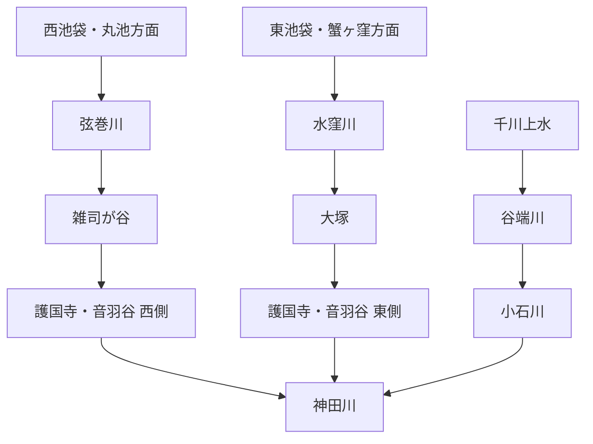

# otowa-ankyoscape

水窪川・弦巻川・谷端川と、その周辺の旧河道・暗渠・湧水・用水・土地利用について調べた記録です。

中心となる範囲は、池袋・雑司が谷・護国寺・音羽・小日向・小石川です。

**追加調査対象：人参川（古茗荷谷川との関係は未確定）** — 2026年10月8日、茗荷谷の西側谷頭について明治初期の地図表示と色別標高図を照合。筑波大学附属中・高の南方にある浅い枝谷が合流する可能性も含め、[人参川の調査ノート](docs/人参川.md)に記録した。**10月8〜9日の現地歩行・二源頭・古地図上の池・筑附南方の分水界候補・還国寺の湧水・水窪川の橋名**は[専用の観察記録](docs/2026-10-09・茗荷谷・人参川現地観察.md)に整理した。名称の史料上の確実性と、水路・谷地形の推定は区別している。

> [!IMPORTANT]
> このリポジトリでは、既知の河川史をまとめるだけでなく、**まだ決着していない流路・接続・成立年代を史料から検証すること**を重視します。
> とくに「水窪川と弦巻川はどこかで合流していたのか」「音羽通り西側の弦巻川下流はいつ成立したのか」「弦巻川・水窪川側と谷端川側の更新世旧河道はどちら向きに流れていたのか」は中心的な未解決問題です。

  

幕末の音羽・雑司ヶ谷周辺を描いた尾張屋版 <i>Otowa ezu</i>。1851年近吾堂板とは別史料。画像をクリックすると合流問題の検討ページへ移動します。

## 未解決問題

このリポジトリの中心です。解決していない問題は川別の概要へ埋め込まず、できるだけ独立した文書として追跡します。

| 問題 | 現状 |
| --- | --- |
| **水窪川と弦巻川は合流していたのか** | [独立文書で検討中](docs/open-questions/水窪川と弦巻川の合流・接続問題.md) |
| **音羽谷西側の弦巻川下流はいつ成立したのか** | [独立文書で検討中](docs/open-questions/音羽谷西側の弦巻川下流の成立年代.md) |
| **更新世の旧河道はどちら向きに流れていたのか** | 滝口志郎（2019）が谷端川側への接続可能性を提示するが、流向は未決着 |
| **千川上水から弦巻川・水窪川へ直接分水したのか** | 谷端川への分水は確認できるが、両河川への直接分水は未確認 |

→ [未解決問題の一覧](docs/open-questions/README.md)

## 水系の全体像

これは近代以降に把握しやすい大まかな配置であり、全時代にそのまま当てはまるとは限りません。近世の造成・灌漑、近代の河川改修、暗渠化、下水道再編によって接続関係や流路が変化した可能性があります。

## 現時点で重要なこと
- **第115回: 神田玉川上水留33冊（NDL次世代DL・[2587517〜2587546](https://lab.ndl.go.jp/dl/book/2587517)の文久3〜明治2年の冊群）の全文走査（第114回課題④）で、維新期の上水行政の移管と白堀渡賃銭制度の全貌・千川家の水料実務を新規登録。①文久3年「**神田上水白堀通掛渡有之候組合橋七ヶ所之内小石川金杉橋朽損**」＝白堀通組合橋の橋数を文久3年（1863）に明記する一次文言（[GOV-234](docs/sources/gov/GOV-234.md)の6→7ヶ所問題への datapoint）＋金杉橋掛直の仕様（橋渡3間3尺幅2間）・入札21両1分3朱・**白堀通渡賃銭残金を財源**・箱番屋1ヶ所（[GOV-245](docs/sources/gov/GOV-245.md)新規）②慶応4年市政南裁判所あて上水方引継ぎ書上「**江戸ゟ五里西之方吉祥寺村井之頭弁天池湧出水ニ而野方堀通村々流水目白下関口村迄堀通并同所ゟ牛天神下迄ハ左右石垣白堀ニ有之**」＝神田上水全体の経路の一次文言＋引継帳面目録（白堀浚賃銭取集帳・渡橋箱下水組合帳・上水記絵図）＋**玉川上水水料堰料上納帳の「砂川村千川善蔵・千川平吉」**＝千川家と玉川上水の水料関係の一次記録（repo初出）＋見守武兵衛・関口水道町の水車持ち（[GOV-246](docs/sources/gov/GOV-246.md)新規）③明治2年正月の会計官営繕司への帳簿引継ぎ目録（「白堀渡賃銭取集帳」・武家町出銀取集帳・水銀取集帳・両上水御門々持場絵図）＝上水行政の明治新政府移管の一次記録＋千川善蔵・千川平吉の玉川上水料代金4両1分の東京府上水屋敷改役所への上納（[GOV-247](docs/sources/gov/GOV-247.md)新規）④明治2年白堀通損所修復の**箇所別縦断リスト（駒塚橋上之方→桜木橋土之方→桜木町上之方→大日坂下→水道町裏通り→中堤）**＝白堀通経路復元の新基礎資料＋金剛寺橋掛直の年月日（6月20日往来差留→22日取掛→29日相通）＋「**大日坂橋 見守勘助**」の在職（repo初出・八幡坂=大日坂の坂下に橋があった傍証）＋神田上水高札建場所（井之頭池上水口〜堀通関口村大洗堰）＋小日向江戸川端の水車御取立（[GOV-248](docs/sources/gov/GOV-248.md)新規・[GOV-242](docs/sources/gov/GOV-242.md)へ年月日追記）⑤明治2年9月の**白堀浚賃銀（渡賃銭）取集上納帳の全貌**＝民部省上水屋敷改への上納触書・番組別（元壱番組〜三拾七番組）・町別・家主別の銀銭高全リスト・市中御改正（町村合併）に伴う番組再編の伺い（[GOV-249](docs/sources/gov/GOV-249.md)新規）⑥[GOV-243](docs/sources/gov/GOV-243.md)に続冊[53][54][57][58]（町方出銀取集帳・慶応3〜4年）の所在を追記＋「音羽町」のhitは神田音羽町で文京区音羽町とは無関係の注意書き。**白堀渡賃銭制度が文久3年（財源）→慶応4年（帳面目録）→明治2年正月（引継ぎ）→明治2年9月（取集上納の全リスト）と帳簿レベルで連続し、[GOV-237](docs/sources/gov/GOV-237.md)の支出側（浚費67両2分）と合わせ収支の両面が揃った**。赤坂の「弁慶堀端白堀通」（2587529）＝「白堀通」呼称が神田上水固有でないことの対照例も記録。対照表に「大日坂橋」「駒塚橋・桜木橋」「白堀浚賃銀／白堀渡賃銭」の3行・橋名調査に第115回追補を追加。監視系（news_search 6クエリ・神田川流域決定版河川整備計画=R5.3版のまま・kanzyou7.com=2026/11/13のまま）は全て変化なし。いずれもOCR由来で原文照合を要する。経緯は[第115回ノート](docs/2026-11-15（第115回）・神田玉川上水留33冊横断・白堀渡賃銭制度・千川家の水料・大日坂橋の追加調査.md)に整理した。**

- **第114回: 神田上水留61冊（NDL次世代DL・[2587456〜2587516](https://lab.ndl.go.jp/dl/book/2587456)の連番冊群）の全文横断検索で白堀・鼠ヶ谷・大洗堰・金剛寺橋・桜木町の残冊文言を一括棚卸し。①弘化3〜4年・文久2年の白堀通普請冊に鼠ヶ谷大下×桜木町大下の「水上渡石樋」の修復仕様（桜木町大下＝長7間・幅9尺5寸・高5尺／鼠ヶ谷大下＝幅5尺7寸＋矢来60間・木戸門）＝白堀（神田上水）と鼠ヶ谷下水の交差構造の幕府側一次記録（repo初出・風土記稿の「石樋」・町方書上の「万年樋」と対になる。[GOV-232](docs/sources/gov/GOV-232.md)・[GOV-233](docs/sources/gov/GOV-233.md)追記・対照表・橋名調査へ反映。「荒ヶ谷」「承ヶ谷」は鼠ヶ谷のOCR変種候補）②天保5年牛天神下白堀水面の実測・白堀浚の水留・「白堀端通」「白堀橋通」の組合年番・文政12年大洗堰石垣急破普請1111両2分・「目白下大洗堰ゟ江戸川え水落」の廻状定型文言（[GOV-244](docs/sources/gov/GOV-244.md)新規）③慶応3年白堀通銘々出銀取集帳＝石高割の普請組合の幕末の実態（武家方1251両余・公儀10万石・水戸殿35万石）（[GOV-243](docs/sources/gov/GOV-243.md)新規）④明治2年金剛寺橋掛直の仕様（橋渡長3間4尺・高2尺5寸）・総入用62両1分余・「小日向金剛寺橋」の表記（[GOV-242](docs/sources/gov/GOV-242.md)新規）⑤寛延2年8月13日出水の関口橋・江戸川大橋の流失・小日向古川橋懸直・牛込馬場下石橋＋延享4年「神田上水白堀ニ相懸り候金剛寺橋」の人留＋寛延3年小石川指谷町下水橋（[GOV-241](docs/sources/gov/GOV-241.md)新規・享保撰要類集[60]）⑥[GAZ-034](docs/sources/gazetteers/GAZ-034.md)追記の白山前町条の下水堀（巾3尺・酒井雅楽頭下屋敷流出→指谷町通り→小石川馬場方）・下水上橋・千川屋敷の四隣・陸尺衆拝領＋東京府史行政篇第一巻の書誌紹介（[BOOK-136](docs/sources/books/BOOK-136.md)）。監視系（ニュース・河川整備計画・都建設局ページ）は全て変化なし。いずれもOCR由来で原文照合を要する（「白泥」/「白堀」・「承ヶ谷」等のOCR対立を含む）。**- **第113回: 「白堀」（神田上水の小日向〜小石川区間の通称・[GAZ-049](docs/sources/gazetteers/GAZ-049.md)⑬でrepo初出）が幕府・東京府側の一次記録の件名そのものだったことを、NDL次世代デジタルライブラリー横断検索で確認し、白堀通の普請・見守・維持・橋の記録群（[GOV-232](docs/sources/gov/GOV-232.md)〜[GOV-240](docs/sources/gov/GOV-240.md)新規・[GAZ-049](docs/sources/gazetteers/GAZ-049.md)追記）を一括登録した。①『神田上水留』[13][14][15]（弘化3〜4年・[GOV-232](docs/sources/gov/GOV-232.md)）＝件名「**神田上水白堀通余垂板其外共御普請一件**」——白堀通の**余垂板801間**（注文785間+16間・高平均5尺）・区間「**小日向川添屋敷前通〜小石川牛天神下**」・金剛寺坂下石垣（長4間高6尺）・水戸殿屋敷後口矢来・茗荷谷坂下并新坂下高札・**工費1,204両余**＝白堀通の大規模修復の第一次記録（repo初出）、②『神田上水留』[33]〜[37]（文久2年・[GOV-233](docs/sources/gov/GOV-233.md)）＝区間「**音羽町九丁目橋上之方ゟ小石川牛天神下水戸殿屋敷際迄**」・弘化普請後の**潰水・浅水**（堀内水面の低位・土手内土の洗流し）・入札**落札直段545両**＝弘化から16年で再修が必要だった経緯、③『明和撰要集』上水之部（[GOV-234](docs/sources/gov/GOV-234.md)）＝**明和6年白堀通并御茶ノ水懸樋の流死倒者検使一件**（久松筑前守・大岡主水正・牧野大隅守＝千川上水明和6年再興願と同時期・同役人）＋**金杉・小日向・関口の三水道町が白堀通を「古来持場」とする文言**＋検使例書（正徳5年「松平対馬守屋敷前白堀内」水死・享保4年「関口中堤入口矢来際長光寺脇白堀内」水死等）＝**18世紀を通じて白堀に流水があり水死が繰り返された**ことの幕府記録＋**服部屋太兵衛の白堀通渡橋六ヶ所請負→新坂下橋含め七ヶ所化**＋渡橋渡下水の**新規組合の石高附リスト**（久世出雲守・安藤対馬守・大久保長門守ら・安永元年）、④『市中取締類集』上水番等之部（弘化3年・[GOV-235](docs/sources/gov/GOV-235.md)）＝神田上水**見守番屋取調**（赤坂御門外・榎坂水道橋・**白堀通**の商番屋5ヶ所・冥加金3両/年・小石川諏訪町角の1両2分/年）、⑤『諸証文留帳』（旧幕引継書・[GOV-236](docs/sources/gov/GOV-236.md)）＝見守喜兵衛・武兵衛の御請書「**古来より神田御上水白堀通渡る橋并箱下水見守相勤**」・天保14年取払→弘化3年再拝借（地代金3両宛・**七月十二月両度に割合前上納**＝GAZ-049⑬⑦の「冥加金3両・年2回上納」と完全一致）＋**巡視路「目白下大洗堰中堤東之方柵矢来際ゟ牛天神下水戸様御屋敷境迄御上水土手通繁々見廻り、同所金杉橋芥留」**＝白堀通の見守制度（業務・区間・料金・沿革）を証文レベルで初記録、⑥『神田玉川上水留』（明治2年・[GOV-237](docs/sources/gov/GOV-237.md)）＝明治2年4月（小石川諏訪町の下水吐押埋・金杉橋脇の浚詰）・9月（「**金剛寺橋上之方神田上水白堀通堤急破**」の御普請取掛・車差留・制札）＋**白堀埋増による流末差支→藻刈并埋浚3日間・入用金67両2分を水下町々の渡賃銭で支払**＋上水屋敷改（東京府・民部省土木司）＝**神田上水廃止（大下水化）直前の白堀の実態を府の一次記録で裏付け**（[BOOK-123](docs/sources/books/BOOK-123.md)明治2年10月の大下水設計変更陳情と同年）、⑦『享保撰要類集』諸所橋々之部（[GOV-238](docs/sources/gov/GOV-238.md)）＝**石河土佐守の定請負橋数書付に「音羽町九丁目橋」「金剛寺坂下橋」「金杉橋」「江戸川橋」「関口橋」が含まれる**（文金千両の公役金）＝音羽町九丁目橋の初出を宝暦10年（[BOOK-129](docs/sources/books/BOOK-129.md)）から約15年先行＋**延享元年〜2年の音羽町九丁目の坂渡り小橋2基の修復**（「目四坂駒井町え渡る」「目田坂福井町え渡る」・長3間1尺幅2間1尺・落札34両1分）＝音羽谷南縁の谷横断の小橋群の新記録、⑧『川浚』第2冊（明和4〜享和2年・[GOV-239](docs/sources/gov/GOV-239.md)）＝**江戸川（神田川）の川原管理区画「舟河原橋ゟ関口大洗堰迄拾五町・柳橋ゟ牛込御門下迄三拾四町・都合四拾九町」**（永代橋掛／新橋掛の区分・橋渡銭・外引高助成地）＝大洗堰までの上流区間の川政の定量的記録（repo初出）、⑨『駒込町方書上』[18]肆止（[GOV-240](docs/sources/gov/GOV-240.md)）＝千駄木坂下町の書上で**石橋「合染橋（藍染橋候）」（長2間巾8尺）の文言が御府内備考巻32-40（[GAZ-033](docs/sources/gazetteers/GAZ-033.md)）とほぼ同文**＝谷戸川（谷田川・藍染川系）の元資料側の対校＋字谷戸川の渋江長伯御預り地、⑩『御府内往還其外沿革図書 十二之二』（小日向台大塚小石川辺一円之絵図・[GAZ-050](docs/sources/gazetteers/GAZ-050.md)新規）＝目録に**「白堀端」を境目とする大縄地の列挙**（水戸殿屋敷境〜白堀端／牛天神脇〜白堀端通金剛寺坂／白堀端字服部坂通東側茗荷谷／白堀端通音羽町九町目橋／白堀端通桜木町横町田中八幡前）＝**白堀が町割の境目の基準線**であることの幕府の地図帳レベルの確認＋小日向竹嶋町の「延宝以前ゟ上水端道内え出張→元禄十七年十月大塚法華寺出火類焼後…道内ニ成」＝白堀端の道路整備史。**【上水在絕記】の同定候補**: [GAZ-049](docs/sources/gazetteers/GAZ-049.md)⑫1の引用史料【上水在絕記】の文言が[GOV-171](docs/sources/gov/GOV-171.md)（御府内上水在絶略記・多摩官渠図本）の千川上水条と**ほぼ逐語一致**＝【上水在絕記】＝御府内上水在絶略記である可能性が強い（GAZ-049の制限⑪に追記）。堀割延長も同略記のOCR「五里弐拾四町」（＝[GOV-222](docs/sources/gov/GOV-222.md)「5里24町余」と一致）がGAZ-049の「五里五拾四町」と対立＝**「24町」系を支持する方向**（原字形照合まで断定しない）。[MAP-027](docs/sources/maps/MAP-027.md)には**郵便局版『東亰市小石川區全圖』3種の次世代DL所在**（明治28年12月調査〔1905刊・1088869〕・明治40年1月調査〔1907・1088871〕・明治41年3月調査〔1908・1088868〕）を追記し、版次の不一致問題に対校材料を加えた。対照表に「白堀端」の行を追加し、石神井川（谷田川）行にGOV-240の対校を追記。橋名調査に2026-11-15追補（第113回）を追加（定請負橋数書付の音羽町九丁目橋・延享期の坂渡り小橋2基・白堀通渡橋6〜7ヶ所と新坂下橋・「音羽町九丁目橋上之方」の区間文言・金剛寺橋〔明治2年〕・見守巡視路の金杉橋）。外部監視はnews_search（2026-11-08以降の6クエリ）全て0件・神田川流域決定版河川整備計画は未公表（R5.3版のまま）・kanzyou7.comは2026/11/13のまま。経緯と文献リストは[第113回ノート](docs/2026-11-15（第113回）・白堀通幕府普請記録群・見守制度・【上水在絕記】同定の追加調査.md)に整理した。**弘化（801間・1,204両）→文久（潰水・545両）→明治2年（堤急破・渡賃銭）という白堀通の幕末〜明治初頭の通史と、見守・持場・石高割という維持制度が、いずれも幕府・東京府側の一次記録で固定された回。**〔いずれもOCRテキスト由来で文言は要原文照合〕

- **第112回: NDL次世代デジタルライブラリーの大日本地誌大系版の精読第2弾（[GAZ-048](docs/sources/gazetteers/GAZ-048.md)追記・[GAZ-049](docs/sources/gazetteers/GAZ-049.md)新規・[BOOK-135](docs/sources/books/BOOK-135.md)追記）で、①『新編武蔵風土記稿』大系版（巻16）の**関口町在方分の精読**＝**地名由来の考証「土人の傳に昔此邊奧州街道にして關ありし地なれば…（と云へど）、當所は神田上水江戶川へ分派の爲堰を日本橋より設けられし地なればこの名は起りしならん」**（奥州街道の関説を退け堰の地に由来を求める官撰考証）＋**余水放流2所＝里俗「関口の瀧」（幅九尺）＋「摺鉢の瀧」（水幅五尺・瀧壺いと深し・古川町の方へ沃く・【徳川編年集成】にも載る・「今も纔に小渠殘れり」）＝repo初出の関口の給水地の滝文言**＋「古川町は小日向川跡を埋立し所・**承應二年よりのこと**」（古川町の成立と承応直流化＝巻9の承応水路変更文言と同条内対校）＋江戸川（幅十間餘・小日向水道町を経て神田川に合す）＋**大洗堰（幅七間の内水口八尺餘・石築・御普請所・水番人小屋＝構造数値はrepo初出）**＋駒塚橋（長九間・駒繫橋→呼誤り伝承＝[BOOK-131](docs/sources/books/BOOK-131.md)橋梁篇第一の引用元と同文の対校）＋**水神社（八幡合殿・本地妙見・関口洞雲寺持＝repo初出）**＋**椿山（八幡・稲荷2社・龍隠庵・俗に芭蕉庵・誹人芭蕉の塚・「前は上水の流を帶」＝repo初出）**、②**小日向町在方分の精読**＝【北條役帳】の太田系知行＋【江戸砂子】「鶴高日向→太田家絕→古日向跡→小日向」説の引用と「其據を知らず」という留保つき考証＋**「用水は神田上水を引沃く」＝小日向町側の用水の官撰文言（repo初出）**＋明暦2年町屋起立→正德3年町方支配・11町分離→在方分五町六段四畢十五歩、③**巣鴨村条の残り**＝**大根原小名（寛永〜享保・六郎知行二貫五百文・江戸図に「大根原村」・【北條分限帳】太田新六郎＝repo初出）**＋**御立場（村の北・中山道の西・馬踏の徑三間二尺・敷八間二尺・高七尺・寛延3年伊奈半左衞門新築＝repo初出）**＋**御薬園（一萬二千六百十坪餘・御医師渋江長伯御預り・元藤堂和泉守抱地→宝暦4年御用地〔代地は大久保新田〕→伊奈半左衞門御林→寛政年中御薬園＝repo初出）**＋霊感院（稲荷山・法華宗・小石川蓮華寺末・元禄9年起立＝庚申塚稲荷の由緒）、④**雑司ヶ谷村条の村概況**＝**領属変遷（寛永18年自証院領→元禄10年伝通院領→同14年芳心院領→享保4年御鷹部屋→享保18年犬小屋御用地→宝暦2年犬小屋廃・御料復帰＝享保18〜宝暦2年に雑司ヶ谷村が犬小屋御用地だった記録＝repo初出）**＋**「村の中程に古の奧州道係れり」＝古奥州道が雑司ヶ谷村の中程を通る官撰文言（repo初出・町方書上の「奧州の古道」〔下戸塚村条〕・郡誌の氷柱ヶ谷の古道と対照できる古奥州道ルートの第3の独立記録）**＋御鷹部屋（9,088坪余・享保4年起立）・御鷹方組屋敷（14,530坪余）＋鬼子母神社縁起（永禄4年佛像掘出→天正6年本地堂建立・棟札現存・寛文6年宮殿拝殿造營）、を、②『御府内備考貳』大系版（蘆田伊人編・雄山閣・1929年12月刊・巻25-46・[GAZ-049](docs/sources/gazetteers/GAZ-049.md)）を新規登録＝**日光御成道町の古上水跡条（「千川上水と唱」・水元は武藏野原保田新田・**再興願人3人の店先つき氏名＝淺草田原町三丁目小兵衞店忠兵衞・同町壹丁目嘉右衞門店孫兵衞・高砂町三郞兵衞店幸左衞門**＝[GOV-218](docs/sources/gov/GOV-218.md)「幸島」との表記対立〔幸左衞門／幸島〕・明和6年2月御訴訟→安永8年11月28日巣鴨庚申塚よりの御見分→樋掛渡→天明2年8月水銭28文を牧野大隅守御番所へ上納→天明6年5月半減・9月御止・**町内え壹町四拾九間壹尺相掛**）＝明和〜天明の再興〜差止の全過程が1つの町の書上で完結**＝[GOV-215](docs/sources/gov/GOV-215.md)〜[GOV-218](docs/sources/gov/GOV-218.md)の対校資料**＋**日光三ッ家町の「委細は追分町にて申上候、幅貳間半」＝町方書上の相互参照構造と幅の記録（repo初出）**＋**巣鴨仲町の古上水蹟（「千川上水と唱、巢鴨町往還通りより當町往還通東の方駒込富士前町通え掛、右安永の頃迄有之候由」）＝巣鴨区間の千川上水の流路（庚申塚〜駒込富士前町間）の町方側の位置記録（repo初出）**＋巣鴨之一の御立場・御薬園の**風土記稿との対校一致**（「御立場寛延三年伊奈半左衞門に仰せて新に築立らる、御藥園元藤堂和泉守の抱地なりしを寶曆四年御林と成り、寬政年中御藥園に改めらる」＝系列の異なる両書で年代・人物が一致）＋**小日向之一の石切橋（「大橋ともいへり…長さ十間ほどなり、江戶川へかゝる橋にてはもつとも大なるはしなり」）・古川橋・中ノ橋・掃部橋・萬年橋・立慶橋の【江戶志】【改撰江戸志】引用文言の活字版**（紺屋由来説の第4テキスト体制・萬年橋＝水道端の方より中の橋へ出る石橋）＋**小日向之二の八幡坂→大日坂の改名文言（田中八幡宮が久世長門守抱屋敷化の後・音羽町八丁目裏通りへ移転→坂下の大日堂により大日坂へ＝[GAZ-035](docs/sources/gazetteers/GAZ-035.md)音羽8丁目条〔移転先側〕と対照して八幡坂側〔旧地側〕の記録が揃った）・「鼠ケ谷下水と里俗相唱」＝鼠ケ谷下水呼称の小日向側用例（repo初出）・神田御上水の「白堀」通称と流路（龍光院境内附・幅凡2間半・repo初出）**、を、③棚橋源太郎『尋常小学に於ける実科教授法講義要領』（**1902・育成会・[810544](https://lab.ndl.go.jp/dl/book/810544)＝1903年版〔BOOK-135〕の1年前の別冊**）の対校＝第二学期第3-4週の教材配列「**藍染川-位置水源河口支流利用(排水灌漑)流水の作用大雨後の狀况**」＋根津の平地・地図模型製作＋隅田川教材内「**神田川及ひ藍染川との比較**」＝藍染川の教材化が1902年に遡ることを確認、を反映した。**関口の給水地（大洗堰の構造数値・関口の瀧・摺鉢の瀧・水神社）、小日向側の用水（神田上水引沃・白堀）、巣鴨の施設群（御立場・御薬園・大根原）、雑司ヶ谷の古奥州道と犬小屋、千川上水の日光御成道・巣鴨区間の流路と願人、がいずれも一次文言レベルで固定された回。**〔いずれもOCRテキスト由来で文言は要原文照合〕 対照表に関口の瀧・摺鉢の瀧・水神社・椿山・白堀・鼠ヶ谷下水（小日向側）の行を、橋名調査に2026-11-15追補（第112回）を追加した。外部監視はnews_search（四河川・周辺の11クエリ・2026-11-01〜15）が全て0件・kanzyou7.comが2026/11/13のまま変化なし・神田川流域決定版河川整備計画は未公表（都建設局ページ2026-11-09更新でもR5.3版のまま）。『東京市下水道事業年報』（1923・[975642](https://lab.ndl.go.jp/dl/book/975642)）の四河川キーワード（弦巻川・音羽・谷端川・千川）は全て0件＝陰性（[GOV-163](docs/sources/gov/GOV-163.md)1924年報告書とは別書と同定のみ記録）。経緯と文献リストは[第112回ノート](docs/2026-11-15（第112回）・大日本地誌大系版の精読第2弾・関口の瀧と摺鉢の瀧・御薬園と御立場・御府内備考貳の千川上水日光御成道条の追加調査.md)に整理した。**push後の追加精読2では[GAZ-049](docs/sources/gazetteers/GAZ-049.md)に⑨〜⑫を追記し、御府内備考貳の全千川上水関係条項を精読した**: ①**巻37-38（駒込区間）**＝千川上水の書上の委細の参照先が**追分町（7町以上）と淺嘉町（3町）の2系統**（追分町条・淺嘉町条の町名起立部分は巻37に収録確認・委細の項はOCR全文で未検出＝原画像照合の課題）＋願人第3人の表記変種（**幸右衞門**〔巻38・丸山淨心寺門前〕／**幸兵衞門**〔白山前町〕を追加し**4変種**に）＋巣鴨仲町の「下水堀幅三尺」、②**巻30-31（湯島・根津・神田明神下区間）**＝各町の埋中樋の延長（11〜105間）と桝（大桝・中桝・小桝）の位置の町別記録＝[GAZ-045](docs/sources/gazetteers/GAZ-045.md)写本系の湯島横町68間余との数値一致対校＋**切通町の「奥州街道脇道」文言**（古奥州道系伝承の第4の記録候補・ただし当時から比定不確かの文言）＋**神田明神下2町の「無程御差留」**（短期間で差止の下流末端の実態）＋下流の委細参照先＝天神門前町（中流2系統とあわせ3層の参照構造）、③**巻33-35（本郷区間）**＝**竹町・河岸通が元禄第1期→相潰→安永第2期→天明7年4月差止の2期構造を明示**＋**河岸通の流路の折れ線（本郷一町目往還の大桝→竹町東通往還→町中程西の横町際小桝→西通り）＝下流流路の具体的経路（repo初出）**＋本郷三町目の「元祿年中の儀申傳〓書留無之」＝第1期の町方側伝承の喪失の文言、④**巻44（小石川之四）＝千川上水の根本資料群**: **千川上水由來条（【上水在絕記】引用）**＝元禄9年の給水先4施設（小石川御殿・湯島聖堂・東叡山・浅草御殿）・**水元「多摩郡保谷村より玉川上水を引」＝「武藏野原保田新田」説（日光御成道町条・[GOV-224](docs/sources/gov/GOV-224.md)/225）との表記対立〔保谷村／保田新田〕**・堀割「五里五拾四町」（第4の数値候補）・**「仙川村太兵衞、德兵衞開發被仰付、仙の字を改め千川となし兩人の姓に給はる」＝千川姓・上水名の由来の公式文言**・「享保七寅年十月止之」・「又安永九子年〓江戶へ掛る」（安永8年見分→安永9年通水の2段階統合）・「**天明六午年十一月また止みて**」（差止「十一月」説に御府内備考版の1票・ただし同書内で日光御成道町条は「九月中より御止」＝月次対立は残る）；**白山前町千川屋敷条**＝小石川村百姓地→余語古庵拝領→元禄9年太兵衞拝領→上水差止で上り地→**正徳4年2月27日「小石川御殿地上水請負人役屋敷上り地」→白山前町名主六之丞御預地**→根津惣門前橋3ヶ所修復で再び元地拝領→文政9年時点で金七拝領＝[GOV-208](docs/sources/gov/GOV-208.md)/210/211/212に先行する元禄〜正徳〜文政期の変遷の初出級記録；**千川金七由緒書（文政9年11月）**＝「**自分入用金四百八拾貮兩壹分差出**」（482両問題の新テキスト・「壹分」つき）・「千川村と申處〓御上水開發仕候に付千川と申名目被下置」＝千川姓由来の由緒の二面（仙→千の改字説と千川村の名目説）・**享保の6橋化の具体的内容（御成橋1橋の幅減少＋谷中通り3橋増設）と明和5年の2橋減少（4橋化）＋年17貫文・金4両1分の上納代替＝千川家橋数問題（3ヶ所/4ヶ所/6橋の対立）の少なくとも一部が「3ヶ所（初期）→6橋（享保）→4ヶ所（明和5以降）」という時期差であることを1つの由緒書が説明**（原文照合後に確定判断）；**白山前町・丸山淨心寺門前の「町内並駒込片町往還中央相通」**＝小石川〜駒込区間の接続部の流路の町方側記録＋丸山側1項の「**寛政年中相止申候**」＝差止年代の新変種（断定しない）。**本郷・湯島区間の「天明七未年四月中」差止＝[GAZ-041](docs/sources/gazetteers/GAZ-041.md)〜[GAZ-043](docs/sources/gazetteers/GAZ-043.md)（外神田）の「四月十三日」と整合**し、「天明六午年十一月」（由來条）/「九月中より御止」（日光御成道町）との間に**天明6年（水銭・通水停止）→天明7年4月（樋の取潰し・埋立）の段階的時系列の可能性**（区間差・政策の別過程かは原文照合後に判断・断定しない）。対照表に保田新田／保谷村・仙川村の行を追加し、千川屋敷（小石川）の行に巻44白山前町条の変遷を追記した。**push後の追加精読3では[GAZ-049](docs/sources/gazetteers/GAZ-049.md)に⑬（小日向区間の神田上水〔白堀〕・江戸川の記録）を追記した**: ①**巻45小日向之一総説**＝「白堀上水關口の方より流れ來り、東流して小石川にかゝり、水戶殿屋敷に入る」＝白堀区間が関口〜小石川まで及ぶ観察文言＋**江戸川の枝流考証**「江戶川は神田上水の枝流なり、關口水道町の西にて分流し…按に此川全く上水の枝流とせば慶長以後の川なれど、恐くは左にはあらざるべし…上水堀割の時たま〓〓此川に餘水を落せしにあらずや」＝**上水堀割以前から用水の川があり上水の余水を受けたのではないかという江戸川の原初形態の編者考証（repo初出級・分派点・大曲り→船河原橋→御堀の流路つき＝関口の瀧比定の新基礎資料）**＋鯉ケ崎・蚊屋ヶ淵・**白鳥池**（中の橋下曲江の旧池が久永氏の宅地に名残＝江戸川筋の湮没池の記録）、②**巻46水道町条(?)**＝**神田御上水の堀割年代「承応2年（1653）の頃」説（repo初出・慶長期神田川由来説との対校案件・由聞文言につき断定しない）**＋「白堀通」呼称（訳は当時すでに不明）＋**「江戶川大橋と相唱、又里俗石切」＝江戸川大橋（公式呼称）＝石切橋（里俗）の同文対校の完了**＋音羽九丁目え相掛橋（長6間・幅3間・町方掛定川掛）・大日坂え渡る橋・服部坂え渡る橋・関口橋（長10間余）、③**巻42稱名寺門前条**＝神田上水堀の幅3間・「**向堀**」呼称・**浚の町方負担区分**（金杉町持／小日向水道町持）、④**巻46の町条(?)**＝**中堤3ヶ所**（長30〜50間・高7尺・幅5尺・御普請方御掛・異変時は御番所へ届出）＋**神田御上水見守番屋**（16坪2合5勺・番人の冥加金3両を年2回上納）＋第六天社が上水土手上、⑤**龍光院門前条(?)**＝鼠ケ谷下水の幅6尺（呼称由来は当時すでに不明）＋江戸川の委細は水道町条参照（千川上水の追分町・淺嘉町参照と同型の参照構造）、⑥神田上水（幅5間）と江戸川（幅10間余）を同書上で区別して併記。対照表に白堀上水／白堀通・向堀（小石川）・江戶川大橋／石切橋の行を、橋名調査に追記3の追補を追加した。〔いずれもOCRテキスト由来で文言は要原文照合〕
- **第111回: NDL次世代デジタルライブラリー全文横断の第11弾で、①『新編武蔵風土記稿』**大日本地誌大系版**（蘆田伊人編・雄山閣・1929・首巻〜巻20・[GAZ-048](docs/sources/gazetteers/GAZ-048.md)・1884刊版〔[GAZ-046](docs/sources/gazetteers/GAZ-046.md)〕よりOCRが格段に清明）を新規登録＝青柳町在方分（音羽町・桜木町）条の二細流のほぼ全文「**堀二（つ）より流れ來り、一は東の方耕地際を流る、櫻木町にて神田上水の石樋を通して江戶(川に入・水元は巣鴨雑司ヶ谷接地处の田間)、一は西の方畑地際を流る、雜司ヶ谷村丸池の下流弦卷川より流れ來り、是も櫻木町に至て前流と同く江戶川に合（二流共音羽町二町目の邊より）、幅一間より九尺程に及ふ、九町目迄を鼠ヶ谷下水と號す**」＝**①東流が桜木町で神田上水の「石樋」（伏越）を通って江戸川に入る＝[GAZ-035](docs/sources/gazetteers/GAZ-035.md)桜木町の万年樋と独立系統で照応する官撰側の伏越明記、②西流＝「雑司ヶ谷村丸池の下流弦巻川」＝丸池→弦巻川の流脈を音羽側から明記、③鼠ヶ谷下水呼称区間＝音羽2〜9丁目、④石橋2の一方＝「庚申橋」（長一間・小流・西青柳町の西・護国寺持）＝1884刊版「申橋」の原字候補が庚申橋に確定し町方書上の「こうしん橋」と一致、⑤板橋2の一方＝「千貫橋」（音羽6丁目東裏鼠坂下・長七尺）＝町方書上「壱貫橋」との表記分岐**、⑥雑司ヶ谷村条（巻16）＝小名「**弦卷**」「星谷」「池谷」「淺井原」らしき列＋「水久保」らしき語（原字形要照合・小字節のSpidersweb二次転記の**原本側確認**）＋丸池（村の西北・長五間餘）＋**「弦卷川（丸池の下流なり）七尺計、村の用水とす」＝丸池→弦巻川源流の官撰地誌文言が北豊島郡誌1918〔[GAZ-002](docs/sources/gazetteers/GAZ-002.md)〕の約90年先行して確認**、⑦巣鴨村条＝小名末尾の「水久保」らしき語＋**川「小谷端川」（北は滝野川村より入・南は小石川村に達す＝小石川の上流・幅三間或は六間・橋4＝藤橋〔板橋・王子道・長五間〕・上橋〔土橋・中山道東側〕・寂法橋・東福寺橋〔土橋・長四間・**碑に明暦三年三月吉祥日**〕〕＝「小谷端川」の語repo初出＋谷端川上流の架橋群の17世紀中葉（1657）の実年代の初出＋郡誌の「矢端川の藤橋」表記との帰属川名の食い違いが新照合課題**、⑧小石川村条＝谷端川（幅三四間・巣鴨村より入て橋戸町へ橋2＝**氷川橋（板橋）・猫俣橋（石橋）・各長二間**＝江戸期の谷端川の橋の文言repo初出・[BLOG-133](docs/sources/blogs/BLOG-133.md)「氷川橋は明治期新設」説との新旧検討課題・[BOOK-126](docs/sources/books/BOOK-126.md)明治19年調「猫俣/猫股」の江戸期先行例）、⑨小石川新田条＝護国寺砂利取場→享保開墾の原文文言＋砂利場橋（土橋・幅二三間）＝BLOG-133引用の原本確認、⑩小石川大塚村条＝**「川 村西雜司ケ谷の方より流れ來り、村內にて南に折れ、靑柳町の間に達す、川幅九尺」＝弦巻川（西流）の大塚村（大塚〜音羽の谷）区間の一次記録候補（川名不記載・断定は避ける）＝風土記稿の3村条で丸池→大塚村西（南折）→青柳町の間→音羽町西→桜木町→江戸川という弦巻川流路の各segmentが初めて官撰地誌でつながる**、⑪巻9の「小石川（并）谷端川」条＝「**長崎村より出る細流…小石川村に至て此名起り、橋戶町、柳町より傳通院東の方を流れ、水戶殿屋敷內にかゝり、仙臺橋の邊にて神田川の上流に合す…江戶川神田上水の分流なり**」＝谷端川条の直接文言のrepo初出（[GOV-208](docs/sources/gov/GOV-208.md)1938の先行）＋谷端川=神田上水の分流説の官撰側文言＋承応の頃の関口水路変更（旧水路は今より南・石堰で神田上水と江戸川の二流に分派）、⑫同巻9神田上水条＝井ノ頭池水源→関口町→水戸殿舘地→御茶水の神田川に架かる「**萬年樋**」（桜木町の万年樋とは別樋の江戸期用例・風土記稿は音羽側を「石樋」と表記する表記差の記録）、⑬同千川上水跡条＝元禄9年起立・太兵衞德兵衞・享保7年廃止・**明和6年再興→安永年中落成→天明6年再廃**＋堀跡現状（流末は滝野川村で石神井川に・堀幅4-5尺〜9尺）＝[GOV-215](docs/sources/gov/GOV-215.md)〜[GOV-218](docs/sources/gov/GOV-218.md)の町方書上群の年代枠の官撰側確認、⑭谷戸川条の対校（[GAZ-032](docs/sources/gazetteers/GAZ-032.md)と文言ほぼ一致）、を、②町方書上[149]（[GAZ-035](docs/sources/gazetteers/GAZ-035.md)）の精読追記＝**書上年が「文政十亥年三月」（1827）と確定（yearを1827に修正）**＋西青柳町条の「**清水之流**」（雑司ヶ谷蛭谷〔OCR・蛍谷か〕ゟ護国寺境内際の往来に交差・里俗こうしん橋〔長壱間巾四尺〕・**橋下で弦巻川へ落入**）＝谷頭の清水が弦巻川へ落ち込む一次記録＋庚申橋の町方側傍証、東青柳町条の**富士見坂**（大塚上町→坂下町・長40間幅4間余＝弦巻川がまたぐ坂の幕府側一次記録）、音羽8丁目の**八幡坂**（「古キ唱ニハ御座ナク田中八幡宮当所江引移リ候已後之唱」＝[BLOG-198](docs/sources/blogs/BLOG-198.md)区教委標識と独立の移転由来一次文言）、音羽7丁目の稲荷2社（文政3年2月・**以前鼠ヶ谷下水際ゟ堀出し**像〔勘七持〕＋文化12年2月仙右衛門稲荷）＝鼠ヶ谷下水際堀出し像の第二例、を、③棚橋源太郎『尋常小学に於ける実科教授法』（1903・金港堂・[BOOK-135](docs/sources/books/BOOK-135.md)）＝東京高等師範学校附属小学校の実科地理教授で**藍染川を「一の河系」教材**とし「曾て涸るゝことなき」水源・支流群・大雨後の濁流と土砂運搬（不忍池への堆積）・水田と灌漑・**住民の職業「農業染工」**を記録＝1903年時点の藍染川の現勢観察の集成、を新規確認し、GAZ-048・BOOK-135として登録・GAZ-035/046に追記した。**弦巻川の流路（丸池→大塚村→青柳町の間→音羽町西→桜木町→江戸川）と水源論（丸池＝官撰地誌レベルの源流記述）、谷端川の上流架橋群（小谷端川・明暦3年碑）と橋戸町の橋（氷川橋・猫俣橋）、鼠ヶ谷下水の呼称区間（音羽2〜9丁目）が、いずれも幕府官撰地誌の一次文言レベルで固定された回。**〔いずれもOCRテキスト由来で文言は要原文照合〕 対照表に小谷端川・庚申橋・千貫橋・清水之流・石樋の行を、橋名調査に2026-11-15追補（庚申橋・千貫橋・藤橋・上橋・寂法橋・東福寺橋・氷川橋・猫俣橋・砂利場橋・明暦3年碑）を追加した。外部監視はkanzyou7.comのWHAT'S NEWが2026/11/13のまま（[GOV-156](docs/sources/gov/GOV-156.md)と変化なし）・神田川流域決定版河川整備計画は未公表。経緯と文献リストは[第111回ノート](docs/2026-11-15（第111回）・NDL全文横断第11弾・大日本地誌大系版風土記稿の精読・弦巻川流路の官撰文言・小谷端川・藍染川河系教材の追加調査.md)に整理した。
- **第110回: NDL次世代デジタルライブラリー全文横断の第10弾（外神田町方書上・駒込町方書上・府内備考写本・明治期上水行政書・新編武蔵風土記稿・江戸名所図会の棚卸し）で、①外神田町方書上[73][75][78]・御府内備考巻11-12（神田之四）・同巻29-31（湯島区間写本）の**千川上水の市中樋管の町別書上群**（GAZ-041〜045）＝**共通書式「安永九子年十月廿七日牧野大隅守様御番所御掛にて上水掛渡之儀被仰付…天明七未年四月十三日御差止ニ相成…其節取潰し埋立申候但元禄之度千川上水御掛渡之儀相分不申候」で①**掛渡開始（安永9年10月27日）と差止（天明7年4月13日）の年月日が日レベルで確定**（[GOV-215](docs/sources/gov/GOV-215.md)〜[GOV-218](docs/sources/gov/GOV-218.md)の天明6閏10月上水差止の翌年4月に市中樋管の差止→取潰が行われた過程の完成）・②**再興の「発願人宇田川長十郎」を記した稲荷の封子文言**（神田仲町・都稲荷〔水野隼人正屋敷跡〕・repo初出の人物名）・③**町別の樋延長＝神田仲町（中樋凡50間・小樋凡72間）・佐久間町（138間1尺5寸・往来中程の埋樋）・神田相生町（上野町代地境〜佐久間町2丁目境凡68間余＋相生町地境〜藤堂和泉守屋敷脇凡80間余）・通船屋敷（筋違橋外・三方折廻し凡130間）・湯島横町（本郷1丁目境〜湯島5丁目境68間余）**＝GOV-172の陰樋総延長の分解が進む・④**神田旅籠町弐丁目「古上水跡…樋跡今以町内南之方土中ニ相残有之候」＝文政10年時点で樋跡が土中に残存**（repo初出）・⑤湯島区間の写本（2553672）は[GAZ-024](docs/sources/gazetteers/GAZ-024.md)雄山閣刊本と**独立の系統**で数値の町名対応（湯島六町目23間等）が進む（差止は湯島側「四月中」のまま＝通達日の記憶の粒度差の記録）を、②『駒込町方書上』[15]壱・[16]弐（GOV-224/225）の**古上水跡条**＝**水元「武蔵野原保田新田」文言**（町方側では初出・[GOV-212](docs/sources/gov/GOV-212.md)千川家由緒書と対応）・**安永八亥年十一月廿八日の巣鴨広小路からの御見分→板樋掛渡**（[GOV-217](docs/sources/gov/GOV-217.md)のOCR「安永一同十一年」は干支整合で安永8説が優る旨を対校追記）・**水銭28文を牧野大隅守様御番所へ上納**（納付先の初の文言・牧野大隅守が神田側の掛渡仰付と同じ奉行）・天明6年5月10日半減・**千川上水跡の通過町（追分町・浅嘉町・吉町・吉祥寺門前・天台寺門前・石町）**＝中流域の流路が通過町レベルで具体化、を、③明治期の上水行政書3点（GOV-226〜228）＝1893年『東京市水道要覧』の**千川上水条に「河村瑞賢ノ計画ニ係リ」＝瑞賢計画説の官撰採録が1912年（BOOK-118）に先行して1893年から存在**＋改良水道の根拠文言「**其千川上水ノ如キハ固ヨリ玉川上水ノ一分派タリ**」「神田千川兩上水ニ於テ殊ニ之ヲ見ル（汚物混入）」＋1899年『東京市水道小誌』の「**其幾分ヲ千川、神田兩上水ニ分割シ以テ四ツ谷大木戶ニ達シ**」（1899年時点の現役分水）・**仙川→千川の姓賜り・江戸府中邸地拝領（千川屋敷）の沿革文言**・1894年『東京府史談』の**給水人口凡そ1.7万余**（独立の新数値）＝明治20〜30年代の千川上水の実態と水源統合議論の起点の公式文言を、④『大東京町名沿革』（1934・東京府編・GOV-229）＝千川屋敷条（**明治五年併合説＝[GOV-208](docs/sources/gov/GOV-208.md)（1938）「明治2年5月」説と対立**・元禄9年太兵衞德兵衞文言の府編系統）＋**音羽町条「以前鼠ヶ谷ト稱セシト傳フ」＝鼠ヶ谷の所在を音羽町側に置く1934年府編文言**（[GAZ-013](docs/sources/gazetteers/GAZ-013.md)/[GAZ-035](docs/sources/gazetteers/GAZ-035.md)の伝承の官撰側採録）、を、⑤『新編武蔵風土記稿』豊島郡（1884刊・GAZ-046）＝音羽町（西青柳町）条の「**水元巢鴨雜司ケ谷接地ノ田間…堀**」＋「**松屋橋ト號ス長九尺弦卷川下流ニ架ス**」（橋長がGAZ-013の御府内備考と一致）＋**申橋（長一間・小流・橋名候補）**、『江戸名所図会』十二（GAZ-047）＝実相寺条周辺の**弦巻川言及の存在**（「源ハ弛谷ノ辺…下流ハ清主ノ辺へゆく」・OCR乱れにつき文言は留保）、[GAZ-013](docs/sources/gazetteers/GAZ-013.md)追記＝雑司ヶ谷条の**川口屋（川口飴・正徳年中の忠治）の家名の由来が弦巻川**（「弦卷川之流盡せぬと申祝して川口屋被付候よし 弦の字を鶴に祝して霧の丸を紋所に付候よし」・BLOG-190の元資料系統・repo初出）、を、⑥千川屋敷系の追補＝『諸問屋名前帳』[13]の**舂米屋「越後屋庄次郎」**（GOV-230）・『日本橋区史』参考画帖（1916）の**「千川屋敷」図版（図版26）の収録**（BOOK-134・八丁堀側の画像人手確認待ち）、⑦『天保撰要類集』[308]の「**室大下水万年樋辻損**」＝**万年樋の大下水側帳簿での普通名詞用例**（GOV-231・GOV-226の「市内ノ配水ハ萬年樋及木極ヲ用ヒ」と併せGAZ-035の固有名読みの吟味資料）、を新規確認し、GOV-224〜231・GAZ-041〜047・BOOK-134として登録した。**千川上水の安永9年再興〜天明7年再廃止の過程（掛渡開始・差止の年月日・町別の樋延長・発願人・水銭の上納先・水元・通過町）が、神田・湯島・駒込の町方書上群でほぼ全域つながり、明治期の官書（瑞賢説・一分派・現役分水・千川屋敷沿革・給水人口）と1860年代の帳簿・画帖まで裏付けが伸びた。**〔いずれもOCRテキスト由来（写本を含む）で文言は要原文照合・安永8年vs安永11年・明治五年vs明治2年5月の対立は併記〕** 対照表・橋名調査への追記（申橋・松屋橋の風土記稿側文言・万年樋の語の用例）は次回ノートに整理する。外部監視はkanzyou7.comが2026/10/16のWHAT'S NEWのまま変化なし・神田川流域決定版河川整備計画は未公表（2026年4-8月のパブリックコメント終了済み・公表待ち）・news_search（2026-11-08以降）は全クエリ0件。経緯と文献リストは[第110回ノート](docs/2026-11-15（第110回）・NDL全文横断第10弾・千川上水再興の発願人と差止年月日・神田区間の町別樋延長・弦巻川の川口屋家名由来の追加調査.md)に整理した。
- **第109回: NDL次世代デジタルライブラリー全文横断の第9弾（撰要類集群・諸事留帳・大赦調書・諸問屋名前帳・玉川上水留・駒込町方書上・大江戸志・町鑑・江戸志系の棚卸し）で、①『天保撰要類集』橋之部の**掃部橋の天保6年（1835）7月1日出水流失と町内入用での再建の一次記録**（橋長6間＋橋台で都合7間2尺・幅1間・**堰板は水道町側高1丈4尺幅2間半・西古川町側高1丈2尺幅3間**・願→見分〔服部嘉太夫・人見脩助〕→往来留→普請→完成見分〔中村元右衛門・永谷兵吉〕→往来再開の全過程・**「東之方古川橋江三拾間程西之方江戸川橋江壱町程」＝掃部橋〜古川橋〔麁朶橋〕30間・〜江戸川橋〔名残橋〕1町の距離の初の数値記録**・流失史の4時点目）を、②『天明撰要類集[49]明地之部』・『安永撰要類集[40]』の**筋違橋御門外明地2ヶ所の千川上水請負人助成地・昌平橋〜筋違橋外での揚場銭取立と米屋の訴訟・「天明六午年八月十九日初而千川上水出浅取立」**（repo初出）・**差止直後（閏10月22日）の請負人リスト＝神田相生町・平永町・佐久間町の町方＋武州多摩郡小川村名主弥次郎**（水源付近の村方の参画・repo初出）を、③『南撰要類集[3]町奉行所之部』の「**同年閏十月千川上水之儀も御差止被仰付候**」＝**天明6閏十月差止の第三次独立資料（府史「閏十月」を支持・GOV-171「十一月」との対立の整理に寄与）**と**千川上水普請入用の山村信濃守御役所貸附金2,753両2朱の繰替流用**（差止後、宝町3・本町3・瀬戸物町・小船町1の元養育所手当地面4屋敷の町奉行両役所預かりを経て地代金で皆済〔天明7に2,416両+銀・天明8に残金337両〕・以後の地代金は町方御救・不時御入用の永久御手当へ＝**再興の財源が町奉行役所の貸附金流用であり、田沼期の養育所廃止の波及と絡みながら決着した実務記録・repo初出**）を、④『駒込町方書上[参]』（文政9年地誌御調）の**駒込肴町・富士前町の「千川上水跡」のmicro-history**（明和6年2月浅草田原町3人〔忠兵衛・孫兵衛・幸島〕の掛渡願出→安永11〔=天明2〕年11月28日御検地・掛渡出来→水銭28文/間→天明6年5月半減→9月出浅止→**埋立被仰付**＝中流域での再興の完成と再廃止の年月日つき年表・repo初出）を、⑤『類集撰要[1]地面』（拝領屋敷調査の例示に「千川屋敷藤兵衛」「茅場町千川屋敷地主」の**両屋敷の同文書内並記**）・『玉川上水留』（慶応3年の組合普請金に「南茅場町千川屋敷 一合銀29匁3分8厘5毛」の出銀）・『大赦調書[184]』（文政12年「小石川白山前町**千川屋敷家主亀次郎**」）・『諸問屋名前帳[39]』（千川屋敷の**両替屋**・嘉永5〜慶応3の層歴・文久3に雑司ヶ谷の家主与兵衛方へ同居替え）＝**両「千川屋敷」（小石川白山前町・南茅場町）が地誌〔大江戸志の九番組町火消組合〕・行政文書・町鑑〔「南茅場町里俗裏通り千川屋敷**裏茅場町**と唱候」＝茅場町側の位置の確定文言〕・実務帳簿の4系統で並存確認**を、⑥『嘉永撰要類集[13]橋之部』の銘書リスト（都合四拾五橋）に「**里俗掃部橋**」＝嘉永期の公式橋帳登録、⑦『諸事留帳43巻[7]』の「**掃部橋は惣水落と申名目無之**」＝掃部橋が下水ではなく神田上水の川橋として扱われた先例言及（千駄ヶ谷の「坂下川」の対比例文言あり・周辺情報）を、⑧『改正新編江戸志』（天保3）・『江戸志』（近藤義休撰・写）の橋名由来文言群——**掃部橋「吉岡掃部と云紺屋ある故名とす」の独立テキスト（紺屋由来説が江戸志系〜天保3に存在）**・**古川橋の俗名の字形分岐「麁朶橋」（江戸志）vs「麁栗橋」（改正新編江戸志）**（第108回課題②の原字形問題に新変種）・江戸川橋＝名残橋（一休名残蕎麦）・大橋＝石切橋（石切の居住由来・repo初出）・九丁目橋（「音羽九十目へゆくはし」）——を新規確認し、GOV-213〜223・GAZ-037〜040として登録した。**掃部橋の流失史に天保6が加わり4時点・構造寸法と隣橋との距離が数値で固定された。千川上水の天明再興の下流域（神田側）の収入と紛争・差止の月（閏10月）・再興財源の貸附金流用の決着・駒込の中流域の再興〜埋立の年表が、いずれも一次文言で固まった。両「千川屋敷」の並存が4系統の資料種別で裏付けられ、幕末期まで屋敷（賃貸・両替商・賦課主体）として存続した実態が確認された。**〔いずれもOCRテキスト由来（写本を含む）で文言は要原文照合〕** 橋名調査に第109回追補（掃部橋1835流失・嘉永銘書・惣水落名目無之・紺屋由来の独立文言・麁朶/麁栗分岐・石切橋・九丁目橋）を追加した。外部監視はkanzyou7.comが2026/11/13定例更新のみ・神田川流域決定版河川整備計画は未公表。経緯と文献リストは[第109回ノート](docs/2026-11-15（第109回）・NDL全文横断第9弾・掃部橋天保6年流失の一次記録・千川上水天明再興の財務と差止月・両千川屋敷の町方組織の追加調査.md)に整理した。

- **第108回: NDL次世代デジタルライブラリー全文横断の第8弾で、①『東京市史稿 橋梁篇第一』（1936）の掃部橋の由緒（「吉岡掃部と云紺屋」・橋長7間幅1間1尺・両町補理）・古川橋の里俗麁朶橋の由来（往古この所で麁朶の持出商売）・四郎橋＝後の江戸川橋（俗に名残橋・一休名残蕎麦）・享保13年9月洪水の流失橋の訴出（享保撰要類集）・元禄12年龜島川入堀半埋立でできた「千川屋敷」（八丁堀側）・駒留橋・駒塚橋（神田上水系）を、②『同 変災編第3』（1916）の明治6年9月23日千川出水（裏柳橋流失・鶯橋浮上り・町別床上浸水戸数）・明治8年8月10日の裏柳橋・鶯橋・丸太橋の三橋流失（「古角材にて仮に掛け渡し」の仮橋）・**明治10年9月14日夜の掃除橋流失＋弦卷川筋増水6尺余・音羽町8丁目12戸・9丁目45戸・櫻木町5戸の床上浸水**（弦巻川の明治10年氾濫の町別明細はrepo初出）・明治43年・44年の千川・大下水氾濫集計を、③『同 変災編第5』（1917）の万延元年2月4日「八丁堀千川屋敷より出火」と**明治31年3月23日本郷・湯島大火で蒸気唧筒を「本郷警察署前千川上水に据付けしも、水利不便」**（1898年時点で本郷側に千川上水の残存した記録・repo初出）を、④『御府内備考』巻44-46（OCR版）の**千川金七由緒書（文政9年）**（太兵衛の私財482両1分・享保年中の根津惣門前御成橋の橋巾減少と谷中側増橋・**千川田水の増水口1尺四方と水料金4両1分/年を千川金七〔小石川〕・千川善蔵〔練馬村〕の両人で上納**）・白山前町条の千川上水跡（明和6年再興→天明2年水銭28文→天明6年9月停止→埋立＝享保7年廃止後の再興と終焉の過程・repo初出）・手代不知堂町条の「**鼠谷村**」（小日向側・repo初出）・小日向川添屋敷町条の**関口橋＝一休橋**を、⑤町方書上[149]（桜木町・音羽町・東青柳町・御府内備考巻50の元資料側）の**万年樋**（桜木町の埋樋2ヶ所の固有名称・神田上水御堀割の節の御公儀普請・repo初出）・**鼠ヶ谷稲荷**（寛政10年・土中から堀出した像）・鼠坂（音羽町5丁目堺・長50間余）・壱貫橋（板橋長7尺・**護国寺持**）・**地震橋の寛政9年11月石橋化（それ以前は土橋）**・駒止橋・九丁目橋（**小日向水道町持**）・**目白坂（桜木町橋際〜大泉寺門前・文政12年目白坂上崖崩落の位置検討の基準資料）**・音羽町の小滝（文化13年5月・「玉簾」）を、⑥『江戸地名字集覧』（1929）の「鼠ケ谷（ねずみがや）」立項（音羽五丁目比定）を、⑦『神田上水留[13]/[14]』（弘化3-4年）の**鼠ヶ谷大下家上の渡石樋の修復仕様と矢来30間×2・白堀通の引取樋5ヶ所**（小日向川添屋敷・大日坂下・服部坂下の内法寸法と伏替年次）を、⑧『市中取締類集[201] 河岸地調之部』（嘉永3年）・『年番取拝十一[11]』（同年）・『七十冊物類集廿一[22]』（嘉永4〜万延元年）の**千川屋敷上納地の請負替の一件**（元祖太兵衛の由緒＝素堀区間「保谷新田〜巣鴨村」凡5里24町余＋埋樋掛渡・千川屋敷寸法・**天保14年7月29日の橋普請・上納免除と拝領地取上げ＝上納地化〔地代年11両〕・水野忠邦の身分改正が契機**・嘉永3年宇兵衛→甥三左衛門〔37才〕・嘉永6年頃三左衛門→平吉への再譲渡・証人の谷中天王寺門前家主久四郎への交替・**千川家負担の根津側4橋の位置列挙**〔根津宮永町→惣門・宮永町西裏通→根津門前町堀端→谷中通り→善光寺前町〕）を新規確認し、BOOK-131〜133・GAZ-034〜036・GOV-209〜212として登録した。**千川家の元禄9年開削から嘉永6年までの負担・屋敷の変遷が4系統の一次文言でほぼつながり、千川上水の素堀／埋樋の区区分け・根津・谷中側の下流流路・享保7年廃止後の明和〜天明の再興期の実態が初めて一次資料で固定された。**〔いずれもOCRテキスト由来で文言は要原文照合〕** また八丁堀・茅場町側に第二の「千川屋敷」が存在したこと（元禄12年入堀半埋立→万延元年出火）が判明し、小石川の千川屋敷との関係（同一千川家か）は未確認として対照表に注意行を設けた。** 対照表に万年樋・鼠谷村・千川屋敷（小石川）・千川屋敷（八丁堀）の4行を、橋名調査に第108回追補（掃部橋由来・麁朶橋＝古川橋・四郎橋＝名残橋・関口橋＝一休橋・万年樋・壱貫橋・地震橋・駒止橋・九丁目橋・目白坂・根津4橋）を追加した。経緯と文献リストは[第108回ノート](docs/2026-11-15（第108回）・NDL全文横断第8弾・千川家由緒の確定・万年樋と鼠谷村・明治期弦巻川氾濫明細・八丁堀の第二千川屋敷の追加調査.md)に整理した。

- **第107回: NDL次世代デジタルライブラリー全文横断の第7弾で、『小石川区史』（1935）の変災章・橋梁章・下水道章の本文をOCR全文確認し、①享保13年（1728）江戸川洪水の『江戸洪水記』抄出（掃部橋を含む大小の橋の全流失・小日向・関口の浸水・死者7,988人）、②明治6年（1873）千川出水（裏柳橋流失・千川流域床上浸水約300戸・死者2）、③明治13年（1880）10月4日の千川・鶴巻川洪水の区史側集計（掃除橋流失・鶴巻川増水6尺床上浸水64・全潰61棟＝弦巻川の氾濫被害明細はrepo初出）、④明治19年橋梁明細調（東京府文献叢書乙集十八）の所在、⑤東京市下水道設計の千川線・雑司谷線の経路文言（初音町→富坂→水道端線→原町線、雨水は砲兵工廠内大溝渠→神田川）、⑥昭和6年度江戸川改修の設計数値（延長2,660m・幅員16.36-23.64m・神田川舟運の関口大瀧下延長計画）、⑦BLOG-119引用の小石川流路文言の原本側（OCR）確認の7点を新規確認し、BOOK-126として登録した。**〔いずれもOCRテキスト由来で、数値・文言は原文画像との照合を要する旨を資料ファイルに明記〕** 同じ実行の後半には、①高田町政概要1930の鶴巻川漂白工業文言（GOV-167追記）、②『江戸洪水記』写本の所在（BOOK-126追記）、③1922年土地概評価・板橋町の谷端川「其支流」（BOOK-115追記）、④嘉永期の村方書上『御府内場末往還其外沿革圖書』の対象域分冊の同定（GAZ-012追記）、⑤明和9年『江戸砂子温故名蹟誌』[3]巻の千川上水・逆川・祇園橋条（GAZ-027追記）、⑥谷戸川（石神井川系）の江戸期一次文言（GAZ-032・GAZ-033新規）、⑦明治工業史の滝野川反射炉の着工年代・未完成評価（BOOK-127新規）を追加確認・登録した（対照表にも石神井川系の行を追記）。さらに第3次以降には、帝国図書館和漢図書書名目録第3編（1913）で**明治19年橋梁明細調（東京府文献叢書乙集十八）の原典が1913年時点で帝国図書館に写本として目録化されていた書誌記録**と「東京府文獻叢書」の欠巻注記（BOOK-128新規）を確認し、続いて『東京市史稿 橋梁篇第二』（1936）で**寛延2年洪水の「神田上水掛樋流れ」・江戸川浚49町（柳橋→牛込御門下・舟河原橋→大洗堰）・延享4年水道橋修理の明細（69両・長14間半・幅4間）・宝暦10年「音羽町九丁目橋」修理**（BOOK-129新規）を確認し、さらに『東京市史稿 変災編第2』（1915）で**文政12年8月2日の目白坂上崖崩落→神田上水崩込→江戸川出水・掃部橋・麁朶橋流失・内神田の水道「水切」・天明6年の掃部橋流失**（BOOK-130新規）を確認した。
  - **変災章の水害年表〔確認・repo初出〕**: [BOOK-126](docs/sources/books/BOOK-126.md)（東京市小石川区編『小石川区史』1935・[lab id 1875569](https://lab.ndl.go.jp/dl/book/1875569)）。第七章雑纂第四節「変災」の水災が①**享保13年9月2日の江戸川・隅田川出水**＝『江戸洪水記』抄出で「江戸川沿岸の小日向、小石川の低地が被害最も甚だしく」「**どんど橋（船河原橋）、龍慶橋、中之橋、石切橋、龍興寺下之橋、掃部橋、水道町之橋、惣じ而彼邊之小橋は不及申、大中小之橋共、一ケ所も不殘押破られ**」〔**掃部橋の享保13年流失＝[GAZ-030](docs/sources/gazetteers/GAZ-030.md)の掃部橋（江戸川に架かる）の18世紀前半の流失・実在記録で、流失文言の原典が『江戸洪水記』と特定**〕・『柳營日錄』死者7,988人（小石川・小日向辺引取618・関口中里辺460）、②**寛延2年8月13日**（江戸川橋・中之橋流失、「小石川極樂水…柳町水七尺計」）、③**天明3年6月**（『柳營日次記』境橋・江戸川橋・古川橋・中之橋流失）、④**天明6年7月**（「小石川柳町、關口水道町、小日向改代町、松枝町、床上二尺三寸餘」）、⑤**明治6年9月の神田川筋出水**＝「千川では**裏柳橋**、江戶川筋では中之橋を押流し、**千川流域では戶崎町、掃除町、柳町、初音町、餌差町、下富坂町等まで床上浸水約三百戶**…死者二人」〔明治6年の千川氾濫の被害町名・戸数・裏柳橋流失はrepo初出〕、⑥**明治13年10月4日の千川筋及鶴巻川筋洪水**＝「兩川共增水八尺、**千川筋掃除橋流失**／**鶴卷川增水六尺床上浸水六十四、全潰六十一棟、半潰五、死傷**」〔**弦巻川（鶴巻川）の氾濫被害明細はrepo初出**で、[BOOK-120](docs/sources/books/BOOK-120.md)（絵入暴風見聞誌・同日の千川橋流失）の区史側集計による裏付け。**掃除橋の1880年流失＝1883年測量図（[BLOG-133](docs/sources/blogs/BLOG-133.md)）より前の年代付き記録**〕、⑦**明治29年9月**（「江戶川千川出水、床上浸水二百餘棟橋梁破潰四、田畑損害十六町步」）・**明治30年**（「千川筋最大約三尺」）・**明治43年8月**（区内浸水9,369棟・死者3・傷者3＝[BOOK-045](docs/sources/books/BOOK-045.md)の指ヶ谷出水絵葉書と同年の区別集計）の年次群を一冊の区史が一覧化〔明治年間風水災表は列崩れあり・行対応は原表照合まで保留〕。**千川・鶴巻川（弦巻川）の明治期水害が年次・被害戸数・流失橋名つきで確認された初の資料**で、1930-34年千川改修（[GOV-094](docs/sources/gov/GOV-094.md)）・大正期区会の千川浚渫（[GOV-208](docs/sources/gov/GOV-208.md)）に至る治水要求の背景の被害実績のデータポイント。
  - **橋梁章・下水道章・地形章〔確認・repo初出の文言を含む〕**: 同書。①**明治19年橋梁明細調**（「東京府文献叢書乙集十八ニヨル」）に江戸川・千川筋の橋（礫川橋・隆慶橋・中之橋・石切橋・古川橋・掃部橋・江戸川橋・丸太橋・鶯橋・嫁入橋・裏柳橋ほか）の橋名・長巾・架換・修繕年次・工費が一覧化される〔**千川下流の橋の1886年時点の府調査の存在と原本の所在（東京府文献叢書乙集十八）が判明**。OCR列崩れのため行対応は原表照合まで保留。現行橋梁一覧に葭簀橋・猫俣橋・掃除橋・千川橋・仙臺橋・指ケ谷橋、名橋解説に「千川の猫股橋」の表記＝[BOOK-009](docs/sources/books/BOOK-009.md)の「猫又橋」との表記差〕。②**東京市下水道設計の千川線・雑司谷線**（区史は明治41年市告示28号の設計として抜粋）——雑司谷線・大塚線は護国寺前で合流→江戸川橋→水道端町→牛天神社前→**砲兵工廠内を隧道で富坂**→千川線に合流、**千川線は鉄道以南の郡部流域及沿路の雨水汚水を合わせ、都市計画路線に沿い初音町を経て富坂に来り水道端線と合流、汚水のみ富坂下で原町線に合流、雨水は砲兵工廠内の大溝渠で神田川に注ぐ**。「千川上流ノ放水路ハ板橋停車場附近ヨリ山手線ニ沿ヒ、石神井川ニ通ゼシメ」〔**千川幹線の設計経路と雨水放流先の文言**。抜粋に「都市計畫路線」の語があるため版年（明治41年告示時点か1919年以降の改訂か）は要確認だが、[GOV-163](docs/sources/gov/GOV-163.md)（1924年「既定計画」）に先行する言及の候補〕。③**昭和6年度から3箇年継続の江戸川改修**の設計数値——「江戶川／神田上水終點ヨリ神田川合流點ニ至ル／延長**二、六六〇米**／新幅員**一六・三六-二三・六四米**／深度**五・一五-五・四五米**」＋「從來**船河原橋を終點としてゐた神田川舟運が、關口大瀧下まで延長される**」〔1931-33年の江戸川（神田川）改修の設計数値・舟運延長計画で、README既出の1932年9月写真帖の「神田川改修工事」に対応する設計側文言〕。④地形章の音羽谷記述——「雜司谷臺地の左右から發した**二細流**が護國寺前で音羽谷頭に出で、**音羽通りの東西を略並行して南流し、櫻木町で江戶川に注ぐ**」〔水窪川・弦巻川に対応する谷筋の1935年区史の地形記述〕＋千川河谷の沖積層厚（富坂町約8m・柳町〜植物園下辺4-5m・指ヶ谷4m）。⑤[BLOG-119](docs/sources/blogs/BLOG-119.md)が二次引用した小石川流路文言（長崎町源流→谷端川→丸山町→千川→柳町で指ヶ谷溝水合流→神田川）が**OCRテキスト上で原本と一致**〔BLOG-119の「原本未確認」の留保が部分解消。原文画像照合は今後課題〕。⑥『御府内備考』小日向水道町の条の神田上水「**中堤**」（高さ7尺・幅5尺・長さ4町）の維持持分が小日向水道町・関口水道町・小石川金杉水道町の三ヶ町制だった文言（享保14年書上）〔神田上水の堤の維持管理体制の一次文言〕。
  - **既存更新〔確認〕**: [GOV-167](docs/sources/gov/GOV-167.md)（高田町政概要1930）＝OCR全文を再取得し、第一章位置面積の「**町の中央部には鶴卷川の細流ありて、東に流れ戶塚町との〔境〕を爲す、舊神田川も亦東流す。其の沿岸は低地にして自ら工塲地を爲す、殊に此の一帶は水質良好なるを以て、漂白工業に適し**」を追記〔**1930年時点の鶴巻川（弦巻川）が高田町中央部を東流し戸塚町との境をなす位置記述＋沿岸低地の漂白工業適性（水質良好）の町側公認記録**。OCR・要照合〕。
  - **『江戸洪水記』写本の所在〔確認・repo初出: 公的目録〕**: 内閣文庫（現・国立公文書館）に「江戶洪水記 寫本**自享保十三年至天明六年一卷 御城書寫文政十一年**」＋「**寛保**江戶洪水記二卷 寫本」の2系統（内閣文庫図書目録1890/1900）、東京帝国大学に「享保十三年戊申江戶洪水記 寫本」（和漢図書目録1941）、学習院図書館に「享保十三年江戶洪水記 寫本」（1913）＝**享保13年〜天明6年を1巻に収めた御城書写系と寛保2年出水の別本の所在が目録レベルで特定**〔写本本文は未見〕。また**東京市史稿 変災編第2（1915）・橋梁篇第二（1936）**が『江戸洪水記』『柳營日次記』を引用して水災・橋梁被害を集成（橋梁篇に寛延2年「小日向筋小石川筋出水いたし、所々橋損しい」のOCR文言）＝**区史抄出の水害文言の原典照合の有力先（repo未登録）**。〔[BOOK-126](docs/sources/books/BOOK-126.md)原典の所在の節〕
  - **1922年土地概評価・板橋町の谷端川「其支流」〔確認・repo初出・既存BOOK-115追記〕**: [BOOK-115](docs/sources/books/BOOK-115.md)（[lab id 921578](https://lab.ndl.go.jp/dl/book/921578)）の大字中丸条をOCR全文で再確認——「**南は谷端川を距て、西巢鴨町大字池袋の高臺と相對し北は其支流々域の低地を挾んで大字金井窪の高臺と相對する**」＋字川原「**東上鐵道板橋驛の西南…其下谷端川と其支流との間に在る窪地**…**東には中丸橋通**其他新道二三ありて池袋に通じ」＝**中丸高台の南＝谷端川本流（対岸は西巣鴨町大字池袋の高台・GOV-159の「板橋町及西巣鴨町ノ境界」と整合）・北＝支流の谷（対岸は金井窪高台）という対称的な谷構造が1922年時点で明示**〔**谷端川の支流（中丸〜金井窪間の谷筋）の存在を示す府の査定文書レベルの文言で、滝野川側の「逆川」（BLOG-087）とは別系統の支流候補**。中丸橋通りの「中丸橋」は谷端川（または支流）に架かる橋名候補〕。あわせて「谷端川岸の田地には旣に一部工事を完りたる處あり」「低地は目下**耕地整理中**」＝**谷端川岸低地の耕地整理が1922年に一部完工・進行中**の記録〔板橋放水路着工時期問題と同時期の谷端川岸の土地改変データ〕。〔OCR・要照合〕
  - **嘉永期の村方書上『御府内場末往還其外沿革圖書』の対象域分冊の同定〔確認・repo初出・既存GAZ-012追記〕**: [GAZ-012](docs/sources/gazetteers/GAZ-012.md)。①**第19部拾九利（嘉永5年・[lab id 2587242](https://lab.ndl.go.jp/dl/book/2587242)）＝牛込関口村・早稲田・小日向・中里・高田・下戸塚一円の嘉永5年絵図＋地所書上**——下戸塚村の井伊掃部頭抱屋敷周辺の四隣に「**神田上水堀筋并同所大洗樋（大洗堰）下川筋迄**」の境界文言〔**大洗堰（関口の堰）の下の川筋が嘉永5年の村方地所の境界に現れる一次文言**〕＋関口村「**水番屋構并水当人持地**」（神田上水の水番屋の嘉永期の存在記録候補）＋小日向西古川町の地所沿革「**元禄八亥年頃 北手掃部橋際**」〔**掃部橋際の元禄8年（1695）頃の存在を示す旧時点記述＝享保13年（1728）『江戸洪水記』の流失記録を33年さかのぼる、掃部橋の最古の年代付き記録候補**〕＋貞享〜正徳（1685-1713）の関口村の町並発達年代の記述。②**第20部貮拾貞（嘉永7年・[lab id 2587247](https://lab.ndl.go.jp/dl/book/2587247)＝150コマ）＝雑司ヶ谷・高田・下落合・巣鴨・下板橋宿・池袋・前野村新田・堀之内・滝野川・金井窪・中丸・長崎・上板橋一円の嘉永7年絵図2枚＋地所書上**〔**弦巻川中流域と谷端川上流域を一円に収める嘉永7年絵図の現存・公開＝第20部「貞」分冊の擔当域確定。絵図の読図は未実施**〕——地所書上に「用水堀」29箇所（巣鴨・池袋・滝野川・中丸・長崎・下板橋宿の境界）＋「延宝年中用水堀等地形不明之ケ所は同年中之絵図書入」の対比文言〔**嘉永7年時点の谷端川上流域の村方境界に用水堀網があった書上記録（個々の用水の同定はしない）**〕。③周辺分冊の所在確認（貮拾元2587244＝小石川巣鴨一円〔白山前町・指谷町〕・貮拾亨2587245・貮拾壱亨2587249＝安政3年駒込・巣鴨・新堀・田端・西ヶ原一円・精査未実施）。〔OCR・要原文照合〕
  - **明和9年『江戸砂子温故名蹟誌』[3]巻の千川上水・逆川・祇園橋の各条〔確認・repo初出・既存GAZ-027追記〕**: [GAZ-027](docs/sources/gazetteers/GAZ-027.md)。同一書の[3]巻全文コピー2点（[lab id 2563639](https://lab.ndl.go.jp/dl/book/2563639)・[2565899](https://lab.ndl.go.jp/dl/book/2565899)）のOCRテキストに、既登録の抄本（2565900・2563640）にない3条を確認。①**千川上水条**＝「**千川上水の玉川より練馬を歴て巣鴨にわたり駒込富士前より本郷湯島にいたり上野山上・谷中・下谷・柳原・浅草辺へかゝりし也 享保七八年の比絶**」〔**享保7年（1722）廃止→安永8年（1779）再興の間＝千川上水が廃止されていた時期の地誌（明和9年・1772）が、廃止年代を「享保七八年」の幅で記す同時代的記録**＋市中樋管経路（湯島→上野山上→谷中→下谷→柳原→浅草）の1772年記述＝GAZ-024（御府内備考の千川上水跡条）・森島2021（帝大文書）と対照〕。②**石神井川＝「逆川」条**＝「**石神井川又逆川といふ 王子山のふもと也 王子村に堰ありこれより西ヶ原・中里・田畑・根岸・金杉・箕輪辺の用水にしゝる也 元相日夜東流去なとあるに此川西へ流るゝゆへに逆川といふにや**」〔**「逆川」の語の18世紀の定義＝石神井川系の王子村堰から西流する用水**。GOV-194（1909・滝野川村字逆川97番官有地）の小字「逆川」の由来説明の有力候補で、BLOG-241（板橋区の「逆川たち」＝北流支川の総称）とは別系統の語。三者の関係は断定しない〕。③**祇園橋条**＝「**祇園橋 同所小石川にわたす七八間の土橋なり 氷川の相殿に祇園牛頭天王をまつるゆへにいふにや**」〔BOOK-009（礫川要覧1910）の祇園橋（小石川氷川社前の七八間の土橋）と**規模・所在が一致する138年先行の記録**＝祇園橋の橋名由来（祇園天王）の18世紀の説明〕。④**網干坂条**＝「網干坂 伝通院の前より上水端へゆく坂」〔千石の網干坂の1772年の坂名記録（1910年礫川要覧の入江由来推測・1923年植物園案内の伝承への疑問というREADME既出の対立に、**「上水端」への方向を記す明和期の地誌記録**を加える〕。〔いずれもOCR・要原文照合〕
  - **谷戸川（石神井川系・隣接水系）の江戸期一次文言＝風土記稿の石神井用水条・谷戸川条＋御府内備考の谷戸川条〔確認・repo初出・GAZ-032/033新規〕**: ①[GAZ-032](docs/sources/gazetteers/GAZ-032.md)（『新編武蔵風土記稿』内務省地理局1884年刊・巻之6〜10のOCR版・[lab id 763976](https://lab.ndl.go.jp/dl/book/763976)）——**石神井用水条**＝「一ハ下坂橋宿ノ内字根村ト云所ヨリ石神井川ヲ引分チ…**是ヲ根村用水ト稱ス 一ハ王子村石堰ヨリ十間許上流ニテ分泒シ 飛鳥山下ヲ流レ西ケ原・梶原・堀之内・田端・新堀・三河島・金杉・龍泉寺・山谷・橋塲數村ヲ歷テ淺草川ニ達ス**」〔**王子の堰から西〜南へ流れる石神井用水の江戸期官撰地誌レベルの流路記録。千川上水の王子分水（千川→王子→石神井川）とは向きが逆の水利で、混同しない**〕＋**谷戸川条**＝「**谷戶川 巣鴨上駒込ノ接地ニ長池ト云アリ 此池ヨリ流レ出テ上駒込西ケ原村ヲ束ニ屈曲ン…夫ヨリ中里・田端・谷中ニ添テ南ニ流レ 流末不忍池ニ落入レリ 根津谷中ノ邊ニテハ藍染川ト唱フ 川幅一間ヨリ二間許**」〔**長池起源・不忍池流末・「根津谷中の辺では藍染川」の江戸期記録**＝GOV-133（2019年区映像「谷戸川→谷田川→藍染川」の古老証言）の江戸期対応文言〕＋小石川（谷端川）「長崎村ヨリ出ル細流」の原典側（OCR）確認。②[GAZ-033](docs/sources/gazetteers/GAZ-033.md)（『御府内備考』巻32〜40のOCR版・[lab id 2553673](https://lab.ndl.go.jp/dl/book/2553673)）——谷中の町の四隣書上に「**字谷戸川**と唱〔堀幅九尺程〕…**巣鴨御茶岡ゟ出田端村・新堀村・下駒込村ゟ町内東之方…相流**」＋谷戸川に架かる「**石橋 長サ弐間幅八尺 …合染橋と唱候者も有之由**」（**「合染橋」＝藍染橋のOCR表記差の可能性・要原文照合＝藍染橋の文政期の一次記録候補**）＋「**板橋長二間 …立合橋に相唱申候**」〔**谷戸川の流路（御茶岡→田端→新堀→下駒込→谷中）・堀幅・2橋の文政期の市中側書上記録**〕。③この3点（風土記稿・御府内備考・明和9年誌の逆川条）で、谷端川の北側を並走する谷戸川/石神井用水系統の江戸期の記録列が明和9年（1772）→文政期→幕末まで揃った〔**谷戸川と石神井用水・明和9年の「逆川」の水路的な異同は断定しない**〕。対照表の支流・関連水路に石神井川系の行を追記。〔OCR・要原文照合〕
  - **明治工業史の滝野川反射炉の着工年代・未完成評価〔確認・repo初出・BOOK-127新規〕**: [BOOK-127](docs/sources/books/BOOK-127.md)（『明治工業史』火兵・鉄鋼篇・1929・[lab id 1226043](https://lab.ndl.go.jp/dl/book/1226043)）＝「幕府は伊豆江川家の反射爐及び大砲製造所、竝に**關口大砲製造所を合して一大鑄鐵所と大砲製造所を設立せんとし、元治元年（1864）府下瀧野川村地内に反射爐と錐臺との建設工事に著手す**。該工事は地域の決定を了へ、**反射爐用煉瓦の一部を豆州天城山產白土を以て製造せしも、外圍の出來るのみにして完成を見る能はざりき**」〔**①関口大砲製造所と韮山系統の統合計画、②元治元年の滝野川村着工の年代記録（GOV-144の一次記録列の上知達と同年）、③天城山産白土の煉瓦原料、④「外郭のみで完成に至らず」の1929年側の未完成評価**＝BOOK-104（飛鳥山展図録・慶応2年10月頃完成説）・PAP-079（馬場永子2014）の完成時期論と対照する1929年の工業史集成の記録。完成説と未完成評価の優劣はこの一文では決めない〕。〔OCR・要原文照合〕
  - **帝国図書館和漢図書書名目録第3編の「東京府橋梁明細調（明治十八年迄）」寫本の書誌〔確認・repo初出・BOOK-128新規〕**: [BOOK-128](docs/sources/books/BOOK-128.md)（帝国図書館編・1913・[lab id 991348](https://lab.ndl.go.jp/dl/book/991348)）＝明治19年橋梁明細調（東京府文献叢書乙集十八＝BOOK-126橋梁章の原本）が、**1913年時点で帝国図書館（現・国立国会図書館の前身機関）に写本として蔵書・目録化されていた記録**。「(明治十八年迄)」注記＝調査対象が明治18年までであることを示し、区史の「明治十九年の調査に係る」文言と整合。同目録の「東京府文獻叢書」項（小宮山綏介等編・寫本）には**欠巻注記「缺乏 一九、二三、二八、三〇、四…」**（19を含む）があり、「東京府文獻叢書總目 東京府記錄課編 寫本」の書誌も確認〔**甲集・乙集の冊号と欠巻番号の対応は未確認のため、帝国図書館所蔵分に乙集十八が欠けていたかは断定しない**。OCR jsonlの文字座標で「缺乏」→「一九」→「、二三、二八、三〇、四」の縦連続を確認〕〔OCR・要原文照合〕。
  - **『東京市史稿 橋梁篇第二』（1936）の江戸川・神田上水の18世紀記録〔確認・repo初出の文言を含む・BOOK-129新規〕**: [BOOK-129](docs/sources/books/BOOK-129.md)（東京市役所編・[lab id 1915642](https://lab.ndl.go.jp/dl/book/1915642)）＝享保撰要類集・柳營日次記・惇信院殿御實紀・武江年表からの抄出で、①**寛延2年（1749）8月13日洪水の「神田上水掛樋流れ」**（惇信院殿御實紀・武江年表＝BOOK-126の『江戸洪水記』抄出と同日の御実紀系統・**神田上水の樋管流失の一次文言**）、②**寛延2年出水後の江戸川浚49町**（柳橋入口→牛込御門下34町＋舟河原橋→関口大洗堰15町＝計49町・水下5尺浚・「船河原橋下洗堰」の取払い吟味・新大橋の町橋化と浚渫引受）、③**延享4年（1747）水道橋修理の明細**（**御入用金69兩・渡り14間半・橋幅4間・袖間7尺8寸**＝水道橋の18世紀の構造・工費記録）、④**「神田上水白堀に相懸かりい金剛寺橋」**の延享4年破損・修復（「白堀」語は要照合）、⑤**宝暦10年（1760）「音羽町九丁目橋」の修理・朽損・修覆記録**（柳營日次記＝**「音羽町九丁目橋」という橋名の18世紀の実在記録**。GAZ-030の掃部橋「音羽町九丁目上水説は誤也」の文脈の資料。当橋が江戸川の橋か上水樋管上の橋かはこの文言からは特定できず断定しない）、⑥天明6年洪水の水道橋周辺の被害、を確認〔**OCR列崩れが激しく、数値・文言の行対応は原文照合まで保留**〕。BOOK-126の関連に追記し、[橋名調査](docs/四河川の橋名・橋跡調査.md)に音羽町九丁目橋（repo初出の橋名候補）を追補した。
  - **『東京市史稿 変災編第2』（1915）の文政12年水害の「神田上水に崩込」〔確認・repo初出・BOOK-130新規〕**: [BOOK-130](docs/sources/books/BOOK-130.md)（東京市役所編・[lab id 1915633](https://lab.ndl.go.jp/dl/book/1915633)）＝①**文政12年（1829）8月2日大風雨**——「**目白坂上家作二三軒崖崩落、神田上水に崩込、江戶川口水あふれ、小日向內…關口改代町、市一圓出水、掃部橋·麁朶橋中の橋流失、江戶川端水道橋邊小日向水道町邊…床上三四尺水上り…上水流崩込にて留たる故、一時に出水しけり**」＝**目白坂上の崖崩落が神田上水（の流路）を堰き止めた後の一時決壊型出水の因果記録＋掃部橋・麁朶橋（repo初出候補）・中之橋の流失**。②同夜の**内神田の水道「水切」**——「內神田內…井下町邊は、夜中より俄に水切と成、春中の出火後、堀井未だ修復も無之、**水道計を一圓に用ひし處、俄の水切ゆゑ狼狽せり**」＝**1829年時点で内神田側まで神田上水の給水が機能していたと読める一次文言（repo初出）**〔廃止（享保7年）後107年の給水実態・残流路か本流かは断定せず〕。③**享保13年の『江戸洪水記』の書付**に「**水道橋無別條往來アリ**」＝享保13年洪水で水道橋は無事だった旨の文言（BOOK-126抄出になくrepo初出）。④**天明6年（1786）7月洪水**「江戶川·神田川筋ノ**掃部橋·粗朶橋·中之橋·和泉橋**等其數頗ル巨多ニ上ル」＝**掃部橋の天明6年流失のrepo初出記録**〔以上、掃部橋の流失史が享保13年・天明6年・文政12年の3時点で確認〕。⑤「千川」「鶴卷」「弦卷」「水窪」「谷端」は全文走査で陰性（江戸川・神田川下流系の集成）。〔OCR・列崩れあり・文言の句割れと出典表記は要原文照合〕。
- **第106回: NDL次世代デジタルライブラリー全文横断の第6弾（第105回ノートの次回登録候補の消化）で、千川屋敷の位置特定（白山前町の内・元禄9年太兵衞・徳兵衞の宅地拝領・蓮華寺坂〜伊賀坂間）、小石川（千川）流路の1938年町列記録（凡そ二里三十二町五十間）、大正期の「牛込区鶴巻町ヨリ本区関口町ヘ貫通ノ大下水」設計変更と千川浚渫・音羽大下水治水の区会記録、丸池→弦巻川源流の1918年明言（明治5年調「無名池 六百坪」）、掃部橋（音羽町九丁目上水説の否定）と安見橋＝面影橋異名（いずれもrepo初出）の7点（GOV-208・BOOK-123〜125・GAZ-029〜031）を登録し、BOOK-009・GAZ-002・GOV-156を更新した。**〔いずれもOCRテキスト由来で、数値・文言は原文画像との照合を要する旨を各資料ファイルに明記〕
  - **千川屋敷の位置特定〔確認・第102回課題への前進〕**: [GOV-208](docs/sources/gov/GOV-208.md)（東京市『東京市町名沿革史』1938・[lab id 1231150](https://lab.ndl.go.jp/dl/book/1231150)）。①指ヶ谷町条「明治二年五月**白山前町の內千川屋敷**及圓乘寺蓮華寺淨雲寺正福院の門前…を併せて今の稱に改め」＝**千川屋敷は白山前町の内にあり明治2年5月指ヶ谷町へ併合**。②「**千川屋敷は元祿九年多摩郡仙川村の民太兵衞、德兵衞命を受けて千川上水を通じ、村名を姓とし、宅地を給せられしもの是なり。蓮華寺の北に在る坂を蓮華寺坂と曰ひ、南に在る坂を伊賀坂と言ふ**」＝**元禄9年請負人の拝領宅地が蓮華寺坂〜伊賀坂間**〔[GOV-175](docs/sources/gov/GOV-175.md)「西千川」位置課題への回答候補。②の親町名はOCR頁境界で欠落・要照合〕。③小石川流路＝源豊島区長崎町→巣鴨町で谷端川→小石川区で小石川→久堅・戸崎・八千代・柳・初音・餌差・下富坂町経由→大下水→仙台橋経て神田川、**長さ凡そ二里三十二町五十間**＋風土記稿「往古は頗る大川」引用＋1938年時点の規模。④戸崎町の由来「**指ヶ谷、千川谷間の突端**」。⑤音羽町各丁の弦巻川現勢（1938年時点で開渠残存）。
  - **大正期の千川・音羽大下水の治水行動〔確認・repo初出〕**: [BOOK-123](docs/sources/books/BOOK-123.md)（『小石川區會史』下巻1939・[lab id 1277818](https://lab.ndl.go.jp/dl/book/1277818)）。①大正3年10月22日聯合会「**目下計劃中ノ牛込區鶴卷町ヨリ本區關口町ヘ貫通ノ大下水**」設計変更陳情→**同年12月現設計より下流へ下水新設に設計変更決定**〔旧神田上水筋（鶴巻町〜関口町）の近代下水の設計変更の一次記録〕。②大正3年9月21日委員会＝**千川浚渫＋屈曲直しの陳情・小櫻橋11間→8間の照会・音羽町両側大下水改修の陳情・千川への塵芥投入取締**。③千川大下水委員会＝**砲兵工廠内水路・下富坂町〜餌差町新工事の視察・工廠前無名橋下の掘下げ要求・音羽大下水の江戸川排水口拡大＋旧水道（千川上水の市内残流路）の鉄管化の陳情**。④旧神田上水治水の府知事宛意見書（関口町の堰の排水口拡大・開閉自在化・江戸川橋の水道鉄管引き上げ等）＋江戸川改修寄附金3万5千円超（大正3.2.10市へ申込・市の予算12万→22万円拡大・高田村川敷提供）＋大正5年豊橋〜面影橋間堤防応急手当。
  - **谷端川＝「下水道工事によって暗渠」と1937年註記・丸池・蜀山人狂歌・矢端川〔確認〕**: [BOOK-124](docs/sources/books/BOOK-124.md)（『豊島区大総覧』1937・[lab id 1222049](https://lab.ndl.go.jp/dl/book/1222049)）。①「**註 谷端川は下水道工事によつて暗渠となつて居る**」＝1937年区勢書レベルの暗渠化の明文。②丸池＝豊島師範付近の窪地（今の鉄道学校）・白蛇が主・「小沼の水は雜司ケ谷に流れて灌漑用水の源」＋遊歴雑記引用＋「**今の雜司ケ谷六丁目から三丁目を過ぎ音羽の方へ流れて居た**」＋**蜀山人の狂歌「流れ出るみなかみ清き土なれやつる巻川の瀧の白糸」〔repo初出〕**。③**矢端川**「池袋田甫は矢端川を挾んで板橋田團と相對した」＝谷端川下流域の川名記録（対照表に同一性未確定で登録）。
  - **千川上水の流末と千川堤桜の第3の植樹時期記述（1932）〔確認〕**: [BOOK-125](docs/sources/books/BOOK-125.md)（府立九中三十五会『九中を中心としたる史蹟名勝』1932・[lab id 1209254](https://lab.ndl.go.jp/dl/book/1209254)）。①千川上水＝元禄9年保谷から**石神井・妙正寺両川の中間台地を一直線**に引かれ、1932年時点では「板橋、瀧野川に於ては埋められて地下水道となり、**王子に到つて荒川にその汚水を放流**」。②千川堤桜＝「**大正年間に**、江古田町から練馬を通つて中村町迄…櫻を植え、八重櫻、吉野櫻を主として」＝植樹時期の第3の変遷記述（[BLOG-101](docs/sources/blogs/BLOG-101.md)大正4年11月・[BOOK-122](docs/sources/books/BOOK-122.md)「大正の初年」に続き品種一致で同一植樹説を補強）。③板橋火薬製造所の水車＝石神井川分疏・明治5年2月創設〜39年11月廃（碑文引用）。
  - **弦巻川の1925年現勢〔確認〕**: [GAZ-029](docs/sources/gazetteers/GAZ-029.md)（東京府『東京府地誌』1925・[lab id 925443](https://lab.ndl.go.jp/dl/book/925443)）。「**弦卷川ハ關口臺ト小日向臺トノ間ヲ流ル**」＋小石川＝小日向台・白山台の間＝[BOOK-009](docs/sources/books/BOOK-009.md)（1910）と[GOV-208](docs/sources/gov/GOV-208.md)（1938）の間を埋める府編纂地誌レベルの現勢記録。
  - **掃部橋・安見橋＝面影橋異名〔確認・repo初出〕**: [GAZ-030](docs/sources/gazetteers/GAZ-030.md)（藤原之廉輯『江戸名勝志』二・明治11年輯・[lab id 2577117](https://lab.ndl.go.jp/dl/book/2577117)）。①**掃部橋**＝江戸川に懸り古川町・水屋町へ渡す橋。**「音羽町九丁目上水に懸ると云説は誤也」**＝九丁目橋（[GAZ-013](docs/sources/gazetteers/GAZ-013.md)の上水の橋）との混同を江戸期集成の側が否定した記録〔千川上水の市中樋管経路問題の周辺史料として記録・断定せず〕。②**安見橋**＝高田馬場二町余・上水川に懸る・長さ十二間四尺・**「面影橋とも云」**＝面影橋の異名候補。③絃巻川＝法明寺の前の細流・星跡清水＝絃巻川の下流。④江戸川＝関口上水の余流・**昔は飯田町の下を流れ神田川出現で川筋替え**・仙台橋「和平陸奥守、神田川を掘れし時掛るる」＝[BLOG-154](docs/sources/blogs/BLOG-154.md)の仙台藩架設説の近世集成系裏付け。⑤水門＝大洗堰＋**「此上水承応年中に掘はじまる」〔repo初出文言候補〕**〔江戸名勝志は江戸期地誌の明治11年集成で、各条の原本特定が課題〕。
  - **弦巻川の和歌2首〔確認・repo初出〕**: [GAZ-031](docs/sources/gazetteers/GAZ-031.md)（『江戸名所和歌集』〔18--〕写本・[lab id 2563039](https://lab.ndl.go.jp/dl/book/2563039)）。「**弦巻川**」が独立項目（山吹の里→弦巻川→鼠山の配列）で「あつさ弓つるまや川の…」「駅梓弓つるまゆき川の…」の2首＝**江戸期和歌集成レベルでの弦巻川立項の初確認**〔和歌本文・歌人はOCR不確定・要原本照合。BOOK-124の蜀山人狂歌と合わせ弦巻川が江戸期に「名所」として詠まれた痕跡〕。
  - **既存更新〔確認〕**: ①[BOOK-009](docs/sources/books/BOOK-009.md)（礫川要覧1910）＝次世代DL OCR全文確認で1910年三河川現勢（弦巻川＝雑司ヶ谷村→音羽の瀧→櫻木町西→江戸川。千川＝**砲兵工廠内通過**・氾濫しやすい）・**祇園橋＝小石川氷川社前の七八間の土橋（府内備考・猫又橋のならび）**・大洗堰の石垣＋飛瀑の実況・享保8年護国寺門前遊女取締・**水川田圃**（明治末埋立）を追記。②[GAZ-002](docs/sources/gazetteers/GAZ-002.md)（北豊島郡誌1918）＝**【溜池】条「丸池と稱す…明治五年の調には『無名池 廣さ六百坪』と記さる…此池より細流を出す、弦卷川これなり」＝丸池→弦巻川源流の1918年明言**〔遊歴雑記「三百餘坪」との対照も記録〕＋法明寺条「古へは布引川とも稱せしよし、水源は池谷の邊に發し」＋東京府誌引用「御嶽の下に幅九尺餘の小川あり…西青柳町より音羽の西を下りて關口に合す」＋高田村小字リスト（**堰下**ほか）＋**星跡の井・氷柱ヶ谷の古道（字威光・古の鎌倉街道）**＋**矢端川に架かる藤橋・熊之窪橋・東福寺橋**を追記。③[GOV-156](docs/sources/gov/GOV-156.md)（kanzyou7）＝2026-11-13作成の工程表PDF2件（発進立坑版＋中間立坑版・**中間立坑では先行連絡管の推進工と凍結工に伴う計測管理**）を抽出登録、**シールド進捗図は2026-11-12版のまま変化なし**。対照表に矢端川・氷柱ヶ谷・堰下を、橋名調査に掃部橋・安見橋を追記。
- **第105回: NDL次世代デジタルライブラリー全文横断の第5弾で、千川用水1880年氾濫・千川橋流失の一次記録（絵入暴風見聞誌）・正徳3年神田上水高札の音羽町橋際と千川按語（徳川禁令考）・高田町4排水区と西巣鴨町4排水区の一次文言（東京市水道事業年報1938）・明和9年の弦巻川独立項目（江戸砂子温故名蹟誌）・1907年東京案内の音羽町各丁の弦巻川記録・千川堤桜の植樹主体と品種（武蔵野歴史地理）の6点（BOOK-120〜122・GAZ-027〜028・GOV-207）を登録した。**〔いずれもOCRテキスト由来で、数値・文言は原文画像との照合を要する旨を各資料ファイルに明記〕
  - **千川用水氾濫・床上浸水・千川橋流失の一次記録（1880）〔確認・repo初出〕**: [BOOK-120](docs/sources/books/BOOK-120.md)（大島真治郎編『絵入暴風見聞誌』明治13年10月出版・塵積堂・[lab id 901800](https://lab.ndl.go.jp/dl/book/901800)）。明治13-10-4午前1時〜の東京暴風雨の実況記録（災害4日後の10-8屆出出版）で、小石川区被害リスト末尾「**久堅町柳町音羽町邊 千川用水溢れ入家床上を浸し…千川橋流失す**」〔OCR判読不能部分あり・要原文照合〕。①**千川橋の年代付き橋名記録を1883年（東京図測量原図=[BLOG-133](docs/sources/blogs/BLOG-133.md)・柳町→掃除町）から1880年に3年前倒し**し、氾濫地点が同位置と整合。②1880年時点の「千川用水」呼称印刷記録＝谷端川下流の千川呼称への加証（千川水道会社開業の同年・営運中水路の災害記録）。③氾濫流が千川上水本流か谷端川下流（千川呼称）かは断定せず並記。根津藍染町「田水一時道路切る」の浸水記録（藍染川〔谷田川下流〕corridorの災害記録候補）も同書。
  - **正徳3年神田上水高札の橋地名群と千川按語（1713高札・1890編）〔確認・repo初出〕**: [BOOK-121](docs/sources/books/BOOK-121.md)（司法省『徳川禁令考』巻16・明治23年・[lab id 786982](https://lab.ndl.go.jp/dl/book/786982)）。①**正徳3癸巳年8月の神田上水高札**: 魚洗い・塵芥投棄禁止場所「金杉橋際・金剛寺坂下・大六天前・小日向村・服部坂下・**音羽町橋際**・関口村**大洗堰**・曾我周防守屋敷前・**髙田橋際**・下落合村橋際・戸塚村橋際」＝**1713年時点の神田上水沿線の橋・堰の地名群**（小日向・音羽・関区間は弦巻川下流域との並走区間で、弦巻川下流の神田上水沿線橋梁史への一次傍証）。②按語「其水源井ノ頭ノ隣地ニ故ノ千川用水ノ廃溝アリ〓**上野堀ト云**」＝**「上野堀」呼称repo初出**（井ノ頭近隣の廃溝を千川用水とする系統）。③享保7年廃止達書「千川用水之儀中興より掛り候事…」の教令類纂経由引用＝[GOV-170](docs/sources/gov/GOV-170.md)（享保撰要類集）と同文の独立系統確認。④「**中興トハ明暦年間ヲ謂フ**」＝千川用水中興を明暦年間とする江戸期学説（元禄9年開削説との対立点・断定せず）。⑤儒官室新助の上申＝室鳩巣献策説（[PAP-023](docs/sources/papers/PAP-023.md)）の一次側説明候補（人物比定は要照合）。
  - **高田町4排水区・西巣鴨町4排水区の一次文言（1938）〔確認・repo初出〕**: [GOV-207](docs/sources/gov/GOV-207.md)（東京市『東京市水道事業年報』昭和12年度・[lab id 1073692](https://lab.ndl.go.jp/dl/book/1073692)）。①高田町下水道＝「**音羽排水區、鶴卷川排水區、神田上水路排水區及谷端川排水區ノ4區ニ分劃ス**」＝**[GOV-166](docs/sources/gov/GOV-166.md)（1937年報・2区扱い）と[GOV-167](docs/sources/gov/GOV-167.md)（1930・4流域）の食い違いに答える1938年の一次文言**（1937年報が部分抜粋だった可能性）。②西巣鴨町4排水区（石神井川・谷端川・音羽・谷田川）の区域・面積・延長（谷端川区約138ha・30,770m、音羽区約100ha・19,970m、谷田川区約17ha・4,460m、石神井川区約200ha・43,070m、総区域約455ha）＝**rzeka 2012年二次転記（1932西巣鴨町誌由来）の数値群と近似する一次側文言**＝[GOV-200](docs/sources/gov/GOV-200.md)（滝野川1932・田端区で音羽なし）とGOV-166（滝野川・音羽を含む）の照合課題に町別差の整理材料を提供。〔各区面積の行対応はOCR列崩れで要照合〕
  - **弦巻川の独立項目「法明寺前の細流をいふ そのゆへをしらす」（1772）〔確認・repo初出〕**: [GAZ-027](docs/sources/gazetteers/GAZ-027.md)（菊岡沾涼『江戸砂子温故名蹟誌』6巻・明和9年・[lab id 2565900](https://lab.ndl.go.jp/dl/book/2565900)・別抄本[2563640](https://lab.ndl.go.jp/dl/book/2563640)）。①**「法明寺前の細流」文言の系譜を風土記稿より50年以上さかのぼる**。②当時すでに由来「知らず」＝義家弓弦説が後世の出であることの傍証材料。③「星跡清水…（つ）まき川の流のしも也」＝星跡清水の弦巻川下流属性の明和期記述。④雑司谷八境に弦巻川・蛍の列挙＝[BOOK-113](docs/sources/books/BOOK-113.md)（弦巻川観螢1890）に先行する螢語列候補。〔くずし字OCR由来・全て要原文照合〕
  - **音羽町各丁の弦巻川の町別位置記録（1907）〔確認・repo初出〕**: [GAZ-028](docs/sources/gazetteers/GAZ-028.md)（『東京案内』明治40年・[lab id 764078](https://lab.ndl.go.jp/dl/book/764078)・別版[900276](https://lab.ndl.go.jp/dl/book/900276)）。音羽町2〜9丁目各丁「**弦卷川西を流る**」「**下流音羽瀧となる**」＋櫻木町「町の西には弦卷川あり」＝**1907年時点の弦巻川開渠の最も早い市販地誌レベルの町別位置記録**（1931年起工・1932年道路化以前の流路資料）。
  - **千川堤桜の植樹主体・品種の1930年記録〔確認・repo初出〕**: [BOOK-122](docs/sources/books/BOOK-122.md)（高橋源一郎編『武蔵野歴史地理』第1冊・1930・[lab id 1178635](https://lab.ndl.go.jp/dl/book/1178635)）。中新井村「練馬停車場の近くに一里半ばかりも連なつて稚櫻…**大正の初年、中新井軍人會や靑年會**で植ゑた…**八重と吉野**」＝千川堤桜の植樹主体・品種の記録（[BLOG-101](docs/sources/blogs/BLOG-101.md)の1915年4村合同植樹と同一事件かは未確定・要照合）。岩崎氏巣鴨別邸専用水→「今は瀧野川を經て王子町に落して居る」の流末処理、長崎町「殆ど中央に谷端川の小低地」（[GOV-165](docs/sources/gov/GOV-165.md)補強）、慶応期反射炉の千川上水利用計画と作事奉行の対立の記述も併せて収録。
- **第104回: NDL次世代デジタルライブラリーの都市計画委員会速記録・報告書シリーズの精読で、東京都市計画瀧野川町下水道決定（1932・内務省告示第242号）の告示全文、谷端川改修の完成時系列（デフレ期の2段階予算削減→1934年「暗渠敷の埋戻し・廃川敷の整理」繰越し→昭和9年度完成の府側公表→1936年「既ニ昭和九年度ニ完成」）、幕末の御用水車取建による千川用水の年中定水運用化など7点（GOV-200〜206）とGOV-189分冊二追記を登録した。**〔いずれもOCRテキスト由来で、数値・文言は原文画像との照合を要する旨を各資料ファイルに明記〕
  - **瀧野川町下水道決定の告示全文（1932）〔確認・repo初出〕**: [GOV-200](docs/sources/gov/GOV-200.md)（議事速記録第4号・[lab id 1212950](https://lab.ndl.go.jp/dl/book/1212950)）。議第76号＝1932-9-16発議→第九回委員会（9-20）可決→9-29内閣認可→**10-4内務省告示第242号**。下水排除区域約450.76ha、**合流法**で「**其ノ大部ハ谷端川、谷田川竝王子町、尾久町及日暮里町下水道ニ合流シ一部ハ石神井川ニ放流**」、管渠は「**總テ暗渠**」、4排水区のうち**谷端川排水区＝大字瀧野川ノ一部・19.90ha・幹線延長4,291m**（ほか石神井川201.52ha・谷田川132.90ha・田端96.44ha）、総延長約89,907m・約300万円・昭和7〜16年度の十箇年計画（市域拡張後は東京市長執行）。理由書＝人口10年間に2.47倍・既存下水は露渠で**氾濫区域約30万坪**。[GOV-180](docs/sources/gov/GOV-180.md)の西巣鴨町下水道（1932-1決定）と同年で、**谷端川を受容水域とする下水道計画が両岸で同年に告示**されたことを示す。[GOV-166](docs/sources/gov/GOV-166.md)（1937年報）の滝野川町「音羽を含む4区」表記と食い違い（本告示は田端を含み音羽を含まない）は照合課題。
  - **谷端川改修の残工事＝「暗渠敷ノ埋戾シ及廢川敷ノ整理工事ノ一部未了」（1934）〔確認・repo初出の重要文言〕**: [GOV-201](docs/sources/gov/GOV-201.md)（議事速記録第6号・議第110号）。三河川（立会川・神田上水・谷端川）の年度割を昭和10年度まで延長（総経費4,434,249→**5,630,722円40銭**）する審議で、**谷端川分の未了工事が「暗渠敷の埋戻し」と「廃川敷の整理」で昭和10年度に繰越された**ことを特定＝本体暗渠化は昭和9年度完了・付帯整理は翌年度という工程の内訳を与える。
  - **谷端川・立会川完成の府側公表（1935）〔確認・repo初出〕**: [GOV-205](docs/sources/gov/GOV-205.md)（東京都市計画報告・昭和9年度第一期・第四期）。「**完成シタル河川ハ東京府知事執行ノ谷端川、立會川ノ兩河川ニシテ**」（昭和9年第四期末・進捗表は昭和9年12月末現在）＝**谷端川改修の完成を完成直後の府側資料が公表した記録**。同第一期の上水道章には「**三百年間ヲ通ジテ存在シタルモノハ玉川上水、神田上水、千川上水ノ三上水ノミ**」の総説（1934年用例）も。
  - **デフレ期の三河川改修予算の2段階削減（1931・1932）〔確認・repo初出〕**: [GOV-202](docs/sources/gov/GOV-202.md)（常務委員会議事速記録第2号・第3号）。520万9千円→**物価下落を理由に491万5千円**（1931-7-28）→**さらに48万円減で443万円**（1932-5-17）。「**事業ノ計畫等ニハ何等變更ハ無イ**」＝計画不変のまま予算だけの削減で、中村梅吉委員「金額ヲ減ジナイデ工事ヲ進メテ行クコトハ出來ナイノカ」の質疑と「財政上ノ都合」の答弁も。**[GOV-159](docs/sources/gov/GOV-159.md)（1930・520万9千円）→[GOV-161](docs/sources/gov/GOV-161.md)（1935・563万余円）の間の予算変遷の欠落部分を埋める記録**。
  - **三河川年度割の最終再延長と「立会川ト谷端川ノ方ハ既ニ昭和九年度ニ完成」（1936）〔確認・repo初出〕**: [GOV-203](docs/sources/gov/GOV-203.md)（議事速記録第10号・1936-11）。経費562万円・昭和5〜11年度の7箇年計画を**昭和12年度まで再延長**（神田上水の用地買収・物件移転の遅延による）。**1936年時点の「昭和9年度完成」の公式説明**＝[GOV-186](docs/sources/gov/GOV-186.md)（1940）の4年前の追認。同号の道路告示509号案の路線一覧に「**豐島區千川町二丁目**」も現れる（路線番号はOCR列崩れで未特定）。
  - **谷端川附近の工場地域指定の陳情（1935）〔確認・repo初出〕**: [GOV-204](docs/sources/gov/GOV-204.md)（議事速記録第7号）。「**豐島區ニ接近シタ方ノ谷端川ニ接近シタアノ方面一帶ガ從來カラ非常ニ工場ガ發展シテ居ル**」と工場経営者が「屢々」当局に指定を陳情していた旨の委員会での証言と、当局の「變更提案ニ至ラズ」回答＝**1935年時点の谷端川滝野川区側の工場集積の一次記録**。
  - **「千川筋一部改良費」の1927年予算計上〔確認・repo初出〕**: [GOV-206](docs/sources/gov/GOV-206.md)（東京市政調査会『東京市予算案管見』昭和2年度）。昭和2年度の東京市新規事業（道路築造費）に「**千川筋一部改良費 八六、〇〇〇円**」＝[GOV-180](docs/sources/gov/GOV-180.md)（1925速成事業）と[GOV-187](docs/sources/gov/GOV-187.md)（1938路線確定）の間の**1927年観測点**（民間監視団体の記録で、市予算原表との照合を要する）。
  - **幕末の年中定水運用への変化〔確認・GOV-189追記〕**: [GOV-189](docs/sources/gov/GOV-189.md)（『玉川上水留』分冊二・[lab id 2587453](https://lab.ndl.go.jp/dl/book/2587453)追記）。①**千川用水組合17ヶ村の水料台帳**（呑水田用水の仕料＝年金三分）②「田用に付年々**秋ゟ翌春まて保谷新田地先元樋口にて津田留**（＝皆留のOCR誤読推定）之場所」＝秋〜翌春の元樋口での留め運用③「**近来三田千川両用水路江御用水車御取建…御取建以来者年中定水掛り相成**」＝**幕末の御用水車取建で両樋口が「田方養時節のみ掛り」（季節運用）から「年中定水掛り」（通年定水）に変わった**記録＝分冊一の千川口「当節四歩明」（1867）と連続する千川用水の幕末運用変化の一次文言。
- **第103回: NDL次世代デジタルライブラリー全文横断の第4弾で、千川上水開削の河村瑞賢関与説の1912年伝記書記述・千川筋街路の路線番号特定（1938）・千川＝「下水道負擔デ、河川デアリマセヌ」の1930年委員会答弁・幕末（1867）の千川口樋口開度「四歩明」など15点（GOV-187〜199・BOOK-118/119）を登録した。**〔いずれもOCRテキスト由来で、数値・文言は原文画像との照合を要する旨を各資料ファイルに明記〕
  - **河村瑞賢関与説の1912年伝記書記述〔確認・repo初出〕**: [BOOK-118](docs/sources/books/BOOK-118.md)（『評伝河村瑞賢』・[lab id 946233](https://lab.ndl.go.jp/dl/book/946233)）。「**元祿九年、瑞賢千川太郞兵衞・千川德兵衞ノ兩人ニ命ジテ、千川上水ヲ始メサセタ**…保谷村デ多摩川ヲ引入レ、**巢鴨村マデ六里十八町ヲ掘割ツテ**水ヲ通ジ、**庚申塚通リカラ本郷湯島淺草ヘ水ヲ供給スル**」＝風土記稿の「幕府ノ命＝太兵衞・徳兵衞」に**瑞賢の指揮を付加した伝記書レベルの伝承**（瑞賢説の史拠は本文では示されず・人名「太郞兵衞」と風土記稿「太兵衞」の表記食い違い・里数の差異は断定せず要照合）。差止理由伝承「**水道ヲ拵ヘルト火災ガ多クナル**」（享保7年10月廃止）→安永9再興→天明6再廃→明治三たび開き岩崎所有→会社化の通史も記述。
  - **千川筋街路＝一等大路第一類第十四号路線〔確認・repo初出〕**: [GOV-187](docs/sources/gov/GOV-187.md)（都市計画東京地方委員会常務委員会議事速記録第7号・1938・[lab id 1207593](https://lab.ndl.go.jp/dl/book/1207593)）。「**等大路第一類第十四號路線、即チ千川筋ノ道路**」＝**竹早町電車通起点→久堅町→白山御殿町（植物園下）→指ヶ谷町→駒込蓬萊町→千駄木根津神社附近・幅員8間の環状系路線**として[GOV-180](docs/sources/gov/GOV-180.md)（1925速成事業「千川筋ノ街路」）・[GOV-178](docs/sources/gov/GOV-178.md)（1941緑道）の路線の計画番号レベルの特定。執行者東京市長。路線変更の理由＝共同印刷工場2棟回避（経費約9万7千円節約）・小石川植物園の「みづき」保存（明治32年以来の帝大吸水試験）・**循環式交通広場設置**。
  - **千川＝「下水道負擔デ」「河川デアリマセヌ」の1930年答弁〔確認・repo初出の一次文言〕**: [GOV-188](docs/sources/gov/GOV-188.md)（特別都市計画委員会議事速記録第11号・1930・[lab id 1225207](https://lab.ndl.go.jp/dl/book/1225207)）。議第98号＝氷川下→巣鴨町字宮下路線で「**小石川區內千川筋ノ下水道事業ノ執行ニ便スル爲ニ路線ノ一部ヲ千川筋ニ變更**」「**千川敷ヲ利用シテ之ヲ十間ニ變更**」（幅員8間→10間）と説明し、朝倉委員の「小石川ノ植物園ノ下ノ千川」質問に広瀬東京市助役が「**アレハ下水道負擔デ**」「**河川デアリマセヌ**」と答弁＝**1930年時点の千川の法的位置づけ（市下水道事業負担・非法定河川）の一次文言**（「千川敷」の呼称も初出）＝[GOV-094](docs/sources/gov/GOV-094.md)（氷川下暗渠化昭和5年着工）・[GOV-159](docs/sources/gov/GOV-159.md)（同年の谷端川改修決定）の間の千川側の制度的実態。
  - **幕末の千川口樋口開度（1867）〔確認・repo初出〕**: [GOV-189](docs/sources/gov/GOV-189.md)（『玉川上水留』慶応3卯年12月・御作事方分水口場所替伏下ヶ一件帳・[lab id 2587452](https://lab.ndl.go.jp/dl/book/2587452)）。「**三田口定式三歩明 千川口当節四歩明**」「**千川用水…樋長三間大**」＝**元樋口の慶応3年時点の開度が定式（3歩）より広い「四歩明」**（[GOV-170](docs/sources/gov/GOV-170.md)の元文4年「壱尺ニ弐尺五寸」等の寸法変遷に1867年観測点を追加）。「**瀧之川村雁入水車掛水不足之趣 此上千川用水元樋口ニ而掛増之程モ難計**」＝幕末水車争論（[GOV-144](docs/sources/gov/GOV-144.md)慶応2年稼水車書付）に1867年官文書を追加。天保12丑年「千川用水秋ゟ翌春迄皆留…呑水丈ヶ差暮明願済」等の分水先例一覧も収録。
  - **江戸期の千川上水請負人・屋敷の町方文書〔確認・repo初出〕**: [GOV-190](docs/sources/gov/GOV-190.md)（『赦帳』第98冊・寛政5・[lab id 2549152](https://lab.ndl.go.jp/dl/book/2549152)）＝浅草天王町の床見世が「**千川上水請負人下谷金杉上町家持長十郎**助成地ニ相渡候」＝**天明6年市中給水再廃後も請負人の氏名・住所が残る作例**。[GOV-191](docs/sources/gov/GOV-191.md)（『諸事留帳』43巻嘉永分冊一・[lab id 2548995](https://lab.ndl.go.jp/dl/book/2548995)）＝町方巡廻書上に「**元千川上水屋敷**」の地名＝[GOV-175](docs/sources/gov/GOV-175.md)（千川宇兵衛・西千川）と併せ、請負体制の幕末までの連続の系譜を補強。
  - **千川堤桜保存を理由とした道路変更（1938）〔確認・repo初出〕**: [GOV-192](docs/sources/gov/GOV-192.md)（常務委員会議事速記録第8号・[lab id 1207598](https://lab.ndl.go.jp/dl/book/1207598)）。補助線道路第47号路線（江古田1丁目→板橋4丁目・幅員11m）のうち豊島区千川2〜3丁目約900m区間を「**千川堤ノ櫻並木ニ非常ニ接近**」のため西側へ移動（昭和12-9-14決定）。理由書「**千川堤ノ櫻樹ヲ保存スルト共ニ屈曲ヲ緩和**」＝**千川桜の1938年所在区間の特定**＝[BLOG-101](docs/sources/blogs/BLOG-101.md)（大正4年植桜楓碑）・[GOV-178](docs/sources/gov/GOV-178.md)（1941「櫻並木」）と連続。
  - **千川用水大堀割の空堀と塵芥充填（1933）〔確認・repo初出〕**: [GOV-193](docs/sources/gov/GOV-193.md)（東京市『東京都市計画環状道路改修工事報告書』・[lab id 1907000](https://lab.ndl.go.jp/dl/book/1907000)）。豊島区内新旧9号国道間＝「俗ニ**堀割**ト稱シ、**千川用水ノ大堀割ノあつたのを該用水組合にて暗渠に改造せる結果、深さ約四米乃至五米、幅一〇米內外の空堀**」→旧滝野川町の塵芥捨場として**全部塵芥充填**→上部2m除去・良土埋戻し・転圧後に基礎コンクリート打設＝**用水組合による暗渠化→空堀の塵芥捨場化→環状道路敷設**という変遷段階の第一次記録。「**千川上水路ニ沿フ鎌倉往還、飛鳥道、飛鳥山道**」の旧道名記述も初出。
  - **明治期の千川用水工業利用の追加〔確認〕**: [GOV-194](docs/sources/gov/GOV-194.md)（『醸造試験所要覧』・1909・[lab id 848109](https://lab.ndl.go.jp/dl/book/848109)）＝旧王子反射炉→印刷局→醸造試験所敷地を「**東ハ逆川ヲ隔テテ飛鳥山ニ接シ**」「**千川用水南ヨリ來リテ域内ヲ貫流**」＝**「逆川」の1909年一次文言**＋砂濾過池による工場用水補給（使用後は水路に復帰）・明治35-10-13の農商務省への土地4,929坪7合1勺授受＝[GOV-157](docs/sources/gov/GOV-157.md)（NDA）の官庁側沿革。[GOV-195](docs/sources/gov/GOV-195.md)（『印刷局沿革録』・1903・[lab id 784387](https://lab.ndl.go.jp/dl/book/784387)）＝明治8-10-31「**王子村水車場ヲ購入**…**又水車ニ要スル千川用水ノ水積ヲ增加ス**」＝[GOV-150](docs/sources/gov/GOV-150.md)（同年3月の鹿嶋萬平×抄紙会社約定証書）の**官庁側対応記録**（民間・官庁双方が揃った）。[GOV-196](docs/sources/gov/GOV-196.md)（東京府『北豊島郡農業志料』・1903・[lab id 802386](https://lab.ndl.go.jp/dl/book/802386)）＝千川用水利用村＋「**千川水道株式會社、印刷局抄紙部、板橋火藥製造所等亦本川ヲ利用セリ**」＝**板橋火薬製造所の千川用水利用がrepo初出**。
  - **千川筋土揚敷地と板橋宿埋立ての年月日〔確認・repo初出〕**: [GOV-198](docs/sources/gov/GOV-198.md)（『北豊島郡総覧（昭和5年度版）』・1931・[lab id 1049150](https://lab.ndl.go.jp/dl/book/1049150)）。江古田新田「**千川筋土揚敷地四坪五合**」の消防器具置場無償使用認可（明治45年）＝**「千川筋」が土揚げ（築堤残土）敷地の小字・地番として残存**。板橋宿＝千川用水**五兵衞橋下流（昭和3-12-6起工→4-3-14開通）・五兵衞橋上流〜大山橋（4-12-9起工→5-6竣工）**の埋立て道路化の具体的年月日。「**千川用水路ノ暗渠計畫悉ク氏在職中ノ產績**」＝板橋町長花井源兵衛の人物記録。1931年時点の全流路記述（延長5里24町余）も。
  - **1927年下水道計画と1935年三川並記〔確認〕**: [GOV-197](docs/sources/gov/GOV-197.md)（東京市『下水道事業概要』・1927・[lab id 1191302](https://lab.ndl.go.jp/dl/book/1191302)）＝「**千川上流ノ放水路ハ板橋停車場附近ヨリ山手鐵道線路ニ沿ヒ石神井川ニ通セシメ、下流氷川下町初音町間ノ改修暗渠ハ都市計畫路線ニ沿ヒテ敷設ス**」＝[GOV-163](docs/sources/gov/GOV-163.md)（1924「既定計画」）→[GOV-159](docs/sources/gov/GOV-159.md)（1930「板橋放水路」完成）の**中間年度の市側文言**＋藍染川・千川等上流流域の下水収容計画。[GOV-199](docs/sources/gov/GOV-199.md)（『東京市豊島区勢要覧（昭和10年版）』・1935・[lab id 1281540](https://lab.ndl.go.jp/dl/book/1281540)）＝「**西南ニ鶴卷川、西北部ニ谷端川、西部ニ千川ノ細流アリ**」＝**鶴巻川（弦巻川）・谷端川・千川の三川並記の1935年公式記述**（弦巻川の区勢要覧レベルでの存在確認）。[BOOK-119](docs/sources/books/BOOK-119.md)（落合町町史編纂係『落合町誌』・1932・[lab id 1190694](https://lab.ndl.go.jp/dl/book/1190694)）＝千川用水の終点記述（長崎町→葛ヶ谷北端→境堺→小字前耕地→下落合→妙正寺川合流）と**不動谷流・諏訪谷流・西ヶ谷流・丸山流の湧水群記録**（1932年時点・その後の存否は未確認）。
  - **陰性・見送り記録**: 報告第7回（[lab id 1448230](https://lab.ndl.go.jp/dl/book/1448230)）・第8回（[lab id 1710676](https://lab.ndl.go.jp/dl/book/1710676)）は受益者負担区告示の表部分がOCR列崩れで読み取れず登録見送り（**原文画像照合は次回候補**）。昭和8年度失業応急事業施行状況調（[lab id 1281787](https://lab.ndl.go.jp/dl/book/1281787)）は立会川・谷端川改修と千川筋街路の実施記録を含むがOCRが極端に劣悪で文言照合不能（不採用・所在のみ記録）。豊多摩郡誌（1916）は既知内容と重複し見送り。kanzyou7.comは2026-11-13付週間工程表・進捗図更新を確認したが神田川流域決定版の発表はまだ（2026-11-15時点）。news_search（2026年10〜11月）は四河川・神田川関連0件・陰性。

- **第102回（追記）: 同じ全文横断の第3弾で、三河川改修（立会川・神田上水・谷端川）の決定（1930）→設計変更（1931）→受益者負担の実施（1935-37）→完成（1934）→残務（1940）を1931〜40年にわたって追走する委員会速記録・府報告書を7点登録した（GOV-180〜186）。あわせて官報第1331号p.233（谷端川改修収用公告・1931-06-09）のIIIFコマをstructures（目次レンジ）から特定した（GOV-101更新）。**〔いずれもOCRテキスト由来で、数値・文言は原文画像との照合を要する旨を各資料ファイルに明記〕
  - **神田上水改修の延長短縮（1931）〔確認・repo初出〕**: [GOV-180](docs/sources/gov/GOV-180.md)（都市計画東京地方委員会議事速記録第3号・[lab id 1212908](https://lab.ndl.go.jp/dl/book/1212908)）＝被告示**内務省告示第155号（1930-08-13）の番号・日付がrepo初出**。神田上水の延長**7,480→7,166m（約314m短縮）**＝落合町久保前橋下〜戸塚町中ノ橋下の**屈曲緩和**・**水路位置3箇所変更**〔橋名・数値・文言はOCR要照合〕。
  - **西巣鴨町下水道の決定（1932-02-08審議）〔確認・repo初出の決定段階数値〕**: [GOV-180](docs/sources/gov/GOV-180.md)＝経費**291万円**・**昭和6〜16年度11箇年**・執行者西巣鴨町長・排水区＝**石神井川・谷端川・音羽・谷田川の4区**・谷端川排水区**約138ha/下水道延長約30,770m**（**町誌系転記〔[BLOG-077](docs/sources/blogs/BLOG-077.md)系〕の37,070mと対立・要照合・確定値として使わない**）・「**谷端川ノ一部ノ改修ヲ遂行**」・全暗渠（陶管・RC管・馬蹄形/矩形渠）・飯沼一省の処分場答弁＝[GOV-162](docs/sources/gov/GOV-162.md)（1930年計画段階・3排水区）に対する**決定段階（4排水区）の記録**。
  - **受益者負担の実施段階（1935-37）〔確認・repo初出〕**: [GOV-181](docs/sources/gov/GOV-181.md)（議事速記録第9号・[lab id 1207640](https://lab.ndl.go.jp/dl/book/1207640)）＝特別委員会（昭和10-12-20付託→11-1報告）と府令12号の条文（**図面を府庁・東京市役所に備置き縦覧**）＝[GOV-102](docs/sources/gov/GOV-102.md)の本文側補完。[GOV-183](docs/sources/gov/GOV-183.md)（東京都市計画報告第12回・1937・[lab id 1115002](https://lab.ndl.go.jp/dl/book/1115002)）＝施行細則（昭和11-7-30・府知事横山助成）と**旧河川境界線から6間以内の土地への指数5%加算規定**・「**改修前ノ洪水時ニ於ケル浸水地域 立会川・神田上水及谷端川(板橋区地内)**」文言・豊島区千川町2丁目の補助線用地買収（不動産取得第249号）。[GOV-184](docs/sources/gov/GOV-184.md)（報告第13回・[lab id 1710669](https://lab.ndl.go.jp/dl/book/1710669)）＝神田上水第一負担区の告示（昭和11-11-28・**中野区本町通3-16-2先壽橋〜あやめ橋**の地番つき区間・[GOV-182](docs/sources/gov/GOV-182.md)の「中野橋」誤読説を補強）・施行済区間一覧の「**至東京市下水道藍染川放水路起**」「**自巣鴨町下水道谷田川幹線終点**」文言（**藍染川＝谷田川（千川）下流の下水道放水路化の文言候補**・OCR列崩れで行対応は要照合）・指数一箇当り拾錢八厘一。
  - **谷端川改修完成の年次「昭和九年」（1934）〔確認・repo初出の年次情報〕**: [GOV-186](docs/sources/gov/GOV-186.md)（常務委員会議事速記録第10号・1940-03-13開会分・[lab id 1184236](https://lab.ndl.go.jp/dl/book/1184236)）＝常委議140の幹事高橋登一説明「**立会川及谷端川ノ方ハ既ニ昭和九年ニ工事ガ完成シテ居リマス、処ガ神田上水ノ方ハ若干ノ浚渫工事ガ残テ居リ…18万2,380円ヲ追加**」＝[GOV-135](docs/sources/gov/GOV-135.md)のNDA文言「立会川及谷端川ハ既ニ完成」（1940-03-23）と**同一案件の委員会側記録**で、**谷端川改修（告示155号1930決定）の完成年を1934年とする第一次記録**〔「昭和九年ニ」前後にOCR頁番号混入・連続判読要照合〕。総経費562万余円・昭和5〜14年度10箇年度。
  - **府側年表・区間文言・「千川筋ノ街路」〔確認〕**: [GOV-185](docs/sources/gov/GOV-185.md)（東京都市計画概要・1937・[lab id 1463269](https://lab.ndl.go.jp/dl/book/1463269)）＝河川改修決定年表（**昭和5年8月＝立会川・谷端川・神田上水／昭和6年8月＝呑川・宇田川・谷田川／昭和7年＝蛇崩川・妙正寺川**）＝都土木年報系の決定年次を府側資料で照合。同書の「弦巻」14ヒットは**すべて「弦巻町」町名で「弦巻川」の言及はOCR上0件**（陰性記録）。[GOV-182](docs/sources/gov/GOV-182.md)（東京都市計画報告第4回・1935・[lab id 1448216](https://lab.ndl.go.jp/dl/book/1448216)）＝告示155号「立会川外二河川改修」文言の第二ソース・谷端川**2,953m**（[GOV-160](docs/sources/gov/GOV-160.md)の2,952.671mと整合）・立会川3,571m（[GOV-159](docs/sources/gov/GOV-159.md)の3,564mと微差）・谷端川「**至池袋鉄道山手線下**」区間文言〔神田上水「**自中野橋**至旧東京市郡界」は「寿橋」とのOCR食い違い・要照合〕。[GOV-180](docs/sources/gov/GOV-180.md)＝大正14年決定の**街路速成事業「千川筋ノ街路外十二線合計十三線」**1,614.5万円・+6路線で19路線1,658万2千円・**失業救済事業として一部実施**・執行年限は昭和6年度から7年度へ1箇年延期＝**「千川筋」を冠する街路が1925年決定の速成事業対象だった**第一次記録（現在の千川通り〔[BLOG-077](docs/sources/blogs/BLOG-077.md)〕との同一性は未確認・断定しない）。
  - **官報第1331号p.233のIIIFコマ特定〔確認〕**: [GOV-101](docs/sources/gov/GOV-101.md)更新＝IIIFマニフェスト（[PID 2957799](https://dl.ndl.go.jp/pid/2957799)）の**structures（目次レンジ）**に「土地收用公告/谷端川改修東京府知事(東京府)/p233」のレンジがあり、**canvas/7＝R0000008（p232-233スプレッド）**と公式対応。マニフェストラベルで号数（第1331号）も再確認。**マニフェストstructuresによる官報の頁↔コマ特定の手法を確立**（全文APIが収録外の官報にも使える補完手段）。公告本文の判読は未達（下記陰性記録参照）。
  - **陰性・状況記録**: NDL次世代デジタルライブラリーの全文ZIP APIは**官報を収録外**（"This PID is not allowed"）＝第99回記録の再確認。AI画像判読（ビジョン解析）は本回13回の試行で**プロンプトのキーワード・例をそのまま返す・時代不整合の幻覚〔岸信介等〕を混入する**等の信頼性問題が深刻で、**官報p.233公告本文の判読結果は一切不採用**（判読は人手待ち・当該画像解析を証拠に使わない）。

- **第102回: NDL次世代デジタルライブラリー全文横断の第2弾で、千川上水の江戸期一次記録の核（享保7年差止の御書付・天明3年11月御普請の褒美記録・天明7年4月市中埋樋取潰の町方書上群）と、明治〜戦中期の数値群（1891/92千川水道・1936府史・1941「千川上水線」緑道計画・1922土地概評価3町）を合計20点登録した（GOV-169〜179・GAZ-024〜026・BOOK-114〜117）。**〔いずれもOCRテキスト由来で、数値・文言は原文画像との照合を要する旨を各資料ファイルに明記〕
  - **享保7年（1722）千川上水差止の幕府御書付〔確認・repo初出の一次記録〕**: [GOV-170](docs/sources/gov/GOV-170.md)（享保撰要類集二十一 上水之部・[lab id 2572821](https://lab.ndl.go.jp/dl/book/2572821)）。「千川上水之儀 **中興より懸り候事に候故自今相止候間**…**来る十月より上水取不申筈**」＝**8月に差止仰渡・10月から取水停止**（安藤対馬守8月17日渡・水野和泉守9月3日渡の青山三田両上水分）。**青山・三田・本所上水との同時差止**を一次側で確認。元文4年（1739）玉川上水分水32ヶ所伺に「**千川用水樋口 壱尺に弐尺五寸**」＝廃止後も樋口寸法が台帳に残る1739年観測点（[GOV-098](docs/sources/gov/GOV-098.md)系の元樋寸法変遷に追加）。
  - **天明3年（1783）11月の千川上水御普請〔確認・repo初出の御普請方一次記録〕**: [GOV-169](docs/sources/gov/GOV-169.md)（川筋浚書留 第3・7・17冊・[lab id 2571800](https://lab.ndl.go.jp/dl/book/2571800)ほか）。「**天明三卯年十一月一 千川上水素堀幷樋枡懸渡御普請**」が実施され、牧野大隅守に御褒美（金2枚・時服2）、**与力1人（10両＋別段銀5枚）・同心5人（各2両＋別段2枚）**に下付された記録＝[BOOK-077](docs/sources/books/BOOK-077.md)の「天明3年竣成」を幕府御普請方帳簿で初めて裏付け、安永9年再興→天明6年廃止の間の工事件として位置づけ。
  - **天明7年（1787）4月の市中埋樋取潰〔確認・repo初出の町方書上群〕**: [GAZ-024](docs/sources/gazetteers/GAZ-024.md)（御府内備考 巻25-46 湯島之部・[lab id 1214857](https://lab.ndl.go.jp/dl/book/1214857)）・[GAZ-025](docs/sources/gazetteers/GAZ-025.md)（本郷・湯島町方書上・[lab id 2571510](https://lab.ndl.go.jp/dl/book/2571510)）。湯島・本郷各町の地誌御調書上が「**安永九子年中…埋中樋懸渡し有之…天明七未年四月中 御差止に相成候節 取潰し埋立申候**」＝**天明6年の上水差止の翌年4月に市中埋樋区間の物理的取り壊し・埋立が実施**されたことを町別書上で確認。町別の埋樋長（**80間5尺3寸5分・22間・68間余・86間余・51間・18間3尺**等）・中桝・小桝の申告は、[GOV-172](docs/sources/gov/GOV-172.md)所引の「**陰樋延長凡1里15町47間**」（市中樋管総延長）を**間数レベルで分解する初出データ**。各町が「**元禄年中の儀は書留無之相分り不申**」＝文政期の町方に元禄開削の記憶・記録が残っていなかった証言も確認。
  - **天明度樋枡伏渡の「助成」と湯島・本郷の明地〔確認・repo初出〕**: [GOV-176](docs/sources/gov/GOV-176.md)（諸向掛合・[lab id 2548672](https://lab.ndl.go.jp/dl/book/2548672)）。天明度の千川上水樋枡伏渡（町奉行取扱）の**「為助成」として湯島・本郷の明地に高床・床店の免許**が出され、上水差止後に取払、**寛政10年（1798）湯島1〜3丁目・文政10年（1827）本郷5〜6丁目の町屋代地化**に転換。千川上水市中樋管と明地（火除地）の土地利用史を結ぶ事務記録。
  - **千川宇兵衛の市中屋敷と「西千川」〔確認・repo初出〕**: [GOV-175](docs/sources/gov/GOV-175.md)（市中取締類集 上水番等之部・[lab id 2572173](https://lab.ndl.go.jp/dl/book/2572173)ほか）。「**小石川向山前 千川宇兵衛**」「**西千川 宇兵衛屋敷**」＝請負人千川家の屋敷が小石川向山前にあり「西千川」の地名で呼ばれた旨、**「請負橋四ケ所 普請修復共 差免 地面取上」**＝千川家の橋梁維持負担、小網町宇兵衛の「**先代之節 千川上水懸ケ渡候 御自分金をも差出候訳を以地面拝領**」＝先代の私財投入の記録。千川姓下賜（[GOV-171](docs/sources/gov/GOV-171.md)）と系譜的に連なる千川家の市中側実務を町奉行文書で確認。
  - **『御府内上水在絶略記』本文〔確認・repo初出〕**: [GOV-171](docs/sources/gov/GOV-171.md)（多摩官渠図本・[lab id 2541386](https://lab.ndl.go.jp/dl/book/2541386)）。千川上水条＝**元禄9年開通時の供給先一覧（小石川御殿・湯島・聖堂・東叡山・浅草御殿）**・**保谷村より堀割5里24町・巣鴨庚申塚通り**・**宝永4年（1707）白山御殿への延伸**・**徳兵衛・太兵衛開発と「千川」姓下賜**・享保7年10月事止・安永9年再興・天明6年11月再廃。さらに**享保7年差止の理由伝承**（江戸中の樋管が地脈を断ち火を誘うとする上申・井水廃止論）を記録〔人名はOCR判読不能〕。
  - **東京府史 行政篇第4巻（1936）〔確認・GOV-159の独立傍証＋新情報〕**: [GOV-172](docs/sources/gov/GOV-172.md)（[lab id 1207680](https://lab.ndl.go.jp/dl/book/1207680)）。「谷端川の改修」節が1930年委員会決定とほぼ同一の数値（延長8,000m・流域866ha・改修3,001m・矩形開渠＋全暗渠）を府史として再録＝決定→執行の連続性。上水道章は**江戸の三上水（神田・玉川・千川）**の枠組みで「**陰樋延長凡1里15町47間**」・**天明6年閏十月に滝野川以下を塞ぎ王子村に注ぐ**・**明治12年（1879）滝野川以下の開削改鑿**・**明治13年8月岩崎弥太郎等の請で千川水道再興（本郷・下谷・小石川・神田給水）**・**明治31年廃絶**を記す（[BOOK-077](docs/sources/books/BOOK-077.md)の明治40年会社閉鎖との関係は未整理の併記）。
  - **明治24-25年の千川水道の同時点数値〔確認・repo初出〕**: [GOV-173](docs/sources/gov/GOV-173.md)（1891談話筆記・[lab id 845862](https://lab.ndl.go.jp/dl/book/845862)）＝**保谷分派→水路5里6丁余・無葢溝172間・樋管3,707間・給水1.7万人・千川水道会社所有**、「玉川神田両上水の如く取締の習慣なく…雨水汚水の流入は二上水よりも甚し」。[GOV-174](docs/sources/gov/GOV-174.md)（1892改良意見・[lab id 845984](https://lab.ndl.go.jp/dl/book/845984)）＝**寸積150坪・旧来の千川用水路に引入・一旦田用水と合流・樋管3,879間**（1891年との172間差は未解決として記録）。
  - **1941年「千川上水線」緑地道路計画〔確認・repo初出〕**: [GOV-178](docs/sources/gov/GOV-178.md)（都市計画東京地方委員会議事速記録第16号・1941-12-24第36回・[lab id 1172389](https://lab.ndl.go.jp/dl/book/1172389)）。「**呑川、玉川上水、千川上水、石神井川ヲ選ビテ沿岸道路ヲ新設又ハ拡幅シ植樹ヲ施シ**…防火ニ備フ」＝**千川上水線（起点板橋區江古田町→武藏野町大字吉祥寺・延長約9km・幅員35〜50m・「德川時代ノ遺蹟」「櫻並木ト雜木林」）**が戦時下の防火緑地計画として決定審議された記録。現在の千川上水緑道整備の制度的直接前史。
  - **1922年土地概評価3町＋1929園芸〔確認・repo初出〕**: [BOOK-114](docs/sources/books/BOOK-114.md)（巣鴨町・[lab id 921577](https://lab.ndl.go.jp/dl/book/921577)）＝「ガード以北の谷端川岸 六〇圓内外」「谷端川岸の低地には若干の小工塲あり」・**染井墓地附近＝「藍染川の上流」注記**。[BOOK-115](docs/sources/books/BOOK-115.md)（板橋町・[lab id 921578](https://lab.ndl.go.jp/dl/book/921578)）＝「**千川上水以北は概ね北に傾斜**」・**板橋驛の西北谷端川岸のプライウッド工塲**・「境久保」表記。[BOOK-116](docs/sources/books/BOOK-116.md)（高田町・[lab id 921575](https://lab.ndl.go.jp/dl/book/921575)）＝**字水窪（OCR「水久保」・判読推定）の地価25〜40円・北部低湿の住宅・工塲地**・**神田上水沿岸の晒業→各種工塲著増と水窪附近の工塲二三**＝弦巻川・水窪川流域の1922年時点の土地利用・工場立地を府評価書で固定。[BOOK-117](docs/sources/books/BOOK-117.md)（北豊島郡農会・1929・[lab id 1123065](https://lab.ndl.go.jp/dl/book/1123065)）＝篤農家の所在案内に「**字境窪 千川用水樋口より約一丁**」＝境窪樋口のランドマーク性。
  - **境界・小字の追加記録〔確認〕**: [GOV-177](docs/sources/gov/GOV-177.md)（中新井村現状調査・1931・[lab id 1900505](https://lab.ndl.go.jp/dl/book/1900505)）＝「本村北部より…練馬町との境界に**旧千川上水**」。[GOV-179](docs/sources/gov/GOV-179.md)（特別都市計画委員会第7号・[lab id 1225165](https://lab.ndl.go.jp/dl/book/1225165)）＝区画整理路線に「**板橋町大字瀧野川字北谷端** 二千三百七十九番地…」＝滝野川の小字「北谷端」の地番レベル記録。[GAZ-026](docs/sources/gazetteers/GAZ-026.md)（巣鴨町方并寺院書上・文政9・[lab id 2571625](https://lab.ndl.go.jp/dl/book/2571625)）＝1826年の巣鴨町内下水堀2ヶ所（幅2〜3尺）の流れ先（巣鴨原町・武家屋敷境方面）と石橋3ヶ所。
  - **陰性・状況記録**: 東京市及接続郡部地籍台帳2（[lab id 800934](https://lab.ndl.go.jp/dl/book/800934)・23MB）のOCRは四河川0件（表データの判読不能も含め陰性扱い）。滝野川村絵図（2542125/2542126）・牛込小日向音羽町辺場末絵図（2542291・天保13）は絵図のみでOCRテキストからは水路の判読不能（判読は画像人手待ち）。高田町現状調査（1900501）も四河川0件。スイープ新規候補の大半は職員録・軍事教範・他県資料などのノイズ。news_search（2026-11-08〜15）は四河川・神田川決定版・雑司ヶ谷幹線の全クエリ0件（**神田川流域決定版河川整備計画は2026-11-15時点で依然未公表**）。

- **第101回: NDL次世代デジタルライブラリーのOCR全文検索API（非公式）を開通させ、谷端川1930年代改修の委員会審議記録3点の本文（1930年決定・1934年变更・1935年受益者負担令案）を含む13点の新規資料（GOV-159〜168・BOOK-109〜113）と2点の大幅更新（GOV-135・BOOK-077）を登録した。**〔いずれもOCRテキスト由来で、数値・文言は原文画像との照合を要する旨を各資料ファイルに明記〕
  - **全文検索の開通〔手法・確認〕**: `https://lab.ndl.go.jp/dl/api/book/search?keyword=<語>&searchfield=contentonly`（書誌単位のヒット数・ハイライト付き）と全文ZIP（`/dl/api/book/fulltext/<id>`・コマ別OCRテキスト）が取得可能。INDEX.md総当たり照合で、土地概評価・議事速記録・下水道年報・滝野川町誌等の13点はすべてrepo未収録の新出典と確認。検証: 「水窪川」380件はすべて静岡県（天竜川水系）で**東京文脈0件・陰性**、水窪川の文献での言及の少なさを量的に固定。
  - **1930年7月28日の谷端川改修決定・計画要綱の全文〔確認・repo初出の設計一次記録〕**: [GOV-159](docs/sources/gov/GOV-159.md)（都市計画東京地方委員会議事速記録第2号・[lab id 1212897](https://lab.ndl.go.jp/dl/book/1212897)）。立会川・神田上水・**谷端川の一括改修決定**（総経費520万9千円・昭和5〜8年度4箇年）。谷端川現況＝「**北豊島郡長崎町字境窪ニ於テ旧千川上水ヨリ分水シ**」→板橋駅附近で「**流水ノ殆ド全部**」を「**既ニ完成セル所謂板橋放水路**」で石神井川に放流→残余は西巣鴨・滝野川町境→巣鴨町→大塚駅東で山手線を貫き→「**市内ニ入リ千川トナリ**」小石川区を経て「**水道橋際ニ於テ神田川ニ合流**」（延長約8,000m・流域866ha）＝境窪分水・板橋放水路既完成・下流千川呼称を一枚の公文書で裏付ける。改修要綱＝**西巣鴨町大字池袋の西前橋下流約百米〜山手線下の約3,001m**・上流矩形開渠（幅6m）＋下流全暗渠（円管0.3〜1.2m＋矩形渠幅2.43〜3.5m）・改築11橋＋根固1橋（鋼桁・RC・**木桁**）・区間表に**谷端橋・鎌倉橋・蛇○橋**〔橋名・数値はOCR要照合〕。
  - **1934年8月の変更要綱全文〔確認・repo初出〕**: [GOV-160](docs/sources/gov/GOV-160.md)（常務委員会第5号・[lab id 1264616](https://lab.ndl.go.jp/dl/book/1264616)）。延長3,001.8→**2,952.671m（約49.1m減・実測）**、構造3区分（上流開渠＝板橋駅鉄橋下で石神井放水路接続・中間円管・下流矩形渠＝**大塚駅山手線下で旧巣鴨町下水道幹線に接続**）、護岸T型→**半重力式RC**、赤羽線鉄道橋下の勾配**1/250〜1/18.6**、**木橋5橋を廃止してRC6橋**〔OCR要照合〕＝READMEの橋梁のRC化過程に1934年の制度変更として�付け。1935年12月の第19回委員会（[GOV-161](docs/sources/gov/GOV-161.md)・[lab id 1207625](https://lab.ndl.go.jp/dl/book/1207625)）では年度割の1箇年延長（総経費563万余円＝NDA 2360164に対応）と**受益者負担令案（負担区劇図つき・1935-12-16後藤文夫）＝GOV-102の1936-04-14省令に先行する委員会決定**、大塚駅街路変更の「**曩ニ都市計画事業トシテ執行済ニ係ル谷端川暗渠敷ヲ可成利用**」＝NDA 2408633と同一文言の**1935年12月時点での二重確認**を収録。
  - **巣鴨町下水道の谷端川排水区〔確認〕**: [GOV-162](docs/sources/gov/GOV-162.md)（特別都市計画委員会第12号・1930）＝汚水を**谷田川・谷端川・悪水路に排出**、**谷田川・谷端川・白山の3排水区**（566,810坪・143万5千円・昭和4〜8年度）＝NDA 纂01907100-00600（1930-01-25）の本文に相当〔同一性の直接照合は保留〕。[GOV-166](docs/sources/gov/GOV-166.md)（下水道事業年報15・16回・1937）で滝野川町＝**石神井川・谷端川・音羽・谷田川の4排水区**「其ノ大部ハ谷端川及悪水路ニ排出」、高田町＝**鶴巻川排水区**・神田上水路排水区〔OCR要照合〕。[GOV-167](docs/sources/gov/GOV-167.md)（高田町政概要・1930）＝高田町独自の下水道実測（東京府交付計画設計との対照・1万分の1図に音羽・鶴巻川・旧神田上水・谷端川の流域区分）〔OCR劣弱・要照合〕。
  - **1924年市下水道報告・1914年沿革誌〔確認・repo初出〕**: [GOV-163](docs/sources/gov/GOV-163.md)（下水道改良実施調査報告書・1924）＝谷端川流域**247.6万坪**、「谷端川ノ下流ハ千川ニシテ」、山手線以西172.8万坪の雨水は「**既定計画ニ依リ谷端川ヨリ石神井川ニ達スル水路ヲ新設**シ以テ荒川ニ放流」＝**板橋放水路が1924年時点で「既定計画」であった市側文言**（1924/25年次問題に上界を与える）、以東74.8万坪は**千川幹線**に収容、**音羽流域83.4万坪は音羽幹線**。[GOV-164](docs/sources/gov/GOV-164.md)（下水道沿革誌・1914）＝「**元巣鴨村ヨリ出ツル野水谷端川ノ末ナリシカ後千川上水ノ剰水ヲ容レ**…**現今ハ直チニ神田川ニ注ク**」＝1914年の小石川＝谷端川末流の明文。「谷端川→千川」呼称の公文書列が1914→1924→1930→1941と連続。
  - **『千川上水』（1941）の全文OCR開通〔確認・BOOK-077大幅更新〕**: [BOOK-077](docs/sources/books/BOOK-077.md)（[lab id 1043756](https://lab.ndl.go.jp/dl/book/1043756)・40コマ・4章）。①谷端川＝「**千川の分水の中最大のもの」「所謂長崎村分水**」、分水口＝**庚申橋下流の釣堀の裏・石積水門**、千川文書の水口「七寸四方」→現在は「四寸四方」（本文）／「三寸四方」（章）と**表記揺れ**〔OCR要照合〕。②**1941年の流路観察**: 要町四丁目→椎名町駅横→**金井窪駅附近**→板橋駅前→「**現在ハ板橋駅前カラ暗渠ニ入リ開渠部分モ二三年前改修**」→小石川植物園・後楽園横→神田川（**全長11km**）。③**明治17（1884）年の千川水路変更**（下板橋宿・金井窪村・滝野川村・汚水浸入防止）＝[MAP-120](docs/sources/maps/MAP-120.md)千川用水絵図（1884）と同じ年の変更事件の本文記述〔絵図＝変更後水路のREADME仮説を補強〕。④**落合分水〔repo初出〕**: 椎名町八丁目屈曲点→西落合1・2丁目→西落合5丁目で**妙正寺川に合流**（全長2.3km・新十三間道路工事で閉鎖・猫地蔵）。**櫻台分水**: 桜台駅前→中荒井分水に合流（約1km）。⑤昭和初年・**庚申塚の開渠埋立・木製陰樋出土・明治15年分配石標現存**。⑥沿革の年代固定: 宝永4（1707）灌漑許可→享保7（1722）廃止→安永8（1779）再興→天明3（1783）竣成→天明6（1786）再廃止→慶応期反射炉水力→明治3砂川村分水→明治13千川水道会社→明治17水路変更→明治40会社閉鎖。
  - **1922年土地概評価（東京興信所）3点〔確認・「乞食橋」repo初出〕**: [BOOK-109](docs/sources/books/BOOK-109.md)（西巣鴨町）＝**乞食橋**（大塚終点の北约一丁・廃兵院の西〔位置はOCR要照合〕）〜鎌倉橋間の両岸＝**工場地・住宅地で空地なし**・以西は田畑＝改修区間と市街化範囲の一致の1922年傍証、境井田＝耕地整理で新道、宮の下＝**西前橋・田楽橋・中丸橋**〔OCR要照合〕、字三家が滝野川町字南北谷端と対峙。[BOOK-110](docs/sources/books/BOOK-110.md)（滝野川町）＝字南谷端・北谷端の1922年断面。[BOOK-111](docs/sources/books/BOOK-111.md)（小石川区）＝丸山町「**千川（谷端川）岸**」＝下流部の千川呼称の民間調査書レベルの傍証。巣鴨町（[921577](https://lab.ndl.go.jp/dl/book/921577)）・板橋町（[921578](https://lab.ndl.go.jp/dl/book/921578)）巻の所在も確認（未精読）。
  - **滝野川町誌（1933）・長崎町現状調査（1931）・「弦巻川観螢」（1890）〔確認〕**: [BOOK-112](docs/sources/books/BOOK-112.md)＝谷端川は「南北谷端を経過して…小石川区に入る、之れが小石川」・**数年前に水害で死者**〔年・規模はOCR要照合〕・千川上水「**大山から滝野川町堀割を経て醸造試験所に入る全部の延長を暗渠として道路に併用**」〔時制は要照合〕＝千川通りの形成過程の滝野川区間の記述・橋梁表あり（抽出は次回）。[GOV-165](docs/sources/gov/GOV-165.md)（長崎町現状調査・1931）＝「千川用水ハ町ノ西北ヲ桜井街道ニ沿ヒテ流レ、**谷端川ハ町ノ中央ヲ貫通シ**」。[BOOK-113](docs/sources/books/BOOK-113.md)（牧山楼詩鈔・1890）＝漢詩「**弦巻川観螢**」＝**弦巻川で螢が見られた**明治期の文学記録候補〔詩句はOCR要照合・詠年・区間は未特定〕。
  - **NDA追加記録とGOV-135の更新〔確認〕**: [GOV-135](docs/sources/gov/GOV-135.md)＝年度割変更5簿冊（1934-04-05・1934-08-21・1935-12-28・1936-04-02・1940-03-23）が**type=3（デジタル化済み・IIIF）**と判明、理由書文言（目録レベル）で**1940-03-23「立会川及谷端川ハ既ニ完成」**＝谷端川改修完成の公式文言、1936-04-02「谷端川暗渠敷」文言を含む。[GOV-168](docs/sources/gov/GOV-168.md)＝東上線**金井窪駅**の行政記録2件（1931-12-05新設・1945-04-05営業休止）・**王子電気軌道 高田町〜長崎村間延長線の特許申請返付（1922-08-28・type=3）**＝弦巻川・谷端川谷域の未成路面電車計画・雑司ヶ谷3件（**1869年「雑司谷植物地ヲ開成学校ノ附属トス」＝IIIF4枚・判読は次回**・1834年2件）。
  - **陰性・見送り**: 「水窪川」全文検索380件＝静岡県のみで東京文脈0件（陰性の量的固定）。官報1931-06-09 p.233の判読は画像解析呼び出し上限（会話単位20回）に到達し**未達**・判読回答は幻覚リスクのため証拠不採用（次回再試行）。OCR由来の数値・橋名の細部は各資料ファイルに「要照合」と明記し断定していない。第101回の詳細は[第101回ノート](docs/2026-11-15（第101回）・次世代デジタルライブラリーOCR全文検索の開通と谷端川1930年代改修の設計一次記録群.md)に整理した。
- **第100回: NDA横断検索で滝野川村官用地の1902年文書列を補強（字逆さ川97番官有地の面積が初めて数値で固定）し、明治7〜8年の行軍天覧の太政官記録群5件（GOV-158）を新規登録、海老床店主の幕末絵地図の所在（文京ふるさと歴史館）を下村信夫ブログ（BLOG-243）で独立確認、谷端川南緑道の橋跡現況2018年観察（羽黒橋のモニュメント化・霜田橋の煉瓦オブジェクト・「要町支流」の命名）を橋名調査に追補した。**
  - **字逆さ川97番官有地の面積の数値固定〔repo初出・GOV-157追記〕**: 明治35年（1902）9月19日「**府下北豊島郡滝ノ川村印刷局用地ノ内使用転換ノ件**」（内閣・纂00669100-01900・[IIIF 7枚](https://www.digital.archives.go.jp/api/iiif/2483649/manifest.json)）の目録内容記述: 「同局用地府下北豊嶋郡滝ノ川村**字逆さ川第９７番官有地２町４反１畝１９歩の内４９２９坪７合１勺の土地及建物存在之侭**農商務省へ転換之義差支無之此段及御回答候也」＝**97番官有地（2町4反1畝19歩＝7,249坪）のうち4,929坪7合1勺（約68％・約16,300㎡）と建物が農商務省へ転換された**ことを、目録レベルで初めて数値付きに固定した〔換算・比率はrepo計算。本文（毛筆）判読は未実施〕。これにより1902〜03年の印刷局用地移転は**9月19日の内閣の転換可否回答（「予て印刷局長へ御協議」）→10月13日引渡（10月21日上申・第98回のGOV-157①）→1903年12月醸造試験所用地への編入・大蔵省転換（同②）の3点の公文書列**で追えるようになった。[GOV-157](docs/sources/gov/GOV-157.md)に追記（IIIF画像公開は5件・計25枚に）。
  - **明治7〜8年の行軍天覧の太政官記録群5件〔repo初出・NDA目録レベル・GOV-158新規〕**: ①1875-12-25「**蓮沼村雑司ヶ谷村ニ於テ行軍天覧**」（太政官・太00277100-06100・IIIF 2枚）＝**雑司ヶ谷村（弦巻川・谷端川両川の源流域にあたる旧村）で行軍天覧が行われた**記録。②1874-11-30「蓮沼村近辺ニ於テ行軍天覧」（同一帙・太00277100-06000・IIIF 2枚）＝1874〜75年に連続実施。③1874-12「**武州豊嶋郡元蓮沼村於テ東京在営兵実地行軍式及演習式天覧被仰出ノ儀上申**」（公01255100-00300・IIIF 23枚・公副本あり）＝在営兵の演習天覧の上申。④1874-10-06「**豊島郡元蓮沼村行軍天覧ノ際田畑等損害者ノ手当トシテ金円ヲ賜フ**」（別00184100-05500）＝**1874年時点で元蓮沼村に田畑が存在した傍証**。蓮沼村＝板橋区蓮沼町・本蓮沼周辺（1871年本蓮沼村・上蓮沼村に分村）の比定は**二次知識による推定**で、**行軍経路と水路（千川上水・谷端川・弦巻川等）の関係は本文未見で一切断定しない**。雑司ヶ谷村が1875年時点で大部隊の行軍が可能な土地利用（原野・農地の混在）だった傍証として、両川源流域の明治初期の土地利用史に追加する〔所在・IIIFマニフェスト確認のみ〕。出典: [GOV-158](docs/sources/gov/GOV-158.md)。
  - **海老床店主の幕末絵地図の所在確認〔repo初出・BLOG-242の次回課題を前進〕**: [BLOG-243](docs/sources/blogs/BLOG-243.md)（下村信夫「大東京圏の案内とルポ」2009-11-10投稿・本文全文直接取得）。**文京ふるさと歴史館の展示**として、駒込の岩槻街道（本郷通り）沿いの江戸から続く髪結い「**海老床**」の**十代目**が描いた**幕末**の同街道周辺の地図を確認した訪問記で、①絵地図の実在、②所蔵館（文京ふるさと歴史館）、③描者（髪結い海老床の十代目）、④年代（幕末）、⑤範囲（**東大農学部〔旧中山道分岐〕〜六義園手前＝吉祥寺・本駒込周辺**）、⑥描写（街道沿いに**かさや・質や・湯や・まき炭や・たばこや・わたや・油や・下駄や・水菓子や・米や・とうふや・アラ物や・さかなや・そばや・カンブツや・紙や・居酒や・箒やの18種の商店**、裏道に「**富士社**」の広い境内〔2009年現地で富士塚状の社殿＝本駒込5-7-20の駒込富士神社とrepo側で推定〕）を確認した〔確認: ブログ本文／書き起こしのため絵図の原文表記は実物閲覧待ち〕。**BLOG-242の北条光年コメント（同絵地図に「吉祥寺の少し本郷よりに本郷通りを横断する水路と橋」が書かれている）の絵地図の書誌を独立に前進**させたが、**本記事本文には水路・橋の描写への言及はなく、水路描写の確認は実物（または同館の図録・展示解説）閲覧まで次回課題のまま**。
  - **谷端川南緑道の橋跡現況2018年観察〔repo初出の観察・橋名調査に追補〕**: wanjin「谷端川」entry-237（2018-03-21）・entry-238（2018-03-28）の本文全文をFC2直取得で確認。①**羽黒橋**: 「都道（441号線）の整備拡幅で橋や銘板は撤去されてしまったのでしょうか、新しそうなモニュメントが橋跡に残っています」〔撤去理由はwanjinの推測だが、**橋・銘板の撤去とモニュメント化が2018年までに遡ることを示す独立観察**。BLOG-150/153/186（2022〜26年観察）に先行する現況記録〕。②**霜田橋**: 立教通りで「立教大学のイメージ…である煉瓦を用いたオブジェクト」〔2018年観察・設置主体・年代・煉瓦の由来は未確認〕。③**日ノ出橋**: 「橋の架かる箇所に『谷端川』の上流から分かれた**支流（要町支流）**が合流します」〔**「要町支流」の呼称はrepo初出**。wanjinの命名か地元呼称かは本文から特定できない。BLOG-033の「要小南側のショートカット分水路」（大正末に直線化・日之出橋付近で本流に合流）・BLOG-208の「耕地整理バイパス」支流（wanjin自身が2018年5月に紹介）と**同対象の可能性があるが、3者の文言照合による同定は未実施**〕。④東橋〜北荒井橋間に「100mにも満たない」近距離の橋跡3つ〔2018年観察〕。橋名の列挙はBLOG-138/069/114と重複するため個別資料化は第64回・第99回に続き見送り、上記3点を[橋名調査](docs/四河川の橋名・橋跡調査.md)の谷端川節に追補した。
- **第99回: wanjinブログ（FC2）の全記事直接取得法（http://＋リダイレクト追従）を発見し、第50回以来未取得だった東大下水（千川下流）支流群・谷端川北緑道・「板橋区の逆川たち」の本文全文を取得、10件を新規登録した（BLOG-233〜242）。**
  - **FC2直接取得法の開通〔手法〕**: `http://wanjin.blog.fc2.com/blog-entry-N.html` をブラウザUA付き・`-L`追従で要求すると全entryが200で取得できる（https直はAccess Deniedのまま）。第53回以来のWayback id_付き迂回が不要になった。これにより**東大下水カテゴリ7本（entry-26/27/28/29/30/31/49）の本文取得が完結**した。
  - **六義園支流の流路訂正と goo古地図明治期との合致検証〔repo初出〕**: [BLOG-240](docs/sources/blogs/BLOG-240.md)（2014-07-16・lotus62「六義園の水のゆくえ」コメント欄の情報が契機の訂正版）。**現六義園は築造当時の下屋敷の半分の規模**（南東側に柳沢吉保の居住部・家臣屋敷棟）、**江戸期地図の「松平家」表記は吉保の松平姓拝領に由来する可能性**〔読者情報〕、**明治2年東京全図に「柳沢カヒ（甲斐）」「江カンシ（江岸寺）」表記**、**外周堀は北・西二面を残して埋立**（池の排水のためと推定）、**心泉亭付近の湧水と「玉藻の磯」への水路が下屋敷全体図で確認**できる。訂正流路＝**外周堀→T字路（路地2.24m＋道路供出0.88mの実例〔4m基準〕）→本駒込1-27/1-28境界（goo古地図明治期の流れと合致・両岸2暗渠の観察）→龍光寺西の池→東洋大学→蓮久寺・最乗寺東→白山下交差点の西で指ヶ谷支流と合流**。**廃止時期・堀の埋立時期との先後は不明と明記**。あわせて**駒込1-10から藍染川へ流れる支流は六義園の余水と無関係と訂正**された〔wanjin自身の旧説撤回〕。旧版の[BLOG-236](docs/sources/blogs/BLOG-236.md)（六義園支流＝千川上水分水の余水で始まる唯一の支流、元禄8年拝領・約2万7千坪・7年造営）も対で登録。
  - **東大下水の4支流の流路・遺構〔repo初出の観察群〕**: [BLOG-235](docs/sources/blogs/BLOG-235.md)（指ヶ谷支流＝東大下水最長支流・千石四丁目大鳥神社周辺の排水が源・**千石一丁目の東京市燈孔マンホール**: 高橋甚也『下水道』（アルス・1937）引用「大管渠の彎曲箇所、又は特に距離長大なる部分の中間にして、人孔を必要とせざる程度の場合には燈孔を代用する」・**大正〜昭和初期の設置で現在新設なし**＝元河川の蛇行部を示唆する遺構候補）・[BLOG-237](docs/sources/blogs/BLOG-237.md)（誠之小学校北で**向丘（むこうがおか）支流（仮）合流**、**白山通り歩道狭小部で「谷端川:西大下水と合流する流れ」と「白山通り南下流」の2分岐**＝東大下水系と谷端川系の接続点）・[BLOG-238](docs/sources/blogs/BLOG-238.md)（**東京大学敷地内に分水嶺（西片側と根津方面）〔推定〕**）・[BLOG-239](docs/sources/blogs/BLOG-239.md)（**懐徳館（旧前田家上屋敷）の池の余水が菊坂支流の源と推定**・本郷通り「**別れの橋**」・見送り坂・見返り坂）。
  - **江岸寺門前の石橋の1950年代実見証言と海老床店主の江戸末期絵地図〔repo初出〕**: [BLOG-242](docs/sources/blogs/BLOG-242.md)（2014-02-04・シリーズ第1回の定義記事: 東大下水＝「東大の下水」ではなく谷端川〔西大下水〕と対をなす東側の大下水、4方面〔巣鴨大鳥神社付近・六義園・西片・菊坂〕の総称、最長支流は現在の下水道白山幹線）。コメント欄に**昭和26年生まれ・旧上富士前町育ちの投稿者（北条光年）による実見記憶**: 「**江岸寺の入り口に石橋があった**」「**吉祥寺（本駒込）の南側の道路で掘割に水が流れていた**」、および「**文京区ふるさと館にある海老床の店主が描いたこの近辺の江戸末期の絵地図**に**吉祥寺の少し本郷よりに本郷通りを横断する水路と橋が書かれている**」。〔確認: コメント欄文言／観察: 実見年代は投稿者の年齢から1950年代と推定〕 **README既収録の深田地質研究所年報26（2025）論文の「2025年4月江岸寺聞き取り・門前の石橋跡＝東大下水」に対する、独立かつ開渠期の年代を絞る手掛かり**〔石橋の築造年代・原位置・構造は従来どおり未確認のまま〕。海老床店主絵地図の所在確認（文京区ふるさと歴史館）は次回課題。
  - **谷端川北緑道〜板橋駅の橋列・支流合流〔repo初出〕**: [BLOG-233](docs/sources/blogs/BLOG-233.md)（2018-04-11。前田上の橋→前田橋→北浦上橋→北浦橋→中丸橋→金井窪橋→西前橋→豊橋。**前田橋・北浦上橋・北浦橋は耕地整理時の橋で江戸・明治期にはなく、中丸橋が江戸・明治期からあり耕地整理の対象は中丸橋まで**。「金井」＝鉄錆湧水語源説。**金井窪橋先の左岸に千川上水分水の「中丸川」が、西前橋の北で左岸に「出端川」が合流**。**西前橋＝高田雑司ヶ谷道（古道: 中山道仲宿〜池袋〜雑司ヶ谷〜高田）**。**下板橋駅＝東上線開業時の起点**（大塚辻町起点免許が東京市に阻まれ当駅から開業・1930年代〔昭和10年頃〕移転説＝第5回ノートの「東上線大塚辻町起点計画」の独立傍証）。**金井窪駅（1931年9月開業・1945年4月13日空襲→営業休止→1951年廃止・駅間400m弱）**）・[BLOG-234](docs/sources/blogs/BLOG-234.md)（2018-04-18。**第二石神井川放水路の分岐位置**＝下板橋駅を過ぎ谷端川がカラー舗装の途切れた位置から右に折れる地点で直進。三の橋・二の橋・一の橋、**三の橋と一の橋の袂に池袋六辻から流れる二条の支流が合流**。「**矢畑川自由通路地下道ガード**」の「**矢畑川**」標記〔誤字か表記ゆれかはwanjinも保留。repo初出候補の語〕。近藤勇供養塔＝「板橋刑場」は後世の創作で馬捨場斬首説・昭和4年の首なし遺骨発掘〔典拠は子母澤寛『新選組遺聞』ほか・史実性は照合課題〕）。
  - **wanjin「逆川」の用語解明とFC2カテゴリ「逆川」8本の構成確定〔repo初出・GOV-157の未解決を解消〕**: [BLOG-241](docs/sources/blogs/BLOG-241.md)（「板橋区の逆川たち」シリーズ5本・2025年3〜4月）。①wanjinの「逆川」は**「荒川・新河岸川低地に南から北へ流入する北流河川の総称」**（固有名ではない）で、対象は蓮根川傍流・前谷津川・梶谷津川（出井川系・四河川スコープ外）。②FC2カテゴリ「逆川」8本の収録をカテゴリ頁の直接取得で確定＝**さいたま市北区の逆川（さかさがわ）5本（2013年）＋上尾市の『逆川』3本＝いずれも埼玉県側の固有名**で、板橋区の5本は「荒川水系」カテゴリ（計数外）。③したがって**wanjinの「逆川」と滝野川村小字「逆さ川」（GOV-157）・谷端川支流「逆川」（BLOG-087）とは直接対応しないことが確認**された〔陰性記録〕。[GOV-157](docs/sources/gov/GOV-157.md)に解明を追記。
  - **陰性・状況記録**: 環七石神井川区間のkanzyou7.comは2026年11月分も週次進捗図（最新2026-11-12版）のみで変化なし（GOV-156の記録の継続）。news_search（2026-11-08〜15）は四河川・神田川決定版・環七・雑司ヶ谷幹線の全クエリ0件（**神田川流域決定版河川整備計画は2026-11-15時点で依然未公表**）。特別展「水を守る―千川家と千川上水の330年―」の「とっておきの練馬」イベント頁はGOV-038/BLOG-170既収録の同一イベント。sirakigi「千川上水展」頁はBLOG-113と同一頁。wanjin entry-237/238（南緑道橋跡）は橋名列挙がBLOG-138等と重複し登録見送り。wanjin entry-235「千川上水引水路」は未取得（次回候補）。読図・判読系（岩瀬文庫DZI・NDAくずし字・通史編2画像）は引き続き人手待ち。
- **第98回: 環状七号線地下広域調節池（石神井川区間）の工事公式ホームページ kanzyou7.com（受注者「大成・鹿島・大林・京急建設共同企業体」運営のJVサイト・repo未収録）を発見し、トンネルの起終点（中野区野方五丁目〜練馬区高松三丁目・環七通り及び目白通りの地下）・中間立坑（練馬区豊玉・面積189m²・深さ52.4m）・工期（平成29年3月9日〜令和10年2月29日）・週次更新のシールド進捗図（2026年11月12日版・「シールドトンネル＝約5,367ｍ」）を本文・PDF抽出で確認した（GOV-156新規）。**
  - **[GOV-156](docs/sources/gov/GOV-156.md)〔repo初出・直接確認: curl全頁本文＋進捗図PDFのテキスト抽出〕**: 事業概要＝**内径12.5m・延長約5.4km・貯留量約68万m³・中間立坑（豊玉立坑）1基・平成28年度〜令和9年度**（**平成28年4月1日 都市計画河川事業認可告示**）・**75mm/h対応＋流域間融通で時間100mmにも効果**。工事概要＝**泥水式シールド／ニューマチックケーソン（中間立坑）／開放型シールド（連絡管・内径4.35m・延長12.1m）**・発進立坑から約1400m上流に維持管理用中間立坑。工程表＝「今週の工程（**発進立坑、中野区野方**）」「今週の工程（**中間立坑、練馬区豊玉**）」の2区分で週次公開。進捗図ラベル＝掘進方向・野方四・六丁目・丸山一・二丁目・**豊玉北三〜六丁目・豊玉中二・三丁目・豊玉南二・三丁目**・豊玉陸橋・練馬区役所・氷川神社・目白通り・環状七号線〔リング番号は1984まで表示確認・掘進位置の特定は推定の域を出ない〕。**GOV-155の未解決①（連結区間の線形不明）を起終点・中間立坑レベルで解消**し、**トンネルが目白通りの豊玉地区（千川上水の分水群: 濯川・中新井村分水ゆかりの地）の直下を通る**〔観察〕。JVサイト由来の数値であること・http通信であることを出典利用時に注記。
  - **[BLOG-232](docs/sources/blogs/BLOG-232.md)〔repo初出・直接確認: open_url全文取得〕**: 建設メディア「ラジエイト」の2025年5月22日現場潜入取材（2025-05-23公開・2022年4月からの定期取材シリーズ）。**発進たて坑=「妙正寺川たて坑」（中野区野方五丁目・妙正寺川の取水施設併設）／到達たて坑=「石神井川たて坑」（練馬区高松三丁目）／中間たて坑=練馬区豊玉中3丁目**——**両端の立坑名が取水する河川名（妙正寺川=神田川水系・石神井川=谷端川放水路の受け皿）を示す**〔観察〕。シールド機直径13.45m・長さ12.91m・約2,500t・**土かぶり32〜40m**・セグメント9枚=1リング・**2020年2月シールド発進式典**・2025-05-22時点で掘削完了1km超・5河川連結（白子川・石神井川・妙正寺川・善福寺川・神田川）。
  - **[GOV-157](docs/sources/gov/GOV-157.md)〔repo初出・NDA目録＋IIIFマニフェスト確認（4件・計18枚の画像公開）・本文未判読〕**: NDA「滝野川村」横断（13件）で**明治期の官用地一次記録群6件**を所在確認。①**1902-10-21 印刷局抄紙部用地ノ内農商務省ヘ引渡済ノ件**（纂00588100-03500・IIIF 3枚）——目録内容記述「**滝野川村字逆さ川97番**の内土地建物等存在之侭別紙目録之通**本月13日農商務省へ引渡済**」＝**千川上水の工業用水利用者（紙幣寮抄紙局→印刷局抄紙部: GOV-088/099/150/BOOK-105）の用地の所在が小字レベルで特定**されたrepo初出の一次記録〔確認: NDA目録の内容記述レベル〕。②**1903-12-11 滝野川村印刷局用地大蔵省用地ニ転換ノ件**（纂00683100-04600・IIIF 2枚）——「**大字滝野川字逆川前耕地**」の地続**74坪2合5勺が醸造試験所用地に編入**・**大蔵省へ使用転換**＝BLOG-226/229の「1904年大蔵省醸造試験所滝野川開設」直前の官庁間用地移転公文書。③**1880-02 滝野川村外一ヶ所陸軍省用地ト交換ノ件**（公02627100-02100・IIIF 9枚）＝BLOG-228「跡地は陸軍省用地」の1880年時点の公文書候補〔本文未判読・断定しない〕。④**1880-07 滝野川村民有地買収ノ件**（公02635100-01700・IIIF 4枚）〔主体・目的は本文未見〕。⑤**1870-02-13 武州滝野川村構内云々ノ義兵部省ヘ懸合**（昭56警察00012100-13500・画像未公開）＝GOV-144の明治3年3月造兵司管轄移管と同年の兵部省交渉記録〔所在のみ〕。⑥日本鉄道田端→千住（1894）・滝野川村田井村間鉄道免許（1928）は所在のみ記録。**小字「逆さ川」「逆川前耕地」は水路名由来と推定**〔推定〕——ORG-014の「石神井川・逆川・千川上水の水道橋の遺構」・wanjin「逆川」カテゴリ8本（未取得）・BLOG-087の谷端川支流「逆川」との関係は未検討。**1864年上知達→慶応の伺群→1870年兵部省懸合→1880年陸軍省用地交換→1902-03年印刷局→醸造試験所用地→1904年開設という滝野川村官用地の文書列が、目録レベルの一次記録でつながった**〔土地の同一地点性の証明は本文判読まで保留〕。
  - **[GOV-150](docs/sources/gov/GOV-150.md)追記（紙の博物館・水利権関係書類124点の画像観察）**: vision判読を124点画像で試みたが**誤読を複数観測**（「石川県知事」等の明らかな誤読）し、**判読結果を証拠に使わない方針を維持**。data_id 3024（6枚目）左頁の「明治七年九月三日」の読みが収蔵DB解説の約定証書の日付と一致することから、**明治7年9月3日約定証書の画像内位置の推定**のみ将来の人手確認用メモとして追記〔推定・未確認・文言確認まで特定根拠に使わない〕。
- **第97回: 西尾市岩瀬文庫「江戸区分図」39舗（江戸市中〜近郊を39枚の「舗」に分けた近世中期写の絵図群・ADEAC公開）の発見＝四河川関連7舗を個別登録。**
  - **岩瀬文庫「江戸区分図」7舗〔repo初出・目録確認・画像未読図・ADEACでDeepZoom公開〕**: [MAP-165](docs/sources/maps/MAP-165.md)「高田馬場辺より雑司ヶ谷迄絵図」（第32舗・弦巻川主流域）・[MAP-166](docs/sources/maps/MAP-166.md)「川田窪大窪高田辺迄絵図」（第14舗・**弦巻川源流の窪地「川田窪」を題名に持つ**）・[MAP-167](docs/sources/maps/MAP-167.md)「大窪より四谷千駄ヶ谷辺迄絵図」（第27舗・目白の分水界）・[MAP-168](docs/sources/maps/MAP-168.md)「小石川元御殿地跡より巣鴨染井辺迄絵図」（第10舗・谷端川中流〜源流）・[MAP-169](docs/sources/maps/MAP-169.md)「小石川より小日向台大塚護国寺辺迄絵図」（第35舗・**谷端川下流＋水窪川を1枚でカバー**）・[MAP-170](docs/sources/maps/MAP-170.md)「牛込御門より江戸川小日向辺まて絵図」（第38舗・江戸川と水窪川・谷端川の流末）・[MAP-171](docs/sources/maps/MAP-171.md)「駒込千駄木根津谷中迄絵図」（第25舗・谷端川下流東側）。いずれも函番号子-3・近世中期写・原写本・虫損補修済。**正徳6（1716）下高田村絵図（MAP-012）と嘉永期切絵図の中間（18世紀中頃）を埋める絵図群**として、三河川の近世の流路確認の最大の候補〔読図は次回課題。図縁のイロハ符号（ム・ネ・ナ等）は隣接舗との接合符号の可能性〔推定〕〕。
  - **NDL蔵「牛込染井雑司ヶ谷高田」実測図2舗〔repo初出・IIIF画像公開〕**: [MAP-172](docs/sources/maps/MAP-172.md)「**享保年中ノ頃**」（819-56・106×164cm・DOI 10.11501/2542299・canvas2/3=17824×15596px）と[MAP-173](docs/sources/maps/MAP-173.md)「**寛保延享ノ頃**」（819-105・98×156cm・DOI 10.11501/2542339・canvas2/3=13281×17306px）。**同一区域（牛込〜染井〜雑司ヶ谷〜高田）の約20〜30年隔てた2時点の実測図の併存**＝時代比較の候補。旧幕府引継書・彩色・PDM公開。IIIF領域取得で部分画像（8912×7798px）を取ってvision判読を試みたが**解像度不足で不成立**〔読図は次回課題〕。無年代版6舗・東大史料編纂所所在版はファイル内に他所蔵記録。
  - **[MAP-174](docs/sources/maps/MAP-174.md)〔repo初出〕**: 岡山大学附属図書館蔵〔牛込市谷雑司ヶ谷早稲田辺絵図〕（T9-52・45.1×57.2cm・出版年未詳・件名標目「**他所図**」・解題「**参勤交代の情報収集及び池田家の役人が常駐していたため**」・デジタル岡山大百科でインターネット公開）。**岡山藩池田家の実務資料として地方に残った江戸絵図**で、牛込・市谷〜雑司ヶ谷・早稲田（弦巻川〜水窪川下流域）をカバー〔第96回ノートのT9-52残置候補を解消〕。
  - **[MAP-164](docs/sources/maps/MAP-164.md)追記（嘉永新鐫雑司ヶ谷音羽絵図）**: ①三康図書館（三康文化研究所）所蔵2舗（竹8-71「[江戸切繪圖]第一三鋪」〔R100000126-I70001609〕・国8-800「第一四鋪」〔R100000126-I30009456〕）の書誌を確認——**いずれも出版年=嘉永6（1853）＋注記「安政四修」**。第96回の「PAP-082論文の嘉永6 vs 都立書誌の安政4改」の食い違いを、**嘉永6年板出版後に安政4年の改修を施した版本が流通した**と整理すれば両立させうる書誌的傍証〔断定はしない〕。②zoom画像（6000×5042px）を取得しvision読図を試行（地名ラベル「雑司ヶ谷」「高田」「染井」「音羽」は複数回で概ね一致。2本の水路描写候補の報告あり。**AI読図の幻覚リスクにより結論には使わない・要人手確認**・読図欄は「?」据え置き）。
  - **[GOV-155](docs/sources/gov/GOV-155.md)〔repo初出・直接確認〕**: 都第三建設事務所「河川の整備」頁（最終更新2026-07-19）で**環状七号線地下広域調節池＝環七と目白通りの地下**、**連結区間（白子川〜神田川環七調節池を結ぶトンネル）は内径12.5m・延長約5.4km・貯留量約68万m³**、施設概要表（白子川10.0m/3.2km/21.2万m³＋連結12.5m/5.4km/68万m³＋神田川環七12.5m/4.5km/54万m³＝**計約13.1km/143万m³**）、工事経過（H28年度末契約→H29立坑・シールド製作→H30.9シールド完成→R1.10中間立坑完成→本体トンネル構築中）を確認〔頁内に「約13.2km/143.2万m³」の表記もあり表記ゆれ。産経報道の一次元確認・目白通り=弦巻川下流域の地下〕。
  - **[BOOK-107](docs/sources/books/BOOK-107.md)/[BOOK-108](docs/sources/books/BOOK-108.md)〔repo初出〕**: 『**石神井川下用水誌**』（石神井川下用水普通水利組合・1929年2月・93p・都立中央図書館蔵20-51C-A・R100000001-I13111101682501・本文非公開）＝千川上水流末の水利権チェーン（GOV-150明治7年約定→明治23年条例→GOV-152明治33〜43年契約→1929年機関誌）の最後の一次資料。／「**安政六年二月廿二日靑山より四ツ谷新宿雜司ヶ谷赤羽辺迄 大火場所明細附**」（三康図書館蔵・国7-304・R100000126-I30007872）＝**安政6年（1859）の大火が雑司ヶ谷（弦巻川上流域）を含む範囲に及んだ記録**の所在。
- **第96回: 2025年3月発行の紀要論文「雑司ヶ谷研究20 絵地図と国土地理院旧版地図より読み取る道路形成の歴史」（日本女子大学紀要家政学系72・pp.55-65・DOI 10.57483/0002000548・杉浦美鈴・薬袋奈美子・大山祐加子・原わかな・古賀碧）の本文全文を機関リポジトリの公開PDF（JAIRO Cloud停止中のためWaybackスナップショット経由・PDFテキスト層をデコード）から取得し、弦巻川の1932年暗渠化と弦巻通りの形成を2025年発行の学術論文が明記していることを確認した（PAP-082新規）。** 同論文の表1（変遷調査に用いた地図24種）に**「嘉永新鐫雑司ヶ谷・音羽絵図」**が掲載され、東京都立図書館TOKYOアーカイブで原図の所在・書誌（安政4[1857]改刻・尾張屋板切絵図17・画像公開）を確認して新規登録した（MAP-164新規）。あわせて**道路幅員規定の変遷**（長屋建築規則3尺→1919年市街地建築物法9尺→1938年4m→1950年建築基準法42条・2項道路）と、**江戸期の道が国土地理院色別標高図の等高線沿いとほぼ一致する観察**も本文から確認した。**
  - **1932年弦巻川暗渠化＋弦巻通りの形成の紀要論文による記載〔確認: 本文p.57〕**: [PAP-082](docs/sources/papers/PAP-082.md)。本文は「昭和初期になり弦巻川の近くまで人が住むようになった。**1932年に弦巻川が暗渠化し弦巻通りとなり**，地図(15)から弦巻通りを確認できた」と記し、地図(15)＝昭和8（1933）『豊島区詳細図』（README既収録の豊島区地域地図集第1集・1933年1月5日刊の図と同一視できる）で弦巻通りの道路表示を確認したとする。**既収録の1931年起工・1932年9月以前の道路化（高田町下水道事業・かたりべ104の1932年9月発行写真帖）と整合する、2025年発行の学術文献による独立の記載**。ただし論文は1932年という年の一次出典を本文で示しておらず、本論文だけで1932年の工事年・竣工日を立証するものではない。弦巻川・谷端川・水窪川のうち本文で扱うのは弦巻川（鶴巻川）のみで、谷端川・水窪川への言及はない（全文grep確認）。
  - **嘉永新鐫雑司ヶ谷・音羽絵図〔repo初出・都立図書館で所在・書誌確認・画像公開済み〕**: [MAP-164](docs/sources/maps/MAP-164.md)。論文の表1は「嘉永6(1853)」とするが、東京都立図書館TOKYOアーカイブ（[tilcod 0000000013-00042340](https://archive.library.metro.tokyo.lg.jp/da/detail?tilcod=0000000013-00042340)）の書誌は**「嘉永新鐫雑司ケ谷音羽絵図」＝戸松昌訓正訂・版元金鱗堂尾張屋清七・出版年「安政4[1857]改」・46.2×50.0cm・尾張屋板切絵図17・パブリックドメインで画像公開**と記す〔**論文の嘉永6（1853）と都立書誌の安政4（1857）改は食い違い、理由は論文本文に示されない**。題名の「嘉永」と改刻年の併存と記録し、年代を断定しない〕。既収録の嘉永4年（1851）『音羽目白雑司ケ谷辺絵図』（[MAP-005](docs/sources/maps/MAP-005.md)・**近江屋吾平板**）と**板元が異なる**ため、同一図の改訂版ではなく**同一地域を扱う別系統（尾張屋板）の版本**である可能性が高い〔都立図書館の企画展解説は「初版は嘉永4年の発行」とも記す〕。他所蔵としてデジタルアーカイブ福井（福井県立図書館）・国際日本文化研究センター所蔵地図データベース・Webcat Plus（NCID BB09641107）でも所在確認。**水路の読図は未実施**（画像は取得済み・次回課題）。表1の江戸期(1)〜(3)（正徳6高田村絵図・明和9雑司谷村絵図・嘉永4音羽絵図）はREADME既収録の各絵図と年代・図名が一致するが、所蔵本レベルの同一性は未照合。
  - **道路幅員規定の変遷と雑司が谷の道路統計〔確認: 本文3-1・表2〕**: [PAP-082](docs/sources/papers/PAP-082.md)。加藤ら(1986)の整理として、住宅地内の道路幅員は**長屋建築規則による地域毎の3尺(0.9m)以上**から→**1919年市街地建築物法9尺(2.7m)以上**→**1938年4m**→**1950年建築基準法42条1項で原則4m以上**・既存の4m未満の道は42条2項の「**2項道路**」「みなし道路」という規定変遷を確認〔repo初出の法令整理。「2項道路」「市街地建築物法」「長屋建築」はREADME未収録の語彙〕。雑司が谷一〜三丁目の道路623本のうち2項道路51.8%（公道35.2%＋私道16.7%）・通路18.5%等の統計（豊島区道路台帳2018年7月閲覧）、「市街地建築物法で示された9尺の道の名残と推定される」昭和初期の細街路形成の推定も掲載。**弦巻川沿いの細街路（README既収録の「弦巻通りと暗渠は一本西側の道」等の観察）の法的位置づけ・幅員史の基礎資料**。ただし規定値は法令上の下限であり、各道路の実際の幅員・指定状況は区の道路台帳・現地確認による。
  - **「鶴巻川・鶴巻通り」表記の学術論文での実例〔確認: 本文p.58〕**: [PAP-082](docs/sources/papers/PAP-082.md)。図3の説明に「**鶴巻川の暗渠化に伴い形成された鶴巻通り**が昭和初期の図より確認できる」。既収録のかたりべ104の「鶴巻（弦巻）川」「鶴巻道路」に続く「鶴巻」表記の2025年の学術論文での実例。**誤植か表記ゆれかは判断しない**。
  - **江戸期の道と等高線の一致〔観察: 本文図2〕**: [PAP-082](docs/sources/papers/PAP-082.md)。江戸期地図（正徳6〜嘉永6の4種）から判読した道を国土地理院色別標高図に重ねると「**色の境目，つまり等高線沿いと道路がほぼ一致する**。自然地形に合わせて，人や獣が歩いた所が道になっていったのではないか」と観察。弦巻川谷の地形順応道路の観察として、弦巻通り・参道・細街路の成因を考える際の比較材料。
  - **陰性・状況記録**: 雑司ヶ谷研究20の本文に谷端川・水窪川への言及なし（弦巻川のみ）。日本女子大学機関リポジトリ（JAIRO Cloud）は2026-11-15時点で停止中（Waybackスナップショット20260118232257で代替取得可）。J-STAGE API 404・nabunken 429・都建設局河川整備計画系URL 404は第95回と同様。参考文献の雑司が谷研究9（=PAP-015既収録）・豊島区遺跡調査会調査報告22「雑司が谷Ⅲ」（=README既収録）に新規登録要素なし。表1の「明治14(1872)」は年号・西暦の不整合（明治14=1881）だが論文の表記のまま記録。
- **第95回: 国立公文書館デジタルアーカイブ（NDA）の幕末反射炉×千川用水一次記録群（GOV-144）を3件拡張した。** ①**慶応元年（1865）7月「武州豊島郡王子川筋大砲其外物揚場之儀ニ付相伺候書付」**（多015330・差出: 陸軍奉行・御勘定奉行・合原左衛門尉・御勘定吟味役・IIIF画像6枚公開）を発見〔repo初出〕——同年7月の反射炉・通船路伺（多010688）と同年月の**軍事・経理系統の別の伺**で、目録の関連事項が**同年3月の伺書（竹中遠江守ら8名＝多010688と同一の作成者）の存在**も記す〔3月伺の言及＝repo初出〕。BLOG-127（北区史経由の1865年石神井川拡幅・新規開削）の背後の官庁文書列を補強し、GOV-100（小平・玉川上水通船の物揚場）とは別件と整理した。②**「反射炉御取建二付御用上知被仰付代知之儀二付野間越中守江可被仰渡趣」**（多024409・IIIF 3枚公開・作成年目録未記載）——上知の**代知（代替知行地）**を野間越中守に渡す趣の達〔「代知」の語＝repo初出。元治元年12月の上知達2通と同系列で、反射炉用地収用に代替地支給を伴ったことが件名レベルで裏付けられる〕。③**「滝野川村大炮御製造錐台并反射炉御建築御用掛役々御手当之儀ニ付」**（多700274・未デジタル化・差出: 小栗下総守・井上備後守・小笠原摂津守・松井助左衛門・御勘定所・関連事項「下ケ札・寅10月」）——**差出の井上備後守が慶応2年10月千川用水書付（多036963）の差出人5名と重複**＝事業担当層の連続性を示す接続〔repo初出。「寅10月」の寅年は慶応2年1866が有力候補（多036963と同月）だが断定しない〕。これでGOV-144の一次記録列は7件（＋目録で言及される1件）になった。あわせて**山岡光治『地形図を読む技術』**（サイエンス・アイ新書・初版2013・新装版2018）の目次「**3-1 川跡探しをする～弦巻川跡を探す**」をNDL目次で確認し、BOOK-106として新規登録した〔元国土地理院技官の地形図読図の入門書が「川跡探し」の実例に弦巻川跡を採用＝一般書レベルでの弦巻川の流通例。BLOG-049（地図豆・弦巻川をたどる）と同一著者〕。**
  - **王子川筋物揚場伺（多015330）〔repo初出・所在のみ（目録・IIIFマニフェスト確認・本文未判読）〕**: [GOV-144](docs/sources/gov/GOV-144.md)。「物揚場」（荷揚場）の立地を王子川筋で伺う慶応元年7月の一次記録。**大砲（反射炉製品）の水運輸の結節点を石神井川下流（王子側）に求めた1865年の官庁行為**を示す件名で、同年7月の通船路取開の伺（多010688）とあわせ、慶応元年の王子川筋＝石神井川側の物流整備が複数系統（竹中遠江守ら8名の技術系と陸軍奉行・御勘定奉行系）で並行して進んだ観察を得た〔物揚場の位置・当事者の詳細は本文判読まで特定しない〕。
  - **森内俊雄「谷端川」の頁範囲・デジタル所在〔確認: NDL目次・BOOK-033追記〕**: [BOOK-033](docs/sources/books/BOOK-033.md)。『海』10(8)（通号112・1978-08・中央公論社）のNDL目次で**「谷端川/森内俊雄/66～79」**を確認。同号はNDLデジタルコレクションでデジタル化済み（pid/2337281）だが**館内限定公開・個人送信対象外**——作品本文（谷端川の描写・時代・場所）の確認は館内閲覧・複写の手続き待ち〔第94回までの残課題を書誌レベルで解消〕。
  - **大石学監修書の受容記事2件〔確認: NDL記事レコード・BOOK-060追記〕**: [BOOK-060](docs/sources/books/BOOK-060.md)。**太田尚宏の紹介記事（『史海』54号 p.39-43・2007-05-31）**と**塚本学の書評（『地方史研究』57(2) p.59-62・2007-04）**の所在を確認。NDLに見えた「東京学芸大学史学会・2007-05-31」の同名レコードは本書の別版ではなく紹介記事の書誌だった（2006/2007の出版年差は版の差ではない）。本文はいずれも未確認。
  - **ADEAC「としまひすとりぃ」通史編2の頁画像の直接取得手法〔確認: BOOK-098追記〕**: [BOOK-098](docs/sources/books/BOOK-098.md)。「千川上水と水車業」節（pp.128-134）の実画像は `adeac.jp/viewitem/toshima-history/viewer/viewer/tosimat2/data/NNNN.jpg`（全1322枚・印刷頁→画像のオフセット33）で直接取得できることを特定し、当該7枚（data_0161〜0167）を取得・保存した〔**vision判読は縦書きで失敗（文字化け・幻覚混入）のため、判読は人手・OCR環境待ち**〕。
  - **陰性・状況記録**: 報道（news_search・2026-11-08以降・四河川・神田川決定版）は0件。神田川流域決定版河川整備計画は2026-11-15時点で依然未公表。jmapps（紙の博物館）のキーワード検索はコレクション単位のみ（「鹿島」「滝野川」「反射炉」等0件）。都建設局の河川整備計画系URLは404（移転）。GOV-144のくずし字判読はvisionでは失敗続きで人手待ち（IIIF画像21枚は保存済み）。
- **第94回: 東京都「豪雨対策基本方針（改定）」（令和5年12月）の第1章・第2章（計32頁）をWaybackスナップショットから取得して本文全文を抽出し、[GOV-149](docs/sources/gov/GOV-149.md)が引用しながら未確認だった「10流域」＝対策強化流域の構成を確定した（GOV-154新規・GOV-149未解決①解消）。** 対策強化流域10流域＝**神田川、渋谷川・古川、石神井川、目黒川、呑川、野川、白子川、谷沢川・丸子川（流域別豪雨対策計画の8流域）＋境川（流域整備計画）＋柳瀬川（検討中）**で、神田川が筆頭。第2章の浸水重点地区一覧には**No.28「北区滝野川」（事業中）**と**No.52「目黒区上目黒、世田谷区弦巻」（事業中）**が載り〔**谷端川下流側の低地と弦巻の名の地が現在の下水道浸水対策の対象地区であることを示す地区別初出記録**〕、雨水貯留管20幹線一覧には**谷端川1号幹線32,000m³**（堀船1号幹線2,100m³・王子西1号幹線12,200m³等とともに）が掲載される〔32,000m³公称値の第三の独立公表源〕。あわせてNDA [GOV-144](docs/sources/gov/GOV-144.md)のIIIF画像12枚（多24411・多24407・多010688・太00106100-04400）を原寸で取得・保存した（判読は次回）。**
  - **対策強化流域10流域の構成〔repo初出・確認: 第2章表2-5・表2-6の文言照合〕**: [GOV-154](docs/sources/gov/GOV-154.md)。「対策強化流域」とは**2014（平成26）年に「東京都豪雨対策基本方針（改定）」等で選定した年超過確率1/20規模の降雨に対応する流域（現在、神田川や野川などの10流域）**。表2-5は**流域別豪雨対策計画＝神田川、渋谷川・古川、石神井川、目黒川、呑川、野川、白子川、谷沢川・丸子川の8流域**（都区市町村の総合治水対策協議会が策定）・**流域整備計画＝新河岸川、中川・綾瀬川、残堀川、境川**（総合治水対策特定河川）・流域水害対策計画＝鶴見川を列挙し、本文は**「柳瀬川流域を除く9流域」の目標対策量約654万㎥**と記す。**表2-6「流域対策の現況（2021年度末）」の9河川（神田川216万㎥57%・目黒川87%・石神井川71%・野川60%・渋谷川・古川56%・呑川59%・谷沢川・丸子川66%・境川116%・白子川62%・合計約654万㎥66%）の合計が654万㎥と一致するため、10流域＝表2-6の9河川＋柳瀬川と特定した**〔境川は実績43万㎥で目標37万㎥の116%＝超過達成〕。**1箇所で10流域を明示列挙する文言は第2章内になく、列挙は表の組み合わせによる特定である点に注意**（第3章以降は画像PDFで未判読）。流域対策の指導基準（対象＝敷地500㎡以上の開発行為等・対策量＝**神田川流域等7流域600㎥/ha**・その他500㎥/ha）も確認。
  - **浸水重点地区No.28北区滝野川・No.52世田谷区弦巻〔repo初出・確認: 第2章重点地区一覧〕**: [GOV-154](docs/sources/gov/GOV-154.md)。下水道浸水対策計画2022の重点地区67地区の一覧で、**No.28「北区滝野川」＝事業中**〔谷端川が石神井川へ合流した下流側の低地（滝野川）が現在も浸水対策の対象〕、**No.52「目黒区上目黒、世田谷区弦巻」＝事業中**〔弦巻川の名の地（世田谷区弦巻）が重点地区名に現れる公式記録はrepo初出〕。No.42板橋区熊野町・中丸町（事業中）・No.55文京区千石、豊島区南大塚（完了）等、README既収録の経営レポート2024/2026と共通の番号体系で、**2023年12月方針時点の別系統の地区一覧として既収録の進捗記録を補う**。ただし**各地区の対象範囲と旧河道・幹線の位置対応は本表では示されない**〔未解決〕。
  - **雨水貯留管20幹線一覧の谷端川1号幹線32,000m³〔確認・独立照合〕**: [GOV-154](docs/sources/gov/GOV-154.md)。第2章の雨水貯留管一覧（20幹線）に**谷端川1号幹線＝貯留量32,000m³**が掲載される〔経営レポート2020（README既収録）・国土交通省2021年度図とは別の、2023年12月の都の政策方針という第三の公表源。2003年完成仕様32,400m³との差の未解決問題は本資料でも解消しない〕。同表の堀船1号幹線2,100m³・王子西1号幹線12,200m³〔石神井川下流・王子側の貯留幹線の容量の公表源〕・渋谷駅西口貯留管4,000m³・和田弥生幹線150,000m³・第二十二社幹線13,700m³＋9,000m³も確認〔README既収録の各幹線記録の容量の再掲〕。
  - **河川整備の現況（令和4年度末）〔確認: 第2章2.4.1・表2-3〕**: [GOV-154](docs/sources/gov/GOV-154.md)。**46河川324km**（隅田川以西の中小河川のうち市街化区域内で改修必要）を対象に**護岸220.9km（整備率68%）・調節池12河川27箇所約264万m³・分水路5河川8箇所約12km・河川の安全度達成率 対策強化流域63%／一般81%**〔第93回確認の2025年11月時点（29箇所・268万m³）の1年前の基準値〕。下水道側は**重点地区67地区・2022年度末28地区完了（進捗率42%）・雨水貯留58か所約60万m³・ポンプ70か所約14万m³/分・多摩の流域下水道雨水幹線5幹線**。
  - **NDA GOV-144のIIIF画像12枚確保〔確認: マニフェスト・画像取得〕**: [GOV-144](docs/sources/gov/GOV-144.md)のうち画像公開済み4件の**原寸画像計12枚**（多24411・3枚／多24407・3枚／多010688慶応元年7月伺・5枚／太00106100-04400明治3年太政官文書・1枚・3000×2159px級）をIIIFマニフェスト経由で取得・保存した。**くずし字判読は画像判読APIの応答あたり呼び出し上限（約20回）に達したため未実施**（慶応元年伺の5枚は空応答）。判読は次回最重要課題。
  - **陰性・状況記録**: PAP-079（馬場永子2014・滝野川反射炉）はCiNii OpenSearch APIで書誌再確定（『産業考古学研究』1号・2014-06・p.16-23・NAID 40020727530・東京産業考古学会）したが、**リポジトリ公開は確認できず本文のオンライン入手不可**。11/2都プレス「神田川・環状七号線地下調節池インフラツアー」は都公式・公園協会・配信社のいずれも自動アクセス遮断で開封不能（見学会告知の可能性が高く情報価値は低いと推定）。豪雨対策基本方針（改定）のs03（第3章・26頁）・s04は**画像ベースPDFでテキスト抽出不能**（JPEG計100枚抽出済み・判読は次回）。Wayback CDX APIは一時オフラインでs05以降の章の有無は未確認。神田川流域決定版河川整備計画は2026-11-15時点で依然未公表。
- **第93回: 環七地下河川計画検討委員会（第1回・2026-03-04）の配布資料2の本文全文を取得し、地下河川構想の全体像（環七地下広域調節池・白子川地下調節池・石神井川区間・環七地下調節池・目黒川流域調節池（仮称）の連結・東京湾放流・相互融通約190万m³・全体約30km）と検討体制（学識委員6名・水質等変化予測調査・水理模型実験）を都自身の資料で確認した（GOV-153新規）。紙の博物館の jmapps 収蔵DBの横断で、千川上水流末の「石神井川下用水」の契約書（明治33～43年期）を含む「製品関係書類」（139点画像公開）を新たに所在特定し（GOV-152新規）、あわせて用水交渉期（明治7年前後）の抄紙会社の社内記録群（明治7年9月3日付開始の「諸約定之部 第二」・株主回議書「回議録 壱～六」・「稟議書」・鹿嶋岩蔵との建築約定書を含む「建築方諸証書」・「水賦金」附記の「地租・区費 納簿」）の所在をGOV-150に追記した。都建設局「東京都の調節池・分水路」頁の数値（令和6年度末12河川29箇所約268万m³稼働・5河川8箇所約12kmの分水路・2035年度までに約1.4倍の365万m³）をGOV-149に、馬場永子2014（滝野川反射炉）の掲載誌・頁範囲（『産業考古学研究』1号 p.16-23）をPAP-079に、『近世練馬史料目録』のNDLデジタルコレクション書誌レコード（pid/3034788・公開範囲未確認）をBOOK-087に、それぞれ追記した。増田剛己「池袋から江戸川橋まで、弦巻川の痕跡を歩く」（All About・2010-07-13・全5ページ）をBLOG-231として新規収録した。**
  - **環七地下河川計画検討委員会（第1回）配布資料2〔repo初出・確認: PDF本文抽出〕**: [GOV-153](docs/sources/gov/GOV-153.md)。令和8年3月4日開催（13:00～13:45・議題＝委員会の設置と進め方）。地下河川＝「複数流域から取水する環状七号線等の地下空間を活用した大口径・長距離の地下トンネル」で、**環七地下広域調節池・白子川地下調節池・石神井川区間・環七地下調節池・目黒川流域調節池（仮称）を連結して東京湾へ放流し、調節池容量の相互融通機能を拡充（約190万m³）**——「貯める」から「流す」へ。**学識委員6名（朝日ちさと・小堀洋美・知花武佳・土屋十圀・平林由希子・山田正）**、第2回＝計画諸元の設定、第3回以降＝放流水理・トンネル/立坑水理・効果・「地下河川計画（案）」、別途実施の**水質等変化予測調査（ヒアリング: 小堀洋美・二瓶泰雄・風呂田利夫）**、**全体約30kmの水理模型実験**。**約190万m³・約30kmは検討前提の概数であって決定済みの計画諸元ではない**。第2回の開催実績は未確認（Wayback最新2026-06-18でも第1回のみ）。議事要旨はWAFで未取得。神田川流域（四河川の受け皿）の治水の将来像を検討する基礎資料。
  - **紙の博物館「製品関係書類」の石神井川下用水契約書〔repo初出・所在のみ（収蔵DB解説確認・画像未判読）〕**: [GOV-152](docs/sources/gov/GOV-152.md)。収蔵ID:953（139点画像公開・キーワード「石神井川」でGOV-150とともにヒット）。解説の列挙に「**明治33～43年期石神井川下用水ニ関スル契約書**」を含む。**千川用水（王子分水）の流末＝石神井川下用水の契約関係が20世紀初頭（1900-1910年）まで更新されていた**ことを示す所在記録で、明治38年の千川上水使用権利詳細平面図（MAP-163・1905年）と同時期の権利文書の照合が次回課題。**年代欄「明治11～15年」と解説の個別文書年代の不一致に注意（一群の文書の代表年代）**。当事者・条件は画像判読まで未確認。
  - **用水交渉期の抄紙会社社内記録群の所在〔確認: jmapps収蔵DB解説・GOV-150追記〕**: 「**諸約定之部 第二**」（収蔵ID:936・**自明治7年9月3日付**～明治10年12月1日付・第11～34号・109点画像）——**明治7年9月3日の約定証書（GOV-150）と開始日付が同日**で、同日付の約定を含む原簿（綴り）の現存可能性。**「回議録 壱～六」**（ID:920～925・株主回議書・明治6年10月～明治9年8月・弐冊目が**明治7年7月8日～11月4日＝約定証書の時期をちょうど覆う**）。**「稟議書」**（ID:940・**明治7年8月7日**～明治9年12月27日・133点画像＝約定の1か月前から）。**「建築方諸証書」**（ID:948・**明治7年10月10日付抄紙会社工場建築ニ付鹿嶋岩蔵トノ間ニ替シタル約定書**を含む・108点画像＝鹿嶋家関係文書の追加）。**「地租・区費 納簿」**（ID:952・明治8～10年分・**「水賦金」の附記**・9点画像）。**いずれもjmaps解説上の水車・上水・樋・分水の語は0件**で、千川用水との直接の関係は画像判読まで主張できない。
  - **都の調節池・分水路の現況数値〔確認: Wayback・GOV-149追記〕**: 都建設局「[東京都の調節池・分水路](https://www.kensetsu.metro.tokyo.lg.jp/river/chusho_seibi/chousetsuike_bunsuiro)」（更新2025-11-10）。**令和6年度末までに12河川29箇所で合計約268万m³稼働・5河川8箇所で総延長約12kmの分水路整備**。時間50mm超の降雨は調節池で対応するのが基本で、**「神田川や野川など優先度が高い10流域から順次」**整備。**2035年度までに調節池容量を約1.4倍（令和2年度末比）の365万m³へ拡大**（環七地下広域調節池等の稼働含む）。**残り5流域名は依然未確認**。
  - **増田剛己「池袋から江戸川橋まで、弦巻川の痕跡を歩く」全5ページ〔repo初出（1・2・4・5ページ目）・確認: Wayback〕**: [BLOG-231](docs/sources/blogs/BLOG-231.md)（All About・**2010年7月13日**）。①びっくりガードの「**雑司が谷いろはかるた**」壁画の**2010年時点の観察**（「そ」の札＝卒塔婆橋・かつての弦巻川が描かれた絵）——既収録の2024～25年撮影記録より14年遡る第三の独立観察。②丸池の「**袋池**」という別呼称の併記。③弦巻通り（川跡と伝える道）と**暗渠は「一本西側の道」**というマンホール観察。④菊池寛旧宅の説明板（**昭和12年＝1937年転入**）を根拠に「**菊池寛が住みはじめた時期、すでに弦巻川は暗渠になっていた**」と読む——1937年以前の暗渠化の傍観記録（既収録の1931年起工・1932年9月以前の道路化と矛盾しない）。⑤**2010年時点の神田川放流口の観察**（旧合流点＝江戸川公園手前の水窪川との合流に対し「**今はもう少し下流に**暗渠化された下水道が神田川に流れ込む」）。⑥三角寛旧宅の料亭化（2010年時点）・木村橋石碑の説明（石橋付け替えの記念）。**③～⑤は2010年時点の現地観察であって管路図・竣工原簿との照合ではない**。
  - **書誌確認の小追記**: [PAP-079](docs/sources/papers/PAP-079.md)＝馬場永子「幕末の滝野川反射炉について」の**掲載誌・頁範囲（『産業考古学研究』1号 p.16-23）をNDL OpenSearch記事レコードで確認**（本文は依然未取得）。[BOOK-087](docs/sources/books/BOOK-087.md)＝『近世練馬史料目録 付 千川家・金沢家文書目録』（1957年・75p）の**NDLデジタルコレクション書誌レコード（[pid/3034788](https://dl.ndl.go.jp/pid/3034788)）の存在を確認**——千川家・金沢家文書目録部分のデジタル閲覧可能性の手掛かり（**公開範囲・本文は未確認**）。
  - **陰性・状況記録**: 報道（news_search・2026-11-01以降・四河川・神田川決定版）は0件。神田川流域決定版河川整備計画は2026-11-15時点で依然未公表。大乗淑徳学園 senkawa2026（千川家文書の表記差問題）は直サイト接続不可・Waybackなしで次回回し。武井弘一「古文書を活用した地域史学習」（『史海』51・2004）・「上水から都市江戸を考える」（2004）がNDL「千川家文書」検索でヒットしたが、TUFSリポジトリがJAIRO Cloudメンテナンス中（2026-10-28～終了日未定）で本文取得できず、四河川との関係が確認できないまま見送り。水徒zen 23248324＝BLOG-065既収録、4travel 福ヒット 12046659＝評価済み、としま案内人2603231006＝README既収録の再確認。PAP-079本文・大松『関口大砲製造所』本文は次回課題として残す。
- **第92回: 紙の博物館収蔵品データベース（jmapps）から、千川用水をめぐる明治期の水利権一次文書群を所在特定した。**「水利権関係書類」（収蔵ID:945・文書124点・明治7〜26年・画像公開済み）に、**明治7年（1874）9月3日の抄紙会社×王子村外23ヶ村の約定証書**・**明治8年（1875）3月10日の「千川用水之儀ニ付 糸器械所鹿嶋萬平ト抄紙会社支配人谷敬三ト取結ヒタル約定証書」**・明治23年の石神井川水利組合条例・石神井川用水図面が含まれる（GOV-150新規）。**鹿島紡績所（滝野川）と抄紙会社（王子）が同じ千川用水系の水を分け合う関係を当事者間の約定証書という一次文書レベルで裏付ける資料の現存在を確認**——BLOG-229の「動力＝王子分水の水車」（二次記述）の一次側。あわせて「用水路修復助合金・堤舗修復助合金 請取帳」（21点・明治8〜23年・王子村外廿三ヶ村から抄紙会社への請取）を所在固定し（GOV-151新規）、明治38年「千川上水使用権利詳細平面図」（王子工場までの水の流れを図示・用水使用権利者が所有）を特設ページ経由で確認した（MAP-163新規）。第91回のBLOG-230「証書・嘆願書は紙の博物館に保存」の具体的中身の所在確認でもある。**
  - **紙の博物館「水利権関係書類」〔repo初出・所在のみ（収蔵DB解説確認・画像未判読）〕**: [GOV-150](docs/sources/gov/GOV-150.md)。内題「第五一号 王子 用水路ニ関スル書類」。**明治7年9月3日付約定証書（抄紙会社・王子村外23ヶ村）**と**明治8年3月10日付・千川用水之儀ニ付・糸器械所鹿嶋萬平ト抄紙会社支配人谷敬三ト取結ヒタル約定証書**、明治23年石神井川水利組合条例・石神井川用水図面、他。124点がjmappsビューア・PDFで公開（文化庁Innovate MUSEUM事業）。**明治7-8年の千川用工業用水の権利設定の一次文書列が現存し、遠隔で判読可能な状態**。判読（証書の文言・当事者・村名・取水条件）は次回最重要課題。
  - **幕末反射炉研究の一次側書誌3点の特定〔repo初出・書誌確認〕**: [BOOK-103](docs/sources/books/BOOK-103.md)＝大松騏一『関口大砲製造所』（東京文献センター・**2005年2月**・ISBN4-925187-46-5・145p）——BLOG-227が引用する文久2年10月文書の初出研究書（大松の神田上水系著作3点の所在も固定）。[BOOK-104](docs/sources/books/BOOK-104.md)＝北区飛鳥山博物館『近代工業化のルーツ 滝野川反射炉展』（東京都北区教育委員会・**2016年10月**・日本・ベルギー友好150周年・NDL書誌3レコード）——BLOG-228の「慶応2年10月頃完成」説の出展図録。[BOOK-105](docs/sources/books/BOOK-105.md)＝成田潔英『王子製紙社史』（第1巻「明治5年〜明治30年」・**1956年5月**）——BLOG-229引用「千川上水を巣鴨から分流して来たもの」の原典社史。
  - **鹿島紡績所の水車・規模の一次記述を本文確認〔repo初出・本文確認（格上げ）〕**: [PAP-078](docs/sources/papers/PAP-078.md)＝土屋喬雄「鹿島紡績工場並びに機械の圖解説」『社会経済史学』3(3) pp.326-327（**1933年6月1日**）。J-STAGE公開PDF（RC4暗号）を取得・復号・本文抽出。口絵＝木板鳥瞰圖（動力たる水車・諸機械）の解説で、**元治元年の幕府への建言→明治3年瀧野川に設立着手→明治五年末竣工（水車・直徑二十呎・25馬力）→明治20年東京紡績合併**の年次・規模を1933年の経済史家が鹿島家資料（玄孫からの寄贈の木板図）に基づき記録。**ただし本文2頁に水車の水源（千川上水か）への言及はなく、用水の解釈はBLOG-229の二次記述依存のまま**。[PAP-079](docs/sources/papers/PAP-079.md)＝馬場永子「幕末の滝野川反射炉について」『産業考古学研究』2014(1)（2014.6・東京産業考古学会・所在のみ）——「慶応2年10月頃」説の有力な元研究候補として登録。
  - **「気候変動を踏まえた河川施設のあり方」概要版の全文取得〔確認・格上げ〕**: [GOV-149](docs/sources/gov/GOV-149.md)。第91回にWAF遮断だった別添PDF（949,526bytes）を取得・全文抽出。**「10流域（神田川、石神井川、白子川、野川、境川等）優先対策」**（神田川が筆頭）・**「CC 1/20」の定義（確率雨量×2℃上昇時の降雨量変化倍率1.1倍・区部＝大手町観測所）**・地下河川（流下施設）と調節池ネットワーク化の整備手法・低地河川の必要嵩上量（城南0.3〜0.5m・2040〜60年代等）を確認。あわせて産経新聞（2026-10-21）で**2026年3月の東京湾延伸（地下巨大河川）検討委員会設置**と**白子川地下調節池連結（平成29年開始・総延長約13km・貯留量約143万m³）**の報道を追記。
  - **都の神田川流域計画の掲載PDF〔確認・版の断定は留保〕**: [GOV-124](docs/sources/gov/GOV-124.md)に追記。都建設局サーバーの「神田川流域河川整備計画の概要」（content/000007274.pdf・**PDF作成日2016年4月7日**・Type3ビットマップフォントでテキスト抽出不可）を確認。2016年作成のため令和5年3月版（GOV-124の本文）と同一版かは本文未確認で断定しない。決定版の公表は2026-11-15時点で未確認のまま。
  - **陰性・状況記録**: 報道（2026-11-01〜15・news_search）は四河川・神田川流域計画・雑司ヶ谷幹線すべて0件。CiNii詳細頁は引き続き遮断。NDL OpenSearchは429頻発（待ち時間で突破可）。
- **第91回: 都の調節池広域整備の検討委託（その２）公告（2026-11-10）の対象流域に神田川流域（河川延長約52.3km・流域面積約105km²）が含まれ、令和5年12月策定「気候変動を踏まえた河川施設のあり方」（目標整備水準を年超過確率1/20の降雨へ引き上げ・トンネル式調節池の海への延伸＝地下河川・調節池のネットワーク化）に基づく検討が2027年12月までの履行で進行中と確認した（GOV-148・GOV-149新規）。wheatbaku「幕末の大砲製造所」シリーズ②⑧⑨⑩の全文取得で、文久2年の関口大砲製造所の水利（大洗堰から神田上水北側への堀開削＋懸樋渡し・大松騏一著書所収文書）、滝野川反射炉の完成時期（慶応2年10月頃＝GOV-144の千川用水書付と同月・飛鳥山博物館展の研究）、鹿島万平紡績の立地・用水（明治3年設立・5年操業・王子分水の水車・反射炉跡地）、洋紙発祥之地碑パネルの千川上水＝石神井川上への掛桶渡し（抄紙会社・印刷局）を新規収録した（BLOG-227〜230新規）。鹿島紡績所の水力的基礎を主題とする末尾至行（1967・史泉35/36合併号）・土屋喬雄（1933・経済学雑誌3(10)）の書誌をNDLで所在固定した（PAP-076・PAP-077新規）。**
  - **調節池広域整備検討（その２）公告〔repo初出・確認: 建設通信新聞記事本文（公告一次テキストは未閲覧）〕**: [GOV-148](docs/sources/gov/GOV-148.md)。東京都財務局が2026年11月10日に希望制指名競争入札を公告。対象流域＝**神田川流域（河川延長約52.3km・流域面積約105km²）**＋石神井川流域（約25.2km・約73.1km²）＋野川流域（約42.9km・約69.6km²）。業務は気候変動を考慮した降雨・流出解析・調節池の施設配置・治水効果等で、履行期間2027年12月10日まで、開札12月2日、前回委託＝パシフィックコンサルタンツ。**神田川の「河川延長約52.3km」は本川延長（約24.6kmとされる）と食い違うため、公告原文での定義確認を未解決として残す**。神田川水系の治水計画（GOV-124の決定版は依然未公表）の先にある調節池・地下河川化の動向の記録。
  - **「気候変動を踏まえた河川施設のあり方」（令和5年12月策定）〔repo初出・確認: プレスリリース本文（概要版PDFはWAF遮断で未取得）〕**: [GOV-149](docs/sources/gov/GOV-149.md)。東京都建設局（2023年12月18日）。**中小河川の目標整備水準を「気候変動を踏まえた年超過確率20分の1の規模の降雨」に引き上げ**、**トンネル式調節池を海等へ延伸した地下河川**と**容量相互融通の調節池ネットワーク化**（時間100mm超の局地豪雨対応）を整備手法に追加。低地河川は0.6m海面上昇＋930hPa伊勢湾台風級の高潮対応へ引き上げ。**対象流域の列挙はリリース本文になく、優先流域の特定は概要版PDF確認待ち（未解決）**。
  - **関口大砲製造所の水利（文久2年・神田上水）〔repo初出・確認: 大松騏一著『関口大砲製造所』所収文書・海舟全集所収上申書の二次引用〕**: [BLOG-227](docs/sources/blogs/BLOG-227.md)。**文久2年（1862）10月、大洗堰から神田上水の北側に堀を開削し、神田上水を懸樋（かけひ）で渡して水利を確保**した。湯島大小砲鋳立場の移転候補は小日向水道町（町人所持の水車2基の北側取建）で、牛込船河原橋際は「地勢平坦・勾配少なく」不採用。製造所は江戸川橋南一帯（プラザ江戸川橋付近）に比定。**文久期の神田上水系の軍事用水の具体構造としてrepo初出**で、既収録の大洗堰諸記録に幕末期の取水実例を加える。明治3年「関口製造所」（GOV-144）との同一性は未確認のまま。
  - **滝野川反射炉の完成時期（慶応2年10月頃）〔repo初出・確認: 飛鳥山博物館「近代工業のルーツ 滝野川反射炉展」の二次引用〕**: [BLOG-228](docs/sources/blogs/BLOG-228.md)。**最近の研究で慶応2年（1866）10月頃に完成と考えられるようになっている**（大砲の実製造は明確でない）。**GOV-144の慶応2年10月「千川用水稼水車之儀ニ付申上候書付」と同一の年月**で、一次文書の申上＝完成前後の運転開始期という対応が強まる。北区史通史編近現代「近代工場のあけぼの」の長文引用で、鹿島紡績所（明治5年冬操業）・抄紙会社（1875.12開業式）・紙幣寮抄紙局（1876.2竣工）の立地を「千川上水・石神井川の流末の工業用水」に帰し、**1865年の石神井川拡幅浚渫＋千川上水分水の堀割・残余水の石神井川への流下・跡地の陸軍省用地化**を記す。
  - **鹿島紡績所の立地・用水と抄紙会社の候補地〔repo初出・確認: 本文・『王子製紙社史』（昭和31年・第1巻）引用の二次〕**: [BLOG-229](docs/sources/blogs/BLOG-229.md)。鹿島万平は**明治3年（1870）に滝野川の反射炉跡地に鹿島紡績所を設立、明治5年に操業**（年次差は資料により併記）、**動力の水車は王子分水による**（BLOG-226の未解決「鹿島万平紡績の立地・用水」を解消する二次記述）。明治21年東京紡績（長男鹿島萬兵衛）と合併で滝野川工場廃止、明治37年跡地に大蔵省醸造試験所。抄紙会社（明治6年創立）の工場用地は**小日向・関口のほか岩淵・王子・板橋、品川川崎で調査**のうえ王子に決定（水質の良い王子分水・石神井川の舟運・鹿島万平の推薦等）。**『王子製紙社史』は「会社の利用にまかされた水は…反射炉を築造するにあたって、それに要する用水を得るため、千川上水を巣鴨から分流して来たもの」と明記**——幕末の王子分水から明治の王子製紙への用水の連続性を当社社史が自己証言する記述はrepo初出。
  - **洋紙発祥之地碑の2021年パネル（千川上水の掛桶渡し）〔repo初出・確認: パネル文言の採録〕**: [BLOG-230](docs/sources/blogs/BLOG-230.md)。王子駅前の碑（昭和28年建立）に「青天を衝け」放映で設置されたパネルが「**抄紙会社工場内と国立印刷局内には石神井川上に掛桶(木桶)で渡して千川上水を工場に引いていました**」と説明。**千川上水が石神井川と立体交差して工場へ導水された構造の現地説明はrepo初出**で、幕末の千川上水→王子の工業用水系譜の明治側の接続を示す。**水路利用の証書・嘆願書が紙の博物館に保存されるという所在情報もrepo初出**（所蔵目録は未確認）。
  - **鹿島紡績所の学術研究の書誌〔repo初出・所在のみ〕**: [PAP-076](docs/sources/papers/PAP-076.md)＝末尾至行「**明治初期紡績業と水力的基礎-1-滝野川鹿島紡績所**」『史泉』通号35・36合併 pp.70-98（関西大学史学・地理学会・**1967年12月20日**・NDL請求記号Z8-345・雑誌記事索引目次で確認・本文未取得）——**鹿島紡績所の水力的基礎を主題とする研究の存在を固定**（「-1-」の続報は未確認）。[PAP-077](docs/sources/papers/PAP-077.md)＝土屋喬雄「**瀧野川鹿島紡績所の創立経営事情 -本邦最初の民設紡績工場-**」『経済学雑誌』3(10)（東京帝国大学経済学会・**1933年**・ndlsearch記事レコード2件・本文未取得）。関連書誌「鹿島紡績工場並びに機械の圖解説」（1933）の所在も固定。
  - **陰性・状況記録**: 直近1週間の報道（谷端川・弦巻川・水窪川・千川上水・雑司ヶ谷幹線）は0件。神田川流域決定版河川整備計画は2026-11-15時点でも未公表。CiNii詳細頁はロボット確認で遮断（ndlsearchの書誌・目次で代替確認）。雨男note（2025）の水窪川・弦巻川記事は既知情報の写真記録で見送り。CBC「道との遭遇」水窪川回（2025-04頃）は既収録の同番組4件と重複範囲で見送り。板橋史談会note「池と湧水その1」は前谷津川・出井川系で四河川直接言及なし。ゆる歴史散歩会の音羽絵図解説頁はMAP-021/006既知内容の再構成。Internet Archiveは引き続き「Temporarily Offline」。
- **第90回: 国立公文書館デジタルアーカイブ（NDA）で幕末の滝野川反射炉・大砲御製造所×千川用水の一次記録列（元治元年12月上知達2通→慶応元年7月伺→慶応2年10月書付→明治3年管轄移管）を発見・所在固定し、うち4件がIIIF画像公開済み（高解像度・公開アクセス可）と判明した（GOV-144新規）。慶応2年10月「武州豊島郡瀧野川村大砲御製造所江引入候千川用水稼水車之儀ニ付申上候書付」（多036963・差出織田宮内大輔ら5名・未デジタル化）は「千川用水」の語が件名に現れる公文書館一次文書としてrepo初出で、BLOG-127（北区史経由・慶応元年工期）の背後に一次文書の実体が残ることを示す。あわせて滝野川町谷端の復興土地区画整理（1951申請→1954認可）と滝野川町下水道事業年度割変更（1942・内務省告示第230号）のNDA記録3件を所在固定した（GOV-145新規）。**
  - **NDA幕末反射炉×千川用水一次記録群〔repo初出・所在のみ（目録・IIIF確認・本文未判読）〕**: [GOV-144](docs/sources/gov/GOV-144.md)。元治元年（1864）12月の野間越中守知行地反射炉場所上知達2通（多24411・多24407・IIIF3枚ずつ）→慶応元年（1865）7月「武州豊嶋郡滝野村地内江反射炉并大砲錐入水車取建王子川筋通船路取開ニ付伺」（多010688・IIIF5枚・差出竹中遠江守ら8名）→慶応2年（1866）10月の千川用水稼水車申上書付（未デジタル化）→明治3年（1870）3月「関口製造所並ニ滝ノ川反射炉ヲ造兵司ノ管轄トス」（太政官・太00106100-04400・IIIF1枚）。慶応元年7月の伺は説明板・北区史経由の「慶応元年9月中旬〜11月末」工期（BLOG-127）の直前の官庁文書。くずし字の判読は未実施で、差出人の官職比定・内容は断定していない。
  - **天保新堀用水の一次絵図と区公式解説〔repo初出〕**: [MAP-162](docs/sources/maps/MAP-162.md)＝杉並区立郷土博物館「中野村高円寺村馬橋村三ヶ村用水路図」（大谷家文書・馬橋村世襲名主の地方文書群・杉並区指定有形文化財・明治模写・270×467mm・CC BY・ADEAC公開）。公開解説は**天保12年（1841）の第二次開削ルート（西田端橋→須賀神社弁天池へ直線）**を描くと明記（第一次＝善福寺川沿い迂回）。[GOV-146](docs/sources/gov/GOV-146.md)＝すぎなみ学倶楽部「天保の水普請 新堀用水」（杉並区公式・2007年12月7日・本文全文取得）は①**三ヶ村の灌漑が「天沼弁天池の湧水と千川上水からの分水を合わせた桃園川の流水」に依存**していた、②天保11年第一次開削（権現堰・掛樋・成宗弁天池・青梅街道下トンネル・代官中村八太夫の補助金270両・請負＝馬橋村名主大谷助次郎）、③完成直後の川獺の巣穴漏水と大雨の土手崩壊→**取水口を広場堰へ変更して天保12年完成**、④三ヶ村用水記念碑（明治13年建立・成宗五色弁財天社境内・碑文採録）を確認。大谷家文書の出自と大谷助次郎の請負が対応。第一次ルートの形（迂回掘割か掛樋か）は両解説で完全には揃わないため併記に留め、西田端橋・権現堰・広場堰の実地照合を次回課題とした。
  - **松山洋・成宮博之（2025）「東京の湧水の湧出量は長期減少傾向にあるのか？」〔repo初出・抄録直接確認〕**: [PAP-075](docs/sources/papers/PAP-075.md)。水文・水資源学会誌38(2) pp.141-152・2025年5月5日・DOI 10.3178/jjshwr.38.1839。成宮博之はPAP-019（2006）の著者。氷川神社（品川区）の冬季枯渇（2017/19/21/23）は3段直列タンクモデルで**「年々変動」で説明**され、1973-2023の1-3月降水量・流出量に**有意な長期変化なし**（2月の蒸発量のみ増加）——湧水減衰仮説の文献列（PAP-018/019・GOV-081・BLOG-130）に「一律減衰」への否定的nuanceを与える2025年時点の学術文献。品川区の事例であり音羽谷への直接適用は本文確認後に判断（PDF本文はCID+ToUnicodeなしで抽出不能）。
  - **小平市史別冊写真集の新堀用水写真4点と『東京の湧水』報告書シリーズの書誌〔追記・所在固定〕**: [GOV-142](docs/sources/gov/GOV-142.md)にNDL「こだいらの「郷土写真」」グループの「上水公園南新堀用水」（I1457434）・「新堀用水と小川用水の分岐堰」（I1457435）・「新堀用水胎内堀坑口」（I1457460）・「新堀用水」（I1457494）を追記（「他写真走査は次回候補」を解消・画像は未取得）。[GOV-147](docs/sources/gov/GOV-147.md)＝『東京の湧水 湧水調査報告書』シリーズ（東京都環境保全局水質保全局・平成2年度〜平成9年度）のNDL書誌（平成2年度版 pid/13417342・平成5年度版 pid/13417135・館内限定で本文不可）を新規登録し、[GOV-124](docs/sources/gov/GOV-124.md)の音羽湧水「H3年度値」※印の出典系列として関連づけた。
  - **ゆる歴史散歩会「滝野川反射炉とは？」（2025年二次整理・repo初出）**: [BLOG-226](docs/sources/blogs/BLOG-226.md)。錐台（砲身加工機械）の水車動力としての王子分水・1864年上申→工事進行・分配堰碑（1882）・明治5年鹿島万平の水力紡績（repo初出候補）を含む現地解説で、BLOG-053/095/127の独立裏付け。GOV-144の一次記録列の年代構造とも整合。
  - **陰性・状況記録**: 直近1か月の報道（谷端川・弦巻川・水窪川・千川上水・神田川決定版）は0件で、神田川流域整備計画の決定版は2026-11-15時点でも未公表。NDL「相渡申一札之事（新堀用水）」は福井県の鳥山新左衛門家文書で小平の新堀用水と無関係（誤検出として除外）。
- **第89回: NDLサーチ横断で玉川上水北側新井筋（分水）組合の運営記録75件（明治10年〜大正10年・規約・総会・常任委員選挙・水積・元樋修繕・玉川上水川底請願）を一括所在確認し、第88回の「明治34〜35年規約制定・総会運営期」に明治35年の常任委員選挙群を加えて新井筋＝新堀用水系統の近代組合運営の通時系列を拡張した（GOV-143新規・GOV-100追記）。愛知県西尾市の岩瀬文庫に『若葉の梢』の粗稿『雑司谷辺里の諺』（写本27丁・成立は天明末〜寛政初年頃）が残り、巣鴨・鼠山の口碑が1780〜90年代に採録済みだったことを目録で確認（BOOK-094）。加瀬順一の自刊3部作（2006〜2008年）の書誌も固定（BOOK-095〜097）。雑師ヶ谷村と角筈村の生活史論文（史艸59・2018）・第二千川幹線「その8工事」の施工レポート（月刊下水道464号・2009）・雑師ヶ谷村御鷹方御役屋敷の文献・絵図調査論文（東池袋遺跡発掘調査報告書第1分冊2・2007・デジタル公開）を新規収録（PAP-069〜072）。mlit事故報告書（RC4暗号化PDF）を純Pythonで全文復号してGOV-025の要約と整合を検証し、当日の国土交通省報道発表（契約額・施行者・6名流出の内訳）をGOV-025に追記した。**
  - **新井筋組合運営記録群75件〔repo初出・確認: NDL書誌・目録レベル〕**: [GOV-143](docs/sources/gov/GOV-143.md)。明治10年（1877）の分水口修繕出資金の議定から大正10年（1921）の総会まで、規約書・総会通知・決算表・議決録・常任委員投票用紙・水積調・元樋・原樋・引取樋の工事費・川浚・請願をNDLレコード単位で固定。明治35年の常任委員選挙群と、明治31年水積臺帳の小川家文書（謄本・既出）と當麻家文書（I30227・新出）の並存が新知見候補。dedupeはSZ番号・NDL ID・題名の3層で実施（第88回の裸のI番号引用4件を除外）。近江国余呉川の「川瀬定品々帳」（同語ヒットの誤検出）を排除。本文は全件未確認。
  - **『若葉の梢』の粗稿『雑司谷辺里の諺』〔repo初出・確認: adeac岩瀬文庫目録〕**: [BOOK-094](docs/sources/books/BOOK-094.md)。金子直徳（雑師ヶ谷村の人・別号紫磨子）の写本27丁（西尾市岩瀬文庫・函番号158-37）。成立は天明末〜寛政初年頃（酒井忠求の大内記任官・黒田直温の襲封への言及による目録推定）。巣鴨の**鼠山の口碑**（不寝の伏兵譚・「里人の口伝」）の採録年代が**18世紀末の写本時点まで遡る**ことを示す年代基準。北村季吟屋敷（千五百坪）・穴八幡の観世一世一代の能跡の記事例を目録引用で確認。本文・画像は未確認。
  - **加瀬順一の自刊シリーズの全体像〔repo初出・書誌のみ〕**: [BOOK-095](docs/sources/books/BOOK-095.md)（『千川「通り」と小石川「川」について』2006）・[BOOK-096](docs/sources/books/BOOK-096.md)（『江戸・東京文京区小石川の自治と歴史』2007）・[BOOK-097](docs/sources/books/BOOK-097.md)（『小石川と本郷の歴史と今 : 地域デビュー』2008）。既出の『千川上水考』（2004）・『こいしかわ谷端川と松尾芭蕉』（2005）と合わせ、千川上水・谷端川（小石川）を主題とする私的文献系譜が年次連続で揃った。本文は全て未確認。
  - **学術論文・技術文献4件〔repo初出・書誌のみ〕**: 望月野花「江戸近郊農村に暮らす人々の生活実態 : 雑師ヶ谷村と角筈村を事例として」『史艸』59号（2018-11・[PAP-069](docs/sources/papers/PAP-069.md)）。渡辺志津男「地下鉄駅舎部に到達する推進工事の施工―第二千川幹線その8工事」『月刊下水道』464号（2009-12・[PAP-070](docs/sources/papers/PAP-070.md)・**第二千川幹線の少なくとも8次分割施工を確認**）。華藤健「宮下橋架換工事概要」『土木技術』13(1)（1958-01・[PAP-071](docs/sources/papers/PAP-071.md)・**対象橋の同定は未確認で豊島区宮下橋との対応は断定しない**）。木下はるか「雑師ヶ谷村御鷹方御役屋敷と周辺地域 文献・絵図調査を中心に」東池袋遺跡発掘調査報告書第1分冊2 pp.441-455（2007-09・[PAP-072](docs/sources/papers/PAP-072.md)・デジタル公開・御府内場末往還の御鷹方御役屋鋪の研究）。
  - **mlit雑司ヶ谷幹線事故報告書の全文復号と報道発表の追記〔確認: 原PDF全文抽出・報道発表頁〕**: [GOV-025](docs/sources/gov/GOV-025.md)第89回追記。RC4暗号化（Standard・R2・空パスワード）された原報告書PDFを純PythonのMD5+RC4復号器で全文抽出し、既存の要約と整合を検証（捜索は雑司ヶ谷幹線・下流幹線・後楽ポンプ所・神田川まで・東京アメッシュ午前11時台の猛烈な雨）。当日の国土交通省報道発表（2008-8-5）の**契約額3億8,745万円・SPR工法L=600m・施行者竹中土木（下請け北立建設・橘技研）・発生11時40分頃・6名流出=5名死亡+1名自力脱出・委員長中村技監**を現行出典体系に統合（旧READMEのS52の再登録）。報道発表の断面「□2100×1600」と報告書「2,000×1,460」の差は未解決のまま。
- **第89回・継続調査: GOV-143の全75レコードのadeac目録番号（SZ）照合を完了し、『豊島区史』通史編2「千川上水と水車業」節（1983）・『豊島風土記』（1971）・『写真でみる豊島区50年のあゆみ』（1982）・今尾恵介『東京凸凹地形散歩 カラー版』（2017）の豊島区公刊・一般書誌4件と、第二千川幹線の施工技術記事2件（『トンネルと地下』1985・1993）を新規収録した（BOOK-098〜101・PAP-073/074新規・GOV-143更新）。**
  - **GOV-143のSZ照合完了〔確認: NDL書誌75ページのadeacリンク抽出・2026-11-14〕**: [GOV-143](docs/sources/gov/GOV-143.md)の75レコード全てのadeac目録番号（SZ107366〜SZ108134・SZ112722・SZ112730）を抽出して対応表を完成させ、各レコード行末にadeac目録リンクを付記した。除外していた「（玉川上水北側新井筋分水組合総会通知并予算決算表）」I25565（1901年）は**SZ108060（既出・明治34年総会通知）と同一文書と確定**（第89回本文登録時の「断定しない」を解消）。規約書3件（I25560=SZ108055・I25571=SZ108066・I25573=SZ108068）は既出SZ108131とは**別番号＝別資料と確認**（内容の重複は本文確認まで残る）。當麻家文書側はI30227=SZ112722・I30235=SZ112730の2点のみで、残り73点は小川家文書目録と判明。
  - **豊島区の公刊書誌4件〔repo初出・いずれもNDL目次レベル〕**: [BOOK-098](docs/sources/books/BOOK-098.md)＝豊島区史編纂委員会『豊島区史 通史編2』（1983）の**第四章第三節「千川上水と水車業」（pp.128-134）**＝水車業を節単位で立てた区史の所在を固定（NDLデジタルコレクション収蔵だが館内限定公開・IIIF不可）、[BOOK-099](docs/sources/books/BOOK-099.md)＝豊島区企画部広報課編『写真でみる豊島区50年のあゆみ』（1982）に**《弦巻川》p.14・《谷端川》p.74・《千川桜堤》p.98・《神田川》p.102の写真トピック4件**、[BOOK-100](docs/sources/books/BOOK-100.md)＝豊島区立豊島図書館編『豊島風土記』（1971・後藤富郎等執筆・宮尾しげを挿絵）に**「谷端川」p.133・「弦巻川」p.195・「千川上水」p.234・「池袋の池跡と地名のおこり」p.147の独立項目**、[BOOK-101](docs/sources/books/BOOK-101.md)＝今尾恵介『東京凸凹地形散歩 カラー版』（平凡社新書842・2017）の**第1章冒頭「雑司が谷・音羽──音羽川と弦巻川を遡る」**。いずれも本文・写真は未確認で記述内容は断定しない。
  - **第二千川幹線の施工技術記事2件〔repo初出・NDL目次レベル〕**: [PAP-073](docs/sources/papers/PAP-073.md)＝安斎史郎・船橋信行・熊井文孝「国道下の障害物を山岳トンネル方式で撤去 東京都下水道第二千川幹線」『トンネルと地下』16(12)(通号184) pp.41-47（1985-12）、[PAP-074](docs/sources/papers/PAP-074.md)＝荻原春男・中島敬喜・繁修二・直塚一博「泥土圧シールドで極小土かぶりを克服--都下水道 第二千川幹線」『トンネルと地下』24(10)(通号278) pp.7-14,29-39,41-47（1993-10）。**1985年（山岳トンネル方式）→1993年（泥土圧シールド・極小土かぶり）→2009年（その8工事・推進）〔PAP-070〕の3時点で第二千川幹線の施工技術の変遷が並んだ**。月刊下水道「その1〜その7・その9」はNDL雑誌記事索引に個別収録なし（陰性）。
  - **陰性・状況記録**: 神田川流域等の2026年河川整備計画変更の**決定版は2026-11-09更新の建設局頁で依然未公表**（現行はR5.3のまま）。PAP-072（東池袋遺跡御鷹方論文）の本文は全国遺跡報告総覧で**限定公開（メタデータのみ）で未取得**。岩瀬文庫BOOK-094の写本画像はadeacで非公開。浦島茂世「江戸川橋から美久仁小路へ」（東京人430号）はREADME既出、豊島区議会H030220公園条例議案・H130731谷端川一号幹線資料はGOV-103/106で既出、「浮世絵でたどる!江戸の凸凹地形散歩」（渡邉晃2023）・「板橋マニア」（2018）は目次に四河川の直接言及なしで見送り。
- **第89回・継続調査2: 『豊島区史』通史編2「千川上水と水車業」節（BOOK-098）の本文画像が、ADEAC「としまひすとりぃ」の既刊区史コーナーで刊行画像形式により全文公開されていることを発見した（目録mp110020・ビューアmp110020/tosimat2・1278p・二次利用不可）。BOOK-099（写真でみる豊島区50年のあゆみ）もADEACで全文画像公開を確認。BOOK-101（カラー版東京凸凹地形散歩）の前身シリーズ＝別冊太陽『太陽の地図帖』「東京凸凹地形案内」（2012・12コース中004「雑司が谷、音羽」）を特定し、BOOK-102として新規収録した（BOOK-098/099/101追記・BOOK-102新規・INDEX 763項目）。**
  - **豊島区史通史編2（BOOK-098）のADEAC全文公開〔確認: ADEAC目録詳細頁・既刊区史頁・2026-11-14〕**: 豊島区デジタル区史「としまひすとりぃ」の[既刊区史頁](https://adeac.jp/toshima-history/top/topg/06kikankushi/index.html)は「これまでに刊行された『豊島区史』の通史編、資料編、年表編、地図編を刊行画像形式でお読みいただけます」と明記し、[通史編二の目録 mp110020](https://adeac.jp/toshima-history/catalog/mp110020)（出版年昭和58年11月・数量1278p・二次利用不可）・本文画像は[ビューア mp110020/tosimat2](https://adeac.jp/toshima-history/viewer/mp110020/tosimat2/1)で全頁閲覧が可能〔確認〕。**NDL側が館内限定だった「千川上水と水車業」（pp.128-134）がオンラインで画像閲覧可能になった**〔確認〕。ただし同アーカイブに区史のOCRテキスト収録はなく〔確認: テキスト一覧〕、当該節の判読・水車の所在地等の具体的記述の確認は次回に残る〔未解決〕。あわせて**通史編全4巻の所在・刊年・章立てを一括確認**した: 通史編一（[mp110010](https://adeac.jp/toshima-history/catalog/mp110010)/tosimat1・昭和56年6月・「原始・古代」「中世」「近世」の3編）・通史編三（[mp110030](https://adeac.jp/toshima-history/catalog/mp110030)/tosimat3・**平成4年3月**・「焼け跡を生きる」「復興から副都心化へ」）・通史編四（[mp110040](https://adeac.jp/toshima-history/catalog/mp110040)/tosimat4・**平成4年3月**・「高度成長期の豊島区」「超都市化の中の区民と区政」・付録「豊島区史年表1945-1989」）〔確認〕。資料編一〜六（mp120010〜mp120060/tosimas1〜6・資料編三はBLOG-074既出）・年表編（mp110050/nenpyohen・昭和57年3月）も所在確認〔確認〕。
  - **BOOK-099（写真でみる豊島区50年のあゆみ）のADEAC全文画像公開〔確認: ADEAC目録詳細頁・2026-11-14〕**: [目録 mp105000](https://adeac.jp/toshima-history/catalog/mp105000)（作成者 豊島区企画部広報課・製作年昭和57年10月・121ページ・二次利用不可）・[ビューア mp105000/toshima50th](https://adeac.jp/toshima-history/viewer/mp105000/toshima50th/1)。**《弦巻川》p.14《谷端川》p.74《千川桜堤》p.98《神田川》p.102の4写真のオンライン判読が可能になった**〔判読は未実施・次回課題〕。
  - **BOOK-101の前身シリーズの特定〔確認: 平凡社公式書誌頁・2026-11-14〕**: カラー版（2017）の前身は同名単行書ではなく**平凡社 別冊太陽『太陽の地図帖』シリーズの今尾恵介監修「東京凸凹地形案内」**（2012年10月・ISBN978-4-582-94548-5・B5・96p）で、12モデルコース中に**「004_雑司が谷、音羽……浅い谷がいくつも入りこみ風情のある町並みを形成」**がある〔確認: 平凡社公式頁の目次一覧〕。**雑司が谷・音羽の谷地形が2012年時点で一般向け地形散歩のモデルコース化されていた**ことを示す新史料として[BOOK-102](docs/sources/books/BOOK-102.md)を新規収録した。004コースと新書第1章「音羽川と弦巻川を遡る」の同一性は本文未確認のため断定しない〔推定〕。NDLタイトル検索で前身書籍が存在しないこととも整合〔確認〕。
- **第88回: 明治3年（1870年）「惣分水口御改正」の村方側一次文書群（御請書写2通・合樋諸色書上）と「新井筋」文書145件の横断で、千川上水取水系統の1870年再編を文書レベルで裏付けた（GOV-100追記）。新堀用水＝北側新井筋の同一名記載と胎内堀（900m地下水路）の構造をkasen.info・小平市教委看板・玉川上水事典（守る会）・1957年行政写真で確認（BLOG-224・BLOG-225・GOV-142・BOOK-093新規）。技術調査年報2017年版の全文走査で四河川言及なし（陰性）も確定（GOV-122追記）。**
  - **明治3年惣分水口御改正の一次文書群〔repo初出・確認: ADEAC小平目録詳細頁〕**: 「玉川御上水通村々惣分水口御改正御請書写」2通（**SZ107882**・差出**鈴木新田名主利左衛門他24か村25名**／**SZ107883**・差出**柴崎村名主弥五左衛門他27か村28名**・いずれも**明治3午年4月**・宛所**土木司御出役中**）と「惣分水口合樋諸色并人足賃銀…取調書上候扣」（**SZ107884**・**明治3年5月29日**・小川村組頭茂十郎）。**通船許可（明治3年4月15日）と同月に28か村規模の請書写が民部省土木司あてに出され、翌5月には新分水口の合樋諸色・人足賃銀の書上が作成されていた**。守る会「新堀用水」頁が引用する小川家文書『玉川御上水通村々惣分水口御改正御請書写』がこの文書に一致。明和7年（1770）の通船出願「玉川御上水通船仕用目論見帳」（**SZ109835**・小川村名主弥次郎父東磻→御普請方御役所）・明治5年「船差止二付船溜并物揚場埋方御請書」（**SZ109843**）・天保8年「分水埋樋掛渡井自普請出来形帳樋口伏替仕様帳」（**SZ112695**・當麻家文書）も同じR-3/K-1系統の新規特定。〔[GOV-100](docs/sources/gov/GOV-100.md)第88回追記〕
  - **新堀用水＝北側新井筋・胎内堀の構造〔確認: web本文・看板引用〕**: kasen.info「玉川上水(新堀用水)」頁が別名「**玉川上水(北側新井筋)**」を併記し、**小平市教育委員会看板（平成16年3月）**が「明治3年(1870)には玉川上水の北側に新堀用水(北側新井筋)が掘られ…**小川分水から千川上水までの7つの分水口が埋められて1つの水路に統合**されます。新しい分水口からここまでの**900メートルは地下水路で、胎内掘(たいないぼり)とよばれています**」と記す（[BLOG-224](docs/sources/blogs/BLOG-224.md)）。守る会頁は胎内堀を「**残土排出口の穴を60ヵ所掘り、双方から掘り進み、900m先の小川用水路の開渠口に繋いだ**」と説明し、「**北側の7分水は新堀用水に、南側11分水は砂川分水(深大寺用水)にそれぞれ一本化**」「**監視所内の送水口から桜橋までの5.5kmを新堀用水**」「小川橋北詰下には小川用水と新堀用水との分岐堰」を記す（[BLOG-225](docs/sources/blogs/BLOG-225.md)・第39回の「本文抽出不能」をShift_JISデコードで解消）。**水道局「9分水」説と「7分水」説が食い違うため差異の記録として扱う**。1957年（昭和32年）の「野火止用水と新堀用水の分水口」写真（飯山達雄撮影・小平市立喜平図書館）も特定（[GOV-142](docs/sources/gov/GOV-142.md)）。**「新井筋」＝新堀用水の同一視は、同一名併記に基づく強い傍証つきの仮説として扱い、本文確認までは確定しない**。
  - **新井筋系統の管理・運営文書群〔repo初出〕**: 胎内堀関係2件（**SZ107624**「北側新井筋胎内浚方諸入費一時立替金受取」明治8年・田無村下田半兵衛→小川弥次郎／**SZ107952**「小川新田字山家の胎内堀の土橋障害除去請求」明治36年）、「玉川上水北側新井筋野火止分水口ト土木埋込并分水樋口水冠改正之定」（**SZ107896**・明治8年9月10日・差出**上石神井村副戸長高橋平蔵他5名**）、小川分水樋修繕指令（**SZ107918**・明治26年・東京府第二課吉村巌→小平村役場）、一円川浚願（**SZ107630**・明治32年・小川弥二郎→東京市水道部・「一円川」はrepo初出水路名候補）、**王子村製紙会社の新井筋用水使用契約証**（**SZ107790**・明治22年・[BLOG-113](docs/sources/blogs/BLOG-113.md)の明治8年千川系分水とは別系統）、分水組合規約書（**SZ108131**）と明治35年5月11日通常総会（議事録**SZ112728**・出席名簿**SZ108065**）、小平口水積台帳（**SZ107798**・明治31年・「大沼田上分聯合口」）、**新井筋組合宛の水車文書2件**（**SZ107568**・明治31〜34年／**SZ107570**・明治35年1月・水車設計御承認ノ申請）＝GOV-100未解決⑩（水車の所在水路）に新堀用水系の第三の可能性、川越鉄道の新井筋用水路橋梁架設伺（**SZ107841**）、製紙会社への水積譲与会議（**SZ108100**・明治40年）。〔[GOV-100](docs/sources/gov/GOV-100.md)第88回追記〕
  - **技術調査年報の年度判定を修正〔確認: Wayback CDX再走査・全文抽出〕**: 2017年版は完全版スナップショットに**テキスト層があり**（ToUnicode 873）、自作抽出器で全262頁を走査し**谷端川・千川・弦巻川・水窪川・雑司ヶ谷幹線の直接言及なし（陰性）**と確定（言及があったのは志村坂下幹線・落合水再生センター・洗足池幹線等、いずれも四河川対象外）。2007・2011・2018・2019年版は画像スキャンのみ（ToUnicode 0）、2016年版は完全版スナップショットなし、と第85〜86回の一部判定を修正。〔[GOV-122](docs/sources/gov/GOV-122.md)第88回追記〕
- **第87回: 建設局の文書URL取得が回復し、令和8年3月渋谷川・古川河川整備基本方針の本文全文を直接確認した（GOV-136追記）。あわせて第80回以来未解決だったALIS「伺書」（千川用水六ヶ村組合）の所蔵館を特定し（GOV-121格上げ）、小川家文書の水衛所文書3件（GOV-100追記）とこだいらデジタルアーカイブの水衛所写真3点（GOV-141新規）を登録した。**
  - **令和8年3月基本方針本文の直接確認〔確認: kensetsu文書2026-03-25-111731-042・13頁・本文全文抽出〕**: 第86回の「スニペット確認・PDF本文未取得」を格上げ。新たに本文確認できた文言: ①渋谷川上流の集水幹線＝「**千駄ヶ谷、宇田川両幹線**」〔弦巻川・水窪川の合流先宇田川の幹線を含む2幹線体制の令和8年明文〕②「**稲荷橋から開水路**」（新渋谷橋の約60m下流＝開渠起点の都公式文言）③「**昭和36年～昭和45年に稲荷橋より上流の区間が暗渠化**」④「**昭和36年の都市計画地方審議会**で渋谷川を下水道幹線化する**答申**→昭和36〜45年に**宮益橋上流や支川**が下水道幹線化・**宮益橋下流の覆蓋化は計画されたが未実施**」⑤童謡「春の小川」＝**河骨川**説の令和8年公式維持⑥江戸期渋谷川＝**玉川上水の落とし水＋新宿御苑・明治神宮の湧き水**、**明治31年淀橋浄水場完成で約250年続いた落とし水が断たれ水車業も衰退**。〔[GOV-136](docs/sources/gov/GOV-136.md)〕
  - **kensetsu文書の取得回復〔確認: curl+UA・2026-11-14〕**: 第86回にWAF遮断だった `/documents/d/kensetsu/<ID>` が再取得可能。渋谷川・古川計画R6.9（000007317・本文94KB）・同変更素案（000066599）・意見と回答（000007318）・呑川・目黒川流域基本方針R8.3・神田川流域計画の意見と回答（000062579）を直接確認し、**いずれも弦巻川・水窪川・谷端川・千川上水の直接言及なし（0ヒット）**を確定。**2026年パブコメ分の決定版計画は2026-11-14時点で未公表**（要継続監視）。石神井川計画H28.3（000007328_2）は取得したが画像PDFでテキスト抽出不能（谷端川言及の確認はOCR待ち・次回候補）。〔[GOV-136](docs/sources/gov/GOV-136.md)〕
  - **ALIS「伺書」の所蔵館特定〔確認: ALIS API→WebOPAC書誌詳細頁・RDF・2026-11-14〕**: NDLサーチALIS索引「伺書」（玉川上水分水千川用水六ヶ村[編]・QQ20085235）の所蔵機関が**農林水産研究情報総合センター（国立国会図書館支部農林水産省図書館 農林水産技術会議事務局つくば分館・ALIS略称「情報セ」）**と特定できた。書誌＝「六ヶ村[東京] : 玉川上水分水千川用水六ヶ村 , **[1875]＝明治8年**」・1v.／配置場所1Fデポ第9書庫・**請求記号 政Ni//11337**・**資料ID 01500001966223**。**千川用水六ヶ村組合文書の請求可能な所蔵情報が確定**し、作成年は明治4年（直引取差免）と明治13年（増水運動）の間の年代。本文は未確認のまま（複写依頼はILL窓口）。〔[GOV-121](docs/sources/gov/GOV-121.md)〕
  - **小川家文書の水衛所文書3件〔repo初出・確認: NDLサーチ書誌頁・ADEAC目録頁〕**: 「（小川分水樋文彫刻ノ件相談二付来駕願の葉書）」**SZ107821**（明治41年4月14日・差出**砂川水衛所ニテ 成美太一**→小川弥二郎宛）、「（分水樋吐尻護岸工事願書差出督促状）」**SZ107988**（明治41年5月12日・同差出→同宛）、「（玉川上水路三分塞人足賃金御渡シ願）」**SZ107740**（大正8年7月7日・差出**水衛所 佐藤佐市**→小川弥次郎宛）。**「砂川水衛所」の個別名と職員名の文書レベル確認はrepo初出**で、[BLOG-220](docs/sources/blogs/BLOG-220.md)「境水衛所＝玉川上水32か所の水衛所の一つ」に、水衛所側→村方（千川上水請負人小川家）の行政実務文書群が加わった。三分塞人足賃金は第85回追記SZ107754（三分塞照会状）の大正期への継続。**ただし同時のword=分水樋横断（50件）で「新井筋小川分水樋」表記が多数を占め、小川分水樋＝新井筋系統の樋である可能性が高い**ため、千川上水取水樋（境分水口）との混同に注意（本文未確認・断定しない）。〔[GOV-100](docs/sources/gov/GOV-100.md)第87回追記〕
  - **こだいらデジタルアーカイブの水衛所写真3点〔repo初出・確認: NDLサーチ書誌頁・IIIFマニフェスト〕**: 小平市立図書館「玉川上水の写真」グループ（151点）から「**小平水衛所**」（mp000960-200050/dgt00804・1975〜84年）、「**旧小川水衛所正面**」（mp001250-200050/dgt01519・**1984年**・座標35.718132,139.473127）、「**旧熊川水衛所**」（mp000800-200050/dgt00726・1975〜84年）の3点を特定（いずれもCC BY・インターネット公開）。**1984年時点で旧小川水衛所の建物が現存・撮影されていた行政写真**で、水衛所群の個別名は境・小平・小川・熊川の4か所が判明。写真画像の判読は未実施。〔[GOV-141](docs/sources/gov/GOV-141.md)〕

- **第86回（並走実行）: 宮下橋改築工事（1989〜1991年）の区議会議案説明資料を取得して、READMEの未解決「1989年契約の対象橋」を跨線橋宮下橋と強く示唆する一次行政文書を固定した（GOV-137新規・BLOG-062追記・GOV-114追記）。このほか、下水道局『技術調査年報』2015年版（目白・下落合の浸水対策シールド・GOV-138新規）と2010年版（清流復活事業のオゾン処理・GOV-139新規）の完全版全文をWaybackから取得・抽出し、YouTube「東京町探検」の水窪川4部作（BLOG-223新規）を所在記録した。** 同実行の継続調査で豊島区『**橋梁の長寿命化修繕計画（平成28年度改定）**』（平成29年3月・mp15002800・110頁・OCRテキスト層全文抽出）も新規取得し、**現役跨線橋宮下橋の架設年次（平成3年3月）**と**区管理橋で唯一「河川（神田川）」を跨ぐ源水橋・高塚橋（高田3丁目・H11/H13架設）の諸元**を確認した（GOV-140新規）。
  - **宮下橋改築工事の仕様〔確認: ADEAC議案説明資料のOCRテキスト層〕**: 豊島区議会企画総務委員会「第63号議案説明資料 宮下橋改築工事」（平成元年7月12日・mp15000160）は、施工箇所＝**自巣鴨三丁目25番先〜巣鴨一丁目36番**（2024年度点検表の現役宮下橋の所在地と地番で完全一致）、**単純鋼床版桁橋・橋長28.0m・支間27.0m・有効幅員10.0m・交差角68°10′・パイルベント式橋台2基・杭基礎7本L=22.5〜24.0m・仮歩道橋（幅2.0m）**、施工区分＝**平成元年度は防護工・下部工等を東日本旅客鉄道株式会社施工（区委託）、平成2年度は上部工・道路取付等を豊島区施工**と記す。**1989〜1991年改築の対象が現役の跨線橋（2016年台帳28.70m）であることを強く示唆**し、旧谷端川の「#32宮下橋跡」（西池袋4）とは同名異橋のまま。〔[GOV-137](docs/sources/gov/GOV-137.md)〕
  - **warpal「山手線が渡る橋」の宮下橋三代説〔確認: 本文全文取得〕**: 初代＝1903年（明治36年）田端線開通時、二代目＝1924年（大正13年）複々線化時の古レール製人道橋（幅1.4m程度）、三代目＝**1991年（平成3年）6月竣工・橋長28.70m・幅員11.00m・山手線・湘南新宿ライン4線を跨ぐ**。旧宮下町（千石・氷川明神下の町が1652年白山御殿用地として召し上げられ巣鴨村に代地移転）由来説。1991年6月竣工はGOV-137の平成元年度〜2年度施工と整合。〔[BLOG-062](docs/sources/blogs/BLOG-062.md)追記〕
  - **まち歩きアルバム千川・巣鴨編の4点〔確認: ADEAC目録詳細頁〕**: 「**千川２丁目 かつて千川の橋の袂にあった地蔵尊**」（ma190036・令和4年4月）は**千川上水旧橋の袂の地蔵尊の現存をキャプションで記録する行政写真**〔千川地蔵系譜の豊島区側の現存観察として初出〕。「千川２丁目 井戸」（ma190029・令和4年4月）、「宮下橋 桜」（ma020008・令和3年11月）、「すがも桜並木通り 宮下橋」（ma020006・令和3年3月）も確認（跨線橋宮下橋がすがも桜並木通り上にあることを示す）。〔[GOV-114](docs/sources/gov/GOV-114.md)追記〕
  - **技術調査年報2015年版・目白・下落合の浸水対策〔確認: Wayback完全版PDF全文抽出・repo初出〕**: 貞本健志「大径礫・流速の速い地下水・急勾配におけるシールド施工について」（Vol.39・1-1-3・要旨印刷頁7・本文48〜）は、**JR目白駅付近の過去の浸水事故（写真キャプション「H24.8」＝2012年8月）**を理由に、**豊島区目白一・三丁目・高田三丁目・新宿区下落合二・三丁目の雨水排除能力増強のためφ2400mm×1,256mを泥土圧シールドで新設**（発進立坑＝JR目白駅付近→学習院大学敷地側の到達立坑で既設幹線に接続・H25〜27年度・三河島処理区・浸水対策）と記す。地盤は50〜250mmの大径礫・**被圧地下水1.2cm/分**（熱量法流向流速測定）・**急勾配105.1‰**。対象地域は旧弦巻川下流域・神田川上流の低地だが、**幹線名は本文に明記なし**（旧弦巻川の暗渠幹線との同一性は断定しない）。〔[GOV-138](docs/sources/gov/GOV-138.md)〕
  - **技術調査年報2010年版・清流復活事業の水質処理史〔確認: Wayback完全版PDF全文抽出・repo初出〕**: 濱本亜希・富田雅昭「流域下水道オゾン処理設備調査」（平成23年2月発行・H21年度実施・環境局依頼）は、「下水道局は環境局と協力し、**昭和59年から、水が枯渇した野火止用水、玉川上水、千川上水に多摩川上流水再生センターの下水処理水を順次送水**」し、「**当初は二次処理水を砂ろ過した水を送っていたが、近隣住民から臭気、色等の改善を求められたことから、平成3年からは凝集剤（PAC）を添加し、砂ろ過後にオゾン処理を施した水を1日24,800m³送水**」と記す。**清流復活事業の起点（昭和59年）・住民要望によるH3のPAC＋オゾン導入・24,800m³/日（3水路合計・2012年都議会答弁の約25,000m³/日と整合）**を、下水道局自身の技術資料で固定。**オゾン・PAC関連の文言はrepo初出**。〔[GOV-139](docs/sources/gov/GOV-139.md)〕
  - **東京町探検の水窪川4部作〔確認: 動画メタデータ・説明文（本文未視聴）〕**: YouTube「東京町探検」（@discovertokyo・登録者約8,440人）の「水窪川の暗渠に沿って」4部作（2024年3月29日〜4月19日）: ①護国寺周辺（菊石・音羽富士）②暗渠をたどる（「池袋を水源に豊島区・文京区を流れて神田川にそそいでいた水窪川」・#鈴木信太郎 #大塚）③暗渠道を遡ると鯰や牛が広場に⁉（#辻広場 #階段）④水源へ（43分11秒・#巣鴨監獄）。いずれも撮影2024.3.15。**動画本文は未視聴で所在・メタデータの記録**。〔[BLOG-223](docs/sources/blogs/BLOG-223.md)〕
  - **並走実行との関係**: 同一時刻に並走した第86回実行（NDA一次記録群GOV-135・2026年計画変更ラッシュGOV-136・BLOG-222）の成果とは重複なし。上記はすべてrepo未収録の新規ソース（GOV-137〜139・BLOG-223）と既存sourceへの追記（GOV-114・BLOG-062）。詳細は[第86回（並走）ノート](docs/2026-11-14（第86回・並走）・宮下橋議案資料・技術調査年報2015・2010・東京町探検水窪川4部作の追加調査.md)。

- **第86回: 国立公文書館デジタルアーカイブ（NDA）の検索API横断で、谷端川・千川上水関係の未デジタル化一次記録群の所在を固定した（GOV-135）。あわせて2026年（令和8年）の都の河川整備基本方針・河川整備計画変更ラッシュ（渋谷川・古川・新河岸川及び白子川・神田川流域・目黒川流域・石神井川・柳瀬川流域・呑川流域）を確認し、四河川の親水系がすべて2026年変更過程の対象であることを確認した（GOV-136・BLOG-222）。**
  - **1930年谷端川附図の現存〔所在のみ: NDAメタデータ・詳細ページ200 OK〕**: 1930-08-08「東京都市計画河川改修及其ノ事業執行年割決定ノ件（谷端川）」附図（請求番号 附Ｂ09002100・aipId 1715352・未デジタル化）が、神田川（1714864）・立合川（1714865）と並ぶ附図3点の1点として公文雑纂に現存。谷端川が1930年都市計画河川改修決定の附図対象であったことを示す目録記録で、谷端川放水路1924/25年次問題・千川下流改修（1930.11着工）と同年の制度決定。1934〜1940年の年度割変更簿冊5件、1930-01-25巣鴨町下水道年度割決定（西巣鴨町下水道1932年認可の2年4か月前の決定段階）、1917-03-15谷端川橋梁橋桁変更届出（逓信省鉄道局）、1942-03-30道路決定（「千川上水」キーワードの唯一のNDAヒット）も固定。いずれも本文・図面未見で閲覧には国立公文書館等での原本確認が必要。〔[GOV-135](docs/sources/gov/GOV-135.md)〕
  - **2026年計画変更ラッシュ〔確認: 報道発表・建設局ページ本文・スニペット〕**: 計画変更原案のパブリックコメントが2026年5〜6月（神田川流域・石神井川・目黒川流域）と7月（新河岸川及び白子川・柳瀬川流域・渋谷川・古川・呑川流域）の2波で実施され、目黒川流域・呑川流域・渋谷川・古川の基本方針3本は2026年2〜3月に変更済み。第21回専門家委員会（2026-09-02）で新河岸川及び白子川・柳瀬川流域・渋谷川・古川の変更原案を審議。**決定版は2026-11-14時点で未公表**（要継続監視）。〔[GOV-136](docs/sources/gov/GOV-136.md)〕
  - **令和8年3月版渋谷川・古川基本方針の暗渠明記〔スニペット確認・PDF本文未取得〕**: 「渋谷川の上流部分や河骨川、宇田川、笄川などの支流は暗渠化され、下水道幹線となっていた」「平常時の流量は極めて少ない」「年超過確率1/50〜1/100規模の降雨への対応を目指す」。**弦巻川・水窪川の合流先を含む渋谷川水系の暗渠化・下水道幹線化の現行基本方針による明文確認**。建設局説明資料の流域図ラベル「**隠田川（千駄ヶ谷幹線）**」は[GOV-122](docs/sources/gov/GOV-122.md)の千駄ヶ谷幹線特定を補強する公式図中対応。渋谷川・古川流域ページの整備状況（安全度達成率 渋谷川79%・古川68%、古川地下調節池135,000m³＋新並木橋〜渋谷橋付近220,000m³調節池計画）も直接確認。〔[GOV-136](docs/sources/gov/GOV-136.md)〕
  - **新河岸川及び白子川変更原案の数値〔確認: 池尻成二note本文〕**: 計画降雨量75mm→85mm、白子川地下調節池の位置変更（向下橋→芝屋橋）・総容量502,000m³不変、カット量208→345m³/s（筆者転記で原案本文未確認）。**谷端川の属する新河岸川水系の計画枠組み更新の具体値**。〔[BLOG-222](docs/sources/blogs/BLOG-222.md)〕
  - **雑司ヶ谷絵図のデジタル化コピー2件の新所在〔確認: ADEAC目録頁〕**: 台東区立図書館「音羽目白雑司ヶ谷辺絵図」（嘉永4年〔1851〕冬新刻・近江屋吾平/編・mp070540-100070・画像公開）と岡山大学附属図書館池田家文書「雑司ヶ谷音羽辺図（T9-86）」（デジタル岡山大百科経由）。[MAP-158](docs/sources/maps/MAP-158.md)収録「音羽目白雑司ヶ谷辺絵図（嘉永4）」と同一図の可能性が高いが、版次照合・読図が未実施のためノート記録のみ。〔docs/2026-11-14（第86回）ノート〕

- **第85回: ADEAC小平市立図書館の詳細検索を「小島・水車・宮崎・水車通り」の4語で横断し、第82回の残課題（小島家・宮崎家の横断）を解決した。独立した小島家文書・宮崎家文書コレクションは存在せず、両家関係文書は小川家文書目録・當麻家文書目録内に分散することを確定。小川家文書K-4「水利－水車」群13件（天明2年水車仕掛〜明治32年貸借交換）・小島家（小島啓助への明治39〜40年水車売却・小島市之丞の大正9年玉川上水々底埋立関係2件）・宮崎家（熊野権現神主家・安永9年呑水出入等）・小平市立図書館定点撮影写真「水車通り東」「たかの街道水車通り交差点西」64件（昭和56〜令和4年度）をGOV-100に、當麻家文書の水車・紛争群5件（嘉永7年水車建家貸借・「（水車場所絵図）」・明治3年飯料搗水車取建・宮崎若狭/采女の出入2件）をGOV-120に追記した。このほか、都下水道局技術調査年報2003〜2011年版がいずれも画像スキャンのみでテキスト層なしと確定（第80回課題④の決着）、『としまの文化財 第7集』と千川インタビュー編の動画プレイヤーURLを特定（GOV-134新規・GOV-129追記）、まち歩きアルバム西巣鴨の「千川上水公園」写真を直接確認（GOV-114追記）。**
  - **小島家・宮崎家の横断解決〔確認: 詳細検索word=小島16件/水車263件/宮崎74件/水車通り64件→各目録詳細頁〕**: ADEAC小平に両家の独立コレクションは存在しない。宮崎家=小川村熊野権現（熊野宮）神主家で、安永9年（1780）の野中新田名主→御奉行所あて「呑水出入一件」一札（宮崎采女相掛り・SZ107765）など水利紛争文書が両目録に残る。小島家は小島啓助（東村山村野口）と小島市之丞（小平村小川・水車）の2名が小川家文書目録内に確認される。〔[GOV-100](docs/sources/gov/GOV-100.md)第85回追記〕
  - **小川の水車経営の通時系列〔確認: 目録詳細頁〕**: 天明2年（1782）水車仕掛3証文（宛所・野火止宿名主）→文化元年稼継続一札→明治7〜32年の水車主小川弥二郎の貸借群・神奈川県令あて水車御届（明治17年）→明治39〜40年、小川弥次郎から小島啓助への水車売却・営業権譲与の許可願（東京府知事千家尊福宛）→大正9年、玉川上水々底埋立工事費予納金・水冠調（小島市之丞）。**江戸後期〜大正まで連続する小川村水車経営の一次記録列**としてrepo初出の資料群。ただし水車の所在水路（千川上水筋か野火止用水筋か）は目録から確定できず、BLOG-094（文化4年以降の千川筋水車不許可）との関係は本文確認まで保留。〔[GOV-100](docs/sources/gov/GOV-100.md)・[GOV-120](docs/sources/gov/GOV-120.md)〕
  - **「水車通り」定点撮影64件〔確認: 検索結果64件・目録詳細頁〕**: 小平市立図書館が地点007「水車通り東」・地点023「たかの街道水車通り交差点西」を昭和56年度〜令和4年度の各年度に定点撮影しており、**小平市に現役の道路名「水車通り」とたかの街道との交差点の存在が公的記録で固定**された。水車通りの名の由来と千川上水旧流路との位置関係は目録から確認できない。〔[GOV-100](docs/sources/gov/GOV-100.md)第85回追記〕
  - **當麻家文書の「（水車場所絵図）」〔確認: 目録詳細頁・画像未公開〕**: 水車の場所を描いた絵図（SZ112780・K-4 23・内容年「近世」）の存在が目録で確認できた。大沼田新田の水車群（嘉永7年水車建家貸借・明治3年飯料搗水車取建）や宮崎家の水車出入とあわせ、**千川上水源流部の村方水車を、小川家・當麻家の両当事者側文書で追える可能性**が開けた。〔[GOV-120](docs/sources/gov/GOV-120.md)第85回追記〕
  - **技術調査年報2003〜2011年版＝画像のみ〔確認: Wayback完全版スナップショットの検査〕**: 2003・2004・2005・2009年版を検査し、ToUnicode 0件・FontFile 0件・Image XObject数百＝**画像スキャンのみでテキスト層なし**と確定（2001年版〔第80回〕と同様）。2013年版以降（GOV-122/123）と異なり2001〜2011年版はテキスト抽出不能。陰性結果のためノート記録のみ。〔docs/2026-11-14（第85回）ノート〕
  - **豊島区映像の視聴手段〔確認: viewer内iframeの取得〕**: 『としまの文化財 第7集』（2004年・谷戸川跡/千川上水跡/日光御成道）と「わが街ひすとりぃ第10回千川インタビュー編」（2019年）の動画プレイヤーURL（118.videoplayer.jp）を特定。前者はREADMEに本文参照がありながらsourceファイルがなかったため[GOV-134](docs/sources/gov/GOV-134.md)として新規登録、後者は[GOV-129](docs/sources/gov/GOV-129.md)に追記。まち歩きアルバム西巣鴨編の「千川上水公園」写真1枚（ma050047）もADEAC目次ページで直接確認し[GOV-114](docs/sources/gov/GOV-114.md)に追記。いずれも映像・写真本文は未視聴・未確認。

- **第84回: ADEAC「としまひすとりぃ」現地ロケ編の全文テキストを系統的に取得して千川・要町・長崎・駒込・巣鴨の古老証言を新規記録し（GOV-129〜133）、1998年「やばた川」プレスリリース（GOV-127）の本文を自作PDF抽出器で再抽出して「江戸時代には千川上水からの分水も行われ、大正時代まで流域の生活用水、灌漑用水として活用されていた」の一文を直接確認、旧記録〔S247〕依拠から本文直接確認へ格上げした。たましん『多摩のあゆみ』第34号の肥留間博分水レポート（PAP-068）と豊島区教委「千川上水探訪マップ1996」（MAP-161・秋田県公文書館所蔵）を書誌確認した。**
  - **第10回千川現地ロケ編〔確認: 全文テキスト取得・CC BY 4.0〕**: 平成31年2月12日収録・14分05秒。千川上水の蛇行と蛍/遊泳の伝聞・板橋区境四つ角の貝屋・千川寿司等の商店街（昭和50年代初めまで）・榛名神社の境窪（田島勝司氏・麦と大根畑＝2026-10-11未反映分ノートの境窪証言の出典が特定できた点も重要）・**千川彫刻公園=中野素昂宅跡**（井上氏・昭和13年越入当時3軒・木彫室）・長谷川義起3棟・名井萬亀アトリエ（昭和15〜16年・石神井から移転）。〔[GOV-129](docs/sources/gov/GOV-129.md)新規・[GOV-117](docs/sources/gov/GOV-117.md)に宅跡証言を追記〕〔千川セクションbullet追加済み〕
  - **第14回要町・第16回長崎〔確認: 全文テキスト取得〕**: 要小学校（昭和29年創立・旧長崎第二尋常小）前の「泥水の川」と長靴通学（稲富文子氏・二重伝聞）・粟島神社=「弁天」呼称の古老確認（要町）／ストーク（清水良浩氏・昭和40年代開店）前の千川流路指差し「向こう側の歩道のサミットのちょうど前あたり」・学生運動期（1960年代後半）の機動隊停車と流水の光景・さくらが丘アトリエ村（長崎）。〔[GOV-130](docs/sources/gov/GOV-130.md)・[GOV-131](docs/sources/gov/GOV-131.md)新規〕〔bullet追加済み〕
  - **第11回駒込・第13回巣鴨〔確認: 全文テキスト取得〕**: 谷戸川→谷田川→藍染川の区間別呼称・湧水池「長池」（明治地図で湿地・円形）・朝日ほのぼのランドの井戸水ホタル・カワニナ（巣鴨・秋山信行氏）／藤堂家下屋敷の池からの川と7m浅井戸の水脈観察（駒込・池上氏）。**谷田川系は隣接水系**として、谷端川と谷田川に挟まれた巣鴨の枝状谷（[ORG-009](docs/sources/org/ORG-009.md)）の構造比較の文脈で記録。〔[GOV-132](docs/sources/gov/GOV-132.md)・[GOV-133](docs/sources/gov/GOV-133.md)新規〕〔bullet追加済み〕
  - **やばた川プレスの格上げ〔確認: PDF再抽出〕**: 第83回の抽出に欠落のあった1998年やばた川プレス（[GOV-127](docs/sources/gov/GOV-127.md)）を自作PDF抽出器で再抽出し、**「江戸時代には千川上水からの分水も行われ、大正時代まで流域の生活用水、灌漑用水として活用されていた。」の一文と弥生集落一文を本文から直接確認**。制限①（抽出欠落）を解消し、旧記録〔S247〕依拠から本文直接確認へ格上げ。
  - **新規書誌〔確認: ADEAC目録のみ・本文未確認〕**: [PAP-068](docs/sources/papers/PAP-068.md)＝肥留間博「分水レポート『千川上水』」『多摩のあゆみ』第34号（玉川上水そのⅡ特集・1984年2月15日・たましん地域文化財団・資料番号065884）＝千川の会（BOOK-069）の肥留間の1984年記事。画像ビューアのみでテキスト層なし・OCR不可。[MAP-161](docs/sources/maps/MAP-161.md)＝豊島区教育委員会「千川上水探訪マップ1996」（平成8年・**秋田県公文書館所蔵**・資料番号96-563・画像なし）。
  - **未採用・次回候補〔観察: 第84回ノート参照〕**: 第12回東池袋現地ロケ編（辻広場の舊川筋読み・水窪川の碑1986年銘の再確認＝[BLOG-106](docs/sources/blogs/BLOG-106.md)と整合のため新規性なし・ノートに記録）／第9回目白は四河川言及なし／第15回千早・第20回北大塚はREADME既反映の再確認／たましんビューアは画像のみでhtテキストなし／ALIS（GOV-121）は今回も未解決／mp01800110（としまの文化財第7集・2004）とma050047（千川上水公園まちあるきアルバム・令和4年）は映像のみで次回深掘り候補／朝日楽問のススメ2026-11-14本田創インタビューは四河川新情報なし。

- **第83回: ADEAC横断検索のGET動作・公式PDFの直接取得・テキストビューアの直接取得の手法を確立し、「としまひすとりぃ」の谷端川26件・弦巻川5件・水窪川2件の横断結果を精査した。その結果、1998年の「やばた川」プレスリリース（旧[S247]）がREADME本文分割時に現行READMEから脱落していたことを検出・復元し（GOV-127）、小池陸子オーラルヒストリーの全文から橋名連載の交代経緯と矢島勝昭の関与を追記した（GOV-128）。**
  - **やばた川プレスリリースの復元〔確認: PDF本文抽出〕**: ADEAC横断検索で特定した豊島区広報課〈街の話題〉「花のお江戸は池袋に候　地元ブランド清酒『やばた川』発売」（**1998年9月11日**・mp404739）は、第130回に旧README出典[S247]として記録済みだったが、README本文分割時に反映から脱落し、現行README・docs/sourcesから消えていた。第83回にPDF本文抽出で主要文言（**延長11km・豊島区内を最も長く流れて（いた）・粟島神社湧水池水源・やばた川の商品名化**）を再確認し、[GOV-127](docs/sources/gov/GOV-127.md)として復元した。〔谷端川セクションにbullet復元済み〕
  - **小池陸子インタビューの追加読み込み〔確認: 全文テキスト取得〕**: としまひすとりぃ「ひと×街ひすとりぃ 第2回 小池陸子さん」（2020年3月4日収録・同年11月17日公開・**CC BY 4.0**・mp00500020・約3.5万字）の全文を取得。既収録の橋名連載担当（前半清水・後半田崎・三田さん写真）に加え、**田崎不二夫氏の途中入会と「前半が終わった時に申し出て」交代した経緯**（第35号1992年9月→第39号1993年6月の号数空白と整合）、**矢島勝昭氏が友の会会員として谷端川調査に参加しつつ関心は鎌倉街道にあったこと**、**友の会結成が資料所在調査（5地区×5年）第1回目だったこと**を記録。〔[GOV-128](docs/sources/gov/GOV-128.md)〕
  - **横断検索の重複確認〔確認〕**: 同時に特定した「湧き水をたずねて　地域史講座でフィールドワーク」プレス（2000年10月7日・mp408238）は現行READMEの湧水FW記録に既に反映済み、「バラが咲いた川の上の遊歩道『谷端緑道』全線完成」プレス（1991年5月14日・mp404251）もREADMEの緑道bulletに記載済みのため、いずれも重複として新規採用せず。映像『風薫る里 旧長崎町編』（1988年・mp01800010）は既存の未反映分ノートに記録済み。〔観察: 第83回ノート参照〕
  - **ADEAC横断検索の手法〔確認〕**: `https://adeac.jp/cross-search?mode=catalog&word=<語>` がGETで動作すること、結果行のPostBackをfresh GET→直後POST（同セッションcookie jar必須）で「Object moved」→`/toshima-history/catalog/<id>`のリダイレクトから個別目録URLが取れること、公式PDFが`https://adeac.jp/viewitem/toshima-history/viewer/viewer/<viewer名>/data/<viewer名>.pdf`で直接取得できることを確認。〔第83回ノートに詳細〕
- **第82回: ADEAC小平市立図書館「千川」検索の全74件の目録ID（SZ番号）を完全特定し（第75回以来の2ページ目問題を解決）、江戸懸渡証文群・千川家の水年貢受取覚・千川上水絵図・保谷新田素掘浚普請仕様帳など千川直接関係の新規レコード約35件をGOV-100に追記した。GOV-116の帰属未確認2件が小川家文書に確定した。**
  - **ADEAC頁送り問題の解決〔確認〕**: 詳細検索フォームを**display_ddl=100で再提出すると74件全件が1頁に表示**され、各行のPostBackが「Object moved」リダイレクトで`/kodaira-lib/catalog/SZxxxxxx-800110`を返すことを利用して全件の目録IDを取得。74件=**小川家文書73件＋當麻家文書1件**（[GOV-120](docs/sources/gov/GOV-120.md)のSZ112720・既出）に確定。〔[GOV-100](docs/sources/gov/GOV-100.md)第82回追記〕
  - **江戸懸渡の証文・願・勘定の一群〔確認: 目録〕**: 安永4年「（千川上水江戸懸渡願ニ付証文）〔前後欠〕」**SZ107286**（K-2 9・差出**大野源蔵・藤井宗助・松本長右衛門・高橋吉兵衛・板倉幸左衛門・小川弥次郎**／宛所**宇田川長十郎殿**＝安永6年懸渡願〔[GOV-100](docs/sources/gov/GOV-100.md)のSZ107289・K-2 12〕と同一人物・同一宛所で資料番号も隣接）をはじめ、江戸懸渡関係15件（SZ107287・107337・107338・107339・107341・107343・107344・107345・107779・107317〔戸樋掛渡願〕・107280〔明和8年千川堀用水水引願・関村側〕・107290〔安永9年素堀筋普請所積見分〕・107291・107248〔天明2年素堀通御高札御建請書〕）を新規確認。**K-2の連番が明和8→安永4→安永6→安永9〜10→天明2年と懸渡・素堀普請の工程を並べ、願→証文→申合→対談議定→請負→工事費勘定の実務配列を文書番号レベルで復元できる**〔観察〕。
  - **千川長右衛門の水年貢・水役米受取覚4件〔確認: 目録〕**: SZ104298/104299/104302/104305（C-7 269〜276・租税－諸掛）。「**水年貢**」「**水役米**」を受領する千川家側の覚で、用水対価の収取実務を示す記録としてrepo初出。
  - **「（千川上水絵図）〔前欠〕」SZ108140（K-9 1）〔確認: 目録〕**: [ORG-013](docs/sources/org/ORG-013.md)（新宿歴史博物館2024年展出品「(千川上水絵図) 前欠」）と題名・欠損注記が完全一致。出品の実物が小平市中央図書館小川家文書の本絵図である可能性が高い〔同定は断定しない〕。
  - **保谷新田新水口→滝野川村大枡の素掘浚御普請仕様帳〔確認: 目録〕**: **SZ107612**（K-5 2・**安永10歳丑3月**）。明和8年新水口普請（SZ107281）に続き、安永10年に**新水口から江戸内末端の「滝野川村大枡」まで素掘・浚を普請した仕様帳**。「滝野川村大枡」は巣鴨町入口出桝（SZ107306）とともに千川上水末端の施設名を特定する文言。
  - **明治13年増水運動の最初の達〔確認: 目録〕**: 「庶第三百八十六号（千川口上水増方故障之有無を上申せよとの達）」**SZ107351**（K-2 74・**明治13年7月5日**・北多摩郡書記中島治郎兵衛→小川村戸長小川弥次郎）。運動史（6月25日起願→7月14日督促→8月12日却下〔[GOV-100](docs/sources/gov/GOV-100.md)第80回追記〕）の**最初の達を9日前倒しで固定**。
  - **羽村水元・水番屋運営群〔確認: 目録〕**: 天明3〜6年の羽村大堰・水門枠・水番屋の見分書上・修復仕様書・入用金願など11件（SZ107250・107251・107255・107296・107297・107298・107304・107313・107294・106092・107302）。**千川上水請負人（小川村）が玉川上水水元の維持修復まで請け負う実務範囲**を示す。小川村名主弥次郎の江戸内上水請負「御除名願」（SZ107302・天明6年）も含む。薩摩芋・保谷新田群（SZ106851ほか23件・天明4年収穫報告等）は千川上水請負人の保谷新田農事を示す〔観察〕。
  - **GOV-116の帰属未確認2件が小川家文書に確定〔確認: ADEAC目録詳細〕**: 「（過日の件御礼状）」NDLレコードI28369＝**SZ110864**（U-4 114・差出**千川善造**／宛所**小川弥次郎様**）、「請取申一札之事（玉川上水御普請金）」I24815＝**SZ107310**（K-2 33・差出多摩郡羽村の請人和七／宛所**千川上水請負人衆中**）。〔[GOV-116](docs/sources/gov/GOV-116.md)第82回追記。後者は玉川上水側の普請金を千川上水請負人が授受した実務で、羽村水元群と対応〕
  - **関村用水口の板橋宿への付替貸渡願〔確認: 目録〕**: **SZ107861**（K-7 5・**宝暦5年亥5月**・差出に**千川清八・千川源蔵**が連なる上石神井村名主組頭ら／宛所 小野左太夫様御役所）。明和8年関村側水引願（SZ107280）以前の宝暦期から関村用水（[GOV-068](docs/sources/gov/GOV-068.md)系統）をめぐる動きがあったことを示す〔観察〕。
  - **新井筋分水の近代組織〔確認: 目録〕**: 「玉川上水北側新井筋分水組合総会通知并予算決算表」**SZ108060**（K-8 10・**明治34年4月1日**・常任委員長**小川弥次郎**）、「惣分水路廃止二付野火止分水路小川分水路合併願」**SZ108033**（K-7 176・宛所羽村土木司御役所）など4件。明治4年廻達（SZ104683）・北側新井筋27か村組合（SZ107417）の系譜上の**近代の分水組合組織と分水網再編の記録**でrepo初出。
  - **GOV-125（神田川流域豪雨対策計画H30）への追記〔確認: 本文抽出〕**: 全文走査で**「谷端」「水窪」「弦巻」の3語とも0件**（谷端川も直接言及なしの陰性データ。谷端川流域は千川幹線・主要枝線の対策地区名でのみ現れる）。江古田川の公式諸元（**下徳田橋から1.6km・江古田公園付近で妙正寺川合流**）と、対策促進地区制度の出典（平成19年度「東京都豪雨対策基本方針」→平成26年6月改定→平成30年3月本計画改定の系譜）を追記。〔[GOV-125](docs/sources/gov/GOV-125.md)第82回追記〕
- **第81回: 神田川流域の都計画2本（河川整備計画・令和5年3月、豪雨対策計画〔改定〕・平成30年3月）と変更原案へのご意見資料を本文確認し、千川上水の現勢導水（0.1m³/s→善福寺川）と音羽・高田の湧水の定量値・枯渇を都資料レベルで固定した。大橋欣治水利探訪シリーズの千川上水単独回（その13・2008）を特定した。**
  - **千川上水経由の善福寺川導水〔確認〕**: [GOV-124](docs/sources/gov/GOV-124.md)（荒川水系神田川流域河川整備計画・R5.3）図2-13: 清流復活事業により多摩川上水再生センターの高度処理水を**千川上水を通じて善福寺川に0.1m³/s**導水（玉川上水経由0.13m³/s→神田川と対。導水量はH2〜H7の送水を計画配分）。[BLOG-090](docs/sources/blogs/BLOG-090.md)・[BLOG-094](docs/sources/blogs/BLOG-094.md)の「1万トン中7000トンを善福寺川へ」（0.081m³/s相当）の個人観察と同水準で整合〔対応関係は推定〕。[GOV-126](docs/sources/gov/GOV-126.md)（変更原案へのご意見・資料5-3）意見13に「**千川上水が地中管で公園内を通り、下池の池尻に流れ出ています**」（善福寺公園・2018年整備の遅野井川親水施設への付替え提案とともに）という市民一次観察があり、導水流末の位置情報を与える〔観察〕。同資料の意見20への回答で図2-13の赤数値＝放流・導水量を含む値と公式確認。
  - **音羽・小日向の湧水定量値と弦巻川・水窪川系の枯渇記録〔確認〕**: [GOV-124](docs/sources/gov/GOV-124.md)表2-4（神田川流域の湧水）: **文京区音羽1丁目の湧水3件＝今宮神社（音羽1-4）5.2m³/日・民家5.8m³/日・民家1.1m³/日（※H3年度調査値）**〔水窪川流域・音羽谷の湧水量の都計画書レベルの数値はrepo初出〕。小日向2丁目民家0.2m³/日・小日向4丁目養徳学舎1.0m³/日。**豊島区高田1丁目民家・高田2丁目区立高南小学校は「H25調査時は確認されていない」**〔弦巻川・水窪川上流側の谷頭〜谷筋の湧水枯渇を間接的に示す〔観察〕。欄上は「神田川」扱い〕。江戸川公園・関口芭蕉庵・新江戸川公園（肥後細川庭園）も掲載。
  - **音羽地区の50ミリ対策完了・千川幹線増強〔確認〕**: [GOV-125](docs/sources/gov/GOV-125.md)（神田川流域豪雨対策計画〔改定〕H30.3）表5-2: 対策促進地区5番「**文京区後楽、音羽（完了）**」（音羽地区の下水道50mm/hr対策完了の公式記録・幹線名の記載なし）。表5-3: 市街地対策地区「**文京区千石、豊島区南大塚 千川幹線の増強施設**」（75mm/hr）・「文京区大塚 主要枝線」・「中野区東中野、杉並区阿佐谷 第二桃園川幹線」＝[GOV-082](docs/sources/gov/GOV-082.md)・[BLOG-134](docs/sources/blogs/BLOG-134.md)・[BLOG-194](docs/sources/blogs/BLOG-194.md)の千川増強幹線の上位計画上の位置づけ〔観察〕。神田川の支川は善福寺川・妙正寺川・江古田川のみで弦巻川・水窪川の記載なし〔観察〕。
  - **「桃園川合流点」の現存〔確認〕**: [GOV-124](docs/sources/gov/GOV-124.md)図3-1計画流量配分図の節点リストに「**桃園川合流点**」が残存〔[PAP-065](docs/sources/papers/PAP-065.md)が示す桃園川の法定河川廃止（S42暗渠化完了）後も計画図の節点名称として生きる例。流量数値は画像未判読のため採らない〕。表2-3に分水路諸元（高田馬場1,460m・江戸川橋1,644m・水道橋1,640m・お茶の水1,300m）。「上流〜関口大洗堰＝神田上水・大洗堰〜船河原橋＝江戸川・以下＝神田川」の旧呼称区分も明記。
  - **水利探訪その13＝千川上水の回〔確認〕**: 大橋欣治「江戸・東京の水利探訪（その13）**千川上水**」『水土の知』76巻4号 pp.374-375（2008）DOI [10.11408/jjsidre2007.76.374](https://doi.org/10.11408/jjsidre2007.76.374)＝[PAP-023](docs/sources/papers/PAP-023.md)（その4）の制限「シリーズの千川上水個別回は未確認」を解消〔[PAP-066](docs/sources/papers/PAP-066.md)〕。J-STAGE PDF（2頁）を取得したが**スキャン画像でテキスト層なし・OCR不可のため本文は未確認**。その22「武蔵野の池沼・湧水・井戸」（77-1・2009）〔[PAP-067](docs/sources/papers/PAP-067.md)〕と、シリーズ合冊の**大橋欣治『水利遺産探訪 江戸・東京の水利探訪』（自費出版2009.5・添付図「江戸市中の上水系統図」「江戸・東京の上水・用水位置図〔元図: 明治42年測図5万分の1〕」）**〔[BOOK-090](docs/sources/books/BOOK-090.md)〕の所在も確認。
  - **新規書誌4件〔確認: NDL書誌〕**: **中西慶爾『青梅街道』（木耳社1982）の目次に「千川上水と富士見池/29」**〔[BOOK-089](docs/sources/books/BOOK-089.md)。[GOV-068](docs/sources/gov/GOV-068.md)関村分水（寛政6年「関村田養水」・天明4年「関村絵図」）・富士見池と直結する章立て〕。伊藤好一『江戸上水道の歴史』（吉川弘文館1996・2010復刊）〔[BOOK-091](docs/sources/books/BOOK-091.md)〕。萩原竜夫・伊藤専成『板橋区の歴史』（名著出版1979）〔[BOOK-092](docs/sources/books/BOOK-092.md)〕。
  - **當麻家文書の水車税受取2通〔確認: NDLレコード〕**: 「証（十二年前半期水車税受取）」（1880-03-13）・「証（十二年第二期水車税受取）」（1880-08-03）、いずれも**北多摩郡長 砂川源五右衛門**・分類「租税－請掛」〔[GOV-120](docs/sources/gov/GOV-120.md)追記。當麻家が明治12年分の水車税を納付＝水車経営への関与を示すが、水車の所在・用途はレコードからは不明のため断定しない。千川用水増水上申（同年7月・GOV-120）と千川水道会社設立期に重なる〕。
  - **技術調査年報のスナップショット対応表〔確認: HEAD調査〕**: opendata旧URLの全年度スナップショットを精査し、**2000・2006・2012年版は切断版（1MiB）のみで完全版取得不能と確定**（第80回課題④の結論。originは403・open_urlも欠落）。2001〜2011年版は完全版スナップショット（2001=36MB・2003=129.7MB・2010=21.6MB等）の所在を特定したが、**2001年版完全版の抽出テストで日本語テキスト層なし（ToUnicode 29個のみ・英文記事のみ抽出可）**——2000年代前半の年報の本文走査にはOCR相当の手段が必要。2017〜2019年版はスナップショット自体が存在しない。〔第81回ノート〕
- **第80回: 桃園川の法定河川廃止論文（PAP-065）の本文抽出に成功して直接確認に格上げし、明治13年（1880）の千川用水再興・増水運動の一次文書群5件（新所蔵の當麻家文書を含む）と技術調査年報2013/2014の関連記事を新規確認した。**
  - **PAP-065本文直接確認への格上げ〔repo初出の本文事実〕**: 石原成幸ら「神田川水系桃園川の法定河川廃止と下水道幹線化の経緯について」（水文・水資源学会誌37・2024）の本文PDF抽出に成功（Contents配列対応の抽出器）。桃園川＝**天沼弁天池・天沼もえぎ公園付近源頭→阿佐ヶ谷・高円寺→東中野1丁目で神田川（神田上水）に合流**、昭和27(1952)年1月10日に中央線鉄橋〜神田上水合流点約4.4kmが準用河川認定（上流は公共溝渠）。表-2の協議経緯＝**S25建告740（東京特別都市計画下水道）→S27都告22（準用河川認定）→36答申→S37管理移譲願い（下水道局長→建設局長）→S38移譲方針決定→事前指揮→都告279（S40・準用認定解除・公有水面の公用廃止・知事から旧大蔵省関東財務局長へ）→S41都市計画河川廃止→S42暗渠化完了**。**二段階管理移管**（下流端〜旧中野区役所〔桃園橋〕完成で第1段階→法定区間完了で残区間）と表-1の河川/下水道計画5区間諸元も確認。**谷端川（都市計画河川・1962年廃止）と法定地位が異なるため手続の単純比較はしないが、準用河川→下水道幹線化の年次骨格の類推材料**になる。**論文が昭和40年を「(1965)」「(1968)」の両方に換算する内部矛盾**も確認（都告279登載日は公報原本確認まで断定しない）。〔[PAP-065](docs/sources/papers/PAP-065.md)〕
  - **明治13年（1880）の千川用水再興・増水運動シリーズ〔repo初出・目録確認〕**: NDL OpenSearch第2波で、**6/25「再興ノ儀ニ付上申御日延願」（鈴木理平→北多摩郡長）→7/14督促状（郡役所→小川村）→7/25「増方之儀ニ付上申」（青木礒右衛門ら）→拝嶋村外村々議員の本県令あて上申→8/12上申却下達（既出）**という月単位の運動の厚みを一次文書で確認。**「北側新井筋弐拾七ヶ村組合」（田無村外9か村）の27か村規模の組合名の文書レベル確認**、安永元(1772)年断片の願文、明治4年以降の元樋口「余分丈ヶ御差塞」請状（東京府営繕上水課あて）も追加。**當麻家文書（小平市指定有形文化財）「千川用水増水之義二付上申」（明治13年7月・小川村議員細谷佐十郎他4名→神奈川縣令野村靖・分類「水利－新井筋組合」）**が新所蔵系統として加わり、千川用水文書の所在は千川家（練馬）・小川家（小平）・須田家・星野家（杉並）に続き5系統目。あわせて**ALIS索引「伺書」（玉川上水分水千川用水六ヶ村[編]）**が農林水産系試験研究機関目録に現れる新所在も確認（所蔵館名は未特定）。各本文は未確認のため運動の一体性は推定として扱う。〔[GOV-100](docs/sources/gov/GOV-100.md)・[GOV-120](docs/sources/gov/GOV-120.md)・[GOV-121](docs/sources/gov/GOV-121.md)〕
  - **技術調査年報2013〔repo初出・本文確認〕**: ①「落合水再生センター～みやぎ水再生センター間送泥管敷設事業」＝**専用管廊方式の最初の事業**（φ400×2条・管廊内径2600mm・総延長約9.9km・既設管は昭和38年から約50年稼働・神田川の流域人口約165万人）で、**ルート図に谷端川親水公園・王子六丁目公園が立坑関連地点として描かれる**（板谷公園は2工区案の通過立坑として採用。両公園の役割は本文明記なし）。②「大断面蓋掛け渠におけるSPR工法の施工（千駄ヶ谷幹線再構築工事）」＝**渋谷区神宮前5・6丁目の昭和38年施工・延長3,020m・5.75×3.70m級の大断面蓋掛け渠**（224.5mをSPR更生・H24.5〜H25.10）で、**キャットストリートの正式名称「旧渋谷川遊歩道」・東京オリンピック開催を契機とする渋谷川暗渠化・橋の親柱の残存**を都技術資料が明記。〔[GOV-122](docs/sources/gov/GOV-122.md)〕
  - **技術調査年報2014〔repo初出・本文確認〕**: ①「区部河川における下水道からの雨水放流量の緩和（神田川流域のケーススタディ）」＝**H20.3.31建設局-下水道局覚書→H20.4.30神田川流域確認書（後楽ポンプ所・坂下幹線・第二十二社幹線・第二妙正寺川幹線の4吐口）→H21.5/H23.8先行緩和→H25.3.29一部修正確認書**という制度史と、**流出解析モデル（神田川流域約10,000ha・神田川/善福寺川/妙正寺川河道+φ800以上管網・水位比較39箇所）**、坂下幹線の吐口断面協議（26.0→19.5→18.6m³/s・袖壁で巾3.0→2.15m縮小）を詳報。**第二十二社幹線が[GOV-119](docs/sources/gov/GOV-119.md)（2008年報・神田川放流渠吐口）と接続**〔観察: 幹線名一致による接続〕。**隅田川・新河岸川流域確認書（H20.12.19・9吐口）**の存在も確認。②段階方式記事のp.50注※2に**「谷端川1号幹線の下流側は未整備となっている。（平成25年度現在）」**とあり、既述の「整備完了（2013-14区資料）」対「一部（2017区防災計画）」の表記差問題を**強める根拠**を都側技術資料が提供。〔[GOV-123](docs/sources/gov/GOV-123.md)〕
  - **既存レコードの充実**: [GOV-110](docs/sources/gov/GOV-110.md)で千川養水17か村組合目録のmus-ID対応を計6件追加（48レコード中21レコードに）。[ORG-029](docs/sources/org/ORG-029.md)に白井光太郎「池袋村貝塚發見の土偶と深大寺村發見の石匙」（1902）のNDL書誌を追記。
  - アクセス不能・見送り: NDL「九中を中心としたる史蹟名勝」1932（旧府立九中＝現都立北園高校で千川流域外の可能性→登録見送り）・ALIS所蔵館名（JS描画）・技術調査年報2000/2012年版（Waybackキャプチャ1MiB打切り）・白井1902年詳細頁（JS遮断）。news_searchで四河川の新報道なし。詳細は[第80回ノート](docs/2026-11-14（第80回）・當麻家文書の明治13年増水運動・桃園川廃止論文の本文抽出・技術調査年報2013・2014の追加調査.md)。

- **第79回: 東京都下水道局『技術調査年報2008』の第二・十二社幹線水理模型実験記事（GOV-119）と石原成幸らの土木史・水文学論文2本（PAP-064/065）を新規確認し、第78回の未解決（PAP-061掲載誌・PAP-062頁数）を解消した。**
  - **技術調査年報2008「第二・十二社幹線水理模型実験について」〔repo初出・直接確認・GOV-119〕**: pp.55-64。**第二十二社幹線＝内径1500-3500mm・延長約4.9km・昭和63年整備開始・神田川放流渠吐口・暫定貯留管供用・流総計画で流入量増加**。横越流/直接分水方式の水理模型実験を詳報。十二社流域は四河川流域外だが、第二雑司ヶ谷幹線の水理模型実験（[PAP-062](docs/sources/papers/PAP-062.md)）の**先行技術系譜**として記録。あわせて**技術調査年報シリーズ（2000/2002/2008/2012/2013/2014年度）がopendataに存在し、直403でもWayback id_で本文取得可**という新規資料群ルートを確認。〔[GOV-119](docs/sources/gov/GOV-119.md)〕
  - **石原成幸ほか「東京都における中小河川改修と都市計画の歴史的経緯」〔repo初出・直接確認・PAP-064〕**: 土木史研究講演集31 (2011) pp.15-24。**1930年東京都市計画事業決定「立会川・神田上水ほか」・神田上水 市郡界〜中野町地内4,114間**（repo初出の定量値）・清流復活通水H1.3（1989年3月）。4,114間の区間が弦巻川・水窪川の合流先区間のどこに対応するかは本文の区間定義未確認のため**断定しない**〔要地図照合〕。〔[PAP-064](docs/sources/papers/PAP-064.md)〕
  - **石原成幸ほか「神田川水系桃園川の法定河川廃止と下水道幹線化の経緯について」〔repo初出・書誌確認・PAP-065〕**: 水文・水資源学会誌37 (2024) p.187-、DOI 10.11520/jshwr.37.0_187。谷端川1962年河川廃止（README既述）の**制度史背景を比較できる学術文献**。本文PDFは取得したがテキスト抽出失敗（人手閲覧待ち）で内容は断定しない。〔[PAP-065](docs/sources/papers/PAP-065.md)〕
  - **第78回未解決の解消**: PAP-061（葛西・雑司ヶ谷幹線事故と安全管理）の掲載誌を**下水道協会誌665号 pp.11-14（2018年3月）**とNDL OpenSearchで確定（status直接確認に格上げ）。PAP-062（第二十二社幹線・第二雑司ヶ谷幹線の水理模型実験調査研究）の掲載誌を**下水道新技術研究所年報 p.125〜130（CiNii CRID 1523106605925753984）**・発行機関を**日本下水道新技術機構**と特定（収録号のみ未確定）。
  - **既存更新**: [PAP-032](docs/sources/papers/PAP-032.md)（角田清美「千川上水の歴史と水利用」の頁数pp.39〜85を羽村市公式紀要目次頁で確認）・[GOV-118](docs/sources/gov/GOV-118.md)（武蔵野市平成28年度水質測定結果PDF本文をWayback id_で取得: **千川上水の測定点は下流側吉祥寺北町・計3地点4回・「著しい汚れは見られなかった」**。数値表は画像で人手閲覧待ち）。
  - アクセス不能: 官報1931 IIIF p.233判読（OCR環境待ち）・J-DAC/CiNii/echo-lab・板橋区WAF。news_search（2026-11-07〜14）で四河川の新報道なし。詳細は[第79回ノート](docs/2026-11-14（第79回）・技術調査年報第二十二社幹線水理模型実験・神田上水1930年4114間・桃園川河川廃止論文の追加調査.md)。
- **第78回: 千川彫刻公園の所在地・開園年次（1993年4月）を豊島区公式頁で確定し、千川増強幹線の技術記事4本と雑司ヶ谷幹線の技術文献2本・千川上水公園の学術調査報告書・武蔵野市の水質調査頁を新たに所在確認した。**
  - **千川彫刻公園の確定〔直接確認・GOV-117〕**: 豊島区公式の施設案内頁で**千川1-24-2・面積645.16平方メートル・開園1993年4月・元地主寄贈を含む4体のブロンズ像（枯山水の庭園）**と確認（[豊島区公式頁](https://www.city.toshima.lg.jp/340/shisetsu/koen/062.html)）。**1993年2月26日の条例改正議案資料（GOV-113）の約2か月後の開園**で、議案→開園の時系列が初めて裏付けで並んだ。公園名「千川」と旧千川上水流路の位置関係は本文に記載がなく断定しない。〔[GOV-117](docs/sources/gov/GOV-117.md)・GOV-113追記〕
  - **千川増強幹線の技術記事群〔repo初出・所在のみ・PAP-058〜060/063〕**: 畠平ほか「突発的に出現した大礫への対応と立坑内注水によるシールド直接切削到達」（トンネルと地下2023推定）＝**GOV-082「礫支障で3年遅延」に対応する施工側記事の候補**、狩野ほか「1時間75ミリ降雨対応の浸水対策施設を構築」（土木施工65-7・2024-7）、西山達也「1時間75mm降雨への対策」（月刊下水道45-10増刊・2022）、西山達也ほか「計画 1時間75mm降雨に対応する下水道施設をシールドトンネルで整備」（トンネルと地下49-10・2018・README既述のSSOT化）。**2018計画→2022総説→2023大礫→2024総括の4時点が揃った**。本文はいずれも未見。〔[PAP-058](docs/sources/papers/PAP-058.md)〜[060](docs/sources/papers/PAP-060.md)・[063](docs/sources/papers/PAP-063.md)〕
  - **雑司ヶ谷幹線の技術文献〔repo初出・所在のみ・PAP-061/062〕**: 葛西孝周「雑司ヶ谷幹線再構築工事事故を教訓とした安全管理の強化について」（掲載誌未特定・下水道協会誌55(665)2018-3との対応は断定せず）と「第二十二社幹線・第二雑司ヶ谷幹線の流下施設の検討及び水理模型実験に関する調査研究」（発行機関・年次未詳・下水道新技術研究所年報2号2000-10への収録可能性あり）。**2008年事故（GOV-025）後の安全管理と第二雑司ヶ谷幹線の水理検討過程の記録の所在が新出**。〔[PAP-061](docs/sources/papers/PAP-061.md)・[PAP-062](docs/sources/papers/PAP-062.md)〕
  - **千川上水公園の学術調査報告書〔repo初出・所在のみ・BOOK-088〕**: 荒川康編・大正大学『都市公園の歴史・機能上の比較分析：飛鳥山公園・千川上水公園・門と蔵のある広場を事例として』（2009年度テーマ研究A調査報告書・2010年3月）＝**千川上水公園（旧沈殿池・GOV-065）を公園論の比較事例にした大学調査報告書の所在が新出**。〔[BOOK-088](docs/sources/books/BOOK-088.md)〕
  - **武蔵野市「玉川上水・千川上水水質調査」頁〔repo初出・直接確認・GOV-118〕**: 掲載2024年12月3日（環境部環境政策課）。**清流復活事業の放流水が「多摩川上流水再生センターの2次処理水」であることを行政頁レベルで明記**、主に生活環境項目の水質調査を常設業務として公開、平成28年度測定結果PDFあり（本文はWAFで未確認・直アクセスは403のためWayback保存版で頁本文を確認）。管理移譲区間（GOV-084）の現況モニタリング記録。〔[GOV-118](docs/sources/gov/GOV-118.md)〕
- **第77回: 2025年11月15日の「大塚物語る」水窪川跡ツアーの主催記録と参加者の現地観察を新規登録した。**
  - **主催団体の開催記録〔repo初出・ORG-033〕**: 2025年11月15日10〜12時・参加20名。新大塚駅から鈴木信太郎記念館・旧大塚坂下町・吹上稲荷神社・大塚先儒墓所・ポポー広場・富士山広場・イケ・サンパーク・日光広場・日出町公園を経て美久仁小路へ至る順路を確認。〔[ORG-033](docs/sources/org/ORG-033.md)〕
  - **参加者の現地記録〔repo初出・BLOG-221〕**: 東池袋の細い曲折路地・大谷石護岸候補・マンホールの観察に加え、**辻広場11か所の貯水槽・消火栓、富士山広場の「水窪川の碑」、ポポー広場の災害用手押し井戸**を記録。11か所の数はNatrium.jpにも既出だが、防災設備・碑・井戸の具体的な現況情報を補う。
  - **プラウドタワー東池袋敷地下の旧道筋候補〔仮説〕**: 参加者が「約40年前」の地図を読み、現在のタワー敷地下に川跡らしい道が続くと指摘。ただし地図の正式名称・刊年・縮尺・所蔵元は不明で、旧河道の確認とは扱わない。
  - **暗渠化年の留保**: マンホール蓋の「33」を1933年暗渠化とする参加者の解釈は未検証。1999年豊島区資料の「昭和初期から戦後にかけて下水化」という幅を維持し、1933年と断定しない。詳細は[第77回ノート](docs/2026-11-14（第77回）・大塚物語る水窪川跡ツアーと参加者の現地観察.md)。
- **第76回: NDLサーチ「千川」横断の残余レコードを精査し、千川家文書の最初期の公刊目録と豊島区の四河川関連写真記録群を新たに確認した。**
  - **『近世練馬史料目録 付 千川家・金沢家文書目録』1957〔repo初出・BOOK-087〕**: 東京都練馬区史編纂委員会編（[NDLサーチ](https://ndlsearch.ndl.go.jp/books/R100000146-I10001_1150369)）。**1957年時点で千川家文書が独立の目録として刊行されていた**最初期の公的書誌で、千川家文書297点の現行アーカイブ（[GOV-089](docs/sources/gov/GOV-089.md)）の前史。**金沢家文書**はrepo未収録の新出の文書家名。本文未確認で、1957年目録と現行297点の対応は未解決。〔[BOOK-087](docs/sources/books/BOOK-087.md)〕
  - **豊島区「まち歩きアルバム」の四河川関連写真記録群〔repo初出の横断一覧・GOV-114〕**: 豊島区デジタルアーカイブの2021〜22年撮影のまち歩きアルバムが、**谷端川北緑道（池袋本町）8枚・南緑道・親水公園（ひまわり時計）・第二親水公園・「板橋高校前 千川上水（暗渠）」の桜並木9枚・「富士山広場 水窪川暗渠脇」**など約25レコードでNDLに個別登録されている。**板橋高校前の桜並木が「千川上水（暗渠）」の名で2021-22年時点も現存撮影されていること・富士山広場が「水窪川暗渠脇」に位置すると公的に記録されていること**が確認できた〔いずれも書誌のみで画像未確認〕。〔[GOV-114](docs/sources/gov/GOV-114.md)〕
  - **「千川彫刻公園」の議案資料〔repo初出・GOV-113〕**: 豊島区の公園条例改正議案資料で、千川親水公園を含む1989年（H1.3.2）議案と、**「千川彫刻公園」を含む1993年（H5.2.26）議案**の所在をNDL書誌で確認。「千川」を冠する公園名（千川親水公園〔GOV-080〕・千川上水公園〔GOV-065〕）に加わる第三の候補。所在地・整備年次は未確認。〔[GOV-113](docs/sources/gov/GOV-113.md)〕
  - **千川善造の御礼状・玉川上水御普請金の請取証〔repo初出・GOV-116〕**: NDL書誌で「（過日の件御礼状）〔前欠〕」（差出**千川善造**・[GOV-110](docs/sources/gov/GOV-110.md)の明治18年文書で既出の人物）と「請取申一札之事（**玉川上水御普請金**）〔虫損甚し〕」（請人=**多摩郡羽村**の村民）の2件の所在を確認。後者は千川用水側の玉川上水負担（mus-002491等）と対になる**玉川上水側の実務文書候補**。いずれもコレクション帰属・年代未確認で断定しない。〔[GOV-116](docs/sources/gov/GOV-116.md)〕
  - **その他**: 豊島区「イラスト地図 千川 : わが街・としまひすとりぃ」2023.3.1（[GOV-115](docs/sources/gov/GOV-115.md)）・永岡義久「小石川の坂道 千川筋吹上坂下の谷底 徳永直『太陽のない街』」『公評』50(6) 2013-07（**「千川筋」呼称の文学資料・[PAP-057](docs/sources/papers/PAP-057.md)）を新規登録。第76回ノート参照。
- **第75回: ADEAC小平市立図書館の詳細検索で小川家文書の「千川」ヒットが74件と判明し、新規6目録レコード（明和8年新水口普請内済証文・明治4年民部省土木司の直引取差免廻達・巣鴨町入口出桝の井戸間数順附など）を個別目録ページで直接確認した。NDL索引経由でADEAC杉並の星野家文書千川養水シリーズ7件の個別目録IDを特定（第74回「残り41件はデジタル化対象外」の結論を部分修正）。豊島区紀要『生活と文化』の書誌を確定（横山2001湧き水・鄧2024飴屋川口屋・蔵持1986川口屋・君塚1990巣鴨村）。**
  - **小川家文書・千川新規6レコード〔repo初出・GOV-100更新〕**: ①「（千川上水新水口普請ニ付十二ヶ条之双方熟談内済証文）」**SZ107281・明和8（1771）亥10月頃**・差出=千川上水願人4名＋保谷新田・関前新田村役人（元樋寸法変遷1732/1737/1773〔GOV-098〕に挟まる**水口普請の一次文書**）②「廻達（千川用水上水堀ヨリ直引取差免達）」**SZ104683・明治4（1871）辛未6月**・差出=**民部省土木司**（[BLOG-113](docs/sources/blogs/BLOG-113.md)の明治4年境橋分水口新設の**行政側一次文書裏付け候補**）③「巣鴨町入口出桝より井戸間数順附覚」**SZ107306**（江戸内末端の給水対象井戸の台帳で**この種の文書はrepo初出**）④「千川上水滝野川村より江戸内掛渡上水樋桝仕様書」SZ107323 ⑤「内相仕証文之事（千川用水引取分水ニ付）」**SZ107285・安永4（1775）**・差出=滝野川村太郎左衛門（**反射炉以前の滝野川村の千川引水**の江戸期記録候補）⑥「（千川分水口地所并水番屋明渡ニ付書状）」SZ107261。いずれも本文未確認のため解釈は断定しない。〔[GOV-100](docs/sources/gov/GOV-100.md)〕
  - **星野家文書・千川養水シリーズの個別ID特定〔GOV-110更新〕**: **NDLサーチのadeac索引経由**で mus-002484（明治10年ヨリ千川養水件書類綴込・1878）・mus-002486（**「南七ヶ村組合」**浚場所書上・1878以降）・mus-002490（南六ヶ村引取分口願・1880）・mus-002491（玉川上水源費上申・1880）・mus-002497（賦金割付帳・1882）・mus-002478（反別水税水料割附台帳・1873〜78）・mus-002514（反別地価台帳写）を特定。**詳細検索のPostBack遷移が不可でもNDL索引で個別目録ページを発見できる**＝ADEAC横断の汎用手法。〔[GOV-110](docs/sources/gov/GOV-110.md)〕
  - **豊島区紀要『生活と文化』書誌確定〔BOOK-064更新・PAP-054〜056新規〕**: 横山恵美「豊島区の湧き水をたずねて」＝**第11号・2001年12月25日発行**（[BOOK-064](docs/sources/books/BOOK-064.md)）。鄧君龍「近世飴屋川口屋の流れを汲む」＝第33号・2024年3月22日発行（[PAP-054](docs/sources/papers/PAP-054.md)）。蔵持重裕「江戸期の川口屋」＝第2号・1986年12月20日発行（[PAP-055](docs/sources/papers/PAP-055.md)・最古級）。君塚仁彦「増上寺村々の『由緒』と巣鴨村」＝第4号・1990年3月30日発行（[PAP-056](docs/sources/papers/PAP-056.md)・本文未確認）。
  - **練馬区「調べ学習用地域資料カード『千川上水』」〔repo初出・GOV-112〕**: 令和3年度・関町図書館作成・**葛城明彦監修**・管理記号「河川-1」。デジタル画像あり（内容未確認）。〔[GOV-112](docs/sources/gov/GOV-112.md)〕
  - 詳細は[第75回ノート](docs/2026-11-14（第75回）・小川家文書千川74件横断・星野家文書mus-0024xx個別ID特定・豊島区紀要書誌確定.md)。
- **第74回: 第28回以来アクセス不能だった y-ok.com（雄' Photo Page）の谷端川4回・千川上水4回の両シリーズの本文を取得した。文化遺産オンラインの星野家文書指定データ（GOV-111）を確認し、ADEAC杉並「千川」48レコードの残り41件はデジタル化対象外（個別IDなし）と確認した。**
  - **y-ok.com谷端川4回シリーズ〔repo初出・BLOG-219・2018年撮影観察〕**: 源流（粟島神社）〜神田川合流までの全流路観察。**南谷端公園に「谷端復興区画整理竣工記念」碑が現存**（位置の具体化は初出）・**谷端川第二親水公園のポンプ施設らしき構造物の観察**・**千石三丁目交差点が谷底で猫又坂と白鷺坂が対になる地形観察**（白鷺坂の対坂位置はrepo初出）・小石川区間の流路を「都道436コース」「脇道コース」の2説として断定しない読図・東京ドーム広場の水場=流路沿い設計（伝聞）・外堀通りで排水口表示なしの観察。〔[BLOG-219](docs/sources/blogs/BLOG-219.md)〕
  - **y-ok.com千川上水4回シリーズ〔repo初出・BLOG-220・Wayback 2020年スナップショット取得〕**: **「境水衛所」＝玉川上水32か所の水衛所の一つで現分水口＝repo初出の文言**。旧分水口=曙橋上流・明治4年設置（[BLOG-113](docs/sources/blogs/BLOG-113.md)と整合）・**上井草駅西250mの開渠が2020年時点で無水**（[BLOG-159](docs/sources/blogs/BLOG-159.md)の2023年観察の前史）・**千川上水公園の六義園方面送水バルブ（巻揚機）2基の現存撮影**（[BLOG-095](docs/sources/blogs/BLOG-095.md)整合）・伊勢橋=六ヶ村分水取水口跡・武蔵野大学前の石橋供養塔と440m遊歩道・関前五丁目交差点の一時暗渠の観察群。〔[BLOG-220](docs/sources/blogs/BLOG-220.md)〕
  - **文化遺産オンライン「星野家文書」〔repo初出の指定データ・GOV-111〕**: 指定年月日2012年2月23日・**664点の点数内訳（モノ資料26点を除き近世13・明治598・大正昭和24・年未詳3・寛永7年1630〜昭和23年1948）**・星野紋左衛門の経歴（明治11〜22年上下井草村連合戸長・26年6月〜36年9月井荻村長）・版木「東京府多摩郡」（明治29年豊多摩郡改称時に「東」を削った説）・印章23点。〔[GOV-111](docs/sources/gov/GOV-111.md)〕
  - **ADEAC杉並「千川」48レコードの残りID特定問題の解消〔GOV-110更新〕**: 詳細検索結果は1ページに全48件表示で2ページ目なし・PostBackでの個別カタログ遷移は再現不可・個別目録ページが存在するのは7レコードのみ＝**残り41レコードはデジタル化対象外で公開の個別IDを持たない**。詳細は[第74回ノート](docs/2026-11-14（第74回）・y-ok.com両シリーズの取得成功・文化遺産オンライン星野家文書・ADEAC残りレコードのデジタル化対象外確認.md)。

- **第73回: ADEAC杉並区立郷土博物館コレクションの「千川」横断目録調査で48目録レコードを一覧化し、明治10〜20年代の千川用水経営文書群（須田家文書・星野家文書）の全体像を確認した。星野家文書「千川養水路之件書類」（寛政6年1794）の所在を特定し、須田家文書「千川水口樋伏替に付人足出願」（千川善蔵・千川金蔵連名・江戸）の翻刻本文を確認した。森島2023の未取得頁（pp.18〜26）はWayback収蔵自体が1MB打ち切り版で取得不能と確認した。**
  - **「千川」横断48レコード〔repo初出の横断一覧・GOV-110〕**: 賦金・割附帳／護岸・修繕・橋梁費／浚渫／樋伏替／分水口増水・新設願／水番・見守人手当／玉川上水源費と主題別に揃う。目録タイトルレベルで「**千川養水拾七ヶ村組合**」「**千川養水掛田**」「**関村地内千川田用水口線路へ青梅街道道路下水ヨリ掛樋ニテ流込**」（明治17年）「**竹下新田分水口之義ニ付新井村武蔵屋出頭被下度**」（明治18年・差出下練馬村千川善造）「**神田・玉川両上水水源費・千川分水村々引取水積高書上**」（明治12年）などの文言を確認。〔[GOV-110](docs/sources/gov/GOV-110.md)〕
  - **星野家文書「千川養水路之件書類」（寛政6年1794年5月・星野兼五郎）の所在特定〔repo初出・GOV-107〕**: [GOV-005](docs/sources/gov/GOV-005.md)（練馬区の分水記事が「江古田村田養水」を引用し所在は記事に記載なしとしていた史料）が**杉並区立郷土博物館に所蔵され、翻刻は『星野家文書 千川用水関係史料（文化財シリーズ29）』（BOOK-032）の1〜8頁**にあることを特定。あわせて**星野家文書の全体規模が664点（江戸期13点・寛永7年1670「武州井草村御地詰帳」含む・平成23年度指定）**であることも確認（初回調査は『文化財シリーズ5 杉並の古文書目録』昭和48年・270点）。〔[GOV-107](docs/sources/gov/GOV-107.md)〕
  - **須田家文書「（千川水口樋伏替に付人足出願）」〔repo初出・翻刻本文確認・GOV-108〕**: ADEAC目録ページの翻刻欄に**千川善蔵・千川金蔵連名の廻状全文**（「此度千川水口樋伏替仕候間…明廿日・廿一日人足二人宛…二日之間御出し被下候」）が掲載＝**江戸期の樋伏替に沿線受益村の人足負担があったことの文言レベルの確認**。連名者の表記がGOV-105①の「千川金七」と本レコードの「千川金蔵」で異なる点は断定せず並記。〔[GOV-108](docs/sources/gov/GOV-108.md)〕
  - **矢嶋又次記憶画2枚〔repo初出・GOV-109〕**: 「青梅街道の追分」（1976）＝**天沼田んぼ・阿佐ヶ谷田んぼへの用水の分岐点で現在は暗渠（下水道）・川の上は商店会の仮設自転車置場**という解説文で分岐点位置が具体化。「清水の湧水地」（1978）＝**清水一丁目の湧水池が青梅街道（清水郵便局際）から分水した千川用水と沓掛田圃用水に合流し稲作利用**＝杉並区側の湧水地点の一次的記憶記録（「清水の町名も此の遊水池に依る」は矢嶋私説）。1948年広報写真「千川上水通り（井草五丁目）」koho-photo-084も同時特定（GOV-105④追記）。〔[GOV-109](docs/sources/gov/GOV-109.md)〕
  - **森島2023（PAP-048）残頁の取得不能を確認**: Wayback収蔵のPDF自体が1,048,576バイト打ち切り版（原ファイル1,869,796バイト・`x-archive-orig-crawler-content-length`で判明）で**レンジ分割でもpp.18〜26は取得できず**、meiji.repo直も503継続＝岩崎邸詳細・結章・第1表のWeb確認手段は現状なし（明治大学での現物確認が残る）。mp15101290（谷端川一号幹線）の会議録も7ファイルすべてスキャン画像でテキスト層なし＝OCR環境のある実行待ち。詳細は[第73回ノート](docs/2026-11-14（第73回）・杉並千川横断目録48レコード・千川養水路之件書類の所在特定・森島2023残頁の取得不能確認.md)。

- **第72回: 森島知之2023『駿台史學』179（PAP-048）の本文PDFをWayback経由で取得・テキスト抽出し「直接確認」へ格上げした。ADEACの機関コレクション探索で、小川家文書4件追記（GOV-100）・杉並区立郷土博物館の須田家文書など3件（GOV-105）・としまひすとりぃの谷端川記録4件の所在特定（GOV-106）・NDL索引の谷端川記事2件の雑誌名特定（PAP-052/053）を登録した。**
  - **森島2023本文確認（pp.1〜17・27頁中）〔既出PAP-048の格上げ〕**: 千川水道会社設立の年次チェーンを確認——明治12年9月の再興呼びかけ（守田治兵衛らの出願・官設希望3万円）→**明治13年3月26日の発起人が岩崎弥太郎・二橋元長・熊谷武五郎・寺西成器に交代し株券5万円方式**→3月29日水道掛上申（会社形式反対）→**8月25日開設許可**。主史料に**三菱史料館・尊経閣文庫**（「千川上水 各自引用樋線切絵図11葉」MA-01209）。**巣鴨村7反1畝11歩の水溜池を会社が買入れ地券は岩崎弥太郎名義・水番人澤田陶三の雇入届**。**根岸邸（前田家）は上野公園の博物局引用権の一部譲渡で引水し滝（瀧吹井146個6分）として利用**。根岸加賀邸は1896年『古今秘伝・築山造庭法』下巻に銅版画掲載。pp.18〜26（岩崎邸詳細・結章）は1MB上限で未取得。〔[PAP-048](docs/sources/papers/PAP-048.md)〕
  - **小川家文書の追加4件〔repo初出〕**: **宝永4年（1707）「証文之事（千川上水呑水水餘水田地掛ケの件）」の宛所「千川徳兵衛殿 他3名」**＝千川家請負人四軒（[GOV-090](docs/sources/gov/GOV-090.md)）への宛所の目録レベル確認・天明5年「肥代御貸附願」（差出＝**千川上水請負人 小川村名主弥次郎**）・**関前新田の水番所甚蔵の御手当金請取証2件**＝江戸期の水番所運営記録（[BLOG-131](docs/sources/blogs/BLOG-131.md)の水番所跡と接続）。〔[GOV-100](docs/sources/gov/GOV-100.md)〕
  - **杉並区立郷土博物館の千川関係3件〔いずれもrepo初出〕**: **須田家文書「覚（分水口水門差蓋笠木ほか伏替のため立合に付）」**（差出＝**千川善蔵・千川金七**／受取＝遅野井・天沼・荻久保・阿左ヶ谷・鷺宮・井草・中村の7か村）＝**千川家文書の所在がneribun（練馬）・小川家文書（小平）に続く第三の系統（杉並）として確認**。**矢嶋又次記憶画「天沼弁天池」（1978）**（「千川上水の分流と共に、天沼、阿佐ヶ谷の田に利用され」＝[BLOG-162](docs/sources/blogs/BLOG-162.md)の記憶画の所在特定）・**広報写真「井草五丁目の千川上水街道」（昭和23年＝1948年撮影）**＝「千川上水街道」呼称の1948年用例候補。〔[GOV-105](docs/sources/gov/GOV-105.md)〕
  - **としまひすとりぃ（ADEAC）の所在特定〔第71回GOV-103の格上げ〕**: 「谷端川一号幹線の一部完了について」mp15101290（2001.7.31副都心開発調査特別委員会・**会議録＋資料5点でCC BY**＝谷端川幹線区間の本文確認経路が開通）・「谷端川緑道整備工事」mp10001890（1990.10.5）・公園条例改正議案資料mp10004620（1991.2.20＝GOV-103①のADEACレコード）・**報道写真「谷端川緑道全線開通」gp1991040100（1991.4.1）**。〔[GOV-106](docs/sources/gov/GOV-106.md)〕
  - **NDL索引の谷端川2記事の雑誌名特定〔repo初出・所在のみ〕**: 吉井忠「谷端川の近く--東長崎村に集まった画家たち」『清春』23号・1996年4月・pp.44–47（芸術村特集・中村彝ら芸術家村史）〔[PAP-052](docs/sources/papers/PAP-052.md)〕・吉村生「谷端川 遺された橋に映る在りし日の営み。」『東京人』38巻6号・2023年6月・pp.52-55（暗橋特集・[BOOK-062](docs/sources/books/BOOK-062.md)以来の橋遺構系記事）〔[PAP-053](docs/sources/papers/PAP-053.md)〕。**紙芝居『弦巻川がきえちゃったよ』の駒込図書館ADEAC個別レコードも特定**（雑司ヶ谷ルネサンスの会×豊島区親子読書連絡会）〔[BOOK-037](docs/sources/books/BOOK-037.md)〕。詳細は[第72回ノート](docs/2026-11-14（第72回）・森島2023本文確認・小川家文書追記・杉並須田家文書・豊島区ADEAC目録の追加調査.md)。

- **第71回: NDLサーチ索引の四河川名全面走査で、官報の谷端川改修一次記録2件（GOV-101/102）・江戸会誌の横井時冬千川上水記事（PAP-050）・豊島区区政資料群（GOV-103/104）を登録した。NDLデジタルコレクションのIIIF APIを発見し、官報本文画像の取得経路が開通した。**
  - **『官報』第1331号（1931年6月9日）p.233に「谷端川改修 東京府知事」の土地収用公告〔repo初出〕**: 都土木年報「昭和5〜6年に谷端川など7河川の改修計画告示」（README既述）と年次が一致し、千川下流改修（1930.11着工→1934.7竣工）・高田町下水道（1930.12告示）と並ぶ**昭和初期の谷端川流域行政の年次チェーン**の一部になり得る〔目次確認のみで公告本文未読。断定しない〕。〔[GOV-101](docs/sources/gov/GOV-101.md)〕
  - **『官報』第2782号（1936年4月14日）p.413・内務省省令第12号「東京都市計畫事業立會川、神田上水及谷端川改修受益者負擔ニ關スル件」〔repo初出〕**: 谷端川改修（と神田上水＝谷端川下流の小石川系・立會川）が**都市計画事業の受益者負担令で一括整理**されており、1936年時点でも改修費用徴収が継続していたことを示唆する〔省令本文未読〕。〔[GOV-102](docs/sources/gov/GOV-102.md)〕
  - **横井時冬「上水渠鑿通ノ紀事──(神田上水○千川上水)」『江戸会誌』2(12)・1890年12月・pp.39-40（NDLデジタルコレクションPID 2895780）＝repo初出の明治23年千川上水史記事**。柳井乃武夫「千川上水」『観光文化』13(2)(74)・1989年3月・p.1〔[PAP-051](docs/sources/papers/PAP-051.md)＝清流復活直前の一般向け記事〕とともに所在のみで登録。〔[PAP-050](docs/sources/papers/PAP-050.md)〕
  - **豊島区立図書館区政資料（NDLサーチ経由）の6記録〔いずれもrepo初出〕**: 1991年谷端川南・北緑道の公園条例改正議案資料・2001年「谷端川一号幹線の一部完了について」〔「谷端川一号幹線」という幹線名repo初出〕・2000年「弦巻川の昔を語る」講演会・1999年水窪川跡フィールドワーク・2018年「弦巻川がきえちゃったよ」・2000年BOOK-062発行の広報記事。〔[GOV-103](docs/sources/gov/GOV-103.md)・[GOV-104](docs/sources/gov/GOV-104.md)〕
  - **PAP-017（森島2021）の書誌を確定**（NDLサーチで著者＝森島知之・『文学研究論集』55号・2021年9月10日・pp.129-139・本文PDFをWayback取得）し、GOV-099に東大文書館IIIF画像3枚の実URLを追記。**NDLデジタルコレクションはHTML遮断でも`dl.ndl.go.jp/api/iiif/<pid>/manifest.json`が官報等で有効**＝本文画像取得の新経路。news_search相当の四河川新報道なし。詳細は[第71回ノート](docs/2026-11-14（第71回）・官報谷端川改修記録・江戸会誌横井時冬・豊島区区政資料の追加調査.md)。

- **第70回: NDLサーチOpenSearch APIがcurl+UAで利用できることを発見し、公的アーカイブ横断の新史料を5件登録した（GOV-099・GOV-100・PAP-047〜049・BOOK-085追記）。**
  - **東京大学文書館デジタル・アーカイブに千川関係17件の一次記録〔repo初出〕**: 帝国大学の千川引用の通史が**明治14年（1881）外国教授館引樋→明治22年本学給水工事→明治29年構内煉瓦造水溜迄ノ支線増設（仮引渡・IIIF画像3枚確認）→明治31年「本学引用ノ水量減少」照會→明治33年吹井50箇分送水停止・水賦金一箇九円→明治35年10月13日引用解約通知→明治36年断水費用請求** と文書の年次で初めて一括確認できた〔水量減少照會（1898）は湧水・透水面減衰仮説の文書側傍証候補。断定はしない〕。**帝國博物館の上野公園引用千川上水樋管（谷中上三崎北町→上野公園・土管）の修繕（1889-90）・伏替工事（1896）記録**は森島2021の支線復元の維持実務を裏付ける。**竹内松次郎「千川上水ノ由来並千川堤桜ノ事」（冊子2点・1932年頃/1937年以降推測・柏図書館・要審査）**＝千川堤桜研究の一次史料候補。〔[GOV-099](docs/sources/gov/GOV-099.md)〕
  - **小平市立図書館ADEAC・小川家文書（東京都指定有形文化財）の千川関係目録レコード〔repo初出〕**: **安永6年（1777）「千川上水江戸内懸渡願ニ付願人筆頭の件」**（差出6名・宛所宇田川長十郎殿）・**天明2年（1782）「千川上水素堀通御高札見守之儀ニ付請書」**（西窪村他5か村14名→関東郡代伊奈半左衛門宛・「素堀通」文言repo初出候補＝宝永4年御高札16か所の維持側村方請負）・**天明3年頃「千川上水土手萱課苅取二付口上之覚」**（千川堤の草刈管理）・安永10年土手敷金子請取手形・「御請負渡世取続金ニ付証文」・**明治13年（1880）「号外（千川水道之義ニ付故障云々の上申却下ニ付達）」**（北多摩郡役所→小川村戸長中＝千川水道会社設立期の沿線村側の摩擦を伝える行政文書）。千川家文書とは別系統の水源側文書群。〔[GOV-100](docs/sources/gov/GOV-100.md)〕
  - **学術書誌3件〔repo初出・いずれも本文未見〕**: 山口高志「雨天時合流式下水道からの汚濁流出シミュレーション──都内谷端川排水区の場合」『土木技術資料』18(2)・1976年2月・pp.71–76〔[PAP-047](docs/sources/papers/PAP-047.md)＝PAP-003の観測データを用いた谷端川排水区の汚濁解析〕、森島知之「明治前半期の会社形式による水道設置──千川水道会社を例に」『駿台史學』179号・2023年9月・pp.1–26〔[PAP-048](docs/sources/papers/PAP-048.md)＝2021年論文の後続〕、吉野俊「千川上水の灌漑利用について 江戸上水史の一こま」『西郊文化』1955年6月26日・pp.2–9〔[PAP-049](docs/sources/papers/PAP-049.md)＝BOOK-085単行書の同年の記事版〕。
  - アクセス不能: nabunken（アクセス集中・吉野1955総覧ページ本文不可）・CiNii/cir.nii・meiji.repo（JAIRO Cloudメンテ継続）・echo-lab。pip導入禁止のため武蔵アルバム・かたりべ45号のOCRは今回も不可。news_search相当の四河川新報道なし。詳細は[第70回ノート](docs/2026-11-14（第70回）・東京大学文書館千川引用17件・小川家文書・森島2023・吉野1955の追加調査.md)。

- **第69回: 『練馬区史 歴史編』本文XHTMLの未取得巻（honcho1〜3・6〜8）をすべて取得し、第68回の制限を解消した。** honcho6〜8（第六部社寺・民俗・第七部歴史資料編・第八部年表稿）から千川上水の新情報を[GOV-098](docs/sources/gov/GOV-098.md)に追記。
  - **千川地蔵の造立年・移設年次〔repo初出〕**: 「千川地蔵（丸彫 享保十一年〔1726〕旭丘2-15-5 能満寺）」・大正14年川ざらい発見は既知どおり、「**昭和27年千川上水暗渠工事のため能満寺の境内へ移された**」の文言を確認〔PAP-027の「1940年代移設」との年次差・能満寺縁起側の「明治末年拾い上げ」説を含め3表記を並記、断定せず〕。**道しるべ地蔵（享保元年1716・丸彫・千川堤沿いの清戸道・道標を兼ねた地蔵）＝repo初出の石仏**〔千川地蔵とともに能満寺へ移設〕。
  - **寛政2年（1790）千川上水利用20か村・灌漑水田100町歩（千川家文書）〔repo初出の定量値〕**＝元治元年1864（GOV-067）・昭和6年（GOV-098）と並ぶ基準点。元禄9年「御上水永々御請負定手形之事」（千川家文書）の文書名も確認。千川家墓の「北町の漆原家から養子」説文言〔repo初出〕。
  - **風土記稿谷原村条「千川上水堀 村の巽の方にあり 幅二間許」〔文言repo初出〕**を練馬区史の引用経由で確認し[GAZ-022](docs/sources/gazetteers/GAZ-022.md)に追記〔谷原村付近の川幅約3.6m〕。
  - **新書誌2件（いずれも所在のみ）**: 吉野俊『江戸上水史（千川上水の灌漑利用）』昭和30年［[BOOK-085](docs/sources/books/BOOK-085.md)］・東京都『千川上水の沿草』昭和27年［[BOOK-086](docs/sources/books/BOOK-086.md)＝暗渠化着手期の行政側沿革書で一次資料候補］。目録表記「石川乾二」はGOV-076「石山乾二」との表記差として記録。
  - nabunken年報4号＝127132（1992）と特定〔第68回課題④〕。honcho1〜3に四河川の記述なし・現勢資料編本文XHTMLは404・news_search相当の新報道なし。

- **第68回: 『練馬区史 歴史編』の本文XHTML（i-repository・honcho4/5）が直接取得可能になったのを確認し、千川上水の基礎史料群と定量値を[GOV-098](docs/sources/gov/GOV-098.md)として新規登録した。**
  - **千川上水三書（「千川上水起立之義」「千川上水古記録上申」「千川上水路履暦」）＝豊島区西福寺所蔵千川家文書**と本文が明記〔確認: 区史本文。neribun 297点（[GOV-089](docs/sources/gov/GOV-089.md)）との異同は未確認〕。宝永4年（1707）灌漑許可の「千川文書写」原文引用に**高札16か所（うち8か所新規修覆）・水料米3升/反・担当奉行4名**〔repo初出〕。
  - **昭和6年「東京市第二水道拡張計画参考書」の定量値〔repo初出〕**: 最大取水量0.844 m³/s・灌漑面積88町4反歩・利用人員2,750人（飲用2,130人）・水車4台・六義園引水1か所。水車新設の不許可方針（文化4/6年願い却下、「遂に明治に至るまで水車稼なし」）は[板橋区史経由のBLOG-094](docs/sources/blogs/BLOG-094.md)の練馬区史側裏付け〔「明治まで水車なし」と明治17年路図8水車の折り合わせは解釈保留〕。
  - **参考文献から都立板橋高校『千川上水沿線集落』（昭和31年）を見出し[BOOK-084](docs/sources/books/BOOK-084.md)として書誌登録**〔所在調査は次回課題〕。
  - 第42回「本文取得不可」だったpeepooblue「東京の池」の粟島神社弁天池・谷端川親水公園両記事（2009）が直接取得可能に。**粟島神社「湧水も失われ、人工的に給水」（2009年観察）**と谷端川の旧流路（椎名町駅で東折→下板橋・板橋駅→大塚→小石川→神田川）→**板橋駅付近から北流して石神井川接続への流路変更**・山手通り並行区間の緑道化を[BLOG-217](docs/sources/blogs/BLOG-217.md)として登録〔2009年時点の観察記録〕。
  - **巻石通り（区道889号・音羽〜水道）の整備計画**: 文京区バリアフリー整備頁〔[GOV-097](docs/sources/gov/GOV-097.md)・平成28年度計画・令和8年度着工〕と、いたくら美千代区議レポート〔[BLOG-218](docs/sources/blogs/BLOG-218.md)・2024-07-15: 音羽通り〜江戸川橋体育館400mの管路工事2024-05-24終了・2028年3月完成予定・**第2期（安藤坂〜金富小）は2024年度設計＋埋蔵文化財調査**〕。第2期の埋蔵文化財調査は旧谷端川・小石川低地縁で遺構確認の機会になり得る〔結果未公表・断定しない〕。
  - **nabunken年報IDを特定（第67回課題の部分解消）**: 板橋区立郷土資料館年報＝127130/127131/127133〜127143/127147（紀要18号と合綴）/127148（1988〜2013）。年報ページは目次・巻号表示なしで、論文書誌の取得は次回以降。
- **第67回: nabunken（全国文化財総覧）が復旧し、第24回以来アクセス不能だった板橋区立郷土資料館紀要の巻別ページを創刊号〜第21号＋年報まで取得、所収論文目録を著者・頁数付きで全精査した。**
  - **小林保男「東京都公文書館収蔵史料に見る板橋の水車 その用水争論をめぐって」（紀要10号・1994年3月）の著者・頁数（pp.1-18）を特定し[PAP-030](docs/sources/papers/PAP-030.md)を更新**〔確認: 総覧目録／本文・対象河川（千川上水系か石神井川系か）は未確認のまま〕。
  - **平尾邸（加賀藩下屋敷）論文群を新規登録（いずれもrepo初出・本文未見）**: 辻崎久哲「加賀藩江戸藩邸の変遷と板橋平尾邸」（紀要11号・1996・pp.1-25）［[PAP-043](docs/sources/papers/PAP-043.md)］、永山嘉之「平尾邸の夕餉 廻遊式庭園・アップルの栽培等」（紀要5号・1986・pp.8-14）［[PAP-044](docs/sources/papers/PAP-044.md)］、海野修「加賀藩下屋敷関係基本史料（『加賀藩史料』）の出典索引ならびに論考等の一覧」（紀要13号・2001・pp.56-65）［[PAP-045](docs/sources/papers/PAP-045.md)］。天明7年（1787）千川用水引き入れ見積書（[BLOG-146](docs/sources/blogs/BLOG-146.md)）・庭園内の大池（[GOV-093](docs/sources/gov/GOV-093.md)）の研究に直結する書誌群。
  - **横山恵美「明治期における北豊島郡の産業について 内国勧業博覧会の出品状況から」（紀要14号・2002・pp.31-55）［[PAP-046](docs/sources/papers/PAP-046.md)］**: [BOOK-064](docs/sources/books/BOOK-064.md)（湧き水紀要11号・2001）と同一著者の別論文。千川上水用水利用への言及可能性あり〔本文未確認〕。
  - 武蔵学園「千川上水調査アルバム」全4巻PDF・Fauna Musashinensis No.1本文PDFを取得したが、**いずれも画像のみでテキスト層なし**（OCR環境なし）。庚申橋・長崎村分水・谷端川分水口コマ判読と千川上水産2種の種名特定は人手閲覧待ち。
  - アクセス不能継続: 板橋区公式WAF（行政資料目録PDF・浸水履歴再取得も不可）・echo-lab.ddo.jp（接続不成立）・meiji.repo（503）。

- **第66回: らんまる水窪川1/2取得・武蔵学園「千川上水調査アルバム」公開PDF特定・中央学術研究所（CARI）紀要DBの発見で、長年の未解決3件（らんまる1/2・武蔵アルバム個別頁・深田1991紀要20号の書誌）を解消した。**
  - **らんまる「水窪川跡を歩く 1/2」（2015-12-27）を本文全文取得（[BLOG-216](docs/sources/blogs/BLOG-216.md)）**: 既知entry（2/2）の本文HTML内の前後entryリンクからID（entry-12110772803）を特定する手法で、第47/55回の未取得を解消。**水窪川暗渠化「昭和10年（1935）頃」説**〔二次・ガイドブック依拠と推定〕が年次データポイントに加わり、「昭和7年工事開始」「昭和8年頃」説と並記。造幣局（巣鴨プリズン跡）石垣下の**排水溝石組みの2015年視認**観察（2016年消滅説・2019年露出目撃との時系列は未解決のまま）。参照ガイドブックとして**本田創『地形を楽しむ東京「暗渠」散歩』洋泉社2012（[BOOK-083](docs/sources/books/BOOK-083.md)）＝[BOOK-001](docs/sources/books/BOOK-001.md)（2021改訂版）の前身版の書誌を新規登録**（NDL書誌で系譜明記）。
  - **武蔵学園百年史サイトで「千川上水調査アルバム」の個別頁と全4冊の公開PDFを特定（[GOV-076](docs/sources/gov/GOV-076.md)更新・第36/58/59回課題解消）**: 2026-08-01公開。**アルバム4冊・写真216葉（47+50+42+77）の確定値**、「石山」印＝石山乾二顧問、成果=昭和16年6月刊『千川上水』・**1982年10月「クオリ」再版（repo初出の書誌）**、平成17年練馬区文化財登録表記。公開PDFはスキャン画像のみ（テキスト層なし）で、庚申橋・長崎村分水・谷端川分水口のコマ判読（1953 vs 1959-60年次差解消の一次資料）はOCR環境待ち。同サイトの**Florula/Fauna頁も新規資料化（[ORG-032](docs/sources/org/ORG-032.md)）**: Fauna No.2＝1936年刊行（repo初出）・Fauna No.1本文PDFの公開URL特定（千川上水産2種の種名特定の原典アクセスが開通）。
  - **中央学術研究所（cari.ne.jp）に紀要目録DBが存在しGET検索で動作することを発現（[PAP-029](docs/sources/papers/PAP-029.md)更新）**: 深田伊佐夫1991（紀要20号・pp.84-100＝谷端川・千川の1990年流域調査論文）の公式DBレコード（id=310）を直接確認。**本文PDFは会員登録制**で取得できず。echo-lab.ddo.jpは接続不成立（ドメイン沈静化の可能性）。深田の「千川」関係は紀要20号と42号（[PAP-027](docs/sources/papers/PAP-027.md)）の2件のみ。
  - アクセス不能: **板橋区公式サイトがWAFで全面遮断**（浸水履歴五十音別PDFは取得不能）・nabunkenは429（板橋区郷土資料館紀要記事タイトルの抽出はCiNii誌名頁まで）・news_searchで四河川関連の新報道なし。

- **第65回: joshuanchin「水窪川跡を辿る」シリーズ全6回の本文取得が完結し、板橋区浸水履歴PDFの本文確認・INDEX.mdの自動再生成（646項目）・第6〜63回保留bulletの一括prependを実施した。** 長年の未解決課題3件を解消した回である。
  - **joshuanchin「水窪川跡を辿る」-1〜-3・-5・-6のURL特定・本文全文取得（[BLOG-211](docs/sources/blogs/BLOG-211.md)〜[BLOG-215](docs/sources/blogs/BLOG-215.md)）**: amebloのentrylistページ送りから全entry IDを特定し、curl+ブラウザUAで本文を取得。**シリーズは-6「東池袋〜美久仁小路」まで計6回で、「-5が最終」とした従来の認識を更新**。主な新情報: ①音羽通り=元禄の護国寺創建時に整備との伝承と、**江戸古地図＋町内会チラシで川名を知った**発見経緯〔伝聞〕（[BLOG-211](docs/sources/blogs/BLOG-211.md)）。②**水窪川と鼠坂（森鴎外）の並行区間**の古地図読図〔観察〕（[BLOG-212](docs/sources/blogs/BLOG-212.md)）。③旧東青柳町の屋敷裏の**川の流れを池に利用した日本庭園**の2019年観察〔観察=repo初出候補〕（[BLOG-213](docs/sources/blogs/BLOG-213.md)）。④**全区間中最も細い個所=文京区大塚六丁目×豊島区東池袋五丁目24の区境**・茗荷畑の位置・水窪川の碑文言＋1986年銘の本文転記〔観察・確認〕（[BLOG-214](docs/sources/blogs/BLOG-214.md)）。⑤**都電荒川線の水窪川渡河個所が窪む**観察・**造幣局も巣鴨プリズン跡地**との伝聞・日之出町公園の短い流れ・**美久仁小路中程のクランク状花壇=水源推定**〔観察・伝聞・推定〕（[BLOG-215](docs/sources/blogs/BLOG-215.md)）。投稿メタデータは全6回とも2019-07-06（Yahooブログ移転）。
  - **板橋区「浸水履歴」sinsuinew.pdfの本文確認（[GOV-074](docs/sources/gov/GOV-074.md)を直接確認へ格上げ）**: open_url・Waybackで取得不能だった同PDF（11頁）を**curl+ブラウザUAで取得**し本文テキストを抽出。表題「いたばし区浸水履歴【昭和43(1968)年4月30日～令和元年】」・**令和4年3月改訂**・公文書館展示用。**大谷口北町（S44〜H22の多数記録）・大山西町・桜川・新河岸・舟渡等**の地域別浸水記録と、「浸水記録なし」リスト（**大谷口一丁目を含む12地域**）をPDF本文レベルで確認〔**確認: 本文抽出テキスト／行単位の対応付けは未実施・2026.8.22大雨は対象期間外**〕。
  - **INDEX.md（646項目）・地図一覧.mdをbuild.pyで自動再生成**: 第8回以降約60件が未反映だった出典索引の陳腐化を解消（BLOG-210→215・GOV-096・PAP-042まで収録）。

- **第6〜63回の定期調査で確認した重要事項を、テーマ別にREADMEに集約した（INDEX.mdと地図一覧.mdの自動再生成も実施、646項目）。** 各項の詳細はリンク先の資料ファイルと各回のノートにある。年次・位置の対立は原典未特定のまま断定しない。
  - **千川下流（板橋区側）の治水改修の工程**: 千川改修記念碑（簸川神社）と氷川下町会資料から、**1928年区会議決→1930年11月着工→1934年7月竣工（総延長3,272m）**の工程が初めて揃った〔**確認: 碑文・区民史の二次転記**〕。大正14年（1925）の記録的洪水が改修の動機とされ、**谷端川放水路1924/25年次問題の傍証候補**になる〔**仮説: 原典未特定**〕。出典: [BLOG-077](docs/sources/blogs/BLOG-077.md)・[GOV-094](docs/sources/gov/GOV-094.md)。
  - **千川上水・谷端川の暗渠化年次は複数の資料が対立するまま整理された**: 練馬区内「昭和25年頃着手」（[GOV-072](docs/sources/gov/GOV-072.md)・清戸道解説板）、1952年請願→27年3月着手→28年武蔵学園前区間（[BLOG-113](docs/sources/blogs/BLOG-113.md)略年表）、武蔵学園側「1950年代末までに全部暗渠」・濯川1959-60年区間（[ORG-019](docs/sources/org/ORG-019.md)）、谷端川上流1948年護岸→1956年暗渠完成の証言（[BLOG-135](docs/sources/blogs/BLOG-135.md)）、大塚駅北口の滝不動「1935年頃の暗渠化」説（[BLOG-207](docs/sources/blogs/BLOG-207.md)）、谷端川本体1964年説（GOV-015）・1967年説（[BLOG-150](docs/sources/blogs/BLOG-150.md)）が並立。**いずれも二次記録・伝聞であり、区間ごとの原典確認を残す**〔**伝聞/観察: 断定せず並記**〕。
  - **千川上水を請け負った千川家の実像が史料で具体化した**: 千川家の墓は練馬区登録文化財（平成8年度・北町2-18、歴代当主の没年判明〔[GOV-078](docs/sources/gov/GOV-078.md)〕）、千川家文書は297点（元禄9年〜明治17年〔[GOV-089](docs/sources/gov/GOV-089.md)〕）。区学芸員の聞き取りで**千川家4軒（播磨屋・和泉屋・加藤屋・中嶋屋）**の屋号と、播磨屋が開削当時姫路出身と自称した点が「仙川村百姓説」への批評として整理された〔**伝聞: 聞き取り／推定**〕区学芸員インタビュー（[GOV-090](docs/sources/gov/GOV-090.md)）。また**1938〜41年武蔵学園生徒の千川上水調査**（写真アルバム200カット超・区登録〔[GOV-076](docs/sources/gov/GOV-076.md)〕）が和田八重造の武蔵野生物調査（1922〜）の系譜に位置づき、濯川（1925年命名）は中新井分水路跡の復元と判明した〔**確認: 学園史料・紀要論文**〕（[PAP-033](docs/sources/papers/PAP-033.md)・[ORG-019](docs/sources/org/ORG-019.md)・[ORG-031](docs/sources/org/ORG-031.md)）。
  - **弦巻川・水窪川の中下流の施設と橋が資料群で具体化した**: 猫又橋の石造改築（大正7年）・昭和9年撤去・袖石2基の移転保存（[BLOG-079](docs/sources/blogs/BLOG-079.md)）、中丸・西光院の橋供養碑「延享2年（1745）に上下両橋を石橋として造立」（[BLOG-177](docs/sources/blogs/BLOG-177.md)）、雑司が谷地名の表記史と昭和41年住居表示変更（[GOV-096](docs/sources/gov/GOV-096.md)）、上川口屋1781年創業（[BLOG-188](docs/sources/blogs/BLOG-188.md)・[BLOG-190](docs/sources/blogs/BLOG-190.md)）、大鳥神社1940年社殿配置変換文言（[BLOG-151](docs/sources/blogs/BLOG-151.md)）、水窪川暗渠化「昭和8年頃」説（[BLOG-089](docs/sources/blogs/BLOG-089.md)）、江戸川橋合流点の東西逆転観察（[BLOG-120](docs/sources/blogs/BLOG-120.md)）、安政4年『音羽繪圖』と権三橋（[BLOG-198](docs/sources/blogs/BLOG-198.md)・[GAZ-023](docs/sources/gazetteers/GAZ-023.md)）〔**確認/観察の混在: 各資料ファイルに区別記載**〕。
  - **谷端川水源地と橋の調査が学術・郷土史料で裏付けられた**: 甲田ほか2015年「谷端川水源地付近における更新世後期以降の環境変遷と土地利用」（豊島区郷土資料館紀要24号）は**谷端川水源地を直接扱う初の学術論文**〔**所在確認: 本文未確認**〕（[PAP-026](docs/sources/papers/PAP-026.md)）。谷端川緑道の橋名由来は友の会『旧谷端川の橋の跡を探る』（1999〔[BOOK-062](docs/sources/books/BOOK-062.md)〕）が典拠で、**水源〜不忍通り間67橋の区間別内訳**と田楽橋の1910年銘欄干現存（[BLOG-081](docs/sources/blogs/BLOG-081.md)）、粟島神社「泉は…谷端川の源泉ともなった」由緒文言（[BLOG-195](docs/sources/blogs/BLOG-195.md)）が揃った。**中丸川＝千川上水の分水説**は地籍図読図・学校誌・聞き取り・独立踏査の4系統の裏付けが蓄積した〔**観察/伝聞: 水路跡の実測は未実施**〕（[BLOG-140](docs/sources/blogs/BLOG-140.md)）。
  - **治水・下水道の現勢資料**: 千川増強幹線は2013年8月豪雨（南大塚床上浸水）を機に2017年度着工・上池袋東公園〜窪町東公園2.5km・内径3.75mシールド（[GOV-082](docs/sources/gov/GOV-082.md)）、枝線は2026年に接続完了（[BLOG-134](docs/sources/blogs/BLOG-134.md)）。1952年練馬区教委の千川上水記録フィルム（60コマ）と所蔵リストから**GHQ関東軍政部の千川上水取水**が確認された〔[GOV-070](docs/sources/gov/GOV-070.md)・[GOV-092](docs/sources/gov/GOV-092.md)〕。2026年8月22日の記録的短時間大雨（板橋120mm/h・池袋駅地下冠水）と濯川1981年氾濫が新時代の水害記録として加わった〔**確認: 報道・学園史料**〕（[BLOG-115](docs/sources/blogs/BLOG-115.md)・[BLOG-116](docs/sources/blogs/BLOG-116.md)・[ORG-019](docs/sources/org/ORG-019.md)）。

- **長年本文未取得だったFC2ブログ「水の行方を追って」（わんじん）の谷端川（西大下水）シリーズ17編を直接取得し、精読した。** 2018年2月〜8月の連載のうち未登録だったentry 17本（233,235,236,237,238,240,241,242,244,245,246,251,252,253,254,255,256）の全文を取得（[第64回ノート](docs/2026-11-13（第64回）・wanjin谷端川シリーズFC2直fetchによる全編取得（樋口地名・滝不動1935年・2源流支流）.md)）。主な新情報: ①板橋区側の小字**「樋口（とよぐち）」**（『いたばしの河川』由来）と長崎村分水の引水路がマンション敷地内の白砂利空間として現存する2018年観察〔**確認: 『いたばしの河川』由来の二次記述／観察: 2018年の引水路空間**〕（[BLOG-203](docs/sources/blogs/BLOG-203.md)）。②**金井窪駅1931年開業・1951年廃止**と下板橋駅の大塚辻町起点案の断念・昭和10年頃の現位置移転説、金井窪「鉄錆湧水」の語釈〔**伝聞: 本文記述／暗渠化年次の議論とは独立の駅史情報**〕（[BLOG-205](docs/sources/blogs/BLOG-205.md)）。③大塚駅北口の滝不動が**「1935年（昭和10年）頃の暗渠化工事」に伴い移転した**とする記述〔**伝聞: ブログ本文の叙述／大塚区間の暗渠化年次の独立データポイント。既存の1967年説等との対立を残し断定しない**〕（[BLOG-207](docs/sources/blogs/BLOG-207.md)）。④南長崎支流の**2源流説**（中落合・やよい児童遊園＝雨水貯留浸透施設併設、と南長崎・子育て地蔵）と本流合流点＝真和中学校（現・心身障害者福祉センター）跡脇〔**観察: 2018年／やよい児童遊園源流説はrepo初出**〕（[BLOG-208](docs/sources/blogs/BLOG-208.md)）。⑤**新田堀之内村＝王子の梶原堀之内村の分郷**説と、下り谷・雲雀が谷戸支流（池袋運輸区留置線）・上池袋支流（源流＝西巣鴨橋北・山手線際）の踏査〔**確認: 本文主張の村名由来／観察: 2018年の流路**〕（[BLOG-209](docs/sources/blogs/BLOG-209.md)）。⑥大塚三業地〜小石川の橋名群（姿見橋・見返り橋・熊野窪橋・東福寺橋・松浦橋・宮原橋・**一木橋＝「一本橋」誤字定着説**）・**『続江戸砂子』湯立坂文言（「往古はこの坂の下は大河の入江」）**・東京帽子株式会社（渋沢栄一設立）・柳町支流（仮）・**東大下水との3度の合流**・**市兵衛河岸（砲兵工廠の荷揚場、〜昭和8年）**〔**観察: 2018年＋『続江戸砂子』文言の引用／橋名の典拠照合は未実施**〕（[BLOG-210](docs/sources/blogs/BLOG-210.md)）。観察は2018年時点の民間踏査記録であり、確定情報としてではなく独立裏付け・仮説補強の資料として扱う。

- **雑司が谷の写真乾板工場について、1927年の井戸・鑿泉の深さと、1994年に撮影された別地点の井戸を記した郷土資料館図録を確認した。** 豊島区立郷土資料館『[町工場の履歴書](https://www.city.toshima.lg.jp/129/bunka/bunka/shiryokan/zuroku/1994zuroku.html)』（**1994年度特別展、図録pp.55–57**）「良質な水をもとめて―東洋乾板から富士写真フイルムへ」の[公開複製](https://takahashi.tokyo.jp/toshima/1994kyoudo.pdf)には、**1927年（昭和2年）の東洋乾板工場増設時、水不足対策として深さ26尺（約8m）の給水井戸と250尺（約76m）の鑿泉を掘った**との記述がある。〔**確認：1994年図録の文字抽出／尺数の原誌面画像再判読は未実施**〕 同図録には**1994年6月撮影の旧乾板製造用井戸（南池袋2丁目41番3号）**の写真があり、宅地化に伴い雑司が谷の井戸水量が減ったとも説明する。〔**確認：図録の写真説明・歴史的叙述／未確認：水位の実測記録・現在の井戸残存**〕 高橋俊之「[感光材料の産業史―『東洋乾板株式会社』と高橋慎二郎](https://www.jstage.jst.go.jp/article/photogrst/87/2/87_71/_article/-char/ja/)」（**2024年、『日本写真学会誌』87巻2号、pp.71–78**）は、**1914年の研究所を現・南池袋4丁目23番、1919年設立の工場を現・南池袋2丁目40番**と区別し、**2021～2023年の再開発発掘で工場内の研究所基礎等が確認された**と記す。〔**確認：論文本文／観察：複数の井戸・工場所在地を区別できる**〕 既収録の**2023年南池袋遺跡見学会資料の「排水施設」**と照合すべき**工業用水の供給側の設備史**が増えたが、**井戸・鑿泉の正確な位置・取水層・排水先、弦巻川との接続は未確認**。**地下水利用を弦巻川からの直接取水・放流とみなさず、1927年を暗渠化年としない**。〔**推定：旧地番・発掘平面図・地下水利用の比較価値／未解決：供排水系統**〕 出典：[GOV-050](docs/sources/gov/GOV-050.md)／[PAP-014](docs/sources/papers/PAP-014.md)／[弦巻川調査ノート](docs/弦巻川.md)。

- **1801年の谷端川上流の敷石伝承を、1996年の豊島区立郷土資料館報の碑文転記・現物写真で補強できた。** 『[かたりべ43号](https://www.city.toshima.lg.jp/documents/2548/kataribe43.pdf)』（**1996年10月20日、印刷p.7**）「区内の土木遺産―舗石建立塔―」は、**千早一丁目二三の地蔵堂内**にある石塔の写真と**高さ149.5cm・幅32.8cm・奥行22.5cm**の寸法を掲載し、碑面の建立年月を**「寛政十三辛酉（一八〇一）年二月吉日」**と転記する。さらに**谷端川の湿地帯に敷石を施した区間を「約百mの区間という」**と紹介し、長崎村から池袋・雑司ヶ谷・音羽・江戸川橋を経て江戸へ向かう旧道の通行事情と関連づける。〔**確認：1996年の区公式館報p.7の誌面画像・写真・碑文転記を直接閲覧／観察：1996年時点の石塔寸法と通行路の説明**〕 **約100mは記事が伝える概数で実測工事延長ではない。橋の架設が必要だったという説明は記事筆者の推測**であり、**1801年の橋梁施工・敷石工区の起終点・旧谷端川の河床線は未確認**。現所在地「千早1丁目23-3」は既登録[ORG-008](docs/sources/org/ORG-008.md)の表記で、1996年記事の番地表示と区別する。〔**推定：1912年地籍図で旧道・湿地の交差箇所を検証する新たな手掛かり／未解決：碑の建立原位置、敷石が横断路か縦断路か**〕 **1801年は碑面の建立年、1996年は館報の刊行年**である。出典：[GOV-049](docs/sources/gov/GOV-049.md)。

- **谷端川を挟む巣鴨の埋没枝谷について、旧石器・縄文時代の遺構分布からの考古学的な補助資料を確認した。** NPO法人としま遺跡調査会「[豊島区No.6遺跡『巣鴨遺跡』～石器と獲物と巣鴨の谷 原始・古代編～](https://wp.toshima-iseki.org/wp/iseki-list06/)」（**掲載年月日不詳、2026年11月3日閲覧**）は、**巣鴨四丁目の関東ローム層からの黒曜石製ナイフ形石器**と、**都立大塚ろう学校建替え時の縄文草創期～早期の陥し穴・縄文後期の土器等**を紹介する。出土地点は**現在埋もれている谷の周囲に集中**し、巣鴨は**谷田川と谷端川に挟まれ、枝状の谷が複数延びていた**と説明する。〔**確認：発掘調査団体の公開解説・出土遺物写真／観察：同団体による遺構分布と埋没谷の二次的な整理**〕 **「狩り場」という用途は団体の考察**で、記事に個別遺構の座標・谷底堆積層・埋没時期は掲載されていない。**陥し穴や石器は水路・旧河床そのものの証拠ではなく、谷端川の旧流向や谷田川との接続を立証しない**。〔**推定：谷端川中下流の支谷と考古遺構を地形図・原報告書で照合する入口／未解決：調査区座標・谷の層序・水流方向**〕 出典：[ORG-009](docs/sources/org/ORG-009.md)。
- **巣鴨・駒込側の隣接水系（谷田川）について、区公式映像の古老証言が流路認識・湧水池・現代の水脈観察を記録している。** 「わが街ひすとりぃ 第13回 巣鴨 現地ロケ編」（令和元年5月29日収録・同年8月制作・14分40秒）で秋山信行氏は、染井霊園の周囲で「**一番低くなっているところに川が流れていたんです。それが谷戸川。それが谷田川に。谷田橋がありますから。そこらへんは谷田川だし。その先は藍染川っていう名前です**」と**同一水路の区間別呼称**を実地の地形（通りが下る最低部）とともに説明し、「**谷田川っていうのが湧き水としてあったわけですので、やっぱり高台だったわけですよね**」と湧水源の川としての理解、「**今、自転車が来ているあたりに長池っていう湧き水の池があって、明治時代の地図ですと湿地になってる。円になってるんですね**」と**湧水池「長池」**を語る〔確認：公的アーカイブの全文翻刻／出演者の秋山信行氏は[BLOG-092](docs/sources/blogs/BLOG-092.md)の寄稿者と同名だが、同一人物であることの確認は本文になく推定として扱う／長池の位置は現場指示のみで座標・現況は未確認、参照された明治期地図の書誌は不明〕。第11回駒込現地ロケ編（平成31年4月16日収録・同年6月制作）では、共同菜園「わたしの庭・みんなの庭」で池上氏が「**（井戸を指しながら）そこのところに昔の地図を見ると、川が流れているんですけど、藤堂さんのお屋敷の池からね。水脈が近いからすぐ井戸が出るんですね。7メートルの浅い井戸で、そこからポンプでくみ上げて川を作って、最後に田んぼがあります**」と、**旧藤堂家下屋敷（染井）の池を源とする川筋に沿う低地の現代の水脈観察**を語る〔確認：全文翻刻／参照された「昔の地図」の書誌は不明〕。〔観察：**谷田川系は本repoの四河川（水窪川・弦巻川・谷端川・千川上水）ではない**。ただし谷端川と谷田川に挟まれた巣鴨の枝状谷（[ORG-009](docs/sources/org/ORG-009.md)）の一方の水系について、**池→湧水→川という台地周縁の水環境構造が公的聞き取りレベルで記録される**ことは、音羽谷・目白周辺（椿山荘・弦巻川・丸池）と同じ構造比較の文脈で価値がある。流路の復元採用は地籍図・地形図の照合を待つ〕  
  出典：[GOV-133](docs/sources/gov/GOV-133.md)・[GOV-132](docs/sources/gov/GOV-132.md)／ADEAC [「わが街ひすとりぃ 第13回 巣鴨 現地ロケ編」目録](https://adeac.jp/toshima-history/catalog/mp00001310)・[現地ロケ編全文テキスト](https://adeac.jp/toshima-history/texthtml/d000000/mp00001310/ht420130)／[「第11回 駒込 現地ロケ編」目録](https://adeac.jp/toshima-history/catalog/mp00001110)・[現地ロケ編全文テキスト](https://adeac.jp/toshima-history/texthtml/d000000/mp00001110/ht420110)

- **2012年の発掘紹介記事は、弦巻川へ下る坂道沿いの「薬研堀」と、雑司が谷駅工事で見つかった中世道路を別々の遺構として具体的な寸法付きで記録している。** 豊島区立郷土資料館『[かたりべ107号](https://www.city.toshima.lg.jp/documents/2546/kataribe107.pdf)』（**2012年10月16日、印刷p.4**）「鎌倉街道を歩いてみよう②―鎌倉街道を掘る」は、東京地下鉄副都心線**雑司が谷駅建設前の発掘**で、**南北に約50m延びる中世の道（図中B、最大幅約5.5m、初期の路面幅3m弱・両側に側溝）**を検出したと紹介する。**13～15世紀の陶磁器片**の出土にも触れる。さらに、**弦巻川へ下る坂道に沿って幅約4m・深さ約2mのV字形の薬研堀（図中C）**が発掘されたと記し、宿坂からの鎌倉街道が堀に沿って北上し弦巻川を越えた可能性を論じる。〔**確認：2012年の公的館報本文・図・写真を直接閲覧した発掘成果の二次紹介／観察：図中B・Cと坂道の相対位置**〕 **薬研堀は弦巻川の旧河床・支流と確認されたものではなく、川の渡河地点・橋の存在・道路Bと堀Cの連続性は記事筆者の推定**である。寸法・遺構年代は発掘原報告書と未照合で、**13～15世紀の道や溝を近代の暗渠化年代に読み替えない**。〔**推定：中世の道・排水溝と弦巻川の谷地形を地図・発掘図で照合する新しい基準点／未解決：遺構座標・層位・渡河位置**〕 出典：[GOV-048](docs/sources/gov/GOV-048.md)。

- **谷端川上流の湿地帯に関わる1801年の舗道整備を伝える石塔の所在と、2018年の緑道景観資料が見つかった。** 豊島区商店街連合会「[千川・要町・高松コース](https://www.toshima-kushoren.gr.jp/course/course09.html)」（**掲載年月日未記載、2026年11月3日閲覧**）は、**千早1丁目23-3の地蔵堂**にある道標兼用の**「舗石建立塔」**が、**谷端川の湿地帯の舗道整備を記念して1801年（寛政13年）に建立された**と説明する。〔**確認：団体公開文の記述／観察：谷端川上流の湿地と旧道整備に結び付けられた石塔の所在**〕 **1801年の銘文・建立原位置・舗装範囲・橋の有無は未照合**で、団体の説明をそのまま当時の測量・工事原簿と扱わない。〔**推定：古地図・地籍図と石塔の現物を照合する基準候補／未解決**〕 また豊島区「[豊島景観百選・拡大図B](https://www.city.toshima.lg.jp/296/machizukuri/toshikekaku/kekan/1902271613.html)」の**番号21「谷端川緑道」**は、**2018年7～12月募集の景観アンケート**に基づき、**西池袋5丁目24付近**の緑道を写真付きで紹介し、谷端川を「千川分水の一つ」、**粟島神社（要町2-14）の弁天池を源泉**と記す（ページ更新**2025年7月10日**）。〔**確認：区公式の所在地・募集期間・説明文／写真の細部は未判読**〕 **景観の所在地は水源・河床の実測地点ではなく、2018年は暗渠化年ではない**。既登録の練馬区資料の紹介には粟島神社が**「要町2-41」**とある一方、商店街連合会は**「要町2-14-4」**と記すため、**住所表記の食い違いは旧地番・現住所・資料誤記の可能性を残して要再照合**。また「千川分水」という行政の簡略な表現から、自然湧水と人工助水の関係や全区間の人工河道説を確定しない。〔**観察／未解決**〕 出典：[ORG-008](docs/sources/org/ORG-008.md)・[GOV-047](docs/sources/gov/GOV-047.md)。

- **東京都水道歴史館のガラス乾板写真2点から、旧小石川区の水道工事の比較史料が増えた。** 「[小石川区大塚仲町配水本管敷設工事](https://www.ro-da.jp/suidorekishida/content/detail/REKI-020-009)」（**REKI-020-009**）は、**大正時代～昭和前期**、東京市（水道局か）制作と目録に記され、**2025年12月16日**に公開された。〔**確認：公的写真目録の題名・年代幅・公開日／写真細部未判読**〕 既収録の大塚仲町の電車軌道下鉄管敷設写真2点（P0120_012_02・REKI-039-003_02）とは**別資料ID**だが、**同一工事・同一写真の別複製かは未確認**。〔**観察：書誌比較／推定：水窪川周辺の道路・軌道・上水道施設の位置照合候補**〕 一方「[配水本管1800ミリ伏越替工事小石川区船河原橋](https://www.ro-da.jp/suidorekishida/content/detail/REKI-019-040)」（**REKI-019-040**）は、原目録の題名に**「昭和9年（1934）7月10日」**と付記された別のガラス乾板写真で、**2025年12月16日公開**。〔**確認：目録原題の日付／写真細部未判読**〕 既収録の**1933年6月30日「船河原橋際伏越工事」写真（P0114_027_03）**との比較点が増えたが、**1934年7月10日は撮影・着工・竣工のいずれの日付か不明**。船河原橋は神田川の飯田橋付近にあり、谷端川下流の直接の旧河道証拠ではない。**両資料は上水道の配水本管工事であり、水窪川・弦巻川・谷端川の暗渠・下水道工事を示すものではない**。〔**推定：1930年代の地域インフラ史の比較に有用／未解決：写真の同一性・工区・施工年代・河川との位置関係**〕 出典：[GOV-045](docs/sources/gov/GOV-045.md)・[GOV-046](docs/sources/gov/GOV-046.md)。

- **2015年の豊島区公式「目白地域資源図」は、谷端川と弦巻川を同じ図表に名称付きで掲載している。** 豊島区『[豊島区都市づくりビジョン・第6章「目白地域」](https://www.city.toshima.lg.jp/295/machizukuri/toshikekaku/toshikekaku/documents/6syou_9.pdf)』（**2015年3月策定、印刷p.213・図表269「地域資源図」**）には**「谷端川」「弦巻川」**の両表記と、凡例の**「河川」「河川（暗渠）」**がある。周辺に**西池袋2丁目、目白3～5丁目、上り屋敷公園、西武池袋線**などが記され、**旧谷端川上流と弦巻川源流域を同一の行政図上で比較する入口**となる。〔**確認：区公式PDFの図表文字情報・凡例／推定：両河川の位置照合に有用**〕 ただし**図上の線分・正確な座標・相互の接続は独立に判読していない**ため、図に名称があることだけで旧河床・分水界・管渠位置・近世の合流関係を確定しない。**2015年は計画策定年であり、河川の成立・暗渠化年ではない**。〔**未解決：図像そのものの読図と明治・昭和の原図との重ね合わせ**〕 出典：[GOV-044](docs/sources/gov/GOV-044.md)。

- **明治期の井戸分布は旧河道・谷底と単純には重ならないことを、2007年の地理学研究が示している。** 谷口智雅・谷口真人「[歴史的地下水環境の復原―史料と古地図から見た東京の井戸と人間活動](https://www.jstage.jst.go.jp/article/ajg/2007s/0/2007s_0_195/_article/-char/ja)」（**2007年日本地理学会春季大会・P845、同年4月29日公開**）は、**1887年刊と記す五千分一東京図測量原図の井戸記号**から、目白・上野を北限とする東京中心部約8km四方の井戸分布を復原したと報告する。住宅・屋敷内の井戸が多く、**井戸分布は低地・台地・旧河道と必ずしも一致しない**とし、現代の**文京区の路地・寺社の井戸分布**も調べている。〔**確認：著者の公開学会発表要旨／観察：地形だけで井戸を説明できないという研究結果**〕 既登録の[MAP-007](docs/sources/maps/MAP-007.md)を、**水窪川・弦巻川の音羽谷下流と谷端川（小石川）下流の井戸記号・宅地配置**という角度から再判読する入口となる。〔**推定：水利用史と旧河道仮説の照合価値**〕 **要旨には地点別井戸図・座標・水位はなく、三河川の個別井戸や湧出口は特定できない**。また「約45,000」は要旨中の既往概数であって著者の図上実測数ではなく、**1887年は地図の刊年、2007年は発表年**である。井戸の存在から地下水流向・旧河道・河川接続を直接推定しない。〔**未解決：原図の井戸記号・地点別資料の確認**〕 出典：[PAP-013](docs/sources/papers/PAP-013.md)。

- **巣鴨刑務所の排水口候補とされる石積みは、2021年の現地写真・案内板転記から、旧造幣局敷地の隣接道路脇からIKE・SUNPARK内へ移設・復元されたことを追える。** [2021年11月28日の現地記事](https://senseki-kikou.net/?p=19228)は**2017年撮影と明記した移設前の写真3枚**と2021年11月の公園内写真を掲載し、[別の2021年11月19日の踏査](https://citywalk2020.hatenablog.com/entry/2021/11/19/185348)も案内板を転記する。案内板によれば、**都市計画道路補助第176号線・特別区道41-340を支えていた石垣の一部**を道路整備で保存・公園内に復元した。〔**確認：現地案内板の二次転記・撮影年表示／観察：移設前後の写真資料の存在**〕 ただし掲示文は、巣鴨刑務所から**水窪川へ排水していた「のではないか」**という推量形で、接続を断定していない。**1999年の豊島区広報[GOV-001](docs/sources/gov/GOV-001.md)にある造幣局脇の「排水溝跡」「護岸用と思われる大谷石塀」と同一構造物かも未確認**。原位置は公園南西の坂下通り終端の階段付近とする二次説明があるが、番地・石材の同一性・工事年代は未確定。〔**推定：旧排水施設の位置復元に有用／未解決：接続・同一性・原位置**〕 出典：[BLOG-025](docs/sources/blogs/BLOG-025.md)。
- **谷端川の2024年5～6月の3回踏査について、主催NPOの活動年表と動画アーカイブの案内が残る。** NPO法人「としまの記憶」をつなぐ会の[活動年表](https://toshima-kioku.jp/about/)は**2024年5～6月に谷端川の暗渠を3回に分けて歩いた**と記す。[動画案内](https://movie.toshima-kioku.jp/archives/yabatagawa-pr/)は**伊藤一雄氏の案内、長島光男氏による2024年撮影・編集**と表示する。〔**確認：主催団体の活動記録と動画案内の公開本文／未確認：動画の全編・各回の踏査日と行程**〕 約11km・弁天池水源・U字蛇行は主催者による既知の河川概説で、独立した測量成果ではない。**2024年の現地景観・橋跡を照合する映像史料候補**として記録し、動画未判読のまま旧河道・橋・工事年を確定しない。〔**推定／未解決**〕 出典：[ORG-007](docs/sources/org/ORG-007.md)。

- **2025年6月26日の池袋村図二土橋読図は、川筋が描かれない2か所の「土橋」という新しい照合対象を提示する。** 地域史調査者[sakura「池袋村図に描かれていない川の流れ」](https://note.com/toshima_lab/n/n2ee55a4da242)（**2025年6月26日**）は、年代未詳の「池袋村図」について、**四面塔辻につながる東西の道筋に「土橋」が2か所あるのに、その下の水流線が描かれていない**と指摘する。出典図を豊島区史編纂委員会『**豊島区史 地図編（上）**』**p.18**と明記しており、[豊島区公式の刊行案内](https://adeac.jp/toshima-history/top/topg/06kikankushi/index.html)では同書は**1974年1月刊・近世地図31図収録**と確認できる。〔**確認：区の刊行物書誌／観察：記事による二次読図、原図未閲覧**〕 記事は西側の橋を現在の東京芸術劇場北側付近と推定し、丸池より上流の弦巻川側と、蟹ヶ窪・水窪川側の未描画支流を想像するが、**いずれも原図の測量成果ではなく執筆者が推測と明示する仮説**。〔**仮説／未解決：橋位置・河道・流向**〕 さらに[東京都公文書館の原図目録](https://www.archives.metro.tokyo.lg.jp/detail?cls=collection_01&pkey=000100349)（資料ID **000100349**）は、**彩色原図1枚・93×118cm・一部に別紙図を貼付**と記す。〔**確認：公的目録／原図未閲覧**〕 **貼付図の範囲、土橋2点の表記、描かれない水流の解釈を原図と1974年複製で独立検証するまで、二河川の近世支流を確定しない**。出典：[MAP-018](docs/sources/maps/MAP-018.md)。

- **1716年の高田村絵図に記された神田川の「大橋」について、2012年の公的館報が面影橋付近の渡河点として解説している。** 豊島区立郷土資料館『[かたりべ106号](https://www.city.toshima.lg.jp/documents/2546/kataribe106.pdf)』（**2012年7月19日、印刷p.3**）「鎌倉街道を歩いてみよう―高田宿の発見」は、**正徳6年（1716年）の高田村絵図**に橋名「大橋」があると記し、部分絵図と現在地形図を併載する。〔**確認：館報本文・掲載図を直接閲覧／観察：館報による古絵図の二次読図**〕 **弦巻川下流の神田川との接続を調べる際の、近世の渡河点と道路の位置合わせ候補**になるが、絵図の「大橋」と現在の面影橋の同一性・架橋年は立証できない。既登録の1716年[MAP-012](docs/sources/maps/MAP-012.md)「下高田村絵図」と、館報に掲載された絵図の**原図系統も未照合**。この橋名だけで弦巻川の合流口や河道を決めない。〔**推定／未解決**〕 出典：[GOV-043](docs/sources/gov/GOV-043.md)。

- **1989年度の「失われた水辺を探る」講座は、1990年の事業報告で1989年10月8日～11月5日の実施と日付まで絞れた。** 豊島区立郷土資料館『[かたりべ](https://www.city.toshima.lg.jp/documents/2550/kataribe18.pdf)』**18号（1990年5月15日、印刷p.4）**「1989年度の郷土資料館事業について」は、地域史講座「中世・鎌倉街道を調べる」（同年6月4～25日）と**「失われた水辺を探る」（同年10月8日～11月5日）**を区別して記録する。〔**確認：1990年の公的事業報告を原PDF画像から直接判読**〕 既収録の1999年豊島区広報[GOV-001](docs/sources/gov/GOV-001.md)は、1989年度に**弦巻川・谷端川**を取り上げたと回顧し、別の区資料は「豊島区の川を歩く～谷端川・弦巻川～」という名称を記す。〔**観察：別年代の区資料の照合**〕 **両講座名が同一企画の別表記か、各河川を何月何日に歩いたかは未確認**。期間は**講座開催の年代であって河川の暗渠化・道路化年代ではない**。〔**推定：1989年10～11月の講座配布地図・現地写真の探索範囲を具体化／未解決：各回の行程・配布資料**〕 出典：[GOV-041](docs/sources/gov/GOV-041.md)。

- **2011年の郷土資料館報は、1909年一万分一地形図の旧長崎村・高田村境と弦巻川源頭の谷を関連づけ、丸池が図上に見えないことも明記している。** 『[かたりべ](https://www.city.toshima.lg.jp/documents/2546/kataribe102.pdf)』**102号（2011年6月30日、印刷p.2）**「一万分一地形図から、豊島区のまちの移り変わりを見てみよう！」は、**池袋駅西側の旧村境の南に伸びる谷・水田を弦巻川の源流域**と読図し、**1909年図には湧水池が見えない**一方、谷頭にはかつて**丸池**があったと説明する。〔**確認：2011年館報の説明文／観察：同館による1909年図の二次読図**〕 この記事が紹介する『豊島区地域地図』第4集は**1999年刊のものを2011年3月に改訂**したもので、**復刻刊年と原図の測量・修正年を混同しない**。また**地図に丸池が見えないことは1909年の池の不存在・湧水枯渇を示さない**。原図の図郭・凡例・村境・池の原位置は未照合である。〔**推定：旧村境と谷頭を地籍・標高図に重ねる比較点／未解決：原測量図での独立判読**〕 出典：[GOV-042](docs/sources/gov/GOV-042.md)。

- **1996年の郷土資料館報に、谷端川沿いの旧地番と三角形低地の土地利用が記録されている。** 豊島区立郷土資料館『[かたりべ](https://www.city.toshima.lg.jp/documents/2548/kataribe44.pdf)』**44号（1996年11月30日、印刷p.4）**「袋ヶ谷自由学園の昼食」は、1926年に屋根板工場を転用して開設された保育施設の所在地を**旧西巣鴨町大字池袋字袋ヶ谷2081番地（現・池袋本町四丁目）**とし、**赤羽線・東武鉄道・谷端川に囲まれた三角形の低地**に町工場が集まっていたと回顧する。掲載写真は**1935年頃の園児の昼食**で、川の水面や護岸を撮影したものではない。〔**確認：1996年の公的館報本文・写真を直接判読／観察：旧地番・鉄道・川による場所の絞り込み**〕 同号**p.3**には、**1905年の水車取調書で千川上水の水車9か所**との記述と、**「千川上水公園に残る調節バルブ」**の写真もある。〔**確認：1996年の史料紹介／未確認：1905年原簿・写真撮影年**〕 **旧2081番地の筆界・保育施設の敷地、川岸との距離、写真の撮影地点は未確定**で、三角形低地の記述を河道中心線の実測記録と扱わない。水車9か所も**千川上水全体**の説明で、谷端川の水車数ではない。〔**推定：旧地籍図・鉄道敷・火災保険特殊地図との照合価値／未解決：施設の原位置と水路敷**〕 出典：[GOV-040](docs/sources/gov/GOV-040.md)。

- **1993年の豊島区立郷土資料館だよりは、三河川の暗渠化後の認識と神田川の旧流路を同時に伝える。** 『**かたりべ』30号（1993年4月30日）**の印刷**p.6**「郷土資料館なんでもQ&A」（回答者「伊藤」）は、当時区内で地表を流れる川を**新宿区境の神田川**とし、**谷端川・弦巻川・水窪川・谷戸川を「自然の川」、千川上水を「人工の川」**として列挙する。谷端川の**農業用水としての利用から生活排水の流入への変化**、川跡が道路・公園として残ること、**千川上水は上流で通水が復活したが豊島区内は暗渠のまま**だったことも記す。〔**確認：1993年の公的館報の本文を原PDF画像から直接判読／観察：当時の河川認識と土地利用の概説**〕 同号**p.1**「区境が見えた！」は、**3月7・14・21・28日**の高田・雑司が谷等の境界踏査を報じ、**目白3-4／下落合3-1の旧高田町・落合村境**を写真で示し、踏査を通じて**護岸工事以前の神田川の流路**を意識したと記す。〔**確認：館報の踏査記録／推定：旧区村境と改修前河道を地図照合する手掛かり**〕 **「自然の川」は資料館による総称で、弦巻川下流の成立過程や水窪川との接続を確定しない**。境界写真の細道を旧神田川河床と同一視せず、**1993年の現況・記憶を現在の状態や改修工事年と混同しない**。〔**未解決：旧神田川の河道中心線、護岸工事の区間・年代、個別水路の人工改変**〕 出典：[GOV-039](docs/sources/gov/GOV-039.md)／[豊島区公式PDF](https://www.city.toshima.lg.jp/documents/2549/kataribe30.pdf)。

- **1935～1937年頃の小石川区・豊島区の火災保険特殊地図4冊と、2024～2026年刊の原寸復刻5巻を新たに特定した。** 都立図書館の[文京区所蔵目録](https://www.library.metro.tokyo.lg.jp/lib_info_tokyo/house_map_union_catalog/bunkyo/)・[豊島区所蔵目録](https://www.library.metro.tokyo.lg.jp/lib_info_tokyo/house_map_union_catalog/toshima/)は、1987年複製の**小石川区・上（原図1937年、資料ID 1123363700）／下（1936～1937年、1123363719）／豊島区・上（1935～1937年、1123363826）／下（1936～1937年、1123363835）**を掲載する。〔**確認：2024年7月末現在の所蔵目録**〕 辻原万規彦編『**戦前期東京火災保険特殊地図集成**』は、**第9・10巻（小石川区を含む、2024年12月・2025年1月）と第22～24巻（豊島区を含む、2026年1～3月）**が刊行済みである。〔**確認：各巻書誌・[編者の刊行一覧](https://www.pu-kumamoto.ac.jp/users_site/m-tsuji/firemap.html)**〕 [NDLの資料解説](https://ndlsearch.ndl.go.jp/rnavi/maps/post_601014)によれば、火保図は概ね**1:600～1:1,200の大縮尺**で、地番・建物等を調べられる。ただし記載項目は図葉ごとに異なる。〔**確認：系列の一般的性格**〕 **弦巻川の1931～1932年頃の暗渠化、谷端川下流の1934年頃の改修、水窪川沿いの戦前の土地利用**を、既収録の1935年小石川区詳細図・地籍図と照合する候補が増えた。〔**推定：時点・縮尺上の比較価値**〕 **各図の図郭・橋・水路・塀の描線は未閲覧**で、三河川の流路を図上で確認したわけではない。**1987年複製と2024～2026年復刻の図葉が同一かも未確認**。1999年に旧造幣局脇で観察された大谷石塀を旧護岸とする根拠にはまだならない。〔**未解決：図葉別の調査／修正年・旧河道・塀・道路の位置合わせ**〕 **原図年代・復刻刊年・工事年月を混同しない**。出典：[MAP-122](docs/sources/maps/MAP-122.md)・[MAP-123](docs/sources/maps/MAP-123.md)・[MAP-124](docs/sources/maps/MAP-124.md)・[MAP-125](docs/sources/maps/MAP-125.md)／[BOOK-052](docs/sources/books/BOOK-052.md)・[BOOK-053](docs/sources/books/BOOK-053.md)・[BOOK-054](docs/sources/books/BOOK-054.md)・[BOOK-055](docs/sources/books/BOOK-055.md)・[BOOK-056](docs/sources/books/BOOK-056.md)。

- **1967年刊『文京区史』巻1について、文京区立図書館の「地域」索引から音羽谷と谷端川の参照頁を新たに特定した。** [公式「文京区史（地域）」索引](https://www.lib.city.bunkyo.tokyo.jp/viewer/info.html?id=171)は、**「音羽谷」巻1・10／11／15／148頁、「谷端川」巻1・8／12／75／216頁、「音羽通り」巻1・59／71／86頁**を掲げる。〔**確認：区立図書館の地域索引における見出し・巻頁、2026年11月2日閲覧**〕 既登録の[BOOK-051](docs/sources/books/BOOK-051.md)で確認した同巻71頁の事項索引「音羽町抄紙場」と併せ、**音羽谷の地形・谷筋と谷端川（小石川）下流の説明を、巻1の複数の頁から照合できる具体的な入口**が増えた。〔**推定：旧河道・地形史の原典確認に役立つ**〕 **該当頁の本文・図版は未閲覧**であり、索引に地名があるだけで水窪川と弦巻川の合流、谷端川の流向、河道・橋の位置、紙漉き場の取水を立証することはできない。索引の頁番号は**1967年刊の巻1の参照先**であり、河道改修・暗渠化・紙漉き場の操業年代ではない。〔**未解決：巻1・8／10～12／15／59／71／75／86／148／216頁の原文・図版の直接判読**〕

- **1878年3月頃刊の1:2,400『小石川區』（西川光通編）を、明治初期の大縮尺・地番入り地図として新たに特定した。** 国立国会図書館の[個別書誌](https://ndlsearch.ndl.go.jp/books/R100000002-I000010125400)は『**大日本改正東京全圖**』第10号、**西川光通編・西川光穂刊、[1878年3月]、122×206cm、請求記号YG913-962**と記す。NDLの[地図室案内](https://ndlsearch.ndl.go.jp/rnavi/maps/post_546)によれば、系列には**地番・間口・奥行・坪数**の表示がある。〔**確認：公的書誌・系列解説**〕 **1873年の沽券地図と1883～1884年測量図の間**に位置し、旧小石川区に属する**谷端川下流・音羽谷の水窪川／弦巻川下流**の筆界・道路・水路敷を比較する候補となる。〔**推定：年代・縮尺上の比較価値**〕 **原図は紙資料で、該当図郭・水路・橋・地番は未閲覧**。系列案内の「建物形状なし」と[2002年復刻版の出版社説明](https://kagakushoin.com/products/detail.php?product_id=534)の「建物輪郭あり」には**食い違い**があり、原図で確認するまで建物形状を断定しない。**1878年を河道の成立・暗渠化年とみなさない**。〔**観察：書誌記述の不一致／未解決：原図の判読**〕 出典：[MAP-121](docs/sources/maps/MAP-121.md)。

- **音羽の紙漉き場を調べる原典候補が、1967年『文京区史』巻1の印刷71頁まで絞れた。** 文京区立図書館の[『文京区史』事項索引](https://www.lib.city.bunkyo.tokyo.jp/viewer/info.html?id=172)には、**「音羽町抄紙場 | 1-71」**という項目がある。〔**確認：公立図書館の事項索引における見出し・巻頁**〕 [NDL書誌](https://ndlsearch.ndl.go.jp/books/R100000002-I000001089561)は巻1を**東京都文京区編・刊、1967年、504頁、図版・地図付き**と記録し、文京区は[旧区史の閲覧先](https://www.city.bunkyo.lg.jp/b001/p005257.html)を案内する。既収録の旅行記が山本松谷作として紹介する**「音羽町紙抄場」**と、区史索引の**「音羽町抄紙場」**は字順が異なり、**同一図・同一工房を指すかは未確認**。〔**観察：表記差／推定：原図・図像出典を探す具体的な参照先**〕 **巻1・71頁は未閲覧**であり、索引だけから図版の有無、制作年、工房住所、水窪川との取水関係を断定しない。1967年は区史刊年であって操業年ではない。〔**未解決：71頁の原文・図版・原掲載誌の照合**〕 出典：[BOOK-051](docs/sources/books/BOOK-051.md)／[水窪川](docs/水窪川.md)。

- **1999年10月9日の豊島区郷土資料館による水窪川踏査では、造幣局脇の旧川筋に排水溝跡と大谷石の塀が観察されていた。** 豊島区広報課「[失われた水辺を探る 水窪川跡を辿るフィールドワーク開催](https://adeac.jp/viewitem/toshima-history/viewer/viewer/pressH111009/data/pressH111009.pdf)」（**1999年10月9日**）は、**13時30分開始、参加者25名、約3時間**の現地踏査で、**美久仁小路→旧巣鴨監獄脇の曲がった細道→文京区大塚→音羽→江戸川橋**を歩いたと記録する。**造幣局脇の細道に排水溝跡と「護岸用として作られたと思われる大谷石の塀並み」が見られた**とも述べる。〔**確認：1999年の区広報原文にある現地踏査経路・観察記述**〕 **大谷石塀を護岸とするのは当時の参加者・広報の解釈**であり、築造年・所有者・旧河床との直接の構造関係は未確認。現存も未確認。**1999年時点の物理的痕跡の位置を、当時の造幣局敷地境界・道路台帳・写真で絞り込む候補**になる。〔**推定：旧河道・護岸の検証定点／未解決：塀の正確な所在地・施工年代・残存状況**〕 同資料は、**1989年度に同講座で弦巻川・谷端川を取り上げた**ことも明記する。これは**1989年度の調査活動の存在**を示すが、各河川の踏査日・経路・成果物は不明であり、同年に河道・暗渠の工事が行われたことを意味しない。〔**確認：1999年広報による過去の講座の回顧／未解決：1989年度の配布資料・写真・行程**〕 出典：既登録の[GOV-001](docs/sources/gov/GOV-001.md)（原文1頁、**2026年11月2日再照合**）。

- **1929～1931年の川流堂「番地界入」町図について、高田町・長崎町・巣鴨町／西巣鴨町の3図を国立国会図書館の個別デジタル化番号まで特定した。** 国立国会図書館地図室「[日本の都市地図（市街図）](https://ndlsearch.ndl.go.jp/rnavi/maps/post_546)」（**2026年10月26日更新**）は、川流堂（小林又七）刊「**東京府郡部町村図 番地界入**」を**1929～1931年の地図系列**として案内し、旧北豊島郡の**高田町**[PID 8312068](https://dl.ndl.go.jp/pid/8312068)、**長崎町**[PID 8312069](https://dl.ndl.go.jp/pid/8312069)、**巣鴨町・西巣鴨町**[PID 8312066](https://dl.ndl.go.jp/pid/8312066)にそれぞれリンクする。系列の地図は**番地表示あり、標高・建物形状表示なし**と整理される。〔**確認：NDLの地図系列・町別所蔵一覧・公開入口・掲載項目**〕 **高田町図は弦巻川の1931年起工前後の道路・地番界、長崎町図は谷端川上流の分水・粟島神社周辺、巣鴨町図は水窪川上流と谷端川の巣鴨・大塚付近**の地割を、既収録の1911年・1924年図と比較する手掛かりになる。〔**推定：旧水路敷・土地利用の位置照合に有用**〕 **1929～1931年は系列全体の刊行範囲であり各図単体の刊年・測量年ではない**。既収録の1929年巣鴨町図などと同一刷か別版かは未照合。**3図とも図書館・個人送信対象で、河道・橋・池・水路敷の原図描線は未閲覧**。地番界が水路や暗渠を示すと断定しない。〔**未解決：各図の刊年・版次・地番界と旧河道の照合**〕 出典：上記NDL地図室案内（**2026年10月26日更新、2026年11月2日確認**）／[水窪川](docs/水窪川.md)・[弦巻川](docs/弦巻川.md)・[谷端川](docs/谷端川.md)。

- **1931年の小石川区地籍図について、地籍図と別冊台帳のデジタル化番号が異なることを確認した。** 内山模型製図社編・刊『**東京市小石川区地籍図**』（**1931年、請求記号426-87**）の**地籍図52枚**は[NDL PID 8311636](https://ndlsearch.ndl.go.jp/books/R100000039-I8311636)、**別冊「地籍台帳」1冊**は[NDL PID 1242316](https://ndlsearch.ndl.go.jp/books/R100000039-I1242316)であり、両書誌の「他のアイテム」欄にも相互参照がある。〔**確認：NDL巻別書誌と相互参照**〕 NDLの上記地図室案内は、内山模型製図社の**1931～1935年「東京地籍図」系列**について**番地・地目・面積・地価・土地賃貸価格・所有者住所氏名**を調べられると説明する。〔**確認：系列案内**〕 **この記載項目が1931年小石川区版の全筆に揃うかは未確認**で、原図・台帳は**図書館・個人送信対象**。谷端川下流の1930～1934年の改修期における旧河川敷・道路敷・工場敷地の地番と所有関係を照合する資料候補となるが、**1931年は刊行年であって個々の土地の変更年・暗渠竣工年ではない**。〔**推定／未解決：原本の筆界・地目・水路敷記載の確認**〕 出典：[MAP-045](docs/sources/maps/MAP-045.md)／上記NDLの地籍図・台帳2巻の書誌。

- **1930年度を対象とする『北豊島郡総覧』の1931年刊行版が、国立国会図書館でインターネット公開されている。** [NDLサーチの書誌](https://ndlsearch.ndl.go.jp/books/R100000002-I000000741998)は『**北豊島郡総覧 昭和5年度版**』（**大正毎日新聞社編、北豊島総覧社刊、1931年〔昭和6年〕、請求記号291.36-Ta24ウ**）を記録し、[NDLデジタルコレクション PID 1049150](https://dl.ndl.go.jp/pid/1049150)への**一般公開の閲覧入口**を示す。目次には「**郡志編**」「**町村編**」がある。〔**確認：公的書誌・目次・公開入口**〕 高田町の下水道事業、長崎町・巣鴨町の土地利用や水利について、**1930年度前後の郡部側の行政・地域史の比較候補**となる。〔**推定**〕 **本文・町村別の掲載事項は未読**で、三河川や暗渠化工事の記述が実在することは未確認。「昭和5年度版」は資料の対象年度、**1931年は刊行年**であり、工事の着工・完成年とはしない。〔**未解決：町村編の原文検索・下水道・河川・用水項目の有無**〕

- **小石川区の戦前の詳細図について、1935年の東京地形社版と1941年6月の日本統制地圖版を、発行者・縮尺が異なる別の書誌として確認した。** 江戸東京博物館所蔵『**大東京区分図 三十五区之内 小石川区詳細図**』（**植野録夫、東京地形社、1935年、資料番号00002392、54.7×79.0cm**）と、特別区協議会が[公開する同名図](https://adeac.jp/tokyo-23city/catalog/ct00000171)（**同著者・同発行所、縮尺1:6,500、78.5×54.2cm、新旧町名一覧表付き、CC BY 4.0**）を確認した。〔**確認：公的所蔵目録の書誌・公開図版入口**〕 ただし**特別区協議会の目録には刊年がなく、両所蔵例が同一刷・同一版かは未確認**。一方、[CiNii Booksの別書誌](https://ci.nii.ac.jp/ncid/BB2281021X)（**NCID BB2281021X**）は**植野録夫著・日本統制地圖刊・1941年6月・縮尺1:8,000**とし、附図「**大東京市擴張區域一般圖**」を記録する。〔**確認：大学図書館共同目録の刊年・発行者・縮尺・附図名**〕 1934年竣工とされる**谷端川（小石川）下流の暗渠化工事後**の道路・橋・町名を、**1935年の所蔵例と1941年版**で照合できる可能性がある。〔**推定：異版比較の研究価値**〕 **両版の原図における旧谷端川・橋・管渠・道路の描線は未判読**で、地図の刊年から工事の実施・完成や道路の開通を推定しない。〔**未解決：1935年所蔵例と刊年未記載の公開図の同一性、1941年版との差、1934年工事区間との位置照合**〕 出典：[MAP-117](docs/sources/maps/MAP-117.md)／[MAP-118](docs/sources/maps/MAP-118.md)／[江戸東京博物館目録](https://museumcollection.tokyo/works/7013871/)／[特別区協議会原図ビューア](https://adeac.jp/tokyo-23city/viewer/ct00000171/dg00000171)／[CiNii Books](https://ci.nii.ac.jp/ncid/BB2281021X)。

- **1920年12月27日認可の東京府産紙同業組合に「東京市小石川区」が含まれたとする沿革を確認した。** 落合道人「[江戸期からの紙漉きがつづいた落合地域。](https://tsune-atelier.seesaa.net/article/521591207.html)」（**2026年10月6日**）が関義城『[江戸東京紙漉史考](https://ndlsearch.ndl.go.jp/books/R100000002-I000000909559)』所収の沿革を転記し、**北豊島・豊多摩・荏原・南足立の4郡と小石川区**を対象に**当時115名**が所属、組合全体では**1922年116工房、1929年解散**と記す。〔**確認：NDL書誌・記事本文／二次転記：原本本文は未照合**〕 **広域の人数を音羽・水窪川沿いの工房数とはしない**。記事の書籍刊年**1944年**とNDL書誌の**1943年**にも不一致がある。既収録の1875年紙生産地記録と大正期の移住談話を、**1920年の組合名簿・旧地番**で検証する手掛かりになるが、特定の移転・取水は未確認。〔**推定／未解決**〕 出典：[BOOK-049](docs/sources/books/BOOK-049.md)／[BLOG-023](docs/sources/blogs/BLOG-023.md)／[水窪川](docs/水窪川.md)。

- **音羽の紙漉き業を描いたとされる「音羽町紙抄場」の図版紹介を確認した。** ベーム「[神田川橋巡り２](https://4travel.jp/travelogue/11794487)」（**2022年11月27日**）は、山本松谷作とする同図を『明治東京名所図会』由来と説明し、**紙をすのこで干す場面**だと記す。〔**確認：二次紹介／未確認：原画・初出**〕 NDLには**1979年刊の山本松谷画集**も別書誌で存在し、明治期『新撰東京名所図会』との掲載関係は未照合。**原掲載号・制作年・工房住所は不明**で、記事の「明治40年頃」「80軒ほど」を確定した年代・統計とは扱わない。〔**推定：図像史料候補／未解決：原典・位置の特定**〕 出典：[BLOG-024](docs/sources/blogs/BLOG-024.md)／[BOOK-050](docs/sources/books/BOOK-050.md)／[BOOK-024](docs/sources/books/BOOK-024.md)。

- **1965年1月頃の東京都水道局による「千川分水」調査写真4点の公開目録を確認した。** 東京都水道歴史館の写真群『**千川分水 昭和40年1月調査**』には、[P0532_001_05「千川分水旧分水口」](https://www.ro-da.jp/suidorekishida/content/detail/P0532_001_05)、[P0532_002_02「千川分水路」](https://www.ro-da.jp/suidorekishida/content/detail/P0532_002_02)、[P0532_011_03「千川上水分配堰 石標」](https://www.ro-da.jp/suidorekishida/content/detail/P0532_011_03)、[P0532_011_05「千川上水分配堰 石標」](https://www.ro-da.jp/suidorekishida/content/detail/P0532_011_05)の**紙焼写真4点**があり、いずれも制作者は**東京都水道局**、制作年月日は**「昭和40年（1965）1月か」**、公開日は**2024年9月30日**とされる。石標写真の目録にはそれぞれ**「17-1」（裏面「551」「板橋区／⑤」）**と**「17-2」（裏面「551」）**の注記がある。〔**確認：所蔵館の4件の書誌・写真裏書・年代表示／未確認：画像内の碑文・水路構造の判読、撮影地点**〕 既収録の**1938～1941年の千川上水調査写真**や**大正～昭和前期・昭和後期の分配堰写真**の間に置ける**1965年頃の別の撮影系列**として、千川上水の分水施設・石標の変化を照合する候補となる。〔**推定：異時点写真の比較価値**〕 ただし、**「千川分水旧分水口」は玉川上水から千川上水への分水口を指す可能性があり、谷端川へ入る長崎村分水口と同一視できない**。**写真の撮影日も1965年1月と確定しておらず、石標が当時の原位置にあったこと、1965年に通水していたこと、旧谷端川の流路や暗渠の施工時期は示さない**。〔**未解決：4画像の実物判読・位置同定・同名施設の識別**〕 出典：東京都水道歴史館デジタルアーカイブ、上記4資料（**目録直接確認**）。

- **1869年（明治2年）の小石川春日町周辺を描く「東京五拾区縮図」第27番組の公開原図を新たに確認した。** 特別区協議会の[所蔵目録](https://adeac.jp/tokyo-23city/catalog/ct00000078)は『**東京五拾区縮図 小石川春日町 その他 27**』（**1869年、60×85cm、資料番号ATD-1**）を登録し、[IIIF図版](https://adeac.jp/tokyo-23city/viewer/ct00000078/dg00000078)を公開する（**CC BY 4.0**）。〔**確認：公的目録の図名・年代・寸法・所蔵・公開先**〕 同会の[解説](https://www.tokyo-23city.or.jp/chosa/tokei/kochizu/50kusyukuzu-index.html)によれば、**1869年3月の50区（番組）再編に伴う戸数・人口調査の報告資料として作成されたとみられる**。〔**確認：所蔵機関の成立背景説明／推定：作成目的は館の見解**〕 1854・1857年の切絵図、1873年の沽券地図、1883年測量図の間に入る**旧小石川の町割・水路比較の候補**となる。〔**推定：年代比較上の価値**〕 **図面の該当部分は未判読**で、小石川（谷端川・西大下水）、水窪川、弦巻川、特定の橋が描かれることや図郭の正確な範囲は確認していない。**1869年を旧河道・暗渠の成立・施工年としない**。〔**未解決：原図の町界・河道・橋の判読、1873年・1883年図との位置合わせ**〕 出典：[MAP-116](docs/sources/maps/MAP-116.md)／[国立国会図書館サーチ](https://ndlsearch.ndl.go.jp/books/R100000094-I1530771)。

- **年代未詳の『「東京」郡部下水道区域予定図』（OY 001-107）を原図画像で部分判読し、広域の都市計画区域図を基図とすることを確認した。** 市政専門図書館の[公開PDF（1頁）](https://www.timr.or.jp/library/docs/mrl1003-01-16.pdf)には、地図上端に「**東京都市計畫區域圖**」、右側の縦書きに「**郡部下水道區域豫定圖**」、左下に「**東京市政調査會**」の表示があり、下部の凡例には**都市計画区域境界・区境・東京市界**の区別が見える。〔**観察：2026年11月2日、所蔵館公開の原図画像を直接閲覧し表題・凡例を部分判読**〕 これまで目録でしか確認できていなかった図面の性格が一段具体化した。**旧東京市と郡部を区別した区域計画の比較資料**となるが、**高田町・長崎町等が予定区域に含まれる範囲、着色・境界の厳密な意味、作成年、実際の施工状況は未判読・未確認**。個々の水窪川・弦巻川・谷端川の旧河道、下水管の線形や竣工年を示す図とは扱わない。〔**推定：広域排水計画の位置照合に有用／未解決：町村別の図上照合・凡例の完全判読**〕 出典：[MAP-114](docs/sources/maps/MAP-114.md)／市政専門図書館『「東京」郡部下水道区域予定図』（**年代未詳、1:100,000、OY 001-107**）。

- **1922年の雨水流下係数図と年代未詳の郡部下水道区域予定図という、既収録の1923・1926年の下水道計画図とは異なる2枚の史料を確認した。** 市政専門図書館「[東京関係地図](https://www.timr.or.jp/library/degitalarchives_shinsai.html)」の目録に、東京市下水課臨時調査掛編『**「東京」市内雨水流下係数図**』（**1922年6月、縮尺1:20,000、78.6×54.1cm、OY 001-108**）と、『**「東京」郡部下水道区域予定図**』（**年代未詳、縮尺1:100,000、54.3×42.2cm、OY 001-107**）が登録され、[市内係数図PDF](https://www.timr.or.jp/library/docs/mrl1003-01-17.pdf)・[郡部予定図PDF](https://www.timr.or.jp/library/docs/mrl1003-01-16.pdf)へのリンクがある。〔**確認：所蔵機関の目録に記された図名・編者・年月・縮尺・寸法・公開入口／未確認：図の細部**〕 **旧小石川区の音羽谷下流・谷端川下流**の雨水流出評価と、**当時郡部に属した高田町・長崎町・巣鴨方面**の下水道区域計画を、1926年『東京府土木概要』附図や1930年代の工事記録と比較する新たな候補となる。〔**推定：図郭が該当範囲を含む場合の比較価値**〕 ただし**両図の原画像の対象地域・凡例・係数値・区域境界は未判読**で、郡部図に刊年がない以上**1922年と同時代の計画とは断定できない**。「市内」図に当時の郡部が描かれていることも未確認。**係数図は旧河道図ではなく、予定区域図は管渠竣工図ではない**ため、特定河川の流路・接続・暗渠化年を示す証拠として扱わない。〔**未解決：図郭・凡例・予定／既設の区別・原図上の地名と現行地形の照合**〕 出典：[MAP-114](docs/sources/maps/MAP-114.md)／[MAP-115](docs/sources/maps/MAP-115.md)／[水窪川](docs/水窪川.md)・[弦巻川](docs/弦巻川.md)・[谷端川](docs/谷端川.md)の調査ノート。

- **1926年の東京府刊『東京府土木概要』には「東京市隣接町下水改良系統図」という附図があり、弦巻川・谷端川流域の1930年代の暗渠化より前の計画を調べる別系統の史料候補となる。** 東京都立図書館「TOKYOアーカイブ」は同書を**1926年11月刊・65頁・附図7枚**として[本文](https://archive.library.metro.tokyo.lg.jp/da/detail?tilcod=0000000009-00006285)（資料コード5004265531）と[別組付録](https://archive.library.metro.tokyo.lg.jp/da/detail?tilcod=0000000009-00006316)（資料コード5010270107）に分けて公開する。国立国会図書館サーチの[書誌](https://ndlsearch.ndl.go.jp/books/R100000136-I1971430859753652924)は、附図名として**「東京市隣接町下水改良系統図」**を明記する。〔**確認：公的書誌の刊年・図名・別組付録の公開先**〕 **1929年の高田町下水道施設計画、1930年の認可、1931年の弦巻川暗渠化着工より前**の排水計画を照合できる可能性がある。〔**推定：比較史料としての価値**〕 ただし**原図の図郭・凡例・管路は未判読**で、高田町・長崎町などが実際に図示されるか、弦巻川・谷端川との接続や工事実施状況は未確認。**1926年を暗渠の着工・完成年とみなさない**。〔**未解決：附図原画像と1930年代の計画・竣工図との比較**〕 出典：[BOOK-048](docs/sources/books/BOOK-048.md)／[弦巻川調査ノート](docs/弦巻川.md)。

- **谷端川下流の1928～1934年の暗渠化工事について、既収録の2024年講座資料に未転記だった施工延長・道路幅員と、明治期の水田景観を示す図版の所在を確認した。** 寄藤昂「東京の『消えた川』を探る」（**早稲田大学オープンカレッジ、2024年11月16日**）の[配布資料・本文版](https://yorifuji.thyme.jp/wasedaopc/ryuuiki/waseda20241116/waseda20241116a.pdf)2.1・[図版版](https://yorifuji.thyme.jp/wasedaopc/tikei/waseda20241116/waseda20241116b.pdf)2.1は、**1928年の東京市会議決を契機に、谷端川下流の3,272 mを鉄筋コンクリート暗渠化し、上部を幅員18 mの道路とする工事が始まり、1934年に竣工した**と記す。〔**確認：2024年の講座資料にある工事年次・延長・道路幅員の記載／未確認：1928年の市会議事録、工事設計書・竣工図による数値の独立照合**〕 **3,272 mは同資料が述べる下流工事の延長**であり、谷端川全長・管渠内径・暗渠化前の川幅ではない。**18 mは上部道路の計画幅員**であり、全線でその幅に施工された実績を示すものとはまだいえない。さらに同資料2.2は、**1891年発行の2万分1地形図「板橋驛」「下谷區」**に著者が水路・水田を色分け加筆し、**小石川植物園付近にも水田があった**と読図する。また**伊藤晴雨「猫貍橋」**という絵の所蔵先を**文京区立根津小学校**とし、『東京人』**466号p.53**を参照する。〔**観察：2024年著者の二次読図・絵画の書誌紹介／未解決：1891年原図の地物記号、絵画の制作年・所蔵現況、1928年の工区起終点**〕 絵を1891年の同時代実測図とみなさず、図版に描かれた水田の場所も原図・現地地形で照合する。出典：[2024年講座資料・本文版](https://yorifuji.thyme.jp/wasedaopc/ryuuiki/waseda20241116/waseda20241116a.pdf)／[図版版](https://yorifuji.thyme.jp/wasedaopc/tikei/waseda20241116/waseda20241116b.pdf)／[谷端川調査ノート](docs/谷端川.md)。

- **谷端川の東福寺橋跡付近について、既収録の現地調査記事に未反映だった下水管断面と学校敷地の地形改変の手掛かりがある。** 高橋俊一「[谷端川の跡を歩く―豊島区南大塚編2](https://warpal.sakura.ne.jp/river-yabata/t-mo2/t-mo21.htm)」（**現地写真は主に2011年12月6日撮影、記事公開年月未確認**）は、**東福寺橋跡付近の地下下水管を「千川幹線、鉄筋コンクリート製、3.6 m×2.6 m」**と記し、**旧仰高西尋常小学校（現・巣鴨小学校）前の谷端川沿いの校庭について、1916年図では斜面状、1929年図では整地されたように見える**と比較する。また2011年の写真では**旧河道側と校庭に約1 mの高低差**があると述べる。〔**確認：二次調査記事の記載と撮影日／観察：筆者による地図・現地比較**〕 管渠の**3.6 m×2.6 mは公的下水道台帳・竣工図による未照合の数値**で、断面の縦横、計測位置、施工年、現在の仕様を確定できない。**1916・1929年の図面からの整地判断も筆者の読図**であり、実際の造成年・石垣の施工年を確定しない。1919年開校時に正門前の橋があったことは既収録の学校記念誌系資料で別途確認されるが、**橋の架設年や当該下水幹線の経路と同一視しない**。〔**推定：旧河道沿いの造成史と現代管渠を照合する定点／未解決：1929年原図・造成図・下水道台帳との比較**〕 出典：上記現地調査記事（**1916年・1929年地図の二次読図、2011年写真**）／[谷端川調査ノート](docs/谷端川.md)。

- **2007年2月24日の水窪川・弦巻川跡の現地踏査には、近代の紙漉き場について別経路の住民談話と、暗渠上の井戸・商店街の景観記録が残る。** まさぼう「[池袋東側の路地裏](https://masaboupiano.seesaa.net/article/2007-02-25.html)」（**2007年2月25日公開、前日24日の踏査**）は、東池袋の匿名住民から**付近を「水窪」と呼び、昔は「紙梳場」が多かった**と聞いたと記す。筆者は**水窪川跡の多数の井戸・木造家屋・屈曲する細道**を観察し、不忍通り付近から遡った**弦巻川跡でも井戸が多い**と述べる。また、弦巻通りの**「雑二ストアー」では当時八百屋のみが営業**していたと記録する。〔**確認：2007年公開の当事者の踏査記事に記された観察・聞き取り**〕 既収録の**豊島区1999年10月9日付広報にある「大正期に紙漉き業者が音羽から水窪川流域へ移った」との地域伝承**とは異なる時点の聞き取りであり、紙漉き業の地域記憶が2007年にも語られたことを補う。ただし**同じ伝承に由来する可能性があり、工房の実在・所在地・移転時期を独立に立証するものではない**。井戸の正確な場所・水源は未記録で、**井戸と旧河床・現下水道の接続を証明しない**。「雑二ストアー」は暗渠化後の沿道土地利用の**2007年時点の比較定点候補**であって、建物が旧河床上にあるとはいえない。〔**観察：2007年の景観記録／推定：1999年記録との照合価値／未解決：井戸・紙漉き場・市場敷地の地理的位置**〕 出典：[BLOG-022](docs/sources/blogs/BLOG-022.md)／[水窪川調査ノート](docs/水窪川.md)／[弦巻川調査ノート](docs/弦巻川.md)。

- **1999年の博士論文に、谷端川の観測点図だけでなく当時の洪水流出計算プログラムの掲載が見つかった。** 藤村和正『**散水型浸透計による浸透能実測値を用いた都市流域の洪水流出解析とその応用**』（**東京都立大学、1999年1月**、博士学位論文、**2012年11月30日公開**）の**p.39・図3-10**は、谷端川試験流域の**6雨量観測点（●）と水位観測点（▲）**を図示し、本文は**5分間隔**の観測を説明する。**付録III・pp.140–143ほか**には谷端川の流出解析用FORTRANコード**`ybt.f`**、浸透施設の効果を扱う**`ysr.f`**・**`ysd.f`**などが掲載される。〔**確認：大学公開の博士論文本文・付録の掲載箇所**〕 既収録の1992年論文と研究系列が重なり、**独立した別観測とは数えない**。コードは未実行で、PDFの文字抽出に誤読もあるため**再現性は未検証**。図中の観測点の住所・座標は未特定であり、**1999年は暗渠化・下水道改修年ではない**。〔**観察：観測地点の復元・計算条件の検証に使える新しい原資料／未解決：測点の地理的位置とコードの完全性**〕 出典：[PAP-011](docs/sources/papers/PAP-011.md)／[大学機関リポジトリの書誌](https://tokyo-metro-u.repo.nii.ac.jp/records/4537)／[原論文PDF](https://tokyo-metro-u.repo.nii.ac.jp/record/4537/files/10357-001.pdf)／[谷端川調査ノート](docs/谷端川.md)。

- **1875年（明治8年）の「音羽花水橋」を、地域史記事の二次転記だけでなく国立公文書館の公的内容テキストから直接確認できた。** 太政官『**太政類典**』第二編・第175巻「運漕一・治水道路一」所収「**両上水修繕費金貸与**」（**1875年5月9日**、国立公文書館**太00397100-062**、JACAR **A24011123900**）には、神田上水の対象区間として「**音羽花水橋ヨリ造兵司邸地ニ至ル**」とある。〔**確認：国立公文書館の原件目録・JACARの公的内容テキスト／未確認：原画像の字形**〕 同じ内務省伺の内容テキストは、**玉川上水を四谷大木戸―代々木村、神田上水を音羽花水橋―造兵司邸地**と区別し、家屋が近接し不潔さが著しい場所での**土手築立などの修繕案**と**二万円・五年賦貸付**を記す。〔**確認：計画・申請内容／未解決：施工箇所・竣工・実際の貸付実行**〕 先にこの橋名を紹介した地域史記事「[矢櫃峠周辺の道 (18)](https://tannasi1212.blog.jp/archives/34760700.html)」（**2026年6月29日公開、7月25日追記**）は、『**御府内備考**』巻之46（**1829年**）の**大日坂へ渡る橋（長さ約4間・幅約5尺）**との同定も提案するが、**同一橋・正確な位置は依然として推定**である。〔**二次転記／未解決**〕 **旧神田上水の橋と水窪川・弦巻川の橋、現在の神田川「華水橋」を混同しない**。現華水橋の**1926年架橋説**と文京区『令和8年度 土木現況』の**1933年当初架橋完成年**の食い違いも残る。**1875年は橋の架設・暗渠化年ではなく、神田上水の修繕記録の年**。出典：[GOV-037](docs/sources/gov/GOV-037.md)／[JACAR公的内容テキスト](https://www.jacar.archives.go.jp/das/meta/A24011123900)／[国立公文書館原件目録](https://www.digital.archives.go.jp/item/1392992)／[BLOG-021](docs/sources/blogs/BLOG-021.md)／[水窪川調査ノート](docs/水窪川.md)。

- **1817年頃の伊能忠敬系『江戸府内実測図』にある弦巻川候補の淡い描線を比較するため、東京市が1927年に刊行した別の複製地図の書誌を確認した。** 国立国会図書館の『[江戸實測圖](https://ndlsearch.ndl.go.jp/books/R100000002-I000010180928)』（**東京市編纂、1927年2月、約1:6,000、色刷20枚、付属解説8頁、請求記号YG17-Z-342**）は、『東京市史稿 市街篇』**附図第三**であり、**1817年に作成された図の副本を東京市が模写して複製**したものと明記する。〔**確認：NDL公的書誌の刊行年・形態・伝来経路**〕 [図葉索引](https://ndlsearch.ndl.go.jp/file/rnavi/maps/post_601018/Z045.pdf)も公開されている。既読の**YR8-N95・N96**と東京市版を比較すれば、**雑司ヶ谷付近の淡線が原図の描線か、写し・製版・印刷に由来する見え方か**を検証できる可能性がある。〔**推定：異なる複製工程を用いた比較価値**〕 **東京市版の該当図葉は未閲覧**であり、弦巻川が描かれることや別原図系統であることを確認したわけではない。**1817年は元図の内容年代、1927年は複製の刊行年**で、河川の成立・暗渠化年代を示さない。〔**未解決：図葉特定・原画像比較**〕 出典：[MAP-004](docs/sources/maps/MAP-004.md)／[弦巻川調査ノート](docs/弦巻川.md)。

- **『新編武蔵風土記稿』の池袋村条に加え、隣接する中丸村・金井久保村の用水記述を原典で照合する手掛かりが増えた。** 地域史ブログ「[金井窪村](https://ameblo.jp/kazuaruki/entry-12940941701.html)」（公開日未確認）は、同地誌の**金井久保村条**に「日本橋よりの里数用水等前村に同じ」とあり、**前村を中丸村**と解し、中丸村条には「用水は仙川用水を引用ゆ」と記されると紹介する。〔**確認：二次転記と筆者の解説／原文未照合**〕 既収録の池袋村条「仙川用水」および**1877年「長崎・中丸・池袋・金井窪四ケ村用水」**と比較すべき対象が増えたが、**同一筆者の二記事を独立した原典確認と数えず、「仙川／千川」の原字・同一水路かどうか・分水経路は未確定**とする。〔**観察：比較対象の拡大／仮説：用水系統の対応**〕 別の原典所蔵候補として、茨城大学図書館デジタルコレクション[『新編武藏風土記稿』第9～12巻](https://digitalcollection.lib.ibaraki.ac.jp/kan-kokusho/001000102266/)（**内務省刊1884年、資料ID 001000102266、目録更新2023年3月1日**）を確認したが、**該当頁の画像は未閲覧**。刊行年を用水の成立年とはしない。〔**確認：大学図書館の書誌／未解決：原字・村ごとの水田と用水線**〕 出典：[GAZ-015](docs/sources/gazetteers/GAZ-015.md)／[谷端川調査ノート](docs/谷端川.md)。

- **豊島区の2024年10月2日付公式資料により、千川増強幹線の「第二千川幹線との接続完了」と「既設千川幹線との接続残工事」を区別できた。** 豊島区都市整備部公園緑地課『[千川増強幹線事業について](https://adeac.jp/viewitem/toshima-history/viewer/viewer/mp15003350/data/mp15003350.pdf)』（**2024年10月2日、都市整備委員会資料、pp.1–2**）は、**千川増強幹線の新設と第二千川幹線との地下接続工事が完了し、2024年8月末から取水開始できることになった**と報告する。工事に伴う**宮仲公園の復旧は2024年7月、上池袋東公園は同年8月**に完了したと記す。〔**確認：区の同時代委員会資料**〕 一方、**北大塚二丁目付近の既設千川幹線―千川増強幹線の接続**は、当時**2025年8月まで工事予定**と明記されており、**全接続工事が2024年に完了したわけではない**。〔**確認：2024年時点の工区・工程の区別**〕 既収録の2025年4月・2026年7月の工期変更資料と併読し、**2025年8月を竣工日、2024年8月末を全幹線の運転開始日としない**。取水の実際の開始日時・流量・接続点の深度は未確認。**現代の下水道施設を旧谷端川の自然河道と同一視しない**。〔**観察：段階別工事史を具体化／未解決：運転記録・完成図**〕 出典：[GOV-036](docs/sources/gov/GOV-036.md)／[区公式目録](https://adeac.jp/toshima-history/catalog/mp15003350)。

- **近世地誌『新編武蔵風土記稿』の池袋村条には、村北東だけの水田と「仙川用水」の利用を記すとする二次転記があり、池袋地名の谷端川沿い地形説を検討する手掛かりが増えた。** 地域史ブログ「[池袋村](https://ameblo.jp/kazuaruki/entry-12940941596.html)」（公開日未確認）は、村の**北東側に水田が集中し、その周辺の窪地が袋状**だったとする地誌の説明と、「**用水は仙川用水を引沃く**」との記述を紹介する。〔**二次転記：原文未照合**〕 国立公文書館は原典『**新編武蔵風土記稿**』**巻之12（豊島郡之4）**を冊次0005に収録すると公表している。現存版の**1884年刊行**は水田・用水の成立年ではない。〔**確認：公的所蔵目録・書誌**〕 既収録の豊島区「わが街ひすとりぃ」の**池の多さ説／谷端川に囲まれた地形説**に対し、**村北東の低地と水田**という具体的な比較対象を追加できる。ただし**地名の由来は未確定**であり、「仙川用水」を長崎村外三村分水や谷端川本流と直接同定しない。**原本の文字・村絵図・取水経路を未確認**。〔**推定：旧谷端川流域の土地利用を検証する価値／未解決**〕 出典：[GAZ-015](docs/sources/gazetteers/GAZ-015.md)／[国立公文書館の巻次目録](https://www.digital.archives.go.jp/file/1224755)。

- **豊島区の地域資料には、「池袋」の地名について、池の多さによる説明とは別に「旧谷端川が池袋本町を取り巻く地形に由来する」という説が明記されている。** 豊島区「[わが街ひすとりぃ・池袋（一～四丁目）基本情報](https://adeac.jp/viewitem/toshima-history/viewer/viewer/content01_v3info/data/content01_v3info.pdf)」（**2018年1月現在と記す資料、p.1**）は、『**遊歴雑記**』に基づく**多数の池の由来説**を紹介し、別に**現在の池袋本町の周囲を巡る谷端川に囲まれた地形に由来する説**を「ある説」として併記する。〔**確認：区資料の二説の記載／仮説：いずれの地名由来も一次史料による確定ではない**〕 区資料は『遊歴雑記』を**1814年**と記す一方、既収録の『ぞうしがや』45号は**1829年**と記すため、**原典の巻次・成立年を照合するまで年代を確定しない**。**地名の由来説を、旧谷端川の正確な河道線・形成時期・丸池との接続の証拠にはしない**。〔**未解決：原典の書誌、近世村絵図・旧字界との対応**〕 出典：[GOV-034](docs/sources/gov/GOV-034.md)。

- **池袋本町の旧文成小学校敷地に「池袋本町小学校井戸」が掲載された公的施設一覧を確認した。** 豊島区「[わが街ひすとりぃ・池袋本町（一～四丁目）基本情報](https://adeac.jp/viewitem/toshima-history/viewer/viewer/content01_v9info/data/content01_v9info.pdf)」（**2018年1月現在と記す資料、p.2**）は、**「池袋本町小学校井戸（旧文成小学校）」を池袋本町4丁目36番1号**、別項目の**谷端川北緑道を同3丁目33番7号**と記す。〔**確認：区資料の施設名・所在地**〕 **井戸の掘削年・深さ・取水層・現役性は未確認**で、旧谷端川の自然湧水や旧河道上の施設とは断定できない。**現代の井戸と旧谷端川の流路を別々に地図照合するための地点資料**として扱う。〔**観察／未解決：井戸と旧河道の位置関係**〕 出典：[GOV-035](docs/sources/gov/GOV-035.md)。

- **弦巻川流域の雑司が谷遺跡について、未収録だった発掘調査報告書2冊の書誌・所蔵先を確認した。** ①雑司が谷遺跡（雑司が谷二丁目配水管新設工事地区）発掘調査団編『**東京都豊島区・雑司が谷遺跡（豊島区雑司が谷二丁目配水管新設工事地区）の発掘調査**』（**豊島区遺跡調査会調査報告8／雑司が谷2、2005年3月、iii＋96頁・図版23頁、NCID BA76878060**）、②としま遺跡調査会編『**豊島区地域別調査報告・雑司が谷遺跡における発掘調査**』（**豊島区埋蔵文化財調査報告40／雑司が谷8、2013年3月、ii＋157頁、NCID BB13118751**）。〔**確認：CiNii Books書誌・豊島区刊行物一覧で両者の独立した刊行と巻号を照合**〕 既収録の**2003年みみずく公園地区**や**2010年副都心線工事地区**とは異なる資料であり、雑司が谷の街区別土地利用・地層・井戸・溝などの調査記録を照合する候補が増えた。〔**推定：本文を入手できた場合の比較価値**〕 ただし**両書の本文・調査位置図は未閲覧**で、**旧弦巻川の河道・水田・湧水・暗渠の検出を示す証拠ではない**。**「配水管新設工事」は旧弦巻川の暗渠化や下水幹線工事を意味せず、2005年・2013年は報告書刊行年であって工事年ではない**。〔**未解決：調査区の番地・層序・遺構図と旧流路の照合**〕 出典：[BOOK-046](docs/sources/books/BOOK-046.md)／[BOOK-047](docs/sources/books/BOOK-047.md)／[2005年書誌](https://ci.nii.ac.jp/ncid/BA76878060)／[2013年書誌](https://ci.nii.ac.jp/ncid/BB13118751)／[豊島区刊行物一覧](https://www.city.toshima.lg.jp/349/bunka/bunka/bunkazai/documents/isekibetsu-list170424.pdf)。

- **旧谷端川の「宮下橋跡」と、豊島区が管理する現役の「宮下橋」は同名異橋であり、後者の正式な位置を区の点検結果で特定できた。** 豊島区「[橋梁の点検](https://www.city.toshima.lg.jp/436/machizukuri/toshikekaku/kyoryo/019544.html)」（**2026年7月13日更新**、**2024年度点検**）は、現役の**宮下橋**を**「自巣鴨三丁目25番先 至巣鴨一丁目36番先」**、診断区分**Ⅱ**と記す。**巣鴨三丁目1番先は同表では別の「江戸橋」の所在地**であり、従来参照した民間地図の位置表示を宮下橋の正式所在地とみなさない。〔**確認：区の点検結果に記された2橋の所在地／観察：既存の民間地図情報との不一致**〕 区『[豊島区公共施設等総合管理計画](https://www.city.toshima.lg.jp/documents/12504/sougoukannrikeikaku.pdf)』（**2016年3月**、p.5、**2015年4月現在**）の宮下橋は**鉄道を跨ぐ車道橋、橋長28.70m、面積346.43m²**。一方、旧谷端川緑道の**西池袋4丁目**には、2026年の現地踏査が記録した**#32宮下橋跡（親柱・欄干）**がある。〔**確認：区施設台帳／観察：現地踏査者の記録**〕 豊島区の**1989年6月21日区議会年表**にある「宮下橋改築工事」の契約対象は、**工事図面を未確認のため依然として未確定**。**2024年度点検を架設年とみなさず、28.70mを旧谷端川の川幅と解釈しない**。〔**未解決：1989年工事の対象橋・旧河川橋の架設年**〕 **→2026年11月14日追記: 平成元年7月12日の「第63号議案説明資料 宮下橋改築工事」（[GOV-137](docs/sources/gov/GOV-137.md)）の施工箇所が点検表の所在地（自巣鴨三丁目25番先〜巣鴨一丁目36番先）と地番で完全一致し、JR東日本への工事委託・橋長28.0mを確認。対象橋＝現役の跨線橋宮下橋が強く示唆された**〔推定: 仕様・施工体制の一致による同定。旧河川橋の架設年は引き続き未解決。詳細は第86回（並走）bullet〕。 **→2026年11月14日追記2: 豊島区『橋梁の長寿命化修繕計画（平成28年度改定）』（平成29年3月・[GOV-140](docs/sources/gov/GOV-140.md)）の橋梁台帳は、宮下橋の架設年次を「平成3年3月（1991年3月）」・箇所を「巣鴨3-25〜巣鴨1-36」・構造を「鋼単純鋼床版鈑桁橋・耐候性鋼材・橋長28.70m・総幅員11.00m・区道32-760」と記し、GOV-137の1989〜91年改築工事（H2年度区施工→H3年3月架設）とBLOG-062の三代目1991年6月竣工説を区自身の台帳で裏付けた。1989年契約の対象橋＝現役跨線橋という同定がさらに強化された〔推定: 台帳・議案資料・三代説の三方の整合。工事図面原本の照合までは未実施〕。なお同書の江戸橋（巣鴨3-1〜南大塚1-32・架設H13.3）が2024年度点検表の「巣鴨三丁目1番先」の江戸橋の架設年次を与える〔確認〕。** 出典：[GOV-033](docs/sources/gov/GOV-033.md)／[GOV-032](docs/sources/gov/GOV-032.md)／[豊島区・1989年の年表](https://adeac.jp/toshima-history/timeline/tm000001_1?key=14%E8%A1%8C%E6%94%BF%E7%B5%8C%E5%96%B6%E3%83%BB%E8%A1%8C%E6%94%BF%E6%89%8B%E7%B6%9A)／[現地踏査（2026年10月3日）](https://freedomwalk.blog.fc2.com/blog-entry-1260.html)。

- **旧谷端川下流の千川通り南端について、2025年の下水道局担当者への聞き取りを記した別系統の資料が見つかった。** 文京区議会議員・依田翼「[こんにゃくえんま前の道路隆起と千川通りの洪水対策の現状](https://yodatsubasa.tokyo/%E3%81%93%E3%82%93%E3%81%AB%E3%82%83%E3%81%8F%E3%81%88%E3%82%93%E3%81%BE%E5%89%8D%E3%81%AE%E9%81%93%E8%B7%AF%E9%9A%86%E8%B5%B7%E3%81%A8%E5%8D%83%E5%B7%9D%E9%80%9A%E3%82%8A%E3%81%AE%E6%B4%AA%E6%B0%B4%E5%AF%BE%E7%AD%96%E3%81%AE%E7%8F%BE%E7%8A%B6/)」（**2025年7月9日**）は、**こんにゃくえんま前**で車道中央が高く歩道との段差があることを記し、**既設千川幹線・千川増強幹線・第二千川幹線**を結ぶ施設が当時一部未完成だったと紹介する。〔**確認：本人の公開記事／観察：筆者による路面描写／二次伝聞：下水道局担当者の説明とされる内容**〕 さらに**浅い既設幹線の上に道路が載ることが中央の盛り上がりに関係し、貯留・連絡施設の整備後、既設管をより細い矩形コンクリート管へ順次更新して道路を平坦化する**との説明を記す。**「10年後くらい」は筆者の見通しであり竣工年ではない**。〔**二次伝聞／未解決：設計断面・工程**〕 既収録の**2020年住民記事**（[BLOG-017](docs/sources/blogs/BLOG-017.md)）にある**地下水揚水による両側の地盤沈下説**と説明が異なるが、**どちらも測量・施工図による因果関係の実証ではない**。**自然河床の深さや地下水揚水の寄与は確定できない**。〔**観察：説明の差／仮説：複合要因**〕 出典：[BLOG-018](docs/sources/blogs/BLOG-018.md)／[2025年7月9日の原記事](https://yodatsubasa.tokyo/%E3%81%93%E3%82%93%E3%81%AB%E3%82%83%E3%81%8F%E3%81%88%E3%82%93%E3%81%BE%E5%89%8D%E3%81%AE%E9%81%93%E8%B7%AF%E9%9A%86%E8%B5%B7%E3%81%A8%E5%8D%83%E5%B7%9D%E9%80%9A%E3%82%8A%E3%81%AE%E6%B4%AA%E6%B0%B4%E5%AF%BE%E7%AD%96%E3%81%AE%E7%8F%BE%E7%8A%B6/)。

- **谷端川水源地に近い千早二丁目の地層剥ぎ取り標本について、2017年時点の実物展示と写真記録を確認した。** 豊島区立郷土資料館『**かたりべ**』**126号（2017年12月8日）**p.2は、**千早二丁目・谷端川流域の高さ約4mの地層剥ぎ取り標本**を常設展示室の中心に据えたと記し、壁面の標本を写した写真を掲載する。館は**AT（姶良Tn）テフラの火山ガラス**と**水田の痕跡となる植物珪酸体**を紹介する。〔**確認：区立資料館の刊行物・標本の展示／観察：写真に写る縦長の標本**〕 既収録の『かたりべ』**110号（2014年）**が詳述する**2013年8月・千早二丁目39番の発掘・土層剥ぎ取り**とよく対応するが、**標本番号による同一性の照合は未実施**。〔**推定：2013年採取標本との対応**〕 **2013年の地層分析の再発見ではなく、2017年時点の標本保存・展示と写真の所在を追加確認したもの**である。**展示写真だけでは谷端川の旧河道・湧水位置・水田耕作の年代を特定できず、AT火山灰の年代と水田の年代を混同しない**。〔**未解決：標本台帳・採取座標・現在の展示状況**〕 出典：[GOV-031](docs/sources/gov/GOV-031.md)／[豊島区立郷土資料館『かたりべ』126号 p.2](https://www.city.toshima.lg.jp/documents/8036/kataribe126.pdf)（**2017年12月8日**）。

- **谷端川の島田牧場支流候補に関係する「池袋の森」について、1997年の公園開園時の公的報道写真が所在確認できた。** 豊島区デジタル区史の「平成ぐらふぃっくす（平成報道写真）」には**「区内2か所の樹林地を区民の森として整備（池袋の森）」**という**1997年4月29日**付の写真項目があり、区年表も同日を「池袋の森」「目白の森」の開園日とする（**1997年4月25日付の区広報発表**を典拠に掲げる）。〔**確認：公的写真目録の所在・標題・日付と公的年表の開園日**〕 既収録の**2015年の区施設案内は園内池を「井戸水をくみ上げた池」と説明**しており、この開園時写真は**公園整備直後の池・井戸設備・植栽を現況と比較する原資料候補**となる。〔**推定：比較の可能性**〕 ただし**画像の被写体・撮影方向・正確な撮影日は未確認**で、池や井戸が写っているとも、**牧場時代（1907～1928年）に同位置の池が存在した／谷端川支流が接続していた**とも断定できない。**1997年の開園日を池の造成・井戸の掘削年に読み替えない**。写真の二次利用は禁止されているため、画像は転載しない。〔**注意／未解決：画像照合・整備図面・牧場時代の地籍図との比較**〕 出典：[GOV-030](docs/sources/gov/GOV-030.md)／[豊島区・平成報道写真目録](https://adeac.jp/toshima-history/catalog-list/list0007-03)／[豊島区・平成9年年表](https://adeac.jp/toshima-history/timeline/tm000001_1?key=%E5%B9%B3%E6%88%909%E5%B9%B4)（**1997年4月**）。

- **1910年（明治43年）8月の小石川指ケ谷町付近の出水を写した絵葉書の所蔵記録2点を確認した。** 江戸東京博物館「喜多川周之コレクション」の**資料番号88131292**『**(明治四十三年八月都下大洪水)小石川指ケ谷町附近出水の実景**』と**88131404**『**小石川指ケ谷町附近出水の実景**』はいずれも**1910年の絵葉書**として公開されている。〔**確認：所蔵館の目録・年代・標題**〕 公開された小画像では**建物・街路・人物の配置がほぼ同じ**であり、**同一写真の印刷・標題違いの可能性**があるため、**独立した2地点の浸水記録とは数えない**。〔**観察：画像の比較／推定：印刷違い**〕 『日本歴史地名大系』地名データでは旧指ヶ谷町を**現在の文京区白山1・2・4・5丁目**に対応させるが、写真の撮影地点は未特定。**旧谷端川（小石川）下流周辺の近代洪水・街路景観を比較する写真資料**となり得る一方、**写真の場所が谷端川の流域に含まれること、谷端川の氾濫による出水だったこと、浸水深・撮影日・道路名は確認できない**。〔**推定：近接地域の比較史料／未解決：撮影位置と水系の帰属**〕 出典：[BOOK-045](docs/sources/books/BOOK-045.md)／[江戸東京博物館・88131292](https://museumcollection.tokyo/works/6486327/)／[同・88131404](https://museumcollection.tokyo/works/6486663/)（**1910年**）／[歴史地名データ「小石川指ヶ谷町」](https://geoshape.ex.nii.ac.jp/nrct/resource/13/130000194200.html)（典拠**2002年**）。

- **2020年12月の住民記録は、旧谷端川の暗渠に沿う千川通りで、車道中央の盛り上がりと歩道の傾斜が観察されていたことを伝える。** 「丸帆亭水屋の戯言」『**千川通り平坦化工事の予定と現状**』（**2020年12月1日**）は、**こんにゃく閻魔交差点・えんま通り商店街付近**の路面形状を記し、筆者が**東京都第六建設事務所・下水道局に問い合わせた**結果として、当時、豊島区側から窪町東公園へ向けて**地下約40m**のバイパス工事が進み、その後に旧暗渠内の管路再構築と路面平坦化を行うという**2020年時点の見通し**を紹介する。〔**確認：2020年公開記事の記述／観察：筆者の現地報告／二次伝聞：行政担当者から聞いたとする工事の説明**〕 **地下水揚水による旧暗渠両側の地盤沈下が路面の凸状化を生んだという因果関係は筆者の説明であり、地盤測量・設計図による検証は未実施**。また、**約40mの深さ・約6年の工事期間・全体で10年以上という見通しは2020年時点の伝聞**で、現時点の工期や工事進捗を示さない。既収録の千川増強幹線・第二千川幹線・旧千川下水幹線と、記事の「バイパス」を**名称だけで同一施設と断定しない**。〔**推定：現代の路面変形・改修履歴を旧河道復元と分離する比較点／未解決：工事名、施工区間、実測地盤変動、道路断面**〕 出典：[BLOG-017](docs/sources/blogs/BLOG-017.md)／[2020年12月1日の現地記録](https://maruho.exblog.jp/28327306/)。

- **小石川後楽園の大泉水では、護岸の発掘調査により池岸の変遷と大型木樋の導水設備が報告されている。** 東京都東部公園緑地事務所刊『**小石川後楽園大泉水護岸修復工事に伴う第二次確認調査**』（**2021年3月15日刊**、文京区春日町遺跡第13地点）の国立国会図書館サーチ掲載要旨は、**8か所の調査区（H23-T1～T8）**から、池岸の変遷を大きく**6段階**（うち池全周に共通するのは**4段階**）に整理し、**7種類の汀線**、**大型木樋の導水設備**、**長橋の一部構造**を確認したと記す。〔**確認：公的書誌・刊行日／二次転記：原報告書の要旨に記載された調査結果**〕 旧谷端川（小石川）下流に近接する**人工池の水利・護岸改変**を検証する新しい考古資料だが、**原報告書の平面図・断面図は未読**。**木樋が谷端川から取水した、谷端川へ放流した、池岸の6段階が自然河道の変遷を示す**とは断定できない。〔**推定：比較資料としての価値／未解決：木樋の位置・築造年・水流方向と旧河道との接続**〕 出典：[PAP-010](docs/sources/papers/PAP-010.md)／[国立国会図書館サーチ・書誌と報告要旨](https://ndlsearch.ndl.go.jp/books/R000000025-I011440005202466)／[DOI](https://doi.org/10.24484/sitereports.115127)。

- **東京市土木局作成の橋梁・水防護岸・排水場分布図が新たな比較史料候補となった。** 江戸東京博物館の公的所蔵目録には『**重要道路橋梁及水防護岸府市分担並排水場分布図**』（資料番号**97201096**、**1枚・109.1×120.7cm**、作成者**東京市土木局**）が登録されている。年代は目録上**「[近代] 19～20世紀」**にとどまり、正確な作成年は不明。〔**確認：所蔵目録の資料名・作成者・番号・寸法・年代表示**〕 旧谷端川（小石川）下流・神田川周辺の橋梁、護岸の管理分担、排水場を既収録の都市計画図・下水道図と比較するための原図探索候補だが、**原図の図郭・縮尺・凡例・描画内容は未確認**。小石川区や三河川の施設が実際に描かれているとも、特定の暗渠化・排水工事の年代を示すとも**断定しない**。〔**推定：比較資料としての可能性／未解決：図面判読と対象区域の有無**〕 出典：[MAP-113](docs/sources/maps/MAP-113.md)／[江戸東京博物館所蔵目録（ToMuCo）](https://museumcollection.tokyo/works/7050521/)（**2026年11月1日書誌確認**）。

- **水窪川暗渠沿いの文京区大塚5丁目5番周辺では、2020年撮影の現地階段記録が、近接する2本の境界階段の高低差をそれぞれ約2.8m・約2.7mと記している。** 東京階段学会調査部の**2025年8月11日公開**記事2件（写真撮影はともに**2020年11月7日**）によれば、①**大塚5丁目3番・5番境界**の北向き階段**No.310**は「マンション小石川台」脇を上り、筆者記載の高低差は**約2.8m**、②**大塚5丁目5番・6番境界**の南向き階段**No.308**は「アールヴェール文京大塚公園」の擁壁脇を上り、**約2.7m**とされる。いずれも**水窪川暗渠に面する5丁目5番を囲む境界道**と説明され、さらに5丁目4番・6番境界の**No.311**にも言及する。〔**確認：公開記事の地点表記・階段番号・撮影日・筆者記載の高低差／観察：旧水窪川沿いの街区内で短距離の段差を比較できる地点を具体化**〕 **高低差は記事筆者の概数で、測量方法・測点・標高基準は不明**。階段の段差は造成・擁壁・道路整備の影響も受けるため、**約2.7～2.8mを旧水窪川の河床深、自然谷の比高、近世の地盤高とみなさない**。旧河道との正確な位置関係は1912年地籍図・古地形図・現行標高データで照合する。〔**推定：現地比較の候補／未解決：地形の自然成分と人工改変の分離**〕 出典：[BLOG-015](docs/sources/blogs/BLOG-015.md)／[BLOG-016](docs/sources/blogs/BLOG-016.md)／[No.310記事](https://stairs23.blog.fc2.com/blog-entry-3777.html)／[No.308記事](https://stairs23.blog.fc2.com/blog-entry-3776.html)。

- **2000年の小石川植物園南西側の発掘では、小石川御殿の外周堀とみられる大形溝と地下水の湧出が実測されている。** 東京大学埋蔵文化財調査室『**東京大学構内遺跡調査研究年報6**』（**2008年刊**）第2部「総合研究博物館小石川分館地点発掘調査報告」は、**文京区白山3丁目7番1号**で**2000年11月27日～12月4日**に実施した**30.3㎡**の調査を報告する。白山台地南斜面の大形溝**SD1**は**幅9.20m以上・深さ2.70m以上**を確認し、壁面勾配から**幅11.2m以上**と推定。**深さ約2.60mで地下水が湧出**して底部まで掘れなかった。また、SD1より古い井戸候補**SE2**（長軸約110cm・深さ約185cm）では**調査時に底から水が滲み続けた**と記す。〔**確認：原報告書pp.151、164–166、171の調査地点・寸法・地下水観察／推定：SD1の全幅とSE2の井戸用途は報告者の解釈**〕 報告者はSD1を**1698年拡張の小石川御殿の外周堀**に比定し、**1713年の御殿廃止後の埋戻し**を推定する。既収録の**2025年『原町西遺跡』の御殿堀取水路3本**とは**別地点の発掘成果**であり、御殿堀の外周・地下水環境を照合できる。〔**観察：別地点の遺構比較／仮説の検証材料**〕 **SD1は谷端川の自然河道と同一視できず、地下水の2000年時点の湧出を近世の恒常的な湧水量・水位の証拠にもできない。** 堀の排水先・谷端川本流との接続は未解決。出典：[PAP-009](docs/sources/papers/PAP-009.md)／[東京大学・原報告書PDF](https://repository.dl.itc.u-tokyo.ac.jp/record/54969/files/nenpou6.pdf)（2008年刊、第2部pp.151–186）／[東京大学埋蔵文化財調査室の遺跡紹介](https://www.aru.u-tokyo.ac.jp/utokyo-sites.html)。

- **池袋1丁目の「池袋の森」の池は、旧谷端川の支流や自然湧水がそのまま残った証拠にはならない。** 豊島区公式の「池袋の森」（**2015年2月25日更新**）は、所在地**池袋1-7-10**、**1997年4月開園**の公園にある池を明確に**「井戸水をくみ上げた池」**と説明する。〔**確認：区公式施設案内の水源表現・所在地・開園年月**〕 NPOいけぶくろねっと（**2023年10月13日**）は、**2021年設置の現地案内板**を引き、当地の**島田牧場が1907年創業・1928年まで営業**し、池の水には牧場時代に利用された井戸水が使われると紹介する。〔**観察：案内板の二次転記／牧場・井戸の原記録は未確認**〕 一方、暗渠踏査サイトD.2.C.の2015年記事索引は、当地を**「トンボ池（湧水）／谷端川 島田牧場支流・島田屋敷支流」**と記す。〔**確認：個人サイトの呼称**〕 **区の揚水説明と個人サイトの「湧水」表記は、そのまま同義に扱えない**。現在の池を旧河道の湧出口と断定せず、支流の実在・線形・谷端川との接続、井戸の掘削年・深度・旧牧場時代との同一性は、地籍図・水路図・井戸資料で別途検証する。〔**観察：旧河道復元への注意／未解決**〕 出典：[GOV-028](docs/sources/gov/GOV-028.md)／[豊島区公式「池袋の森」](https://www.city.toshima.lg.jp/340/shisetsu/koen/064.html)（**2015年2月25日更新**）／[いけぶくろねっと](https://w3.ikebukuro-net.jp/archives/info/bokujyo202310)（**2023年10月13日**）／[D.2.C.](https://d-2-c.jp/column_back84.html)（**2015年7月の索引**）。

- **1929年刊の江副広忠『高田の今昔』という、弦巻川暗渠化前の高田町・雑司ヶ谷を扱う地誌の所在を新たに確認した。** 国立国会図書館の書誌は、**1929年（昭和4年）・三才社刊・301頁・和装・謄写版**と記す。〔**確認：公的所蔵目録の書誌**〕 2021年7月14日の所蔵本紹介によれば、地勢・沿革・衛生・道路などの記述と、**金子直徳『和佳場の小図絵』に基づくとされる1798年頃の地域図「曹司谷 白眼 高田 落合 鼠山全図」**の折込がある。〔**観察：所蔵者による二次紹介／原本未読**〕 **1929年の刊行年と折込図が描く近世の時代は異なる**。既収録の1919年『高田村誌』・1930年『高田町政概要』・1933年『高田町史』と照合する別の史料候補となる。〔**推定：弦巻川暗渠化前後の地勢・土地利用の比較資料**〕 ただし**弦巻川・丸池・用水・橋の具体的記述や折込図の描線は未確認**で、1933年『高田町史』と独立した証言とも断定しない。〔**未解決：原本・折込図の判読と引用関係**〕 出典：[BOOK-044](docs/sources/books/BOOK-044.md)／[国立国会図書館サーチ](https://ndlsearch.ndl.go.jp/books/R100000002-I000000761588)（**1929年刊**）／[所蔵本紹介（2021年7月14日）](https://tsune-atelier.seesaa.net/article/2021-07-14.html)。

- **1924年の復興局『東京都市計画図（一万分之一）』の独立した所蔵記録を確認した。** 江戸東京博物館の公開目録は、**資料番号08000183**について、作成者**復興局**、年代**1924年（大正13年）**、縮尺**1:10,000**、**112.5×109.0cm・1枚**と記載する。〔**確認：公的所蔵目録の書誌・年代・寸法**〕 既収録の**1923年の東京市下水道計画図**、**1927年の下水道事業概要付図**、**1929年の小石川区関係図**の間に位置する**都市計画図の別史料候補**で、旧谷端川（小石川）下流の道路・市街地・計画線の比較に使える可能性がある。〔**推定：時代比較の利用価値**〕 **原図の図郭・凡例・該当部分は未判読**であり、旧河道・橋・下水道の描線や事業実施を示す証拠としては扱わない。江戸東京博物館の閲覧ページでは代替画像しか確認できていない。〔**未解決：原図閲覧・小石川区内の描線確認**〕 出典：[MAP-112](docs/sources/maps/MAP-112.md)／[東京都立博物館・美術館収蔵品検索](https://museumcollection.tokyo/works/7009408/)／[江戸東京博物館デジタルアーカイブズ](https://www.edohakuarchives.jp/detail-286583.html)（**1924年、資料番号08000183／2026年11月1日書誌確認**）。

- **1930年12月29日付『官報』に、高田町下水道の都市計画と事業執行年割を掲げた内務省告示の掲載を確認できる。** 国立国会図書館サーチが公開する『**官報**』**第1201号（1930年12月29日）**の目次には、印刷**p.748**の項目として**内務省告示第250号「東京都市計畫高田町下水道及其事業執行年割」**が登録されている。〔**確認：国立国会図書館の同時代官報に対応する書誌・目次／告示本文の原画像は未読**〕 既収録の**1930年10月14日町会可決**、豊島区立郷土資料館リーフレットが記す**同年12月24日内閣認可**、碑文の二次転記にある**1931年6月17日起工式**の間に、**官報掲載日・告示番号・掲載頁**という独立に追跡可能な行政記録を追加できた。〔**観察：下水道事業の手続きの時系列を具体化**〕 ただし**告示の原文、年割の内訳、対象管路・工区、告示の効力発生日、内閣認可との法的な関係は未照合**。**官報掲載を弦巻川の全区間の暗渠化完了や個別工区の着工の証拠にはしない**。〔**未解決：印刷p.748原画像・告示本文・計画附図の判読**〕 出典：[GOV-027](docs/sources/gov/GOV-027.md)／[国立国会図書館サーチ『官報』1930年12月29日第1201号](https://ndlsearch.ndl.go.jp/books/R100000039-I2957668)／[同号デジタルコレクションPID 2957668](https://dl.ndl.go.jp/pid/2957668)。

- **2008年の雑司ヶ谷幹線再構築工事事故調査報告書に、旧弦巻川流域の現代下水道の具体的な断面・勾配・施工位置が残る。** 東京都下水道局・雑司ヶ谷幹線再構築工事事故調査委員会『**雑司ヶ谷幹線再構築工事事故調査報告書**』（**2008年9月1日**）は、**豊島区雑司が谷1・2丁目、文京区目白台2丁目**の既設幹線の老朽化対策として、**矩形渠2,000×1,460mm、延長598.75m**の内面更生工事を記す（印刷p.1）。**図1～5（pp.2–3）**には工区・人孔の平面図、No.20～22人孔間**82.55m**の縦断面図、管底勾配**3.3‰・4.5‰**、土被り**1.67m・1.28m**（図示位置）がある。〔**確認：原報告書本文・図面**〕 施工計画書の数値として工区最下流の受け持つ雨水・汚水面積**約48ha**、無降雨時水深**約10cm**、50mm/h降雨時の**計算上の等流水深約60～90cm**が記される（p.8）。〔**確認：計画値／実測流量ではない**〕 **2008年8月5日には豪雨による急激な増水で作業員5人が死亡する事故**が発生し、現場約150mの雨量計で11:53からの1時間最大**57.5mm**を観測した（pp.4–6）。〔**確認：事故調査報告**〕 この資料は旧弦巻川と現代下水道の**線形・断面・縦断勾配**を比較する一次資料だが、**2008年の既設管が1931～1932年の原暗渠と同じ線形・断面だったことや、旧弦巻川の自然河床勾配を示すものではない**。〔**観察／推定：比較の基準／未解決：当初築造図・旧河道との位置照合**〕 出典：[GOV-025](docs/sources/gov/GOV-025.md)／[原報告書PDF](https://www.mlit.go.jp/common/000024056.pdf)（**2008年9月1日、印刷pp.1–8・図1～5**）。

- **2012年8月にJR目白駅付近で浸水事故があり、その対策として目白〜下落合の低地にφ2400mm・1,256mの雨水幹線が2013〜2015年度に新設されたことを、都下水道局の技術年報が記録する。** 東京都下水道局『**技術調査年報-2015- Vol.39**』1-1-3、貞本健志「**大径礫・流速の速い地下水・急勾配におけるシールド施工について～豊島区目白三丁目、新宿区下落合二丁目付近再構築その３工事～**」は、**JR目白駅付近の過去の浸水事故（写真キャプション「過去の浸水被害状況（H24.8）」＝2012年8月）**を早急対策の理由として掲げ、**豊島区目白一・三丁目・高田三丁目・新宿区下落合二・三丁目付近の既設管きょの雨水排除能力増強**のため、**泥土圧シールドで内径2400mm・1,256mの管きょを新設**（発進立坑＝JR目白駅付近〔「その2工事」で施工済み〕→**学習院大学敷地側の新設到達立坑**で既設幹線に接続・H25〜27年度・三河島処理区・施策区分浸水対策）したと報告する。〔**確認：Wayback保存版完全PDFの本文抽出／要旨=印刷頁7・本文=印刷頁48〜**〕 地盤は**50〜250mmの大径礫**（当初想定70mmを追疎調査で修正）、**被圧地下水が1.2cm/分程度の流速で流れる**（熱量法による流向流速測定）、**急勾配105.1‰**。〔**確認：本文・要旨**〕 対象地域は**旧弦巻川下流域・神田川上流の低地**で、README既述の2008年雑司ヶ谷幹線事故（GOV-025）・2008年8月5日豪雨速報（GOV-026）と時代が連なる。〔**観察：旧弦巻川流域の浸水対策整備の一次技術記録**〕 ただし**本幹線の名称・系統は本文に明記がなく、旧弦巻川の暗渠幹線との同一性は断定しない**。「その1・その2」工事の記事の所在は未確認（2013・2014年版はGOV-122/123で走査済みで該当なし）。〔**未解決：幹線名・系統、工事案内図の線形、H24.8浸水の規模・機構**〕 出典：[GOV-138](docs/sources/gov/GOV-138.md)／[Wayback保存版](https://web.archive.org/web/20240708075528/https://www.opendata.metro.tokyo.lg.jp/gesui/R3/gijyututyousa/2015all.pdf)（**完全版23,476,466バイト**）。

- **2008年8月5日の東京都豪雨速報は、音羽1丁目と水道1・2丁目で町丁目別の浸水被害を記録している。** 東京都総務局総合防災部『**平成20年8月5日豪雨に伴う被害状況等について（第4報）**』（**2008年8月5日20時30分現在**）は、文京区の床上浸水**6件**を**音羽1丁目4件、水道1・2丁目計2件**、床下浸水**1件**を**水道1丁目**と記す。〔**確認：当日の行政速報**〕 旧水窪川・弦巻川の音羽谷、旧谷端川下流側の水道地区について、同一豪雨時の浸水地点を町丁目まで絞る比較材料となる。〔**観察：近接する地区の被害記録**〕 ただし**被害の番地、下水の溢水位置、各旧河道との接続・因果関係は未確認**であり、旧水路が浸水の原因だったと断定しない。また**20時30分時点の速報件数**であり最終確定値とは限らない。〔**未解決：詳細浸水図・下水道台帳との照合**〕 出典：[GOV-026](docs/sources/gov/GOV-026.md)／[東京都防災ホームページ・第4報](https://www.bousai.metro.tokyo.lg.jp/mobile/taisaku/saigai/1000036/1000041/1000500.html)（**2008年8月5日20時30分現在**）。

- **1929年3月刊の縮尺1:5,000『五千分之一東京市地図』には、小石川区を含む4図葉の書誌が確認できる。** 内山模型製図社編・刊の同図について、東京都立図書館の地形図目録（2023年版）は**第6・7・12・13図**の内容細目に「小石川区（一部）」を記載し、資料コードを順に**1128746294・1128746300・1128746356・1128746365**とする。第6図は同館TOKYOアーカイブに**1929年3月刊・55×79cm・縮尺1:5,000**の個別書誌と画像閲覧画面がある。〔**確認：公的所蔵目録・個別書誌／図の水路細部は未判読**〕 1903・1904年の小石川区全図、1931年の小石川区地籍図、既収録の図名未詳1929年図と比較すれば、**旧谷端川（小石川）の河道・橋・道路・宅地の年代差**を検証できる可能性がある。〔**推定：図葉間・年代間比較の資料価値**〕 ただし**各図葉が旧谷端川のどの区間を含むか、河道が描かれているか、刊行年と測量年が一致するかは未確認**で、図名未詳1929年図との同一性も断定しない。〔**未解決：原画像の図郭・河道判読、測量・修正年月**〕 出典：[MAP-110](docs/sources/maps/MAP-110.md)／東京都立図書館『[地形図目録・5千分1地形図](https://www.library.metro.tokyo.lg.jp/search/uploads/chizumokuroku202306_5-1_chikeizu_zenhan.pdf)』（2023年版）／[第6図の公開書誌](https://archive.library.metro.tokyo.lg.jp/da/detail?tilcod=0000000008-00001469)（1929年3月刊）。

- **2016年の土木学会論文は、現代の「谷端川幹線下水道」が石神井川の雨水吐に接続することを、流出計算の対象施設として明記している。** 関根正人ほか「**石神井川流域を対象とした豪雨時の内水氾濫と河川洪水流の一体予測計算**」（『土木学会論文集B1（水工学）』**72巻4号、2016年、pp.I_337–I_342**）の**第3章(2)・図4**は、石神井川の雨水吐**地点A・B**を、それぞれ**田柄川幹線・谷端川幹線**に対応させる。両幹線の断面積を円形断面に換算した直径は、それぞれ**約5m・3m超**とされる。〔**確認：原論文PDFの本文・図4の説明**〕 旧谷端川（小石川）の**歴史的な自然河口は神田川**だが、少なくともこの論文が扱う**現代の谷端川幹線には石神井川への雨水放流経路がある**ため、旧河道と現在の排水系統を区別する根拠となる。〔**観察：時代の異なる流末の区別**〕 論文は**2005年杉並豪雨（総雨量263mm・最大時間雨量112mm/h）と同じ雨が対象区域全域に一様に降る**という条件での**2016年の予測計算**であり、谷端川幹線の実測流量や実際の浸水記録ではない。また**逆流の計算例は別の地点C**であって、谷端川幹線の地点Bで逆流したと示すものではない。〔**注意／未解決：地点Bの正確な座標・吐口構造、石神井川への放流施設の建設年、旧谷端川流路からの排水系統切替時期**〕 出典：[PAP-008](docs/sources/papers/PAP-008.md)／[原論文PDF](https://www.jstage.jst.go.jp/article/jscejhe/72/4/72_I_337/_pdf)（**2016年、第3章(2)・図4**）。

- **2022年改定の豊島区景観計画には、水窪川・弦巻川・谷端川を同一図郭で比較できる地形図と、1909年頃の土地利用を描く編集図が併載される。** 豊島区『**豊島区景観計画**』（**2022年6月改定**、第5章「池袋西地域」）の印刷**p.78・図表5-49「池袋西地域の等高線」**は、国土地理院の基盤地図情報数値標高モデルを典拠とし、**水窪川・弦巻川・谷端川**の名称と標高の目盛り（0・20・40m）を示す。印刷**p.81「明治42（1909）年の市街地の様子」**には三河川に加え**「千川上水本流」「千川上水・長崎分水」**の文字があり、河川・水田・畑／雑木林・集落・街道・鉄道を区別した凡例を持つ。〔**確認：2022年改定版の原PDFの図題・典拠・凡例・図中文字／精密な描線は未判読**〕 既収録の**2015年版p.72の水窪川付近の図**では弦巻川・谷端川まで図郭が及ぶか未確認だったが、**2022年版の池袋西地域の図は三河川を同一図郭に収める**。〔**観察：比較資料の範囲を具体化**〕 ただし**p.81の1909年図は『豊島区地域地図第四集』（2011年）と『豊島区史跡めぐり』を典拠とする後年の編集図**であり、1909年の原測量図や地籍図ではない。現代の等高線を更新世の流向の直接証拠としたり、図上の近接だけで**水窪川と弦巻川の合流・千川上水からの直接分水**を確定したりしない。〔**推定・留保／未解決：原図・旧地籍との位置合わせ、2015年版との図郭差**〕 出典：[GOV-024](docs/sources/gov/GOV-024.md)／豊島区『[豊島区景観計画・池袋西地域](https://www.city.toshima.lg.jp/documents/22568/kaitei_keikankeikaku_5-06.pdf)』（**2022年6月改定、印刷pp.78–81**）。

- **1993年の豊島区の公園・緑地計画は、谷端川緑道が1992年4月時点で行政上どのように扱われていたかを具体的に示す。** 豊島区都市整備部都市計画課『**みどりと広場の基本計画**』（**1993年3月初版**、印刷**p.31**）は、**1992年4月1日時点の公園・児童遊園等を144か所・154,324m²**と記し、**「目白庭園」と「谷端川緑道」をこの集計に含める**と明記する。同頁の表3-2では、谷端川緑道を**種別F「自由庭園など」**の例に挙げる。〔**確認：区の1993年刊原資料・p.31の本文と表**〕 既収録の**1991年4月1日「谷端川緑道全線開通」**という区年表と照合すると、**開通翌年の施設区分・公園統計への算入**を確認できる。〔**観察：異なる公的資料の年代照合**〕 ただし**144か所・154,324m²は区全体の公園等の合計であり、谷端川緑道単独の面積や全区間の供用面積ではない**。また「自由庭園など」は当時の計画上の分類であって、河川・下水道の法的な管理区分ではない。〔**未解決：1992年時点の緑道の区間別面積・覆蓋上使用許可・公園台帳との対応**〕  
  同書の印刷**pp.10–12**には、**国土地理院「土地条件図」を典拠とする図2-1「豊島区の土地条件」**と、**東京都現存植生図を典拠とする図2-2**、**1991年11月の区内緑被面積162.86ha・緑被率12.5％**も載る。〔**確認：図題・典拠表記と区全体の数値／図の各谷筋の細部は未判読**〕 これは弦巻川・谷端川の谷地形と緑地化後の土地利用を比較する資料候補だが、**1991年の緑被率から特定の旧河道の植生や湧水状況を逆算することはできない**。〔**推定：地形・土地利用の比較資料として有用／未解決：図2-1・2-2の谷筋ごとの判読**〕 出典：[GOV-023](docs/sources/gov/GOV-023.md)／豊島区『[みどりと広場の基本計画・公開原本](https://adeac.jp/viewitem/toshima-history/viewer/viewer/13_H050611_05/data/13_H050611_05.pdf)』（**1993年3月、印刷pp.10–12・31**）。

- **護国寺境内の近世の土地利用について、2010年の発掘報告書の公開要旨から、遺構と遺物の年代幅を具体化できる。** 松井和浩『**護国寺境内遺跡**』（東京都埋蔵文化財センター調査報告**第251集**、**2010年12月28日**）は、護国寺**月光殿（旧日光院客殿）の保存修理**に伴い、建物のコンクリート布基礎の下まで調査した報告である。公開要旨によると、近世の遺構確認面で**大型遺構・土坑・焼土跡・植栽痕・礎石・ピット**が検出され、出土遺物の年代は主に**17世紀末～18世紀前葉**と**18世紀末～19世紀中葉**の二群に分かれる。〔**確認：国立国会図書館サーチに掲載された報告書の書誌・著者要旨／報告書本文・遺構図面は未閲覧**〕  
  既収録の**1681年の高田薬園地への護国寺創建**と、護国寺周辺の**水窪川・弦巻川の近世絵図・1912年地籍図**を照合する際、**境内の局所的な造成・植栽・利用の時期を考える考古資料**となる。〔**観察：創建期に近い遺物群と後期の遺物群を区別できる／推定：周辺の地形改変を年代別に検討する補助資料**〕 ただし、**月光殿そのものが17世紀に当地に存在したこと、検出された大型遺構が河道・池・用水・谷の埋立てであること、両河川が護国寺境内で合流したことは示されていない**。建物基礎の亀裂に埋蔵文化財が影響したという説明も**調査の契機となった可能性**であり、原因の確定ではない。〔**未解決：原報告書の調査区平面図・標高・地層断面と旧河道の位置照合**〕 出典：[PAP-006](docs/sources/papers/PAP-006.md)／[国立国会図書館サーチ・著者要旨](https://ndlsearch.ndl.go.jp/books/R000000025-I011440005048821)／[同書誌](https://ndlsearch.ndl.go.jp/books/R100000002-I000011077526)。

- **小石川植物園内の旧養生所井戸について、1973年の東京大学理学部記事と現行の植物園公式案内を照合できた。** 田中康義「**古い時代の小石川植物園**」（『東京大学理学部広報』**1973年7月10日、pp.4–5**）は、享保7年（**1722年**）に設けられた小石川養生所で使われた井戸が、**1973年当時、植物園中央付近に残っていた**と記す。同記事p.4には、**1915年東京帝国大学発行「植物園一覧図及び沿革誌参考図類」の部分図**も掲載される。〔**確認：1973年刊の東京大学公開原誌面／観察：井戸の存在を示す1973年時点の記述と旧薬園図の掲載**〕 東京大学大学院理学系研究科附属植物園の現行公式案内も、**小石川養生所の井戸**を園内の遺構として掲載し、**1923年の関東大震災時に飲料水として役立った**と説明する。〔**確認：施設管理者の公式説明、2026年10月31日閲覧／震災当時の原記録は未照合**〕  
  旧谷端川（小石川）の谷に隣接する**白山側の台地・斜面における井戸水利用**を、近世の養生所から近代の震災時利用、1973年の遺構確認まで追える比較資料となる。〔**推定：谷筋周辺の水利用史を検証する補助資料**〕 ただし**井戸の掘削年・深さ・水位・水質・帯水層・現在の取水状況、谷端川本流や千川上水との接続は未確認**。1722年を井戸の掘削年と断定せず、1915年の図に旧河道が描かれるとも断定しない。〔**未解決：園内マップ・井戸の構造資料・地質断面と旧河道の位置照合**〕 出典：[PAP-007](docs/sources/papers/PAP-007.md)／[ORG-005](docs/sources/org/ORG-005.md)／[東京大学理学部1973年原誌面](https://www.s.u-tokyo.ac.jp/en/story/newsletter/past/19730710_5_5.pdf)／[小石川植物園公式・井戸案内](https://koishikawa-bg.jp/ennai/ido/)。

- **鬼子母神大門のケヤキ並木について、下水本管敷設と道路整備による伐採を東京都の文化財案内が明記している。** 東京都「小石川・雑司が谷を歩いてみませんか」（**公開・更新年月不記載、2026年10月31日本文確認**）は、鬼子母神前から鬼子母神堂へ至る**約100mの参道**に昭和10年代には大径のケヤキ**19本**があり、**下水本管の敷設・道路整備に伴い伐採**され、説明時点では西側3本・東側1本が残ると記す。〔**確認：東京都公式文化財案内の記述／当時の伐採・工事台帳は未確認**〕 一方、豊島区の文化財解説（**2022年10月25日更新**）は**1937年時点で大径木18本**と記し、現存する大径木を4本とする。〔**確認：区公式解説／観察：1937年の18本と東京都の「昭和10年代」19本は集計時点・対象木の基準が不明で、同一時点の確定本数として扱わない**〕  
  この資料は**弦巻川沿いの雑司が谷における下水道・道路工事が参道の樹木景観に及ぼした影響**を追う独立の手掛かりとなる。〔**推定：都市基盤整備と景観変化の関連を比較する価値**〕 ただし、**伐採を伴った「下水本管」が弦巻川を暗渠化した雑司ヶ谷幹線と同一であること、工事年、管の正確な位置、各伐採木の位置は未確認**。ケヤキ本数の減少を1931～1932年の弦巻川暗渠工事の直接結果と断定しない。〔**未解決：工事台帳・参道横断図・樹木調査台帳との照合**〕 出典：[GOV-021](docs/sources/gov/GOV-021.md)／[GOV-022](docs/sources/gov/GOV-022.md)／[東京都文化財めぐり](https://www.syougai.metro.tokyo.lg.jp/bunkazai/week/koishikawa/)／[豊島区文化財解説](https://www.city.toshima.lg.jp/349/bunka/bunka/bunkazai/naturalmonument/2209260935.html)。

- **1903年・1904年の『小石川区全図』2点を、谷端川下流の町割・水路敷の年代比較に使える新たな史料候補として確認した。** 飯田錦之助編、博益社『**小石川區全圖**』（**1903年12月刊**）は、袋の別題を『東亰市小石川區全圖 : 朙細番地入』とし、地図1枚**39×54cm**、国際日本文化研究センター所蔵（**NCID BA46982595**）。同じ著者・出版社の『**小石川区全図**』（**1904年10月5日刊**）は、台東区立中央図書館が**カラー図37.1×53.0cm**を公開（**CC BY 4.0**）。東京都立中央図書館にも1904年10月刊の同題図（**40×55cm**）が所蔵される。〔**確認：公的書誌・所蔵・画像公開情報／原図細部は未判読**〕  
  既収録の1896年小石川区全図と1909年地形図の**間にある2時点**として、猫又橋・千川橋・富坂付近の**河道、橋、道路線形**を比較できる可能性がある。〔**推定：異時点比較の有用性**〕 ただし、**1903年版と1904年版の図面内容の違い、旧谷端川の水路線の有無は未確認**。また1904年の所蔵品の寸法差だけで別版とは断定しない。〔**未解決：両図の原画像判読と版の異同**〕 出典：[MAP-108](docs/sources/maps/MAP-108.md)／[MAP-109](docs/sources/maps/MAP-109.md)／[CiNii Books・1903年図](https://ci.nii.ac.jp/ncid/BA46982595)／[台東区立図書館・1904年図](https://adeac.jp/taito-lib/viewer/mp071530-100070/2021_chi_011)／[国立国会図書館サーチ](https://ndlsearch.ndl.go.jp/books/R100000094-I1189)。

- **猫又橋の歴史を、正保期の橋記号候補と1910年地誌の橋長・幅員で年代別に検証できる。** 国立公文書館所蔵『**正保年中江戸絵図**』（請求番号177-0665）は**嘉永6年（1853年）の写本**で、描写対象の江戸は屋敷名から**正保元〜2年（1644〜1645年）頃**と推定され、**橋を赤色で表す**と所蔵目録が説明する。地域史の読図記事は、現在の文京区千石・猫又坂下付近の赤い橋を**後世の猫又橋に相当する橋**と比定する。〔**確認：公的目録の書誌・作成年代・図式／二次観察：赤い橋の位置比定。原図該当部は本調査では未拡大判読**〕 したがって**1644〜45年に「猫又橋」の名称があった、同じ橋体が幕末まで存続した、当時の河道幅を確定できる**とはしない。既収録の1864年錦絵より早い**橋梁位置の検証候補**として扱う。出典：[MAP-051](docs/sources/maps/MAP-051.md)／[国立公文書館「正保年中江戸絵図」](https://www.digital.archives.go.jp/file/1795289.html)／[「千石の坂道」猫又坂の読図](https://ma-maison.sakura.ne.jp/hill/sakamichi/sakamichi5_sengoku.html)。
  また、小石川新聞社編『**礫川要覧**』（**1910年10月**）の猫又橋条を転記した2021年の地域史記事は、**1895年（明治28年）に架け替えた石橋の長さを20尺（約6.06m）、幅を5尺6寸（約1.70m）**と記す。〔**確認：引用記事の記述／二次転記：『礫川要覧』原本の当該頁は未照合**〕 既収録の**1918年3月成の親柱**と合わせ、**1895年の石橋→1918年のコンクリート橋**という架替え史を検証できるが、寸法を川の水面幅そのものとみなさない。出典：[BOOK-009](docs/sources/books/BOOK-009.md)／[『礫川要覧』原本（国立国会図書館）](https://dl.ndl.go.jp/pid/764460)／[「猫又橋」『礫川要覧』転記・写真考証](https://okaaaaab9.blog.fc2.com/blog-entry-2701.html)（2021年4月11日）。

- **1950年代初めの東京全域の河川・上水・用水を一枚に整理した東京都建設局の「東京の河川図」が、谷端川の暗渠化状況を検証する別系統の地図史料候補として特定できた。** 鈴木理生『**江戸の川・東京の川**』（**1989年8月再刊**）第IX章「川の変貌と死」第2節「独立当時の東京の川」・**図38「自然の川と上水・用水」**は、東京都建設局が東昌文化研究所に委託した「東京の河川図・河川表」を掲載したと説明する。公開転記では、**谷端川が谷田川・宇田川などとともに破線で表現されている**とし、都市河川の地下化を読み取っている。〔**確認：書籍の書誌と公開転記にある図の出典説明／観察：著者による図38の読図。都の原図・凡例は未閲覧**〕  
  **年代には留保が必要**である。本文には「**昭和二八年（一九五二）六月一〇日**」という和暦・西暦の不一致があり、昭和28年なら**1953年**である。図の説明にも「昭和28年」とあるが、原図の作成日・調査時点は未照合のため**1953年6月10日を確定日としない**。また、破線の全区間が暗渠済みであること、図上の線が実測河道と一致すること、同図に水窪川・弦巻川が描かれることは確認できていない。〔**未解決：東京都建設局の原図・河川表・凡例の所在と、谷端川の破線区間の高精細判読**〕  
  既収録の**1953年3～4月航空写真**と時期が近いため、**地図上の河川表示と同時期の地表の水面・道路化状況**を比較する資料候補となる。〔**推定：独立資料間の照合に有用／地図の破線と地表の暗渠完了年を直結させない**〕  
  出典：[BOOK-043](docs/sources/books/BOOK-043.md)／鈴木理生『[江戸の川・東京の川 第IX章・図38の公開転記](https://ktymtskz.my.coocan.jp/B/river9.htm)』（1978年初刊・1989年再刊）／国立国会図書館サーチ「[同書書誌](https://ndlsearch.ndl.go.jp/books/R100000002-I000002063051)」（**1989年8月、書誌ID 000002063051**）／CiNii Research「[同書](https://cir.nii.ac.jp/crid/1971149384787321128)」。

- **1969年の東京都土木技術研究所による23区地盤地質図14葉を、地形・地質断面の独立した比較史料として特定した。** 同研究所編『**東京都地盤地質図：23区内**』（**1969年刊、都土木技研資料43-5／東京都地質図集2、地図14枚、CiNii Books NCID: BA50227056**）には、**地盤高図・地形分類図・地盤地質図I・II・地質断面図**が含まれる。CiNii Booksの所蔵欄では**東京大学工学部・地震研究所図書室、立教大学図書館（所蔵番号42121694）**を確認できる。〔**確認：公的研究所刊行図の書誌・収録図種・所蔵記録／図面現物は未閲覧**〕 水窪川・弦巻川の音羽谷と谷端川・小石川の谷筋を、近代の道路・下水道線形から独立した**地盤高・地形区分・地下地質**の側面から検討するための候補資料となる。〔**推定：埋没谷・支谷・谷底堆積物の分布を比較できる可能性**〕 **図郭、図の測量・編纂年代、断面測線、各河川に対応する記載は未確認**であり、1969年を地層や旧河道の形成時期とみなさない。地形分類や地質断面だけで水窪川・弦巻川の合流、更新世の流向、特定の湧水源を確定することもできない。〔**未解決：原図の該当図葉・断面線の位置と既収録の地質柱状図との照合**〕 出典：CiNii Books「[東京都地盤地質図：23区内](https://ci.nii.ac.jp/ncid/BA50227056)」（**1969年、NCID BA50227056、2026年10月31日書誌確認**）。

- **1990年の「山の手・北多摩地区」地盤図には、柱状図集と別添の地盤分類・地質断面図があり、東京都の公開断面図にも同図を典拠とするものがある。** 東京都土木技術研究所編『**東京都地質図集4（東京都総合地盤図II 山の手・北多摩地区）**』（**1990年3月刊、国立国会図書館請求記号ME615-E6**）は、『東京都の地盤2』『地質柱状図集』『土質試験結果一覧表』の**3冊**からなり、書誌には**ボーリング位置および地盤分類図4枚、地盤断面図5枚**の別添を記載する。柱状図集のデジタル化資料は**NDL PID 13608488**で、**館内限定公開**と表示される。〔**確認：国会図書館書誌の巻構成・付図・刊行年・閲覧条件／本文・付図未閲覧**〕 また東京都建設局の「**箇所別地質断面図 中央部**」（**2018年1月26日更新**）は、東西方向の断面図をメッシュ番号から選ぶ形式で、**「東京都総合地盤図（II）山の手・北多摩地区による」**と明記する。〔**確認：都公式公開ページの典拠と閲覧方法**〕 1969年図と1990年図を照合すれば、三河川の谷地形と**地表の旧河道／地下の埋没谷を混同せず**、地質境界や谷底の形を検証するための基盤になる可能性がある。〔**推定：年代の異なる地質資料の比較に有用**〕 ただし**公開メッシュのうち各河川の谷筋を横切る断面は未特定**であり、地下の埋没谷を現在の暗渠・下水道の線形や水流方向と同一視しない。〔**未解決：該当メッシュと断面線の特定、原図・ボーリング柱状図との照合**〕 出典：国立国会図書館サーチ「[東京都地質図集4／地質柱状図集](https://ndlsearch.ndl.go.jp/books/R100000039-I13608488)」・「[同・全3冊の書誌](https://ndlsearch.ndl.go.jp/books/R100000002-I000002036276)」（**1990年3月**）／東京都建設局「[箇所別地質断面図 中央部](https://www.kensetsu.metro.tokyo.lg.jp/jimusho/tech/03-jyouhou/danmenzu/menu2)」（**2018年1月26日更新、2026年10月31日確認**）。

- **1953年3～4月撮影の航空写真集が、三河川の戦後の地表状況を比較する共通の年代資料として使える。** 写真測量所編『**東京航空写真地図 第2集**』（**創元社、1954年刊、159枚、47cm**）は、国立国会図書館の書誌で**昭和28年（1953年）3～4月撮影**と明記され、**文京区・豊島区・板橋区・北区**などを収録する。デジタル化された**本編（永続的識別子8798042）**と**別冊索引（同8798043）**も特定できた。〔**確認：国立国会図書館の書誌、撮影期間、対象区、デジタル化資料の所在／原画像は未閲覧**〕 1930年代に暗渠化された弦巻川・水窪川周辺の地上道路・土地利用と、谷端川上流域の**1956年暗渠工事完了記録より前**の状況を、同一撮影期の写真で比較できる可能性がある。〔**推定：年代を固定した地表変化の照合に有用**〕 ただし、**航空写真から地下の管渠や旧河床の位置を直接確定することはできない**。本編は国会図書館内限定公開・図書館／個人送信対象であり、現時点で各流路に対応する写真番号・写真の判読結果は未確認。〔**未解決：該当図葉番号、1953年時点の各地点の水面・道路・敷地境界の判読、前後の写真との比較**〕 出典：国立国会図書館サーチ『[東京航空写真地図 第2集](https://ndlsearch.ndl.go.jp/books/R100000002-I000000855687)』（**1954年刊、1953年3～4月撮影**）／同『[第2集［本編］](https://ndlsearch.ndl.go.jp/books/R100000039-I8798042)』（[デジタル化資料](https://dl.ndl.go.jp/pid/8798042)）／同『[第2集 索引](https://ndlsearch.ndl.go.jp/books/R100000039-I8798043)』（[デジタル化資料](https://dl.ndl.go.jp/pid/8798043)）。
- **1961年の「36答申」より前に東京都建設局が刊行した河川行政資料の書誌を新たに確認した。** CiNii Booksには『**東京都の河川の現況とその将来**』（**東京都建設局、1958年12月刊、101頁、25cm、別冊、NCID: BA65659531**）が登録されている。〔**確認：書誌情報・刊行年月・分量／本文・別冊の内容は未閲覧**〕 **1958年の狩野川台風と1961年10月17日の答申の間**に位置するため、既収録の谷端川下水道化協議・1962年河川廃止や、各河川の管理上の位置づけを、答申以前の都の行政資料から検証するための探索先となる。〔**推定：行政史の年代比較に有用**〕 ただし**本書に水窪川・弦巻川・谷端川の名称、工事計画、廃止方針が載っているかは未確認**であり、書誌の発見だけを河川指定や工事実施の証拠にはしない。〔**未解決：本文・別冊の目次と該当頁、河川一覧・図面の有無、所蔵機関と閲覧方法**〕 出典：CiNii Books『[東京都の河川の現況とその将来](https://ci.nii.ac.jp/ncid/BA65659531)』（**東京都建設局、1958年12月**）。

- **1961年10月17日の「36答申」と谷端川の下水道化協議は、同一の指定・工事として扱えない。** 東京都下水道局『**ニュース東京の下水道 No.282**』「**第4回 続下水道れきし旅：下水道になった都市河川**」（**2026年公開**）は、1958年9月の狩野川台風を背景に設置された**東京都市計画河川下水道調査特別委員会**の答申を紹介し、下水道幹線として利用する河川として**吞川・九品仏川・立会川・北沢川・烏山川・蛇崩川・目黒川・渋谷川・古川・桃園川・長島川・前堰川・小松川・酒井川東支川・田柄川**の**15河川を列記**する。この列挙には**谷端川・弦巻川・水窪川の名はない**。同記事は、答申後の計画降雨量を時間最大**40mmから50mmへ変更**したとも記す。〔**確認：都下水道局による答申内容の紹介・列挙・計画値／答申原本は未閲覧**〕 一方、**小濱祐里子『暗渠が生む特殊な都市歩行領域の研究―河川の暗渠化に伴う東京の変遷と実態調査を通して―』**（**芝浦工業大学大学院、2019年修士設計展公開資料**）の展示図面**3頁（PDF第3頁）**は、**「36答申河川」と「下水道化協議河川」を別凡例**で図示し、**谷端川を後者に明記**する。同図は答申報告を**1961年10月17日**とする。〔**確認：2019年公開の研究・設計展示の図中分類・日付／分類は研究者の整理であり行政上の正式指定の原本ではない**〕 既収録の**弦巻川1931～1932年の工事**、**谷端川の1930年代の下流暗渠化**、**谷端川の1962年の河川廃止**を、すべて1961年の答申に直接由来する工事と説明するのは不適切。〔**観察：少なくとも一部工事は答申より前／推定：谷端川の下水道化には答申指定と異なる事業・協議経路があり得る**〕 ただし、**15河川の列挙にないことは、三河川が当時のあらゆる計画・協議から除外された証拠ではない**。2012年の研究者による解説には「16河川」との数え方もあり、答申原文の別表・協議対象・変更履歴との照合が必要。〔**未解決：1961年答申原本の対象河川一覧、谷端川の「下水道化協議」の実施時期・行政文書、1962年の廃止手続との関係、15／16の集計差**〕 出典：東京都下水道局「[第4回 続下水道れきし旅](https://www.gesui.metro.tokyo.lg.jp/pr/kouhou/newstokyo/282/6)」（**ニュース東京の下水道No.282、2026年公開**）／日本建築家協会関東甲信越支部「[小濱祐里子・作品詳細](https://www.jia-kanto.org/shushiten/2019/data/09/index.html)」・「[展示図面PDF](https://www.jia-kanto.org/shushiten/2019/data/09/files/descript_01.pdf)」（**2019年、PDF第3頁**）／ミツカン水の文化センター「[『春の小川』の流れをめぐるフィールドワーク](https://www.mizu.gr.jp/bunkajuku/houkoku/004_20120205_haru.html)」（**2012年、16河川との解説**、**2026年10月31日照合**）。

- **清土鬼子母神の「星の清水」は、『江戸名所図会』の挿絵を国立国会図書館の原画像へ直接たどれる。** 国立国会図書館の電子展示会「[雑司が谷](https://www.ndl.go.jp/landmarks/sights/zoshigaya)」は、斎藤月岑編『**江戸名所図会**』の「**清土 星の清水（挿絵）**」を**1834年**の資料として案内し、[デジタルコレクションの該当画像（PID 2563391・第47齣）](https://dl.ndl.go.jp/info:ndljp/pid/2563391/47)に直接リンクしている。〔**確認：国立国会図書館の公開展示にある図題・表示年・原画像へのリンク／原画像の細部は未判読**〕 既収録の同じPIDの**第45齣「星谷の井旧地」**とは、少なくとも**別の図題・別の齣**であることを照合できる。〔**観察：名称が似た二つの水場を史料上で区別する手掛かり**〕 **清土の星の清水を、護国寺西側の「星谷の井」や目白台2丁目の現存井戸と同一地点・同一水脈と断定しない**。また、展示会の「1834年」という表示と、既収録の第45齣の書誌にある「1836年」の差は、巻次・刊行時期・版の取り方を原本書誌で再確認するまで解消しない。〔**推定：近世の清土周辺の湧水景観を復元する図像候補／未解決：原図の描写・描画地点・刊行年の差・現存井戸との位置関係**〕 出典：国立国会図書館「[錦絵と写真でめぐる日本の名所：雑司が谷](https://www.ndl.go.jp/landmarks/sights/zoshigaya)」（**「清土 星の清水（挿絵）」、展示会の表示年1834年**）／同館「[『江戸名所図会』第47齣](https://dl.ndl.go.jp/info:ndljp/pid/2563391/47)」（**原画像への案内**、2026年10月30日確認）。

- **1921年9月刊の小石川区1:5,000図に、町名・河岸名の一覧表を伴う独立した地図がある。** 公益財団法人後藤・安田記念東京都市研究所・市政専門図書館「東京関係地図」の目録は、**東京逓信局編『東京市小石川区　附. 小石川区町名河岸名一覧表』**を**1921年9月、縮尺1:5,000、84×78cm、資料番号OY 001-031**として登録する。〔**確認：同図書館の公開目録における資料名・編者・年月・縮尺・寸法・番号**〕 既収録の**1916年図で先行暗渠化が疑われる小石川下流～後楽側**と、**1930～1934年の小石川改修**の間に位置する、**地名・河岸名・街路を照合するための別系統の地図史料**である。〔**推定：旧谷端川最下流の町界・神田川沿いの河岸名・道路の時期差の検証に利用できる可能性**〕 **地図原画像・凡例・一覧表の個別名称は未判読**であり、谷端川の開渠・暗渠、河口位置、特定の橋・河岸の存在がこの図で確認できたわけではない。「河岸名」は神田川沿いの地名などを含み得るが、旧谷端川の橋名や河床線とは同一視しない。〔**未解決：図郭・描画された河川線・河岸名一覧表の内容、1909／1916年地形図および1931年地籍図との位置合わせ**〕 出典：市政専門図書館「[デジタルアーカイブス 東京関係地図](https://www.timr.or.jp/library/degitalarchives_shinsai.html)」（**OY 001-031、1921年9月刊**、**2026年10月30日に目録を確認、原図未閲覧**）。

- **1923年と1932年の東京市下水道計画図を別個にたどれる公的・専門図書館の所蔵記録を確認した。** 市政専門図書館「東京関係地図」には、**『東京市下水道計画平面図』**（**1923年3月、縮尺1:20,000、81.8×131.7cm、資料番号OY 001-122**）が登録される。一方、復興事務局編『**帝都復興事業誌 計画篇附図**』（**1931～1932年刊、国立国会図書館デジタルコレクションPID 1466030**）には、**第6図『東京都市計画東京市下水道平面図』**が収録されることをCiNii Booksの目録と国会図書館の巻別書誌で確認できる。第5図は上水道平面図であり、下水道図とは区別する。〔**確認：両目録の図名・刊行年代・縮尺／寸法（1923年図）・公開先・附図番号**〕 既収録の**1927年『東京市下水道事業概要』の計画付図**と合わせ、**関東大震災前の1923年、震災後の1927年、1932年刊の都市計画資料**という、異なる時点の計画資料を比較できる。〔**観察：独立した書誌・刊行時期の存在／推定：旧小石川区の計画排水系統が描かれていれば、谷端川下流の改修・暗渠化の計画段階を絞れる可能性**〕 ただし、**3図とも今回の該当箇所の原画像・凡例は未判読**であり、**小石川・千川幹線が図郭内に描かれることも未確認**。図題の「計画」は施工済みを意味せず、1923年・1927年・1932年という刊行年を各施設の築造年としない。**当時の東京市の範囲と現在の豊島区側を混同せず**、水窪川・弦巻川・谷端川上流まで図示されているとは断定しない。〔**未解決：図郭、計画管路の凡例、旧小石川区内の線形、既設／計画の区別、1930～1934年の工事との関係**〕 出典：市政専門図書館「[東京関係地図](https://www.timr.or.jp/library/degitalarchives_shinsai.html)」（**OY 001-122、1923年3月**）／CiNii Books「[帝都復興事業誌](https://ci.nii.ac.jp/ncid/BN06481279)」（**計画篇附図の第5・第6図名**）／国立国会図書館サーチ「[帝都復興事業誌 計画篇附図](https://ndlsearch.ndl.go.jp/books/R100000039-I1466030)」（**1931～1932年刊、[公開画像](https://dl.ndl.go.jp/pid/1466030)**、**2026年10月30日に書誌を確認、原図未判読**）。

- **2026年10月の東京都下水道局の発注予定表に、旧谷端川上流域に近い西池袋二～四丁目を対象とする、下水道再構築の「その2」実施設計が掲載された。** 「**豊島区西池袋三、四丁目付近再構築その２実施設計**」（**契約番号08-委-011**、東京都下水道局北部下水道事務所発注）は、**履行場所を西池袋二・三・四丁目**、業務概要を**流域踏査12.30ha、提案系統調査路線3.14km、既設管調査3.14km**と記す。**希望申請期間は2026年10月26～30日、開札予定は同年12月16日11時、履行期間は契約確定翌日から175日間**。〔**確認：東京都電子調達システム「発注予定表」の2026年10月27日保存画面に記載された案件・数量・予定日／原サイトでの現時点の改訂有無は未確認**〕 既収録の**08-委-003（同年7月公示、流域踏査10.50ha・調査2.87km）**とは**別の契約番号・「その２」の案件**であり、調査数量の相違は確認できるが、**同一区間の拡大・置換・連続工区と断定できない**。〔**観察：案件名と町丁目が旧谷端川上流域の調査に関係し得る／推定：将来の調査成果図は旧河道と現下水道の位置照合に利用できる可能性**〕 **3.14kmは下水道の調査予定延長であり、旧谷端川の長さ・旧河床の位置を示さない**。〔**未解決：原設計仕様書・施工位置図、08-委-003との範囲の重複、落札・実施状況**〕 出典：東京都下水道局「[入札情報サービス・発注予定表：08-委-011](https://www.e-procurement.metro.tokyo.lg.jp/SrvPublish?doc=kokoku_detail&contno=3539331729802059)」（**2026年10月27日取得の[原画面保存版](https://api.nyusatsu-yoho.jp/genpon/13948991/)**）／[案件別の収録情報](https://nyusatsu-yoho.jp/notice/3b0e87abc60c/)（取得日と出典の説明を含む）。

- **同じ2026年10月の発注予定表に、水窪川の上流域に近い東池袋五丁目・南大塚三丁目を含む下水道再構築実施設計が掲載された。** 「**豊島区東池袋五丁目、文京区小石川一丁目付近再構築実施設計**」（**契約番号08-委-012**、東京都下水道局北部下水道事務所発注）の**履行場所は豊島区東池袋五丁目・南大塚三丁目、文京区小石川一丁目・西方一丁目（発注予定表の原文表記）・本郷四・五丁目**で、**流域踏査6.16ha、提案系統調査路線1.62km、既設管調査1.62km**と記される。**希望申請期間は2026年10月26～30日、開札予定は同年12月16日11時、履行期間は契約確定翌日から170日間**。〔**確認：東京都電子調達システム「発注予定表」の2026年10月27日保存画面に記載された履行場所・数量・予定日**〕 東池袋・南大塚の対象町丁目は水窪川の旧谷筋の検討に関係し得るが、**小石川・西片・本郷を含む広い業務であり、全対象が水窪川流域であるとはいえない**。〔**観察：案件名・対象町丁目／推定：将来の調査成果を現下水道と旧河道の比較に利用できる可能性**〕 **1.62kmは既設管の調査予定延長であり、水窪川の旧流路を示す数字ではない**。〔**未解決：実際の対象管渠・排水系統、原設計図、原文の「西方一丁目」が現行町名「西片一丁目」を指すか、落札・契約・調査完了**〕 出典：東京都下水道局「[入札情報サービス・発注予定表：08-委-012](https://www.e-procurement.metro.tokyo.lg.jp/SrvPublish?doc=kokoku_detail&contno=3539331729802159)」（**2026年10月27日取得の[原画面保存版](https://api.nyusatsu-yoho.jp/genpon/13949057/)**）／[案件別の収録情報](https://nyusatsu-yoho.jp/notice/8f9c83fbf821/)（取得日と出典の説明を含む）。

- **1953年の地形・地質原著は、小石川・本郷台地を形成した古い河川の流向を「南向き」と解釈しており、三河川の更新世旧河道説を検証する際に、地形面形成期と後世の支谷形成期を分ける基準になる。** 貝塚爽平・戸谷洋「[武藏野台地東部の地形・地質と周辺諸台地の Tephrochronology](https://www.jstage.jst.go.jp/article/jgeography1889/62/2/62_2_59/_article/-char/ja)」（『**地学雑誌**』**62巻2号、1953年6月30日、pp.59–68**、[原著PDF](https://www.jstage.jst.go.jp/article/jgeography1889/62/2/62_2_59/_pdf/-char/ja)）は、武蔵野台地東部を**淀橋面・豊島面・本郷面**に区分し、本郷面を**小石川・本郷・上野・王子の台地**などに対応させる。著者らは**小石川・本郷の「台地面」は南へ流れた河川によって形成された**と結論づけ、古東京湾側から現在の東京湾側への流向の変化を**関東ローム層上部の堆積以前**に置いている（**印刷pp.67–68、特にp.68の要約5**）。また豊島面・本郷面を覆うローム層下の**山の手粘土砂互層と砂礫層**の分布・透水性の違いが、宙水・地下水瀑布線などの成因を説明し得ると論じる（**p.67の要約2**）。〔**確認：1953年原著の書誌・地形面区分・著者の古流向解釈・地下水に関する説明を原著PDFと抄録で確認**〕 これは既収録の**滝口志郎（2019）の弦巻川―谷端川側旧谷接続仮説**や**遠藤ほか（2024）のボーリングに基づく古地理復元**と、**時代の異なる河川作用を区別して比較するための独立した古典的研究**である。〔**観察：1953年論文が示すのは台地面形成時の広域的な古流向であり、近世・近代の谷底水路の流向ではない／推定：音羽谷と小石川谷の地形面・地層対比の参考になる**〕 **「南向き」は小石川・本郷の台地面を形成した古河川についての解釈であり、水窪川・弦巻川・谷端川の個々の旧河道が南流した、または三河川が直接接続していた、という証拠ではない**。著者らの地形面対比と年代観は1953年当時の研究成果で、後年の年代測定・ボーリング研究との照合が必要。〔**未解決：三河川の谷底礫層・埋没谷の標高と年代、局地的な古流向、1953年図1・図2と2024年地質断面の位置合わせ**〕 出典：貝塚爽平・戸谷洋、上記『地学雑誌』原著（**1953年6月30日、pp.59–68、特にpp.67–68**、DOI **10.5026/jgeography.62.2_59**）。

- **旧谷端川下流の千川通りは、1934年の暗渠化と1936年の乗合自動車開通を別の資料から時系列で照合できる。** 交通史の個人編纂サイト「[都営バス資料館：上60](https://toeibus.com/archives/557)」（**2015年5月27日公開、2026年10月30日閲覧**）の「歴史」節は、**1934年（昭和9年）に小石川の谷筋の川が暗渠化された後、1936年（昭和11年）に［34］大塚駅―大塚仲町（現・大塚三丁目）―植物園―春日町―東京駅の乗合自動車系統が開業**したと記す。同資料によれば、当時の大塚駅―千石三丁目間は現在の千川通り直行ではなく**春日通り・不忍通り経由**であり、1936年の路線開通をもって**大塚駅から春日までの旧河道上の道路全区間がバス走行可能になった**とはいえない。〔**確認：2015年公開の交通史二次資料に記載された年・系統番号・経由地／観察：谷端川下流の暗渠化後の街路利用を1930年代にさかのぼって検証する年代手掛かり**〕 同ページの系統年表は**1953年6月15日の［60］開通**を別系統として示すため、1936年の［34］と混同しない。**1934年の暗渠化完了範囲、1936年のバス停・道路線形、当時の運行開始日**は同時代の路線図・東京市交通局年報・工事竣工図と未照合であり、二次編纂記事を河川工事の一次記録とはしない。〔**推定：交通路の成立時期から谷底道路の改変を間接的に検証できる可能性／未解決：1930年代の実際の運行線形と旧河道の重ね合わせ**〕 出典：「都営バス資料館」**2015年5月27日**「上60」歴史節（**二次編纂、原路線図未確認**）。

- **千川通りの都市計画道路としての指定は、旧谷端川下流の1930年代の暗渠化・道路化とは別に、1946年の告示に遡る。** 豊島区『[豊島区の街づくり2025・第2部第2章「道路網・交通体系」](https://www.city.toshima.lg.jp/documents/55059/07.pdf)』（**2025年版、印刷p.72／PDF第5頁、図表2-2-6「補助線道路」、数値の基準日2024年3月31日**）は、**補助26号線（千川通り）**の計画決定を**1946年4月25日・戦災復興院告示第15号**と記し、起終点を**品川区東大井一丁目―板橋区氷川町**、路線全体の計画延長を**22.35km**、豊島区内の代表幅員を**20～23m**、区内延長を**1,377m**、区内部分の完成率を**43.4%**とする。〔**確認：区公式計画表の告示日・路線名・延長・幅員・完成率と基準日**〕 既収録の**1934年の谷端川下流暗渠化・1936年の乗合自動車開通**と、戦後の都市計画道路指定は**別の段階**である。〔**観察：道路利用開始と都市計画決定の時期を分けて検証できる**〕 ただし**22.35kmは路線全体、1,377mと43.4%は豊島区内部分**であり、旧谷端川沿いの区間長・河川敷幅・暗渠幅ではない。**2024年時点の完成率を1946年の道路状況に遡及しない**。〔**推定：計画決定図と1930年代の河道・街路図の重ね合わせが有用／未解決：区間別決定・変更・事業化年、旧河道との線形差**〕 出典：豊島区『豊島区の街づくり2025』第2部第2章（**p.72、図表2-2-6**）／[区公式の掲載案内](https://www.city.toshima.lg.jp/294/machizukuri/2512181347.html)（**2026年7月21日更新表示**）。

- **三河川の現下水道経路を検証する資料として、公開1:500台帳とは別に「工事完了図」「特殊人孔構造図」などの閲覧先が東京都下水道局の公式案内に明示されている。** 東京都下水道局「[下水道台帳案内](https://www.gesui.metro.tokyo.lg.jp/ja/contractor/daicyo)」（**2026年10月30日閲覧、ページ自体の発行・更新年月日は未確認**）によれば、**都庁第二本庁舎27階・下水道台帳閲覧室（新宿区西新宿2-8-1、平日9～17時）**では、**施設平面図1:500、施設管理図1:2,000、工事完了図、特殊人孔構造図等**を閲覧対象として案内している。閲覧無料、A3白黒写し1枚30円とされる。〔**確認：下水道局公式案内にある資料種別・閲覧場所・利用条件**〕 既収録の**水窪川系坂下幹線と弦巻川系雑司ヶ谷幹線の交差、旧谷端川と千川幹線の線形差、谷端川一号幹線の立坑・排水ポンプ**などについて、**現況台帳だけでは分からない接続・断面・工事時点の施設配置**を照合する具体的な原図探索先となる。〔**推定：図面を得られた場合の検証可能性**〕 ただし、**これら特定施設の完成図・過去の工事図が現存し、一般閲覧可能であることまでは未確認**。公式の[下水道台帳情報システム（SEMIS）の注意書き](https://www.gesuijoho.metro.tokyo.lg.jp/semiswebsystem/TspAgreementWeb.aspx/html/etc/html/SemisWebSystem/web/info/TspAgreementWeb_EN.aspx)は、公開1:500図が**現地の精密実測図ではなく、工事後の反映遅延があり、土地境界の特定にも使えない**と明記する。**現況の下水管と歴史上の自然河床・地籍筆界を同一視しない**。〔**確認：公開図面の利用制限／未解決：各工事図の所在・図面番号・築造年・線形の実測照合**〕 出典：東京都下水道局「下水道台帳案内」「下水道台帳情報システム利用上の注意」（**2026年10月30日確認、各図面の現物は未閲覧**）。

- **谷端川上流の旧長崎村と、上板橋村側の分水・支流を地番界から照合できる可能性がある、1911年・1930年の実測系村図2点の書誌を確認した。** ①国立国会図書館サーチ／CiNii Booksに、逓信協会・小林又七『**東京府北豊島郡長崎村豊多摩郡落合村**』（別題『**番地界入東京府北豊島郡長崎村豊多摩郡落合村五千分一圖**』、**1911年7月刊、縮尺1:5,000、100×79cm、NCID BA55905369**）が登録されている。**「五千分一」「番地界入」は別題・帙の題簽による書誌表記**であり、原図の凡例・筆界表示は未確認。〔**確認：国会図書館のCiNii連携書誌における刊行年月・別題・寸法・所蔵先**〕 旧長崎村は既収録の**谷端川上流・要町付近の源流説**に関わるため、**1911年の地番界・池・水路表示を当時の村境と合わせて確かめる候補**になる。〔**推定：地理的関連と今後の利用可能性**〕 **この地図の画像は未閲覧**で、旧谷端川の水面・丸池・分水路が実際に描かれているとは確認していない。出典：国立国会図書館サーチ「[東京府北豊島郡長崎村豊多摩郡落合村](https://ndlsearch.ndl.go.jp/books/R100000136-I1970023484872415690)」（**1911年7月、CiNii Books NCID BA55905369、紙資料の書誌**）。

- **1930年3月刊の上板橋村「番地界入」実測地図（1:6,000）は、国立国会図書館が画像をインターネット公開している。** 小林編纂部実測、川流堂・小林又七発行『**東京府北豐嶋郡上板橋村全圖 番地界入**』（**1930年3月刊、色刷1枚、79×55cm、縮尺1:6,000、請求記号 YG21-Z-4995、NDL PID 1191326**）の書誌には、**「字名番地早見圖」（1:25,000）を分図として収録**する旨も記される。国立国会図書館デジタルコレクションで**インターネット公開・パブリックドメイン表示・IIIFマニフェスト提供**が確認できる。〔**確認：国会図書館の原資料書誌・公開条件・縮尺・分図の存在**〕 既収録の**1933年『東京市豊嶋區（旧巣鴨町西巣鴨町）全圖：番地界入』**と発行者・縮尺が近いが**別の村域・別の刊行年の資料**であり、谷端川の**上板橋村側の支流・千川上水との接続候補・道路と水路敷の位置**を1930年前後の地番界から照合する史料候補となる。〔**推定：比較に用いる価値**〕 **地図原画像の水路線・橋名・地番を直接判読しておらず**、描かれた水路の存在、正確な流路、1930年時点の通水・暗渠化を実証したものではない。1:25,000の分図は1:6,000本図と同じ精度の地番図ではない。〔**未解決：図郭・凡例・旧河道と地番界の位置照合、1911年長崎村図・1933年豊島区図との版差**〕 出典：国立国会図書館サーチ「[東京府北豐嶋郡上板橋村全圖 番地界入](https://ndlsearch.ndl.go.jp/books/R100000039-I1191326)」（**1930年3月刊、PID 1191326**）／[国立国会図書館デジタルコレクション公開画像](https://dl.ndl.go.jp/pid/1191326)／[IIIFマニフェスト](https://dl.ndl.go.jp/api/iiif/1191326/manifest.json)（**2026年10月30日に書誌と公開表示を確認、原画像は未判読**）。

- **1986年の施工技術報告から、旧谷端川・小石川の谷筋に重なる千川通り周辺の「第二千川幹線」について、工区・深さ・断面・工事段階を具体化できる。** 河野正・山下徹「[後楽園シールド工事（泥水加圧シールド工法）における施工管理](https://jcmanet.or.jp/bunken/wp-content/uploads/1986/jcma-1986_12.pdf)」（『**建設の機械化**』**第442号、1986年12月25日刊、掲載は印刷p.39以降**）は、東京都下水道局が**既設千川幹線を補うため、豊島区板橋付近から文京区後楽園ポンプ場まで、補助79号線付近の地下に第二千川幹線約6,460mを築造する計画**を説明する。うち「**第二千川幹線その3工事**」は、**文京区礫川公園から春日通りを経て村田女子商業高等学校前までの約1,783m**で、**掘削外径6,700mm、仕上がり内径5,300mm、土被り6.0～21.5m**の泥水加圧式シールド工事とされる。工事場所は**文京区春日一・二丁目、小日向四丁目、小石川四丁目**、契約上の工期として**1983年10月28日～1987年3月31日**が記載され、**1986年10月時点では一次覆工が終わり、二次覆工を施工中**だったという。〔**確認：1986年刊の施工報告PDFの検索可能な本文に記載された工事諸元・当時の進捗／観察：現代の地下排水経路を旧谷端川下流の地形と照合できる、施工時点の技術資料が存在する**〕 **6,460mは全体計画、1,783mはその3工区**であり、両者を同じ区間の延長としない。**工期末日を竣工日と断定せず、第二千川幹線の新設線形を旧谷端川の自然河床や既設千川幹線の線形と同一視しない**。PDFには平面図・現場写真が含まれるが、今回は大容量PDFの原図画像を直接判読できておらず、図上の立坑位置・地下水位・地層境界は未確認。〔**推定：1980年代の谷端川下流域の排水系再編を、施工図と下水道台帳で復元するための基礎史料／未解決：各工区の接続、供用開始日、旧河道・旧千川幹線との平面・縦断関係**〕 出典：日本建設機械化協会系公開誌『建設の機械化』**1986年12月号・第442号**、河野正・山下徹「後楽園シールド工事（泥水加圧シールド工法）における施工管理」（**施工報告、PDF原図未判読**）。

- **千川幹線の「移設工事」に伴う1991年刊の発掘調査報告書が、文京区の埋蔵文化財報告書第1集として刊行されている。** CiNii Booksの[書誌（NCID: BN10489580）](https://ci.nii.ac.jp/ncid/BN10489580)は、文京区千川幹線遺跡調査会編『**春日町遺跡：千川幹線下水道移設工事に伴う発掘調査**』（**東京都文京区教育委員会社会教育課、1991年11月刊、36頁、文京区埋蔵文化財調査報告書第1集**）を記録する。〔**確認：公的機関刊行の発掘調査報告書の書誌・刊行年月・工事件名**〕 これは**既設「千川幹線」の移設工事と考古学的調査が結び付く独立した史料探索先**であり、旧谷端川・小石川下流域の土地利用と近代下水道施設の改変を照合する手掛かりとなる。〔**推定：工事に伴う掘削範囲・地層・旧地形・施設位置が本文に記録されている可能性**〕 **報告書本文・調査位置図は未閲覧**で、移設対象区間、工事着手・完成年月、検出遺構、1986年の**「第二千川幹線その3工事」との関係は未確認**。名称が似ていても、既設幹線の移設と第二幹線の新設を同一工事としない。〔**未解決：36頁の原本閲覧と調査区・工事図面の照合**〕 出典：CiNii Books『春日町遺跡：千川幹線下水道移設工事に伴う発掘調査』（**1991年11月、NCID BN10489580**）。

- **1932年の河道・街路改変期と1959年の市街化後を照合できる、別系統の地形図3件の書誌・公開先を確認した。** 国立国会図書館サーチにある陸地測量部『[東京西部：東京府武蔵國東京市北豊島郡豊多摩郡（昭和7年要部修正測圖）](https://ndlsearch.ndl.go.jp/books/R100000136-I1970304959876151949)』は**1932年10月印刷発行・縮尺1:25,000・46×58cm**で、書誌注記に**1916年測図、1929年第二回修正、1931年部分修正、1932年要部修正**という測量・修正履歴が明記される。〔**確認：書誌の版・発行年月・縮尺・修正履歴**〕 さらに豊島区立駒込図書館「さくらデジタルコレクション」には『[昭和7年の駒込周辺の地図](https://adeac.jp/toshima-komagome-lib/viewer/mp440030/S7S34)』（**1932年、縮尺1:10,000**）が公開され、国立国会図書館の[連携書誌](https://ndlsearch.ndl.go.jp/books/R100000094-I240761)には**「昭和34年の地図との比較」**と記載される。江戸東京博物館・ToMuCoにも地理調査所『[池袋 1:10000 地形図](https://museumcollection.tokyo/works/6803952/)』（**1959年2月28日、資料番号87100876、46.1×57.0cm、喜多川周之コレクション**）が別途登録されている。〔**確認：公的図書館・博物館の目録に記された年代・資料番号・公開先**〕 1932年は既収録の**弦巻川暗渠化・高田町の道路造成**と重なり、1959年は既収録の**谷端川暗渠化の区間別進展**と照合するための年代基準となる。〔**推定：同時期の道路・水路表示や低地の土地利用を複数縮尺・版で比較できる可能性**〕 ただし**今回は各地図の原図画像を判読していない**。1932年10月の地図は1916年以降の部分的な修正を重ねた版で、**全地物が1932年10月の現況を示すとは限らない**。駒込図の図郭が谷端川のどの区間まで及ぶか、1959年の池袋図と「昭和34年の地図との比較」に用いられた図が同一か、各図に三河川の水面・暗渠・橋が描かれるかは未確認である。**書誌の存在を河道・暗渠化の直接証拠とはしない**。〔**観察：未実施／未解決：原図の図郭・凡例・修正範囲の確認、既収録の1909～1957年1万分1図との位置合わせ**〕 出典：国立国会図書館サーチ（**1932年10月刊1:25,000図の書誌**／**1932年1:10,000図の連携書誌**）、豊島区立駒込図書館「さくらデジタルコレクション」（**1932年図の公開先**）、江戸東京博物館・ToMuCo（**1959年2月28日図の所蔵目録**）。

- **弦巻川の旧橋名を3つ並べた地域の「雑司が谷いろはかるた」の壁画が、池袋駅南側の大ガード（ビックリガード）西側擁壁に残る。** Natrium.jp「[神田川周辺の水路敷群（弦巻川）](https://natrium.jp/canal_lot/kanda/tsurumaki/index.html)」（**写真2024年2月10日撮影、本文末尾の「雑司ヶ谷いろはかるた」節**）は、かるたの**「そ」の札に「卒塔婆」「鎌倉」「木村」が弦巻川の橋名として並ぶ**ことを、現地壁画の写真とともに記録している。別の現地記録「[ビックリガードと雑司が谷いろはかるた](https://citywalk2020.hatenablog.com/entry/2025/03/20/152000)」（**2025年3月20日公開、写真は同年2月10日撮影**）は、壁面の説明表示から**かるた原画は矢島勝昭、壁画制作はすいどーばた美術学院**と読み取り、**雑司が谷ルネサンスの会が2005年11月にかるたを発行**したと紹介する。〔**確認：二つの撮影日付き現地記録に壁画と説明表示が紹介され、少なくとも2024～2025年に橋名を伝える地域資料が掲示されていた／観察：橋名のうち「卒塔婆」はREADMEの従来の橋名記録にない照合候補**〕 既収録の**清立院付近の木村橋・1733年の石橋供養塔**を補うほか、**「卒塔婆橋」「鎌倉橋」という呼称の史料探索**に使える。ただし**かるたは2005年に編集された郷土教材であって、橋の築造時代の同時代史料ではない**。橋の所在地、架橋・撤去年、旧地図での表記、正式名称か通称かは未確認である。とくに**谷端川にも「旧鎌倉橋」と呼ばれる地点の記録があるため、同名橋を混同しない**。〔**推定：橋名を鍵とした古地図・町村道路台帳・橋供養碑の探索／未解決：かるた原本の「そ」の解説と橋の位置照合**〕 出典：Natrium.jp「神田川周辺の水路敷群（弦巻川）」（**2024年2月10日撮影の壁画写真**）／「歩・探・見・感」**2025年3月20日**「ビックリガードと雑司が谷いろはかるた」（**2005年11月刊行との二次記述・現地説明表示の写真**）。

- **1992～1993年の地域誌『坂まち通信』第1・2号の原誌PDF公開先が判明し、水窪川沿いの工場・井戸の旧地物名を原誌に遡って照合できるようになった。** 個人公開サイト「[読み物・昔の科学](https://rpn.sakura.ne.jp/rm/rm.html)」は、編集人の死去後に途絶えた地域誌の手元の号として、[第1号PDF](https://rpn.sakura.ne.jp/rm/scm/scm1.pdf)と[第2号PDF](https://rpn.sakura.ne.jp/rm/scm/scm2.pdf)を掲載する。暗渠踏査者による[2010年2月18日の紹介](https://lotus62ankyo.blog.jp/archives/7711804.html)は**第1号を1992年刊**とし、水窪川・弦巻川の特集だったと記す。第2号は既収録の[2026年6月8日の記事](https://bunshun.jp/articles/-/88508)で**1993年刊**と紹介されている。〔**確認：公開ページから両号PDFへのリンクが存在し、両PDFの公開先が応答すること／年代：1992・1993年は二次紹介に基づく**〕 とくに第1号PDFの**検索索引に表示される原誌の文字列**には「**岸野ラムネ工場**」、工場内の**井戸が駐車場となって消えた**旨、「**写真提供／三石茂氏**」の記載がある。2010年の踏査記事も**君の湯横の駐車場が旧ラムネ工場跡**と説明しており、水窪川沿いの産業利用・井戸跡を地点付きで再調査する手掛かりとなる。〔**観察：原誌の検索索引と後年の現地記録が、工場・井戸・駐車場という地物の変化で対応する**〕 **2026年10月29日に第1号PDF全6頁の図版を直接確認**し、**PDF第2～4頁に弦巻川・水窪川の川筋と街路・寺社・鉄道を重ねた案内図、PDF第3頁右面に「音羽谷断面図」「河川勾配比較図」**が掲載されていることを確認した。〔**確認：第1号の原誌画像で図題と図版の存在を確認／観察：二つの谷筋を地形断面と河川勾配から説明する構成**〕 ただし、**断面の測線・標高の測定方法・地質区分の原典・勾配図の作図根拠は未照合**であり、これらの説明図を実測の河床断面・地質柱状図・水系間の地下接続の証明として扱わない。〔**推定：旧河道・谷地形・地質資料との比較対象／未解決：原図の典拠と数値の検証**〕 **第1号のラムネ工場に関する本文・写真の対応はなお判読できず**、該当箇所の掲載頁、写真の被写体、工場の正確な番地・廃業年、井戸の位置・埋戻し年は未確認。「写真提供」の表示が工場写真に付属するかも未確定である。第2号に既収録の弦巻川の滝・ホタルの証言が実際にどの頁にあるかも未照合で、**原誌の所在確認と本文検証完了を混同しない**。〔**推定：旧水窪川沿いの地下水利用・工業立地と旧河道の関係を調べる資料／未解決：第1号本文・写真キャプションの精査、第2号の画像判読、古写真の位置合わせ**〕 出典：『坂まち通信』[第1号PDF](https://rpn.sakura.ne.jp/rm/scm/scm1.pdf)（**1992年刊と二次紹介、図版は2026年10月29日に直接確認、ラムネ工場の詳細は索引文字列のみ確認**）／[第2号PDF](https://rpn.sakura.ne.jp/rm/scm/scm2.pdf)（**1993年刊と二次紹介、本文未判読**）／公開元「[読み物・昔の科学](https://rpn.sakura.ne.jp/rm/rm.html)」／暗渠ハンター「[音羽川①水窪川アゲイン！](https://lotus62ankyo.blog.jp/archives/7711804.html)」（**2010年2月18日**）。

- **大正初期と2023年の駒塚橋の写真を比較でき、神田川の橋の位置が変わったことを文京区の公式解説で確認できる。** 文京ふるさと歴史館「[1.駒塚橋](https://www.city.bunkyo.lg.jp/rekishikan/p004328.html)」（**2024年5月5日更新**）は、**大正初期**に関口芭蕉庵前から神田川越しに駒塚橋・椿山荘方面を写した写真と、**2023年**の駒塚橋写真を並べ、現在の橋は古写真の橋より**約200m上流側、胸突坂下**に架けられていると説明する。また神田川の**護岸はコンクリート化され、河床は当時より深くなった**と明記する。〔**確認：文京区公式の写真説明・両写真の年代・橋の位置差と河道改変の記述／観察：古写真の橋位置を現在の同名橋に直接重ねると位置を誤る**〕 旧水窪川・弦巻川が注ぐ神田川の上流側で、**近現代の橋梁位置・河床標高が不変ではない**ことを示す比較基準となる。ただし、**移設・架替えの施工年、移動距離の測量根拠、旧橋の橋台座標、両旧河川の流末との直接の関係は未確認**であり、約200mを旧河道の移動距離とみなさない。〔**推定：神田川沿いの古地図・古写真の位置合わせにおける注意点／未解決：橋梁台帳・改修竣工図との照合**〕 出典：文京ふるさと歴史館「1.駒塚橋」（**2024年5月5日更新、大正初期・2023年の写真と解説**）。

- **神田川上流側の江戸川公園は、1984年の河川拡幅に伴って改修されており、現況の河岸・公園形状をそれ以前へそのまま遡及できない。** 文京区「[江戸川公園](https://www.city.bunkyo.lg.jp/b036/p004885.html)」（**2023年4月21日更新**）は、関口台地南斜面の神田川沿いにある公園（**文京区関口2-1**）が**1984年（昭和59年）の神田川拡幅工事に伴い改修**されたと記す。園内の石組みの池は**神田上水取入口に用いられた関口大洗堰の復原施設**である。同ページは、**1983年（昭和58年）の神田川河川改修に伴う上流側の桜の植樹**、当地の神田川が**1965年（昭和40年）までは「江戸川」と呼ばれた**ことも説明する。〔**確認：区公式の所在地・河川工事と公園改修年・復原施設・旧河川名／観察：現在の石組み池は歴史的堰そのものの原位置・原構造を証明するものではない**〕 旧水窪川・弦巻川の神田川合流部を含む音羽谷下流の歴史的景観を比較する際、**河川本川の1980年代の拡幅・河岸整備という別要因**を考慮する手掛かりになる。ただし、**公園は両旧河川の流末そのものではなく、1984年工事が各旧流末の排水口や暗渠に及んだかは不明**。公園内の復原池を湧水池や旧河川の現存水源と扱わない。〔**推定：1980年代前後の航空写真・護岸図面の比較候補／未解決：拡幅工区・流末との距離・復原池の設置時期**〕 出典：文京区「江戸川公園」（**2023年4月21日更新、概要・利用メモ**）。

- **1997年3月の地域まちづくり広報に、江戸期の弦巻川・丸池の灌漑管理と滝の寸法を伝える古地誌の二次引用が残る。** 雑司が谷地区不燃化促進協議会『[まちづくりニュース ぞうしがや 第45号](https://zoshigaya.org/pdf/news/45.pdf)』（**1997年3月、紙面p.4／PDF第1頁**）の矢島勝昭「熊さんご隠居さんの『雑司が谷談義』第4話 弦巻川」は、『**遊歴雑記**』（同記事は**1829年**と記載）を引き、池袋の**丸池が「三百坪ほど」残り、池袋村側は高く池水を引きにくい一方、低い雑司が谷村では田の用水となるため、池の掃除・泥さらいを雑司が谷村が担った**とする説明を載せる。また、長田右兵衛の屋敷「潭弦亭」から見えたとされる弦巻川の滝を、**幅約1間・高さ約2間**とする記述も紹介する。〔**確認：1997年発行紙面の記載・典拠名／観察：池の維持管理を村境・高低差・灌漑利用と結び付けた説明、滝の具体的な寸法表現**〕 既収録の丸池・弦巻川水源と潭弦亭の記録に対し、**水利管理の主体と局所的な落差の検証項目**を追加できる。ただし、これは**1997年の郷土史家による古地誌の抄録・解釈**であり、『遊歴雑記』原本の該当巻・原文・執筆年代は未照合。「三百坪」は古地誌の記述時点の伝聞値で、現存池の実測面積ではない。滝の位置・寸法も測量値として採用せず、村境・地形・庭園跡を原史料と古地図で照合する。〔**推定：丸池の維持管理・旧河床の落差を復元する手掛かり／未解決：原文・池の年代別面積・滝の位置**〕 出典：『まちづくりニュース ぞうしがや』**45号（1997年3月、p.4、画像紙面を確認）**。

- **2014年11月初め、道路工事で露出した弦巻川暗渠の石積み・煉瓦状の構造と流水を写した現地写真がある。** 雑司が谷の古書店「往来座」の記録「[2014/11/3 せと](https://ouraiza.exblog.jp/23228691/)」（**2014年11月4日公開**）は、道路を開削した際に見えた弦巻川の暗渠を[写真1点](https://pds.exblog.jp/pds/1/201411/04/84/f0035084_1391933.jpg)で示す。写真には、**上部の石積み状の面、側壁・底面の煉瓦状の積み、内部の水面と工事作業者**が写る。〔**確認：2014年公開記事・写真／観察：露出した地下水路の材料の見え方と流水**〕 記事筆者はこれを**1932年（昭和7年）頃の暗渠化工事で造られた部分ではないか**と推測しているが、**部材の年代・工法・工事地点の番地は記事と写真から確定できない**。既収録の雑司ヶ谷幹線の煉瓦造り区間と照合する価値はあるものの、写真の箇所を同幹線の既知区間・1932年当初材と同定せず、工事許可図・道路占用図・当時の工事記録を探す。〔**推定：近年まで残った暗渠構造を記録した写真史料／未解決：撮影位置・工事内容・築造年・下水道幹線との対応**〕 出典：往来座地下「2014/11/3 せと」（**2014年11月4日公開、現地写真**）。

- **旧弦巻川の概略線を載せた地域散策図について、既収録の2018年版とは別に2026年3月発行の第7版が公開されている。** 雑司が谷未来遺産推進協議会の公式「[おでかけガイド](https://zoushigaya-mirai.tokyo/guide/)」は、『**未来遺産 雑司が谷 がやがやお散歩マップ**』の**第7版を2026年3月発行**と明記し、[第7版PDF（全2頁）](https://zoushigaya-mirai.tokyo/wp2017/wp-content/uploads/2026/07/Map_Ver7.pdf)を公開している。制作はヌールエ デザイン総合研究所、地図イラストはMizuno Nahomiと記載される。〔**確認：発行団体の公式案内における版次・発行年月・制作情報・PDFの公開先**〕 既収録の**2018年2月版**は「旧弦巻川のおおよその川筋」を点線で表示し、川幅「4mほど」と説明する地域図であるため、**同一団体による新旧版を比較し、概略線・地物名・注記の改訂有無を確かめられる**。〔**観察：年代の異なる地域図が存在する／推定：旧流路の描画根拠や地域での認識の変化を追う比較対象**〕 **今回、第7版PDFの地図面・凡例は直接判読できておらず、2018年版と同じ川筋が描かれるか、川幅の記載が残るか、線形が修正されたかは未確認**。発行年月を旧河道の測量年月と取り違えず、いずれの版の概略線も地籍図・旧版地形図・下水道台帳に優先する確定河道とはしない。〔**未解決：両版の図面比較・第7版の旧弦巻川表示の有無・図示の根拠**〕 出典：雑司が谷未来遺産推進協議会「[おでかけガイド](https://zoushigaya-mirai.tokyo/guide/)」（**第7版2026年3月発行、2026年10月29日閲覧**）／同「[がやがやお散歩マップ 第7版PDF](https://zoushigaya-mirai.tokyo/wp2017/wp-content/uploads/2026/07/Map_Ver7.pdf)」（**地図面未判読**）／比較対象：[2018年2月版（豊島区デジタルアーカイブ）](https://adeac.jp/viewitem/toshima-history/viewer/viewer/07_21_H300200/data/07_21_H300200.pdf)。

- **2026年5月刊の考古学・文献史学論集に、弦巻川流域の近世土地利用と村落境界を検討するための独立論考2編が収録されている。** 橋口定志編『[地域の個性にみる江戸東京―歴史を地域に返すこと](https://www.yuzankaku.co.jp/products/detail.php?product_id=9101)』（**雄山閣、2026年5月10日初版、300頁、ISBN 9784639031185**）の第II部「村から町へ」には、**水本和美「雑司が谷遺跡―中世の宗教空間から江戸の遊興地へ」**、**両角まり「雑司が谷と下高田―二つの近世村落」**が収録される。〔**確認：出版社の刊行日・書誌・目次・執筆者／本文・図版は未閲覧**〕 既収録の**1772年村絵図・雑司が谷遺跡発掘記録・弦巻川沿いの近世土地利用**と照合するため、発掘資料と文献資料をつなぐ**2026年刊の調査対象**が増えた。〔**推定：村落の土地利用や道筋・地境を旧弦巻川の谷地形に重ねるための参照候補**〕 **目次だけでは、論考に弦巻川・水窪川の流路図、用水・灌漑、橋・河川工事の記載があるかは不明**であり、村境が河道と一致したことや近世の水路接続を証明する資料としては扱わない。〔**未解決：本文中の地図・土地利用史料・川名の有無と年代別の位置照合**〕 出典：雄山閣「[地域の個性にみる江戸東京](https://www.yuzankaku.co.jp/products/detail.php?product_id=9101)」（**2026年5月10日刊、目次**）／NPOとしま遺跡調査会「[新刊本紹介](https://wp.toshima-iseki.org/wp/info/book-hashiguchi202605/)」（**2026年5月22日公開、5月23日更新、同書の紹介と目次**）。

- **弦巻川に向かう台地縁辺の雑司が谷3-3-5（M・K・Cビル地区）では、近世後半の土地利用の始まりを18世紀後半～19世紀前半頃に絞る発掘成果の要約がある。** NPOとしま遺跡調査会『[つたのは通信 第18号](https://wp.toshima-iseki.org/wp/wp-content/uploads/2016/10/tutanoha18.pdf)』（**2012年4月5日、p.3／PDFの3頁目**）の高木翼郎による『**雑司が谷VI**』（豊島区遺跡調査会調査報告21、M・K・Cビル地区）紹介は、**明治通り東側の遺跡外縁部**を下高田村年寄の**新倉四郎右衛門家または新倉金太郎家の所有地の一画**と比定する。**18世紀後半以前の植栽の痕跡**があり、建物跡・地下室・遺物から**18世紀後半～19世紀前半頃に本格的な土地利用が始まったと報告者が推測**する。また新倉家が**19世紀初めから屋敷田畑の譲渡によって土地を集積し、幕末には村内最高の生産高に達した**という史料との対応を述べる。〔**確認：2012年の調査団体刊行物に記された植栽・建物・地下室と旧所有者比定／推定：報告者による本格利用の開始時期・家の所有地への比定**〕 既収録の**同地区の住所・2000年の調査・近世後期の遺構**に対して、**植栽段階と建物・生活空間の形成段階を区別する時期の手掛かり**を追加する。**これは旧弦巻川に接する高台側の土地利用年代であって、弦巻川の開削・付け替え・暗渠化年代ではない**。また「屋敷田畑」の譲渡を灌漑用水の存在・取水地点の直接証拠とはしない。〔**観察：土地利用の段階差／未解決：原報告書の遺構平面・層序・地籍資料と旧河道との位置照合**〕 出典：としま遺跡調査会『つたのは通信』**第18号（2012年4月5日、p.3、発掘調査報告書の新刊紹介「雑司が谷VI」）**／同紹介の原報告書『雑司が谷VI』（豊島区遺跡調査会調査報告21、**2011年刊**、本文未閲覧）。

- **2010年6月5日の水窪川・弦巻川の現地写真記録は、旧巣鴨刑務所の排水口がIKE・SUNPARKへ展示移設される前の状態を比較する資料になる。** 個人の自転車踏査記録「[弦巻川＆水窪川暗渠探訪](https://www.yamaiko.com/touring/area/tokyo/20100605.html)」（**2010年6月5日走行、同年6月のコメント記録あり**）は、弦巻川の**清立院南側の木村橋由来碑、雑司が谷1丁目付近の旧流路と井戸、首都高5号線下の細い通路**、水窪川の**今宮神社前の石橋とされる石材、鳩山会館北側の擁壁排水管、護国寺・豊島岡墓地東側の「防災協定井戸」、坂下通り周辺の手押し井戸・屈曲路地**を写真とともに記録する。とくに**東池袋5丁目19番地付近で都電線を越えた下流側**の写真説明には、**旧巣鴨プリズンから水窪川への排水口と伝えられる石組みの開口部が当時残っていた**こと、さらに**東池袋4丁目・中央図書館北側付近ではURの集合住宅が建設中**だったことが記される。〔**確認：2010年の日付付き現地記事・撮影地点の説明／観察：2010年時点の路地・井戸・石組み・工事景観の写真記録**〕 既収録のUR都市機構『UR PRESS』63号（**2020年10月31日**）はIKE・SUNPARK入口で「巣鴨プリズン時代の排水口の一部」を再利用したと説明しており、**2010年の現地写真と2020年の展示写真を比較することで、構造物の保存・移設・再利用過程を追跡できる可能性がある**。〔**推定：写真の年代間照合による部材同定**〕 ただし、**2010年の開口部と2020年の展示部材が同一の石材・同一施設のどの部分に当たるか、元の排水路の正確な地番・施工年・水窪川への接続経路は未確認**。踏査記事中の流路・近世付け替え・地下水量についての説明は二次資料や現地推測を含むため、写真の撮影事実と分け、地籍図・下水道台帳で再検証する。〔**仮説・未解決：排水口の原位置、部材の同一性、各井戸と旧河川との水理的接続**〕 出典：YAMAHON「[弦巻川＆水窪川暗渠探訪](https://www.yamaiko.com/touring/area/tokyo/20100605.html)」（**2010年6月5日踏査、写真説明「石組みの排水口」ほか、2026年10月29日閲覧**）／UR都市機構「[IKE・SUNPARK特集](https://www.ur-net.go.jp/aboutus/publication/web-urpress63/special1.html)」『UR PRESS』63号（**2020年10月31日**）。

- **千川上水・谷端川上流域との位置照合に使える地下施設の記録として、旧第十中学校跡地（豊島区千早4-8-19）の西側に、2017年時点で東京都下水道局保有の地下貯留槽があったことを区の資料から確認できる。** 豊島区政策経営部企画課「[旧第十中学校跡地等の活用について―事業者の皆さまとの意見交換を実施します](https://www.city.toshima.lg.jp/documents/16861/sounding.pdf)」（**2017年9月の意見交換募集資料、PDF pp.1–4**）は、旧校地の所在地を**千早4-8-19、敷地面積15,855.22 m²**とし、**西側約3,600 m²を放置自転車保管所として暫定利用**していると説明する。物件情報（PDF p.2）には**「放置自転車保管所敷地部分の地下に、東京都下水道局が保有する貯留槽あり」**と明記され、提供予定資料（PDF p.4）には**「旧第十中学校敷地内 地下貯留槽平面図・立面図」**が挙げられる。〔**確認：2017年時点の施設所在地・地下貯留槽の存在と保有主体・図面が用意されていたこと／図面そのものは未閲覧**〕 同じ旧第十中学校跡地の野外スポーツ施設地区について、としま遺跡調査会編『[東京都豊島区・千早遺跡（旧第十中学校跡地野外スポーツ施設地区）の発掘調査](https://ci.nii.ac.jp/ncid/BD05365636)』（**としま遺跡調査会調査報告20・千早1、2023年12月刊、33頁・図版10頁、NCID BD05365636**）の所蔵書誌も確認できる。〔**確認：2023年の発掘調査報告書の書誌と調査対象地／本文・地層断面・遺構図は未閲覧**〕 **同一敷地の地下貯留施設図面と発掘報告書を探せる**ことは、千川上水・谷端川上流側の地形・地下施設を検証する新たな資料探索先となる。〔**観察・推定：近隣の地下施設・地層記録を比較できる可能性**〕 ただし、**貯留槽の設置年・容量・深さ・現存状況・排水系統・旧千川上水や谷端川との接続は未確認**であり、旧第十中学校の地下貯留槽を旧河道・分水路・湧水池と同一視しない。〔**未解決：図面の入手と下水道台帳・旧地籍・発掘報告書の位置照合**〕

- **後楽園駅北側の礫川公園にある池・落水施設は、旧谷端川（小石川）の水面や自然湧水を示すものとしてそのまま扱えない。** 文京区「[礫川公園](https://www.city.bunkyo.lg.jp/b036/p004887.html)」（**2023年4月14日更新**）によれば、現在の**春日1-15・小石川台地東端**の敷地は旧軍用地で、戦後に都営住宅・大学・慰霊堂・公園用地へ分割され、**1964年に東京都が公園を造成、1965年に文京区へ移管**した。公園は**高低差を利用した3段構成**で、中段に池があり、中段と上段の間に**高さ約10mのカスケード**が設けられている。文京区「[区立公園一覧](https://www.city.bunkyo.lg.jp/b036/p004874/index.html)」（**2026年9月8日更新**）では、礫川公園の**設置1964年8月1日／区開園1965年4月1日**を区別する。〔**確認：区の公園沿革・所在地・地形利用・水景施設・設置と開園の年月日**〕 さらに同一覧は、**窪町東公園（大塚3-30、1953年9月1日設置・開園）に「流れ・滝・水車」**、**教育の森公園（大塚3-29、1986年10月13日設置・開園）に「半月池」**を公園施設として記録する。〔**確認：公園施設の名称と開園記録／観察：現在の水面・流れの写真を旧水系復元に使う際には公園整備の年代を別途考慮する必要がある**〕 ただし**これらの水景施設が各公園の設置年に造られたか、水源が水道水・地下水・湧水のいずれか、造成前に同位置に池があったかは未確認**。礫川公園の段状地形も、旧谷端川の谷底や旧河道を測量した断面ではない。〔**推定：近現代の土地改変と旧水面の混同を避ける比較資料／未解決：旧軍用地の造成図・旧地籍・園内水系の設備図・旧河道との位置照合**〕 出典：[GOV-019](docs/sources/gov/GOV-019.md)／[GOV-020](docs/sources/gov/GOV-020.md)（いずれも**2026年10月29日閲覧**）。

- **東京都の2026年改訂液状化予測図は、1909・1925・1937年頃の水域・湿地の旧版地形図情報と地盤調査を併用しており、三河川の旧谷底・旧池・埋没低地を照合する別系統の公的地図資料となる。** 東京都土木技術支援・人材育成センター「[東京の液状化予測図 令和7年度改訂版](https://doboku.metro.tokyo.lg.jp/start/03-jyouhou/ekijyouka/top.aspx)」（**2026年3月29日公開**）と「[液状化予測図作成の考え方](https://doboku.metro.tokyo.lg.jp/start/03-jyouhou/ekijyouka/konkyo.html)」によれば、判定可能な**約8万6千本のボーリングデータ**を用い、**1909年頃・1925年頃・1937年頃の旧版地形図から抽出した水域変遷図**、1937年頃の湿地・水田分布図などを液状化評価に組み込む。地形分類では**旧河道・旧水面上の盛土地、凹地・浅い谷・谷底平野**を区別する。〔**確認：東京都の2026年改訂版の資料数・使用史料・評価区分／観察：本調査の1909年基準図や旧池・谷筋の読図と年代別に突き合わせられる**〕 ただし**液状化判定は250m四方の区画単位**であり、三河川の河道中心線・旧流向・更新世の接続を直接復元する図ではない。液状化計算上の地下水位は、**台地・丘陵地を孔内水位にかかわらず地表下5m、河川・海域を0mとするなどの設定値**を含むため、表示値を音羽谷の湧水や地下水面の実測値と誤認しない。〔**推定：旧水域図と地質データの独立照合先／未解決：対象3河川沿いの区画別表示・原地形図との一致・ボーリングごとの地層**〕 出典：東京都「[東京の液状化予測図 令和7年度改訂版](https://doboku.metro.tokyo.lg.jp/start/03-jyouhou/ekijyouka/top.aspx)」／「[液状化予測図作成の考え方](https://doboku.metro.tokyo.lg.jp/start/03-jyouhou/ekijyouka/konkyo.html)」／「[公開データ](https://doboku.metro.tokyo.lg.jp/start/03-jyouhou/ekijyouka/layertable.html)」（**2026年10月28日閲覧**。地下水位分布図・地点別PL分布図はShape形式で公開、旧水域変遷図は閲覧用の掲載であり同表にダウンロードリンクはない）。

- **東京都の公開ボーリング柱状図は、地図上の座標と標高をそのまま現地の現在位置・現在標高として扱えないことが、公式利用条件に明記されている。** 東京都「[東京の地盤（GIS版）ご利用上の注意](https://doboku.metro.tokyo.lg.jp/start/03-jyouhou/geo-web/000-geo-web03.aspx)」（**公開中の利用条件、2026年10月28日閲覧**）は、個別柱状図の**経緯度を秒単位に丸めて表示するため調査位置とのずれがあり得る**こと、**標高値は調査当時の値であり、切土・盛土等によって現在の地盤高と一致しない場合がある**ことを明記する。〔**確認：東京都の公開利用条件**〕 既収録の**2014年「東京の地盤（GIS版）のインターネット公開」**に基づく柱状図利用を補足する重要な精度条件であり、水窪川・弦巻川・谷端川の**段丘礫層上面・埋没谷底の標高を数地点で比較する場合、柱状図記載の調査日・地盤標高・地層深度をそろえ、表示点の座標丸めと造成後の標高変化を考慮する必要がある**。〔**推定：旧河道の地質断面復元に際する誤差管理／未解決：三河川沿いの個別柱状図の原調査位置・標高基準・造成履歴**〕 これは**特定の旧流路や古流向が新たに確認されたことを意味しない**。出典：東京都「[東京の地盤（GIS版）ご利用上の注意](https://doboku.metro.tokyo.lg.jp/start/03-jyouhou/geo-web/000-geo-web03.aspx)」（利用条件の「位置座標」「標高値」、**2026年10月28日閲覧**）。

- **2026年10月の東京都下水道局施工図は、東池袋駅付近の南池袋二丁目で、都市計画道路の整備に伴う下水道再構築区間を道路単位で示す。** 東京都下水道局「[工事情報詳細（豊島区）](https://www.gesui1.metro.tokyo.lg.jp/living/a5/current/116/index.html)」の「**環状第5の1号線街路整備事業に伴う豊島区南池袋二丁目付近再構築その2工事**」は、施工箇所を**豊島区南池袋二丁目**、掲載工期を**令和8年3月～12月（2026年3～12月）**、受注者を**株式会社松尾工務店東京支店**とする。都の[施工位置図](https://www.gesui1.metro.tokyo.lg.jp/living/a5/current_img/07114118.jpg)では、**東池袋駅西側、都電雑司ヶ谷駅の北側**にあたる南北方向の道路に工事線が描かれ、凡例は**青＝9月までの施工完了、赤＝10月施工予定、緑＝11月施工予定、黒＝未施工**と区別する。〔**確認：東京都下水道局の2026年10月閲覧時点の工事件名・町域・掲載工期・位置図／観察：図の施工線と駅名・凡例**〕 旧水窪川の東池袋側や弦巻川上流の地形と、**現代の道路・下水管がどこで交差するか**を照合するための位置資料となるが、**この施工線が旧河道・旧暗渠本体に一致するという根拠はない**。工事図は月次更新のため、凡例上の完了・予定は**2026年10月の掲載時点の表示**であり、実際の全区間竣工や地下水の流向は示さない。〔**推定：旧地形図との照合用途／未解決：管路の系統・竣工図・旧河道との重なり**〕 出典：東京都下水道局「[下水道局が施工する工事情報](https://www.gesui1.metro.tokyo.lg.jp/living/a5/current/)」（**毎月1日現在の情報を原則10日掲載**）／同「[豊島区の工事一覧](https://www.gesui1.metro.tokyo.lg.jp/living/a5/current/116/index.html)」／[工事位置図](https://www.gesui1.metro.tokyo.lg.jp/living/a5/current_img/07114118.jpg)（**2026年10月28日閲覧**）。

- **2026年10月の東京都下水道局施工図には、神田川沿いの関口一丁目と早稲田鶴巻町を結ぶ下水道再構築工事の位置も記録されている。** 東京都下水道局「[工事情報詳細（文京区）](https://www.gesui1.metro.tokyo.lg.jp/living/a5/current/105/index.html)」の「**新宿区早稲田鶴巻町、文京区関口一丁目付近再構築その2工事**」は、施工箇所を**新宿区早稲田鶴巻町・文京区関口一丁目**、掲載工期を**令和7年9月～令和8年10月（2025年9月～2026年10月）**、受注者を**株式会社ヤマソウ**とする。都の[施工位置図](https://www.gesui1.metro.tokyo.lg.jp/living/a5/current_img/07117108.jpg)は、**神田川の南側で関口二丁目・関口一丁目に近い道路を東西に走る施工線と、山吹町側へ南下する枝線**を示し、図中の青線は**2026年9月までの施工完了表示**である。〔**確認：東京都下水道局の工事一覧・位置図・凡例／観察：道路・神田川との位置関係**〕 **水窪川・弦巻川の流末を神田川へ結び付ける現代下水道の位置照合候補**だが、当該管渠が両河川の暗渠を引き継いだものか、雨水・汚水のいずれを運ぶか、旧落口との接続関係は**この図だけでは不明**。青線の表示も**工事全体の竣工・供用開始を保証しない**。〔**推定：流末周辺の地下施設との比較資料／未解決：管路台帳・吐口・旧河道との接続**〕 出典：東京都下水道局「[下水道局が施工する工事情報](https://www.gesui1.metro.tokyo.lg.jp/living/a5/current/)」／同「[文京区の工事一覧](https://www.gesui1.metro.tokyo.lg.jp/living/a5/current/105/index.html)」／[工事位置図](https://www.gesui1.metro.tokyo.lg.jp/living/a5/current_img/07117108.jpg)（**2026年10月28日閲覧**）。

- **2019年の音羽・鳩山会館麓では、建物解体後の空地に水窪川旧水路の構造物とみられる横長の開口部・石組みが一時的に露出し、写真付きの現地記録が残された。** ヤスノリ「**水窪川の暗渠で新発見があったそうなので解説してもらった**」（**2019年3月19日**）は、文京区音羽の民家跡が更地となり、壁の下に奥へ続く横長の穴と水路の石組み上部らしい構造が見えるようになったと、発見者「ソトノミスト」への取材と写真で記録する。〔**確認：2019年公開の現地踏査記事・写真説明／観察：解体に伴う露出状況**〕 別の踏査記録、地図子「**地図子、水窪川を歩く**」（**2019年12月22日公開、同月14日現地歩行**）も、**鳩山会館のふもとの空地と、橋の下に反対側まで通じる狭い空間**を写真付きで紹介する。〔**確認：同年末の別筆者による現地観察**〕 両記事が**同一の開口部・構造物を撮影したか、正確な地番、石組み・橋の施工年代、暗渠化前の河道中心線、2026年現在の存否は未確認**。写真の形状だけで近世の護岸・橋台や水窪川本流の原位置遺構と断定しない。〔**推定：旧水路構造との関連／未解決：位置・年代・構造の同定**〕 出典：[サンポー「水窪川の暗渠で新発見があったそうなので解説してもらった」](https://sanpoo.jp/article/mizukubogawa-sanpo/)（2019年3月19日、冒頭と「例の場所」）／[地図子「地図子、水窪川を歩く」](https://chizuchizuko.hatenablog.com/entry/mizukubogawa)（2019年12月22日、「8. 鳩山家の秘密」）。

- **2019年12月14日の音羽谷東側では、晴天時にも崖下の壁から水が滲み、駐車場に水が溜まる状況が写真で記録されている。** 地図子の同日踏査・同月22日公開記事は、音羽通り東側の崖沿いで壁からの滲出水を複数箇所に認め、「**7. 晴れても水浸しの駐車場**」に水の溜まった駐車場と水が出る壁を掲載し、下流寄りでも崖から流れる水を受ける容器を紹介する。〔**確認：撮影日のある現地踏査記録／観察：2019年12月の湿潤・滲出状況**〕 水窪川沿いの**崖下湧水の残存を検証する地点候補**だが、地下水の自然湧出か配管漏水等かの水源、正確な地番、恒常的な流量、現在の状況は未確認。晴天という記述のみで通年湧水・旧河川との直接連結を証明しない。〔**仮説／未解決**〕 出典：地図子「[地図子、水窪川を歩く](https://chizuchizuko.hatenablog.com/entry/mizukubogawa)」（**2019年12月22日**、2019年12月14日踏査、「6」「7」「9」の各節）。

- **2026年公開の豊島区地域防災計画では、南大塚の下水道浸水対策は時間75mm対応の工事中、池袋駅の同水準の施設整備は完了と、地点ごとに進捗を区別している。** 豊島区防災会議『**豊島区地域防災計画（令和7年修正）**』第5部「風水害編」（**2026年7月公開、印刷pp.385–387／PDF pp.5–7**）は、①**豊島区南大塚では時間75mm降雨に対応するため東京都が対策工事を進めている**、②**池袋駅では時間75mm対応の施設整備が完了**、③**池袋本町は『下水道浸水対策計画2022』の新たな重点地区10地区の一つ**、④**豊島区内の神田川護岸整備は完了**と記す。さらに、東京都の**2023年12月改定の豪雨対策基本方針**を受け、下水道施設の**時間75mm対応に流域対策を加え、時間85mm降雨での内水氾濫被害防止を目標**とする一方、神田川流域の河川施設については**時間85mm対応を「検討」**と区別する。〔**確認：2026年公開の区公式計画に記された地域別進捗と対策目標**〕 **南大塚は谷端川の大塚周辺の旧低地に近く、池袋駅は弦巻川源流の丸池周辺に近い**ため、既収録の旧河道・内水被害・谷端川幹線関連工事と現在の整備状況を比較する手掛かりになる。〔**観察：地理的な照合対象**〕 ただし**時間75mmは施設・対策の目標降雨であり、南大塚の工事が完了したこと、各地点が時間85mmまで完全に安全になったこと、工事管路が旧河道と一致することを示さない**。区の説明は工事名・施工区間・完成予定日をこの箇所では特定していない。〔**未解決：工事台帳・設計図との位置照合、各施設の完成年月**〕 出典：豊島区防災会議『[豊島区地域防災計画（令和7年修正）・第5部風水害編](https://www.city.toshima.lg.jp/documents/49964/20260714180326.pdf)』（**2026年7月公開、印刷pp.385–387、PDF pp.5–7**）／豊島区「[計画公開ページ](https://www.city.toshima.lg.jp/514/kuse/shisaku/shisaku/kekaku/documents/documents/2303131135.html)」（**2026年7月15日更新**）。

- **神田川の高田地区には、2026年版の区防災計画に番地付きで記載された水位警報装置5か所と、曙橋の警報水位の基準がある。** 同『**豊島区地域防災計画（令和7年修正）**』資料編「**水位観測装置及び水位警報装置**」（**印刷p.97／PDF p.102**）は、**高田2-5-26（吉祥染色脇）、高田2-1-12（星野ビル脇）、高田1-18-1（三島橋脇）、高田1-13-15（渡辺染工脇）、高田1-1-14（佐藤染業脇）**を高田地区・神田川の水位警報装置の設置場所として列挙する。**曙橋桁下1.9m（川底より6.0m）**を吹鳴位置の基準として掲げ、音声放送等による警報と**一度吹鳴すると20分間休止**する運用も記す。〔**確認：2026年公開の区公式資料にある装置位置・基準値・吹鳴方法**〕 旧弦巻川の流末に近い神田川沿いで、**河川水位監視の地点と現在の洪水対応施設を番地単位で重ねる**ための資料となる。〔**観察：位置照合への用途**〕 ただし**「染工」「染色」等は資料中の位置目印であり、当該事業者が2026年現在も営業している証拠ではない**。また**1.9m／6.0mは曙橋の装置に関する基準であって、弦巻川・水窪川・谷端川の旧水路の水深・河床高ではない**。各警報装置の設置年、最新の作動状況、旧河川流末との正確な距離は未確認。〔**注意／未解決**〕 出典：豊島区防災会議『[豊島区地域防災計画（令和7年修正）・資料編](https://www.city.toshima.lg.jp/documents/49964/20260714180512.pdf)』（**2026年7月公開、印刷p.97、PDF p.102**）。

- **寛政9年（1797年）の下高田村の井戸掘削と、近世の関口新町付近の浅い掘削で「貝殻の層」が見つかったという地誌の記録があり、弦巻川下流域と神田川沿いの地下地質を検証する手掛かりになる。** 金子直徳『**和佳場の小図絵**』（別称『若葉の梢』、**寛政10年〔1798年〕の自序を持つ写本が伝存**）の文章を転記した地域史記事によれば、**寛政9年秋**、下高田村の**松平大炊頭屋敷**で「御膳水」の井戸を掘った際、**地下「四丈四五尺」ほど（約13.3～13.6mと読めるが字義・基準面は未照合）**で多くの貝殻が現れ、**厚さ三尺余（約0.9m超）**の貝殻が集まる箇所があったと記される。記事筆者は屋敷を現在の**高田一丁目、日本女子大学附属豊明小学校の西隣付近**に比定している。〔**確認：2015年の地域史記事に掲載された近世地誌の二次転記と、CiNii Booksが確認する写本の書誌・1798年自序／未確認：原写本の該当丁、井戸の実測記録、屋敷境界**〕 同記事は海老沢了之介『**新編若葉の梢**』（**1958年刊**）から、**関口新町（関口水道町）付近では六尺ほど（約1.8m）掘ると牡蠣・蛤などの貝殻が出て、厚さ二～三尺ほど（約0.6～0.9m）の場所もある**とする記述も紹介する。〔**確認：1958年刊の現代語訳からの二次引用／未確認：原文・調査地点・掘削年代**〕 **二つの記述は同じ地点・同じ地層を測ったものではなく、自然堆積の貝化石・貝塚・盛土・再堆積のいずれかを決定できない**。近世著者による「昔は海だった」という解釈や、後年の紹介記事による縄文海進・貝塚説を**年代測定や地質柱状図の代わりに採用しない**。〔**観察：近世の井戸掘削に関する地点・深さ・貝殻層厚の伝聞記録／推定：弦巻川下流・神田川沿いの地質ボーリング、貝塚分布図との照合に使える／未解決：原典の丁付、松平屋敷の地番、関口新町の掘削地点、堆積物の年代・成因**〕 出典：落合道人「[目白崖線の入江と貝塚と『白鳥池』](https://tsune-atelier.seesaa.net/article/2015-09-27.html)」（**2015年9月27日**、金子直徳の原文と1958年訳文を二次引用）／CiNii Books「[和佳場の小圖繪 2巻](https://ci.nii.ac.jp/ncid/BC0390756X)」（**写本6冊、底本に寛政10年自序、東京大学総合図書館所蔵、NCID BC0390756X**）。**『和佳場の小図絵』写本・『新編若葉の梢』本文の直接照合は未実施。**

- **幕末の千川上水分水口を復元する際、1864年の絵図に「明治初期の修正・加筆」が混在することを、所蔵館の資料一覧で確認できる。** 練馬区立石神井公園ふるさと文化館『**所蔵資料リスト**』（刊行年月は一覧に明記されず、**PDF pp.1–2「地図」8・11番**）は、千川家文書絵図「**千川分水口取調絵図**」を、**上保谷新田の取水口から巣鴨村までの素掘り区間を描く1864年（元治元年）作成の図**としつつ、**明治初期に修正・加筆されている**と明記する。同じ一覧の「**千川用水絵図**」は**1884年（明治17年）作成**で、千川上水の分水とその水を利用した水田を描くとされる。〔**確認：所蔵館の公的資料一覧に記載された絵図の名称・対象範囲・年代・加筆の存在・描画対象／原図の線・注記は未判読**〕 既収録の元治元年図に由来する**巣鴨村分水口「四寸四方長六尺」**などの二次転記を検証する際、**1864年時点の原記載か、後年の追記かを図中の筆跡・色・注記・同時代文書で区別する必要がある**。1884年図は、1877年の分水樋寸法・1880年代の分水口変更記録と比較できる別年代の図である。〔**観察：同じ水路を異時点で示す図面の存在／推定：幕末から明治前期の分水口変遷を検証する資料組**〕 ただし**1884年図に長崎村・巣鴨村のどの分水口や谷端川への接続が実際に描かれるかは未確認**。1864年図の修正範囲・加筆年・二枚の異同も未解決である。〔**未解決：原図の高精細画像、加筆箇所、分水口の地点・年代別照合**〕 出典：練馬区立石神井公園ふるさと文化館『[所蔵資料リスト](https://www.city.nerima.tokyo.jp/kankomoyoshi/bunka/nerimi.files/hurubunrisuto.pdf)』（**PDF pp.1–2、地図8番・11番、公開リストの作成年未記載**）／補助書誌：豊島区立郷土資料館『[研究紀要『生活と文化』・年報](https://www.city.toshima.lg.jp/129/bunka/bunka/shiryokan/kankobutu/005957.html)』（**年報13号、1999年3月31日刊**、伊藤暢直「千川用水『王子分水』をめぐる二・三の問題」）および昭和館『[同年報の目次](https://search.showakan.go.jp/search/magazine/detail.php?material_cord=160001479)』（副題に**「二枚の『元治元年千川分水口取調絵図』」**とある）。**王子分水と谷端川へ向かう長崎村分水は別系統**として扱う。

- **1952年頃の千川上水の写真群について、長崎分水との分岐・西武池袋線横断・暗渠化済み区間を個別の写真番号と町丁目で追える。** 上記ふるさと文化館『所蔵資料リスト』の**「写真・フィルム」欄（PDF pp.2–4）**は、「**千川上水記録フィルム**」を、**練馬区内の暗渠化が本格化する直前の1952年（昭和27年）頃、玉川上水からの取水口付近～巣鴨付近を撮影した記録**と説明する。写真一覧の**33番**は**豊島区南長崎6丁目付近で東長崎駅―江古田駅間の西武池袋線と交差する千川上水**、**34番**は**要町3丁目付近ですでに暗渠化された千川上水（現・千川児童遊園）**、**35番**は**要町3丁目付近で手前から奥へ流れる千川上水本流と、画面右手前に見える「長崎分水」の流れ**、**39番**は**西巣鴨2丁目付近の旧素掘り区間（現・千川上水公園）**と説明する。〔**確認：所蔵館の写真目録に記された地点・被写体・写真番号、フィルム群の概括年代／写真画像そのものは未閲覧**〕 とくに**35番は長崎分水の分岐位置を写真と現地地割で照合する有力な候補**であり、谷端川上流の人工導水史を検証できる。〔**推定：分水地点の写真同定・旧地籍との位置合わせに役立つ**〕 ただし**「右手前」は写真の画面内の位置を指す目録説明で、実際の水の流向・本流への流入を証明しない**。各写真の正確な撮影日・カメラ方向・画面内の水路境界は未確認で、**1952年頃という群全体の年代を各地点の暗渠化工事の完了日とみなさない**。また長崎分水の写る35番から谷端川本流までの通水継続を直接証明できない。〔**未解決：原写真の閲覧、写真33～35・39の撮影位置・方向、長崎分水の流向と谷端川接続**〕 出典：練馬区立石神井公園ふるさと文化館『[所蔵資料リスト](https://www.city.nerima.tokyo.jp/kankomoyoshi/bunka/nerimi.files/hurubunrisuto.pdf)』（**PDF pp.2–4、「写真・フィルム」33～35・39番と「千川上水記録フィルム」解説、撮影時期は1952年頃**）。

- **神田川の2026年4月1日時点の護岸現況について、文京区の最新の土木現況表で旧水窪川・弦巻川の流末に近い神田川本川の管理区間と護岸延長を数値で確認できる。** 文京区土木部『**令和8年度 土木現況**』（**2026年4月1日現在**、区公式ページ**2026年9月4日更新**）の**p.36「35. 河川」（PDFの37頁目）**は、対象を**「神田川の駒塚橋付近から聖橋付近まで」**と明記し、護岸延長を**左岸4,674.00 m、右岸1,340.00 m**と記録する。内訳は左岸が**コンクリート2,705.80 m・石積140.00 m・コンクリートブロック1,575.00 m・その他253.20 m**、右岸が**コンクリート981.90 m・コンクリートブロック304.00 m・その他54.10 m**である。〔**確認：2026年4月1日現在の文京区公式土木台帳集計を原表で判読**〕 この表は**江戸川橋近傍を含む神田川本川の現代の護岸材料・管理延長**を、旧水窪川・弦巻川の推定落口と比較するための行政資料となる。〔**推定：流末付近の護岸変遷・吐口構造を照合する基準資料**〕 ただし**左右岸の延長差の理由、各材料の施工年・正確な施工位置、旧河川落口との接続は表に示されていない**。延長は**文京区の表に載る護岸の集計**であり、神田川全体の河道延長や旧二河川の河長ではない。〔**未解決：区管理範囲と左右岸集計差、工区別護岸図、吐口・旧落口の位置照合**〕 出典：文京区土木部『[令和8年度 土木現況](https://www.city.bunkyo.lg.jp/documents/4645/r8dobokugenkyou.pdf)』（**2026年4月1日現在、p.36「河川」**）／文京区「[土木現況](https://www.city.bunkyo.lg.jp/b034/p004821.html)」（**2026年9月4日更新**）。

- **2008年7月29日と8月5日の局地豪雨について、豊島区が同年9月11日に作成した町名別の浸水被害表を確認でき、旧谷端川上流側と水窪川・弦巻川周辺の被害を区全体の集計から切り分けて比較できる。** 豊島区総務部防災課『**平成20年度の豪雨災害について**』（**2008年9月11日**、防災対策調査特別委員会資料、**PDF p.4「平成20年7月・8月 豊島区 浸水被害状況」**）では、**7月29日**は住居床上**目白8件**、住居床下**長崎2件・南長崎1件**、事業所被害**目白2・長崎17・南長崎3・高松8件（計30件）**と記録する。一方、**8月5日**は住居床上**目白1・駒込6・巣鴨1件（計8件）**、住居床下**目白1・駒込21・巣鴨9件（計31件）**、事業所**巣鴨3・南大塚3・上池袋1・南池袋1件（計8件）**、さらに**南大塚で半地下車庫1件**を別枠で記録する。〔**確認：区の2008年同時代委員会資料の町名別原表を直接判読**〕 **7月29日は長崎・高松等の西側、8月5日は駒込・巣鴨等の東側に被害が偏る**ことが分かり、既収録の『としま政策データブック2025』の区全体の雨量・被害件数に、**地点と被害種別の内訳**を補える。〔**観察：異なる2日の町名別分布／推定：旧谷端川上流域と水窪川・弦巻川側の微地形・下水道系統を比較する検証起点**〕 ただし**町名は浸水地点の番地や旧河道との重なりを示さず、どの河川・下水幹線が原因だったかは未確認**。また2025年版の**7月29日「床上38件」**は2008年原表の**住居床上8件＋事業所30件**と数値が一致するが、**原表は事業所を床上・床下に分けていない**ため、集計定義が一致するとの断定は避ける。〔**未解決：番地別浸水位置、事業所被害の分類、2025年版との集計定義**〕 出典：豊島区総務部防災課『[平成20年度の豪雨災害について](https://adeac.jp/viewitem/toshima-history/viewer/viewer/08_48_H200911/data/08_48_H200911.pdf)』（**2008年9月11日、PDF pp.1–4、特にp.4**）／既収録の豊島区『[としま政策データブック2025 分野別データ1](https://www.city.toshima.lg.jp/documents/54270/20260312185335.pdf)』（p.49）。

- **2008年8月5日の豪雨について、豊島区の同時代資料は複数観測点の時間別雨量と、駒込・巣鴨の暫定貯留管が二度の降雨で容量を超えたとする行政側の説明を記録する。** 上記『平成20年度の豪雨災害について』**PDF p.2**には、1時間雨量として**南大塚66.0mm（都雨量計・13時10分）、東池袋48.0mm（区雨量計・12時）と37.5mm（同・17時）、高田43.0mm（区雨量計・12時）と24.0mm（同・17時）**が列記される。駒込・巣鴨については、**50mm対応済み**であっても、暫定利用中の貯留管が**1回目の雨で容量の約70％まで貯留し、排水前の2回目の雨で容量を超えた**と区が説明する。〔**確認：2008年9月11日付区資料に記載された観測値と行政説明**〕 これは**「50mm対応済み」と「特定の複数波の豪雨に耐えた」は同義でない**ことを示す当時の管理上の記録であり、2008年8月5日の雑司ヶ谷幹線事故・音羽谷下流の浸水と併せて、雨の時間分布と貯留・排水能力を別々に検討する材料となる。〔**観察：行政資料の時系列／推定：流域別の水理検証に必要な比較項目**〕 **約70％という値は駒込・巣鴨側の暫定貯留管についての区の説明**であり、雑司ヶ谷幹線・水窪川旧河道・谷端川幹線の貯留率や事故原因を示す数値ではない。異なる時刻の1時間雨量を同時刻の空間比較に使わず、観測地点・流域界・雨量時系列・貯留管の正式名称は未照合とする。〔**未解決**〕 出典：豊島区総務部防災課『[平成20年度の豪雨災害について](https://adeac.jp/viewitem/toshima-history/viewer/viewer/08_48_H200911/data/08_48_H200911.pdf)』（**2008年9月11日、PDF p.2**）。

- **谷端川・水窪川の大正末期の地割を検証できる、1924年12月10日刊の巣鴨町・西巣鴨町の番地入り町図が、2026年公開の特別区自治デジタルアーカイブで閲覧できる。** 都築祐之編・文化地図普及會刊『**東京府下巣鴨町西巣鴨町全図**』（**1924年12月10日**、**縮尺1:6,000**、**78.7×54cm**、特別区協議会資料番号**ATA-116-924**）の公開目録を確認した。〔**確認：所蔵機関の目録にある原図の題名・刊行日・縮尺・寸法・資料番号・公開条件（CC BY 4.0）／地図面の水路表現は未読図**〕 既収録の豊島区『東池袋駅周辺まちづくり方針』（2024年）が「明治後期頃の東京府下巣鴨町西巣鴨町全図」として紹介する地図、および豊島区地域地図集第1集に収録された**1929年11月5日刊の同地域の図**と比較する際、**1924年刊の本図を同一版・同一測量時点とみなさない**ことが重要である。〔**観察：地図名・年代の異なる史料の存在／推定：谷端川沿いの大塚・巣鴨側の街区と水窪川上流の1920年代の地割を比較する材料**〕 **刊行日は各道路・水路の測量日ではなく、旧河道の記号・橋・筆界の実際の描画状況や1929年図との改訂差は未確認**。〔**未解決**〕 出典：特別区協議会「[東京府下巣鴨町西巣鴨町全図・資料目録](https://adeac.jp/tokyo-23city/catalog/ct00000157)」（**1924年12月10日刊、ATA-116-924**）／同「[東京府15区8郡時代の町村区分図・収録地図一覧](https://www.tokyo-23city.or.jp/chosa/tokei/kochizu/kubunchizu/choson/documents/map3.pdf)」（原図刊行日・寸法の照合）／豊島区「[豊島区地域地図集（複製）](https://www.city.toshima.lg.jp/129/bunka/bunka/shiryokan/kankobutu/005951.html)」（**1987年刊の第1集の収録図一覧**）。

- **弦巻川上流と千川上水・谷端川上流側を1925年の町図で比較できる公開原図が、特別区自治デジタルアーカイブに追加されている。** ①文化地図普及会編『**東京府下高田町戸塚町全図**』（**1925年4月10日刊**、**78.5×54.6cm**、東京都立図書館目録によれば**縮尺1:5,000**）と、②東京遞信局編纂・遞信協會刊『**東京府北豊島郡長崎村 豊多摩郡落合町 第2版**』（**1925年6月1日刊**、**78×100cm**、デジタル公開資料ID**ct00000135**）である。〔**確認：特別区協議会の公開地図一覧・国立国会図書館サーチ・東京都立図書館目録による刊行年月日・図郭・縮尺・公開所在／地図面の水路表示は未読図**〕 1925年高田町図は既収録の**1911年高田村図**とは異なる刊行時点であり、両図を比較すれば丸池・弦巻川の源頭側の道路・地番・水路表現の変化を検討できる可能性がある。長崎村図は千川上水沿いと谷端川上流側の位置照合に利用する候補となる。〔**推定：版間比較の用途**〕 **1925年という刊行年だけで川がその年まで開渠だったことや、分水が実際に通水していたことは証明できない**。水路記号の有無、旧版からの転記、村境を越える接続については原図を拡大して照合する。〔**未解決**〕 出典：特別区協議会「[東京府15区8郡時代の町村区分図・収録地図一覧](https://www.tokyo-23city.or.jp/chosa/tokei/kochizu/kubunchizu/choson/documents/map3.pdf)」（高田町図**1925年4月10日**、長崎村図**同年6月1日第2版**）／同「[長崎村・落合町第2版の公開原図目録](https://adeac.jp/tokyo-23city/catalog/ct00000135)」／東京都立図書館「[地図目録](https://www.library.metro.tokyo.lg.jp/search/uploads/re_chizumokuroku202006_2_ippan.pdf)」（高田町図**1:5,000**）／豊島区「[豊島区地域地図集（複製）](https://www.city.toshima.lg.jp/129/bunka/bunka/shiryokan/kankobutu/005951.html)」（**1987年刊第1集にも両図の複製を収録**）。

- **大塚駅・池袋駅周辺の戦前の道路計画を検証する資料として、公開された「豊島区詳細図」に二つの駅前広場計画図が付属することを確認した。** 植野録夫著作・東京地形社『**大東京区分図三十五区之内豊島区詳細図**』（**刊年は公開目録で未記載**、**78.5×54.3cm**）について、特別区協議会と国立国会図書館サーチの目録は、**新旧町名一覧表に加えて「大塚広場計画図」「池袋広場計画図」がある**と明記する。〔**確認：公的目録の附図名・著作者・出版社・寸法／地図面・計画図の線形は未閲覧**〕 谷端川の大塚駅付近の鉄道横断構造や、水窪川・弦巻川の池袋側の道路・街区改変を調べる際、**駅前広場の計画範囲と旧河道・既存道路の重なりを検証する別系統の資料**となる。〔**推定：都市計画と旧水路敷の位置比較の用途**〕 ただし**「計画図」の記載は事業決定・施工・竣工を証明せず**、計画の作成年・実施状況・水路の付替えの有無も未確認。既収録の**1947年2月5日刊・日本地図株式会社『大東京区分図 豊島区詳細図』**や、豊島区地域地図集第1集の**1933年1月5日刊『豊島区詳細図』**と本図が同一版であるかも未照合。〔**未解決**〕 出典：特別区協議会「[大東京区分図三十五区之内豊島区詳細図・資料目録](https://adeac.jp/tokyo-23city/catalog/ct00000187)」（**刊年未記載、附図2点を明記**）／国立国会図書館サーチ「[同図の書誌](https://ndlsearch.ndl.go.jp/books/R100000094-I1530880)」／豊島区「[豊島区地域地図集（複製）](https://www.city.toshima.lg.jp/129/bunka/bunka/shiryokan/kankobutu/005951.html)」（1933年刊図の書誌）。

- **谷端川の南大塚・旧巣鴨町字平松付近について、1921年5月調査・1922年刊の土地評価資料が、旧河道を基準とした区域・傾斜・工場の立地を記述している。** 中所眞『**大正十年五月調 北豊島郡巢鴨町土地槪評価**』（**東京興信所、1922年**）の一節を引用する2020年の地域史研究によれば、対象地は**江戸橋通りの西・谷端川の東**、南は松井邸・北は折戸の通りに至る範囲で、**山手線が中央を東西に通り、地勢は概ね東から西の谷端川岸へ下る**とされる。**谷端川岸の低地には小工場が若干あり、北部には廃兵院・金門商会などの工場、南部には採乳場、江戸橋付近には商家**があったという。〔**確認：2020年研究における1922年刊資料の書名・書誌・該当箇所の引用／1922年原本画像は未閲覧**〕 既収録の明治期の水田・大塚三業地の記録と異なり、**河岸低地への工場立地と宅地化が進む時期の地勢・土地利用を、川の東西という相対位置で特定できる**。〔**観察：引用文の地形・土地利用の対比／推定：地籍図・工場名簿・大正期の地形図の照合基準**〕 **1921年5月は書名に示された調査時点であり、記載された全施設の開業・建設年を意味しない**。川岸の各工場の番地・排水経路・水路敷との境界、原本の頁は未確認。〔**未解決**〕 出典：地域史研究「[19番目の富士見坂（上）またの名を、あさみ坂](https://fujimizaka.wordpress.com/2020/08/27/asami-saka/)」（**2020年8月27日**、本文・註25に1922年刊『北豊島郡巢鴨町土地槪評価』を引用）／原資料の閲覧先：[国立国会図書館デジタルコレクション](https://dl.ndl.go.jp/info:ndljp/pid/921577/7)（**原本の該当画像・頁は未照合**）。

- **谷端川の大塚駅付近には、鉄道盛土を抜ける煉瓦アーチ状の通水部と、三業地入口の「ドンドン橋」と呼ばれた仮設的な板渡しを伝える1985年の聞き取りがある。** 田崎不二夫編『**聞き書き帖 谷端川**』（**巣鴨のむかしを語り合う会、1985年**、のち1989年『座談会集 巣鴨のむかし 第一集』収録）を引用する地域史研究（**2020年**）には、山手線建設時に高台を切り下げた土で盛土し、**川の部分を煉瓦のアーチ型に抜いたと思う**という証言、三業地入口の料理屋「すずむら」付近に、踏むと音のする板渡しを**「ドンドン橋」**と呼んだという証言が掲載されている。〔**確認：2020年研究の聞き取り引用と出典註56／1985年原冊・1989年収録本文は未閲覧**〕 これは**1903年開業の日本鉄道豊島線（現・山手線）の築堤と谷端川の交差位置、橋の名称・構造**を絞る手掛かりとなる。〔**推定：旧地形図・鉄道構造物台帳・橋梁聞き取りの照合用途**〕 ただし**煉瓦アーチの材質・断面・築造年は証言者自身の推量を含み**、現在の暗渠が当時の鉄道横断構造をそのまま利用しているかは不明。また**「ドンドン橋」は地元での通称**で、行政上の正式橋名や架橋年代は確定しない。〔**未解決**〕 出典：「[19番目の富士見坂（上）](https://fujimizaka.wordpress.com/2020/08/27/asami-saka/)」（**2020年8月27日**、鉄道横断部・三業地入口の証言と註56）／原出典：田崎不二夫編『聞き書き帖 谷端川』（**1985年**）、『座談会集 巣鴨のむかし 第一集』（**1989年**）。

- **大塚三業地の谷端川が開渠だった頃の橋・染物排水・暗渠化年代について、詩人・田村隆一の1982年刊の回想という新しい証言の所在を特定できる。** 田村隆一「**ぼくのピクニック 連載5 武州大塚のエピソード**」（『**年金と住宅**』**No.23、住宅福祉協会、1982年5月31日**）を2020年の地域史研究が引用し、**料理屋を営んだ祖父の家の前を川が流れ、大ケヤキと朱塗りの小橋があり、上流の染物屋の影響で水色が日によって変わった**という少年期の記憶を紹介する。本人は**川幅を5mほどだったかと回想**し、**「昭和五年」（1930年）に暗渠化**されたと述べている。〔**確認：2020年研究における1982年回想の引用・掲載誌名・発行日／1982年の原雑誌は未閲覧**〕 **染色排水という具体的な土地利用・水質変化と、朱塗りの橋の存在を示す地点未特定の証言**として有用だが、**川幅は記憶に基づく概数、1930年は回想上の年であり、既収録の谷端川下流1934年暗渠化記録と直ちに矛盾するとは限らない**（区間や工期が異なる可能性）。また本人の別の回想には川を**石神井川の支流**と誤認する記述もあり、**川名・流末・暗渠化年の同定は地図・行政工事記録を優先して検証**する。〔**観察：証言の史料価値と限界／未解決：橋と染物屋の地番、1930年前後の工区別竣工年、原文異同**〕 出典：「[19番目の富士見坂（上）](https://fujimizaka.wordpress.com/2020/08/27/asami-saka/)」（**2020年8月27日**、本文・註57）／原出典：田村隆一「ぼくのピクニック 連載5 武州大塚のエピソード」（**1982年5月31日**）。

- **明治13年（1880年）の千川上水再興には、岩崎弥太郎らの同年3月26日の出願より前に、1879年9月の前田家・沿線有志による計画があったことを、2021年の史学論文が同時代新聞と三菱史料館文書から示している。** 森島知之「**明治一〇年代の千川上水再興と東京府**」（『文学研究論集』**55号、明治大学大学院、2021年9月、pp.129–139**）は、『**郵便報知新聞**』**1879年9月4日・9月30日号**から前田家や小木曽富蔵・守田治兵衛・平山省斎・増田寿平らによる再興構想を確認し、**1879年10月2日**の資金関係書類（三菱史料館「**千川水道開設関連証書**」**IWS-00133**）も参照する。**1880年3月26日**の岩崎弥太郎ら4名の出願に先行する動きであり、同年3月の計画では**5万円の株券のうち4万円を発起人が拠出し、1万円を募集**する構成だったと分析する。〔**確認：2021年論文の本文・注15–17・同時代新聞の日付と史料番号／新聞原紙・三菱史料館原本は未閲覧**〕 さらに同論文は**1880年8月25日の会社創設認可**を記すが、既収録の『東京市史稿 上水篇第2』の目次には**8月21日「千川水道再興」**という別の日付がある。**認可日と編纂史料の立項日が何を指すかは、同じ出来事と即断せず原史料で照合する**。〔**観察：日付の照合課題／未解決：決裁・告示・工事開始・通水開始の区別**〕 水源側の千川用水と谷端川側の分水を考える際、**飲用水再興の資金・行政許可と、従来の農業用水管理は別に追う必要がある**。〔**推定：水利制度の時系列比較上の意義**〕 出典：森島知之「[明治一〇年代の千川上水再興と東京府](https://meiji.repo.nii.ac.jp/record/10514/files/bungakuronshu_55_129.pdf)」（**2021年9月、pp.129–139、特にpp.131–133・138–139**）／既収録の東京都公文書館「[東京市史稿 上水篇第2 目次](https://www.soumu.metro.tokyo.lg.jp/01soumu-archives/06kanko_butsu/0601sisiko/0601jousui02)」。

- **千川上水の明治期の配水経路を、三菱史料館所蔵の「樋線切絵図11葉」を基に復元した2021年の論文地図で検討できる。** 森島（**2021年、p.132、図2**）は、三菱史料館「**千川上水 各自引用樋線切絵図11葉**」（**資料番号MA-01209**）と「**第一軍管区地方2万分の1迅速測図原図**」を用いて明治期の配水経路を作図する。本文（**p.131**）は**巣鴨村→中山道→巣鴨籠町→白山坂上→駒込東片町・森川町→本郷四丁目**の幹線、本郷四丁目から**湯島切通町・湯島天神町・妻恋町方面**と**本郷一丁目・湯島二丁目の女子師範学校方面**への二系統、さらに**白山坂上から肴町・千駄木林町・谷中三崎町を経て上野公園へ向かう支線**を記す。〔**確認：公開論文本文と図2の出典注記／観察：近世の図1と明治期の図2で給水範囲が異なる**〕 同論文は**1894年に六義園への支線を新設、1908年6月25日に千川水道会社が解散**し、六義園支線を除く東京府区部への給水が停止したと説明する（**pp.131–132**）。〔**確認：論文による年次記述／社史・会社文書の原本未照合**〕 **この図は江戸市中への上水樋線の復元であり、谷端川の自然流路・巣鴨村の田用水分水・現代の下水道幹線を描いたものではない**。谷端川への分水口位置を図2の線だけで確定せず、同史料の原図と1789–1790年の一橋家分水絵図、近代の地籍図を別々に照合する。〔**未解決：各図の測量・作成年、分水口との位置関係**〕 出典：森島知之「[明治一〇年代の千川上水再興と東京府](https://meiji.repo.nii.ac.jp/record/10514/files/bungakuronshu_55_129.pdf)」（**2021年9月、p.131・p.132図2**、原図所蔵番号**MA-01209**）。

- **千川上水が南長崎六丁目付近で北東に曲がる地点について、1780年の水番所敷地寸法と1798年の建物計画図を照合できる手掛かりがある。** 地域踏査記録「**南長崎６丁目交差点**」は、安永9年（**1780年**）の「**千川素堀筋普請所積見分**」に、旧長崎村字五郎久保の**石橋・分水口と「水番敷五間半四方有」**との記載があると転記する。また「**千川家文書**」の寛政10年（**1798年**）の絵図面には、**2間×4間＝8坪と2間×9尺＝3坪**の2区画からなる「水番家」が描かれると紹介し、**1775年に水番人の長崎村弥兵衛が辞め、上板橋村の者が番を引き継いだ後、1798年に弥兵衛の縁者による再建が計画された**と解説する。〔**確認：踏査記事における史料名・年代・寸法・人名の二次転記／原図・原文は未閲覧**〕 現在の**南長崎六丁目交差点で清戸道と別れ北東へ向きを変える千川上水の右岸側**を番所候補地に比定するが、**現代の飲食店付近という位置は踏査者の推定で、敷地境界・座標は未確定**。また1780年の敷地記録は**建物の現存や1798年の建築完了を証明しない**。〔**推定：地形・道路形状からの位置比定／未解決：絵図原本・普請実績・谷端川上流への分水との接続**〕 既収録の1884年『千川用水取調表』の「長崎村付近の水見守」候補に、**敷地寸法と番人交代の年代**を付け加えられる。出典：地域踏査「[南長崎６丁目交差点](https://ameblo.jp/kazuaruki/entry-12940933805.html)」（『千川素堀筋普請所積見分』**1780年**・『千川家文書』**1798年**を二次紹介）／既収録の豊島区立郷土資料館編『**千川上水関係史料集 1**』（**1995年**）。

- **千川上水の巣鴨村側流末の施設規模について、天明期の「滝野川大枡」を六尺四方・深さ八尺とする小川家文書の二次引用がある。** 地域踏査「**巣鴨村分水と流末**」は、千川上水再興期（**1780年代**）の「**小川家文書・樋枡仕様書**」から**「滝野川大枡　六尺四方深サ八尺」**と転記し、流末の水門・分水枡・巣鴨村田用水の位置関係を考察する。〔**確認：公開された二次引用の寸法・史料名／原文・図面・工事竣工の実績は未確認**〕 寸法を単純換算すれば一辺約**1.82m**・深さ約**2.42m**だが、**枡の内法・外法、実際の水深、建設済みか設計寸法かは不明**で、これを谷端川の川幅・水深と取り違えない。既収録の**1789–1790年「一橋家小石川屋敷分水絵図」の巣鴨村田用水・流末に関する記述**を、水理施設の寸法という別の角度から照合できる可能性がある。〔**推定：末端施設の同定候補／未解決：大枡の正確な位置・巣鴨村分水口との関係・史料原本**〕 出典：地域踏査「[巣鴨村分水と流末](https://ameblo.jp/kazuaruki/entry-12940934039.html)」（「小川家文書・樋枡仕様書」の二次引用、**天明期の上水再興を扱う**）。

- **谷端川沿いの戦後の土地利用・生活景観を調べるための、2026年刊の回想資料を新たに確認した。** 臼田捷治『**池袋木賃アパート生活5年のあとさき――昭和版〈長屋〉の盛衰劇とわが住みか遍歴**』（**東京図書出版、2026年4月、164頁、ISBN 978-4-86641-951-0**）の第1章「つかの間のアパート生活と〈池袋モンパルナス〉と」には、目次の小項目として**「豊島区要町のアパートの3畳ひと間／周辺各所にあったアトリエ村と谷端川」**が明記されている。国立国会図書館請求記号は**KH971-R25480**、書誌IDは**034648900**で、東京都立中央図書館にも所蔵記録がある。〔**確認：国立国会図書館サーチの書誌・出版社提供の目次・所蔵表示／本文未閲覧**〕 本書は**1960～70年代の木造賃貸住宅生活を扱う回想**と紹介されており、既収録の池袋モンパルナス・谷端川緑道・旧アトリエ村の資料に対し、**戦後の要町周辺の居住環境と谷端川の関係を照合する新しい文献候補**となる。〔**観察：同じ章でアトリエ村と谷端川が扱われること／推定：戦後の土地利用・生活景観の比較に役立つ可能性**〕 ただし**谷端川の流路、暗渠の構造、川の水が見えた年代、著者が実見した景観、写真・地図の掲載有無は目次からは分からない**。題名・章題だけを根拠に1960～70年代に谷端川が開渠で残っていたと判断せず、原本第1章の記述時点・観察地点・参照資料を確認する。〔**未解決：本文の内容と証言年代・地点の特定**〕 出典：国立国会図書館サーチ「[池袋木賃アパート生活5年のあとさき](https://ndlsearch.ndl.go.jp/books/R100000137-I9784866419510)」（**2026年4月刊、書誌ID034648900、出版社提供の目次**）／同[蔵書書誌](https://ndlsearch.ndl.go.jp/books/R100000002-I034648900)（**請求記号KH971-R25480**）。

- **明治12年（1879年）の千川分水に関する水積・水源費の書上が、杉並区指定文化財「星野家文書」に現存する。** 杉並区デジタルアーカイブの目録は、**資料番号mus-002488『（神田・玉川両上水水源費・千川分水村々引取水積高書上）』**を**1879年（明治12年）・1綴・星野家文書G10**として登録する。さらに、杉並区教育委員会編『**星野家文書 千川用水関係史料**』（**文化財シリーズ29、1983年3月刊**）の**pp.65–66**に翻刻され、**翻刻時の史料名は「上水源費割付」**であると目録が明記する。〔**確認：自治体所蔵目録に記載された資料名・年代・資料番号・翻刻掲載頁と異題／原文・水積の具体的数値は未閲覧**〕 既収録の**1877年の巣鴨村分水樋口寸法**と、明治前期の分水口縮小・廃止を論じる記録を、**1879年という別時点の村別取水量・費用配分を扱う可能性がある同時代文書**で検証する入口になる。〔**推定：時系列比較への利用可能性**〕 ただし**資料名の「村々」が巣鴨村を含むか、谷端川側の取水量が記されるか、1877年の樋口と同一の施設かは未確認**。題名だけから分水の実施・増減や流量を確定せず、**翻刻pp.65–66と原綴の村名・単位・計算根拠を照合**する必要がある。〔**未解決**〕 出典：杉並区デジタルアーカイブ「[（神田・玉川両上水水源費・千川分水村々引取水積高書上）](https://adeac.jp/suginami-city/catalog/mus-002488)」（**1879年、星野家文書G10、翻刻pp.65–66を案内**）／同「[文化財シリーズ29 星野家文書 千川用水関係史料](https://adeac.jp/suginami-city/catalog/lib-bukazai_s_029)」（**1983年刊、142頁・76コマ**）。

- **千川上水の分水口改変・維持管理を追える1880年代の史料群について、1983年の翻刻集の目次から個別の年代と文書名を特定できる。** 杉並区教育委員会編『**星野家文書 千川用水関係史料**』（**1983年3月刊、142頁**）の目次には、**1881年（明治14年）「樋口変換願」「用水分口寸積割受書」**、**1885年（明治18年）「分水口之義に付会合廻状」「竹下新田分水口板柵改築入費書」**、**1886年（明治19年）「分水口・堤修繕入費割合書」**が列挙される。また**1880～1888年「水路ノ件指令書類綴込」**、年代未詳「用水川浚場所取極書」も含まれる。〔**確認：昭和館の公的図書目録が掲載する1983年翻刻集の目次・年次／各文書本文・図面は未閲覧**〕 **分水口の寸法・変更申請・維持費用を時点別に調べられる一次史料の翻刻先**が具体化し、千川上水から谷端川側への取水が近世以来不変だったと仮定せずに比較する手掛かりとなる。〔**観察：史料の種類と年代の分布／推定：既存仮説の検証用途**〕 ただし**星野家文書は主として上井草周辺の村政史料であり、これらの文書が巣鴨村・谷端川の分水口を扱うと確認したわけではない**。「竹下新田」の分水口を谷端川への取水口と同定せず、各文書の対象村・樋口位置・寸法・年月を本文で照合する。〔**未解決**〕 出典：昭和館デジタルアーカイブ「[星野家文書 千川用水関係史料（文化財シリーズ29）](https://search.showakan.go.jp/search/book/detail.php?material_cord=080003801)」（**1983年3月刊、資料番号080003801、目次1～38**）／杉並区デジタルアーカイブ「[同書の目録](https://adeac.jp/suginami-city/catalog/lib-bukazai_s_029)」（**1983年刊、公開目録**）。

- **千川上水の1779～1786年の再興・堀割・廃止を、東京都公文書館『東京市史稿 上水篇第1』の目次から日付・頁・引用史料まで絞り込める。** 同館公開の目次は、①「**千川上水再興**」を**1779年（安永8）11月28日・上水1-571**（出典「文政町方書上」「千川文書」）、②「**千川上水堀割竣成**」を**1783年（天明3）11月20日・上水1-589**（「柳営日次記」「撰要集」）、③「**千川上水廃止**」を**1786年（天明6）閏10月22日・上水1-598**（「天明撰要集」「文政町方書上」）と掲げる。関連して「**千川上水高札**」**1781年12月28日・上水1-584**、「**千川上水助成地**」**1786年6月・上水1-595**、「**千川上水出銀訴訟**」**1786年8月19日・上水1-595**の項目もある。〔**確認：東京都公文書館が公開する史料編纂物の目次の項目名・年月日・掲載頁・引用史料名／各項目の本文・原史料は未閲覧**〕 既収録の**1779年の給水再開・1786年の上水用途廃止**という年単位の説明に対し、史料照合の対象日と頁を特定できる。特に**1696年の創設とは別に1783年の「堀割竣成」が立項されている**点は、当時の掘割の位置・工区・目的を確かめるべき新しい論点である。〔**観察：目次に別個の工事項目が存在／仮説：既存上水の改修・別区間の新設等の可能性はあるが未判定**〕 **目次の「廃止」は千川上水全線の埋立て・断水、あるいは谷端川への農業用分水の停止を意味すると断定しない**。三河川への分水口位置・1783年の工区・1786年以後の灌漑通水の有無は、**上水篇第1のpp.571–600と引用原史料の本文**を照合するまで未解決。出典：東京都公文書館「[東京市史稿 上水篇第1 目次](https://www.soumu.metro.tokyo.lg.jp/01soumu-archives/06kanko_butsu/0601sisiko/0601jousui01)」（**公開目次、上水1-571・584・589・595・598、原資料の対象年1779–1786年**）。

- **1983年の東京都建設局・土木技術研究所による洪水到達時間の分析は、旧水窪川・弦巻川・谷端川の流末側に関係する神田川・石神井川の雨水排除条件が、1970年代から1980年代初めに変化したことを示す比較史料となる。** 佐藤一夫（東京都建設局河川部）・和泉清（東京都土木技術研究所）「**公共下水道の普及と洪水到達時間の変化について**」（『第27回水理講演会論文集』**1983年、pp.37–42**）は、**1973年（昭和48年）頃から1981年（昭和56年）頃**にかけて、対象とした**神田川本川の平均洪水到達時間が約90分から約50分へ短縮（論文記載44.4%）**、**石神井川が約180分から約80分へ短縮**したと報告する（**p.40、図6**）。〔**確認：論文本文の数値・対象年・研究機関／観察：同論文が下水道普及と洪水の応答時間を比較している**〕 著者らは公共下水道普及率の変化と到達時間の関係を検討し、石神井川では**下流側への整備の偏りと田柄川流域の先行整備**が雨水集中に影響すると論じる（**p.41**）。ただし石神井川について本文に記された**「180分→80分」と「短縮率50.0%」は算術上は一致しない**（両値をそのまま計算すると約55.6%）。〔**確認：原著内の数値不整合／推定：丸め・別集計値等の可能性はあるが原因未確認**〕 **神田川・石神井川本川の集計を、旧水窪川・弦巻川・谷端川それぞれの洪水到達時間や下水道普及率に置き換えない**。また論文の対象は**3～35 mm/h未満の降雨強度の出水例**であり、極端な豪雨の応答や現在の流況へ外挿しない。〔**注意／未解決：各観測地点、旧三河川の排水経路と対象集水域の対応、石神井川の短縮率不整合の理由**〕 出典：佐藤一夫・和泉清「[公共下水道の普及と洪水到達時間の変化について](https://www.jstage.jst.go.jp/article/prohe1975/27/0/27_0_37/_pdf)」（**1983年、pp.37–42、特にpp.38・40–41、図6・7**、DOI **10.2208/prohe1975.27.37**）。

- **明治42年（1909年）頃の水窪川周辺の耕地・古道を、河川・土地利用の色分けで検討できる豊島区の主題図がある。** 豊島区『**豊島区景観計画**』（**2015年6月11日付委員会資料として公開される版、p.72「明治42年のまちの様子」**）は、**河川・水田・畑／雑木林・集落・街道・鉄道を色分けした図**を載せ、**「水窪川」「雑司ヶ谷道」「小石川道」**等を図中に表示する。図の典拠は**『豊島区地域地図第四集』（2011年）と『豊島区史跡めぐり』**と記載される。〔**確認：区公開資料における図題・凡例・記載名称・典拠表示／観察：水窪川付近の水田・集落・道の相互配置を対照できる**〕 既収録の**2024年『東池袋駅周辺まちづくり方針』p.4に載る明治後期の水窪川・巣鴨監獄南側の地図**とは別に、**1909年頃を基準とした土地利用分類と古道名**が示されている点が比較材料となる。〔**推定：谷筋に沿う谷地田と旧道の交差地点の探索に利用可能**〕 ただし**1909年当時の原測量図ではなく後年の資料を基にした編集図**であり、河道中心線・筆界・水田の範囲の測量精度は不明。**弦巻川・谷端川まで図郭が及ぶか、三河川を同一精度で比較できるかも原図未確認**である。図の描線を旧河道・橋・水田筆の確定位置とせず、原典図集の測図年・凡例と地籍図で検証する。〔**未解決：図郭・編集時の簡略化・原図との位置合わせ**〕 出典：豊島区『[豊島区景観計画（2015年6月11日付委員会資料掲載版）](https://adeac.jp/viewitem/toshima-history/viewer/viewer/13_H270611_04/data/13_H270611_04.pdf)』（**p.72「明治42年のまちの様子」**、図の出典表記は『豊島区地域地図第四集』〔2011年〕・『豊島区史跡めぐり』）。

- **谷端川下流・小石川五丁目の旧氷川橋（湯立坂下）付近について、1947年8月8日撮影の空中写真を使った旧河道の読図と、戦後の街路付替えを年代で挟む観察がある。** 高橋俊一「谷端川の跡を歩く 文京区千石編1」（**2012年1～2月現地撮影**）は、国土地理院の**1947年8月8日撮影**と表記する空中写真を1921年の地図と並べ、氷川橋周辺に川跡が読み取れるとする。また、同記事が**仮称「新久堅坂」**と呼ぶ坂道について、**1948年と1956年の空中写真の比較から、その間に街路が整備された**と判断している。〔**確認：2012年の踏査記事に写真の撮影日・比較年・仮称が明記されること／観察：1947年の河道痕跡と1948～1956年の街路変化は記事筆者による画像読図**〕 これは、旧河道と現道の位置のずれを戦後の道路整備と結び付けて検証するための、**写真撮影日を伴う照合候補**である。ただし**1947年写真のコマ番号・原画像、1948年と1956年の各撮影日・コマ番号、道路工事の竣工記録は未確認**。「新久堅坂」は筆者の仮称で公称ではなく、**写真間に道路が現れたことは旧谷端川の暗渠化工事の施工年を直接示さない**。〔**推定：旧河道敷と戦後の街路付替えの関係／未解決：原写真・道路台帳・工事図による位置合わせ**〕 出典：高橋俊一「[谷端川の跡を歩く 文京区千石編1](https://warpal.sakura.ne.jp/river-yabata/b-koishi1/koishi1.htm)」（**2012年1～2月撮影**、「湯立坂と氷川橋」「仮称 新久堅坂」の段；**1947年8月8日・1948～1956年は記事中の資料表示・比較に基づく**）。

- **小石川五丁目の旧氷川橋付近で撮影された2012年の下水管工事記録には、旧河道付近の管と千川通り沿いの二つの幹線を区別する断面値が記載されている。** 同じ高橋俊一の現地踏査記事は、旧氷川橋跡付近の開口工事で見えた管を**内径約1.8m**と説明する一方、**千川通りを通る「千川下水幹線」は幅3.39m×高さ2.69m、「雨水用の第二千川幹線」は径3.6m**と記す。〔**確認：記事本文における三つの管渠・寸法の区別／観察：旧橋付近の開口部は2012年の写真に写る／**管径は公的竣工図・台帳未照合の二次記述**〕 既収録の旧氷川橋付近の**約1.8mの管の工事写真**と、別地点で言及される**「千川幹線」3.6m×2.52m**を、名前や寸法が近いだけで同じ構造物と同定しない。特に**千川下水幹線・第二千川幹線・旧谷端川の暗渠本体**は、現代の管路線形と旧河道線形が一致するかを個別に確認する必要がある。〔**推定：下水道台帳と旧河道の重ね合わせに使える数値／未解決：寸法の測点・工事時点・施設正式名称・管渠系統と接続関係**〕 出典：高橋俊一「[谷端川の跡を歩く 文京区千石編1](https://warpal.sakura.ne.jp/river-yabata/b-koishi1/koishi1.htm)」（**2012年1～2月撮影**、「氷川橋」の段）。

- **谷端川一号幹線の「整備完了」という行政資料の表現は、全計画区間の完成と同義ではない可能性がある。** 豊島区都市計画マスタープラン改定検討資料『**土地利用方針・都市づくり方針素案（本編）**』（**2013～2014年の改定検討過程、p.16「都市型水害対策」**）の新旧対照表は、旧方針の「谷端川１号幹線、第二千川幹線等の下水道幹線整備」を改定する理由として、**「谷端川１号幹線、第二千川幹線等の下水道幹線整備は完了」**と注記し、根拠として**2013年3月刊『豊島区の街づくり2013』と2013年2月作成の東京都『経営計画2013』**を挙げる。〔**確認：区公式の改定検討資料における進捗の記述・参照資料名／両参照資料の該当頁と工区別竣工図は未照合**〕 一方、既収録の豊島区防災会議『**豊島区地域防災計画 平成29年（28年度）修正 新旧対照表**』（**2017年3月**）は、整備済み施設を**「谷端川一号幹線（一部）」**と表記し、さらに2026年2月の高松地区浸水対策の説明には**将来の谷端川一号幹線への新規接続構想**が現れる。〔**観察：2013～2014年の「完了」と2017年の「一部」の対象範囲・事業単位が一致するとは限らない**〕 したがって**2013年以前に谷端川一号幹線の全構想区間・全接続枝線が竣工したと断定しない**。これは旧谷端川の暗渠化年とも別問題である。〔**推定：当時の計画対象工区だけを「完了」とした可能性／未解決：『経営計画2013』の工区別進捗、2001年の「将来計画」区間との対応、後年の延伸・接続計画**〕 出典：豊島区都市計画マスタープラン改定検討委員会『[土地利用方針・都市づくり方針素案（本編）・資料5](https://www.city.toshima.lg.jp/295/kuse/shingi/kaigichiran/033814/documents/toshimasu-siryou-07-05.pdf)』（**2013～2014年の改定検討資料、p.16**）／豊島区防災会議『[豊島区地域防災計画 平成29年（28年度）修正 新旧対照表](https://adeac.jp/viewitem/toshima-history/viewer/viewer/08_40_H290413_2/data/08_40_H290413_2.pdf)』（**2017年3月、p.94**）。

- **谷端川の源流域に近い長崎・千早地域の街路形成と、1950年頃の千川上水の写真を同じ区の景観資料で照合できる。** 豊島区『**豊島区景観計画**』（**2022年6月改定**）第5章「長崎・千早地域」（**p.98／当該PDFの1頁目**）は、**大正初期に千川上水の土手沿いへ桜が植えられた**こと、**昭和初期の耕地整理と建築線指定で格子状の道路が形成された**こと、**上水・用水としての役割を終えた千川上水が千川通りの拡幅に伴って暗渠化された**ことを地域史として記す。さらに**図表5-99「千川上水（昭和25（1950）年頃）」**を掲載し、写真の出典を『**写真で見る豊島区50年のあゆみ**』と明示する。〔**確認：区公式計画の文章・写真の標題・転載元／写真の撮影者・撮影日・地点、元写真の原版は未確認**〕 **1950年頃の写真**は、既収録の1952年千川上水写真・1938～1941年調査アルバムと比較できる別の写真史料候補である。〔**推定：写真比較による水路・護岸・沿道景観の年代拘束**〕 一方、同計画の**p.99・図表5-100**は国土地理院の標高模型に基づく**長崎・千早地域の等高線図に千川上水と谷端川を併記**し、分水界・谷頭の概観に利用できる。〔**確認：図表の存在と作成資料／図面の細部・標高値は未判読**〕 **道路の格子化は旧河道の移設や水路敷の消滅を直接立証せず、千川通りの拡幅・暗渠化の竣工年もこの記述だけでは確定しない**。写真の撮影場所を谷端川の分水口と決めつけない。〔**未解決：元写真の原版・撮影位置、耕地整理の施行区域と旧地籍、道路拡幅の工事記録**〕 出典：豊島区『[豊島区景観計画・第5章 長崎・千早地域](https://www.city.toshima.lg.jp/documents/22568/kaitei_keikankeikaku_5-11.pdf)』（**2022年6月改定、pp.98–99、図表5-99・5-100**）。
- **千川地区の区公式映像の全文テキストから、千川上水の蛇行・蛍と遊泳の伝聞・旧長崎村の字名「境窪」・畑作の証言を一度に確認できる。** 豊島区デジタル区史「としまひすとりぃ」の広報番組「わが街ひすとりぃ 第10回 千川 現地ロケ編」（平成31年2月12日収録・令和元年5月制作・14分05秒・CC BY 4.0）で、千川上水（暗渠）沿いを歩く矢尾一枝氏は「**千川ってすごく蛇行してるんですよね。曲がりくねってね。昭和の初めとか、そんな時には蛍が飛んだりね。泳いでたなんて話をちょこっと聞きますけれども**」と語る〔確認：公的アーカイブの全文翻刻／**蛍・遊泳は「聞きます」という伝聞であり、蛇行は証言者の地形認識である点を区別する**〕。この蛍の伝聞は、千川たんぼのホタル・ドジョウを記す解説板（[BLOG-079](docs/sources/blogs/BLOG-079.md)）と整合する千川の生活史の追加証言である。〔観察：既存理解を強める根拠〕  
  同一座面で矢尾氏・島功氏は、**板橋区境の四つ角の貝屋（山盛りの貝の剥き身）・中村屋・千川寿司・魚屋・時計屋**など千川の商店街の記憶を語り、商店が続いていたのは「**（昭和）50年代の初めくらいまで**」と補足する〔確認：全文翻刻／回想法〕。  
  さらに榛名神社（千川1丁目）では総代の田島勝司氏が提示した古地図を示して「**昔長崎村の境窪って場所だったんです、ここは**」「**この一帯がずっと全部畑なんですよね**」と説明し、田島喜久雄氏が「**稲作じゃないから**」「**麦とやっぱり大根ですよ**」と畑作の内容を補足する〔確認：全文翻刻／**字名「境窪」の範囲・提示古地図の書誌・年代は本文中で特定されない**〕。2026-10-11のノートに出典未特定のまま記録が残っていた境窪証言の出典が、本資料で特定できた〔観察：未反映分の解消〕。  
  千川彫刻公園（[GOV-117](docs/sources/gov/GOV-117.md)）では、昭和13年から当地に住む井上氏が「**公園ができる前はここは中野さんの御宅でした、全部。**」と証言し、母屋・アトリエ・木彫室の配置、**越入当時（昭和13年）は中野邸含め3軒のみ**だった住宅状況、彫刻家中野素昂氏の制作生活の回想を語る〔確認：全文翻刻／**「元地主寄贈」の元地主＝中野素昂宅跡という接続を示す古老証言**。ただし寄贈者名の公文書確認・宅跡と公園敷地の範囲の地籍照合は未実施で断定しない〕。同じ回で長谷川義起（1891～1974）のアトリエ3棟（現「ドルフ長谷川」）・名井萬亀（1896～1976）のアトリエ（**昭和15～16年頃・石神井公園から移転建築**）の言及もあり、千川・長崎一帯のアトリエ村形成の個別実態が区公式映像レベルで裏付けられた〔確認／アトリエと旧河道との位置関係の言及はない〕。  
  出典：[GOV-129](docs/sources/gov/GOV-129.md)／ADEAC [「わが街ひすとりぃ 第10回 千川 現地ロケ編」目録](https://adeac.jp/toshima-history/catalog/mp00001010)・[現地ロケ編全文テキスト](https://adeac.jp/toshima-history/texthtml/d000000/mp00001010/ht420100)（インタビュー編[mp00001020](https://adeac.jp/toshima-history/catalog/mp00001020)に全文テキストなし）／docs/2026-10-11・音羽暗渠調査・未反映分.md（境窪証言の初出記録）

- **長崎1丁目（椎名町駅南側）の千川（上水）開渠跡の位置を、現存の歩道・店舗を基準にした古老の指差しで確認できる。** 「わが街ひすとりぃ 第16回 長崎 現地ロケ編」（令和元年7月10日収録・同年11月制作・15分32秒）で、カフェレストラン「ストーク」（清水良浩氏が**52年前＝昭和40年代後半に開店**）の前で、熊澤雄一氏が「**ここのところはね、川が流れていたんです。向こう側**」、清水氏が「**千川っていうのがね。**」と応じ、熊澤氏が**暗渠化（地下に埋設された導水路）**を説明したうえで、清水氏が「**向こう側の歩道のところですね。向こう側の歩道のサミットのちょうど前あたりですね。あそこでずーっと流れてまして**」と流路の位置を指示する〔確認：公的アーカイブの全文翻刻／**位置指示は2019年収録時点のランドマーク基準であり、1912年地籍図・空中写真との照合による流路同定は未実施**〕。清水氏は続けて「**学生運動の時には芸闘員ってのが芸術学部でできましてね。闘っていたんですけど、ここへ全部機動隊の車が停まって**」と語り、**1960年代後半の千川沿いの光景**を伝える〔確認：全文翻刻／「流れてまして」が1960年代後半時点の恒常流水・残存開渠・雨天時流水のいずれかは未確認。この「千川」が千川上水本流か長崎村分水（谷端川上流）かも証言だけでは確定しない〕。  
  出典：[GOV-131](docs/sources/gov/GOV-131.md)／ADEAC [「わが街ひすとりぃ 第16回 長崎 現地ロケ編」目録](https://adeac.jp/toshima-history/catalog/mp00001610)・[現地ロケ編全文テキスト](https://adeac.jp/toshima-history/texthtml/d000000/mp00001610/ht420160)

- **1972～1973年の谷端川洪水を再現した1983年の論文には、流出解析で採用した具体的な係数が残る。** 鮭川登・北川善廣「**線形貯水池モデルに基づく流出解析法**」（『**第27回水理講演会論文集**』**1983年2月、pp.29–35**）の**p.34**は、既収録の**流域面積5.42km²・市街化率100％・不浸透面積率53.1％**に加え、谷端川流域を**2小流域に分割**して、**一次流出率 f1=0.55、流出率切替雨量 Rc=∞、斜面の等価粗度 N=0.007、河道粗度係数 n=0.03**を用いたと明記する。**p.35**の結論では、線形貯水池の直列個数 **m=2～4** でおおむね妥当な計算結果となり、**m=1** は適合性が劣るため **m=2** でよいとする。また比較対象の多摩川上流域には **N=0.7** を用いる。〔**確認：論文原文p.34の係数・p.35の結論／観察：当時の都市流域と山地流域でモデル係数を変えている**〕 これらは**1972年7月15日・1973年10月14日の観測洪水に合わせた解析上の設定値**であり、**N・nを現地で直接測定した実測値、f1を現在の不浸透面積率、Rc=∞を降雨の物理的な無限量と解釈しない**。本文は洪水ごとにf1を調整すれば観測との一致が改善すると述べる。〔**推定：古い谷端川流域の洪水再計算の初期条件／未解決：観測時系列の原簿、係数の感度、現況への適用可能性**〕 出典：鮭川登・北川善廣「[線形貯水池モデルに基づく流出解析法](https://www.jstage.jst.go.jp/article/prohe1975/27/0/27_0_29/_pdf)」（**1983年2月、pp.34–35、図9～11**）。

- **明治17年（1884年）頃と推定される『千川上水路図』には水車8か所が記され、上水の工業利用を地点別に検証できる。** 練馬区の地域史連載「千川上水が水田、工業利用に」（**原掲載『ねりま区報』1987年2月21日号、2024年3月1日再掲**）は、同図に**8か所の水車**があると述べ、**後年も含めて練馬区内で確認された4か所**として**田中水車（上石神井1丁目8番）・斎藤水車（南田中1丁目22番）・鴨下水車（富士見台1丁目4番）・矢島水車（豊玉上2丁目27番付近）**を挙げる。**昭和30年代の田中水車の写真**も同記事に掲載される。〔**確認：区所蔵の旧区報記事の再掲内容と4地点の記載／観察：1884年頃の図には8基との二次解説**〕 同記事の参照先『**千川上水路図解説**』は、東京都水道歴史館の図書目録で**1986年8月刊・31頁・資料ID B081・貸出可**と確認できる。目録の著者欄は「**千川の会編、肥留間博著**」だが、区報再掲記事は「**肥留間・北沢著**」と記しており、著者表示の差は現物で要照合。〔**確認：書誌・閲覧先／未解決：著者表記と原図の所蔵・凡例・水車位置**〕 **8基は1884年頃の図に載る数、4基は異なる年代を含む練馬区内の確認地点であり、両者を同一時点の内訳として扱わない**。この情報は千川上水の利用形態を示すが、**谷端川・中丸川への分水口や田留さんの水車の位置・通水年代を直接確定しない**。〔**推定：水車分布と分水・工業利用の比較資料／未解決：図の原画像・谷端川系統との接続**〕 出典：練馬わがまち資料館「[千川上水が水田、工業利用に](https://www.nerima-archives.jp/column/3518/)」（**2024年3月1日再掲、原掲載1987年2月21日**、水車の節）／東京都水道歴史館「[千川上水路図解説](https://www.ro-da.jp/suidorekishida/book/detail/B081)」（**1986年8月刊、資料ID B081、書誌のみ確認**）。

- **1952年の千川上水の写真を主題にした、2000年刊の別冊資料の所在が確認できた。** 練馬区教育委員会編『**千川上水―昭和27年の写真を中心に―**』（**2000年3月刊、45頁、26cm、〈祖先の足跡〉シリーズ**）は、東京都水道歴史館の所蔵目録**B078-2（開架書架B、館外貸出不可）**とCiNii Booksのシリーズ書誌に登録されている。〔**確認：書名・編者・刊年・頁数・所蔵先／本文・図版は未閲覧**〕 既収録の**1952年制作・カラー反転フィルム60コマ**や**1938～1941年の調査アルバム**と突き合わせる候補で、暗渠化前後の水路形状・写真の撮影地点を絞れる可能性がある。〔**推定：史料比較の用途**〕 ただし、**同書が1952年フィルムと同一写真を収録するか、谷端川への分水口や豊島区内の区間を含むかは未確認**。書名にある1952年は**写真の対象年であって刊行年ではない**。〔**未解決：収録写真の地点・撮影日・他史料との重複**〕 出典：東京都水道歴史館「[千川上水 昭和27年の写真を中心に](https://www.ro-da.jp/suidorekishida/book/detail/B078-2)」（**2000年3月刊、資料ID B078-2、書誌のみ確認**）／CiNii Books「[祖先の足跡（関連書誌一覧）](https://ci.nii.ac.jp/ncid/BN03633483)」（**同書を2000年3月刊として収録**）。

- **谷端川に架かっていた旧「宮仲橋」と、山手線を跨ぐ現在の「宮仲橋」は別の橋であり、1920年代後半には同名の橋が近接して併存した可能性が高い。** 高橋俊一「宮仲橋と旧第一鎌倉踏切」（**2010年2月掲載、2020年11月改訂**）は、豊島区立郷土資料館『**豊島区地域地図 第4集**』の**1929年（昭和4年）地形図・第4図**に加筆して、**谷端川本流上の旧宮仲橋**を示す一方、鉄道側の宮仲橋は**1924年（大正13年）の山手線複々線化時に初代が架けられ、1995年（平成7年）3月に二代目が竣工**したと整理する。〔確認：調査記事における二橋の区別・年次・加筆図の掲載／**原地形図・鉄道橋台帳は未照合**〕 別の現地踏査Natrium.jp「谷端川と周辺の水路敷群（宮原橋〜板橋駅）」も、**北大塚三丁目交差点から入った巣鴨新田交番前**を旧谷端川の宮仲橋跡と記しており、鉄道跨線橋とは異なる地点であることを補強する。〔観察：2023年12月30日撮影とされる現地写真・橋跡位置の二次記録〕 1929年図の出典に当たる**『豊島区地域地図 第4集（東京近傍1万分1地形図）改訂版』は2011年3月刊・地図7枚・縮尺1:10,000**と国立国会図書館の書誌で確認できる。〔確認：図集の書誌／**第4図の橋名の原記号は今回未判読**〕 **旧宮仲橋の撤去年・橋台位置・構造は不明**。記事の「谷端川が昭和10年前後に暗渠化」という概数を、その橋の撤去年と同一視しない。また鉄道側の1995年竣工は**旧河川橋の改築年ではない**。〔推定：同名橋の混同防止と地図上の年代拘束／未解決：旧橋の竣工・撤去、原図・橋梁台帳照合〕 出典：高橋俊一「[宮仲橋と旧第一鎌倉踏切](https://warpal.sakura.ne.jp/yamanote/13bukuro/07miyanaka/miyanaka-brg.htm)」（**2010年2月、2020年11月改訂**、末尾「ふたつの宮仲橋」）／Natrium.jp「[谷端川と周辺の水路敷群（宮原橋〜板橋駅）](https://natrium.jp/canal_lot/yabata/yabata08/index.html)」（**2023年12月30日現地撮影とする「宮仲橋」節**）／国立国会図書館サーチ「[豊島区地域地図 第4集・改訂版](https://ndlsearch.ndl.go.jp/books/R100000002-I000011160982)」（**2011年3月刊、地図原本は未閲覧**）。

- **谷端川の蛇子橋付近について、近世・明治の異名候補「寂法橋」「真法橋」「蛇下橋」と、近接する小名「寂法」が新たな照合対象となる。** 現地調査「宮仲公園通り２」は、**北大塚三丁目交差点から空蝉橋下交差点へ向かう途中の旧谷端川横断地点**を挙げ、**『新編武蔵風土記稿』（1830年完成）の「寂法橋」、『東京府志料』（1874年に編纂事業の記録）の「真法橋」、明治以降の「蛇下橋」が同一橋ではないか**と推測する。〔確認：調査記事の三名称と位置説明／**同一橋との同定は筆者の推定で、地誌原文・図面未照合**〕 同じ記事の図説明では「**蛇子橋**」と表記されており、**「蛇下橋」と「蛇子橋」の表記差は未解決**。別資料「小字マップ 北豊島郡」は『新編武蔵風土記稿』の巣鴨村小名に**「寂法（シヤクホウ）」**を載せ、少なくとも地名「寂法」の二次転記は独立に確認できる。〔確認：小字資料の二次転記／橋名の原史料確認とは別〕 **空蝉橋は山手線を跨ぐ橋で、谷端川の旧橋と取り違えない。** また「寂法」という地名の存在だけでは「寂法橋」の位置・同一性を証明できない。〔観察／未解決：各地誌の橋名の字形・年代・橋位置、地籍との照合〕 出典：「[宮仲公園通り２](https://ameblo.jp/kazuaruki/entry-12940941834.html)」（**公開日未特定、2026年10月27日閲覧**、旧地誌の二次紹介と1929年修正地形図の読図）／Spidersweb「[小字マップ・北豊島郡](https://spidersweb-map.github.io/koaza-map/pages/%E5%8C%97%E8%B1%8A%E5%B3%B6%E9%83%A1.html)」（**2024〜2025年のサイト表記、『新編武蔵風土記稿』1830年の巣鴨村小名を転記**）／東京都公文書館「[東京市史稿 市街篇第57 目次](https://www.soumu.metro.tokyo.lg.jp/01soumu-archives/06kanko_butsu/0601sisiko/0601shigai/0601shigai57)」（**1874年「東京府志料編纂」の年次確認のみ**）。

- **近代の雑司ヶ谷村・高田村の小字資料には、水窪川・弦巻川の谷頭・支谷・水利地名を検証する候補が複数ある。** Spidersweb「小字マップ 北豊島郡」は、**1911年と1920年の高田村周辺の地図を典拠とする小字一覧**に、旧雑司ヶ谷村の**「星跡」「中谷戸見行島」「池谷戸浅井原」「西谷戸大門原」「水久保新田」**、旧高田村の**「堰下」「金久保沢」「階子田」**などを収録する。〔確認：小字一覧にこれらの表記があること／**個別地名の初出年・1911年図と1920年図のどちらに載るかは未照合**〕 同サイトの『**新編武蔵風土記稿**』（**1830年完成**）由来の江戸期小名一覧には、雑司ヶ谷村の**「星谷（ホシヤト）」「池谷（ヤト）」「弦巻」**、巣鴨村の**「清水」「水久保」「寂法」**などが記され、近世と近代で表記・区画を比較する具体的な候補になる。〔確認：地誌を基にした二次転記／観察：水・谷・堰に関係しそうな地名群の存在〕 ただし**「星跡」と「星谷」、「水久保新田」と水窪川、「金久保沢」と谷端川支流をそれぞれ同一地点・同一水路と断定しない**。名称から湧水・用水の実在や流向を直接証明することもできず、**小字の筆界・地名の使用年代・原図上の位置**を1911・1920年の原図と旧地籍図で照合する必要がある。〔仮説：谷頭・水利地名と旧水系の対応／未解決：小字界・原図・初出〕 出典：Spidersweb「[小字マップ・北豊島郡](https://spidersweb-map.github.io/koaza-map/pages/%E5%8C%97%E8%B1%8A%E5%B3%B6%E9%83%A1.html)」（**2024〜2025年のサイト表記**、典拠として**1911年東京逓信管理局・1920年逓信協会の高田村周辺図、『新編武蔵風土記稿』1830年**を掲示。**原図・原文は今回未照合**）。**2026-11-15（第111回）に『新編武蔵風土記稿』大日本地誌大系版（[GAZ-048](docs/sources/gazetteers/GAZ-048.md)・NDL全文OCR）で、雑司ヶ谷村小名リストの「弦卷」「星谷」「池谷」「淺井原」と「水久保」らしき語、巣鴨村小名末尾の「水久保」らしき語が原文側でも確認できた**〔確認：NDL全文OCR／原字形（水久保か水窪か）と小名の区切りは要原文照合〕。

