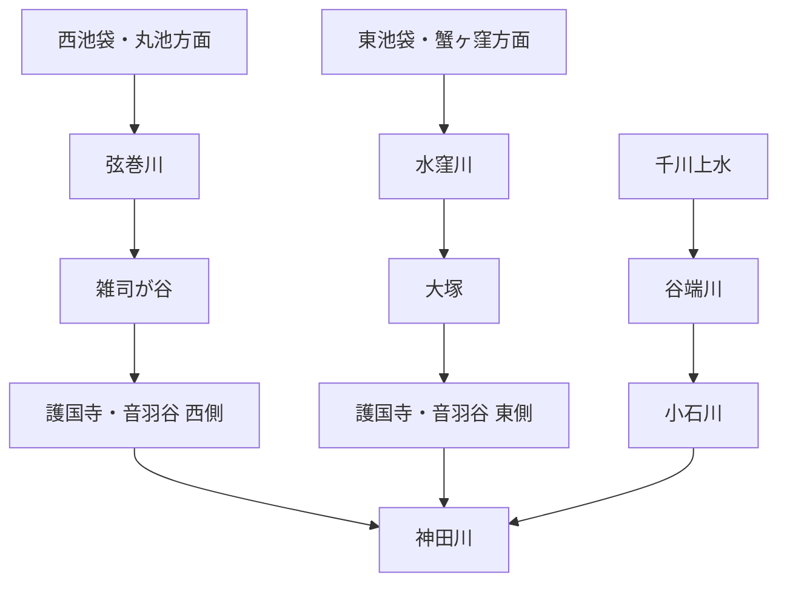

# otowa-ankyoscape

水窪川・弦巻川・谷端川と、その周辺の旧河道・暗渠・湧水・用水・土地利用について調べた記録です。

中心となる範囲は、池袋・雑司が谷・護国寺・音羽・小日向・小石川です。

**追加調査対象：人参川（古茗荷谷川との関係は未確定）** — 2026年10月8日、茗荷谷の西側谷頭について明治初期の地図表示と色別標高図を照合。筑波大学附属中・高の南方にある浅い枝谷が合流する可能性も含め、[人参川の調査ノート](docs/人参川.md)に記録した。**10月8〜9日の現地歩行・二源頭・古地図上の池・筑附南方の分水界候補・還国寺の湧水・水窪川の橋名**は[専用の観察記録](docs/2026-10-09・茗荷谷・人参川現地観察.md)に整理した。名称の史料上の確実性と、水路・谷地形の推定は区別している。

> [!IMPORTANT]
> このリポジトリでは、既知の河川史をまとめるだけでなく、**まだ決着していない流路・接続・成立年代を史料から検証すること**を重視します。
> とくに「水窪川と弦巻川はどこかで合流していたのか」「音羽通り西側の弦巻川下流はいつ成立したのか」「弦巻川・水窪川側と谷端川側の更新世旧河道はどちら向きに流れていたのか」は中心的な未解決問題です。

  

幕末の音羽・雑司ヶ谷周辺を描いた尾張屋版 <i>Otowa ezu</i>。1851年近吾堂板とは別史料。画像をクリックすると合流問題の検討ページへ移動します。

## 未解決問題

このリポジトリの中心です。解決していない問題は川別の概要へ埋め込まず、できるだけ独立した文書として追跡します。

| 問題 | 現状 |
| --- | --- |
| **水窪川と弦巻川は合流していたのか** | [独立文書で検討中](docs/open-questions/水窪川と弦巻川の合流・接続問題.md) |
| **音羽谷西側の弦巻川下流はいつ成立したのか** | [独立文書で検討中](docs/open-questions/音羽谷西側の弦巻川下流の成立年代.md) |
| **更新世の旧河道はどちら向きに流れていたのか** | 滝口志郎（2019）が谷端川側への接続可能性を提示するが、流向は未決着 |
| **千川上水から弦巻川・水窪川へ直接分水したのか** | 谷端川への分水は確認できるが、両河川への直接分水は未確認 |

→ [未解決問題の一覧](docs/open-questions/README.md)

## 水系の全体像

これは近代以降に把握しやすい大まかな配置であり、全時代にそのまま当てはまるとは限りません。近世の造成・灌漑、近代の河川改修、暗渠化、下水道再編によって接続関係や流路が変化した可能性があります。

## 現時点で重要なこと

- **第65回: joshuanchin「水窪川跡を辿る」シリーズ全6回の本文取得が完結し、板橋区浸水履歴PDFの本文確認・INDEX.mdの自動再生成（646項目）・第6〜63回保留bulletの一括prependを実施した。** 長年の未解決課題3件を解消した回である。
  - **joshuanchin「水窪川跡を辿る」-1〜-3・-5・-6のURL特定・本文全文取得（[BLOG-211](docs/sources/blogs/BLOG-211.md)〜[BLOG-215](docs/sources/blogs/BLOG-215.md)）**: amebloのentrylistページ送りから全entry IDを特定し、curl+ブラウザUAで本文を取得。**シリーズは-6「東池袋〜美久仁小路」まで計6回で、「-5が最終」とした従来の認識を更新**。主な新情報: ①音羽通り=元禄の護国寺創建時に整備との伝承と、**江戸古地図＋町内会チラシで川名を知った**発見経緯〔伝聞〕（[BLOG-211](docs/sources/blogs/BLOG-211.md)）。②**水窪川と鼠坂（森鴎外）の並行区間**の古地図読図〔観察〕（[BLOG-212](docs/sources/blogs/BLOG-212.md)）。③旧東青柳町の屋敷裏の**川の流れを池に利用した日本庭園**の2019年観察〔観察=repo初出候補〕（[BLOG-213](docs/sources/blogs/BLOG-213.md)）。④**全区間中最も細い個所=文京区大塚六丁目×豊島区東池袋五丁目24の区境**・茗荷畑の位置・水窪川の碑文言＋1986年銘の本文転記〔観察・確認〕（[BLOG-214](docs/sources/blogs/BLOG-214.md)）。⑤**都電荒川線の水窪川渡河個所が窪む**観察・**造幣局も巣鴨プリズン跡地**との伝聞・日之出町公園の短い流れ・**美久仁小路中程のクランク状花壇=水源推定**〔観察・伝聞・推定〕（[BLOG-215](docs/sources/blogs/BLOG-215.md)）。投稿メタデータは全6回とも2019-07-06（Yahooブログ移転）。
  - **板橋区「浸水履歴」sinsuinew.pdfの本文確認（[GOV-074](docs/sources/gov/GOV-074.md)を直接確認へ格上げ）**: open_url・Waybackで取得不能だった同PDF（11頁）を**curl+ブラウザUAで取得**し本文テキストを抽出。表題「いたばし区浸水履歴【昭和43(1968)年4月30日～令和元年】」・**令和4年3月改訂**・公文書館展示用。**大谷口北町（S44〜H22の多数記録）・大山西町・桜川・新河岸・舟渡等**の地域別浸水記録と、「浸水記録なし」リスト（**大谷口一丁目を含む12地域**）をPDF本文レベルで確認〔**確認: 本文抽出テキスト／行単位の対応付けは未実施・2026.8.22大雨は対象期間外**〕。
  - **INDEX.md（646項目）・地図一覧.mdをbuild.pyで自動再生成**: 第8回以降約60件が未反映だった出典索引の陳腐化を解消（BLOG-210→215・GOV-096・PAP-042まで収録）。

- **第6〜63回の定期調査で確認した重要事項を、テーマ別にREADMEに集約した（INDEX.mdと地図一覧.mdの自動再生成も実施、646項目）。** 各項の詳細はリンク先の資料ファイルと各回のノートにある。年次・位置の対立は原典未特定のまま断定しない。
  - **千川下流（板橋区側）の治水改修の工程**: 千川改修記念碑（簸川神社）と氷川下町会資料から、**1928年区会議決→1930年11月着工→1934年7月竣工（総延長3,272m）**の工程が初めて揃った〔**確認: 碑文・区民史の二次転記**〕。大正14年（1925）の記録的洪水が改修の動機とされ、**谷端川放水路1924/25年次問題の傍証候補**になる〔**仮説: 原典未特定**〕。出典: [BLOG-077](docs/sources/blogs/BLOG-077.md)・[GOV-094](docs/sources/gov/GOV-094.md)。
  - **千川上水・谷端川の暗渠化年次は複数の資料が対立するまま整理された**: 練馬区内「昭和25年頃着手」（[GOV-072](docs/sources/gov/GOV-072.md)・清戸道解説板）、1952年請願→27年3月着手→28年武蔵学園前区間（[BLOG-113](docs/sources/blogs/BLOG-113.md)略年表）、武蔵学園側「1950年代末までに全部暗渠」・濯川1959-60年区間（[ORG-019](docs/sources/org/ORG-019.md)）、谷端川上流1948年護岸→1956年暗渠完成の証言（[BLOG-135](docs/sources/blogs/BLOG-135.md)）、大塚駅北口の滝不動「1935年頃の暗渠化」説（[BLOG-207](docs/sources/blogs/BLOG-207.md)）、谷端川本体1964年説（GOV-015）・1967年説（[BLOG-150](docs/sources/blogs/BLOG-150.md)）が並立。**いずれも二次記録・伝聞であり、区間ごとの原典確認を残す**〔**伝聞/観察: 断定せず並記**〕。
  - **千川上水を請け負った千川家の実像が史料で具体化した**: 千川家の墓は練馬区登録文化財（平成8年度・北町2-18、歴代当主の没年判明〔[GOV-078](docs/sources/gov/GOV-078.md)〕）、千川家文書は297点（元禄9年〜明治17年〔[GOV-089](docs/sources/gov/GOV-089.md)〕）。区学芸員の聞き取りで**千川家4軒（播磨屋・和泉屋・加藤屋・中嶋屋）**の屋号と、播磨屋が開削当時姫路出身と自称した点が「仙川村百姓説」への批評として整理された〔**伝聞: 聞き取り／推定**〕区学芸員インタビュー（[GOV-090](docs/sources/gov/GOV-090.md)）。また**1938〜41年武蔵学園生徒の千川上水調査**（写真アルバム200カット超・区登録〔[GOV-076](docs/sources/gov/GOV-076.md)〕）が和田八重造の武蔵野生物調査（1922〜）の系譜に位置づき、濯川（1925年命名）は中新井分水路跡の復元と判明した〔**確認: 学園史料・紀要論文**〕（[PAP-033](docs/sources/papers/PAP-033.md)・[ORG-019](docs/sources/org/ORG-019.md)・[ORG-031](docs/sources/org/ORG-031.md)）。
  - **弦巻川・水窪川の中下流の施設と橋が資料群で具体化した**: 猫又橋の石造改築（大正7年）・昭和9年撤去・袖石2基の移転保存（[BLOG-079](docs/sources/blogs/BLOG-079.md)）、中丸・西光院の橋供養碑「延享2年（1745）に上下両橋を石橋として造立」（[BLOG-177](docs/sources/blogs/BLOG-177.md)）、雑司が谷地名の表記史と昭和41年住居表示変更（[GOV-096](docs/sources/gov/GOV-096.md)）、上川口屋1781年創業（[BLOG-188](docs/sources/blogs/BLOG-188.md)・[BLOG-190](docs/sources/blogs/BLOG-190.md)）、大鳥神社1940年社殿配置変換文言（[BLOG-151](docs/sources/blogs/BLOG-151.md)）、水窪川暗渠化「昭和8年頃」説（[BLOG-089](docs/sources/blogs/BLOG-089.md)）、江戸川橋合流点の東西逆転観察（[BLOG-120](docs/sources/blogs/BLOG-120.md)）、安政4年『音羽繪圖』と権三橋（[BLOG-198](docs/sources/blogs/BLOG-198.md)・[GAZ-023](docs/sources/gazetteers/GAZ-023.md)）〔**確認/観察の混在: 各資料ファイルに区別記載**〕。
  - **谷端川水源地と橋の調査が学術・郷土史料で裏付けられた**: 甲田ほか2015年「谷端川水源地付近における更新世後期以降の環境変遷と土地利用」（豊島区郷土資料館紀要24号）は**谷端川水源地を直接扱う初の学術論文**〔**所在確認: 本文未確認**〕（[PAP-026](docs/sources/papers/PAP-026.md)）。谷端川緑道の橋名由来は友の会『旧谷端川の橋の跡を探る』（1999〔[BOOK-062](docs/sources/books/BOOK-062.md)〕）が典拠で、**水源〜不忍通り間67橋の区間別内訳**と田楽橋の1910年銘欄干現存（[BLOG-081](docs/sources/blogs/BLOG-081.md)）、粟島神社「泉は…谷端川の源泉ともなった」由緒文言（[BLOG-195](docs/sources/blogs/BLOG-195.md)）が揃った。**中丸川＝千川上水の分水説**は地籍図読図・学校誌・聞き取り・独立踏査の4系統の裏付けが蓄積した〔**観察/伝聞: 水路跡の実測は未実施**〕（[BLOG-140](docs/sources/blogs/BLOG-140.md)）。
  - **治水・下水道の現勢資料**: 千川増強幹線は2013年8月豪雨（南大塚床上浸水）を機に2017年度着工・上池袋東公園〜窪町東公園2.5km・内径3.75mシールド（[GOV-082](docs/sources/gov/GOV-082.md)）、枝線は2026年に接続完了（[BLOG-134](docs/sources/blogs/BLOG-134.md)）。1952年練馬区教委の千川上水記録フィルム（60コマ）と所蔵リストから**GHQ関東軍政部の千川上水取水**が確認された〔[GOV-070](docs/sources/gov/GOV-070.md)・[GOV-092](docs/sources/gov/GOV-092.md)〕。2026年8月22日の記録的短時間大雨（板橋120mm/h・池袋駅地下冠水）と濯川1981年氾濫が新時代の水害記録として加わった〔**確認: 報道・学園史料**〕（[BLOG-115](docs/sources/blogs/BLOG-115.md)・[BLOG-116](docs/sources/blogs/BLOG-116.md)・[ORG-019](docs/sources/org/ORG-019.md)）。

- **長年本文未取得だったFC2ブログ「水の行方を追って」（わんじん）の谷端川（西大下水）シリーズ17編を直接取得し、精読した。** 2018年2月〜8月の連載のうち未登録だったentry 17本（233,235,236,237,238,240,241,242,244,245,246,251,252,253,254,255,256）の全文を取得（[第64回ノート](docs/2026-11-13（第64回）・wanjin谷端川シリーズFC2直fetchによる全編取得（樋口地名・滝不動1935年・2源流支流）.md)）。主な新情報: ①板橋区側の小字**「樋口（とよぐち）」**（『いたばしの河川』由来）と長崎村分水の引水路がマンション敷地内の白砂利空間として現存する2018年観察〔**確認: 『いたばしの河川』由来の二次記述／観察: 2018年の引水路空間**〕（[BLOG-203](docs/sources/blogs/BLOG-203.md)）。②**金井窪駅1931年開業・1951年廃止**と下板橋駅の大塚辻町起点案の断念・昭和10年頃の現位置移転説、金井窪「鉄錆湧水」の語釈〔**伝聞: 本文記述／暗渠化年次の議論とは独立の駅史情報**〕（[BLOG-205](docs/sources/blogs/BLOG-205.md)）。③大塚駅北口の滝不動が**「1935年（昭和10年）頃の暗渠化工事」に伴い移転した**とする記述〔**伝聞: ブログ本文の叙述／大塚区間の暗渠化年次の独立データポイント。既存の1967年説等との対立を残し断定しない**〕（[BLOG-207](docs/sources/blogs/BLOG-207.md)）。④南長崎支流の**2源流説**（中落合・やよい児童遊園＝雨水貯留浸透施設併設、と南長崎・子育て地蔵）と本流合流点＝真和中学校（現・心身障害者福祉センター）跡脇〔**観察: 2018年／やよい児童遊園源流説はrepo初出**〕（[BLOG-208](docs/sources/blogs/BLOG-208.md)）。⑤**新田堀之内村＝王子の梶原堀之内村の分郷**説と、下り谷・雲雀が谷戸支流（池袋運輸区留置線）・上池袋支流（源流＝西巣鴨橋北・山手線際）の踏査〔**確認: 本文主張の村名由来／観察: 2018年の流路**〕（[BLOG-209](docs/sources/blogs/BLOG-209.md)）。⑥大塚三業地〜小石川の橋名群（姿見橋・見返り橋・熊野窪橋・東福寺橋・松浦橋・宮原橋・**一木橋＝「一本橋」誤字定着説**）・**『続江戸砂子』湯立坂文言（「往古はこの坂の下は大河の入江」）**・東京帽子株式会社（渋沢栄一設立）・柳町支流（仮）・**東大下水との3度の合流**・**市兵衛河岸（砲兵工廠の荷揚場、〜昭和8年）**〔**観察: 2018年＋『続江戸砂子』文言の引用／橋名の典拠照合は未実施**〕（[BLOG-210](docs/sources/blogs/BLOG-210.md)）。観察は2018年時点の民間踏査記録であり、確定情報としてではなく独立裏付け・仮説補強の資料として扱う。

- **雑司が谷の写真乾板工場について、1927年の井戸・鑿泉の深さと、1994年に撮影された別地点の井戸を記した郷土資料館図録を確認した。** 豊島区立郷土資料館『[町工場の履歴書](https://www.city.toshima.lg.jp/129/bunka/bunka/shiryokan/zuroku/1994zuroku.html)』（**1994年度特別展、図録pp.55–57**）「良質な水をもとめて―東洋乾板から富士写真フイルムへ」の[公開複製](https://takahashi.tokyo.jp/toshima/1994kyoudo.pdf)には、**1927年（昭和2年）の東洋乾板工場増設時、水不足対策として深さ26尺（約8m）の給水井戸と250尺（約76m）の鑿泉を掘った**との記述がある。〔**確認：1994年図録の文字抽出／尺数の原誌面画像再判読は未実施**〕 同図録には**1994年6月撮影の旧乾板製造用井戸（南池袋2丁目41番3号）**の写真があり、宅地化に伴い雑司が谷の井戸水量が減ったとも説明する。〔**確認：図録の写真説明・歴史的叙述／未確認：水位の実測記録・現在の井戸残存**〕 高橋俊之「[感光材料の産業史―『東洋乾板株式会社』と高橋慎二郎](https://www.jstage.jst.go.jp/article/photogrst/87/2/87_71/_article/-char/ja/)」（**2024年、『日本写真学会誌』87巻2号、pp.71–78**）は、**1914年の研究所を現・南池袋4丁目23番、1919年設立の工場を現・南池袋2丁目40番**と区別し、**2021～2023年の再開発発掘で工場内の研究所基礎等が確認された**と記す。〔**確認：論文本文／観察：複数の井戸・工場所在地を区別できる**〕 既収録の**2023年南池袋遺跡見学会資料の「排水施設」**と照合すべき**工業用水の供給側の設備史**が増えたが、**井戸・鑿泉の正確な位置・取水層・排水先、弦巻川との接続は未確認**。**地下水利用を弦巻川からの直接取水・放流とみなさず、1927年を暗渠化年としない**。〔**推定：旧地番・発掘平面図・地下水利用の比較価値／未解決：供排水系統**〕 出典：[GOV-050](docs/sources/gov/GOV-050.md)／[PAP-014](docs/sources/papers/PAP-014.md)／[弦巻川調査ノート](docs/弦巻川.md)。

- **1801年の谷端川上流の敷石伝承を、1996年の豊島区立郷土資料館報の碑文転記・現物写真で補強できた。** 『[かたりべ43号](https://www.city.toshima.lg.jp/documents/2548/kataribe43.pdf)』（**1996年10月20日、印刷p.7**）「区内の土木遺産―舗石建立塔―」は、**千早一丁目二三の地蔵堂内**にある石塔の写真と**高さ149.5cm・幅32.8cm・奥行22.5cm**の寸法を掲載し、碑面の建立年月を**「寛政十三辛酉（一八〇一）年二月吉日」**と転記する。さらに**谷端川の湿地帯に敷石を施した区間を「約百mの区間という」**と紹介し、長崎村から池袋・雑司ヶ谷・音羽・江戸川橋を経て江戸へ向かう旧道の通行事情と関連づける。〔**確認：1996年の区公式館報p.7の誌面画像・写真・碑文転記を直接閲覧／観察：1996年時点の石塔寸法と通行路の説明**〕 **約100mは記事が伝える概数で実測工事延長ではない。橋の架設が必要だったという説明は記事筆者の推測**であり、**1801年の橋梁施工・敷石工区の起終点・旧谷端川の河床線は未確認**。現所在地「千早1丁目23-3」は既登録[ORG-008](docs/sources/org/ORG-008.md)の表記で、1996年記事の番地表示と区別する。〔**推定：1912年地籍図で旧道・湿地の交差箇所を検証する新たな手掛かり／未解決：碑の建立原位置、敷石が横断路か縦断路か**〕 **1801年は碑面の建立年、1996年は館報の刊行年**である。出典：[GOV-049](docs/sources/gov/GOV-049.md)。

- **谷端川を挟む巣鴨の埋没枝谷について、旧石器・縄文時代の遺構分布からの考古学的な補助資料を確認した。** NPO法人としま遺跡調査会「[豊島区No.6遺跡『巣鴨遺跡』～石器と獲物と巣鴨の谷 原始・古代編～](https://wp.toshima-iseki.org/wp/iseki-list06/)」（**掲載年月日不詳、2026年11月3日閲覧**）は、**巣鴨四丁目の関東ローム層からの黒曜石製ナイフ形石器**と、**都立大塚ろう学校建替え時の縄文草創期～早期の陥し穴・縄文後期の土器等**を紹介する。出土地点は**現在埋もれている谷の周囲に集中**し、巣鴨は**谷田川と谷端川に挟まれ、枝状の谷が複数延びていた**と説明する。〔**確認：発掘調査団体の公開解説・出土遺物写真／観察：同団体による遺構分布と埋没谷の二次的な整理**〕 **「狩り場」という用途は団体の考察**で、記事に個別遺構の座標・谷底堆積層・埋没時期は掲載されていない。**陥し穴や石器は水路・旧河床そのものの証拠ではなく、谷端川の旧流向や谷田川との接続を立証しない**。〔**推定：谷端川中下流の支谷と考古遺構を地形図・原報告書で照合する入口／未解決：調査区座標・谷の層序・水流方向**〕 出典：[ORG-009](docs/sources/org/ORG-009.md)。

- **2012年の発掘紹介記事は、弦巻川へ下る坂道沿いの「薬研堀」と、雑司が谷駅工事で見つかった中世道路を別々の遺構として具体的な寸法付きで記録している。** 豊島区立郷土資料館『[かたりべ107号](https://www.city.toshima.lg.jp/documents/2546/kataribe107.pdf)』（**2012年10月16日、印刷p.4**）「鎌倉街道を歩いてみよう②―鎌倉街道を掘る」は、東京地下鉄副都心線**雑司が谷駅建設前の発掘**で、**南北に約50m延びる中世の道（図中B、最大幅約5.5m、初期の路面幅3m弱・両側に側溝）**を検出したと紹介する。**13～15世紀の陶磁器片**の出土にも触れる。さらに、**弦巻川へ下る坂道に沿って幅約4m・深さ約2mのV字形の薬研堀（図中C）**が発掘されたと記し、宿坂からの鎌倉街道が堀に沿って北上し弦巻川を越えた可能性を論じる。〔**確認：2012年の公的館報本文・図・写真を直接閲覧した発掘成果の二次紹介／観察：図中B・Cと坂道の相対位置**〕 **薬研堀は弦巻川の旧河床・支流と確認されたものではなく、川の渡河地点・橋の存在・道路Bと堀Cの連続性は記事筆者の推定**である。寸法・遺構年代は発掘原報告書と未照合で、**13～15世紀の道や溝を近代の暗渠化年代に読み替えない**。〔**推定：中世の道・排水溝と弦巻川の谷地形を地図・発掘図で照合する新しい基準点／未解決：遺構座標・層位・渡河位置**〕 出典：[GOV-048](docs/sources/gov/GOV-048.md)。

- **谷端川上流の湿地帯に関わる1801年の舗道整備を伝える石塔の所在と、2018年の緑道景観資料が見つかった。** 豊島区商店街連合会「[千川・要町・高松コース](https://www.toshima-kushoren.gr.jp/course/course09.html)」（**掲載年月日未記載、2026年11月3日閲覧**）は、**千早1丁目23-3の地蔵堂**にある道標兼用の**「舗石建立塔」**が、**谷端川の湿地帯の舗道整備を記念して1801年（寛政13年）に建立された**と説明する。〔**確認：団体公開文の記述／観察：谷端川上流の湿地と旧道整備に結び付けられた石塔の所在**〕 **1801年の銘文・建立原位置・舗装範囲・橋の有無は未照合**で、団体の説明をそのまま当時の測量・工事原簿と扱わない。〔**推定：古地図・地籍図と石塔の現物を照合する基準候補／未解決**〕 また豊島区「[豊島景観百選・拡大図B](https://www.city.toshima.lg.jp/296/machizukuri/toshikekaku/kekan/1902271613.html)」の**番号21「谷端川緑道」**は、**2018年7～12月募集の景観アンケート**に基づき、**西池袋5丁目24付近**の緑道を写真付きで紹介し、谷端川を「千川分水の一つ」、**粟島神社（要町2-14）の弁天池を源泉**と記す（ページ更新**2025年7月10日**）。〔**確認：区公式の所在地・募集期間・説明文／写真の細部は未判読**〕 **景観の所在地は水源・河床の実測地点ではなく、2018年は暗渠化年ではない**。既登録の練馬区資料の紹介には粟島神社が**「要町2-41」**とある一方、商店街連合会は**「要町2-14-4」**と記すため、**住所表記の食い違いは旧地番・現住所・資料誤記の可能性を残して要再照合**。また「千川分水」という行政の簡略な表現から、自然湧水と人工助水の関係や全区間の人工河道説を確定しない。〔**観察／未解決**〕 出典：[ORG-008](docs/sources/org/ORG-008.md)・[GOV-047](docs/sources/gov/GOV-047.md)。

- **東京都水道歴史館のガラス乾板写真2点から、旧小石川区の水道工事の比較史料が増えた。** 「[小石川区大塚仲町配水本管敷設工事](https://www.ro-da.jp/suidorekishida/content/detail/REKI-020-009)」（**REKI-020-009**）は、**大正時代～昭和前期**、東京市（水道局か）制作と目録に記され、**2025年12月16日**に公開された。〔**確認：公的写真目録の題名・年代幅・公開日／写真細部未判読**〕 既収録の大塚仲町の電車軌道下鉄管敷設写真2点（P0120_012_02・REKI-039-003_02）とは**別資料ID**だが、**同一工事・同一写真の別複製かは未確認**。〔**観察：書誌比較／推定：水窪川周辺の道路・軌道・上水道施設の位置照合候補**〕 一方「[配水本管1800ミリ伏越替工事小石川区船河原橋](https://www.ro-da.jp/suidorekishida/content/detail/REKI-019-040)」（**REKI-019-040**）は、原目録の題名に**「昭和9年（1934）7月10日」**と付記された別のガラス乾板写真で、**2025年12月16日公開**。〔**確認：目録原題の日付／写真細部未判読**〕 既収録の**1933年6月30日「船河原橋際伏越工事」写真（P0114_027_03）**との比較点が増えたが、**1934年7月10日は撮影・着工・竣工のいずれの日付か不明**。船河原橋は神田川の飯田橋付近にあり、谷端川下流の直接の旧河道証拠ではない。**両資料は上水道の配水本管工事であり、水窪川・弦巻川・谷端川の暗渠・下水道工事を示すものではない**。〔**推定：1930年代の地域インフラ史の比較に有用／未解決：写真の同一性・工区・施工年代・河川との位置関係**〕 出典：[GOV-045](docs/sources/gov/GOV-045.md)・[GOV-046](docs/sources/gov/GOV-046.md)。

- **2015年の豊島区公式「目白地域資源図」は、谷端川と弦巻川を同じ図表に名称付きで掲載している。** 豊島区『[豊島区都市づくりビジョン・第6章「目白地域」](https://www.city.toshima.lg.jp/295/machizukuri/toshikekaku/toshikekaku/documents/6syou_9.pdf)』（**2015年3月策定、印刷p.213・図表269「地域資源図」**）には**「谷端川」「弦巻川」**の両表記と、凡例の**「河川」「河川（暗渠）」**がある。周辺に**西池袋2丁目、目白3～5丁目、上り屋敷公園、西武池袋線**などが記され、**旧谷端川上流と弦巻川源流域を同一の行政図上で比較する入口**となる。〔**確認：区公式PDFの図表文字情報・凡例／推定：両河川の位置照合に有用**〕 ただし**図上の線分・正確な座標・相互の接続は独立に判読していない**ため、図に名称があることだけで旧河床・分水界・管渠位置・近世の合流関係を確定しない。**2015年は計画策定年であり、河川の成立・暗渠化年ではない**。〔**未解決：図像そのものの読図と明治・昭和の原図との重ね合わせ**〕 出典：[GOV-044](docs/sources/gov/GOV-044.md)。

- **明治期の井戸分布は旧河道・谷底と単純には重ならないことを、2007年の地理学研究が示している。** 谷口智雅・谷口真人「[歴史的地下水環境の復原―史料と古地図から見た東京の井戸と人間活動](https://www.jstage.jst.go.jp/article/ajg/2007s/0/2007s_0_195/_article/-char/ja)」（**2007年日本地理学会春季大会・P845、同年4月29日公開**）は、**1887年刊と記す五千分一東京図測量原図の井戸記号**から、目白・上野を北限とする東京中心部約8km四方の井戸分布を復原したと報告する。住宅・屋敷内の井戸が多く、**井戸分布は低地・台地・旧河道と必ずしも一致しない**とし、現代の**文京区の路地・寺社の井戸分布**も調べている。〔**確認：著者の公開学会発表要旨／観察：地形だけで井戸を説明できないという研究結果**〕 既登録の[MAP-007](docs/sources/maps/MAP-007.md)を、**水窪川・弦巻川の音羽谷下流と谷端川（小石川）下流の井戸記号・宅地配置**という角度から再判読する入口となる。〔**推定：水利用史と旧河道仮説の照合価値**〕 **要旨には地点別井戸図・座標・水位はなく、三河川の個別井戸や湧出口は特定できない**。また「約45,000」は要旨中の既往概数であって著者の図上実測数ではなく、**1887年は地図の刊年、2007年は発表年**である。井戸の存在から地下水流向・旧河道・河川接続を直接推定しない。〔**未解決：原図の井戸記号・地点別資料の確認**〕 出典：[PAP-013](docs/sources/papers/PAP-013.md)。

- **巣鴨刑務所の排水口候補とされる石積みは、2021年の現地写真・案内板転記から、旧造幣局敷地の隣接道路脇からIKE・SUNPARK内へ移設・復元されたことを追える。** [2021年11月28日の現地記事](https://senseki-kikou.net/?p=19228)は**2017年撮影と明記した移設前の写真3枚**と2021年11月の公園内写真を掲載し、[別の2021年11月19日の踏査](https://citywalk2020.hatenablog.com/entry/2021/11/19/185348)も案内板を転記する。案内板によれば、**都市計画道路補助第176号線・特別区道41-340を支えていた石垣の一部**を道路整備で保存・公園内に復元した。〔**確認：現地案内板の二次転記・撮影年表示／観察：移設前後の写真資料の存在**〕 ただし掲示文は、巣鴨刑務所から**水窪川へ排水していた「のではないか」**という推量形で、接続を断定していない。**1999年の豊島区広報[GOV-001](docs/sources/gov/GOV-001.md)にある造幣局脇の「排水溝跡」「護岸用と思われる大谷石塀」と同一構造物かも未確認**。原位置は公園南西の坂下通り終端の階段付近とする二次説明があるが、番地・石材の同一性・工事年代は未確定。〔**推定：旧排水施設の位置復元に有用／未解決：接続・同一性・原位置**〕 出典：[BLOG-025](docs/sources/blogs/BLOG-025.md)。
- **谷端川の2024年5～6月の3回踏査について、主催NPOの活動年表と動画アーカイブの案内が残る。** NPO法人「としまの記憶」をつなぐ会の[活動年表](https://toshima-kioku.jp/about/)は**2024年5～6月に谷端川の暗渠を3回に分けて歩いた**と記す。[動画案内](https://movie.toshima-kioku.jp/archives/yabatagawa-pr/)は**伊藤一雄氏の案内、長島光男氏による2024年撮影・編集**と表示する。〔**確認：主催団体の活動記録と動画案内の公開本文／未確認：動画の全編・各回の踏査日と行程**〕 約11km・弁天池水源・U字蛇行は主催者による既知の河川概説で、独立した測量成果ではない。**2024年の現地景観・橋跡を照合する映像史料候補**として記録し、動画未判読のまま旧河道・橋・工事年を確定しない。〔**推定／未解決**〕 出典：[ORG-007](docs/sources/org/ORG-007.md)。

- **2025年6月26日の池袋村図二土橋読図は、川筋が描かれない2か所の「土橋」という新しい照合対象を提示する。** 地域史調査者[sakura「池袋村図に描かれていない川の流れ」](https://note.com/toshima_lab/n/n2ee55a4da242)（**2025年6月26日**）は、年代未詳の「池袋村図」について、**四面塔辻につながる東西の道筋に「土橋」が2か所あるのに、その下の水流線が描かれていない**と指摘する。出典図を豊島区史編纂委員会『**豊島区史 地図編（上）**』**p.18**と明記しており、[豊島区公式の刊行案内](https://adeac.jp/toshima-history/top/topg/06kikankushi/index.html)では同書は**1974年1月刊・近世地図31図収録**と確認できる。〔**確認：区の刊行物書誌／観察：記事による二次読図、原図未閲覧**〕 記事は西側の橋を現在の東京芸術劇場北側付近と推定し、丸池より上流の弦巻川側と、蟹ヶ窪・水窪川側の未描画支流を想像するが、**いずれも原図の測量成果ではなく執筆者が推測と明示する仮説**。〔**仮説／未解決：橋位置・河道・流向**〕 さらに[東京都公文書館の原図目録](https://www.archives.metro.tokyo.lg.jp/detail?cls=collection_01&pkey=000100349)（資料ID **000100349**）は、**彩色原図1枚・93×118cm・一部に別紙図を貼付**と記す。〔**確認：公的目録／原図未閲覧**〕 **貼付図の範囲、土橋2点の表記、描かれない水流の解釈を原図と1974年複製で独立検証するまで、二河川の近世支流を確定しない**。出典：[MAP-018](docs/sources/maps/MAP-018.md)。

- **1716年の高田村絵図に記された神田川の「大橋」について、2012年の公的館報が面影橋付近の渡河点として解説している。** 豊島区立郷土資料館『[かたりべ106号](https://www.city.toshima.lg.jp/documents/2546/kataribe106.pdf)』（**2012年7月19日、印刷p.3**）「鎌倉街道を歩いてみよう―高田宿の発見」は、**正徳6年（1716年）の高田村絵図**に橋名「大橋」があると記し、部分絵図と現在地形図を併載する。〔**確認：館報本文・掲載図を直接閲覧／観察：館報による古絵図の二次読図**〕 **弦巻川下流の神田川との接続を調べる際の、近世の渡河点と道路の位置合わせ候補**になるが、絵図の「大橋」と現在の面影橋の同一性・架橋年は立証できない。既登録の1716年[MAP-012](docs/sources/maps/MAP-012.md)「下高田村絵図」と、館報に掲載された絵図の**原図系統も未照合**。この橋名だけで弦巻川の合流口や河道を決めない。〔**推定／未解決**〕 出典：[GOV-043](docs/sources/gov/GOV-043.md)。

- **1989年度の「失われた水辺を探る」講座は、1990年の事業報告で1989年10月8日～11月5日の実施と日付まで絞れた。** 豊島区立郷土資料館『[かたりべ](https://www.city.toshima.lg.jp/documents/2550/kataribe18.pdf)』**18号（1990年5月15日、印刷p.4）**「1989年度の郷土資料館事業について」は、地域史講座「中世・鎌倉街道を調べる」（同年6月4～25日）と**「失われた水辺を探る」（同年10月8日～11月5日）**を区別して記録する。〔**確認：1990年の公的事業報告を原PDF画像から直接判読**〕 既収録の1999年豊島区広報[GOV-001](docs/sources/gov/GOV-001.md)は、1989年度に**弦巻川・谷端川**を取り上げたと回顧し、別の区資料は「豊島区の川を歩く～谷端川・弦巻川～」という名称を記す。〔**観察：別年代の区資料の照合**〕 **両講座名が同一企画の別表記か、各河川を何月何日に歩いたかは未確認**。期間は**講座開催の年代であって河川の暗渠化・道路化年代ではない**。〔**推定：1989年10～11月の講座配布地図・現地写真の探索範囲を具体化／未解決：各回の行程・配布資料**〕 出典：[GOV-041](docs/sources/gov/GOV-041.md)。

- **2011年の郷土資料館報は、1909年一万分一地形図の旧長崎村・高田村境と弦巻川源頭の谷を関連づけ、丸池が図上に見えないことも明記している。** 『[かたりべ](https://www.city.toshima.lg.jp/documents/2546/kataribe102.pdf)』**102号（2011年6月30日、印刷p.2）**「一万分一地形図から、豊島区のまちの移り変わりを見てみよう！」は、**池袋駅西側の旧村境の南に伸びる谷・水田を弦巻川の源流域**と読図し、**1909年図には湧水池が見えない**一方、谷頭にはかつて**丸池**があったと説明する。〔**確認：2011年館報の説明文／観察：同館による1909年図の二次読図**〕 この記事が紹介する『豊島区地域地図』第4集は**1999年刊のものを2011年3月に改訂**したもので、**復刻刊年と原図の測量・修正年を混同しない**。また**地図に丸池が見えないことは1909年の池の不存在・湧水枯渇を示さない**。原図の図郭・凡例・村境・池の原位置は未照合である。〔**推定：旧村境と谷頭を地籍・標高図に重ねる比較点／未解決：原測量図での独立判読**〕 出典：[GOV-042](docs/sources/gov/GOV-042.md)。

- **1996年の郷土資料館報に、谷端川沿いの旧地番と三角形低地の土地利用が記録されている。** 豊島区立郷土資料館『[かたりべ](https://www.city.toshima.lg.jp/documents/2548/kataribe44.pdf)』**44号（1996年11月30日、印刷p.4）**「袋ヶ谷自由学園の昼食」は、1926年に屋根板工場を転用して開設された保育施設の所在地を**旧西巣鴨町大字池袋字袋ヶ谷2081番地（現・池袋本町四丁目）**とし、**赤羽線・東武鉄道・谷端川に囲まれた三角形の低地**に町工場が集まっていたと回顧する。掲載写真は**1935年頃の園児の昼食**で、川の水面や護岸を撮影したものではない。〔**確認：1996年の公的館報本文・写真を直接判読／観察：旧地番・鉄道・川による場所の絞り込み**〕 同号**p.3**には、**1905年の水車取調書で千川上水の水車9か所**との記述と、**「千川上水公園に残る調節バルブ」**の写真もある。〔**確認：1996年の史料紹介／未確認：1905年原簿・写真撮影年**〕 **旧2081番地の筆界・保育施設の敷地、川岸との距離、写真の撮影地点は未確定**で、三角形低地の記述を河道中心線の実測記録と扱わない。水車9か所も**千川上水全体**の説明で、谷端川の水車数ではない。〔**推定：旧地籍図・鉄道敷・火災保険特殊地図との照合価値／未解決：施設の原位置と水路敷**〕 出典：[GOV-040](docs/sources/gov/GOV-040.md)。

- **1993年の豊島区立郷土資料館だよりは、三河川の暗渠化後の認識と神田川の旧流路を同時に伝える。** 『**かたりべ』30号（1993年4月30日）**の印刷**p.6**「郷土資料館なんでもQ&A」（回答者「伊藤」）は、当時区内で地表を流れる川を**新宿区境の神田川**とし、**谷端川・弦巻川・水窪川・谷戸川を「自然の川」、千川上水を「人工の川」**として列挙する。谷端川の**農業用水としての利用から生活排水の流入への変化**、川跡が道路・公園として残ること、**千川上水は上流で通水が復活したが豊島区内は暗渠のまま**だったことも記す。〔**確認：1993年の公的館報の本文を原PDF画像から直接判読／観察：当時の河川認識と土地利用の概説**〕 同号**p.1**「区境が見えた！」は、**3月7・14・21・28日**の高田・雑司が谷等の境界踏査を報じ、**目白3-4／下落合3-1の旧高田町・落合村境**を写真で示し、踏査を通じて**護岸工事以前の神田川の流路**を意識したと記す。〔**確認：館報の踏査記録／推定：旧区村境と改修前河道を地図照合する手掛かり**〕 **「自然の川」は資料館による総称で、弦巻川下流の成立過程や水窪川との接続を確定しない**。境界写真の細道を旧神田川河床と同一視せず、**1993年の現況・記憶を現在の状態や改修工事年と混同しない**。〔**未解決：旧神田川の河道中心線、護岸工事の区間・年代、個別水路の人工改変**〕 出典：[GOV-039](docs/sources/gov/GOV-039.md)／[豊島区公式PDF](https://www.city.toshima.lg.jp/documents/2549/kataribe30.pdf)。

- **1935～1937年頃の小石川区・豊島区の火災保険特殊地図4冊と、2024～2026年刊の原寸復刻5巻を新たに特定した。** 都立図書館の[文京区所蔵目録](https://www.library.metro.tokyo.lg.jp/lib_info_tokyo/house_map_union_catalog/bunkyo/)・[豊島区所蔵目録](https://www.library.metro.tokyo.lg.jp/lib_info_tokyo/house_map_union_catalog/toshima/)は、1987年複製の**小石川区・上（原図1937年、資料ID 1123363700）／下（1936～1937年、1123363719）／豊島区・上（1935～1937年、1123363826）／下（1936～1937年、1123363835）**を掲載する。〔**確認：2024年7月末現在の所蔵目録**〕 辻原万規彦編『**戦前期東京火災保険特殊地図集成**』は、**第9・10巻（小石川区を含む、2024年12月・2025年1月）と第22～24巻（豊島区を含む、2026年1～3月）**が刊行済みである。〔**確認：各巻書誌・[編者の刊行一覧](https://www.pu-kumamoto.ac.jp/users_site/m-tsuji/firemap.html)**〕 [NDLの資料解説](https://ndlsearch.ndl.go.jp/rnavi/maps/post_601014)によれば、火保図は概ね**1:600～1:1,200の大縮尺**で、地番・建物等を調べられる。ただし記載項目は図葉ごとに異なる。〔**確認：系列の一般的性格**〕 **弦巻川の1931～1932年頃の暗渠化、谷端川下流の1934年頃の改修、水窪川沿いの戦前の土地利用**を、既収録の1935年小石川区詳細図・地籍図と照合する候補が増えた。〔**推定：時点・縮尺上の比較価値**〕 **各図の図郭・橋・水路・塀の描線は未閲覧**で、三河川の流路を図上で確認したわけではない。**1987年複製と2024～2026年復刻の図葉が同一かも未確認**。1999年に旧造幣局脇で観察された大谷石塀を旧護岸とする根拠にはまだならない。〔**未解決：図葉別の調査／修正年・旧河道・塀・道路の位置合わせ**〕 **原図年代・復刻刊年・工事年月を混同しない**。出典：[MAP-122](docs/sources/maps/MAP-122.md)・[MAP-123](docs/sources/maps/MAP-123.md)・[MAP-124](docs/sources/maps/MAP-124.md)・[MAP-125](docs/sources/maps/MAP-125.md)／[BOOK-052](docs/sources/books/BOOK-052.md)・[BOOK-053](docs/sources/books/BOOK-053.md)・[BOOK-054](docs/sources/books/BOOK-054.md)・[BOOK-055](docs/sources/books/BOOK-055.md)・[BOOK-056](docs/sources/books/BOOK-056.md)。

- **1967年刊『文京区史』巻1について、文京区立図書館の「地域」索引から音羽谷と谷端川の参照頁を新たに特定した。** [公式「文京区史（地域）」索引](https://www.lib.city.bunkyo.tokyo.jp/viewer/info.html?id=171)は、**「音羽谷」巻1・10／11／15／148頁、「谷端川」巻1・8／12／75／216頁、「音羽通り」巻1・59／71／86頁**を掲げる。〔**確認：区立図書館の地域索引における見出し・巻頁、2026年11月2日閲覧**〕 既登録の[BOOK-051](docs/sources/books/BOOK-051.md)で確認した同巻71頁の事項索引「音羽町抄紙場」と併せ、**音羽谷の地形・谷筋と谷端川（小石川）下流の説明を、巻1の複数の頁から照合できる具体的な入口**が増えた。〔**推定：旧河道・地形史の原典確認に役立つ**〕 **該当頁の本文・図版は未閲覧**であり、索引に地名があるだけで水窪川と弦巻川の合流、谷端川の流向、河道・橋の位置、紙漉き場の取水を立証することはできない。索引の頁番号は**1967年刊の巻1の参照先**であり、河道改修・暗渠化・紙漉き場の操業年代ではない。〔**未解決：巻1・8／10～12／15／59／71／75／86／148／216頁の原文・図版の直接判読**〕

- **1878年3月頃刊の1:2,400『小石川區』（西川光通編）を、明治初期の大縮尺・地番入り地図として新たに特定した。** 国立国会図書館の[個別書誌](https://ndlsearch.ndl.go.jp/books/R100000002-I000010125400)は『**大日本改正東京全圖**』第10号、**西川光通編・西川光穂刊、[1878年3月]、122×206cm、請求記号YG913-962**と記す。NDLの[地図室案内](https://ndlsearch.ndl.go.jp/rnavi/maps/post_546)によれば、系列には**地番・間口・奥行・坪数**の表示がある。〔**確認：公的書誌・系列解説**〕 **1873年の沽券地図と1883～1884年測量図の間**に位置し、旧小石川区に属する**谷端川下流・音羽谷の水窪川／弦巻川下流**の筆界・道路・水路敷を比較する候補となる。〔**推定：年代・縮尺上の比較価値**〕 **原図は紙資料で、該当図郭・水路・橋・地番は未閲覧**。系列案内の「建物形状なし」と[2002年復刻版の出版社説明](https://kagakushoin.com/products/detail.php?product_id=534)の「建物輪郭あり」には**食い違い**があり、原図で確認するまで建物形状を断定しない。**1878年を河道の成立・暗渠化年とみなさない**。〔**観察：書誌記述の不一致／未解決：原図の判読**〕 出典：[MAP-121](docs/sources/maps/MAP-121.md)。

- **音羽の紙漉き場を調べる原典候補が、1967年『文京区史』巻1の印刷71頁まで絞れた。** 文京区立図書館の[『文京区史』事項索引](https://www.lib.city.bunkyo.tokyo.jp/viewer/info.html?id=172)には、**「音羽町抄紙場 | 1-71」**という項目がある。〔**確認：公立図書館の事項索引における見出し・巻頁**〕 [NDL書誌](https://ndlsearch.ndl.go.jp/books/R100000002-I000001089561)は巻1を**東京都文京区編・刊、1967年、504頁、図版・地図付き**と記録し、文京区は[旧区史の閲覧先](https://www.city.bunkyo.lg.jp/b001/p005257.html)を案内する。既収録の旅行記が山本松谷作として紹介する**「音羽町紙抄場」**と、区史索引の**「音羽町抄紙場」**は字順が異なり、**同一図・同一工房を指すかは未確認**。〔**観察：表記差／推定：原図・図像出典を探す具体的な参照先**〕 **巻1・71頁は未閲覧**であり、索引だけから図版の有無、制作年、工房住所、水窪川との取水関係を断定しない。1967年は区史刊年であって操業年ではない。〔**未解決：71頁の原文・図版・原掲載誌の照合**〕 出典：[BOOK-051](docs/sources/books/BOOK-051.md)／[水窪川](docs/水窪川.md)。

- **1999年10月9日の豊島区郷土資料館による水窪川踏査では、造幣局脇の旧川筋に排水溝跡と大谷石の塀が観察されていた。** 豊島区広報課「[失われた水辺を探る 水窪川跡を辿るフィールドワーク開催](https://adeac.jp/viewitem/toshima-history/viewer/viewer/pressH111009/data/pressH111009.pdf)」（**1999年10月9日**）は、**13時30分開始、参加者25名、約3時間**の現地踏査で、**美久仁小路→旧巣鴨監獄脇の曲がった細道→文京区大塚→音羽→江戸川橋**を歩いたと記録する。**造幣局脇の細道に排水溝跡と「護岸用として作られたと思われる大谷石の塀並み」が見られた**とも述べる。〔**確認：1999年の区広報原文にある現地踏査経路・観察記述**〕 **大谷石塀を護岸とするのは当時の参加者・広報の解釈**であり、築造年・所有者・旧河床との直接の構造関係は未確認。現存も未確認。**1999年時点の物理的痕跡の位置を、当時の造幣局敷地境界・道路台帳・写真で絞り込む候補**になる。〔**推定：旧河道・護岸の検証定点／未解決：塀の正確な所在地・施工年代・残存状況**〕 同資料は、**1989年度に同講座で弦巻川・谷端川を取り上げた**ことも明記する。これは**1989年度の調査活動の存在**を示すが、各河川の踏査日・経路・成果物は不明であり、同年に河道・暗渠の工事が行われたことを意味しない。〔**確認：1999年広報による過去の講座の回顧／未解決：1989年度の配布資料・写真・行程**〕 出典：既登録の[GOV-001](docs/sources/gov/GOV-001.md)（原文1頁、**2026年11月2日再照合**）。

- **1929～1931年の川流堂「番地界入」町図について、高田町・長崎町・巣鴨町／西巣鴨町の3図を国立国会図書館の個別デジタル化番号まで特定した。** 国立国会図書館地図室「[日本の都市地図（市街図）](https://ndlsearch.ndl.go.jp/rnavi/maps/post_546)」（**2026年10月26日更新**）は、川流堂（小林又七）刊「**東京府郡部町村図 番地界入**」を**1929～1931年の地図系列**として案内し、旧北豊島郡の**高田町**[PID 8312068](https://dl.ndl.go.jp/pid/8312068)、**長崎町**[PID 8312069](https://dl.ndl.go.jp/pid/8312069)、**巣鴨町・西巣鴨町**[PID 8312066](https://dl.ndl.go.jp/pid/8312066)にそれぞれリンクする。系列の地図は**番地表示あり、標高・建物形状表示なし**と整理される。〔**確認：NDLの地図系列・町別所蔵一覧・公開入口・掲載項目**〕 **高田町図は弦巻川の1931年起工前後の道路・地番界、長崎町図は谷端川上流の分水・粟島神社周辺、巣鴨町図は水窪川上流と谷端川の巣鴨・大塚付近**の地割を、既収録の1911年・1924年図と比較する手掛かりになる。〔**推定：旧水路敷・土地利用の位置照合に有用**〕 **1929～1931年は系列全体の刊行範囲であり各図単体の刊年・測量年ではない**。既収録の1929年巣鴨町図などと同一刷か別版かは未照合。**3図とも図書館・個人送信対象で、河道・橋・池・水路敷の原図描線は未閲覧**。地番界が水路や暗渠を示すと断定しない。〔**未解決：各図の刊年・版次・地番界と旧河道の照合**〕 出典：上記NDL地図室案内（**2026年10月26日更新、2026年11月2日確認**）／[水窪川](docs/水窪川.md)・[弦巻川](docs/弦巻川.md)・[谷端川](docs/谷端川.md)。

- **1931年の小石川区地籍図について、地籍図と別冊台帳のデジタル化番号が異なることを確認した。** 内山模型製図社編・刊『**東京市小石川区地籍図**』（**1931年、請求記号426-87**）の**地籍図52枚**は[NDL PID 8311636](https://ndlsearch.ndl.go.jp/books/R100000039-I8311636)、**別冊「地籍台帳」1冊**は[NDL PID 1242316](https://ndlsearch.ndl.go.jp/books/R100000039-I1242316)であり、両書誌の「他のアイテム」欄にも相互参照がある。〔**確認：NDL巻別書誌と相互参照**〕 NDLの上記地図室案内は、内山模型製図社の**1931～1935年「東京地籍図」系列**について**番地・地目・面積・地価・土地賃貸価格・所有者住所氏名**を調べられると説明する。〔**確認：系列案内**〕 **この記載項目が1931年小石川区版の全筆に揃うかは未確認**で、原図・台帳は**図書館・個人送信対象**。谷端川下流の1930～1934年の改修期における旧河川敷・道路敷・工場敷地の地番と所有関係を照合する資料候補となるが、**1931年は刊行年であって個々の土地の変更年・暗渠竣工年ではない**。〔**推定／未解決：原本の筆界・地目・水路敷記載の確認**〕 出典：[MAP-045](docs/sources/maps/MAP-045.md)／上記NDLの地籍図・台帳2巻の書誌。

- **1930年度を対象とする『北豊島郡総覧』の1931年刊行版が、国立国会図書館でインターネット公開されている。** [NDLサーチの書誌](https://ndlsearch.ndl.go.jp/books/R100000002-I000000741998)は『**北豊島郡総覧 昭和5年度版**』（**大正毎日新聞社編、北豊島総覧社刊、1931年〔昭和6年〕、請求記号291.36-Ta24ウ**）を記録し、[NDLデジタルコレクション PID 1049150](https://dl.ndl.go.jp/pid/1049150)への**一般公開の閲覧入口**を示す。目次には「**郡志編**」「**町村編**」がある。〔**確認：公的書誌・目次・公開入口**〕 高田町の下水道事業、長崎町・巣鴨町の土地利用や水利について、**1930年度前後の郡部側の行政・地域史の比較候補**となる。〔**推定**〕 **本文・町村別の掲載事項は未読**で、三河川や暗渠化工事の記述が実在することは未確認。「昭和5年度版」は資料の対象年度、**1931年は刊行年**であり、工事の着工・完成年とはしない。〔**未解決：町村編の原文検索・下水道・河川・用水項目の有無**〕

- **小石川区の戦前の詳細図について、1935年の東京地形社版と1941年6月の日本統制地圖版を、発行者・縮尺が異なる別の書誌として確認した。** 江戸東京博物館所蔵『**大東京区分図 三十五区之内 小石川区詳細図**』（**植野録夫、東京地形社、1935年、資料番号00002392、54.7×79.0cm**）と、特別区協議会が[公開する同名図](https://adeac.jp/tokyo-23city/catalog/ct00000171)（**同著者・同発行所、縮尺1:6,500、78.5×54.2cm、新旧町名一覧表付き、CC BY 4.0**）を確認した。〔**確認：公的所蔵目録の書誌・公開図版入口**〕 ただし**特別区協議会の目録には刊年がなく、両所蔵例が同一刷・同一版かは未確認**。一方、[CiNii Booksの別書誌](https://ci.nii.ac.jp/ncid/BB2281021X)（**NCID BB2281021X**）は**植野録夫著・日本統制地圖刊・1941年6月・縮尺1:8,000**とし、附図「**大東京市擴張區域一般圖**」を記録する。〔**確認：大学図書館共同目録の刊年・発行者・縮尺・附図名**〕 1934年竣工とされる**谷端川（小石川）下流の暗渠化工事後**の道路・橋・町名を、**1935年の所蔵例と1941年版**で照合できる可能性がある。〔**推定：異版比較の研究価値**〕 **両版の原図における旧谷端川・橋・管渠・道路の描線は未判読**で、地図の刊年から工事の実施・完成や道路の開通を推定しない。〔**未解決：1935年所蔵例と刊年未記載の公開図の同一性、1941年版との差、1934年工事区間との位置照合**〕 出典：[MAP-117](docs/sources/maps/MAP-117.md)／[MAP-118](docs/sources/maps/MAP-118.md)／[江戸東京博物館目録](https://museumcollection.tokyo/works/7013871/)／[特別区協議会原図ビューア](https://adeac.jp/tokyo-23city/viewer/ct00000171/dg00000171)／[CiNii Books](https://ci.nii.ac.jp/ncid/BB2281021X)。

- **1920年12月27日認可の東京府産紙同業組合に「東京市小石川区」が含まれたとする沿革を確認した。** 落合道人「[江戸期からの紙漉きがつづいた落合地域。](https://tsune-atelier.seesaa.net/article/521591207.html)」（**2026年10月6日**）が関義城『[江戸東京紙漉史考](https://ndlsearch.ndl.go.jp/books/R100000002-I000000909559)』所収の沿革を転記し、**北豊島・豊多摩・荏原・南足立の4郡と小石川区**を対象に**当時115名**が所属、組合全体では**1922年116工房、1929年解散**と記す。〔**確認：NDL書誌・記事本文／二次転記：原本本文は未照合**〕 **広域の人数を音羽・水窪川沿いの工房数とはしない**。記事の書籍刊年**1944年**とNDL書誌の**1943年**にも不一致がある。既収録の1875年紙生産地記録と大正期の移住談話を、**1920年の組合名簿・旧地番**で検証する手掛かりになるが、特定の移転・取水は未確認。〔**推定／未解決**〕 出典：[BOOK-049](docs/sources/books/BOOK-049.md)／[BLOG-023](docs/sources/blogs/BLOG-023.md)／[水窪川](docs/水窪川.md)。

- **音羽の紙漉き業を描いたとされる「音羽町紙抄場」の図版紹介を確認した。** ベーム「[神田川橋巡り２](https://4travel.jp/travelogue/11794487)」（**2022年11月27日**）は、山本松谷作とする同図を『明治東京名所図会』由来と説明し、**紙をすのこで干す場面**だと記す。〔**確認：二次紹介／未確認：原画・初出**〕 NDLには**1979年刊の山本松谷画集**も別書誌で存在し、明治期『新撰東京名所図会』との掲載関係は未照合。**原掲載号・制作年・工房住所は不明**で、記事の「明治40年頃」「80軒ほど」を確定した年代・統計とは扱わない。〔**推定：図像史料候補／未解決：原典・位置の特定**〕 出典：[BLOG-024](docs/sources/blogs/BLOG-024.md)／[BOOK-050](docs/sources/books/BOOK-050.md)／[BOOK-024](docs/sources/books/BOOK-024.md)。

- **1965年1月頃の東京都水道局による「千川分水」調査写真4点の公開目録を確認した。** 東京都水道歴史館の写真群『**千川分水 昭和40年1月調査**』には、[P0532_001_05「千川分水旧分水口」](https://www.ro-da.jp/suidorekishida/content/detail/P0532_001_05)、[P0532_002_02「千川分水路」](https://www.ro-da.jp/suidorekishida/content/detail/P0532_002_02)、[P0532_011_03「千川上水分配堰 石標」](https://www.ro-da.jp/suidorekishida/content/detail/P0532_011_03)、[P0532_011_05「千川上水分配堰 石標」](https://www.ro-da.jp/suidorekishida/content/detail/P0532_011_05)の**紙焼写真4点**があり、いずれも制作者は**東京都水道局**、制作年月日は**「昭和40年（1965）1月か」**、公開日は**2024年9月30日**とされる。石標写真の目録にはそれぞれ**「17-1」（裏面「551」「板橋区／⑤」）**と**「17-2」（裏面「551」）**の注記がある。〔**確認：所蔵館の4件の書誌・写真裏書・年代表示／未確認：画像内の碑文・水路構造の判読、撮影地点**〕 既収録の**1938～1941年の千川上水調査写真**や**大正～昭和前期・昭和後期の分配堰写真**の間に置ける**1965年頃の別の撮影系列**として、千川上水の分水施設・石標の変化を照合する候補となる。〔**推定：異時点写真の比較価値**〕 ただし、**「千川分水旧分水口」は玉川上水から千川上水への分水口を指す可能性があり、谷端川へ入る長崎村分水口と同一視できない**。**写真の撮影日も1965年1月と確定しておらず、石標が当時の原位置にあったこと、1965年に通水していたこと、旧谷端川の流路や暗渠の施工時期は示さない**。〔**未解決：4画像の実物判読・位置同定・同名施設の識別**〕 出典：東京都水道歴史館デジタルアーカイブ、上記4資料（**目録直接確認**）。

- **1869年（明治2年）の小石川春日町周辺を描く「東京五拾区縮図」第27番組の公開原図を新たに確認した。** 特別区協議会の[所蔵目録](https://adeac.jp/tokyo-23city/catalog/ct00000078)は『**東京五拾区縮図 小石川春日町 その他 27**』（**1869年、60×85cm、資料番号ATD-1**）を登録し、[IIIF図版](https://adeac.jp/tokyo-23city/viewer/ct00000078/dg00000078)を公開する（**CC BY 4.0**）。〔**確認：公的目録の図名・年代・寸法・所蔵・公開先**〕 同会の[解説](https://www.tokyo-23city.or.jp/chosa/tokei/kochizu/50kusyukuzu-index.html)によれば、**1869年3月の50区（番組）再編に伴う戸数・人口調査の報告資料として作成されたとみられる**。〔**確認：所蔵機関の成立背景説明／推定：作成目的は館の見解**〕 1854・1857年の切絵図、1873年の沽券地図、1883年測量図の間に入る**旧小石川の町割・水路比較の候補**となる。〔**推定：年代比較上の価値**〕 **図面の該当部分は未判読**で、小石川（谷端川・西大下水）、水窪川、弦巻川、特定の橋が描かれることや図郭の正確な範囲は確認していない。**1869年を旧河道・暗渠の成立・施工年としない**。〔**未解決：原図の町界・河道・橋の判読、1873年・1883年図との位置合わせ**〕 出典：[MAP-116](docs/sources/maps/MAP-116.md)／[国立国会図書館サーチ](https://ndlsearch.ndl.go.jp/books/R100000094-I1530771)。

- **年代未詳の『「東京」郡部下水道区域予定図』（OY 001-107）を原図画像で部分判読し、広域の都市計画区域図を基図とすることを確認した。** 市政専門図書館の[公開PDF（1頁）](https://www.timr.or.jp/library/docs/mrl1003-01-16.pdf)には、地図上端に「**東京都市計畫區域圖**」、右側の縦書きに「**郡部下水道區域豫定圖**」、左下に「**東京市政調査會**」の表示があり、下部の凡例には**都市計画区域境界・区境・東京市界**の区別が見える。〔**観察：2026年11月2日、所蔵館公開の原図画像を直接閲覧し表題・凡例を部分判読**〕 これまで目録でしか確認できていなかった図面の性格が一段具体化した。**旧東京市と郡部を区別した区域計画の比較資料**となるが、**高田町・長崎町等が予定区域に含まれる範囲、着色・境界の厳密な意味、作成年、実際の施工状況は未判読・未確認**。個々の水窪川・弦巻川・谷端川の旧河道、下水管の線形や竣工年を示す図とは扱わない。〔**推定：広域排水計画の位置照合に有用／未解決：町村別の図上照合・凡例の完全判読**〕 出典：[MAP-114](docs/sources/maps/MAP-114.md)／市政専門図書館『「東京」郡部下水道区域予定図』（**年代未詳、1:100,000、OY 001-107**）。

