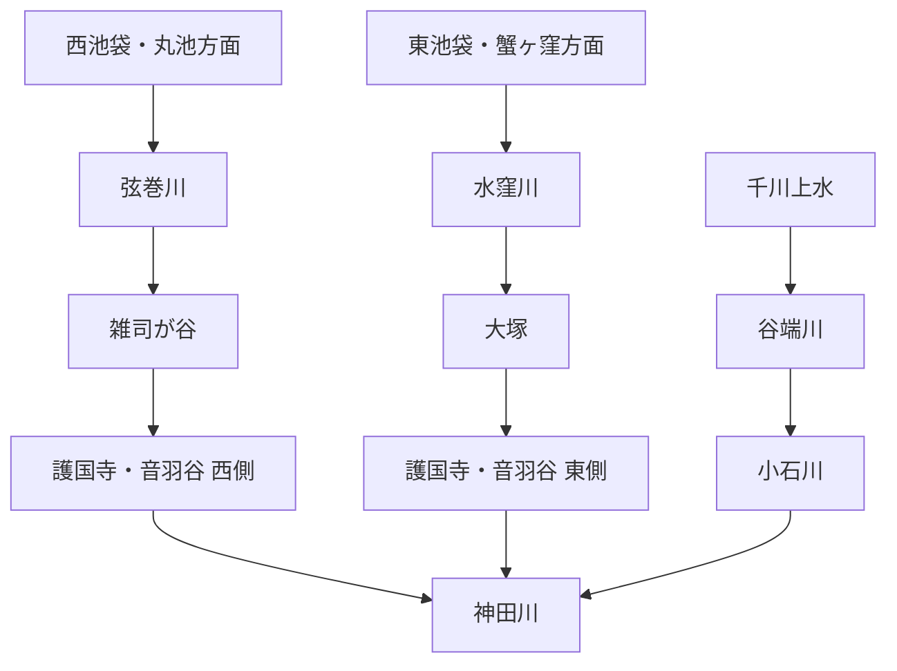

# otowa-ankyoscape

水窪川・弦巻川・谷端川と、その周辺の旧河道・暗渠・湧水・用水・土地利用について調べた記録です。

中心となる範囲は、池袋・雑司が谷・護国寺・音羽・小日向・小石川です。

**追加調査対象：人参川（古茗荷谷川との関係は未確定）** — 2026年10月8日、茗荷谷の西側谷頭について明治初期の地図表示と色別標高図を照合。筑波大学附属中・高の南方にある浅い枝谷が合流する可能性も含め、[人参川の調査ノート](docs/人参川.md)に記録した。**10月8〜9日の現地歩行・二源頭・古地図上の池・筑附南方の分水界候補・還国寺の湧水・水窪川の橋名**は[専用の観察記録](docs/2026-10-09・茗荷谷・人参川現地観察.md)に整理した。名称の史料上の確実性と、水路・谷地形の推定は区別している。

> [!IMPORTANT]
> このリポジトリでは、既知の河川史をまとめるだけでなく、**まだ決着していない流路・接続・成立年代を史料から検証すること**を重視します。
> とくに「水窪川と弦巻川はどこかで合流していたのか」「音羽通り西側の弦巻川下流はいつ成立したのか」「弦巻川・水窪川側と谷端川側の更新世旧河道はどちら向きに流れていたのか」は中心的な未解決問題です。

  

幕末の音羽・雑司ヶ谷周辺を描いた尾張屋版 <i>Otowa ezu</i>。1851年近吾堂板とは別史料。画像をクリックすると合流問題の検討ページへ移動します。

## 未解決問題

このリポジトリの中心です。解決していない問題は川別の概要へ埋め込まず、できるだけ独立した文書として追跡します。

| 問題 | 現状 |
| --- | --- |
| **水窪川と弦巻川は合流していたのか** | [独立文書で検討中](docs/open-questions/水窪川と弦巻川の合流・接続問題.md) |
| **音羽谷西側の弦巻川下流はいつ成立したのか** | [独立文書で検討中](docs/open-questions/音羽谷西側の弦巻川下流の成立年代.md) |
| **更新世の旧河道はどちら向きに流れていたのか** | 滝口志郎（2019）が谷端川側への接続可能性を提示するが、流向は未決着 |
| **千川上水から弦巻川・水窪川へ直接分水したのか** | 谷端川への分水は確認できるが、両河川への直接分水は未確認 |

→ [未解決問題の一覧](docs/open-questions/README.md)

## 水系の全体像

これは近代以降に把握しやすい大まかな配置であり、全時代にそのまま当てはまるとは限りません。近世の造成・灌漑、近代の河川改修、暗渠化、下水道再編によって接続関係や流路が変化した可能性があります。

## 現時点で重要なこと

- **第175回: 三宅観瀬（緝明）『觀瀾集』[3]（写・NDL 2590573）の「十四 秋遊記」を本文側で直接確認（宝永3年〔1706・丙戌〕）＝頼朝の陣所を「川」と記し松橋/板橋のいずれの橋名も記さない中立witness＋「瀧野川道灌山」の1706年定点＋楓樹言及なし（看印寛永7年植樹説への含意）＝BOOK-201新規・GOV-198追記で1930/1931の元文特定（第173回課題④解決・第174回ノートの「デジタル化なし」訂正）。江戸志[5]の内題「新編江戸志巻之五 武陽懐山子輯著」を観察＝NDL目録「江戸志（近藤義休撰）」との対立＝懐山子『新編江戸志』（GAZ-039改正新編江戸志の前身候補）の本文である可能性が強く、年代基準点としての使用を取り下げ（GAZ-039との同条対校が次回課題）。江戸志[5]板橋条＝板橋の別名「木下藤谷」・伽羅稲荷（著者参詣の一次観察）＝1930年の木下出世稲荷/伽羅稲荷/藤吉稲荷（BOOK-122）と対応、源五郎淵由来譚（入水死→淵の主）＋川名候補「大民川」＋涸れ観察、神田上水承応説批判の天正18年大久保忠行説支持の按語、音羽条の元亀比／同頁護国寺条元禄年中＝同書内年次対立、道山幸神社条＝延宝黒馬→駒谷→駒塚橋→黄金馬の別起源譚、椿山正八幡条と「胸突坂＝椿山より目白へ込る坂」、[3]龍不動条＝「功曾久」場所判読（1930・1931と3書一致）＋道潅塚＝メウハンツカ（冥加塚）誤称説（いずれもGAZ-097第175回追記・repo初出群）。BOOK-122追記＝長門本「瀧の川の板橋」の1930年witness・松隣夜話の板橋城記事＝松山城混同批判と「雲をつかむ」・板橋原比定（中山道両側・川越往来両側）・秀忠元和4年〜家光寛永11-12年の板橋原狩猟年次群・十方庵敬順「茶を煮て水の善悪を批判」の水辺点（石神井池畔・前野湧水・上板橋氷川社前河岸）と遊歴雑記史料批判。対照表（松橋行・石神井川行・胸突坂行・音羽町行）・橋名調査第175回追補・第175回ノート追記。
- **第174回: 盛衰記「48巻目録1巻」本の巻23実冊同定で「上龍野河松橋」という新表記系統候補（第173回のID↔巻号対応の訂正）＋江戸志（近藤義休本）残冊9冊のfulltext確認＝金剛寺条の本文側直見（第173回課題①解決）＋王子水道の統計年報レベルの初出候補**——追記2件＋新規1件（[GAZ-097](docs/sources/gazetteers/GAZ-097.md)第174回追記＝江戸志[3]（[2563422](https://lab.ndl.go.jp/dl/book/2563422)）金剛寺条「**瀧河山松橋山金岡寺〔OCR候補〕**…**客縁記云**…**古へは橋あり北国より鎌倉への大道也今は跡のみなす**…**旧記曰武蔵国豊島上滝の川松橋と云処に陣を取**…**天文の比宿印〔OCR・看印候補〕**…**北条氏京へ訴へて終に真言の山に復す**」＝GAZ-094（東京市史稿経由）の江戸志引く金剛寺略縁起・旧記文言の**本文側直接確認（制限③解決）＋山号「瀧河山松橋山」＋略縁起引用書名「客縁記」候補＋看印（宿印）天文中興文言の本文側候補（寛永7植樹説〔GOV-198〕との対立は維持）**＋蟹ヶ窪条（[5]）「**鶯渓の上 伝通院の前…**」＝GAZ-083のOCR判読「愛谷」が本文側では「鶯渓」＝判読前進＋可児（可里）説を「**此説甚偽也**」と退けた按語＋音無川条「**一名等並川〔OCR崩れ候補〕又音なし川**…**すへなし川**」＋引用書「**元文世説**」の元文4年（1739）白雉の瀧野川辺放生記録＋雑司谷条＝雑司料説の出典を「**金剛寺の伝記**」に帰属＋本仏寺条＝GAZ-071（1828書上）と同一縁起の江戸志採録（書上に先行する流通の年代引き上げ候補・小納町／小網町表記対立）＋南向茶舘引用の寛永以前流路「**小石川の流は今の三崎稲荷の辺より一ツ橋の堀の川へ流るゝ**」＋『求凉雑記』直接引用2条（飛鳥山・麹町の**左内坂〜加賀屋敷の石樋＝小児の咳の治癒を祈る石樋の記録候補**＝GAZ-092制限②の引用書運用傍証）＋逆川「**一名石神川**」候補・[GOV-408](docs/sources/gov/GOV-408.md)（新規）＝内務省土木局第二十七回統計年報（1927・[1077166](https://lab.ndl.go.jp/dl/book/1077166)）の大正13年度〜14年末水道統計表＝**王子水道（水源＝瀧野川鑿井・滝野川町字馬場候補／給水区域＝北豊島郡滝野川町・王子村・板橋町・巣鴨町・西巣鴨町候補）＋「神田川上流鑿井」（豊多摩郡落合村候補）＋淀橋町水道＝東京市水道區分水（角筈）の行候補（いずれも多桁表の行対応崩壊で文言候補扱い・原画像照合必須）**）＋[GAZ-096](docs/sources/gazetteers/GAZ-096.md)第174回追記＝**「48巻目録1巻」本の巻23-24実冊は[2544763](https://lab.ndl.go.jp/dl/book/2544763)（25冊合本＝惣目録＋奇数巻首24冊）で、本文「**武蔵国豊嶋ノ上龍野河松橋ト云所ニ陣ヲ取**」＝「上龍野河松橋」の新表記系統候補（OCR・瀧→龍誤読の可能性を排除せず原画像照合必須）＝名所図会「世俗龍野河と云は誤り」按語の俗呼「龍野河」と版本本文表記の接続仮説の対照材料＋巻23章題「源氏隅田河原取レ陣事」の惣目録採録＝**第173回の「2544773=巻23・2544774=巻24で松橋文言なし（陰性）」記録はID↔巻号対応の誤りと訂正（2544763=巻23-24冊＝陽性・2544773=巻43冊・2544774=巻45冊＝隅田河原章を含まず）**＋対照表（松橋行・石神井川行・蟹ヶ窪行・清土/鬼子母神行）＋[橋名調査](docs/四河川の橋名・橋跡調査.md)第174回追補。⑤監視系＝news_search 6クエリ（2026-10-18〜11-18）全0件・kanzyou7 WHAT'S NEWは2026/11/13工程表更新のみ・都建設局は自動取得不能・神田川整備工事（その158）の開札2026-12-02はまだ未来・観瀬『秋遊記』『遊歴雑誌』はNDL labにデジタル化なし（陰性・継続課題）・中用水/下用水組合の規約・名簿は未発見のまま。〔いずれもOCR由来で文言は要原画像照合。「上龍野河」表記・「宿印（看印）」判読・山号・「鶯渓」判読・元文世説・客縁記・王子水道の行対応・江戸志の成立年代はいずれも断定せず対校案件として記録〕**詳細は[第174回ノート](docs/2026-11-18（第174回）・盛衰記48巻本の巻23冊松橋文言「上龍野河」確認と江戸志残冊9冊の文言群・王子水道統計年報の追加調査.md)**。
- **第173回: 盛衰記の版本誌学（NDL lab書誌APIで[2544856](https://lab.ndl.go.jp/dl/book/2544856)＝藤本久兵衛板・[2544839](https://lab.ndl.go.jp/dl/book/2544839)＝出版者不明板と板元が判明）＋GAZ-094制限⑤（名所図会金剛寺条周辺の精読）を解決＋松橋/板橋対立の新軸（第2軸）を一挙に4系統で確認＋王子側瀧不動（正受院）の記録群（repo初出）**——新規3件（[GAZ-097](docs/sources/gazetteers/GAZ-097.md)＝『江戸志』[2]（近藤義休撰・瀬名貞雄補・写本10冊の[2]）橋場条「橋場本名石浜。源平盛衰記を考るに…豊島の上瀧野川松橋に陣となれはその時の橋場なる故かくは名付るなるへし」＝**橋場の地名を盛衰記の松橋陣所に由来させる江戸前期地誌の本文＋江戸砂子の太平記解釈への批判的按語（repo初出の書）**・[GAZ-098](docs/sources/gazetteers/GAZ-098.md)＝大橋方長『武蔵演路』（天保12〔1841〕写）隅田川条の**長門本平家物語「武蔵国豊嶋の上瀧の川の板橋」＋源平盛衰記「上瀧野川板橋」の並列引用＝長門本も盛衰記も「板橋」として引く1841年の考証記録（repo初出。大橋方長＝江戸往古図説・望海毎談と同一著者）**・[BOOK-200](docs/sources/books/BOOK-200.md)＝『源平軍物語』（国史研究会1919活字）「**武藏の國豐島の上、瀧野川松橋**」＝「上」で区切る読み候補の新文言系統）＋追記4件（[GAZ-096](docs/sources/gazetteers/GAZ-096.md)＝「48巻目録1巻」本巻23-24の松橋文言なし（陰性）＋江戸名所図会巻七音無河条「**本名を石神井川といふ…世俗龍野河と云は誤なり。瀧野河村と号して河の名にはあらす**」＝**「龍野河」俗呼の実在記録（repo初出）＋「瀧野河」＝村名とする称名判断（制限⑤解決）**＋瀧不動条（正受院・金剛寺の東二丁あまり・弘治年中の学仙坊草創・洪水での不動霊像感得譚・2559054のみ「**天文の頃中興阿闍梨看印**」）・[GAZ-078](docs/sources/gazetteers/GAZ-078.md)＝滝野川村の字名一覧表OCRの列崩れ文字列の「**上瀧野川**」＝**字名「上瀧野川」候補（盛衰記の「上瀧野河」＝村の「上」部由来説に対する行政側字名レベルの候補・要原画像照合）**・[GOV-198](docs/sources/gov/GOV-198.md)＝【金剛寺】条「**一説には盛衰記の松橋は誤りで長門本平家物語には板橋とある**」＝**長門本=板橋説の1931年言及（repo初出）**＋頼朝陣所＝松橋院号由来説＋観瀬『秋遊記』の道灌山記録＋**明治40年の金剛寺火災で記録什宝皆焼失（影向石の現存説）**＋【正受院】条＝思惟山三昧寺・**文禄3年（1594）9月本堂再建棟札**・「**堂後の岸に小さい瀧があつて不動尊がある、之れを瀧不動と稱し有名**」・病気湯治〔遊歴雑誌〕＝**王子側瀧不動の1931年記録（repo初出群。大塚側の滝不動とは別物）**＋【瀧野川の紅葉】条＝看印の楓樹植樹を**寛永7年（1630）**とする年次文言（名所図会の「天文中興」説と対立・要照合）＋【瀧野川城趾】条＝瀧野川氏系図（信久→信川→久吉→久道・「光明は長門守と稱」）＝GOV-196の「瀧野川長門守」説の系譜側の具体化＋【昔の鎌倉街道】条＝南向茶話引用の経路（高田馬場→雑司ヶ谷法明寺→…→滝野川村→豊島→千住））＋対照表（松橋行・石神井川行の追記＋**瀧不動〔王子正受院〕行の新設**）＋[橋名調査](docs/四河川の橋名・橋跡調査.md)第173回追補。**松橋の表記対立は「野河/野川/ノ川」（第1軸）に加え「松橋/板橋」（第2軸）と「上」の区切りの問題（豊島の上＋瀧野川）の3層構造に整理されたが、いずれの系統関係も断定しない（対校案件として管理）**。⑤監視系＝news_search 6クエリ（2026-10-19〜11-18）全0件・kanzyou7 WHAT'S NEWは2026/11/11現場見学会終了のまま・都建設局は自動取得不能・開札2026-12-02はまだ未来・中用水/下用水組合の規約・名簿の探索はNDL lab横断検索で既登録資料のみにHitし成果なし（第172回課題④は未解決のまま）。〔いずれもOCR由来で文言は要原画像照合。盛衰記諸本（藤本久兵衛板/出版者不明板/48巻目録1巻本）の同異版関係・長門本平家物語の本文原形（板橋）・看印の中興年代対立（天文中興vs寛永7年植樹）・字名「上瀧野川」の判読・瀧野川氏系図の史料性はいずれも断定せず対校案件として記録〕**詳細は[第173回ノート](docs/2026-11-18（第173回）・盛衰記版本誌学と長門本板橋説・江戸志橋場条・武蔵演路引用群・名所図会音無河条按語・北豊島郡総覧の王子瀧不動群の追加調査.md)**。
- **第172回: 源平盛衰記の江戸初期版本2本（NDL次世代DL〔2544839](https://lab.ndl.go.jp/dl/book/2544839)〕・〔[2544856](https://lab.ndl.go.jp/dl/book/2544856)〕）の本文直接確認で[GAZ-096](docs/sources/gazetteers/GAZ-096.md)（新規）＋[GAZ-094](docs/sources/gazetteers/GAZ-094.md)の制限④「盛衰記の諸本の本文異同は未了」を解決＋[GAZ-093](docs/sources/gazetteers/GAZ-093.md)追記（巻之二十〜二十四の水系文言走査＝陰性＋本所白堀上水条）＋[GOV-196](docs/sources/gov/GOV-196.md)追記＋[対照表](docs/地名・河川名対照表.md)松橋行追記＋[橋名調査](docs/四河川の橋名・橋跡調査.md)第172回追補＋[第172回ノート](docs/2026-11-18（第172回）・源平盛衰記版本2本の本文直接確認と風土記稿巻之二十〜二十四走査・農業志料の長門守説.md)**。**
①**盛衰記版本2本の本文「武蔵国豊嶋ノ上瀧野河松橋ト云所ニ陣ヲ取テ其勢既十萬余騎」が両版本で一致（GAZ-094制限④の解決）**——松橋の修飾語の表記対立群（上瀧ノ川〔風土記稿〕／上瀧の河〔江戸志引く旧記〕／上瀧野河〔版本2本・江戸名所図会金剛寺条の引用・1885年活字版・江戸紀聞〕／上瀧野川まつ橋〔東京市史稿引く盛衰記〕／上瀧野川松橋〔江戸砂子温故名蹟誌〕）＝「野河／野川／ノ川」の3系統に整理（**系統関係は断定しない**・OCR・要原画像照合）。巻頭部の「江戸湾西」〔2544839〕vs「江戸葛西」〔2544856〕の異同もOCR崩れ候補として記録。
②**[GAZ-093](docs/sources/gazetteers/GAZ-093.md)追記: 風土記稿巻之二十〜二十四（葛飾郡・763978）の水系文言走査＝「谷端」「千川」「弦巻」「水窪」すべて0件（陰性）**。「江戸川」文言は埼玉郡側の大利根川の川名語源記事（東京の江戸川＝神田川とは別物）。本所側の「白堀上水」（小梅古上水）条＝延宝8年江戸安見図掲載・萬治寛文作立推定・綾瀬川「誤り」考証・享保7年業平橋東以南埋立の文言＝BOOK-157武江年表・GOV-170系の本文側対校点。
③**[GOV-196](docs/sources/gov/GOV-196.md)追記（北豊島郡農業志料・1903）**: 滝野川村名由来の**「瀧野川長門守」説**（領主＝豊島氏の臣・官途名つきの領主氏説＝repo初出候補。「豐鳥氏」はOCR崩れ候補）＋盛衰記引用「上瀧野河松橋ニ陣ヲ取ルト載セタレハ既ニ此地名ヲ稱セシコト明ナリ」＝版本系表記と一致する1903年の引用形＋**石神井用水の中用水組合・下用水組合（郡長管理）＋分水組合23（町村長管理）**の制度文言（repo初出候補）。
④監視系＝news_search 6クエリ（2026-10-19〜11-18）全0件・kanzyou7 WHAT'S NEWは2026/11/13のまま・都建設局は自動取得不能・開札2026-12-02はまだ未来。**並走する同一タスクの第171回実行が先にpush済みだったため、本実行は並走実行の未カバー領域（盛衰記版本本文・農業志料・巻之二十〜二十四走査）のみを第172回として反映**（詳細は第172回ノート）。〔いずれもOCR由来で文言は要原画像照合。盛衰記諸本の系統関係・「瀧野川長門守」の比定・中用水/下用水組合の地理的範囲は断定せず対校案件として記録〕**

- **第171回: 『江戸砂子温故名蹟誌』（沾凉纂緝・恒足軒再校・明和9年・1772）の全14冊（2系統×7冊）写本走査・対校で[GAZ-027第171回追記](docs/sources/gazetteers/GAZ-027.md)＋[GAZ-094](docs/sources/gazetteers/GAZ-094.md)の第170回課題②「再校江戸砂子のデジタル化探索」を解決＋[対照表](docs/地名・河川名対照表.md)新規4行・追記2行＋[橋名調査](docs/四河川の橋名・橋跡調査.md)第171回追補＋[第171回ノート](docs/2026-11-18（第171回）・再校江戸砂子＝江戸砂子温故名蹟誌の書誌同定・全14冊の写本対校と蟹が窪・松橋・玉川上水・蜘蛛の井の明和9年文言.md)**。いずれもNDL次世代DLのくずし字OCR由来で文言は要原文照合。**
①**「再校江戸砂子」＝本書の書誌同定（第170回課題②の解決）**——[GAZ-094](docs/sources/gazetteers/GAZ-094.md)（東京市史稿宗教篇第二・1936）が雑司ヶ谷鬼子母神条に引用する「**再校江戸砂子**」の文言「**鬼子母神出現の所えと。弦まき川の流のしもそへ**」＝星跡清水条の本文（GAZ-027既登録）と文言一致・「弦まき川」表記まで一致し、**東京市史稿の引用源「再校江戸砂子」が本書（江戸砂子温故名蹟誌・恒足軒再校）に書誌同定される**（星跡清水系譜の原典系を確定）。**写本対校も前進**: 巻之四の2写（2565900系・2563640系）の対校で弦巻川条の判読を確定読みに寄せ、2563640系に「**鈴巻川**」表記があることを記録、雑司谷八境の8項目構成が[BOOK-183](docs/sources/books/BOOK-183.md)（雑司谷村誌・1901）の八境列挙と一致することを確認（OCR・要照合）。
②**落合三昧条（repo初出）**——巻之四「**落合三昧 高田の内也 清弟の橋より三町はかり川上 上水川と雑司谷の細流との間也 此所の蛍すくれて大也**」（2565900）／「**蒲近傍の橋**…上**木**川…」（2563640）＝**神田上水（上水川）と雑司谷の細流（弦巻川下流）が並走する高田落合の区間で、「三昧」という蛍の名所が橋の三町ほど川上にあるとする1772年の位置記録**。橋名の判読対立（清弟の橋／蒲近傍の橋）は要原文照合で比定は断定しない。八境の「蛍」・弦巻川観螢系譜（BOOK-113）に接続する初出層。
③**姿見の橋条（repo初出候補）**——巻之四「**姿見の橋…高田上水川にかゝる長十二(間?)四尺**」（2写文言一致）＝**高田上水川に架かる長さ十二間四尺の「姿見の橋」の1772年記録**＝[GAZ-030](docs/sources/gazetteers/GAZ-030.md)（江戸名勝志）の安見橋（上水川・長サ十二間四尺・「面影橋とも云」）と**規模が完全一致**＝安見橋＝面影橋系の橋の先行記録候補（同一橋かは断定しない。谷端川の姿見橋〔BOOK-062〕とは別水系の同名橋で混同注意）。
④**玉川上水条の助水文言（repo初出・[GOV-366](docs/sources/gov/GOV-366.md)の77年先行）**——「**玉川上水 角はすより淀橋方の流をわかち…神田上水井頭の助水となりて…小石川に出る**」＝**角筈で玉川上水から淀橋方へ分かつ流が「神田上水井頭の助水」となり小石川へ出る**とする明和期の分流記録＝千川上水＝神田上水助水説（千川架説採碑文〔GOV-366〕）の**1772年先行本文**。分流の帰属（千川系か）は本条だけでは断定せず原画像照合保留。
⑤**面影橋条の異名群・改称伝承（[BOOK-194](docs/sources/books/BOOK-194.md)の64年先行・原典候補確定）**——巻之五「**淀橋なる(戸塚?)宿と中野の間 又面影の橋 みずの橋 姿か橋ともいふ 寛永の頃御鷹狩の節淀橋と改むへしと上意ありしと也**」＋朝日長者の下男殺し譚「**その下男のわたりたるは人見たれとも帰る所を見さるゆへに姿見すの橋といふ**」＝**①異名「みずの橋・姿か橋」、②寛永御鷹狩の節の淀橋改称上意伝承、③「姿見すの橋」名義譚の1772年本文**＝土岐頼旨『井の頭』（1836）の当該文言とほぼ同一＝**BOOK-194の記事の原典（または共通原典）候補が本書に確定**＝面影橋＝淀橋の異名群（安見橋〔GAZ-030〕・不姿見橋〔GOV-396〕・姿見ず橋〔BOOK-148〕）に1772年の起点本文を追加。
⑥**圓融寺条の蜘蛛の井／塩の井（repo初出）**——巻之五「**蜘蛛の井境内にあり…山際に穴あり その穴より涌水也 毒ありて飲者死と也…この穴むかし土の巣(蜘蛛)なつと云渡辺綱三田にありし時土蜘蛛をしたかへしといふは当所の事…此水にてあやまち多かりけれはこれを埋あらたに本堂の側に用水の井をほり これを塩の井(蜘の井・他写本)と号 古跡をうしなはさるのしるし也**」＝市ヶ谷圓融寺（[GAZ-073](docs/sources/gazetteers/GAZ-073.md)の寺）の**渡辺綱土蜘蛛退治譚の穴の毒水を埋め、本堂脇に新たに掘った「塩の井／蜘の井」の縁起本文（1772）**＝市ヶ谷の湧水・井戸系譜の新規記録（寺領二百石も記録。「塩の井」〔2563641〕／「蜘の井」〔2565901〕の写本対立は要照合）。
⑦**その他の対校・先行記録**: ①蟹が窪条「**蟹が窪 小石川御たんす町組やしきの所 むかし大なる碑(石?)ありし故といふ 後にその蜘(石?)を一社にまつれりといふ説もあり 又可児何かし住居ゆへともいふ**」＝[GAZ-083](docs/sources/gazetteers/GAZ-083.md)（小石川志料・1811）の39年先行の3説本文（対照表の蟹ヶ窪行に追記）②巻之一水道橋条「飯田町の旧流→入堀・万治年中松平陸奥守…吉祥寺橋」＝水道橋下流の旧流・入堀系文言の1772年本文（GAZ-083の先行）③穴八幡条「**雑司谷御薬園の主にやとす**」（寛永18年〔1641〕・良昌僧都）＝音羽護国寺地＝御薬園説の職主の縁起文言＝高田殿／北薬園行に追記（[GOV-369](docs/sources/gov/GOV-369.md)の白山御殿跡・御薬園文言の先行観察）④巻之三小石川側「**御茶園 小石川白山御殿の旧地也**」＋御薬園の舟繋松・野中の清水＋享保年中の施薬所⑤舟山条「**舟山 中里の旧名也 むかし此所に御茶屋あり 寿寧軒と号させたまふ 又達観といひし御望樓もありし**」＝中里＝舟山の旧名説＋御茶屋（対照表新規行。第169回の御殿山＝舟山〔林羅山「舟山茶亭記」〕との異同は断定しない）⑥巻之二橋場条「**治承四年庚子十月…豐嶋の上瀧野川松橋に陣をとるとあり これ(は)そのときの橋場ならんか**」＝盛衰記系松橋文言の地誌採録の1772年例（GAZ-094の松橋文言群の先行対校点）⑦井の頭池条「七井の池」＝[GAZ-065](docs/sources/gazetteers/GAZ-065.md)引用の原典候補⑧三田の水窪（渡辺綱出生地の同名異所）＝false positiveとして記録。
**監視系はすべて実施・変化なし**: kanzyou7（弦巻川・仙川ABS堰WG）WHAT'S NEWは2026/11/13のまま／東京都建設局の神田川流域整備計画ページは今回も403（決定版未公表扱い）／news_search 6クエリ（弦巻川・谷端川・千川上水等・2026-11-11〜18）はすべて0件／都の開札（千川上水関係）は2026-12-02予定でまだ結果なし。
- **第170回: NDL次世代DL 1915639（東京市史稿宗教篇第二・1936）と燕石十種第3収録の望海毎談（大橋方長・1800自序）の初回精読で新規2件（[GAZ-094](docs/sources/gazetteers/GAZ-094.md)・[GAZ-095](docs/sources/gazetteers/GAZ-095.md)）＋追記3ファイル（[GAZ-092](docs/sources/gazetteers/GAZ-092.md)・[GAZ-093](docs/sources/gazetteers/GAZ-093.md)・[GOV-407](docs/sources/gov/GOV-407.md)）＋[対照表](docs/地名・河川名対照表.md)2行追記3行新設＋[橋名調査](docs/四河川の橋名・橋跡調査.md)第170回追補＋[第170回ノート](docs/2026-11-18（第170回）・東京市史稿宗教篇の金剛寺条と望海毎談の入江説・風土記稿巻之十九の境川候補・視聴草第72冊の三集之八構造.md)**。**
①**東京市史稿宗教篇（repo初登録）の金剛寺（松橋弁天）条で松橋の橋名候補が前進**——江戸志引く金剛寺略縁起「**古へは橋なり。北國より鎌倉への大道なり。今跡のみ存た**」＝**松橋の橋跡存続文言（repo初出）**＋「**此地を瀧の河と名付る事を、瀧なくして河の音四方はひゝくゆへなり**」＝瀧ノ川村名由来の縁起本文候補＋**源平盛衰記本文の長文直接引用「武藏の國豐嶋郡の上瀧野川まつ橋と云所ま陣を取」**＝松橋の表記対立群（上瀧ノ川〔風土記稿〕／上瀧の河〔江戸志引く旧記〕／上瀧野河〔江戸紀聞〕）に**盛衰記本文「上瀧野川まつ橋」を追加**＋江戸志の批判的按語「**上矢を奉りしは六所の明神なり。この辨才天へたてまつりしと云は、いかなる舊記にや、おぼつかなし**」（上矢奉納先を王子とし弁天への奉納を疑う考証）＋江戸紀聞「**王子權現の西の方三四丁**」「**此地い石神井河の流よ臨ミ**」・頼朝奉納太刀一振＝当社宝物＋東京近郊名所図会「**此處往古い海なりしかば、貝殻の存きる者多し…好古者の來りて土を穿ち之を求る者頻繁なるより、かく埋めたるなり**」＝松橋弁天洞窟の貝殻・入海説＋武蔵古蹟志掲載の文保3年古牌の図（長2尺4-5寸・幅1尺・「岩屋前瀧野川端に臥て有り」）＝**縁起・考証・名所記の3系統の態度の対立をなす対校記録群**（いずれも東京市史稿経由の二次引用・OCR要照合）＋**雑司ヶ谷鬼子母神条の再校江戸砂子引用「鬼子母神出現の所えと。弦まき川の流のしもそへ。夜あとみ此所ま星くさりけるを…鬼子母神の像あり」＝出現地を弦巻川流下・星降り跡とする系統（repo初出文言・星の清水系譜に加わる）**＋天正6戊寅年棟札本文（山本丹右衞門・東陽坊＝大行院）＋〓土出現所＝本浄寺の南一町・方20余間・三角の井。
②**大橋方長の別作品『望海毎談』（repo初収録）で入江説の詳論本文を確認**——「**昔は芝浦の海の潮此所迄入來る入江の續にて斯三ツの岡の打續を以て谷中の岡に三崎と云地名有其中間に有る池の大さ十二萬坪**」＝忍の岡・向ふの岡・入砂の岡の三岡連続による**三崎地名由来説＋不忍池12万坪伝承**＋「**三河島より少々北手に牡蠣山あり…其昔橋塲邊の方より此邊大船の類迄通る程の川もなかりつべし**…**惣じて谷中より三河島の末までも土地甚低くややもすると河水の揚るをみれば古來は入江にて川もなかりつべし**」＝**三河島〜尾久の蠣売山・古入江説（GAZ-092追記の江戸往古図説三河島村条と同じ著者の村条側採録）**＋「**日暮里一入堀と云所**」・静勝寺「**十條邊入堀**まで山續」＝入堀系文言候補（OCR区切り注意・要照合）＝谷端川・谷戸川下流域の古入江論の系譜（関口新町貝殻層・網干坂入江伝承の対照点）に1800年の詳論が加わる。
③**[GAZ-092](docs/sources/gazetteers/GAZ-092.md)第170回追記（江戸往古図説下巻の周辺村条）**: 瀧野川村条「**古名松橋辨天と云…六百有餘年の古蹟也**」＝GAZ-093松橋記録の1800-01年先行対校点＋谷中村条（北條分限帳所出・「いにしへは谷にて三崎につゞき」・善光寺旧地＝谷中善光寺坂）・新堀村条（北條舊記所出・行基開発説〔諏訪縁起〕・道灌斥候臺丘＝本行寺境内・道灌山古名＝新堀山）・**三河島村条「北條分限帳には此地細谷三河守といへる人知行住居の所といへり」＝三河島語源の細谷三河守説（repo初出候補）**・鳥越村条（堯惠「鳥越の海村」・道興「鳥越の里」・正保2年官命→山谷替地→新鳥越移転・白鳥神社＝当社説）・志村の丸池＝むかしの川筋説・不忍池＝篠輪津池・瀬織津姫説。
④**[GAZ-093](docs/sources/gazetteers/GAZ-093.md)第170回追記（風土記稿巻之十九＝763978の未登録巻の初回精読）**: ①763978の実際の収録範囲＝巻之十八＋巻之十九（豊島郡之11）＋巻之二十〜二十四（葛飾郡）の確認。②**上駒込村条「北境西ケ原村ノ接地テ流ル或ハ境川トモ呼谷戸川…染井ノ內長池ト云池ヨリ西ケ原村ヘ沃ク」＝谷戸川の別称「境川」の文言候補（repo初出候補・OCR崩壊大で原画像照合必須・対照表の石神井川〔谷戸川〕行に追記）**＝長池→西ヶ原への流路の官撰側記述。③巻之十九末尾の千住側条の石神井用水・荒川幅70間・文禄3年棟札（帰属条名は要照合）。
⑤**[GOV-407](docs/sources/gov/GOV-407.md)第170回追記: 視聴草第72冊の内容細目全文（NDL Searchの埋込JSONから取得）＝「三集之七」10項目＋「三集之八」10項目の計20項目、「井頭上水役由緒」＝三集之八第7項目（全体17/20項目目）**＝**第72冊の書名群が甲集第73冊総目（GOV-406）と一致しないため「甲集第73冊の写し」候補は後退し、続視聴草（三集系）の独立の写本伝統として位置づけ直し**（該当コマは未特定・均等配分仮定でコマ160-175前後の推定範囲・人手判読待ち）。影印本「視聴草」目次索引（福井保編・1996）の所在も確認。監視系＝news_search 6クエリ（2026-10-19以降）全0件・kanzyou7 WHAT'S NEWは2026/11/13のまま・都建設局「河川整備計画について」頁は更新日2026年11月9日のまま（神田川流域決定版は依然未公表）・開札2026-12-02はまだ未来。詳細は[第170回ノート](docs/2026-11-18（第170回）・東京市史稿宗教篇の金剛寺条と望海毎談の入江説・風土記稿巻之十九の境川候補・視聴草第72冊の三集之八構造.md)。〔いずれもOCR・活字版・二次引用由来で文言は要原画像照合。松橋の橋跡文言の原字・「境川」の範囲・「一入堀」の区切り・細谷三河守の人物比定・視聴草と甲集の対応は断定せず対校案件として記録〕**
- **第169回: 燕石十種第3の江戸往古図説活字版（[GAZ-092](docs/sources/gazetteers/GAZ-092.md)・1908）と新編武蔵風土記稿巻之十八（[GAZ-093](docs/sources/gazetteers/GAZ-093.md)・1884刊）の初回精読で新規2件＋追記2ファイル＋[対照表](docs/地名・河川名対照表.md)3行追記4行新設＋[橋名調査](docs/四河川の橋名・橋跡調査.md)第169回追補＋[第169回ノート](docs/2026-11-18（第169回）・燕石十種江戸往古図説活字版の初回精読と風土記稿巻之十八滝野川村条・井頭上水役由緒の視聴草第72冊デジタル化発見.md)**。**
①**江戸往古図説（1800-01成立）の活字版対校で「皇角原」→「**皂莢原**」の誤読候補を提示**（読み確定は写本原画像照合まで保留）＋小石川村条「**往古小石川といふ流れ有て…巢鴨西北よりねこまた橋の方を通り傳通院うしろの邊を流れし大川也**」（ねこまた橋川筋＝小石川流路説のGAZ-083と同型の先行テキスト・北條分限帳・牛天神社傳所出説）＋小日向村条の**白鳥池＝久永氏宅地池（GAZ-049⑬の幕末記録の1800-01年先行記録）と江戸川水筋替え説**＋**飯田川・袖摺橋・市谷長圓寺池水→飯田町堀止（神田川堀割以前の市中旧流路譚・repo初出）**＋下卷末尾の澁谷〜雜司ヶ谷〜護國寺うしろ〜瀧野川〜西ヶ原〜石濱の古道条・「中道」。
②**風土記稿巻之十八滝野川村条「用水ハ仙川分水ノ下流ヲ引沃ク」＝滝野川村が仙川用水受益村である官撰文言（repo初出・1918年郡誌の先行記録）**＋**源平盛衰記「上瀧ノ川松橋ト云處ニ陣取」＋松橋辨天「當時此地ニ松橋ト云橋アリシ故」＋文保3年（1319）古牌＝中世の橋名候補（[橋名調査](docs/四河川の橋名・橋跡調査.md)第169回追補）**＋北條役帳の江戸瀧野川知行・源五郎淵・西ヶ原小名橋戶・田端村条の谷戸川注記・上中里村条の御殿山＝舟山（林羅山「舟山茶亭記」の池島文言）。
③**[GOV-407](docs/sources/gov/GOV-407.md)第169回追記: 井頭上水役由緒の所在問題が前進**＝NDL書誌で著者**内田茂重郎**を確認＋**視聴草第72冊（宮崎成身編・pid [14970321](https://dl.ndl.go.jp/pid/14970321)・PDM・2026-08-26公開・192コマ・IIIF取得可）の内容細目に「井頭上水役由緒」が含まれる**＝甲集第73冊本文画像が閲覧可能になった発見（該当コマ特定は次回課題）。監視系＝news_search全クエリ0件・kanzyou7 WHAT'S NEWは2026/11/11のまま変化なし（開札2026-12-02はまだ未来）。
- **第168回: NDL次世代DLのfulltext精読の続きで第167回の未解決課題を3件前進させた回（新規1件＋追記5ファイル＋[対照表](docs/地名・河川名対照表.md)4行追記＋[橋名調査](docs/四河川の橋名・橋跡調査.md)第168回追補・INDEX再生成）**。主な新情報は①**[GAZ-090](docs/sources/gazetteers/GAZ-090.md)の書名同定（第167回課題③の解決）**——fulltext冒頭の自記「**東京府文獻叢書甲集第四冊地理 明治十一年一月輯 江戸往古図説 大橋方長**」＋自序末尾「**寛政庚申年 大橋（方長）**」＋城郭条「**当今享和元辛年**」＝**大橋方長『江戸往古図説』（成立1800-01年・東京府文献叢書甲集第四冊）**と同定＝**鶏声窪旧名「皇角原」説の記録に年代基準点が確定**（1750年実務文書〔[GOV-403](docs/sources/gov/GOV-403.md)〕→1779年由来譚〔[BOOK-197](docs/sources/books/BOOK-197.md)〕→**1800-01年旧名説〔GAZ-090〕**→幕末御成道筋〔[GOV-404](docs/sources/gov/GOV-404.md)〕の通時系列。皇角原の原字形は要照合のまま）、②**同書の増司ヶ谷村条（repo初出候補群）**: 「**増司谷村北條分限帳ニ出今雜司谷ト書ス比ワタリ古ヘ巣鴨ノ庄ト云シ由**」＝**旧字「増司谷」の北条分限帳所出説＋古巣鴨庄説**＋「**鬼子母神ハ永禄ノ頃清土ト云地ヨリ堀出スト云清土又清戸トモ書民俗ハセイトウト云リ此地ニ今三角ノ井ト云アリ此地鬼子母神出現ノ所ト云**」＝**清土＝清戸の別書と民俗音セイトウ＋「三角の井」の1800年の独立記録**（[GAZ-066](docs/sources/gazetteers/GAZ-066.md)三角井泉・[GAZ-070](docs/sources/gazetteers/GAZ-070.md)三ヶ用井に先立つ対校点で、鬼子母神掘出地＝三角の井の系統の年代を遡らせるdatapoint）、③**[GAZ-091](docs/sources/gazetteers/GAZ-091.md)（武蔵名勝図会）の本文初回精読（第167回課題③の残り）**: 善福寺川条（**上荻窪村善福寺池湧出→下荻窪・成宗→大宮八幡山際・川巾一町半**）＋妙正寺池条（**広さ三百坪余・妙正寺境内中**＋流出の井頭上水侵入文言候補）＋池袋村条の**沼の大蛇譚と水涸れ**（退治→水涸れ→「今は僅か四面五間・真ん中は深さ七間」候補＝[BOOK-100](docs/sources/books/BOOK-100.md)豊島風土記「池袋の池跡と地名のおこり」の系譜に加わる名勝図会側datapoint・本沼が丸池〔元池袋の池〕と同一かは断定しない・OCR崩壊大）、④**軽子橋の築地比定（第167回課題⑤の解決）**: NDL次世代DL横断検索で「軽子橋」全219件ヒットが**いずれも築地文脈**（御府内往還沿革図書七・御府内沿革図書二篇上・交通調査統計表〔大正14〕等・鉄砲洲・明石橋・「築地之内十二番組軽子橋辺」）＝「笹地」＝「築地」のOCR崩れ候補が有力＝**[GOV-404](docs/sources/gov/GOV-404.md)の軽子橋は築地の橋の可能性が高く四河川流域の橋候補から除外**（OCR照合まで断定はしない）、⑤**[GOV-407](docs/sources/gov/GOV-407.md)（新規）＝帝国図書館和漢書件名目録第2編・和漢図書書名目録第3編の「井頭上水役由緒 內田茂重著 献叢書甲集第七三册」＋「井頭上水役由緒錄」**＝『井頭上水役由緒書』（[GOV-406](docs/sources/gov/GOV-406.md)・東京府文献叢書甲集第73冊）の**著者（內田茂重）と献上系の帝国図書館の目録記録**（第167回課題④の所在手がかり。次世代DLに甲集第73冊本体のデジタル化冊は確認できない＝陰性観察。静嘉堂『井頭上水由緒』〔GOV-384〕との異同は原冊確認まで保留）、⑥同書（江戸往古図説）の池袋村条（**「大窪ノ北高田ノ西ナリ」＝池袋村の相対位置の1800-01年記録**＋諏訪社〔別当玄国寺・旧社鎮坐不詳〕・古鎌倉道の伝）・石神井村条（**三宝寺池の下流が古図では「王子村ノ方ヘ流レ」今の水筋とは少し違う旨の石神井川旧流路考証の1800-01年の例**・四河川の範囲外の参考記録）・誓閑寺条（**高田馬場下の誓閑寺境内の小流＝荏原・豊島両郡境・鐘銘「武州荏原郡」**＝どの谷川かの同定は本文言では不可能で断定しない・誓閑寺の現所在地確認が次の一手）・平川村条（往古「平川」の流路〔水道橋の上→飯田町下→一ツ橋南東→白銀・油・浜町間〕と常盤橋＝大橋の江戸前島旧流路考証）をGAZ-090に追記。監視系はnews_search/unified_search（recency 14〜60日）＝対象河川の直接の新規報道なし（決定版神田川流域計画は依然未公表）・**kanzyou7.com WHAT'S NEWの再取得に成功するも2026/11/13のまま変化なし**・都建設局は引き続き403（R5.3版が最新扱い）・開札2026-12-02はまだ未来。詳細は[第168回ノート](docs/2026-11-18（第168回）・江戸往古図説書名同定と皇角原説の年代確定・増司ヶ谷村条と三角の井・武蔵名勝図会本文初精読・軽子橋築地比定・井頭上水役由緒の目録記録.md)。〔いずれもOCR由来で文言は要原画像照合。皇角原の原字形・「増司谷」の北条分限帳実在・誓閑寺の小流の同定・軽子橋の築地比定は断定せず対校案件として記録〕**
- **第167回: 御用向諸事日記・触留第20/54冊・屋敷渡預絵図証文・大東京新区町名地番表・東京府文献叢書・中野町誌・戸塚町誌・中野町勢要覧・江戸期随筆・読み物・武蔵名勝図会のfulltext横断で新規13件（[GOV-401](docs/sources/gov/GOV-401.md)〜[GOV-406](docs/sources/gov/GOV-406.md)・[BOOK-195](docs/sources/books/BOOK-195.md)〜[BOOK-199](docs/sources/books/BOOK-199.md)・[GAZ-090](docs/sources/gazetteers/GAZ-090.md)・[GAZ-091](docs/sources/gazetteers/GAZ-091.md)）＋追記4ファイル（[GOV-396](docs/sources/gov/GOV-396.md)・[GOV-398](docs/sources/gov/GOV-398.md)・[BOOK-148](docs/sources/books/BOOK-148.md)・[BOOK-149](docs/sources/books/BOOK-149.md)）＋対照表5行新設3行追記＋[橋名調査](docs/四河川の橋名・橋跡調査.md)第167回追補**。主な新情報は①**[GOV-401](docs/sources/gov/GOV-401.md)（御用向諸事日記24巻[15]・[2577238](https://lab.ndl.go.jp/dl/book/2577238)）＝第166回の触留30冊（[GOV-398](docs/sources/gov/GOV-398.md)）の小金井筋御成と同一御成の独立系統の日記側記録**——直前の条が「**天保十五辰年二月**」の日付を持つことから**[GOV-398](docs/sources/gov/GOV-398.md)の辰年=天保15甲辰（1844）2月25日説が有力候補**に（天保3壬辰〔1832〕説から更新・断定は保留）＋「**中野村小淀山御立場二而雉子御用相済**」＝小淀山の雉子狩の文言候補＋還路の「**井ノ頭弁天境内御通**」・「**浜橋御渡**」（淀橋の崩れ候補）＝**淀橋水車御小休所系列の1844年点が加わり御成ルートの重複確認が取れた**、②**[GOV-402](docs/sources/gov/GOV-402.md)（触留第20冊・[2549597](https://lab.ndl.go.jp/dl/book/2549597)・巳九月・幕末候補）＝中野筋御成の道筋全文（同一道筋が2系統で採録）**: 矢来御門→神楽坂→早稲田町馬場下町→高田越→諏訪谷台（鶴御用）→上戸塚村→**小瀧橋御渡**→上落合村野道（鶉御用）→新井村薬師境内御通抜→**御膳所中野村宝仙寺**→**小淀山御立場脇**→**神田上水御伝橋御渡**→柏木村野道（鶉御用）→成子町→内藤新宿＝**小瀧橋の御成実利用（repo初出）＋「御伝橋」＝神田上水の橋名文言候補（repo初出・淀橋のOCR崩れの可能性を保持し断定しない）＋宝仙寺御膳所・鶴/鶉御用の狩猟地点**、③**[GOV-403](docs/sources/gov/GOV-403.md)（屋敷渡預絵図証文第176冊・寛延3庚午=1750）＝鶏声窪と船河原橋際の実務文書**: 「**駒込鶏声窪加藤三之丞上り地之内…森重治郎屋鋪拝領**」（1750年8月25日）＝**鶏声窪の江戸期実務文書（屋敷渡証文）用例**＋「**船河原橋近所神田川通り河岸に而…阿倍百助揚ケ場御渡之被成**」（8月23日）＝**船河原橋際の神田川河岸の揚場の1750年定点（江戸川水運の河岸の一次文書例・repo初出候補）＋「神田川通り」の18世紀中葉の表記用例**、④**[GOV-404](docs/sources/gov/GOV-404.md)（触留第54冊・辰九月・幕末）＝清光院様御年始の御道筋「巣鴨仮御住居御門ゟ右え鶏声窪白山裏門前通指ケ谷町通…水道橋…一橋御渡平川口御門」＝鶏声窪の御成経路採用の触記録（repo初出候補）＋「笹地軽子橋修復ニ付…往来差留」＝軽子橋の初出候補**、⑤**[GOV-405](docs/sources/gov/GOV-405.md)（大東京新区町名地番表・1932）＝戸塚町三丁目の字名表の「馬尿川」＝1922（[BOOK-190](docs/sources/books/BOOK-190.md)）→1931（[BOOK-149](docs/sources/books/BOOK-149.md)）に次ぐ第3時点（区編入時点の東京市の公式地番表）**、⑥**[BOOK-148](docs/sources/books/BOOK-148.md)追記（中野町誌・1933の史跡条の本文文言群）＝第166回課題④の解決**: 成趣園条の「**成趣園（伏見宮御別邸）中野坂下北側なる字小淀に在り…里俗に天狗山又は小淀山とも云ふ**」＝**小淀山の小字特定（字小淀・中野坂下北側）**＋姿見ず橋条（娘投身〔**十二社の池とも云ふ**〕→**小瀧橋にて遺骸を発見**→「**以來此の橋を姿見ず橋、小瀧橋を姿見の橋**」＋「**一說には…淀橋を姿見ず橋、附近の小淀橋を面影橋と云ふ**」＋「**洲湯水**」転訛口碑＋神田上水の流れ澱む所の命名推測）＋淀橋由来2説（『紫の一本』天和2年刊・『江戸砂子』の家光×春日局の**柏木村邸**説）＋小淀橋条（**淀橋より西二十間許の神田上水引水の灌漑用水堀の小橋・明治期道路改修で埋没・面影橋異説・伏見宮別邸附近の小名**）＋村方書上引用（**三水源〔井ノ頭池・遲野井村善福寺の池・雜色村和田村境〕と流末〔江戸川筋船河原橋より神田川に落〕**・御鷹野御用地御立場2ヶ所・関口二分と萬治年間増鑿の流路論）、⑦**[BOOK-149](docs/sources/books/BOOK-149.md)追記（戸塚町誌の面影橋条）＝面影橋=姿見の橋説（『江戸砂子』引用の「**淀橋を姿見ずの橋と稱せるに對して、之を姿見の橋といふ**」）＋中野長者娘の入水発見説＋『南向閑話』の於戶姫異説＋流螢名所**＝面影橋由来の3系統目、⑧**[BOOK-195](docs/sources/books/BOOK-195.md)（中野町勢要覧・1926）＝四所橋（**柏木中野角筈本◯の四村の境地**）・餘戶橋（**豊島多摩両郡の境の堺・両郡の餘戸を移した**由来）という新橋名2件＋吉宗放鷹説の淀橋由来＋「**洲潟水**」・三重塔転訛説＋小淀山=天狗山・11,750坪**（いずれも二段組OCRで要原画像照合）、⑨**善福寺池＝井頭上水の助水の江戸期随筆2系統（[BOOK-198](docs/sources/books/BOOK-198.md)愚得襍載・[BOOK-199](docs/sources/books/BOOK-199.md)筠庭雑録）＝「江戸の井頭のわたりに小園井村善福寺地といふは井頭上水の助水となるの処**」＝[GOV-377](docs/sources/gov/GOV-377.md)（1877年多水源合流説）・[BOOK-148](docs/sources/books/BOOK-148.md)村方書上の善福寺の池に先行する江戸期の助水認識の裏付け、⑩**[GAZ-090](docs/sources/gazetteers/GAZ-090.md)（東京府文献叢書[4]）＝鶏声窪の旧名「皇角原」説（repo初出・OCR崩れ大で読み保留）＋東西大塚の範囲構造（鶏声窪土井家の辺=東大塚・波切不動=西大塚）**＋[BOOK-197](docs/sources/books/BOOK-197.md)（安永8=1779の読み物）＝宝掘りの「けいせい窪」命名・「傾城は字違い」の**鶏声窪由来譚の18世紀の記録**、⑪[BOOK-196](docs/sources/books/BOOK-196.md)（菊牕偶筆・1881）＝天下名水秤量表の**井頭上水370兩**（[GAZ-066](docs/sources/gazetteers/GAZ-066.md)名水品彙の秤量43・[BOOK-182](docs/sources/books/BOOK-182.md)七碗歌の43匁と並ぶ名水品評系）＋[GOV-406](docs/sources/gov/GOV-406.md)（東京府文献叢書[31]の書目）＝**「井頭上水役由緒書」の所在記録**（静嘉堂『井頭上水由緒』〔GOV-384〕との異同は未確認）＋[GAZ-091](docs/sources/gazetteers/GAZ-091.md)（武蔵名勝図会・1926）＝歸方領目録の善福寺池・妙正寺池等の項目と家光の五倍子樹彫刻譚・遲野井村名由来の文言候補（OCR崩壊大）。重複判定（登録せず）: 763773北豊島郡史概説＝GOV-196系と同一文言系統等（ノートに記録）。監視系はnews_search 6クエリ全0件・kanzyou7.comは2回とも取得不能（次回再試行）・都建設局は引き続き403（R5.3版のまま）・開札2026-12-02はまだ未来。詳細は[第167回ノート](docs/2026-11-18（第167回）・小淀山の字小淀特定と淀橋姿見ず橋由来群・善福寺池助水の江戸期随筆・鶏声窪旧名皇角原・小瀧橋御渡の中野筋御成.md)。〔いずれもOCR由来で文言・人名・数値は要原文照合。小淀山の字特定・皇角原の読み・御伝橋の同定・由来説の対立（淀橋/姿見ず橋/面影橋・家光/吉宗）は断定せず対校案件として記録〕**
- **第166回: 東京市史稿市街篇第九・市街編44・市中取締類集・市中取締書留・触留・書上帳第48冊のfulltext横断で新規6件（[GOV-395](docs/sources/gov/GOV-395.md)〜[GOV-400](docs/sources/gov/GOV-400.md)）＋追記2ファイル（[GOV-384](docs/sources/gov/GOV-384.md)・[GOV-285](docs/sources/gov/GOV-285.md)）＋対照表2行新設＋[橋名調査](docs/四河川の橋名・橋跡調査.md)追補**。主な新情報は①**淀橋水車（柏木淀橋町）の通時系列の確定**——[GOV-395](docs/sources/gov/GOV-395.md)（市街篇第九・1931）の文政町方書上引用「**寛文年中神田御上水助水堀分水仕、水車取立申度段相願**」＝**先祖彌兵衞の寛文年中起立願の回顧文言（[GOV-390](docs/sources/gov/GOV-390.md)の享保4年〔1719〕裁定に先行する町方書上側年代情報の対校案件・断定は保留）**＋[GOV-399](docs/sources/gov/GOV-399.md)（市中取締書留196・文久4＝元治元〔1864〕）の**従弟吉太郎への家業相続願**: 「**神田上水〔西/成〕水堀筋ゟ分水引受**」・**水料米毎年四斗（弐拾俵）**・「**水元井之頭池水門下弐百間之場所自分入用を以埋渡**」＝**享保期家業セット（井之頭池水門＋野方白堀之内長弐百間）の幕末までの継続を示す一次文言・「野方白堀弐百間≒井之頭池水門下二百間」の同定を強める対校案件（原字形照合まで断定しない）**＋同冊の「**安政元寅年右水車ニ而炮薬舂立及出火**」＝嘉永7爆発の後日規制（米穀以外の舂立禁止一札の書替）＋『諸証文言上帳』元文5年（1735）両国橋東広小路証文の「**淀橋水車弥兵衛印付**」（弥兵衛の1735年定点・補足併記）、②**[GOV-396](docs/sources/gov/GOV-396.md)（市街編44・1957）＝嘉永7寅年（1854）の淀橋水車の焔硝製法と爆発事故の一次記録群（repo初出）**: 嘉永6丑7月の焔硝製法仰付・**先行4度の水車火薬事故**（瀧野川村水車・細川の小山村水車・酒井の牛込矢來屋敷の製法・深川六間堀の小細川の雷火）・日当毎日8両・**嘉永7年6月12日朝6時過ぎの水車合藥製場出火・爆発**（小遣人足の焼死・淀橋町過半押潰し・角筈村潰家2軒損家5軒・和泉新田御焔硝藏へ四箱附廿五駄相納直前の類焼・見舞金〔潰家1軒に金3歩・破損家1軒に金1歩〕の実務）＋「**淀橋を昔ハ不姿見橋と申けれハ、地雷火で家を殘らず打崩し、人の姿も見ずの橋なり**」＝**面影橋＝淀橋の異名群に新系統（[GAZ-030](docs/sources/gazetteers/GAZ-030.md)の安見橋・[BOOK-194](docs/sources/books/BOOK-194.md)の姿見数の橋に次ぐ）**＋安政大地震の「**新宿〓四ツ谷御門外迄玉川上水樋震ひ潰し水吹出し、水元を止ル**」（1855・玉川上水の四谷〜新宿間の樋被災・repo初出候補）、③**[GOV-397](docs/sources/gov/GOV-397.md)（市中取締類集208・天保14卯7月）＝淀橋水車久兵衛家の御成施設の仕来（repo初出）**: 「**御成御門壱ケ所右は左来水車江之通用口…御成度々有之御通行…年限不知…自分入用を以取建**」＝**水車通用口の御成御通行用転用**＋**享保年中に御小納戸頭取〔松平伊賀守〕差図の御用高張挑灯2張・「御成御門」掛札の相渡→文政8酉10月の小普請方引替請取→天保14の留**の通時系列＋「**古享保度より当時迄御成之節御小休等**」＝御小休所の享保〜天保14の継続、④**[GOV-398](docs/sources/gov/GOV-398.md)（触留第30冊・辰2月24日・天保3壬辰〔1832〕候補）＝小金井筋御成の往復道筋全文（repo初出）**: 「**大木戸内藤新宿往還通戌子町御小休所淀橋水車久兵衛右相済淀橋御渡中野村小淀山御立場**」＝**淀橋御渡の御成実利用・中野村小淀山の御立場（地名repo初出候補）**＋復路の「**井之頭弁天境内御通抜**」（井之頭池の弁天境内の御成通過・repo初出）＋御膳所吉祥寺村名主十郎左衛門、⑤**[GOV-400](docs/sources/gov/GOV-400.md)（書上帳第48冊・文化11戌〔1814〕）＝野方堀通葭茅刈取見廻りの玉川上水側の下限の文言（repo初出）**: 「**右は神田上水水元井之頭池ゟ関口村迄 玉川上水水元福生村新堀口ゟ四谷内藤宿裏通内藤大和守下屋敷境迄**」＝**玉川上水側見廻り区間の下限＝四谷内藤宿裏＝[GOV-285](docs/sources/gov/GOV-285.md)制限③「玉川側下限不確定」の解消方向**（第49冊以降の系列の2年先行・[GOV-285](docs/sources/gov/GOV-285.md)に追記）、⑥**[GOV-384](docs/sources/gov/GOV-384.md)追記（第165回課題②の消化）**: 寛政5丑（1793）4月20日の「神田上水水銀不差出候町々」の**全町リスト（約70か所・壱町目新道共〜龍門寺門前）**＋別分差出不申の**家主つきリスト**（本代木町壱丁目市郎兵衛・南槙町惣兵衛・北紺屋町義兵衛・常盤町幸右衛門・本紙木町六丁目宇兵衛・南塗師町・西紺屋町藤兵衛・吉川町関次郎〔出火分〕等）＋「**小日向水道町同所川添屋敷右は神田上水御開発之節ゟ右之水に付御役相勤候間是迄水銀取出不申候**（委細書面は元文2巳年類焼で焼失）」＝**水道町の水銀免除の理由の一次文言（repo初出）**＋南方町々の享保6丑7月小使伝左衛門仕法文言（伝右衛門→左衛門→又市の替番の全容）、⑦[GOV-395](docs/sources/gov/GOV-395.md)の神田旅籠町壹丁目の「**古上水跡之儀も、安永九子年中千川上水町内へ相懸り候得共、無程御差留**」＝**千川上水の安永9年（1780）の神田旅籠町への懸かり・短期差止の町方書上側文言（[GAZ-082](docs/sources/gazetteers/GAZ-082.md)④の下谷側安永8年文言群と1年差の対校案件）**＋求涼亭引用の音羽町・櫻木町の町名由来説（京清水寺模倣・**護国寺前の音羽町で牛込音羽町とは別の可能性が高い**・対照表に注意書きつきで新設）。監視系はkanzyou7.comが2026/11/13のまま・都建設局は403（R5.3版が最新のまま）・news_searchは対象河川の直接報道なし（都プレス2026-11-02の環七地下調節池インフラツアー〔2027年1月〜〕と産経2026-10-21の内部見学記事を監視系記録として捕捉）・静嘉堂『井頭上水由緒』の請求記号特定はweb検索で不成立（継続課題）・開札2026-12-02はまだ未来。詳細は[第166回ノート](docs/2026-11-18（第166回）・淀橋水車の通時系列と嘉永7年焔硝爆発・野方堀通見廻りの玉川側下限・未納町全リストと水道町免除理由.md)（淀橋水車の寛文〜元治の通時系列のMermaid図を含む）。〔いずれもOCR由来で文言・人名・数値は要原文照合。寛文年中起立願と享保4年裁定の年代の食い違い・不姿見橋の成立年代・巷説の月日対立（一次記録の六月対年間録の二月）は断定せず対校案件として記録〕**
