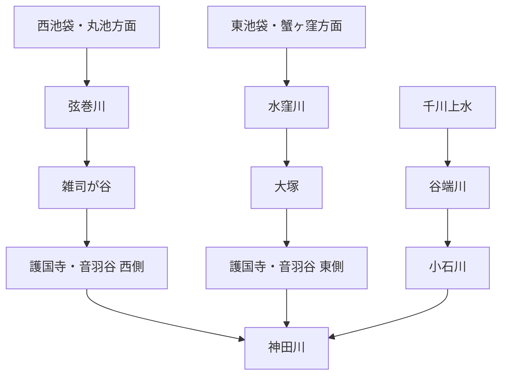

# otowa-ankyoscape

水窪川・弦巻川・谷端川と、その周辺の旧河道・暗渠・湧水・用水・土地利用について調べた記録です。

中心となる範囲は、池袋・雑司が谷・護国寺・音羽・小日向・小石川です。

**追加調査対象：人参川（古茗荷谷川との関係は未確定）** — 2026年10月8日、茗荷谷の西側谷頭について明治初期の地図表示と色別標高図を照合。筑波大学附属中・高の南方にある浅い枝谷が合流する可能性も含め、[人参川の調査ノート](docs/人参川.md)に記録した。**10月8〜9日の現地歩行・二源頭・古地図上の池・筑附南方の分水界候補・還国寺の湧水・水窪川の橋名**は[専用の観察記録](docs/2026-10-09・茗荷谷・人参川現地観察.md)に整理した。名称の史料上の確実性と、水路・谷地形の推定は区別している。

> [!IMPORTANT]
> このリポジトリでは、既知の河川史をまとめるだけでなく、**まだ決着していない流路・接続・成立年代を史料から検証すること**を重視します。
> とくに「水窪川と弦巻川はどこかで合流していたのか」「音羽通り西側の弦巻川下流はいつ成立したのか」「弦巻川・水窪川側と谷端川側の更新世旧河道はどちら向きに流れていたのか」は中心的な未解決問題です。

  

幕末の音羽・雑司ヶ谷周辺を描いた尾張屋版 <i>Otowa ezu</i>。1851年近吾堂板とは別史料。画像をクリックすると合流問題の検討ページへ移動します。

## 未解決問題

このリポジトリの中心です。解決していない問題は川別の概要へ埋め込まず、できるだけ独立した文書として追跡します。

| 問題 | 現状 |
| --- | --- |
| **水窪川と弦巻川は合流していたのか** | [独立文書で検討中](docs/open-questions/水窪川と弦巻川の合流・接続問題.md) |
| **音羽谷西側の弦巻川下流はいつ成立したのか** | [独立文書で検討中](docs/open-questions/音羽谷西側の弦巻川下流の成立年代.md) |
| **更新世の旧河道はどちら向きに流れていたのか** | 滝口志郎（2019）が谷端川側への接続可能性を提示するが、流向は未決着 |
| **千川上水から弦巻川・水窪川へ直接分水したのか** | 谷端川への分水は確認できるが、両河川への直接分水は未確認 |

→ [未解決問題の一覧](docs/open-questions/README.md)

## 水系の全体像

これは近代以降に把握しやすい大まかな配置であり、全時代にそのまま当てはまるとは限りません。近世の造成・灌漑、近代の河川改修、暗渠化、下水道再編によって接続関係や流路が変化した可能性があります。

## 現時点で重要なこと

- **第72回: 森島知之2023『駿台史學』179（PAP-048）の本文PDFをWayback経由で取得・テキスト抽出し「直接確認」へ格上げした。ADEACの機関コレクション探索で、小川家文書4件追記（GOV-100）・杉並区立郷土博物館の須田家文書など3件（GOV-105）・としまひすとりぃの谷端川記録4件の所在特定（GOV-106）・NDL索引の谷端川記事2件の雑誌名特定（PAP-052/053）を登録した。**
  - **森島2023本文確認（pp.1〜17・27頁中）〔既出PAP-048の格上げ〕**: 千川水道会社設立の年次チェーンを確認——明治12年9月の再興呼びかけ（守田治兵衛らの出願・官設希望3万円）→**明治13年3月26日の発起人が岩崎弥太郎・二橋元長・熊谷武五郎・寺西成器に交代し株券5万円方式**→3月29日水道掛上申（会社形式反対）→**8月25日開設許可**。主史料に**三菱史料館・尊経閣文庫**（「千川上水 各自引用樋線切絵図11葉」MA-01209）。**巣鴨村7反1畝11歩の水溜池を会社が買入れ地券は岩崎弥太郎名義・水番人澤田陶三の雇入届**。**根岸邸（前田家）は上野公園の博物局引用権の一部譲渡で引水し滝（瀧吹井146個6分）として利用**。根岸加賀邸は1896年『古今秘伝・築山造庭法』下巻に銅版画掲載。pp.18〜26（岩崎邸詳細・結章）は1MB上限で未取得。〔[PAP-048](docs/sources/papers/PAP-048.md)〕
  - **小川家文書の追加4件〔repo初出〕**: **宝永4年（1707）「証文之事（千川上水呑水水餘水田地掛ケの件）」の宛所「千川徳兵衛殿 他3名」**＝千川家請負人四軒（[GOV-090](docs/sources/gov/GOV-090.md)）への宛所の目録レベル確認・天明5年「肥代御貸附願」（差出＝**千川上水請負人 小川村名主弥次郎**）・**関前新田の水番所甚蔵の御手当金請取証2件**＝江戸期の水番所運営記録（[BLOG-131](docs/sources/blogs/BLOG-131.md)の水番所跡と接続）。〔[GOV-100](docs/sources/gov/GOV-100.md)〕
  - **杉並区立郷土博物館の千川関係3件〔いずれもrepo初出〕**: **須田家文書「覚（分水口水門差蓋笠木ほか伏替のため立合に付）」**（差出＝**千川善蔵・千川金七**／受取＝遅野井・天沼・荻久保・阿左ヶ谷・鷺宮・井草・中村の7か村）＝**千川家文書の所在がneribun（練馬）・小川家文書（小平）に続く第三の系統（杉並）として確認**。**矢嶋又次記憶画「天沼弁天池」（1978）**（「千川上水の分流と共に、天沼、阿佐ヶ谷の田に利用され」＝[BLOG-162](docs/sources/blogs/BLOG-162.md)の記憶画の所在特定）・**広報写真「井草五丁目の千川上水街道」（昭和23年＝1948年撮影）**＝「千川上水街道」呼称の1948年用例候補。〔[GOV-105](docs/sources/gov/GOV-105.md)〕
  - **としまひすとりぃ（ADEAC）の所在特定〔第71回GOV-103の格上げ〕**: 「谷端川一号幹線の一部完了について」mp15101290（2001.7.31副都心開発調査特別委員会・**会議録＋資料5点でCC BY**＝谷端川幹線区間の本文確認経路が開通）・「谷端川緑道整備工事」mp10001890（1990.10.5）・公園条例改正議案資料mp10004620（1991.2.20＝GOV-103①のADEACレコード）・**報道写真「谷端川緑道全線開通」gp1991040100（1991.4.1）**。〔[GOV-106](docs/sources/gov/GOV-106.md)〕
  - **NDL索引の谷端川2記事の雑誌名特定〔repo初出・所在のみ〕**: 吉井忠「谷端川の近く--東長崎村に集まった画家たち」『清春』23号・1996年4月・pp.44–47（芸術村特集・中村彝ら芸術家村史）〔[PAP-052](docs/sources/papers/PAP-052.md)〕・吉村生「谷端川 遺された橋に映る在りし日の営み。」『東京人』38巻6号・2023年6月・pp.52-55（暗橋特集・[BOOK-062](docs/sources/books/BOOK-062.md)以来の橋遺構系記事）〔[PAP-053](docs/sources/papers/PAP-053.md)〕。**紙芝居『弦巻川がきえちゃったよ』の駒込図書館ADEAC個別レコードも特定**（雑司ヶ谷ルネサンスの会×豊島区親子読書連絡会）〔[BOOK-037](docs/sources/books/BOOK-037.md)〕。詳細は[第72回ノート](docs/2026-11-14（第72回）・森島2023本文確認・小川家文書追記・杉並須田家文書・豊島区ADEAC目録の追加調査.md)。

- **第71回: NDLサーチ索引の四河川名全面走査で、官報の谷端川改修一次記録2件（GOV-101/102）・江戸会誌の横井時冬千川上水記事（PAP-050）・豊島区区政資料群（GOV-103/104）を登録した。NDLデジタルコレクションのIIIF APIを発見し、官報本文画像の取得経路が開通した。**
  - **『官報』第1331号（1931年6月9日）p.233に「谷端川改修 東京府知事」の土地収用公告〔repo初出〕**: 都土木年報「昭和5〜6年に谷端川など7河川の改修計画告示」（README既述）と年次が一致し、千川下流改修（1930.11着工→1934.7竣工）・高田町下水道（1930.12告示）と並ぶ**昭和初期の谷端川流域行政の年次チェーン**の一部になり得る〔目次確認のみで公告本文未読。断定しない〕。〔[GOV-101](docs/sources/gov/GOV-101.md)〕
  - **『官報』第2782号（1936年4月14日）p.413・内務省省令第12号「東京都市計畫事業立會川、神田上水及谷端川改修受益者負擔ニ關スル件」〔repo初出〕**: 谷端川改修（と神田上水＝谷端川下流の小石川系・立會川）が**都市計画事業の受益者負担令で一括整理**されており、1936年時点でも改修費用徴収が継続していたことを示唆する〔省令本文未読〕。〔[GOV-102](docs/sources/gov/GOV-102.md)〕
  - **横井時冬「上水渠鑿通ノ紀事──(神田上水○千川上水)」『江戸会誌』2(12)・1890年12月・pp.39-40（NDLデジタルコレクションPID 2895780）＝repo初出の明治23年千川上水史記事**。柳井乃武夫「千川上水」『観光文化』13(2)(74)・1989年3月・p.1〔[PAP-051](docs/sources/papers/PAP-051.md)＝清流復活直前の一般向け記事〕とともに所在のみで登録。〔[PAP-050](docs/sources/papers/PAP-050.md)〕
  - **豊島区立図書館区政資料（NDLサーチ経由）の6記録〔いずれもrepo初出〕**: 1991年谷端川南・北緑道の公園条例改正議案資料・2001年「谷端川一号幹線の一部完了について」〔「谷端川一号幹線」という幹線名repo初出〕・2000年「弦巻川の昔を語る」講演会・1999年水窪川跡フィールドワーク・2018年「弦巻川がきえちゃったよ」・2000年BOOK-062発行の広報記事。〔[GOV-103](docs/sources/gov/GOV-103.md)・[GOV-104](docs/sources/gov/GOV-104.md)〕
  - **PAP-017（森島2021）の書誌を確定**（NDLサーチで著者＝森島知之・『文学研究論集』55号・2021年9月10日・pp.129-139・本文PDFをWayback取得）し、GOV-099に東大文書館IIIF画像3枚の実URLを追記。**NDLデジタルコレクションはHTML遮断でも`dl.ndl.go.jp/api/iiif/<pid>/manifest.json`が官報等で有効**＝本文画像取得の新経路。news_search相当の四河川新報道なし。詳細は[第71回ノート](docs/2026-11-14（第71回）・官報谷端川改修記録・江戸会誌横井時冬・豊島区区政資料の追加調査.md)。

- **第70回: NDLサーチOpenSearch APIがcurl+UAで利用できることを発見し、公的アーカイブ横断の新史料を5件登録した（GOV-099・GOV-100・PAP-047〜049・BOOK-085追記）。**
  - **東京大学文書館デジタル・アーカイブに千川関係17件の一次記録〔repo初出〕**: 帝国大学の千川引用の通史が**明治14年（1881）外国教授館引樋→明治22年本学給水工事→明治29年構内煉瓦造水溜迄ノ支線増設（仮引渡・IIIF画像3枚確認）→明治31年「本学引用ノ水量減少」照會→明治33年吹井50箇分送水停止・水賦金一箇九円→明治35年10月13日引用解約通知→明治36年断水費用請求** と文書の年次で初めて一括確認できた〔水量減少照會（1898）は湧水・透水面減衰仮説の文書側傍証候補。断定はしない〕。**帝國博物館の上野公園引用千川上水樋管（谷中上三崎北町→上野公園・土管）の修繕（1889-90）・伏替工事（1896）記録**は森島2021の支線復元の維持実務を裏付ける。**竹内松次郎「千川上水ノ由来並千川堤桜ノ事」（冊子2点・1932年頃/1937年以降推測・柏図書館・要審査）**＝千川堤桜研究の一次史料候補。〔[GOV-099](docs/sources/gov/GOV-099.md)〕
  - **小平市立図書館ADEAC・小川家文書（東京都指定有形文化財）の千川関係目録レコード〔repo初出〕**: **安永6年（1777）「千川上水江戸内懸渡願ニ付願人筆頭の件」**（差出6名・宛所宇田川長十郎殿）・**天明2年（1782）「千川上水素堀通御高札見守之儀ニ付請書」**（西窪村他5か村14名→関東郡代伊奈半左衛門宛・「素堀通」文言repo初出候補＝宝永4年御高札16か所の維持側村方請負）・**天明3年頃「千川上水土手萱課苅取二付口上之覚」**（千川堤の草刈管理）・安永10年土手敷金子請取手形・「御請負渡世取続金ニ付証文」・**明治13年（1880）「号外（千川水道之義ニ付故障云々の上申却下ニ付達）」**（北多摩郡役所→小川村戸長中＝千川水道会社設立期の沿線村側の摩擦を伝える行政文書）。千川家文書とは別系統の水源側文書群。〔[GOV-100](docs/sources/gov/GOV-100.md)〕
  - **学術書誌3件〔repo初出・いずれも本文未見〕**: 山口高志「雨天時合流式下水道からの汚濁流出シミュレーション──都内谷端川排水区の場合」『土木技術資料』18(2)・1976年2月・pp.71–76〔[PAP-047](docs/sources/papers/PAP-047.md)＝PAP-003の観測データを用いた谷端川排水区の汚濁解析〕、森島知之「明治前半期の会社形式による水道設置──千川水道会社を例に」『駿台史學』179号・2023年9月・pp.1–26〔[PAP-048](docs/sources/papers/PAP-048.md)＝2021年論文の後続〕、吉野俊「千川上水の灌漑利用について 江戸上水史の一こま」『西郊文化』1955年6月26日・pp.2–9〔[PAP-049](docs/sources/papers/PAP-049.md)＝BOOK-085単行書の同年の記事版〕。
  - アクセス不能: nabunken（アクセス集中・吉野1955総覧ページ本文不可）・CiNii/cir.nii・meiji.repo（JAIRO Cloudメンテ継続）・echo-lab。pip導入禁止のため武蔵アルバム・かたりべ45号のOCRは今回も不可。news_search相当の四河川新報道なし。詳細は[第70回ノート](docs/2026-11-14（第70回）・東京大学文書館千川引用17件・小川家文書・森島2023・吉野1955の追加調査.md)。

- **第69回: 『練馬区史 歴史編』本文XHTMLの未取得巻（honcho1〜3・6〜8）をすべて取得し、第68回の制限を解消した。** honcho6〜8（第六部社寺・民俗・第七部歴史資料編・第八部年表稿）から千川上水の新情報を[GOV-098](docs/sources/gov/GOV-098.md)に追記。
  - **千川地蔵の造立年・移設年次〔repo初出〕**: 「千川地蔵（丸彫 享保十一年〔1726〕旭丘2-15-5 能満寺）」・大正14年川ざらい発見は既知どおり、「**昭和27年千川上水暗渠工事のため能満寺の境内へ移された**」の文言を確認〔PAP-027の「1940年代移設」との年次差・能満寺縁起側の「明治末年拾い上げ」説を含め3表記を並記、断定せず〕。**道しるべ地蔵（享保元年1716・丸彫・千川堤沿いの清戸道・道標を兼ねた地蔵）＝repo初出の石仏**〔千川地蔵とともに能満寺へ移設〕。
  - **寛政2年（1790）千川上水利用20か村・灌漑水田100町歩（千川家文書）〔repo初出の定量値〕**＝元治元年1864（GOV-067）・昭和6年（GOV-098）と並ぶ基準点。元禄9年「御上水永々御請負定手形之事」（千川家文書）の文書名も確認。千川家墓の「北町の漆原家から養子」説文言〔repo初出〕。
  - **風土記稿谷原村条「千川上水堀 村の巽の方にあり 幅二間許」〔文言repo初出〕**を練馬区史の引用経由で確認し[GAZ-022](docs/sources/gazetteers/GAZ-022.md)に追記〔谷原村付近の川幅約3.6m〕。
  - **新書誌2件（いずれも所在のみ）**: 吉野俊『江戸上水史（千川上水の灌漑利用）』昭和30年［[BOOK-085](docs/sources/books/BOOK-085.md)］・東京都『千川上水の沿草』昭和27年［[BOOK-086](docs/sources/books/BOOK-086.md)＝暗渠化着手期の行政側沿革書で一次資料候補］。目録表記「石川乾二」はGOV-076「石山乾二」との表記差として記録。
  - nabunken年報4号＝127132（1992）と特定〔第68回課題④〕。honcho1〜3に四河川の記述なし・現勢資料編本文XHTMLは404・news_search相当の新報道なし。

- **第68回: 『練馬区史 歴史編』の本文XHTML（i-repository・honcho4/5）が直接取得可能になったのを確認し、千川上水の基礎史料群と定量値を[GOV-098](docs/sources/gov/GOV-098.md)として新規登録した。**
  - **千川上水三書（「千川上水起立之義」「千川上水古記録上申」「千川上水路履暦」）＝豊島区西福寺所蔵千川家文書**と本文が明記〔確認: 区史本文。neribun 297点（[GOV-089](docs/sources/gov/GOV-089.md)）との異同は未確認〕。宝永4年（1707）灌漑許可の「千川文書写」原文引用に**高札16か所（うち8か所新規修覆）・水料米3升/反・担当奉行4名**〔repo初出〕。
  - **昭和6年「東京市第二水道拡張計画参考書」の定量値〔repo初出〕**: 最大取水量0.844 m³/s・灌漑面積88町4反歩・利用人員2,750人（飲用2,130人）・水車4台・六義園引水1か所。水車新設の不許可方針（文化4/6年願い却下、「遂に明治に至るまで水車稼なし」）は[板橋区史経由のBLOG-094](docs/sources/blogs/BLOG-094.md)の練馬区史側裏付け〔「明治まで水車なし」と明治17年路図8水車の折り合わせは解釈保留〕。
  - **参考文献から都立板橋高校『千川上水沿線集落』（昭和31年）を見出し[BOOK-084](docs/sources/books/BOOK-084.md)として書誌登録**〔所在調査は次回課題〕。
  - 第42回「本文取得不可」だったpeepooblue「東京の池」の粟島神社弁天池・谷端川親水公園両記事（2009）が直接取得可能に。**粟島神社「湧水も失われ、人工的に給水」（2009年観察）**と谷端川の旧流路（椎名町駅で東折→下板橋・板橋駅→大塚→小石川→神田川）→**板橋駅付近から北流して石神井川接続への流路変更**・山手通り並行区間の緑道化を[BLOG-217](docs/sources/blogs/BLOG-217.md)として登録〔2009年時点の観察記録〕。
  - **巻石通り（区道889号・音羽〜水道）の整備計画**: 文京区バリアフリー整備頁〔[GOV-097](docs/sources/gov/GOV-097.md)・平成28年度計画・令和8年度着工〕と、いたくら美千代区議レポート〔[BLOG-218](docs/sources/blogs/BLOG-218.md)・2024-07-15: 音羽通り〜江戸川橋体育館400mの管路工事2024-05-24終了・2028年3月完成予定・**第2期（安藤坂〜金富小）は2024年度設計＋埋蔵文化財調査**〕。第2期の埋蔵文化財調査は旧谷端川・小石川低地縁で遺構確認の機会になり得る〔結果未公表・断定しない〕。
  - **nabunken年報IDを特定（第67回課題の部分解消）**: 板橋区立郷土資料館年報＝127130/127131/127133〜127143/127147（紀要18号と合綴）/127148（1988〜2013）。年報ページは目次・巻号表示なしで、論文書誌の取得は次回以降。
- **第67回: nabunken（全国文化財総覧）が復旧し、第24回以来アクセス不能だった板橋区立郷土資料館紀要の巻別ページを創刊号〜第21号＋年報まで取得、所収論文目録を著者・頁数付きで全精査した。**
  - **小林保男「東京都公文書館収蔵史料に見る板橋の水車 その用水争論をめぐって」（紀要10号・1994年3月）の著者・頁数（pp.1-18）を特定し[PAP-030](docs/sources/papers/PAP-030.md)を更新**〔確認: 総覧目録／本文・対象河川（千川上水系か石神井川系か）は未確認のまま〕。
  - **平尾邸（加賀藩下屋敷）論文群を新規登録（いずれもrepo初出・本文未見）**: 辻崎久哲「加賀藩江戸藩邸の変遷と板橋平尾邸」（紀要11号・1996・pp.1-25）［[PAP-043](docs/sources/papers/PAP-043.md)］、永山嘉之「平尾邸の夕餉 廻遊式庭園・アップルの栽培等」（紀要5号・1986・pp.8-14）［[PAP-044](docs/sources/papers/PAP-044.md)］、海野修「加賀藩下屋敷関係基本史料（『加賀藩史料』）の出典索引ならびに論考等の一覧」（紀要13号・2001・pp.56-65）［[PAP-045](docs/sources/papers/PAP-045.md)］。天明7年（1787）千川用水引き入れ見積書（[BLOG-146](docs/sources/blogs/BLOG-146.md)）・庭園内の大池（[GOV-093](docs/sources/gov/GOV-093.md)）の研究に直結する書誌群。
  - **横山恵美「明治期における北豊島郡の産業について 内国勧業博覧会の出品状況から」（紀要14号・2002・pp.31-55）［[PAP-046](docs/sources/papers/PAP-046.md)］**: [BOOK-064](docs/sources/books/BOOK-064.md)（湧き水紀要11号・2001）と同一著者の別論文。千川上水用水利用への言及可能性あり〔本文未確認〕。
  - 武蔵学園「千川上水調査アルバム」全4巻PDF・Fauna Musashinensis No.1本文PDFを取得したが、**いずれも画像のみでテキスト層なし**（OCR環境なし）。庚申橋・長崎村分水・谷端川分水口コマ判読と千川上水産2種の種名特定は人手閲覧待ち。
  - アクセス不能継続: 板橋区公式WAF（行政資料目録PDF・浸水履歴再取得も不可）・echo-lab.ddo.jp（接続不成立）・meiji.repo（503）。

- **第66回: らんまる水窪川1/2取得・武蔵学園「千川上水調査アルバム」公開PDF特定・中央学術研究所（CARI）紀要DBの発見で、長年の未解決3件（らんまる1/2・武蔵アルバム個別頁・深田1991紀要20号の書誌）を解消した。**
  - **らんまる「水窪川跡を歩く 1/2」（2015-12-27）を本文全文取得（[BLOG-216](docs/sources/blogs/BLOG-216.md)）**: 既知entry（2/2）の本文HTML内の前後entryリンクからID（entry-12110772803）を特定する手法で、第47/55回の未取得を解消。**水窪川暗渠化「昭和10年（1935）頃」説**〔二次・ガイドブック依拠と推定〕が年次データポイントに加わり、「昭和7年工事開始」「昭和8年頃」説と並記。造幣局（巣鴨プリズン跡）石垣下の**排水溝石組みの2015年視認**観察（2016年消滅説・2019年露出目撃との時系列は未解決のまま）。参照ガイドブックとして**本田創『地形を楽しむ東京「暗渠」散歩』洋泉社2012（[BOOK-083](docs/sources/books/BOOK-083.md)）＝[BOOK-001](docs/sources/books/BOOK-001.md)（2021改訂版）の前身版の書誌を新規登録**（NDL書誌で系譜明記）。
  - **武蔵学園百年史サイトで「千川上水調査アルバム」の個別頁と全4冊の公開PDFを特定（[GOV-076](docs/sources/gov/GOV-076.md)更新・第36/58/59回課題解消）**: 2026-08-01公開。**アルバム4冊・写真216葉（47+50+42+77）の確定値**、「石山」印＝石山乾二顧問、成果=昭和16年6月刊『千川上水』・**1982年10月「クオリ」再版（repo初出の書誌）**、平成17年練馬区文化財登録表記。公開PDFはスキャン画像のみ（テキスト層なし）で、庚申橋・長崎村分水・谷端川分水口のコマ判読（1953 vs 1959-60年次差解消の一次資料）はOCR環境待ち。同サイトの**Florula/Fauna頁も新規資料化（[ORG-032](docs/sources/org/ORG-032.md)）**: Fauna No.2＝1936年刊行（repo初出）・Fauna No.1本文PDFの公開URL特定（千川上水産2種の種名特定の原典アクセスが開通）。
  - **中央学術研究所（cari.ne.jp）に紀要目録DBが存在しGET検索で動作することを発現（[PAP-029](docs/sources/papers/PAP-029.md)更新）**: 深田伊佐夫1991（紀要20号・pp.84-100＝谷端川・千川の1990年流域調査論文）の公式DBレコード（id=310）を直接確認。**本文PDFは会員登録制**で取得できず。echo-lab.ddo.jpは接続不成立（ドメイン沈静化の可能性）。深田の「千川」関係は紀要20号と42号（[PAP-027](docs/sources/papers/PAP-027.md)）の2件のみ。
  - アクセス不能: **板橋区公式サイトがWAFで全面遮断**（浸水履歴五十音別PDFは取得不能）・nabunkenは429（板橋区郷土資料館紀要記事タイトルの抽出はCiNii誌名頁まで）・news_searchで四河川関連の新報道なし。

- **第65回: joshuanchin「水窪川跡を辿る」シリーズ全6回の本文取得が完結し、板橋区浸水履歴PDFの本文確認・INDEX.mdの自動再生成（646項目）・第6〜63回保留bulletの一括prependを実施した。** 長年の未解決課題3件を解消した回である。
  - **joshuanchin「水窪川跡を辿る」-1〜-3・-5・-6のURL特定・本文全文取得（[BLOG-211](docs/sources/blogs/BLOG-211.md)〜[BLOG-215](docs/sources/blogs/BLOG-215.md)）**: amebloのentrylistページ送りから全entry IDを特定し、curl+ブラウザUAで本文を取得。**シリーズは-6「東池袋〜美久仁小路」まで計6回で、「-5が最終」とした従来の認識を更新**。主な新情報: ①音羽通り=元禄の護国寺創建時に整備との伝承と、**江戸古地図＋町内会チラシで川名を知った**発見経緯〔伝聞〕（[BLOG-211](docs/sources/blogs/BLOG-211.md)）。②**水窪川と鼠坂（森鴎外）の並行区間**の古地図読図〔観察〕（[BLOG-212](docs/sources/blogs/BLOG-212.md)）。③旧東青柳町の屋敷裏の**川の流れを池に利用した日本庭園**の2019年観察〔観察=repo初出候補〕（[BLOG-213](docs/sources/blogs/BLOG-213.md)）。④**全区間中最も細い個所=文京区大塚六丁目×豊島区東池袋五丁目24の区境**・茗荷畑の位置・水窪川の碑文言＋1986年銘の本文転記〔観察・確認〕（[BLOG-214](docs/sources/blogs/BLOG-214.md)）。⑤**都電荒川線の水窪川渡河個所が窪む**観察・**造幣局も巣鴨プリズン跡地**との伝聞・日之出町公園の短い流れ・**美久仁小路中程のクランク状花壇=水源推定**〔観察・伝聞・推定〕（[BLOG-215](docs/sources/blogs/BLOG-215.md)）。投稿メタデータは全6回とも2019-07-06（Yahooブログ移転）。
  - **板橋区「浸水履歴」sinsuinew.pdfの本文確認（[GOV-074](docs/sources/gov/GOV-074.md)を直接確認へ格上げ）**: open_url・Waybackで取得不能だった同PDF（11頁）を**curl+ブラウザUAで取得**し本文テキストを抽出。表題「いたばし区浸水履歴【昭和43(1968)年4月30日～令和元年】」・**令和4年3月改訂**・公文書館展示用。**大谷口北町（S44〜H22の多数記録）・大山西町・桜川・新河岸・舟渡等**の地域別浸水記録と、「浸水記録なし」リスト（**大谷口一丁目を含む12地域**）をPDF本文レベルで確認〔**確認: 本文抽出テキスト／行単位の対応付けは未実施・2026.8.22大雨は対象期間外**〕。
  - **INDEX.md（646項目）・地図一覧.mdをbuild.pyで自動再生成**: 第8回以降約60件が未反映だった出典索引の陳腐化を解消（BLOG-210→215・GOV-096・PAP-042まで収録）。

- **第6〜63回の定期調査で確認した重要事項を、テーマ別にREADMEに集約した（INDEX.mdと地図一覧.mdの自動再生成も実施、646項目）。** 各項の詳細はリンク先の資料ファイルと各回のノートにある。年次・位置の対立は原典未特定のまま断定しない。
  - **千川下流（板橋区側）の治水改修の工程**: 千川改修記念碑（簸川神社）と氷川下町会資料から、**1928年区会議決→1930年11月着工→1934年7月竣工（総延長3,272m）**の工程が初めて揃った〔**確認: 碑文・区民史の二次転記**〕。大正14年（1925）の記録的洪水が改修の動機とされ、**谷端川放水路1924/25年次問題の傍証候補**になる〔**仮説: 原典未特定**〕。出典: [BLOG-077](docs/sources/blogs/BLOG-077.md)・[GOV-094](docs/sources/gov/GOV-094.md)。
  - **千川上水・谷端川の暗渠化年次は複数の資料が対立するまま整理された**: 練馬区内「昭和25年頃着手」（[GOV-072](docs/sources/gov/GOV-072.md)・清戸道解説板）、1952年請願→27年3月着手→28年武蔵学園前区間（[BLOG-113](docs/sources/blogs/BLOG-113.md)略年表）、武蔵学園側「1950年代末までに全部暗渠」・濯川1959-60年区間（[ORG-019](docs/sources/org/ORG-019.md)）、谷端川上流1948年護岸→1956年暗渠完成の証言（[BLOG-135](docs/sources/blogs/BLOG-135.md)）、大塚駅北口の滝不動「1935年頃の暗渠化」説（[BLOG-207](docs/sources/blogs/BLOG-207.md)）、谷端川本体1964年説（GOV-015）・1967年説（[BLOG-150](docs/sources/blogs/BLOG-150.md)）が並立。**いずれも二次記録・伝聞であり、区間ごとの原典確認を残す**〔**伝聞/観察: 断定せず並記**〕。
  - **千川上水を請け負った千川家の実像が史料で具体化した**: 千川家の墓は練馬区登録文化財（平成8年度・北町2-18、歴代当主の没年判明〔[GOV-078](docs/sources/gov/GOV-078.md)〕）、千川家文書は297点（元禄9年〜明治17年〔[GOV-089](docs/sources/gov/GOV-089.md)〕）。区学芸員の聞き取りで**千川家4軒（播磨屋・和泉屋・加藤屋・中嶋屋）**の屋号と、播磨屋が開削当時姫路出身と自称した点が「仙川村百姓説」への批評として整理された〔**伝聞: 聞き取り／推定**〕区学芸員インタビュー（[GOV-090](docs/sources/gov/GOV-090.md)）。また**1938〜41年武蔵学園生徒の千川上水調査**（写真アルバム200カット超・区登録〔[GOV-076](docs/sources/gov/GOV-076.md)〕）が和田八重造の武蔵野生物調査（1922〜）の系譜に位置づき、濯川（1925年命名）は中新井分水路跡の復元と判明した〔**確認: 学園史料・紀要論文**〕（[PAP-033](docs/sources/papers/PAP-033.md)・[ORG-019](docs/sources/org/ORG-019.md)・[ORG-031](docs/sources/org/ORG-031.md)）。
  - **弦巻川・水窪川の中下流の施設と橋が資料群で具体化した**: 猫又橋の石造改築（大正7年）・昭和9年撤去・袖石2基の移転保存（[BLOG-079](docs/sources/blogs/BLOG-079.md)）、中丸・西光院の橋供養碑「延享2年（1745）に上下両橋を石橋として造立」（[BLOG-177](docs/sources/blogs/BLOG-177.md)）、雑司が谷地名の表記史と昭和41年住居表示変更（[GOV-096](docs/sources/gov/GOV-096.md)）、上川口屋1781年創業（[BLOG-188](docs/sources/blogs/BLOG-188.md)・[BLOG-190](docs/sources/blogs/BLOG-190.md)）、大鳥神社1940年社殿配置変換文言（[BLOG-151](docs/sources/blogs/BLOG-151.md)）、水窪川暗渠化「昭和8年頃」説（[BLOG-089](docs/sources/blogs/BLOG-089.md)）、江戸川橋合流点の東西逆転観察（[BLOG-120](docs/sources/blogs/BLOG-120.md)）、安政4年『音羽繪圖』と権三橋（[BLOG-198](docs/sources/blogs/BLOG-198.md)・[GAZ-023](docs/sources/gazetteers/GAZ-023.md)）〔**確認/観察の混在: 各資料ファイルに区別記載**〕。
  - **谷端川水源地と橋の調査が学術・郷土史料で裏付けられた**: 甲田ほか2015年「谷端川水源地付近における更新世後期以降の環境変遷と土地利用」（豊島区郷土資料館紀要24号）は**谷端川水源地を直接扱う初の学術論文**〔**所在確認: 本文未確認**〕（[PAP-026](docs/sources/papers/PAP-026.md)）。谷端川緑道の橋名由来は友の会『旧谷端川の橋の跡を探る』（1999〔[BOOK-062](docs/sources/books/BOOK-062.md)〕）が典拠で、**水源〜不忍通り間67橋の区間別内訳**と田楽橋の1910年銘欄干現存（[BLOG-081](docs/sources/blogs/BLOG-081.md)）、粟島神社「泉は…谷端川の源泉ともなった」由緒文言（[BLOG-195](docs/sources/blogs/BLOG-195.md)）が揃った。**中丸川＝千川上水の分水説**は地籍図読図・学校誌・聞き取り・独立踏査の4系統の裏付けが蓄積した〔**観察/伝聞: 水路跡の実測は未実施**〕（[BLOG-140](docs/sources/blogs/BLOG-140.md)）。
  - **治水・下水道の現勢資料**: 千川増強幹線は2013年8月豪雨（南大塚床上浸水）を機に2017年度着工・上池袋東公園〜窪町東公園2.5km・内径3.75mシールド（[GOV-082](docs/sources/gov/GOV-082.md)）、枝線は2026年に接続完了（[BLOG-134](docs/sources/blogs/BLOG-134.md)）。1952年練馬区教委の千川上水記録フィルム（60コマ）と所蔵リストから**GHQ関東軍政部の千川上水取水**が確認された〔[GOV-070](docs/sources/gov/GOV-070.md)・[GOV-092](docs/sources/gov/GOV-092.md)〕。2026年8月22日の記録的短時間大雨（板橋120mm/h・池袋駅地下冠水）と濯川1981年氾濫が新時代の水害記録として加わった〔**確認: 報道・学園史料**〕（[BLOG-115](docs/sources/blogs/BLOG-115.md)・[BLOG-116](docs/sources/blogs/BLOG-116.md)・[ORG-019](docs/sources/org/ORG-019.md)）。

- **長年本文未取得だったFC2ブログ「水の行方を追って」（わんじん）の谷端川（西大下水）シリーズ17編を直接取得し、精読した。** 2018年2月〜8月の連載のうち未登録だったentry 17本（233,235,236,237,238,240,241,242,244,245,246,251,252,253,254,255,256）の全文を取得（[第64回ノート](docs/2026-11-13（第64回）・wanjin谷端川シリーズFC2直fetchによる全編取得（樋口地名・滝不動1935年・2源流支流）.md)）。主な新情報: ①板橋区側の小字**「樋口（とよぐち）」**（『いたばしの河川』由来）と長崎村分水の引水路がマンション敷地内の白砂利空間として現存する2018年観察〔**確認: 『いたばしの河川』由来の二次記述／観察: 2018年の引水路空間**〕（[BLOG-203](docs/sources/blogs/BLOG-203.md)）。②**金井窪駅1931年開業・1951年廃止**と下板橋駅の大塚辻町起点案の断念・昭和10年頃の現位置移転説、金井窪「鉄錆湧水」の語釈〔**伝聞: 本文記述／暗渠化年次の議論とは独立の駅史情報**〕（[BLOG-205](docs/sources/blogs/BLOG-205.md)）。③大塚駅北口の滝不動が**「1935年（昭和10年）頃の暗渠化工事」に伴い移転した**とする記述〔**伝聞: ブログ本文の叙述／大塚区間の暗渠化年次の独立データポイント。既存の1967年説等との対立を残し断定しない**〕（[BLOG-207](docs/sources/blogs/BLOG-207.md)）。④南長崎支流の**2源流説**（中落合・やよい児童遊園＝雨水貯留浸透施設併設、と南長崎・子育て地蔵）と本流合流点＝真和中学校（現・心身障害者福祉センター）跡脇〔**観察: 2018年／やよい児童遊園源流説はrepo初出**〕（[BLOG-208](docs/sources/blogs/BLOG-208.md)）。⑤**新田堀之内村＝王子の梶原堀之内村の分郷**説と、下り谷・雲雀が谷戸支流（池袋運輸区留置線）・上池袋支流（源流＝西巣鴨橋北・山手線際）の踏査〔**確認: 本文主張の村名由来／観察: 2018年の流路**〕（[BLOG-209](docs/sources/blogs/BLOG-209.md)）。⑥大塚三業地〜小石川の橋名群（姿見橋・見返り橋・熊野窪橋・東福寺橋・松浦橋・宮原橋・**一木橋＝「一本橋」誤字定着説**）・**『続江戸砂子』湯立坂文言（「往古はこの坂の下は大河の入江」）**・東京帽子株式会社（渋沢栄一設立）・柳町支流（仮）・**東大下水との3度の合流**・**市兵衛河岸（砲兵工廠の荷揚場、〜昭和8年）**〔**観察: 2018年＋『続江戸砂子』文言の引用／橋名の典拠照合は未実施**〕（[BLOG-210](docs/sources/blogs/BLOG-210.md)）。観察は2018年時点の民間踏査記録であり、確定情報としてではなく独立裏付け・仮説補強の資料として扱う。

- **雑司が谷の写真乾板工場について、1927年の井戸・鑿泉の深さと、1994年に撮影された別地点の井戸を記した郷土資料館図録を確認した。** 豊島区立郷土資料館『[町工場の履歴書](https://www.city.toshima.lg.jp/129/bunka/bunka/shiryokan/zuroku/1994zuroku.html)』（**1994年度特別展、図録pp.55–57**）「良質な水をもとめて―東洋乾板から富士写真フイルムへ」の[公開複製](https://takahashi.tokyo.jp/toshima/1994kyoudo.pdf)には、**1927年（昭和2年）の東洋乾板工場増設時、水不足対策として深さ26尺（約8m）の給水井戸と250尺（約76m）の鑿泉を掘った**との記述がある。〔**確認：1994年図録の文字抽出／尺数の原誌面画像再判読は未実施**〕 同図録には**1994年6月撮影の旧乾板製造用井戸（南池袋2丁目41番3号）**の写真があり、宅地化に伴い雑司が谷の井戸水量が減ったとも説明する。〔**確認：図録の写真説明・歴史的叙述／未確認：水位の実測記録・現在の井戸残存**〕 高橋俊之「[感光材料の産業史―『東洋乾板株式会社』と高橋慎二郎](https://www.jstage.jst.go.jp/article/photogrst/87/2/87_71/_article/-char/ja/)」（**2024年、『日本写真学会誌』87巻2号、pp.71–78**）は、**1914年の研究所を現・南池袋4丁目23番、1919年設立の工場を現・南池袋2丁目40番**と区別し、**2021～2023年の再開発発掘で工場内の研究所基礎等が確認された**と記す。〔**確認：論文本文／観察：複数の井戸・工場所在地を区別できる**〕 既収録の**2023年南池袋遺跡見学会資料の「排水施設」**と照合すべき**工業用水の供給側の設備史**が増えたが、**井戸・鑿泉の正確な位置・取水層・排水先、弦巻川との接続は未確認**。**地下水利用を弦巻川からの直接取水・放流とみなさず、1927年を暗渠化年としない**。〔**推定：旧地番・発掘平面図・地下水利用の比較価値／未解決：供排水系統**〕 出典：[GOV-050](docs/sources/gov/GOV-050.md)／[PAP-014](docs/sources/papers/PAP-014.md)／[弦巻川調査ノート](docs/弦巻川.md)。

- **1801年の谷端川上流の敷石伝承を、1996年の豊島区立郷土資料館報の碑文転記・現物写真で補強できた。** 『[かたりべ43号](https://www.city.toshima.lg.jp/documents/2548/kataribe43.pdf)』（**1996年10月20日、印刷p.7**）「区内の土木遺産―舗石建立塔―」は、**千早一丁目二三の地蔵堂内**にある石塔の写真と**高さ149.5cm・幅32.8cm・奥行22.5cm**の寸法を掲載し、碑面の建立年月を**「寛政十三辛酉（一八〇一）年二月吉日」**と転記する。さらに**谷端川の湿地帯に敷石を施した区間を「約百mの区間という」**と紹介し、長崎村から池袋・雑司ヶ谷・音羽・江戸川橋を経て江戸へ向かう旧道の通行事情と関連づける。〔**確認：1996年の区公式館報p.7の誌面画像・写真・碑文転記を直接閲覧／観察：1996年時点の石塔寸法と通行路の説明**〕 **約100mは記事が伝える概数で実測工事延長ではない。橋の架設が必要だったという説明は記事筆者の推測**であり、**1801年の橋梁施工・敷石工区の起終点・旧谷端川の河床線は未確認**。現所在地「千早1丁目23-3」は既登録[ORG-008](docs/sources/org/ORG-008.md)の表記で、1996年記事の番地表示と区別する。〔**推定：1912年地籍図で旧道・湿地の交差箇所を検証する新たな手掛かり／未解決：碑の建立原位置、敷石が横断路か縦断路か**〕 **1801年は碑面の建立年、1996年は館報の刊行年**である。出典：[GOV-049](docs/sources/gov/GOV-049.md)。

- **谷端川を挟む巣鴨の埋没枝谷について、旧石器・縄文時代の遺構分布からの考古学的な補助資料を確認した。** NPO法人としま遺跡調査会「[豊島区No.6遺跡『巣鴨遺跡』～石器と獲物と巣鴨の谷 原始・古代編～](https://wp.toshima-iseki.org/wp/iseki-list06/)」（**掲載年月日不詳、2026年11月3日閲覧**）は、**巣鴨四丁目の関東ローム層からの黒曜石製ナイフ形石器**と、**都立大塚ろう学校建替え時の縄文草創期～早期の陥し穴・縄文後期の土器等**を紹介する。出土地点は**現在埋もれている谷の周囲に集中**し、巣鴨は**谷田川と谷端川に挟まれ、枝状の谷が複数延びていた**と説明する。〔**確認：発掘調査団体の公開解説・出土遺物写真／観察：同団体による遺構分布と埋没谷の二次的な整理**〕 **「狩り場」という用途は団体の考察**で、記事に個別遺構の座標・谷底堆積層・埋没時期は掲載されていない。**陥し穴や石器は水路・旧河床そのものの証拠ではなく、谷端川の旧流向や谷田川との接続を立証しない**。〔**推定：谷端川中下流の支谷と考古遺構を地形図・原報告書で照合する入口／未解決：調査区座標・谷の層序・水流方向**〕 出典：[ORG-009](docs/sources/org/ORG-009.md)。

- **2012年の発掘紹介記事は、弦巻川へ下る坂道沿いの「薬研堀」と、雑司が谷駅工事で見つかった中世道路を別々の遺構として具体的な寸法付きで記録している。** 豊島区立郷土資料館『[かたりべ107号](https://www.city.toshima.lg.jp/documents/2546/kataribe107.pdf)』（**2012年10月16日、印刷p.4**）「鎌倉街道を歩いてみよう②―鎌倉街道を掘る」は、東京地下鉄副都心線**雑司が谷駅建設前の発掘**で、**南北に約50m延びる中世の道（図中B、最大幅約5.5m、初期の路面幅3m弱・両側に側溝）**を検出したと紹介する。**13～15世紀の陶磁器片**の出土にも触れる。さらに、**弦巻川へ下る坂道に沿って幅約4m・深さ約2mのV字形の薬研堀（図中C）**が発掘されたと記し、宿坂からの鎌倉街道が堀に沿って北上し弦巻川を越えた可能性を論じる。〔**確認：2012年の公的館報本文・図・写真を直接閲覧した発掘成果の二次紹介／観察：図中B・Cと坂道の相対位置**〕 **薬研堀は弦巻川の旧河床・支流と確認されたものではなく、川の渡河地点・橋の存在・道路Bと堀Cの連続性は記事筆者の推定**である。寸法・遺構年代は発掘原報告書と未照合で、**13～15世紀の道や溝を近代の暗渠化年代に読み替えない**。〔**推定：中世の道・排水溝と弦巻川の谷地形を地図・発掘図で照合する新しい基準点／未解決：遺構座標・層位・渡河位置**〕 出典：[GOV-048](docs/sources/gov/GOV-048.md)。

- **谷端川上流の湿地帯に関わる1801年の舗道整備を伝える石塔の所在と、2018年の緑道景観資料が見つかった。** 豊島区商店街連合会「[千川・要町・高松コース](https://www.toshima-kushoren.gr.jp/course/course09.html)」（**掲載年月日未記載、2026年11月3日閲覧**）は、**千早1丁目23-3の地蔵堂**にある道標兼用の**「舗石建立塔」**が、**谷端川の湿地帯の舗道整備を記念して1801年（寛政13年）に建立された**と説明する。〔**確認：団体公開文の記述／観察：谷端川上流の湿地と旧道整備に結び付けられた石塔の所在**〕 **1801年の銘文・建立原位置・舗装範囲・橋の有無は未照合**で、団体の説明をそのまま当時の測量・工事原簿と扱わない。〔**推定：古地図・地籍図と石塔の現物を照合する基準候補／未解決**〕 また豊島区「[豊島景観百選・拡大図B](https://www.city.toshima.lg.jp/296/machizukuri/toshikekaku/kekan/1902271613.html)」の**番号21「谷端川緑道」**は、**2018年7～12月募集の景観アンケート**に基づき、**西池袋5丁目24付近**の緑道を写真付きで紹介し、谷端川を「千川分水の一つ」、**粟島神社（要町2-14）の弁天池を源泉**と記す（ページ更新**2025年7月10日**）。〔**確認：区公式の所在地・募集期間・説明文／写真の細部は未判読**〕 **景観の所在地は水源・河床の実測地点ではなく、2018年は暗渠化年ではない**。既登録の練馬区資料の紹介には粟島神社が**「要町2-41」**とある一方、商店街連合会は**「要町2-14-4」**と記すため、**住所表記の食い違いは旧地番・現住所・資料誤記の可能性を残して要再照合**。また「千川分水」という行政の簡略な表現から、自然湧水と人工助水の関係や全区間の人工河道説を確定しない。〔**観察／未解決**〕 出典：[ORG-008](docs/sources/org/ORG-008.md)・[GOV-047](docs/sources/gov/GOV-047.md)。

- **東京都水道歴史館のガラス乾板写真2点から、旧小石川区の水道工事の比較史料が増えた。** 「[小石川区大塚仲町配水本管敷設工事](https://www.ro-da.jp/suidorekishida/content/detail/REKI-020-009)」（**REKI-020-009**）は、**大正時代～昭和前期**、東京市（水道局か）制作と目録に記され、**2025年12月16日**に公開された。〔**確認：公的写真目録の題名・年代幅・公開日／写真細部未判読**〕 既収録の大塚仲町の電車軌道下鉄管敷設写真2点（P0120_012_02・REKI-039-003_02）とは**別資料ID**だが、**同一工事・同一写真の別複製かは未確認**。〔**観察：書誌比較／推定：水窪川周辺の道路・軌道・上水道施設の位置照合候補**〕 一方「[配水本管1800ミリ伏越替工事小石川区船河原橋](https://www.ro-da.jp/suidorekishida/content/detail/REKI-019-040)」（**REKI-019-040**）は、原目録の題名に**「昭和9年（1934）7月10日」**と付記された別のガラス乾板写真で、**2025年12月16日公開**。〔**確認：目録原題の日付／写真細部未判読**〕 既収録の**1933年6月30日「船河原橋際伏越工事」写真（P0114_027_03）**との比較点が増えたが、**1934年7月10日は撮影・着工・竣工のいずれの日付か不明**。船河原橋は神田川の飯田橋付近にあり、谷端川下流の直接の旧河道証拠ではない。**両資料は上水道の配水本管工事であり、水窪川・弦巻川・谷端川の暗渠・下水道工事を示すものではない**。〔**推定：1930年代の地域インフラ史の比較に有用／未解決：写真の同一性・工区・施工年代・河川との位置関係**〕 出典：[GOV-045](docs/sources/gov/GOV-045.md)・[GOV-046](docs/sources/gov/GOV-046.md)。

- **2015年の豊島区公式「目白地域資源図」は、谷端川と弦巻川を同じ図表に名称付きで掲載している。** 豊島区『[豊島区都市づくりビジョン・第6章「目白地域」](https://www.city.toshima.lg.jp/295/machizukuri/toshikekaku/toshikekaku/documents/6syou_9.pdf)』（**2015年3月策定、印刷p.213・図表269「地域資源図」**）には**「谷端川」「弦巻川」**の両表記と、凡例の**「河川」「河川（暗渠）」**がある。周辺に**西池袋2丁目、目白3～5丁目、上り屋敷公園、西武池袋線**などが記され、**旧谷端川上流と弦巻川源流域を同一の行政図上で比較する入口**となる。〔**確認：区公式PDFの図表文字情報・凡例／推定：両河川の位置照合に有用**〕 ただし**図上の線分・正確な座標・相互の接続は独立に判読していない**ため、図に名称があることだけで旧河床・分水界・管渠位置・近世の合流関係を確定しない。**2015年は計画策定年であり、河川の成立・暗渠化年ではない**。〔**未解決：図像そのものの読図と明治・昭和の原図との重ね合わせ**〕 出典：[GOV-044](docs/sources/gov/GOV-044.md)。

- **明治期の井戸分布は旧河道・谷底と単純には重ならないことを、2007年の地理学研究が示している。** 谷口智雅・谷口真人「[歴史的地下水環境の復原―史料と古地図から見た東京の井戸と人間活動](https://www.jstage.jst.go.jp/article/ajg/2007s/0/2007s_0_195/_article/-char/ja)」（**2007年日本地理学会春季大会・P845、同年4月29日公開**）は、**1887年刊と記す五千分一東京図測量原図の井戸記号**から、目白・上野を北限とする東京中心部約8km四方の井戸分布を復原したと報告する。住宅・屋敷内の井戸が多く、**井戸分布は低地・台地・旧河道と必ずしも一致しない**とし、現代の**文京区の路地・寺社の井戸分布**も調べている。〔**確認：著者の公開学会発表要旨／観察：地形だけで井戸を説明できないという研究結果**〕 既登録の[MAP-007](docs/sources/maps/MAP-007.md)を、**水窪川・弦巻川の音羽谷下流と谷端川（小石川）下流の井戸記号・宅地配置**という角度から再判読する入口となる。〔**推定：水利用史と旧河道仮説の照合価値**〕 **要旨には地点別井戸図・座標・水位はなく、三河川の個別井戸や湧出口は特定できない**。また「約45,000」は要旨中の既往概数であって著者の図上実測数ではなく、**1887年は地図の刊年、2007年は発表年**である。井戸の存在から地下水流向・旧河道・河川接続を直接推定しない。〔**未解決：原図の井戸記号・地点別資料の確認**〕 出典：[PAP-013](docs/sources/papers/PAP-013.md)。

- **巣鴨刑務所の排水口候補とされる石積みは、2021年の現地写真・案内板転記から、旧造幣局敷地の隣接道路脇からIKE・SUNPARK内へ移設・復元されたことを追える。** [2021年11月28日の現地記事](https://senseki-kikou.net/?p=19228)は**2017年撮影と明記した移設前の写真3枚**と2021年11月の公園内写真を掲載し、[別の2021年11月19日の踏査](https://citywalk2020.hatenablog.com/entry/2021/11/19/185348)も案内板を転記する。案内板によれば、**都市計画道路補助第176号線・特別区道41-340を支えていた石垣の一部**を道路整備で保存・公園内に復元した。〔**確認：現地案内板の二次転記・撮影年表示／観察：移設前後の写真資料の存在**〕 ただし掲示文は、巣鴨刑務所から**水窪川へ排水していた「のではないか」**という推量形で、接続を断定していない。**1999年の豊島区広報[GOV-001](docs/sources/gov/GOV-001.md)にある造幣局脇の「排水溝跡」「護岸用と思われる大谷石塀」と同一構造物かも未確認**。原位置は公園南西の坂下通り終端の階段付近とする二次説明があるが、番地・石材の同一性・工事年代は未確定。〔**推定：旧排水施設の位置復元に有用／未解決：接続・同一性・原位置**〕 出典：[BLOG-025](docs/sources/blogs/BLOG-025.md)。
- **谷端川の2024年5～6月の3回踏査について、主催NPOの活動年表と動画アーカイブの案内が残る。** NPO法人「としまの記憶」をつなぐ会の[活動年表](https://toshima-kioku.jp/about/)は**2024年5～6月に谷端川の暗渠を3回に分けて歩いた**と記す。[動画案内](https://movie.toshima-kioku.jp/archives/yabatagawa-pr/)は**伊藤一雄氏の案内、長島光男氏による2024年撮影・編集**と表示する。〔**確認：主催団体の活動記録と動画案内の公開本文／未確認：動画の全編・各回の踏査日と行程**〕 約11km・弁天池水源・U字蛇行は主催者による既知の河川概説で、独立した測量成果ではない。**2024年の現地景観・橋跡を照合する映像史料候補**として記録し、動画未判読のまま旧河道・橋・工事年を確定しない。〔**推定／未解決**〕 出典：[ORG-007](docs/sources/org/ORG-007.md)。

- **2025年6月26日の池袋村図二土橋読図は、川筋が描かれない2か所の「土橋」という新しい照合対象を提示する。** 地域史調査者[sakura「池袋村図に描かれていない川の流れ」](https://note.com/toshima_lab/n/n2ee55a4da242)（**2025年6月26日**）は、年代未詳の「池袋村図」について、**四面塔辻につながる東西の道筋に「土橋」が2か所あるのに、その下の水流線が描かれていない**と指摘する。出典図を豊島区史編纂委員会『**豊島区史 地図編（上）**』**p.18**と明記しており、[豊島区公式の刊行案内](https://adeac.jp/toshima-history/top/topg/06kikankushi/index.html)では同書は**1974年1月刊・近世地図31図収録**と確認できる。〔**確認：区の刊行物書誌／観察：記事による二次読図、原図未閲覧**〕 記事は西側の橋を現在の東京芸術劇場北側付近と推定し、丸池より上流の弦巻川側と、蟹ヶ窪・水窪川側の未描画支流を想像するが、**いずれも原図の測量成果ではなく執筆者が推測と明示する仮説**。〔**仮説／未解決：橋位置・河道・流向**〕 さらに[東京都公文書館の原図目録](https://www.archives.metro.tokyo.lg.jp/detail?cls=collection_01&pkey=000100349)（資料ID **000100349**）は、**彩色原図1枚・93×118cm・一部に別紙図を貼付**と記す。〔**確認：公的目録／原図未閲覧**〕 **貼付図の範囲、土橋2点の表記、描かれない水流の解釈を原図と1974年複製で独立検証するまで、二河川の近世支流を確定しない**。出典：[MAP-018](docs/sources/maps/MAP-018.md)。

- **1716年の高田村絵図に記された神田川の「大橋」について、2012年の公的館報が面影橋付近の渡河点として解説している。** 豊島区立郷土資料館『[かたりべ106号](https://www.city.toshima.lg.jp/documents/2546/kataribe106.pdf)』（**2012年7月19日、印刷p.3**）「鎌倉街道を歩いてみよう―高田宿の発見」は、**正徳6年（1716年）の高田村絵図**に橋名「大橋」があると記し、部分絵図と現在地形図を併載する。〔**確認：館報本文・掲載図を直接閲覧／観察：館報による古絵図の二次読図**〕 **弦巻川下流の神田川との接続を調べる際の、近世の渡河点と道路の位置合わせ候補**になるが、絵図の「大橋」と現在の面影橋の同一性・架橋年は立証できない。既登録の1716年[MAP-012](docs/sources/maps/MAP-012.md)「下高田村絵図」と、館報に掲載された絵図の**原図系統も未照合**。この橋名だけで弦巻川の合流口や河道を決めない。〔**推定／未解決**〕 出典：[GOV-043](docs/sources/gov/GOV-043.md)。

- **1989年度の「失われた水辺を探る」講座は、1990年の事業報告で1989年10月8日～11月5日の実施と日付まで絞れた。** 豊島区立郷土資料館『[かたりべ](https://www.city.toshima.lg.jp/documents/2550/kataribe18.pdf)』**18号（1990年5月15日、印刷p.4）**「1989年度の郷土資料館事業について」は、地域史講座「中世・鎌倉街道を調べる」（同年6月4～25日）と**「失われた水辺を探る」（同年10月8日～11月5日）**を区別して記録する。〔**確認：1990年の公的事業報告を原PDF画像から直接判読**〕 既収録の1999年豊島区広報[GOV-001](docs/sources/gov/GOV-001.md)は、1989年度に**弦巻川・谷端川**を取り上げたと回顧し、別の区資料は「豊島区の川を歩く～谷端川・弦巻川～」という名称を記す。〔**観察：別年代の区資料の照合**〕 **両講座名が同一企画の別表記か、各河川を何月何日に歩いたかは未確認**。期間は**講座開催の年代であって河川の暗渠化・道路化年代ではない**。〔**推定：1989年10～11月の講座配布地図・現地写真の探索範囲を具体化／未解決：各回の行程・配布資料**〕 出典：[GOV-041](docs/sources/gov/GOV-041.md)。

- **2011年の郷土資料館報は、1909年一万分一地形図の旧長崎村・高田村境と弦巻川源頭の谷を関連づけ、丸池が図上に見えないことも明記している。** 『[かたりべ](https://www.city.toshima.lg.jp/documents/2546/kataribe102.pdf)』**102号（2011年6月30日、印刷p.2）**「一万分一地形図から、豊島区のまちの移り変わりを見てみよう！」は、**池袋駅西側の旧村境の南に伸びる谷・水田を弦巻川の源流域**と読図し、**1909年図には湧水池が見えない**一方、谷頭にはかつて**丸池**があったと説明する。〔**確認：2011年館報の説明文／観察：同館による1909年図の二次読図**〕 この記事が紹介する『豊島区地域地図』第4集は**1999年刊のものを2011年3月に改訂**したもので、**復刻刊年と原図の測量・修正年を混同しない**。また**地図に丸池が見えないことは1909年の池の不存在・湧水枯渇を示さない**。原図の図郭・凡例・村境・池の原位置は未照合である。〔**推定：旧村境と谷頭を地籍・標高図に重ねる比較点／未解決：原測量図での独立判読**〕 出典：[GOV-042](docs/sources/gov/GOV-042.md)。

- **1996年の郷土資料館報に、谷端川沿いの旧地番と三角形低地の土地利用が記録されている。** 豊島区立郷土資料館『[かたりべ](https://www.city.toshima.lg.jp/documents/2548/kataribe44.pdf)』**44号（1996年11月30日、印刷p.4）**「袋ヶ谷自由学園の昼食」は、1926年に屋根板工場を転用して開設された保育施設の所在地を**旧西巣鴨町大字池袋字袋ヶ谷2081番地（現・池袋本町四丁目）**とし、**赤羽線・東武鉄道・谷端川に囲まれた三角形の低地**に町工場が集まっていたと回顧する。掲載写真は**1935年頃の園児の昼食**で、川の水面や護岸を撮影したものではない。〔**確認：1996年の公的館報本文・写真を直接判読／観察：旧地番・鉄道・川による場所の絞り込み**〕 同号**p.3**には、**1905年の水車取調書で千川上水の水車9か所**との記述と、**「千川上水公園に残る調節バルブ」**の写真もある。〔**確認：1996年の史料紹介／未確認：1905年原簿・写真撮影年**〕 **旧2081番地の筆界・保育施設の敷地、川岸との距離、写真の撮影地点は未確定**で、三角形低地の記述を河道中心線の実測記録と扱わない。水車9か所も**千川上水全体**の説明で、谷端川の水車数ではない。〔**推定：旧地籍図・鉄道敷・火災保険特殊地図との照合価値／未解決：施設の原位置と水路敷**〕 出典：[GOV-040](docs/sources/gov/GOV-040.md)。

- **1993年の豊島区立郷土資料館だよりは、三河川の暗渠化後の認識と神田川の旧流路を同時に伝える。** 『**かたりべ』30号（1993年4月30日）**の印刷**p.6**「郷土資料館なんでもQ&A」（回答者「伊藤」）は、当時区内で地表を流れる川を**新宿区境の神田川**とし、**谷端川・弦巻川・水窪川・谷戸川を「自然の川」、千川上水を「人工の川」**として列挙する。谷端川の**農業用水としての利用から生活排水の流入への変化**、川跡が道路・公園として残ること、**千川上水は上流で通水が復活したが豊島区内は暗渠のまま**だったことも記す。〔**確認：1993年の公的館報の本文を原PDF画像から直接判読／観察：当時の河川認識と土地利用の概説**〕 同号**p.1**「区境が見えた！」は、**3月7・14・21・28日**の高田・雑司が谷等の境界踏査を報じ、**目白3-4／下落合3-1の旧高田町・落合村境**を写真で示し、踏査を通じて**護岸工事以前の神田川の流路**を意識したと記す。〔**確認：館報の踏査記録／推定：旧区村境と改修前河道を地図照合する手掛かり**〕 **「自然の川」は資料館による総称で、弦巻川下流の成立過程や水窪川との接続を確定しない**。境界写真の細道を旧神田川河床と同一視せず、**1993年の現況・記憶を現在の状態や改修工事年と混同しない**。〔**未解決：旧神田川の河道中心線、護岸工事の区間・年代、個別水路の人工改変**〕 出典：[GOV-039](docs/sources/gov/GOV-039.md)／[豊島区公式PDF](https://www.city.toshima.lg.jp/documents/2549/kataribe30.pdf)。

