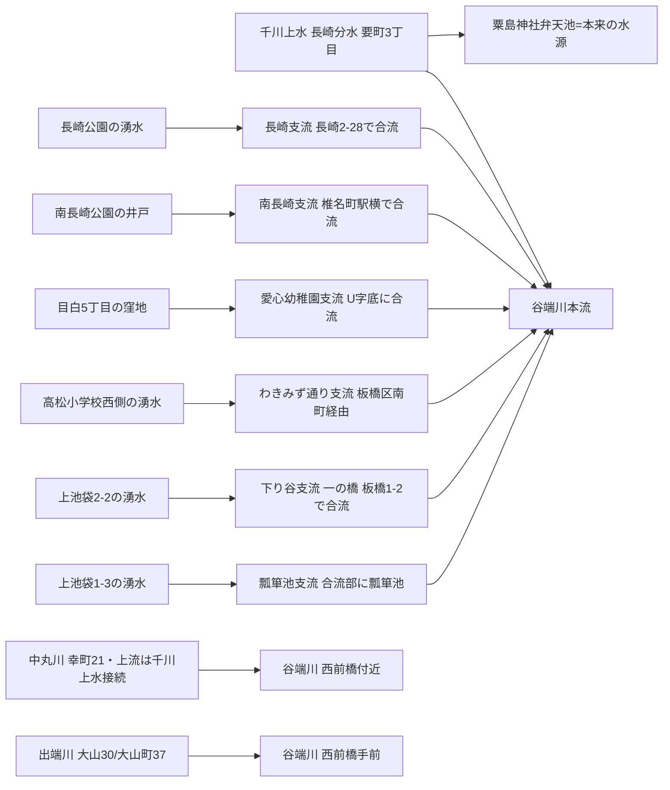

# 2026-11-11（第10回）・暗渠ハンター谷端川湧水支流シリーズ・第2雑司ヶ谷幹線・千川上水豊島区通水断念経緯の追加調査

第10回定期実行。第9回（コミット 8a7644f）以降のmainを取り直して重複確認した上で、下記を追加した。

## 追加した資料（BLOG-056〜063、コミット d2fb602 + 本コミット）

- [BLOG-056](../sources/blogs/BLOG-056.md)〜[BLOG-061](../sources/blogs/BLOG-061.md)：髙山英男「毎日暗活！暗渠ハンター」谷端川沿い湧水ものがたりシリーズ（2012年4月・全6回）を全文確認して資料化。2026-10-23・暗渠ブログ横断調査で「連載未索引」「原典追跡」としていた案件の一部を解消。
- [BLOG-062](../sources/blogs/BLOG-062.md)：warpal「番外・谷端川アーチ・カルバート」。谷端川.mdで引用済みだが資料ファイルがなかったものを登録。「谷端川」の1万分の1地形図初記載1909年説を新規記録。
- [BLOG-063](../sources/blogs/BLOG-063.md)：文春オンライン弦巻川記事（抄録のみ）。**第2雑司ヶ谷幹線（1989年度着手）はrepo初出**。

## 系列の位置づけ〔推定〕

谷端川の湧水支流群は、豊島区郷土資料館研究紀要第11号（横山恵美「豊島区の湧き水をたずねて」）の湧水リストを骨格に、2012年の現地観察で位置を付した記録が髙山シリーズ。支流別に整理すると:

- **支流呼称の混同発見〔確認〕**：wiki「谷端川」の支流「出端川」（中丸町〜熊野町〜西前橋）は『いたばしの地名』では**中丸川**であり、wikiの支流記述に出端川=中丸川の混同の可能性（[BLOG-059](../sources/blogs/BLOG-059.md)）。地名対照表・[対照表監査](2026-10-26・地名河川名対照表・追加監査.md)への反映を検討する。
- **千川上水との水理接続〔観察の集積〕**：中丸川「上流は千川上水につながっていた」聴取（BLOG-059）・出端川「一説に千川用水の洩水が水源」引用（BLOG-060）・長崎支流（BLOG-056）と、**谷端川本流起点の長崎分水（既存理解）に加え、支流レベルでも千川上水系との接続言及が3本**ある。GOV-068の「分水は湧水池・自然河川源頭に接続する設計思想」と合わせ、千川上水と谷端川水系の多重的接続仮説を強める。
- **暗渠化時期の支流別データ〔観察・聴取〕**：長崎支流≒1980年頃まで開渠（BLOG-056聴取）・中丸川昭和50年代暗渠化（BLOG-059聴取）・本流の河川廃止1962年（GOV-008）・わきみず通り支流は「戦前まで使用」（紀要11号引用）。**支流ごとに暗渠化時期が数十年ずれる**ことが裏付けられ、一括の「谷端川暗渠化」では扱えない。

## Wikipedia千川上水（Weblio複製・2025-10-10版）で確認した追加情報〔二次：要原典確認〕

ja.wikipediaのaction=rawは遮断されるがWeblio複製で本文取得可（第7回と同手法）。うちrepo未収録と判断したもの:

- **豊島区の千川上水復活の断念経緯**：豊島区は1991年（平成3年）60周年記念事業として千川上水の復活事業を決定し、**平成4年度に暗渠管の調査を実施、管内20箇所の異状・土砂堆積・逆勾配を発見**。都建設局河川部に報告し通水工事を要請したが相当の整備復旧費が必要で都費支出困難との結論により**通水を断念**（現在も暗渠内の水流は豊島区部分を通っていないと推測）。
- **板橋区内の漏水**：清流復活事業の流水は事業開始当初計画水量の30%が流されたが、**設備破損により板橋区内で全量が漏水していることが報告され**、流水が止められた（*要出典*付き）。
- **1948年10月11日付け請願書**：練馬区史によれば、練馬区議会議長上野徳次郎から東京都知事安井誠一郎宛の請願書により、千川上水の**氾濫・幼児の水死事故・都市計画樹立の障害**を主たる事由として暗渠化が求められ、**練馬区内では1952年（昭和27年）より**着手。[GOV-056](../sources/gov/GOV-056.md)の「昭和23年10月意見書」に日付・宛先・事由が肉付けされる。いずれもWikipedia経由のため**練馬区史・豊島区の原資料での確認が必須**（source file化は原典確認後とする）。
- その他：中村橋駅名は千川上水の橋に由来、境橋（分水口）〜巣鴨で落差約41m、など。**中村橋の由来はrepo未収録だった。**

## GOV-056の再読で得た追加細部〔確認〕（source file更新は見送り）

「ねりまの川 千川上水が暗きょに」の本文には、GOV-056に未記録の細部もある: 昭和25年8月1日に練馬本町通り商業連合会がすずらん灯を設置した地元紙記事、**昭和31年頃・暗渠化直後の千川通り写真（豊玉北6-14付近から東望・右側歩道が千川上水跡）**の掲載。写真資料（昭和31年頃の千川上水暗渠化直後）としての価値がある。追記は原典欄を乱さない範囲で次回検討。

## 検討・制限

- [BLOG-055](../sources/blogs/BLOG-055.md)（露塚散111・池袋〜板橋区南町の支流暗渠）とBLOG-058のわきみ通り支流は、合流部が谷端川緑道×板橋区南町手前で近いが、露塚散の支流は北側（池袋側）から、わきみず通りは南町を西へ抜ける流れで**別水路の可能性が高い**。同定は保留。
- BLOG-063のURLは採録時（本コミット前）に記事IDを推定で書いたが、実在確認できないため本コミットで削除・相対参照に改めた。
- アクセス不能が継続: 文春オンライン・Yahoo!ニュース・gooブログ（kawawalk「神田川まる歩き」：石神井村分水エントリ本文取得不可・repo未収録のまま）・暗渠な日々（水窪川part.1、blog.jp遮断）・豊島区公式033.html（Waybackで本文取得済=GOV-008既存と同一内容）。

## 次回課題

1. 髙山2014年9月8日の南長崎支流再検証記事（[7712218](http://lotus62ankyo.blog.jp/archives/7712218.html)）の本文確認（今回アクセス失敗）。
2. 瓢箪池支流（上池袋1-3）の単独記事の有無。
3. 豊島区郷土資料館研究紀要第11号・横山恵美「＜調査ノート＞豊島区の湧き水をたずねて」の実物（湧水リスト全録・付図）確認 — BLOG-056〜061の引用元。
4. 練馬区史・豊島区資料での1948年10月11日請願書・平成4年度暗渠管調査（20箇所異状）の原典確認。
5. 第2雑司ヶ谷幹線の都下水道局資料確認。
6. 『いたばしの地名』の中丸川・出端川各項の原文直接確認。
7. 継続: INDEX.mdのbuild.py再生成（git環境待ち）、README冒頭「現時点で重要なこと」への保留bullet（第6〜9回分）のprepend（git環境待ち）。
