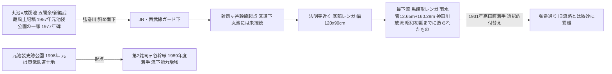

# 2026-11-11（第11回）・文春弦巻川3回シリーズ全文・南長崎支流再検証・水徒然谷端川暗渠・地図豆目白泉探しの追加調査

第11回定期実行。第10回（コミット 2be868d）以降のmainを取り直して重複確認した上で、下記を追加した。

## 追加・更新した資料

- [BLOG-063](../sources/blogs/BLOG-063.md)（更新）: 文春オンライン弦巻川シリーズ（葉上太郎・2026年6月8日・全3回）が**全文取得可能になっていた**ため、抄録のみ→直接確認へ格上げ。URL（88508/88509/88510）も確定。
- [BLOG-064](../sources/blogs/BLOG-064.md): 髙山英男・南長崎支流再検証（2014年9月8日・本文取得失敗記事の再試行成功）。第10回の次回課題1を解消。
- [BLOG-065](../sources/blogs/BLOG-065.md)・[BLOG-066](../sources/blogs/BLOG-066.md): 水徒然（onnbubatta）の谷端川記事2本。2026-10-23・暗渠ブログ横断調査で未索引だったブログの一部を資料化。
- [BLOG-067](../sources/blogs/BLOG-067.md): 一朴洞日記「名残の湧水」（2025年6月19日）。アクセス遮断が記録されていたブログの新規エントリ取得。千早公園湧水の2025年現況観察を含む。
- [BLOG-068](../sources/blogs/BLOG-068.md): 地図豆9-1「目白の坂を上り下りしながら泉を探す」。湧水3分類と目白崖線湧水点の観察。

## 文春弦巻川シリーズで既存仮説が強まった点〔確認〕

- **弦巻川→雑司ヶ谷幹線の選択的付替え**: 横山恵美学芸員「なるべく短い距離を通した。川の上に道路を通した」、雑司ヶ谷幹線は音羽通り下を一直線で旧川（首都高下）と乖離、起点は丸池につながらず西武ガード越え後の区道下 — 選択的付替え理解の公的裏付けが増えた。
- **弦巻川＝豊島区・文京区の区境**（清土鬼子母神・日本女子大の説明）: 明治22年境界川説（城所note）を第3の傍証が支持。
- **雑司ヶ谷の地下水・自噴**: 豆腐店の井戸水「ボンボン出てくる」、現存する湧く井戸、建て替え時の大量湧水の聴取 — 弦巻川谷頭の自噴仮説（BLOG-052の弦巻川断章）を補強。
- **丸池・元池袋史跡公園の位置特定が前進**: 現公園は東武鉄道の土地で丸池跡ではなく、丸池は隣接ビル下付近の推定。**第2雑司ヶ谷幹線の起点が同公園の横**（1989年度着手・公園1998年）で、区HPの「下水道工事」の正体が判明。

## その他の解釈メモ

- **南長崎支流（BLOG-064）**: 花咲公園前の細い暗渠が支流に接続する聴取の裏付けに加え、Weekend Outdoors証言で**昭和40年前後まで開渠・昭和40年前半ヒューム管埋設・農業用水説**が加わった。谷端川支流群の「支流ごとに暗渠化時期がずれる」（第10回ノート）に昭和40年前後のデータ点が1つ増えた。としま昭和病院横湧水暗渠の清戸道越えと合わせ、清戸道沿いの湧水・湿地帯の広がりが複数の観察で裏付けられた。
- **雲雀ヶ谷戸・下り谷の字界が具体化**（BLOG-066付記、池袋本町4-3と1-38の丁界）。「明治44年逓信局の地図」が個人読図にも使われていることが判明 — 郵便地図（東京市十五区番地界入地図）系の正式書誌同定が次の一手。
- **千早公園の流水が2025年時点で湧水**（BLOG-067）: 粟島神社弁天池と約100mという近接観測。谷端川源頭部の湧水系（弁天池・湧水・千川上水長崎分水）に新たな現況観察点が加わった。ただし湧水口は未観察で湧出機構は未解決のまま。
- **地図豆9-1の湧水3分類**（BLOG-068）: 谷頭湧水仮説をtypedで論じるための枠組み（崖線/谷頭/凹地滲みだし）として利用価値が高い。おとめ山公園東西の谷の湧水は目白崖線（弦巻川谷の北縁）の観察点。

## アクセス不能・不発の記録

- kawawalk「谷端川児童遊園」（blog.goo.ne.jp）: 橋名由来（耕地整理の字名、熊野橋のみ神社由来）の抄録が得られたが本文は自動遮断。第10回と同じ状態。橋名の情報自体は[BOOK-062](../sources/books/BOOK-062.md)系と重複するためsource file化せず。
- 寅さん歩その25（shonan-fujisawa.jp/watanabe/wpage5144.pdf）: 豊橋=池袋本町と大山金井町の間、西前橋=池袋本町3-17と大山金井町5の間などの抄録が得られたが本文取得は遮断。橋位置は既存の四河川の橋名調査と重複のためノート記録のみ。
- sirakigi千川上水ページ（wwr3.ucom.ne.jp、武蔵高等学校報国団1941年写真アルバム復刻紹介）: 遮断。同アルバム（平成8年武蔵大学調査版）の所在確認は次回以降。
- NDL・国会図書館での千川上水絵図の直接検索は不発（既知の小川家文書・都公文書館絵図情報を超える新規所蔵は未確認）。

## 次回課題

1. 文春シリーズの裏取り: 『ふるさと雑二町会』（1988・宇佐美俊弘）・『坂まち通信』第2号・『高田町史』・『高田町写真帖』（豊島区立郷土資料館）の実物確認。としま案内人の弦巻川案内図の入手。
2. 雑司ヶ谷幹線最下流レンガ区間（雨水管12.65m+160.28m）の出典（都下水道局の施設資料・写真）確認。
3. 「ここに弦巻川ありき 1987年4月」ペイントの現地確認と撮影年。
4. 明治44年逓信局地図（郵便地図）の正式書誌同定と[MAP](../sources/INDEX.md)登録。BLOG-066の巣鴨学園支流と瓢箪池支流（BLOG-061）の照合。
5. Weekend Outdoorsブログ（weekendoutdoors.blog97.fc2.com/blog-entry-1386.html）の取得再試行。
6. 千早公園湧水の現地確認（BLOG-067の追試）。
7. 継続: INDEX.mdのbuild.py再生成（git環境待ち）、README冒頭「現時点で重要なこと」への保留bullet（第6〜10回分＋今回分）のprepend（git環境待ち）。今回もget_file_contentsではREADME本文（約1.37MB）を取得できず、README変更は見送り。
