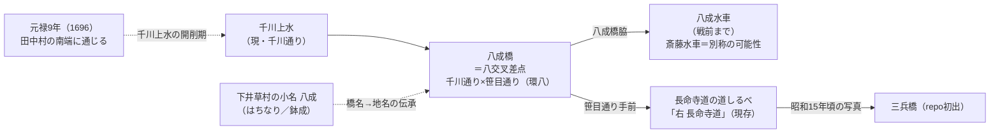

# 2026-11-11（第12回）調査ノート

## 概要

第11回（コミット eff42ce）以降の追加調査。GitHub App の書き込み関数は復旧済み。本回は主に①千川上水・南田中周辺（八成橋・八成水車）、②丸池・弦巻川源流の江戸〜昭和初期史料、③谷端川緑道の橋跡観察、④千川（小石川）の記念碑・解説板の4系統で新情報を得た。

## 新資料

- [BLOG-069](../sources/blogs/BLOG-069.md) 村田英之「逃避の散歩39 谷端川緑道」（2022）：橋跡目印27橋の2022年時点の設置状況、南=赤系/北=白色系タイル・境橋以降柵が鉄製という**区間別の素材差の観察**、親水公園2か所の「親水施設稼働中止」張り紙（2022年5月）。
- [BLOG-070](../sources/blogs/BLOG-070.md) miwa3k（投稿年未詳）：**簸川神社の「千川改修記念碑」（1934＝昭和9年暗渠化）repo初出**、猫又橋親柱の現存と猫又坂解説板（文京区教委1999）全文、市兵衛河岸解説板（1989）全文、板橋駅での「一の橋・二の橋の橋跡が再現」という表現、粟島神社由緒碑の「谷端川の源泉」文言の引用。
- [BLOG-071](../sources/blogs/BLOG-071.md) Kazu Bike Journey 南田中（2019訪問・2023投稿）：**「八成水車」repo初出**。八交叉差点（千川通り×笹目通り／環八）付近・戦前まで、設備（挽臼4・搗臼2・杵12・精米機）が [GOV-069](../sources/gov/GOV-069.md) の斎藤水車証言と完全一致。**長命寺道道しるべ現存**、昭和15年頃写真の**三兵橋**（repo初出の千川上水橋名）。
- [BLOG-072](../sources/blogs/BLOG-072.md) 歩・探・見・感 八成町（2021、Wayback確認）：**八成＝はちなり**、下井草村の小名（風土記稿「東の方上鷺ノ宮の界を云」）、異表記「**鉢成講中**」、**観泉寺住職が経典から八成橋と命名→地名化**という『杉並風土記』（1977）の伝承、『杉並の地名』（1978）は由来を伝えず。
- [BLOG-073](../sources/blogs/BLOG-073.md) toshima_lab 丸池（2025-02-16）：『遊歴雑記』（1814）「往古夥しき池ありしによってなり…今もなを三百余坪」**repo初出の江戸期原典**、**『高田町史』（1933）「鶴巻川と水源の丸池」**（池谷戸・浅井原・義家伝承・蛍の名所→汚濁の記述）、成蹊実務学校時代（大正7年頃）の丸池写真のADEAC所在、丸池が雑司ヶ谷村の管理になった経緯説（かたりべ45→豊島区史）、**池袋村絵図の立教通り辺りの橋と流れの読図指摘**。
- [BLOG-074](../sources/blogs/BLOG-074.md) toshima_lab 続々・高田雲雀（2025-03-23）：高田雲雀（天明8／1788）「琵琶島、検校島 蓮光院のうしろ…**池ヶ谷**あり、今は池のかたちのミあり」、字「中谷戸見行島」＝検校島候補、『御府内場末往還其外沿革図書』の**延宝期・丸池周辺の入会**（NDL pid/2587247/1/48）。
- [BLOG-075](../sources/blogs/BLOG-075.md) 弦巻川暗渠散歩①（2020）：東京時層地図・文明開化期図で**水源が丸池でなく北西（西池袋公園方面）**という独立の読図＝**西池袋公園＝谷頭説の支持観察**。
- [BLOG-076](../sources/blogs/BLOG-076.md) 暗渠を駆ける 弦巻川（投稿年未詳）：**神田川合流点（江戸川橋）で弦巻川の水流が見える**という現況観察。
- [MAP-155](../sources/maps/MAP-155.md) 板橋宿付近千川用水堀絵図（千川家文書絵図、練馬区立石神井公園ふるさと文化館・分室）：所蔵番号2000-1-0002-284、江戸時代作成。同アーカイブの「千川分水口取調絵図」（2000-1-0002-133、元治元年1864作成・明治初期加筆）は [MAP-119](../sources/maps/MAP-119.md) の所在先に一致。

## 解釈

### 1. 八成橋・八成水車（第9回の未解決課題への進展）

第9回ノートの「八成橋の位置特定は未実施」に対し、[BLOG-071](../sources/blogs/BLOG-071.md)・[BLOG-072](../sources/blogs/BLOG-072.md) で次の要素が揃った。

- 位置：千川通り（旧千川上水）×笹目通り（環八）の**八交叉差点**・その交差点名のバス停「八成橋」（井草3丁目）として現代に残る（[GOV-069](../sources/gov/GOV-069.md) の「八成橋脇の水車」の位置と整合）。
- 呼称：「八成」は下井草村の小名（はちなり）。橋名→地名とする伝承（観泉寺住職・経典由来）と、地名由来を伝えない区教委史料（1978）が併存。**橋名と地名の前後関係は確定できず、両説並記とする**。
- 水車：設備構成の完全一致から**八成水車＝斎藤水車の別称・通称**と推定（仮説）。ただし [GOV-067](../sources/gov/GOV-067.md)（上水路図に8か所・練馬区で確認される水車4か所）と「10基ほどの水車」の数字は食い違い、典拠確認待ち。

### 2. 丸池・弦巻川源流（BLOG-073〜075）

- 年代順に整理すると、丸池の消長が史料で追える：延宝期（入会）→1772（雑司ヶ谷村絵図で村内）→**1788（高田雲雀「池の形のみ」＝凋落期）→1814（遊歴雑記「三百余坪」＝回復）**→大正7年頃（成蹊実務学校で水泳）→1933（高田町史「石囲いの水溜」・汚濁）。
- 「池谷戸」「浅井原」「池ヶ谷」等、丸池周辺の谷戸・字呼称の初出資料が揃った。**地名対照表への追加候補**（池谷戸・浅井原・池ヶ谷・中谷戸見行島・八成・鉢成）。
- 高田雲雀「池の形のみ」（1788）と遊歴雑記「三百余坪」（1814）の落差は、雑司ヶ谷村による池の整備（泥さらい）で回復したという [BLOG-073](../sources/blogs/BLOG-073.md) の仮説と整合するが、**原典（adeac・NDL）がopen_urlで未確認のため全て二次転記扱い**。
- 弦巻川の水源位置は「丸池」説（碑・[GOV-055](../sources/gov/GOV-055.md)系）と「西池袋公園方面」説（[BLOG-052](../sources/blogs/BLOG-052.md)・時層地図読図）の対立のまま。[BLOG-075](../sources/blogs/BLOG-075.md) は後者の独立支持。**池袋村絵図の立教通り辺りの橋と流れ（BLOG-073の読図指摘）の該当箇所判読が次の一手**。

### 3. 千川（小石川）の記念碑（BLOG-070）

簸川神社の千川改修記念碑（1934＝昭和9年）は、小石川区間の暗渠化年次を示す**記念碑レベルの新根拠**。ただし碑文採録がまだで、既知の神田上水・千川関連年次（1930年閣議決定（README年表）等）との整合は確認できていない。**現地での碑文採録が次回課題**。

### 4. GitHub コード検索の不調（運用メモ）

本回、search_code が既知の語（「かたりべ」等）でも0件を返したため、重複確認はコミット履歴（第1〜11回の記録）とディレクトリ実測（BLOG-068・GOV-069・PAP-021・BOOK-063・MAP-154・ORG-013・GAZ-022が最大番号）で代替した。次回以降、search_code が使えるか最初に検証すること。

## READMEへの反映

- README冒頭「現時点で重要なこと」へのbullet追記は今回も不可（get_file_contentsが1.37MBのREADMEに「too large」を返すのみ・git環境なし、を再確認）。**保留bulletは第6〜8回分＋第11回分＋本回分（八成水車＝斎藤水車別称の可能性・遊歴雑記1814・高田町史1933・高田雲雀1788・千川改修記念碑1934・神田川合流点で弦巻川の水流観察・南/北緑道の素材差）をgitが使える環境でまとめてprependすること**。
- INDEX.md の build.py による再生成は引き続きgit環境待ち（BLOG-069〜076・MAP-155でさらに未反映が9件増えた）。

## 次回課題

1. 千川改修記念碑（簸川神社）の碑文採録・設置主体の確認。
2. 『かたりべ』45号PDF（丸池・弦巻川関係記事）の本文確認（open_url不可だったため代替取得手段：図書館・Wayback）。
3. ADEACの丸池大正期写真（mp105000/toshima50th/11）・豊島区史資料編3巻該当頁（高田雲雀）の画像判読。
4. 『高田町史』（1933）200頁の原本確認（豊島区立郷土資料館等の所蔵）。
5. 字「中谷戸見行島」「池谷戸」「浅井原」の地図上の位置特定と、地名対照表への追加（git環境）。
6. MAP-119（千川分水口取調絵図）の格上げ（同アーカイブ目録で内容確認済み・未反映）。
7. 谷端川緑道の橋跡目印の設置主体・年度の確認（BLOG-069の観察の裏付け）。
8. 八成水車＝斎藤水車別称説の裏付け（「こもれび」の記事・練馬区史該当箇所）。

