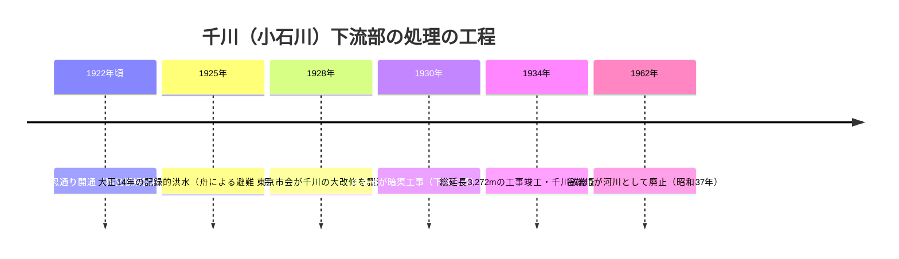

# 2026-11-11（第13回）追加調査ノート

前回（[第12回](2026-11-11（第12回）・八成橋と八成水車の位置具体化・丸池江戸期史料・千川改修記念碑・緑道橋跡観察の追加調査.md)）の未解決課題（千川改修記念碑の碑文・かたりべ45本文）への再挑戦と、新規の調査角度（洪水・下水工事・記録フィルム・支流出端川・まち歩き記録）を進めた。新資料6件（BLOG-077〜080・GOV-070・ORG-014）と対照表への追記を反映（コミットは[このコミット](https://github.com/yuubinnkyoku/otowa-ankyoscape/commits/main)参照）。

## 千川（小石川）下流の1934年暗渠化の工程が揃った

- これまでrepo内で「1934年（昭和9年）暗渠化」は複数資料の読みとして保持してきた（[BLOG-070](sources/blogs/BLOG-070.md)、Wikipedia谷端川の1928年市会議決・3,272m・幅員18mの記述（[第7回ノート](2026-11-11（第7回）・谷端川放水路の典拠特定・湧水論文・鈴木理生事典の追加調査.md)））。
- 今回 [BLOG-077](sources/blogs/BLOG-077.md)（石仏散歩・gooブログ終了のためWayback取得）で**「東京市は昭和5年（1930）から千川の暗渠工事に取り掛かり、総延長3,272mの下水工事は4年後の昭和9年（1934）竣工、碑はその完成記念碑で裏面に各地域の功労者名」**という工程の記述を確認した。1928年議決→1930年着手→1934年竣工という一連の工程が初めて揃い、**千川下流部の暗渠化年次は1934年でほぼ確定的とした観測に格上げ**できる。ただし着手1930の典拠（東京市の工事文書）は本記事では提示されておらず、碑文の直接採録も依然未実施〔確認：記事の記述。断定は碑文・行政文書待ち〕。
- [BLOG-078](sources/blogs/BLOG-078.md)（ぼのぼのぶろぐ・Wayback）・[BLOG-079](sources/blogs/BLOG-079.md)（ふじ・ふじブログ・直接取得）も文京区教委解説板経由で昭和9年暗渠完成を同様に伝え、独立裏付けが計4資料になった。

## 大正14年（1925）洪水と谷端川放水路年次問題

- BLOG-077は「**特に大正14年の洪水は記録的で、舟での避難を余儀なくされた**」と伝える〔二次情報〕。谷端川放水路の1924年7月開削説（[第7回ノート](2026-11-11（第7回）・谷端川放水路の典拠特定・湧水論文・鈴木理生事典の追加調査.md)で『いたばしの河川』（[BOOK-031](sources/books/BOOK-031.md)）を原典候補に特定）と同じ時期に下流域が洪水に苦しんでいたことを示す傍証になる可能性がある〔**仮説**：放水路開削（1924）の直後に記録的洪水（1925）が起きたのか、あるいは洪水が契機で議論が進んだのか、因果の方向は本情報では定まらない。断定しない〕。
- 筆者が大正14年洪水の記録写真を区の図書館で探したが見当たらなかったという否定的探索の記録も残しておく（写真的史料の探索の手がかり）。

## 猫又橋の実体史が具体化した

- BLOG-079の袖石解説板転記で、①江戸期の別名説「**根子股橋**」、②**大正7年（1918）3月に石を用いたコンクリート造に改築**、③昭和9年暗渠化に伴い**石造橋は撤去**、④**故市川虎之助（改修工事相談役）が親柱と袖石を東京市と交渉して自宅に移した**、⑤**現存は袖石2基、袖石の短歌は市川の作**——が判明〔確認：文京区教委解説板の転記。行政文書での裏付けは未実施〕。[BLOG-070](sources/blogs/BLOG-070.md)の猫又橋親柱の観察（不忍通り・氷川下交差点）と併せ、**猫又橋の橋跡情報としてはrepo内で最も具体化した**。[四河川の橋名・橋跡調査](四河川の橋名・橋跡調査.md)への反映と、江戸切絵図の**祇園橋**（BLOG-078、湯立坂から千川に架かる＝簸川神社参道）の追加が次回課題。

## 千川上水の記録フィルム（1952）という影像史料の所在

- [GOV-070](sources/gov/GOV-070.md)：練馬区公式の指定・登録文化財ページで、**昭和27年（1952）に練馬区教育委員会が製作したカラーリバーサルフィルム60コマ（取水口→六義園）**の存在を確認。**田中水車の所在地（上石神井1-8）**と**石神井川からの揚水流入口（豊玉北6-13）**の撮影地点が特定される。1952年当時、暗渠化工事の初期段階を意図的にカラー記録したという解説付き〔確認：公式ページ〕。フィルム本体の視聴手段・デジタル公開は未確認で、次回以降の探索課題。[BOOK-058](sources/books/BOOK-058.md)（水道歴史館『千川上水 昭和27年の写真を中心に』）と同年の、相互補強できる記録群。

## 出端川と大山の地名

- [BLOG-080](sources/blogs/BLOG-080.md)：wanjin（「水の行方を追って」）の出端川編を、これまでのAccess Denied（[BLOG-004](sources/blogs/BLOG-004.md)等と同じ）をWaybackで回避して初めて直接確認。『いたばしの地名』に基づき**大山町（千川上水の漏水の影響を受けた水源）→大山駅→東上線沿い→山手通り越え→谷端川合流**という流路観察と、**大山=大山道（大山阿夫利神社参詣道八道）の分岐点「大山に曲がる処」に由来する地名**という説明を確認〔確認：記事の転記。『いたばしの地名』本文は未直接確認〕。中丸川との混同問題（[BLOG-059](sources/blogs/BLOG-059.md)）について、『いたばしの地名』が両川を別項として扱う理解を支持する第三の独立記録になった。対照表に「氷川田んぼ／氷川たんぼ／千川たんぼ」「大山」を追記した。

## ORG-014（JIA関東まち歩き）

- 板橋駅東口→王子の千川用水通し経路の歩行メモ。分配堰石碑＋堀割地名（[BLOG-053](sources/blogs/BLOG-053.md)と整合）、木樋による江戸供給の叙述、暗渠化時マンホール残存の観察など、repo初出レベルの細部を含むが、見学会メモのため裏付けは薄い〔確認：PDF本文〕。

## アクセス不能の記録（次回再試行）

- **『かたりべ』45号PDF**（https://www.city.toshima.lg.jp/documents/2548/kataribe45.pdf ）：直接もWaybackスナップショット（2026-10-25取得済み）もopen_urlでの本文抽出不可。丸池関連引用は[BLOG-073](sources/blogs/BLOG-073.md)の二次転記に依存したまま。
- gooブログ（石仏散歩）：サービス終了のため全滅予定。Wayback id_形式で取得成功（BLOG-077）。
- ぼのぼのぶろぐ（cocolog）：直接はAccess Denied、Waybackで取得成功（BLOG-078）。
- wanjin（fc2）：entry-250はWaybackで取得成功（BLOG-080）。**entry-240/241 は従来どおり Access Denied・Wayback未収蔵**。
- CiNii経由の新規学術論文は今回新規ヒットなし（千川上水・弦巻川・谷端川いずれも既知文献の範囲内）。

## 次回課題

1. 千川改修記念碑の碑文の直接採録（裏面の功労者名を含む）と、着手1930年を裏付ける東京市の工事文書の探索。
2. 大正14年（1925）洪水の東京市・文京区の災害記録・新聞記事の探索（谷端川放水路年次問題との関連の検証）。
3. GOV-070記録フィルムの視聴手段（練馬区の上映・デジタル公開・収蔵）の確認。
4. 『いたばしの地名』出端川・中丸川各項の原文確認。出端川の読み。
5. 簸川神社境内「取水舎」の由来・設置年代の確認。
6. [四河川の橋名・橋跡調査](四河川の橋名・橋跡調査.md)への祇園橋・根子股橋の追加。
