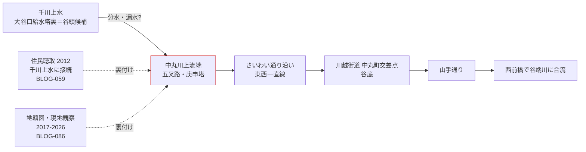

# 2026-11-11（第14回）追加調査ノート

第14回定期調査。前回（第13回・コミット2f8f317）までに未収録だった情報源を調査した。書き込み関数は復旧済みで、反映直前にmainの最新コミット（2f8f317）を再取得し、blogs の最大番号がBLOG-080であることを確認のうえ採番した。

## 1. Natrium.jp「谷端川と周辺の水路敷群」シリーズ全体の資料化（BLOG-081〜088）

Natrium.jpは[BLOG-001（水窪川編）](sources/blogs/BLOG-001.md)・[BLOG-002（弦巻川編）](sources/blogs/BLOG-002.md)で既収録だったが、**谷端川編（yabata01〜08）は参考リンクとして引用されるのみで、資料ファイルが存在しなかった**。今回、8ページすべての本文を直接確認して資料化した（撮影2017年〜2023年、2025年再訪、2026年7月6日追記含む）。

新事項のうちrepo初出のもの：

- **田楽橋**（下板橋駅前にあった橋。**明治43年＝1910年銘の欄干が子易神社境内にベンチとして現存**）〔BLOG-084〕
- **見返り橋**（大塚三業通り・割烹あたり。BOOK-062準拠の橋名）〔BLOG-088〕
- **大塚天祖神社**（旧巣鴨村鎮守、元亨年間勧請、明治6年まで神明社）〔BLOG-088〕
- **目白通り二又子育地蔵尊**（宝永7年＝1710年造立銘、昭和13年＝1938年目白通り拡幅で移転）〔BLOG-082〕
- **六ツ又の庚申塔（庚申ビルディング）**・池袋六ツ又＝支流上流端説〔BLOG-087〕
- **椎名町駅〜東長崎駅間の線路北側水路敷**（地籍マップ＋2025年現況、東長崎駅保線区排水路起源説）〔BLOG-083〕

## 2. 中丸川の千川上水接続仮説の強化〔重要〕

[BLOG-086](sources/blogs/BLOG-086.md)（Natrium中丸川編）は、『いたばしの地名』の中丸川記述に基づき、**本流と2支流の水路敷を地籍図・MapExpert地籍マップ・現地観察で照合**した。要点：

1. 中丸川本流の上流端は**千川上水に達する**（五叉路・青面金剛庚申塔の位置）。
2. 2026年7月6日追記では、千川上水北側（**東側下板橋村・西側上板橋村の村界路地**）に地籍図上の水路敷が残り、**中丸川の最上流部だった可能性**。
3. 筆者は地形図から**大谷口給水塔裏あたりが谷頭のよう**で、湧き水の存在を推測する。

これは以下の既存資料を独立に補強する：

- [BLOG-059](sources/blogs/BLOG-059.md)（暗渠ハンター中丸川）の住民聴取「上流は千川上水につながっていた」「昭和50年代に暗渠化」
- [GOV-068](../gov/GOV-068.md)の「分水は湧水池・自然河川源頭に接続する設計思想」
- 中丸川＝出端川混同問題について、**両川別項実在説を流路単位で支持**

**留保**：中丸川が千川上水から実際に取水していたか（分水口・樋の有無）は依然一次史料未確認。水路敷の存在と湧水の存在は別問題で断定しない。

## 3. 出端川流路の具体化（BLOG-085）

東上線の踏切番号（第10・11・14号）・ハッピーロード大山・大山東町児童遊園などを単位に出端川の流路を地籍図照合。**合流位置は豊橋とする別説が地籍図でも裏付く**こと、**千川上水の漏水を水源に合わせた**という推定を記録。[BLOG-080](sources/blogs/BLOG-080.md)（wanjin）の『いたばしの地名』系読図と相互補完。

## 4. 水窪川暗渠化「昭和8年頃」説の追加（BLOG-089）

NEWSポストセブン（週刊ポスト2022年4月22日号・本田創）が今回初めて本文取得できた（第7回以降アクセス不能が継続していた記事）。

- **水窪川の暗渠化は「昭和8（1933）年頃」**〔本田創の明記〕。既存の東京江戸ぶらの「昭和7〜9年に絞る」地図読図推論に対する独立傍証で、**昭和8年説が有力候補に浮上**した。ただし行政の工事原史料は未確認で断定しない。
- **1681年護国寺創建時の門前町整備で東崖下に水窪川・西崖下に弦巻川を整備した**という伝承が本田創からも語られる（「言われている」レベル）。
- 護国寺境内の湧水池→支流→水窪川の構図と、石橋の音羽富士前保存は、既存の護国寺境内旧水系ノートと整合。

## 5. その他の確認

- **寅さん歩 wpage5144.pdf（谷端川の流れを歩くー3）**：検索スニペットで高松橋・中上橋・御嶽橋の由来（地名・字）が見えたが、open_url は「自動アクセス遮断」と返し本文取得は不可のまま。第11回記録のアクセス不能継続。〔継続課題〕
- **wanderxwonder 2026-09-23 皆川典久まち歩き（池袋の川跡）**・**4travel 2026-04-25 谷端川水源から要町まで**：読み取り可能だったが、いずれも既収録事項（千川上水尾根筋・谷端川緑道・雲雀ヶ谷戸・巣鴨プリズン排水口モニュメント・粟島神社水源など）の再構成にとどまり、独立した新事実は見えなかったため資料化せず。

## 6. 次回課題

1. **田楽橋欄干（1910年銘）の子易神社での現物確認・採録**（銘全文・移設経緯の文献探索）。
2. **『いたばしの地名』中丸川・出端川各項の原文**（図書館現物）と、BLOG-059/080/086の三資料の完全照合。
3. **中丸川上流端＝千川上水接続点（五叉路・庚申塔）の現地確認**と、分水口・樋の史料探索。
4. BOOK-062の見返り橋・空蝉橋の掲載頁・由来記述の確認（現物）。
5. 水窪川暗渠化「昭和8年頃」説の行政史料（市会議事録・工事誌）照合。

## 出典

- [BLOG-081](sources/blogs/BLOG-081.md)〜[BLOG-088](sources/blogs/BLOG-088.md)（Natrium.jp 谷端川と周辺の水路敷群 yabata01〜08、2017〜2026）
- [BLOG-089](sources/blogs/BLOG-089.md)（NEWSポストセブン 2022-04-12）
