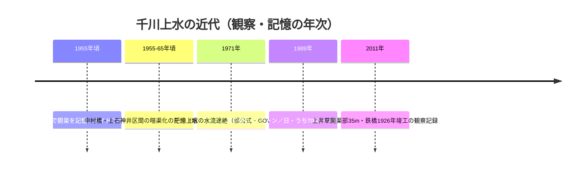

# 2026-11-11（第15回）・千川上水橋梁と境界石・上井草開渠と流量配分・大塚天祖神社の享和元年絵図の追加調査

## 目的・方法

定期調査（第15回実行）。地形・旧河道・暗渠・下水道・湧水・橋・池・用水・灌漑・地名・土地利用・古地図・地籍・都市計画・河川史・地域史・写真資料・学術論文・公的アーカイブの各角度で検索し、出典を開いて内容確認、search_code で既収録と照合した。書き込み関数（push_files・create_or_update_file・get_file_contents）は本セッションも正常。反映直前に最新main（9fcaedb）と各dirの最大番号を再確認した（並行実行との競合なし）。

## 新規登録

1. [BLOG-090](../sources/blogs/BLOG-090.md)：本田創「千川上水橋梁と地上に姿を現す千川上水」（2011年5月23日）。**上井草の西武新宿線千川上水橋梁（1926年竣工と記す）・開渠区間約35m・鉄道建設時の付替え・1万トン中7000トンを善福寺川へ導水し残り約3000トンが開渠部に流れる2011年時点の流量配分**、**谷端川放水路を「1924年氾濫対策」とする独立の二次傍証**。板橋駅東側で谷端川幹線に接続する経路の叙述も。
2. [BLOG-091](../sources/blogs/BLOG-091.md)：水徒然「板橋区栄町（大山）の暗渠と、千川上水境界石」（2011年9月28日）。**千川上水境界石2基の現地観察（傾き・磨耗・埋没の状態）**。境界石という物理的遺構の存在がrepo初記録。
3. [BLOG-092](../sources/blogs/BLOG-092.md)：滝野川探検隊・秋山信行（JIA城北）寄稿。**昭和30年頃の上石神井周辺の開渠記憶（「スイドウバタ」「水道端」バス停）・中村橋の並木＝昭和30年代暗渠化の堤の名残・王子駅前三角広場＝貯水池説・飛鳥山紙の博物館収蔵資料で石神井川掛樋確認可能**、区役所立地と尾根筋用水の解釈。
4. [BLOG-093](../sources/blogs/BLOG-093.md)：TEIONE BLOG「谷端川（小石川）大塚～水道橋01-南大塚」（2020年1月30日）。**大塚天祖神社境内の享和元年（1801）絵図の存在（谷端川を青線で描くと読む）**＝新たな原史料候補。江戸名所図会十羅刹女堂項（乞食橋＝藤〔富士〕橋・石標現存）、大塚花街1922年指定地が「谷端川北側」だった話、東福寺の移転史。
5. [MAP-156](../sources/maps/MAP-156.md)：練馬区立石神井公園ふるさと文化館・分室「**江戸上水配水図**」（千川家文書、2000-1-0002-279、享保2〜3年〔1717–18〕頃）。**千川上水を含む5上水の江戸市中配水図**。MAP-155（同2000-1-0002-284）と同一文書群で、千川家文書群の通し目録調査が次の一手。
6. [BOOK-064](../sources/books/BOOK-064.md)：横山恵美「＜調査ノート＞豊島区の湧き水をたずねて」（豊島区立郷土資料館研究紀要第11号）。2026-10-23横断調査で最優先原典追跡課題だった書誌のファイル化。本文未確認。

## 既存仮説への影響

- **谷端川放水路1924/1925年次問題**: [BLOG-090](../sources/blogs/BLOG-090.md)（2011年）が「**1924年に谷端川の氾濫対策としてつくられた**」と記す。Wikipedia系（1924年7月・1925年）と**独立の二次傍証**が1件増えた〔仮説の補強。原典（[BOOK-031](../sources/books/BOOK-031.md)『いたばしの河川』1986）の現物確認前なので年次確定には用いない〕。
- **千川上水の近代流量・接続の具体化**: 1989年清流復活後の**高度処理水1万トンの配分（善福寺川導水7000トン・上井草以降3000トン）**と**板橋駅東側での谷端川幹線（放水路）接続・石神井川放流**が、GOV-058（管理区分13.8km暗渠）・BLOG-070（板橋駅東口=流末）と整合する形で2011年時点の観察として記録された〔観察。行政資料との照合課題〕。
- **大正期の谷端川と土地利用**: 大塚花街の指定地（1922）が「谷端川北側」に設けられたという叙述は、谷端川が大正期まで南大塚で土地利用の境界として機能した傍証〔推定〕。
- **1801年の谷端川**: 千早の舗石建立塔（GOV-049、1801年建立）に加え、**大塚天祖神社の享和元年絵図**が同年の谷端川流路資料の候補になった。両者の照合は次回以降の現地確認課題。

## 登録見送り（重複・軽微）

- 武蔵野市観光機構「千川上水」ページ（小石川御殿〔現・東大植物園〕・湯島聖堂・上野寛永寺・浅草御殿への給水主目的）: 白山御殿・給水目的は既収録（BLOG-040・BLOG-053・PAP-007）の再叙述。
- 東海大学公開の『図解 武蔵野の水路』26頁・『江戸の川・復活』79頁の**差し替え図PDF**（元禄期6上水給水域概念図・千川上水給水域を含む）: 両書籍の図に無断加筆問題による正誤差し替えである旨を記録。repoはこれら概念図を原資料として使わない。書籍自体の資料化は本文確認時に。
- Code for Nerima note（練馬区南西部の千川上水探索）・北区観光「千川上水分配堰碑」ページ・ねりまの文化財60号（既にGOV-061で直接確認済み）: 既知扱い。
- tokyoriver「千川上水橋梁」記事のコメント欄の鰍工房（復活運動）は BLOG-090 内に併記。

## アクセス不能・継続課題

- michikusa-ac.jp（みちくさ学会「井戸の町、雑司が谷」）: 遮断。次回再試行。
- chizuchizuko.hatenablog.jp（水窪川・谷端川）: 本文取得不能（前回に続き）。横断調査ノートの「未索引」のまま。
- sirakigi 千川上水探訪 senkawa61.html: 遮断。
- nerima-archives.jp: **サイト全体がメンテナンス中**（column/3599など既収録ページも含む）。復旧後に「千川上水が暗きょに」（昭和23年区会意見書・管理権移管問題）の再取得を推奨。
- y-ok.com（雄'Page 谷端川-1）: 遮断。hakkaisan-photo.com 版の再試行も次回。
- **現地確認課題（累積）**: 千川上水境界石の銘文採録（板橋区栄町）・大塚天祖神社の享和元年絵図の撮影・紙の博物館収蔵の石神井川掛樋資料の特定・上井草鉄橋の竣工銘板確認。

## README更新について

本回もREADME.md（約1.37MB）の全文取得手段がこの実行環境にない（get_file_contentsはResourceLinkのみ、raw取得は~32KBで打ち切り、gitなし）。**create_or_update_file による部分更新は1.37MBを消失させるため絶対に行わない**（既定の運用どおり）。第6回〜第14回分の保留bulletに今回分（上井草橋梁と流量配分・境界石・享和元年絵図・放水路1924年傍証追加）を加え、gitが使える環境で「現時点で重要なこと」へまとめて prepend すること。INDEX.md の build.py 再生成も引き続きgit環境待ち（BLOG-032以降約40件未反映のまま）。
