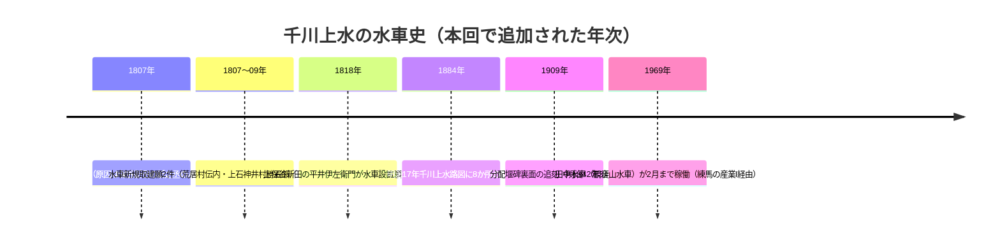

# 2026-11-11（第16回）・千川水車史と分配堰碑碑文・エア暗渠・椿山荘古香井の追加調査

## 目的・方法

定期調査（第16回実行）。地形・旧河道・暗渠・下水道・湧水・橋・池・用水・灌漑・地名・土地利用・古地図・地籍・都市計画・河川史・地域史・写真資料・学術論文・公的アーカイブの各角度で検索し、出典を開いて内容確認、search_code で既収録と照合した。書き込み関数は本セッションも正常。反映直前に最新main（066e5e9）と各dirの最大番号を再確認した（並行実行との競合なし）。sirakigi・citywalk2020・trafficnews の3件は直接アクセスが遮断されたため **Wayback Machine 保存版で全文取得**し、各資料ファイルの書誌欄に取得方法を明記した。

## 新規登録

1. [BLOG-094](../sources/blogs/BLOG-094.md)：sirakigi「千川上水(2) 更新橋〜上井草駅」。**千川筋の水車不許可史**（**文化4年〔1807〕千川の溢水事故＝原因は保谷新田の新之丞の水車とする記録〔板橋区史通史編上経由〕**、文化4・6年の水車願い却下〔近世練馬諸家文書抄経由〕、**明治まで千川筋では水車が許されなかった**という江戸期の通則）、**明治17年千川上水路図に8か所の水車**、**斉藤（南田中1）・渡辺（鴨下・富士見台1）・矢島（豊玉上2）の所在地**、**田中水車（観音山水車）が昭和44年2月まで稼働・杵数43本・フル稼働で約1.2トン/日の定量的記録〔『練馬の産業I』昭和59経由〕**、下掛け式、**練馬区史（昭和32年版）の練馬区内延長10.53km・橋41**、**伊勢殿橋＝出店橋（小字名）→現・伊勢橋プレート**、**千川上水施餓亡霊鬼供養塔（明治41年建立・道しるべ文言採録）**、井草村分水の6か村組合と水田面積（明治10年52町歩→同21年80町歩）、御獄菅笠（天保5刊）の水道端図、竹下新田千川用水堀絵図（千川家蔵）引用。
2. [BLOG-095](../sources/blogs/BLOG-095.md)：citywalk2020「千川上水分配堰碑＆マンホール＆千川上水調節池跡」（2022年8月）。**分配堰碑の碑文を面別に全面採録**：右側面**「樋口寸積百拾六坪八合＝内八拾三坪四合 印刷局抄紙部・三拾三坪四合 王子村外廿二箇村、樋口寸積百五拾坪 千川水道会社」**、**裏面に明治42年（1909）3月の追刻（樋口の大きさ・利用者・堰幅・千川上水公園内溜池の水面高）**。マンホール蓋の型別所在、導水門・排水門の現地観察、沈殿池1973年造替え・バルブ（巻揚器）現存（説明板文言）。
3. [BLOG-096](../sources/blogs/BLOG-096.md)：滝島俊「千川上水と上保谷新田の水車」（西東京市INFORMATION WEB）。**1818年平井伊左衛門の水車設置願（柳橋交差点西角・専用水路を上流約400mから引水）・1835年分村で名主、平井週作（明治2年御門訴事件の中心人物）による水車の銅線工場動力化・坂上水車新設、伸銅工場が昭和末期まで・坂上水車は戦時中中島飛行機の部品工場**。宝永4年（1707）農業用水利用許可。
4. [BLOG-097](../sources/blogs/BLOG-097.md)：大貫伸樹「しん散歩（12）葭窪橋・坂上水車取水口」。**葭窪橋（葭窪・葭窪北台の地名）**、**明治40年の水車2か所（字鎮守290番地・字坂上57番地）**、**昭和19年「公有土地水面使用願」控の写真（水車営業地五七番地から水路引き）**、水路跡の現地聴取、こいこい橋。
5. [BLOG-098](../sources/blogs/BLOG-098.md)：乗りものニュース「エア暗渠」。**仲宿交差点付近で山手通り外回り（地上）と内回り（アンダーパス）が千川上水の暗渠を上下から挟む立体交差構造**、平尾宿〜西巣鴨間で暗渠が道路より高い観察。
6. [GOV-071](../sources/gov/GOV-071.md)：練馬区立石神井公園ふるさと文化館・分室の所蔵品アーカイブ個別ページ「**千川上水記録フィルム 板橋区大谷口付近（推定場所）**」（5000-0057-040）。**「石橋の手前では開渠・下流ではすでに暗渠化」**という個別コマ解説＝GOV-070にない地点の1952年状況。
7. [ORG-015](../sources/org/ORG-015.md)：ホテル椿山荘東京公式「令和十二景」。**古香井（秩父山系からの地下水の井戸）の大正12年震災時の被災者開放伝承**、**ほたる沢＝旧「竹裏渓」（椿山荘十勝の流れ）**、五丈滝（1965年竣工）・望郷橋（2023年命名）。
8. [ORG-016](../sources/org/ORG-016.md)：としまの記憶「**消えたとしまの川1 水窪川コース**」（2023年5月13日）。水窪川を最初に扱った開催記録。**「下流部は弦巻川と併流し、神田川に合流する」**という案内文言。
9. [ORG-017](../sources/org/ORG-017.md)：としまの記憶 動画アーカイブ「**弦巻川編**」（2023年10月28日・長島光男撮影編集）。弦巻川.mdで参照済みだったURLの資料ファイル化（SSOT整備）。丸池→法明寺門前・清立院→護国寺門前→江戸川橋の流路要約と義家の弦説。
10. [PAP-022](../sources/papers/PAP-022.md)：小坂克信「武蔵野台地南部の水利用・水配分に関する教材化のための基礎研究」（2005年）。**「内国勧業博覧会と千川水道株式会社の設立」「明治10年前後の北側新井筋の水争い」「昭和47年の分水の実態調査」**等の章立て（目次レベルで確認）。

## 既存仮説への影響

- **千川上水の水車史の時代区分が具体化**：江戸期の千川筋は水車不許可（灌漑優先・下流の反対）→明治17年路図で8水車→明治期に設置が進む→田中水車が昭和44年2月まで稼働、という前史と終末期が接続した。[GOV-067](../sources/gov/GOV-067.md)（1864年の水田利用・練馬区4水車）、[GOV-070](../sources/gov/GOV-070.md)（田中水車＝上石神井1-8）、[BLOG-071](../sources/blogs/BLOG-071.md)（八成水車）、[BLOG-092](../sources/blogs/BLOG-092.md)（上石神井の記憶）と接続する〔観察。板橋区史通史編上・近世練馬諸家文書抄・練馬の産業Iの原典確認前なので年次・数値の断定には用いない〕。
- **田中水車の廃止年の資料間差異**：sirakigi（『練馬の産業I』経由）は**昭和44年2月**。周辺観察には「昭和40年頃まで」系の叙述もあり得る。廃止年の確定には『練馬の産業I』原本の確認が次の一手〔未解決〕。
- **弦巻川・水窪川の下流接続問題**：ORG-016の「下流部は弦巻川と併流し、神田川に合流する」は、両川の下流接続（弦巻川.mdの中心的未解決問題）について、主催団体が明示的に「併流」と表現した記録〔観察。暗渠化直前の合流形態の各説とどう整合するか要検討〕。
- **分配堰碑裏面の明治42年（1909）追刻**：碑（明治15年建立）の後に水利条件の変化があった時期の物理的痕跡。**碑面で印刷局抄紙部（83坪4合）・王子村外22か村（33坪4合）・千川水道会社（150坪）の水利を対置する原量情報はrepo初出**。千川水道株式会社（1880年設立・説明板文言、PAP-022の章題）との照合資料〔観察〕。
- **エア暗渠（BLOG-098）**：千川暗渠と他交通の立体交差という新しい観察軸。蓋の意匠・水路敷形状に加えて、暗渠が道路を「跨ぐ側／潜る側」の区別を記録する価値〔観察〕。
- **1952年の大谷口付近（GOV-071）**：GOV-070の記録フィルムの個別コマに「石橋の手前開渠・下流暗渠化」という1952年時点の開渠/暗渠境の記述。**大谷口の「石橋」の同定**が昭和20年代後半の千川上水の空間的状態を固定する鍵〔推定〕。

## 登録見送り（重複・軽微）

- 2008年雑司ヶ谷幹線事故の報道・行政文書（朝日・しんぶん赤旗・ウィキニュース・国土交通省報道資料・月刊SORA）: [GOV-025](../sources/gov/GOV-025.md)・[GOV-026](../sources/gov/GOV-026.md)で既収録。
- 板橋区浸水履歴・洪水ハザードマップ・東京都水害リスク情報システム: 現代の防災資料で、千川・谷端川の河川史には直結しない（大正14年洪水の行政記録探索は継続課題のまま）。
- sirakigi senkawa11（武蔵高写真アルバム関係）・senkawa51・senkawa61ほか同シリーズ他頁: senkawa21を資料化。他頁の個別資料化は次回以降。
- 武蔵野市観光機構・北区観光（分配堰碑）・練馬区公式（千川上水跡・谷端川緑道）・miwa3k「千川上水を歩く」（10基以上の水車・「昭和40年頃まで」）: 既知の再叙述。ただしmiwa3kの「昭和40年頃まで水車」説とsirakigiの「昭和44年2月」説の**対立自体**は上記のとおり記録した。
- 朝日新聞・赤旗の事故報道個別ページ、練馬区史昭和32年版などsirakigi引用書籍自体: 本文未確認のため資料ファイル化せず（BLOG-094内の二次引用として記録）。

## アクセス不能・継続課題

- t-ramsar-k.jimdofree.com（加藤嘉六「坂と湧水 おとめ山〜椿山荘〜懸樋跡を歩く」）: 直接遮断、Wayback未収蔵。次回再試行。
- chizuchizuko.hatenablog.com（水窪川・谷端川・小石川）: 引き続き遮断（前回に続き）。
- かたりべ45 PDF・wanjin entry-240/241・夢七雑録part3: 引き続きアクセス不能。
- **原典確認課題（本回追加）**: 『板橋区史 通史編上』（文化4年溢水事故）・『近世練馬諸家文書抄』（文化4・6年願い）・『練馬の産業I』（田中水車の数値・廃止年）・『練馬区史』昭和32年版（10.53km・橋41）・千川上水路図（明治17年・8水車）・星野家文書（杉並区教委昭和58）・御獄菅笠（天保5刊）・明治2年上保谷新田絵図・昭和19年公有土地水面使用願。
- **現地確認課題（本回追加）**: 分配堰碑裏面（明治42年追刻）の全文採録・上石千川児童遊園の田中水車案内板・石臼2基・伊勢橋プレート・施餓亡供養塔・大谷口の「石橋」・葭窪橋・こいこい橋・椿山荘の古香井。

## README更新について

本回もREADME.md（約1.37MB）の全文取得手段なし。create_or_update_fileによる部分更新は絶対に行わない（既定運用どおり）。保留bulletは第6〜15回分＋本回分（千川水車史の通則と例外・分配堰碑碑文と明治42年追刻・エア暗渠・1952年大谷口コマ・古香井震災伝承・弦巻川「併流」文言）をgit環境が使える実行で「現時点で重要なこと」へまとめてprependすること。INDEX.md の build.py 再生成も引き続きgit環境待ち（BLOG-094以降さらに10件が未反映）。
