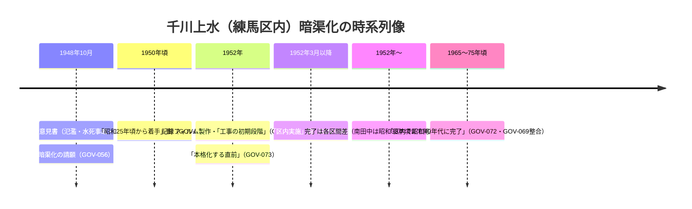

# 2026-11-11（第18回）定期調査ノート：西武新宿線下の開渠残存・記録フィルムの個別コマ公開・Natrium両川頁の本文資料化

## 1. 今回の実行概要

- 実行時点の最新mainは a42ef91（第17回分）。並行実行による追い越しはなし。書き込み関数（push_files・get_file_contents）は復帰済みで正常動作。search_code も正常動作。
- 前回までの未解決課題（坂まち通信第1号の所在・かたりべ45 PDF・wanjin 240/241・夢七雑録part3・sirakigi senkawa1・大塚天祖神社享和元年絵図）は今回も新展開なし。chizuchizuko水窪川頁は本文抽出依然不可（頁は存在するが読み取りサービスが内容を返さず。第17回の記録どおり）。
- 新たに判明したアクセス障害: daijo.shukutoku.ac.jp/senkawa2026（淑徳学園・長谷川良信記念館 歴史講座「千川上水と千川家」2026年10月4日）は直接open不可。ただし検索スニペットで講座要旨（千川家文書＝練馬区指定文化財・西巣鴨の溜池＝調節池・「堀割」地名由来）が確認でき、いずれも GOV-038・ORG-013・BLOG-053 で既収録のため、新規source file化はせず本ノート記録のみ。

## 2. 新規資料

### GOV-072 練馬区「写真で見る練馬の今昔 千川上水・西武新宿線付近」
https://www.city.nerima.tokyo.jp/kankomoyoshi/annai/rekishiwoshiru/nerimanokonjaku/kawahashikoen/shinkawajosui.html

- 下石神井四丁目29番（上井草〜上石神井間）の**線路下20メートル余りのみ開渠が残存**〔確認：本文文言〕。
- 昭和38年・平成9年・平成29年9月の3時点写真（練馬区資料番号24-0305・24-0522・24-0804）。
- **「区内では昭和25年頃から暗きょ化工事」**〔確認〕。着手年代をめぐる3説の比較は下記§3。

### GOV-073 ふるさと文化館分室アーカイブ「千川上水記録フィルム 西東京市新町６丁目付近」（5000-0057-004）
https://www.neribun.or.jp/archive/detail.cgi?id=10022

- GOV-070の記録フィルムの**個別コマが所蔵品アーカイブ（neribun.or.jp）で通し番号公開されていること**が判明〔確認〕。取水点直下流コマ（左=千川上水・右=玉川上水）。
- 「**暗渠化が練馬区内で本格化する直前の昭和27(1952)年頃に撮影**」〔確認〕。
- 5000-0057シリーズ（GOV-071の大谷口コマ=同040を含む）の**通し目録調査が次の一手**。

## 3. 解釈：千川上水暗渠化の着手年代をめぐる3説の整理

すべて練馬区発の叙述。断定せず、上限の絞り込み材料として保持する。

| 説 | 出典 | 文言 |
|---|---|---|
| ①昭和25年頃から | GOV-072（区公式・今昔シリーズ、2024年更新） | 区内では昭和25年頃から暗きょ化工事が行われ |
| ②昭和27年3月以降 | GOV-056（練馬わがまち資料館、昭和62年記事の再録） | 練馬区内での実施は昭和27年3月以降 |
| ③1952年着手 | Wikipedia千川上水（原典は練馬区側史料と推定、未特定） | 練馬区内1952年暗渠化着手（第17回ノート） |

- **②と③は同じ年（昭和27=1952）で整合**。①だけが約2年早い。①「頃」付きの概括と、②「3月以降」の具体的月との差は、着工準備（測量・設計）を含むか否かの違いの可能性があるが〔推定〕、行政文書（区議会議事録・事業記録）の確認まで留保する。
- GOV-070「工事の初期段階」・GOV-073「本格化する直前」の1952年当時の様相と組み合わせると、**1952年＝着手直後の初期段階、本格化は以降、区内完了は昭和40年代**という時系列像が4資料で裏付けられた。

## 4. BLOG-001・BLOG-002（Natrium.jp 水窪川編・弦巻川編）の本文資料化

両ファイルは旧来スタブだったが、2026-11-11に本文全文を取得して内容を資料化した。要点（詳細は各source file）：

- **鼠ヶ谷下水呼称が両川（水窪川・弦巻川）に及ぶ**〔確認：当頁の古地図引用に基づく主張〕— 鼠ヶ谷関係の既存記録（GOV-001・BOOK-057・GAZ-013）に対し、**包括的呼称**という新規の観点。
- **水窪川の出口＝江戸川橋西側の坂下幹線排水口**（下水道台帳照合による）〔確認〕。水窪川の元の川筋が旧神田上水（巻石通り）に注いでいたため神田川に痕跡がない、という説明と、弦巻川側の「大正期地図では弦巻川が旧神田上水に流れ出る描図がある」という読図が対になり、**両川の旧神田上水合流説**を新たな検討課題として残す〔仮説として記録〕。
- **弦巻川は昭和7年（1932）暗渠化の際に流路の付け替えがあった**〔確認：当頁の主張〕— 既存の昭和7年暗渠化記録（GOV-017・BLOG-038）に**流路変更**の具体像を追加。
- **自噴井戸の2023〜24年時点の現地観察**〔確認〕— BLOG-052（2010年観察）に対する別時点の観察として蓄積。
- 明治44年高田村・戸塚村全図（豊島区立中央図書館など所蔵）・大正14年高田町戸塚町全図（特別区協議会）による**弦巻川上流端の描き分け**〔確認〕— MAP-035（年代未詳→明治44年説の補強）・MAP-117に対応。
- 上流端・谷頭の読図（美久仁小路・栄町通りの谷頭、日出町公園中央の流路、水久保停留場の昭和14年統合〔※頁に「昭和14年（1393年）」の誤記あり〕、蟹ヶ窪の範囲）〔確認・推定が混在：当頁の主張〕。
- 社寺の年代データ（吹上稲荷1622創建/1912現地、今宮神社1873遷座、清土鬼子母神堂1561出土、蓮光寺1698移転）は既存資料と一致し裏付けに使う。

## 5. MAP-035 への影響（ファイル更新はせず本ノートに記録）

- BLOG-002の本文で「**明治44年 北豊島郡高田村・豊多摩郡戸塚村全図**（豊島区立中央図書館など所蔵）」と特定されており、MAP-035（現在「年代未詳」）の作成年特定の補強材料になる。README既存の1911年7月刊説（逓信協会・CiNii書誌）とも一致。**MAP-035のfrontmatterを「明治44年（1911）説（BLOG-002・README書誌による）」へ更新するかは、原図書誌の直接確認後に判断する**〔今回は本文の変更を避け、根拠を本ノートに残す〕。

## 6. 次回課題

- neribun 5000-0057シリーズの通し目録調査（id=10016〜10025等の隣接項目の確認）→ 記録フィルムの全コマ撮影地点の把握、GOV-070の撮影地点7か所との対応。
- GOV-072の「昭和25年頃から」説の典拠行政文書（練馬区議会・下水道事業記録）の探索。
- 練馬区資料番号24-0305・24-0522・24-0804の写真実体の所在確認。
- 旧神田上水合流説（水窪川・弦巻川とも大正期以前に旧神田上水に注いだ描図）の古地図原図確認（BLOG-001/002依拠の「江戸時代/大正期の地図」の特定）。
- 引き続き: 坂まち通信第1・2号の所在、かたりべ45 PDF、wanjin entry-240/241、夢七雑録谷端川part3、sirakigi senkawa1、大塚天祖神社享和元年絵図の現物確認、INDEX.md build.py再生成（git環境待ち）、README冒頭bulletのprepend（第6回分〜保留中）。
