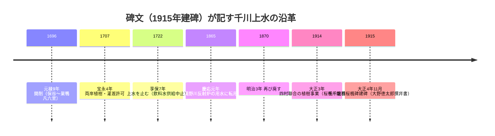

# 2026-11-11（第19回）調査ノート：千川堤植桜楓碑の漢文碑文・Natrium千川上水シリーズ3頁

## 1. 概要

第19回定期実行。前回（第18回・コミット 92e47c5）以降の main は更新なし（本回開始時に 92e47c5 が最新であることを確認）。書き込み関数（push_files・get_file_contents）は正常動作。本回は **4件の新資料** を登録した。

- [BLOG-101](../sources/blogs/BLOG-101.md): 円満字二郎「漢文石碑を読み歩く 千川堤植桜楓碑」——江古田浅間神社の千川堤植桜楓碑（1915年建碑・北豊島郡長 大野徳太郎撰幷書）**碑文（漢文）全文採録のrepo初出**。
- [BLOG-102](../sources/blogs/BLOG-102.md)〜[BLOG-104](../sources/blogs/BLOG-104.md): **Natrium.jp 千川上水シリーズ（canal_lot/josui/）3頁がすべて未登録だったことを発見**し、全頁を資料化（関町〜井草／東長崎〜千川駅／千川駅〜板橋区役所。2011〜2019年撮影）。既登録の谷端川系11頁（BLOG-081〜088・LOST-004）と同サイトだが別シリーズで、repoの Natrium 資料群を千川上水側に拡張した。

## 2. 千川堤植桜楓碑の碑文がもたらしたもの

碑文自身が千川上水の沿革を年代順に記しており、repoで個別に出典を追ってきた各年代が**一つの一次史料上で連続して確認できる**点が新しい。

- 享保7年（1722）廃止はrepo既知の定説と整合。
- **慶応元年（1865）の滝野川反射炉用の転用**は、[BLOG-053](../sources/blogs/BLOG-053.md)（豊島区教委説明板「1865年反射炉王子分水＝堀割の由来」）と対応する反射炉関連記述の第二の源泉。碑文では「明治3年又た廃せり」と続き、**1865→1870の用水転用の継続期間**を絞る材料になる。
- 大正3年植樹は「今上践祚大礼の記念」（大正天皇即位）で、[GOV-056](../sources/gov/GOV-056.md)の「大正4年・桜と楓1,600本・新小金井」記述の背景事業が村会決議・四村聯合（下練馬・中新井・長崎・上板橋）・府知事允可という手続き込みで確認できた。**株数は碑文「千数百株」vs GOV-056「1,600本」で表記差異**（未解決として記録）。
- 長崎村が四村聯合に含まれることは、谷端川への長崎村外三村分水（[GOV-005](../sources/gov/GOV-005.md)）を担った村と千川上水堤の維持体制側の村が連続することを示す〔仮説: 制度史的な連続性の評価は原典照合待ち〕。
- 碑は区画整理で千川通り沿いから現在地（浅間神社）へ移転〔伝聞。時期は未特定〕。

## 3. Natrium千川上水シリーズの解釈

- **BLOG-104: 「戦後の昭和20年代後半までは開渠」**（大山〜板橋区役所間・水神様の由緒として記述）——千川上水の暗渠化着手年代について、既存の3説（[GOV-056] 練馬区は昭和27年3月以降／[GOV-072] 区内では昭和25年頃から／Wikipedia系 1952年着手）に、**板橋区側（下流域）の開渠下限＝1950年前後**という第4の情報が加わった。4つは矛盾せず、「練馬区着手（1950前後）→板橋区側も同時期以降に暗渠化→全区間完了は昭和40年代前半（[GOV-072]）」という全区間の時間軸がより見えてきた〔観察に基づく伝聞であり、板橋区側の行政文書照合が次の一手〕。
- **BLOG-103: 庚申橋の残存**（千川親水公園手前・かつて庚申塔ありという伝聞）と**エンガ堀の起点観察**（東長崎3号踏切北側で西へ分岐）。エンガ堀は谷端川水系側（[谷端川.md](../谷端川.md)のエンガ堀資料群）に接続する話題で、**千川上水からエンガ堀への分堀の起点位置の観察記録**を追加した。小石川・人参川系の庚申橋（[BOOK-057](../sources/books/BOOK-057.md)）とは同名異橋候補として分離して記録。
- **BLOG-104: 中丸川の分水口**の再観察は、[BLOG-086](../sources/blogs/BLOG-086.md)（中丸川頁）・第14回の地籍図裏付け（中丸川の千川上水接続）に**同一サイトの独立した頁としての観察**を重ねたもので、接続説をさらに強める。また「千川上水は谷端川支流（東）と石神井川支流（西）の分水嶺を流れる」という大局観察は、千川上水と谷端川支流群の位置関係の説明図として引用できる。
- **BLOG-102: 伊勢橋の扁額欄干現存**（青梅街道歩道脇・開渠末端部）と**上井草の千川上水橋梁開渠**（2011年観察）は、[BLOG-090](../sources/blogs/BLOG-090.md)（本田創・約35m開渠・1926年竣工説）・[GOV-072](../sources/gov/GOV-072.md)（線路下20m余り）と**観察として相互整合**する第三の記録。伊勢橋（下石神井側）と BLOG-094 の伊勢殿橋→伊勢橋（練馬区側）の関係は未整理。

## 4. 見送り・既存内容との重複確認

- 森内俊雄『谷川の水を求めて』（河出書房新社・1994年）は**長編小説**で、書名の「谷川」が谷端川と無関係の可能性が高く（BOOK-033/034の森内関係とは性格が違う）、見送り。
- 文春 bunshun.jp/articles/-/50033（水窪川）は BOOK-005/BOOK-010 で既出。
- 石仏散歩・千川改修記念碑頁（blog.goo.ne.jp/fuw6606/e/7f368edc…）は [BLOG-077](../sources/blogs/BLOG-077.md) と同内容。
- 新宿歴史博物館の千川上水関係資料リストPDF（regasu-shinjuku）は [ORG-013](../sources/org/ORG-013.md)・第3回で既出。
- 石神井公園ふるさと文化館所蔵資料リストPDF（hurubunrisuto）は [GOV-038](../sources/gov/GOV-038.md) に集約済み。
- 銀木犀note（水窪川暗渠散歩・不動産鑑定士目線）は第5回・第7回で「既知事実の再叙述」と見送り済み。
- 暗渠ハンター「谷端川沿い湧水ものがたり」長崎支流シリーズは [BLOG-056](../sources/blogs/BLOG-056.md)〜で既収録。

## 5. アクセス不能・環境の記録

- **nerima-archives.jp は依然サイト全体メンテナンス中**（column/3482「千川上水の歴史」も column/3599 も直接取得不可。検索スニペットでは column/3482 の内容〔明治13年岩崎弥太郎立案の千川水道会社設立→明治41年解散〕が見えるが、本文未取得のため GOV 化は見送り）。[GOV-056](../sources/gov/GOV-056.md) の Wayback 依存は継続。
- bon-emma.my.coocan.jp は直接 open 403（Wayback 2025-05-13 スナップショットで代替取得可）。
- かたりべ45 PDF・wanjin entry-240/241・夢七雑録part3・sirakigi senkawa1 は継続してアクセス不能（本回は未再試行）。
- README冒頭「現時点で重要なこと」へのbullet追記は今回も不可（1.37MB・git環境なし）。保留bulletは第6〜18回分＋本回分（千川堤植桜楓碑碑文・Natrium千川上水シリーズ・板橋区側「昭和20年代後半まで開渠」・庚申橋残存）をgit環境が使える実行でまとめてprependすること。INDEX.md build.py再生成も継続課題。

## 6. 次回課題

1. 千川堤植桜楓碑の現地確認・実物撮影（碑文の写し取り・株数表記の確認）。
2. 千川上水の板橋区側暗渠化の行政文書（区報・事業記録）の探索（「昭和20年代後半まで開渠」の照合）。
3. 庚申橋（長崎）の橋の遺構・千川親水公園の現況確認。
4. 伊勢橋（下石神井側）の扁額欄干の現地確認と、伊勢殿橋→伊勢橋（練馬区側）との名寄せ。
5. nerima-archives 復旧後の column/3482 直接取得（千川水道会社設立経緯の GOV 化）。
6. 「千」の字境界標（都道420号）・「千川管理地」看板（田崎病院前）の設置主体の確認。
