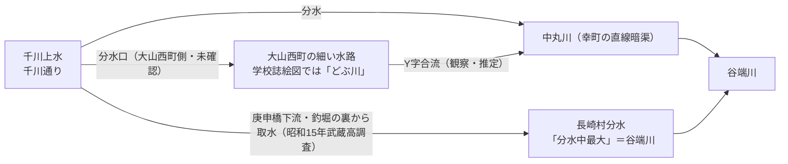

# 第20回調査ノート（2026-11-11）

## 実行環境・経緯

- 実行開始時 main=92e47c5（第18回）。調査中に並行実行が第19回（762d07d: BLOG-101〜104＋第19回ノート）をpushしたため、本実行は第20回として採番し直した（search_codeで重複なし確認済み）。
- README.md冒頭bullet追記は例により不可（get_file_contents不可・git環境なし）。第6〜19回分の保留bulletはgit環境が使える実行でのprependが継続課題。

## 新規資料12件

| ID | 資料 | 要点 |
|---|---|---|
| BLOG-105 | 水徒然（2013）大山西町の細い水路 | 学校周年誌の回顧絵図に千川上水からの水路が「どぶ川」と描かれる＝中丸川接続の第3裏付け。上流端=千川上水、Y字合流説 |
| BLOG-106 | ゆる歴史散歩会（2025-11-17）護国寺〜池袋 | 辻広場11か所整備（昭和61〜平成10年）公式年次・日光広場（第4辻広場・東池袋4-15-5・平成2年度・26.89㎡・防火水槽5t） |
| BLOG-107 | 雨男note（2025/2021訪問）階段路地〜水窪川 | 江戸川橋=弦巻川合流点・谷積み石垣の耐震改修予告・巣鴨プリズン排水口→イケ・サンパーク保存 |
| BLOG-108 | 銀木犀note（2025・不動産鑑定士） | 42条2項道路の分布（豊島区=私道/文京区=区道）・令和6年路線価（美久仁小径100万円超→下流60万円程度）・日光広場湛水・都電拡幅と暗渠道路の廃道・ポポー広場の井戸 |
| BLOG-109 | 神出鬼没日記（2022）富士山広場 | 説明板なし放置状の2022年現況 |
| BLOG-110 | enoお散歩アルバム（2015） | 日光広場説明版（男体山フェンス・華厳の滝ポンプ仕掛け・見ザル聞ザル言ザルベンチ）＋水窪川の碑文言「昔ここに小さな川が流れていた。後世にこれを伝える」 |
| BLOG-111 | 東京の水2009 fragments（2013）エンガ堀向原支流 | 田頭（でんがしら）溜池（大谷口2-35・390坪）・鯉供養の碑・雨乞いと榛名講・雨乞地蔵・大谷口の釣堀・千川上水がエンガ堀谷を迂回 |
| BLOG-112 | kawawalk「長崎村分水２」（goo終了・スニペットのみ二次転記） | 武蔵高校生徒の昭和15年調査「庚申橋の稍々下流に釣堀。釣堀の裏から千川の分水中最大の谷端川…」 |
| GOV-074 | 板橋区「浸水履歴」 | 昭和43年4月30日以降・PDF12本・所在のみ |
| GOV-075 | 『練馬区史 現勢資料編』（i-repository） | 昭和23年10月11日付意見書・請願書原文の所在特定。「暗渠工事施行後の千川に対し下水溝を併設…地方自治法99条2項意見書/124条請願書」（スニペット確認）＝第10回ノート課題4の進展 |
| ORG-018 | 武蔵高等学校中学校 校長散歩200（2020）濯川の水源 | 濯川=千川上水支流・1983年学園60周年蘇生事業（ポンプ式）・八角井戸（埋設）に楚辞の詩・命名=初代教頭山本良吉 |
| LOST-005 | アイ･マイ･ミー（2017・消滅サイト・Wayback 2019-09-22）水窪川頁 | 水窪川=水久保字名由来説（私説）・蟹ヶ窪水源・全流路読図・水久保駅の改名史（1966東池袋四丁目・1974都電荒川線） |

## 既存資料更新3件

- BLOG-034: 「雑司が谷八景の一つ（夏蛍・秋月）」＋「昭和4年に暗渠化」文言を追加。**昭和4年 vs 昭和7年高田町説の年次ずれを記録（断定せず）**。
- GOV-008: 谷端川南緑道の整備年次細目（昭和41年児童遊園1-3・42年第4・55年遊歩道・58年〜平成2年改修・面積8,885.72㎡・開園平成3年4月）open_url直接確認で追記。
- GOV-009: 谷端川北緑道（昭和46年第5児童遊園及び遊歩道・平成2年改修・西前橋〜下板橋駅前・面積2,765.73㎡）Wayback版で追記。

## 接続構造の整理（Mermaid）

千川上水から中丸川への接続は①BLOG-059（地元聴取）②BLOG-086（地籍図・現地観察）③GOV-068/BLOG-104に加え、BLOG-105（学校誌回顧絵図）が第3の独立裏付け。ただし取水構造は未確認。

エンガ堀谷では千川上水が谷を迂回（BLOG-111）。田頭溜池（390坪）は昭和初期に釣堀化し、釣堀=調整池を経て分水する構造はBLOG-112（庚申橋下流の釣堀）と並行する事例。

## 次回課題

- 武蔵高『千川上水』（昭和16年刊）原本の所在確認（BLOG-112・sirakigi写真展の元資料）
- 練馬区史現勢資料編（GOV-075）本文の取得（遮断継続・別ルート探索）
- 中丸川分水口の現地確認（BLOG-105系）
- 日光広場説明版・水窪川の碑の現地採録（BLOG-110の転写文言の照合）
- GOV-074 PDF（谷端川沿い町丁目分）の内容確認
- t-sentaku.com 1310_9.pdf（「水車小屋」「弦巻川の川筋の名残り」）の本文確認
- README冒頭bullet（第6〜19回分）のprepend（git環境待ち）
- LOST-005の弦巻川頁・根津山頁・推測全水路マップの取得

## アクセス不能の記録（本回確認済み）

i-repository本文（遮断・Waybackなし）、kawawalk 2頁（Waybackなし）、sirakigi senkawa11（スニペットのみ）、wanjin 240/241（Access Denied再確認）、夢七雑録本文、kajikakoubou（403）、cocolog post-9d8e（遮断）、chizuchizuko水窪川頁（本文空）、東京土建（mojibake継続）、かたりべ45、t-sentaku PDF。nerima-archives.jpは復旧確認（GOV-056と整合、書き換え見送り）。

## コミット

- 本ノート＋資料15ファイル: c3f0f49（第20回コミット）
