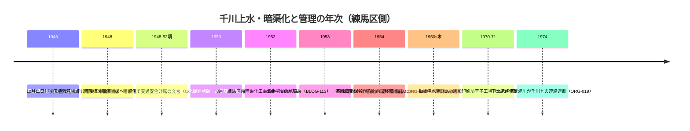

# 第21回調査ノート（2026-11-11）

## 実行環境・経緯

- 実行開始時 main=cfd5631（第20回ノート）。本回は並行実行のpushなし。採番は docs/sources の実測（BLOG-112・GOV-075・BOOK-064・ORG-018が最大番号）に基づく。
- README.md冒頭bullet追記は今回も不可（1.37MB・get_file_contents本文取得不能・git環境なし）。保留bulletは第6〜20回分＋本回分をgit環境が使える実行でまとめてprependすること。

## 新規資料5件＋既存2件更新

| ID | 資料 | 要点 |
|---|---|---|
| BLOG-113 | sirakigi senkawa1（武蔵学園記念室1996年3月写真展「千川上水−今と昔−」・Wayback取得成功） | 千川上水関係略年表の全文取得。**元樋寸法変遷（1732縮小→1737埋樋→1773埋樋＋運上金4両1分）・明治4年境橋上流へ分水口変更・明治6年板橋火薬製造所・明治8年王子製紙/大蔵省抄紙部分水・明治14年取締禁令5カ条・明治40年「岩崎邸六義園、王子方面の用水は存続」・昭和25年5月請願→26年度予算→27年3月着手→28年武蔵学園前暗渠→29年取水口関前移転→45/46年取水停止の工程**。1996年時点「一部地域の復元計画も中止されたまま」。千川上水絵図（千川善蔵所蔵・『東京市史稿』上水篇第1巻付録の複製）の存在 |
| GOV-076 | 練馬区「千川上水調査アルバム」b1706 | **平成17年度区登録文化財・所在は武蔵学園記念室（豊玉上1-26）・昭和13〜16年調査・4冊200カット超・刊本編者は石山乾二**。第20回課題「武蔵高『千川上水』原本の所在確認」を解消 |
| GOV-077 | 練馬わがまち資料館「千川上水の歴史」column/3482（スニペット） | **道奉行伊勢平八郎監督・480両余自前出資（GOV-004の1340−860両と整合）・千川水路取締役拝命・水使用料徴収権・徳兵衛常陸出身入夫説**。サイトは再びメンテ中のためスニペット確認 |
| ORG-019 | 武蔵学園百年史「語り継ごう濯川」（阿妻耕次郎・スニペット） | **濯川1925命名・1932濯川七橋（佐の橋〜玉の橋）・1936喜寿島・「1950年代末までに千川がすべて暗渠」・1974（昭和49）年下水道整備で千川との連絡遮断**・濯川水源は千川分水＋校内湧水（旧制の記述） |
| BOOK-065 | 『練馬区史』（昭和32年・i-repository）第五編補説「千川上水の歴史」（スニペット） | **千川家由緒書は仙川村百姓説に「まつたくふれていない」という区史レベルの批評的検討**・千川名字拝領文書（「仙の字不宜」）・五代源蔵の練馬区北町移住・「江戸の三上水」呼称 |
| GOV-004更新 | 練馬区「千川上水跡」b047本文直接確認 | **河村瑞軒（1617-1699）設計伝承・費用1,340両余/幕府支出860両余・私費投下・千川姓帯刀・子孫代々取締役・明治以降印刷局/王子製紙の工場用水・現在も消火用水・素掘り残存は登録範囲付近のみ・昭和63年度区登録** |
| GOV-075更新 | 『練馬区史 現勢資料編』honcho5追加スニペット | 意見書の追記文言＝**「先に提出した千川暗渠工事請願書」「暗渠化により交通安全災害防止等は誠に好転」＝当該文書は暗渠化（一部）完工後の段階**・利用者は都水道局・大蔵省印刷局・王子抄紙部・王子製紙・都建設局・「沿道の各区は恩恵に浴せない」 |

## 千川上水の暗渠化年次の証拠チェーン（Mermaid）

〔解釈の整理〕BLOG-113年表は昭和23年意見書→25年請願→27年3月着手という行政側の工程を示した。一方GOV-075の追記スニペット（「先に提出いたしました千川暗渠工事請願書」「暗渠化により交通安全災害防止等は誠に好転」）は、当該文書が暗渠化の完工を一部前提とする後の段階の内容で、昭和23年10月11日付という既知の日付との間に時系列の疑問が残る。**同頁に複数年度の文書が含まれる可能性**があり、断定しない。現勢資料編本文の取得が決め手になる。

## 第20回ノートの次回課題に対する進捗

- 武蔵高『千川上水』（昭和16年刊）原本の所在確認 → **解消**（GOV-076：区登録文化財・武蔵学園記念室所蔵）。
- 練馬区史現勢資料編（GOV-075）本文取得 → 部分進展（追加スニペット文言。直接open・Waybackとも不可）。
- 中丸川分水口の現地確認・日光広場・水窪川の碑の現地採録 → 現地作業のため未実施（継続）。
- GOV-074板橋区浸水履歴PDF・t-sentaku 1310_9.pdf → 今回も本文取得不能（t-sentakuは再挑戦したが遮断）。
- LOST-005弦巻川頁・根津山頁 → 本回は未着手（次回）。

## アクセス不能の記録（本回確認済み）

- t-sentaku.com 1310_9.pdf（直接再挑戦・遮断）。
- nerima-archives.jp（column/3482・1623とも、**再びサイト全体メンテ中**。第20回の復旧確認後の再遮断）。
- i-repository（junenshi_honcho5・genseishiryohen_honcho5とも直接open遮断・Wayback未収蔵。スニペット取得のみ可能）。
- sirakigi senkawa11.html（直接遮断・Waybackはトップ転諭のみで本文未取得）。
- 武蔵学園百年史 100nenshi.musashi.jp（目次頁は直接取得可、本文ページ単位の抽出不可・スニペットのみ）。

## 継続課題（次回）

- 武蔵学園記念室（豊玉上1-26）でのアルバム4冊・『千川上水』本文の確認方法（展示・閲覧の問い合わせ）。
- i-repository『練馬区史』補説・『現勢資料編』本文の別ルート取得（区立図書館等の所蔵確認）。
- 「江戸三上水」呼称（BOOK-065）の用例の広がり確認。
- 濯川七橋・喜寿島の現況確認、1974年遮断の下水道事業の行政記録。
- 千川上水絵図（千川善蔵所蔵・『東京市史稿』上水篇第1巻付録）と千川家文書（neribun 2000-1-0002シリーズ）の関係整理。
- GOV-074 PDF・かたりべ45・wanjin 240/241・夢七雑録part3（長期継続）。

## コミット

- 本ノート＋新規5件＋既存2件更新: （本コミット）
