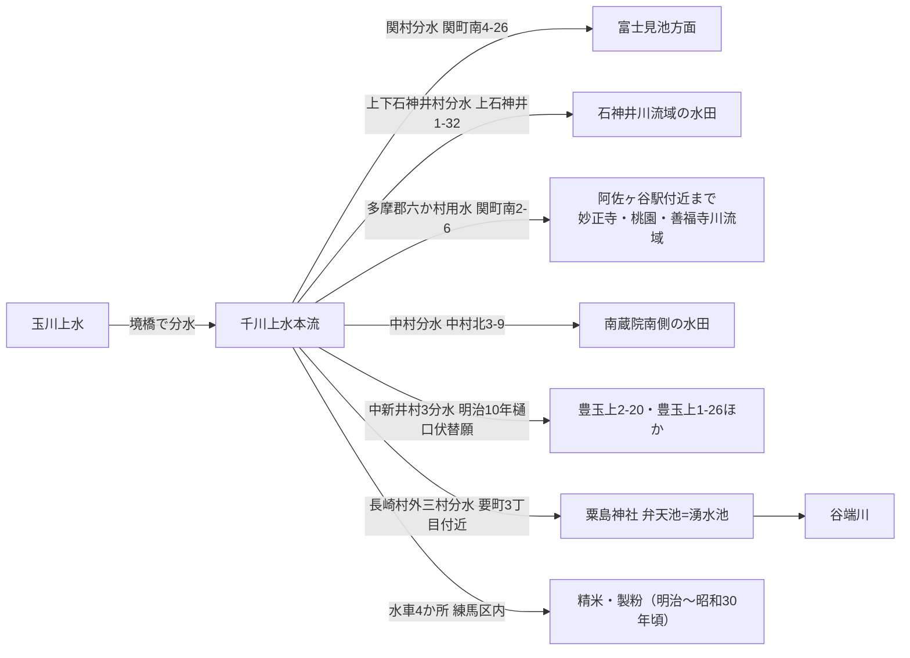

# 2026-11-11（第9回）千川上水の灌漑規模・水車証言・支流暗渠観察・地下水文献の追加調査

## 概要

第9回定期調査。新規資料8件（GOV-067〜069・BOOK-062〜063・PAP-020〜021・BLOG-055）を追加。出典採番は反映直前に docs/sources/ 各カテゴリの最大番号+1で再確認した（main = ce53167 時点、並行実行との競合なし）。

## 今回の発見と解釈

### 千川上水の灌漑規模が数値で確定できる資料（GOV-067）

- 元治元年（1864年）時点の豊島郡6か村（中村・中新井・下練馬・関・上石神井・下石神井）の千川上水による水田利用面積が村別に記録されており（計約41ha）、水使用料「田1反につき米3升を千川家に支払う」宝永4年の取り決めとともに、**灌漑規模を数量で絞れる初出の公的資料**。利用は多摩郡系統6か村＋豊島郡系統14か村の計20か村。
- 明治3年の玉川上水通船計画で千川上水が一時本流から切り離され各村が嘆願した事件の年代が確定。
- 練馬区内の水車4か所（田中・斎藤・鴨下・矢島）の所在地が住所レベルで記録された。谷端川への長崎村外三村分水（GOV-005）の面積は引き続き未知。

### 分水系の設計思想（GOV-068）＝谷端川接続仮説を強める

- 「分水の多くは自然河川の源頭部や湧水池、そこから流れ出た小川につながれ、自然条件を巧みに利用」と明記。長崎村外三村分水が粟島神社の湧水池（弁天池）を経て谷端川に接続した構造（GOV-005・粟島神社弁天池の判読）が**系全体の設計思想としての裏付け**を得た〔確認〕。
- 天明4年（1784年）「関村絵図」・年次不明の上石神井村絵図の存在、寛政6年（1794年）「関村田養水」「中村田養水」の文書名が新たに判明（repo未収録の絵図・文書の所在情報）。

### 水車証言（GOV-069）＝千川上水練馬区間の暗渠化時期を絞る

- 南田中の斎藤水車経営者の証言で「**昭和30年頃の廃業時には（南田中付近の）千川上水は既に暗渠化していた**」と明言。GOV-056「練馬区内の暗きょ化は昭和27年3月以降着手」と整合し、**南田中区間の暗渠化を昭和27〜30年頃に絞る根拠**になる〔確認：証言によるが文書裏付けなし〕。
- ただし（a）1971年の給水停止（大蔵省印刷局）まで水が流れていた区間とは場所が別であること、（b）谷端川・豊島区側の暗渠化時期には直接適用できないこと、の2点は混同しない。

### 谷端川支流の新観察（BLOG-055）

- 池袋・ときわ通り坂下商店街〜板橋区南町手前に、谷端川本流に合流する支流暗渠の水路敷（幅マンホール1個分まで狭まる小径）が2026年5月時点で観察されている。真っ直ぐな線形から元は田用水と筆者が推定。**支流がどの谷筋に対応するかは未特定**（下り谷の可能性もあるが断定しない）。続編記事の所在は未確認。

### 地下水文献（PAP-020・021）＝湧水減衰メカニズムの背景

- 滝口志郎2018（深田年報19）：板橋粘土層の分布が台地東部の浅層地下水（地下水堆・シマッポ）を左右する議論。三河川の谷頭・崖下湧水の地質的背景の一般論として利用可能〔論文自体は三河川非扱い〕。
- 久富ほか2015（水文・水資源学会誌28-3）：武蔵野台地の浅層地下水位低下と透水面（水田・農地・森林）減少の正の相関を1977-2012で定量的に実証。**水窪川・弦巻川の湧水減衰仮説に「都市化→涵養減→水位低下」というメカニズムの文献�付け**を与える〔三河川非扱いのため背景文献扱い〕。

## 千川上水分水の構造（GOV-067・068・005の統合・第1回〜の解釈の要約図）

（新規に判明したのは関村・上下石神井・六か村・中村の各分水の位置と水車。長崎村外三村分水→谷端川の接続は既存GOV-005による）

## 今回のアクセス状況

- nerima-archives.jp の3コラム（3518・3542・1623）はopen_url直接取得不可、Wayback Machineのスナップショット（2024-12-01・2024-11-12・2026-04-07）で本文全文確認。
- 深田年報19_105.pdf・J-STAGE水文水資源学会誌28-3はPDF全文取得可。

## 次回課題

1. BOOK-062（旧谷端川の橋の跡を探る）・BOOK-063（みどりと水の練馬）の現物確認（上池袋図書館・練馬区立図書館）。
2. 天明4年「関村絵図」・上石神井村絵図の所在特定（練馬区郷土資料室・石神井公園ふるさと文化館）。
3. BLOG-055の続編（東京路地紀行112）の所在確認と支流の同定。
4. 「千川用水堀絵図」（GOV-068で言及）と東京都公文書館「千川元上水堀通見分絵図」（GOV-061）の異同確認。
5. 八成橋の位置特定と「八成橋脇の水車」写真（GOV-069）の場所照合。

## README更新について

- README冒頭「現状重要事項」へのbullet追記は今回も実施できず（1.37MB全文取得不可・git環境なし、get_file_contentsはResourceLinkのみを返し read_resource は Resource not found）。第6〜8回分の保留bulletに今回分（灌漑面積1864年確定・南田中暗渠化昭和30年頃・分水=湧水池接続の設計思想・地下水2論文・支流暗渠観察）を加えて、git環境が使える実行でまとめてprependすること。
- INDEX.mdの再生成（build.py）も引き続きgit環境待ち。
