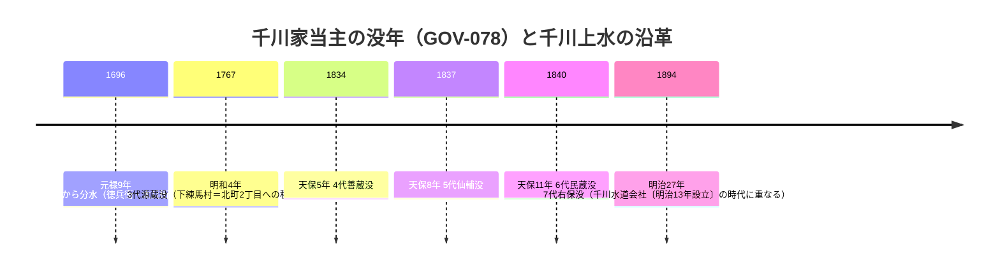

# 2026-11-12（第23回）調査ノート

- 実行日: 2026-11-12（第23回定期実行）。headコミット e541cfb（第22回）に対して実施。
- 資料化: 8件（GOV-078〜080・ORG-020・MAP-157・BLOG-116〜118）。

## 今回の要点

1. **千川家の墓の区登録文化財頁（GOV-078）**: 練馬区公式の千川家の墓案内頁をWaybackで全文取得。**平成8年度の区登録**（GOV-004千川家文書＝昭和63年度登録とは別件）、**歴代当主の没年**（3代源蔵・明和4年没〜7代右保・明治27年没）、**所在地＝北町2丁目18番**がrepo初出。GOV-077の「千川家代々の墓＝北町二丁目阿弥陀堂墓地内」の実在拠点を公式文化財頁で裏付けた。4代善蔵（天保5年没）と『東京市史稿』付録千川上水絵図の「千川善蔵」の同一人物可能性は仮説にとどめる（没年が早く、所蔵時期と合うかは未確認）。
2. **2026年8月22日の報道記録（BLOG-116/117・GOV-079）**: 東京新聞（**練馬区66.5ミリ実測**・高島平膝下浸水・マンホール噴出・「浸水は一昨年7月以来」・神田川レベル4氾濫危険警報）と産経（**池袋駅地下構内の冠水17:30**・北区西が丘1丁目の冠水110番）を資料化。板橋区公式の被災者支援特設頁（1065820）は直接取得不能のため二次転記（いたばしTIMES）でGOV-079として記録。**池袋駅直下の地下空間浸水**は、谷端川旧流路と水窪川谷頭に挟まれた立地の観察材料として価値が高いが、浸水経路は記事になく推定も残さない。
3. **明治44年逓信局地図の所在（MAP-157）**: [BLOG-066]（水徒然）の依存図「明治44年逓信局の地図」の原典候補を特定。**郵政博物館蔵「四十四年調査東京十五區番地界入地圖」全15枚（東京逓信管理局編）**＋CiNii BA38620103の**「明治44年近傍34町村番地界入地圖」**（人文社複製・豊島郡巣鴨村を含む）。郵政博物館は2026年4月1日から資料利用サービス全面停止中のため、再開後の閲覧が次の一手。BLOG-061紀要引用の「明治44年巣鴨村全図」との異同は未確認。
4. **校長散歩058（ORG-020）**: ORG-018の未解決だった「校長散歩58」を取得。濯川＝**千川上水中新井分水**の流れという分水名がrepo初出候補（分水口の位置・開設年は未記載のため、GOV-068の分水網との対応は断定しない）。
5. **千川親水公園の公式文言（GOV-080）**: 豊島区公式公園頁をスニペット確認。「**水流はながらく途絶えていましたが、平成元年に復活し、暗渠管のなかを流れています**」「**この敷地は東京都から借りており、以前は千川児童遊園の一…**」。①親水公園の水流が暗渠管内を流れるという公式文言、②旧千川児童遊園（の一部）からの転用・都借地が記録価値ありと判断（BLOG-053説明板・BLOG-103庚申橋観察を補強）。平成元年の豊島区側の通水が練馬区側の清流復活（GOV-077・平成元年3月）と同一事業かは断定できない〔仮説〕。
6. **北町旧跡研究会の阿弥陀堂頁（BLOG-118）**: 千川家の墓説明（GOV-078とほぼ同文）に加え、**「千川上水から田柄川を引いた」説・田柄川「やっかい堀」呼称・成増飛行場造成による水途絶え説**が独自文言。堂主岡田さん資料の引用本文がなく、田柄川導水は伝聞段階（GAZ-002・GOV-068との照合が課題）。

## 図: 千川家歴代当主の没年と主な出来事



## 図: 2026年8月22日の時間軸（BLOG-116/117・BLOG-115）

```mermaid
timeline
    title 2026年8月22日 記録的短時間大雨の時間軸
    16:53 : 新宿・豊島・北・板橋区に大雨危険警報（レベル4）
    17:09 : 北区・板橋区付近 各約100ミリの記録的短時間大雨情報
    17:17 : 板橋区付近 120ミリ以上（記録的短時間大雨情報 第2号）
    17:27 : 豊島区付きた約100ミリ
    17:30 : 池袋駅地下構内の冠水（産経・読者提供写真）
    17:50 : 神田川にレベル4氾濫危険警報（善福寺川にも）
    18:55 : 時点で高島平団地、膝下まで浸水（東京新聞・聞き取り）
```

## ノートのみの記録（source file化せず）

- **板橋区議会議員・内田けんいちろう氏のX投稿（2026年9月）**: [x.com/kenichirouchida/status/2098003682000347475](https://x.com/kenichirouchida/status/209800368200034745) に「9月2日現在、区内で**床上浸水22件・床下浸水7件**が確認」（区への報告値）とある。個人投稿のため区の公式公表値の確認後に資料化する〔URL末尾は正しくは …3475〕。
- **雑司ヶ谷幹線再構築その11工事の入札結果（2026-10-20・nikoukei）**: [nikoukei.co.jp/bid_result/detail/013804766](https://www.nikoukei.co.jp/bid_result/detail/013804766)。工事番号08-土-050。第2雑司ヶ谷幹線（弦巻川暗渠の下水道幹線〔BLOG-063〕）の再構築が2026年時点でも継続中であることの現況記録。
- **神田川江戸川橋分水路補修工事（その6）の入札結果（nikoukei）**: [nikoukei.co.jp/bid_result/detail/013364075](https://www.nikoukei.co.jp/bid_result/detail/013364075)。BLOG-107（江戸川橋合流点の石垣耐震改修予告）に関連する分水路補修の継続記録。
- **毎日新聞2026-08-22**: 「善福寺川、神田川にレベル4氾濫危険警報」〔[mainichi.jp](https://mainichi.jp/articles/20260822/k00/00m/040/141000c)〕。有料記事（全文121字）のため見出しと写真キャプション（杉並区で増水する善福寺川・17:41）のみ記録。
- **英語版Wikipedia「Senkawa Aqueduct」**: [en.wikipedia.org/wiki/Senkawa_Aqueduct](https://en.wikipedia.org/wiki/Senkawa_Aqueduct) のスタブ記事の存在（玉川上水からの分水・22km・武蔵野・西東京・練馬を通る記述のみ。板橋区・豊島区への言及なし）。ja版（Weblio複製で取得済み）に比べ情報量が小さく資料化見送り。
- **東京都水道歴史館デジタルアーカイブ（ro-da.jp）の目録**: [B078-1「千川上水の今と昔」](https://www.ro-da.jp/suidorekishida/book/detail/B078-1)（練馬古文書研究会・平成3年1月・59p＝[BOOK-061](../sources/books/BOOK-061.md)の目録確認・閲覧は館内）と [B116「豊島区地域地図 第6集 近代（千川上水路図）編」](https://www.ro-da.jp/suidorekishida/book/detail/B116)（豊島区立郷土資料館・平成5年12月・23p＝千川上水路図の複製集。repoの豊島区地域地図関連〔MAP-003等〕と書誌的に接続）を確認。千川上水路図編の所在が水道歴史館目録でも確認できることを記録。

## アクセス不能の記録

- **板橋区公式1065820頁**: open_urlが「お探しのページ」応答（検索では実在が確認できる）。いたばしTIMESの二次転記で対応（GOV-079）。
- **練馬区b050頁**: 直接open_urlではJS描画のため本文取得不能。Wayback 2024年版で全文取得（GOV-078）。
- **echo-lab深田伊佐夫PDF（中央学術研究所紀要42号・2013）**: open_urlが「site blocked automated access・再試行しないこと」応答。第22回に続き継続記録。
- **wanjin entry-240/241**: Access Denied継続（Wayback未収蔵）。
- **毎日新聞2026-08-22**: 有料（121字）。
- **豊島区公式 千川親水公園頁・としま案内人弦巻川イベント頁**: open_urlで本文取得不能（翻訳/クッキー応答）。前者はスニペットで対応（GOV-080）、後者はイベント告知のみで既知内容〔ORG-016/017としまの記憶〕と重複が大きく見送り。
- **寅さん歩wpage5145.pdf・かたりべ45・夢七雑録part3**: 継続。

## 重複確認の見送り・既収録判定

- 暗渠ハンター「谷端川沿い湧水ものがたり 下り谷支流」（7712077）＝BLOG-061既収録。
- サンポー「水窪川の暗渠で新発見」＝BLOG-036既収録。
- ゆる歴史散歩会「弦巻川跡を歩く」＝BLOG-047既収録。
- 雨男「階段路地に囲まれた暗渠道〜水窪川」＝BLOG-107既収録。
- warpal「谷端川の跡を歩く」＝BLOG-005/062既収録（Shift-JIS mojibakeにより新規取得は見送り）。
- 紙の博物館「千川上水使用権利詳細平面図」＝MAP-063既収録。
- WANDER×WONDER 2026-09-23まち歩き・4travel 2026-04-22谷端川＝第14回と同内容の再構成と判断し見送り。
- 東京路地紀行112の所在: 検索では111（＝BLOG-055）のみ確認。続編の所在は未解決のまま。

## 次回課題

1. 郵政博物館の資料利用サービス再開後、「四十四年調査東京十五區番地界入地圖」・「近傍34町村番地界入地圖」の巣鴨村・池袋村図幅の閲覧・撮影（BLOG-061・BLOG-065/066の読図座標源の原図確認）。
2. GOV-074板橋区浸水履歴の令和8年度更新版での2026年8月22日分（床上22件・床下7件の町丁目別内訳・池袋駅/高島平/西が丘の記載の有無）。
3. 千川家の墓（北町2-18）の墓石の現地確認・銘文採録（GOV-077/078の未解決）。4代善蔵と『東京市史稿』の千川善蔵の関係。
4. ro-da.jp B116「豊島区地域地図 第6集（千川上水路図編）」の内容確認（水道歴史館での館内閲覧可否）。
5. 田柄川への導水説（BLOG-118）の裏付け（『練馬区史』田柄川項・[GOV-068]分水設計思想との照合）。
6. 1953年（BLOG-113）vs 1959-60年（ORG-019）の千川暗渠化年次差の解消（武蔵学園記念室アルバム・1941年刊『千川上水』）〔第22回課題の継続〕。
