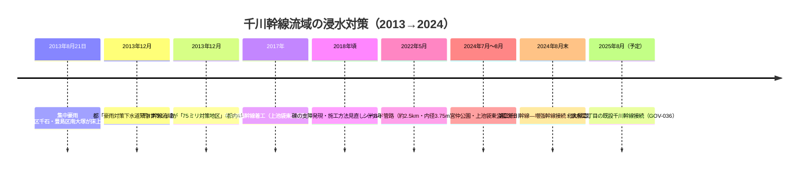

# 2026-11-12（第24回）・都湧水地点数調査・千川増強幹線視察報告書・小石川区史引用・Wikipedia谷端川三幹線文言の追加調査

## 目的・方法
毎時実行の定期調査（第24回）。地形・旧河道・暗渠・下水道・湧水・地名・古文献・公的アーカイブ等の観点から検索し、repo既収録と `search_code` で重複確認した上で、新情報のみ資料化した。push前に最新main（head `7d744e9`＝第23回）を再取得し、競合なしを確認した。

## 新規登録（いずれも2026-11-12時点でrepo未収録）

1. [GOV-081](sources/gov/GOV-081.md)：**東京都環境局「湧水の保全について」「区別の湧水地点数」**（令和5年度調査）。**都内湧水591地点（区部199）**。**豊島区は令和2年度以降0地点**（平成28〜令和元年度は2〜3地点）、板橋区30・北区13・文京区2・練馬区19（令和2年度60から大幅減）。都公式頁は直接遮断のためWayback 2025年スナップショットで確認。**湧水減衰仮説（PAP-018・PAP-021）の現時点での公的な到達点**。ただし「地点数0＝湧水不存在の証明ではない」こと、地点数が調査条件で変動する都の注記を付す。
2. [GOV-082](sources/gov/GOV-082.md)：**文京区議会災害対策調査特別委員会視察報告書（令和4年度）**。千川増強幹線の工種詳細：**2013年8月21日豪雨で文京区千石・豊島区南大塚が床上浸水→都内4地区の「75ミリ対策地区」に選定**、平成29年着工、上池袋東公園→窪町東公園（大塚3-32）間**約2.5km・内径3.75mの泥水式シールド**、令和4年5月管路完了、累積約50億円、**礫の支障で約3年遅延**、貯水容量は25mプール約85杯分。GOV-036（2024年豊島区資料）を工種レベルで補完。
3. [BLOG-119](sources/blogs/BLOG-119.md)：**ma-maison「小石川 歴史散歩(3)」**。**『小石川區史』（昭和10年）の直接引用**＝指ヶ谷（東大下水）合流位置「柳町附近」・丸山町で文京区に入る谷端川/千川呼称境界。**昭和15年地図で氷川下町・丸山町・巣鴨町に開渠残存**の読図。**中世文献の小石川初出系譜**（文明19年『回國雜記』・文安5年『熊野領豊島年貢目録』「五百文小石河四人」・応永27年『武蔵国江戸之書立』）。礫川小学校（明治6年）・礫川公園（昭和40年）。
4. [BLOG-120](sources/blogs/BLOG-120.md)：**地図子「水窪川を歩く」（2019年12月14日・本田創NHK文化センター暗渠さんぽ）**。**第15回以来アクセス不能と記録してきた頁をWayback 2023年スナップショットで取得**。**水窪川「1933年と戦前に埋め立てられた」文言**＝昭和8年頃説（BLOG-089）の2019年時点の独立二次記述。2019年12月のバケツ湧水・日光広場・辻広場観察。

## ノートのみの記録（source file化せず）

- **Wikipedia谷端川（2026-02-02版・Weblio複製で本文取得）の「下水道台帳」脚注文言**〔確認〕：谷端川旧流路は**「川越街道の手前より上流は谷端川上幹線（合流管）＝新河岸処理区」「下板橋駅付近までは谷端川幹線（合流管）＝小台処理区」「上池袋・滝野川より下流は千川幹線（合流管）＝三河島処理区」**の三幹線に分断、脚注[3]は**東京都下水道局「下水道台帳」（2009年12月11日閲覧）**。「谷端川上幹線」の呼称と処理区の対応はrepo初出（search_code確認）。また**清流復活の水は「旧谷端川放水路の雨水管を通り、赤羽線橋梁の脇から石神井川に流れ込んでいる」**（脚注[4]＝現地案内板）。BLOG-043（板橋駅東口＝流末）・BLOG-090（板橋駅東側で接続）と整合する放流末端位置の具体化。**下水道台帳の直接確認が課題**。
- **石神井川河川整備計画（都建設局・平成28年3月）**：第5回ノートで原典確認候補とした同文書のPDF（000007328_2）を取得したが、**取得可能な本文範囲（約19.5KB・冒頭目次中心）に谷端川放水路への言及なし**。取得打ち切りの制約によるもので、**放水路1924/25年次問題の原典確認は未解決のまま**（継続課題）。
- **10plus1.jp（テンプラスワン）滝野川記事**（2017年9月・千川上水が滝野川傾斜地を経由して音無川に言及）：自動アクセス遮断。継続課題に追加。
- **明治大学リポジトリ（PAP-017）**：引き続き遮断（継続）。
- **wanjin fc2 entry-240/241・夢七雑録part3・かたりべ45 PDF・寅さん歩**：引き続きアクセス不能（継続）。
- **全国遺跡報告総覧（nabunken）の板橋区立郷土資料館紀要**（0 hits・repo未収録の紀要群）：検索フォーム経由で千川上水関連論文の有無を確認できず（本文検索結果未取得）。紀要第6号（1987・千川関連の可能性）等の目録確認を次回課題に追加。
- **ゆる歴史散歩会「弦巻川跡を歩く」（2025-03-14）**：BLOG-047（第5回）で既収録と確認、資料化せず。
- **サンポー水窪川頁（2019-03-19）**：BLOG-036で既収録と確認、資料化せず。
- **BE-PAL斉藤正史谷端川緑道（FILE.35）**：BLOG-114で既収録と確認、資料化せず。

## 千川増強幹線の時系列（GOV-082＋GOV-036の統合）

※時系列は行政側の報告文言に基づく。**現代の下水幹線を旧谷端川の自然河道と同一視しない**。

## 豊島区湧水地点数の年次（GOV-081の補足整理）

| 年度 | 平成28 | 平成29 | 平成30 | 令和元 | 令和2 | 令和3 | 令和4 | 令和5 |
| --- | --- | --- | --- | --- | --- | --- | --- | --- |
| 豊島区 | 2 | 3 | 2 | 2 | 0 | 0 | 0 | 0 |
| 板橋区 | 34 | 37 | 37 | 35 | 32 | 27 | 30 | 30 |
| 練馬区 | 33 | 38 | 63 | 53 | 60 | 42 | 23 | 19 |
| 文京区 | 7 | 7 | 7 | 8 | 8 | 8 | 2 | 2 |

※GOV-081の表判読に基づく。列対応の検証（年度の並び）は区市町村別PDF本文確認後に確定させる。

## README更新について
本回もREADME.md（約1.37MB）の全文取得手段がこの実行環境になく（get_file_contentsはResourceLinkのみ・open_urlは約32KB打ち切り・git環境なし）、**「現時点で重要なこと」へのbullet追記は実施不可**。保留bulletは第6〜23回分＋今回分（**都調査で豊島区湧水0地点・千川増強幹線の工種詳細と2013年千石・南大塚床上浸水・『小石川區史』の指ヶ谷合流位置引用・水窪川1933年説の2019年記録・谷端川上幹線など三幹線と処理区の対応**）を、gitが使える実行環境でまとめてprependすること。INDEX.mdのbuild.py再生成も継続課題。

## アクセス不能の記録（2026-11-12時点）
- 直接遮断：東京都環境局湧水頁（Waybackで代替取得可＝GOV-081）、10plus1.jp、明治大学リポジトリ、chizuchizuko（Waybackで代替取得可＝BLOG-120）
- 継続：wanjin fc2 entry-240/241、夢七雑録part3（ただし谷端川長崎村分水編〔cf505…〕はBLOG-033で既収録）、かたりべ45 PDF、寅さん歩PDF、sirakigi senkawa1・senkawa11

## 次回課題
1. 東京都下水道局「下水道台帳」の直接確認（谷端川上幹線・三幹線処理区対応・放水路雨水管の文言）。
2. 環境局「区市町村別湧水地点数一覧」PDF（642KB）の本文取得とGOV-081の年度列対応の検証。
3. 『小石川區史』（昭和10年）の所蔵確認と引用文言の原本照合。『熊野領豊島年貢目録』の所在。
4. 板橋区立郷土資料館紀要（nabunken）の目録確認（特に第6号・1987年刊）。
5. 10plus1滝野川記事の別ルート取得（千川上水→音無川言及の確認）。
6. 千川増強幹線の北大塚接続の実績（2025年8月予定以降）。
