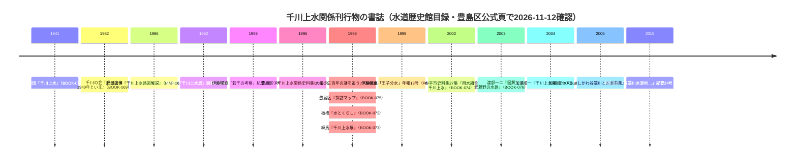

# 2026-11-12（第25回）調査ノート・水道歴史館開架図書一覧の千川書誌群・豊島区郷土資料館紀要論文・谷端川川下り2020年観察

実施: 2026-11-12。head=d25c157（第24回）を確認の上で調査・反映。**search_code は本セッションでは機能不全**（「武蔵学園記念室」等の既知語で0件。第12回と同様の不調。重複確認はINDEX.md・ディレクトリ全覧・既知の資料ファイル本文で代替）。

## 1. 今回の主な収穫

### 1.1 東京都水道歴史館「開架図書一覧」（2021-07-10版PDF）の千川棚

[開架図書一覧PDF](https://www.suidorekishi.jp/images/information/library/book.pdf)（160頁中1〜24頁付近の抽出で千川関連19箇所）を直接確認。B棚（江戸上水）の千川関係の未収録書誌を一括して登録した。

- 新規登録: [BOOK-066](../sources/books/BOOK-066.md)（大松騏一『千川上水三百年の謎を追う』1996）・[BOOK-067](../sources/books/BOOK-067.md)（加瀬順一『こいしかわ谷端川と松尾芭蕉』2005）・[BOOK-068](../sources/books/BOOK-068.md)（同『千川上水考』2004）・[BOOK-069](../sources/books/BOOK-069.md)（千川の会『千川上水 1940年といま』1982）・[BOOK-070](../sources/books/BOOK-070.md)（『千川上水関係史料集Ⅰ』1995）・[BOOK-071](../sources/books/BOOK-071.md)（『千川上水展』1992図録）・[BOOK-072](../sources/books/BOOK-072.md)（板橋区郷土資料館『水とくらし 千川上水の三百年』1996）・[BOOK-073](../sources/books/BOOK-073.md)（練馬区郷土資料室『千川上水展 平成8年・平成18年』）・[BOOK-074](../sources/books/BOOK-074.md)（小平市史料集27集『用水組合 千川上水』2002）・[BOOK-076](../sources/books/BOOK-076.md)（渡部一二『図解 武蔵野の水路』2003）・[BOOK-077](../sources/books/BOOK-077.md)（武蔵高等学校報国団『千川上水』1941＝閉架）。
- **1941年刊『千川上水』の原刊行物書誌を初登録**（これまでBLOG-113・ORG-019・GOV-076経由の言及のみだった）。
- [MAP-061](../sources/maps/MAP-061.md)『千川上水路図解説』の書誌特定（**肥留間博著・千川の会・1986年8月**）。GOV-061の「クオリ発行」表記との食い違いを記録（断定せず）。

### 1.2 豊島区立郷土資料館「研究紀要『生活と文化』・年報」目次ページ

区公式頁（[005957](https://www.city.toshima.lg.jp/129/bunka/bunka/shiryokan/kankobutu/005957.html)）は直接遮断だが **Wayback Machine で全目次を取得**。千川・谷端川関係の研究論文3本の掲載号を特定:

- [PAP-024](../sources/papers/PAP-024.md): 伊藤暢直「千川上水に関する若干の考察」= **紀要第7号（1993年3月31日）**。
- [PAP-025](../sources/papers/PAP-025.md): 伊藤暢直「千川用水『王子分水』をめぐる二・三の問題」= **年報第13号（1997年度・1999年3月31日）**（水道歴史館目録B243と対応。同目録の「H.01.03」表記は整合せず断定しない）。
- [PAP-026](../sources/papers/PAP-026.md): **甲田篤郎・斉藤崇人・辻本崇夫「谷端川水源地付近における更新世後期以降の環境変遷と土地利用」= 紀要第24号（2015年3月27日）＝repo初出の谷端川水源地を主題とする第四紀地形・環境史の学術論文**。

### 1.3 深田伊佐夫2013（中央学術研究所紀要42）

[PAP-027](../sources/papers/PAP-027.md)として登録。echo-lab.ddo.jpのPDFは今回も直接遮断（第20回・第24回に続き3度目の再試行。Wayback未収蔵）。**検索スニペットで冒頭と表1の出典文献（大石ら2006・大松1996・豊島区郷土資料館1992・千川の会1982）が確認できた**ため、上記の書誌特定群と相互に対応づけを記録。「宗教的構築物」の内容は本文未確認のまま。

### 1.4 豊島区公式「図録（1996年度）」ページ（Wayback）

- [BOOK-075](../sources/books/BOOK-075.md): 『千川上水探訪マップ』（1996年・完売）の序文を確認。**『かたりべ24・25合併号』が先行する千川ガイドマップである旨、1996年記念事業が練馬区教委・板橋区郷土資料館との相互協力である旨**〔かたりべ24・25合併号はrepo未収録・次回課題〕。
- 同ページの大黒煎餅（北田商店・西巣鴨3丁目）は中山道商店史で三河川と直接関係しないため資料化せず。

### 1.5 その他の新規資料

- [BLOG-121](../sources/blogs/BLOG-121.md): xaymaca「東京暗歩」谷端川川下り第4弾（2020-08-27）。**下板橋駅前の谷端川児童遊園に「三の橋」「二の橋」「一の橋」の橋名プレートが現存する2020年時点の観察**（BLOG-070の「一の橋・二の橋」再現記録の拡張）・北大塚「谷端川跡」プレート。
- [ORG-021](../sources/org/ORG-021.md): 雑司が谷公園（zoshigaya.org）「高田小学校敷地＝弦巻川の河岸段丘上・北側2m擁壁」の施設解説。**弦巻川の谷地形が現行建築設計に反映されている現況記録**。

## 2. 千川上水関係刊行物の書誌年表（今回確認分）

## 3. 既存仮説への影響（観察）

- **取水口・分水系統論**: PAP-024/025（伊藤暢直）は王子分水・千川上水の学芸員研究であり、GOV-053（1865年反射炉王子分水）・GOV-068（分水設計思想）の原典照合が進む可能性。本文確認までは位置・年代の更新をしない。
- **谷端川水源地＝谷頭論**: PAP-026（甲田ほか2015）は谷端川水源地付近の更新世後期以降の環境変遷を扱う。谷頭湧水減衰論（PAP-018）・粟島神社弁天池水源説の学術的検討文献の候補。本文未確認。
- **弦巻川旧流路**: ORG-021の「高田小学校＝弦巻川河岸段丘上・北側2m擁壁」は弦巻川旧流路北縁崖線の位置の手掛かり候補（BLOG-002・LOST-005の読図と照合が次の一手）。
- **千川地蔵移転（BLOG-032）**: sirakigi senkawa51/61はWayback未収蔵で本文取得ならず（継続課題）。

## 4. アクセス不能・取得不能の記録

- **search_code 機能不全**（既知語で0件。重複確認は代替手段で実施）。
- echo-lab.ddo.jp 深田紀要42 PDF: 直接遮断（3度目）。
- sirakigi senkawa51/61: 直接遮断・Wayback未収蔵。
- 豊島区公式頁（005951/005957/1996zuroku）: 直接は翻訳応答遮断、**Wayback 2024-2025スナップショットで全文取得可**（新たな回避手段として有効）。
- 東京都下水道局下水道台帳（SEMIS）: JS依存のため本文図面は取得できず（第24回課題のまま）。

## 5. README冒頭bullet・INDEX.md

- **README冒頭「現時点で重要なこと」へのbullet追記は今回も不可**（README約1.37MB・get_file_contents不可・git環境なし）。保留bulletは第6〜24回分に加え今回分（水道歴史館千川書誌群・甲田ほか2015谷端川水源地論文・伊藤暢直2論文・1941年刊『千川上水』書誌・下板橋一〜三の橋プレート・雑司が谷公園弦巻川段丘）をgit環境が使える実行でまとめてprependすること。
- INDEX.md の build.py による再生成は引き続きgit環境待ち（今回の登録で未反映は約50件超）。

## 6. 次回課題

1. PAP-024/025/026の本文確認（豊島区立郷土資料館・都立図書館）。特に甲田ほか2015の谷端川水源地の範囲と結論。
2. BOOK-066〜077のNDL書誌確認と、BOOK-071（1992図録）・BOOK-074（小平市史料集27集）・BOOK-077（1941年刊）の所蔵・閲覧手段の特定。
3. 『かたりべ24・25合併号』の目次・千川ガイドマップ部分の確認。
4. 深田紀要42本文の別ルート取得（中央学術研究所への直接照会も候補）。
5. MAP-061『千川上水路図解説』の現物確認（発行者の書誌表記の解消＝GOV-061との整合）。
6. BOOK-070『千川上水関係史料集Ⅰ』の「Ⅱ」以降の存否。
7. xaymaca谷端川川下りシリーズの他回（水源〜下板橋・大塚〜水道橋）の取得とBLOG-121への補足。
8. 雑司が谷公園丘の上テラスの擁壁位置と弦巻川旧河道の空中写真照合。
