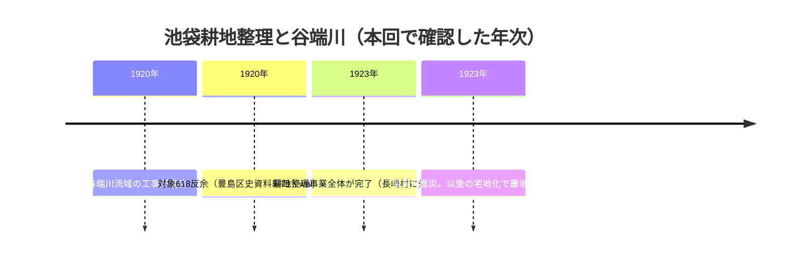
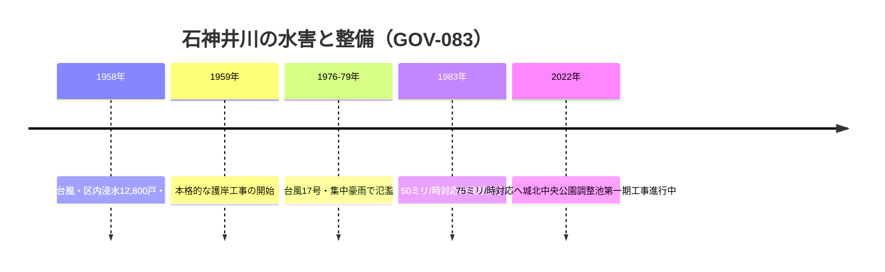

# 2026-11-12（第26回）・谷端川耕地整理の年次細分・石神井川水害と城北中央公園調整池・武蔵野市管理移譲・私邸の池の2025年観察の追加調査

## 目的・方法

定期調査（第26回実行）。地形・旧河道・暗渠・下水道・湧水・橋・池・用水・灌漑・地名・土地利用・古地図・地籍・都市計画・河川史・地域史・写真資料・学術論文・公的アーカイブの各角度で検索し、出典を開いて内容確認、search_code で既収録と照合した。search_code・push_files・get_file_contentsとも正常。反映直前に最新main（e676adb＝第25回）と各dirの最大番号（BLOG-121・GOV-082）を再確認した（並行実行との競合なし）。

## 新規登録

1. [BLOG-122](../sources/blogs/BLOG-122.md)：わんじん「水の行方を追って」谷端川耕地整理編（2018-04-04・entry-239）。**Wayback 2026-10-25スナップショットで全文取得に成功**（entry-240/241は引き続き未収蔵）。**池袋耕地整理の年次細分（1920年内に谷端川流域の工事竣功・1923年全体完了＝長崎村に先立つ）と対象字名の構成（字本村・他領・上・丸山・境井田・前田・飛地他領・境向・中原＋中丸字川原・前・飛地沼田・中原の618反余）＝repo初出**。橋名の字名由来対応の独立二次ソース、支流2本（高松小学校方面・池袋2/3丁目境）の合流位置、耕地整理時の橋が現存橋の多く・用水路の路地化の観察。
2. [BLOG-123](../sources/blogs/BLOG-123.md)：CBCテレビ「道との遭遇」水窪川暗渠道編（2025-04-15放送・髙山英男案内）。**護国寺付近の私邸敷地で2025年に親族の許可を得て実地観察し、水窪川の流れは庭の池に流入せず塀に沿ってカルバートで抜けていることを確認**＝東青柳町の私邸の池の未決事項への実地観察傍証〔同一私邸の同定は高精度の推定として断定しない〕。
3. [BLOG-124](../sources/blogs/BLOG-124.md)：めぐるスイッチ「タイム写シーン10」（2021-10-29）。板橋区公文書館蔵の昭和52年（1977年）石神井川洪水写真（山崎橋たもと・撮影地点記録あり）の所在。**山崎・山崎田んぼの地名（二次転記）＝repo初出**。山崎橋1994年架替・三日月意匠の由来推測。
4. [GOV-083](../sources/gov/GOV-083.md)：板橋区公文書館 電子展示室81号「石神井川の水害と整備」（2022-03-30）。**狩野川台風1958（浸水12,800戸・5km²＝区内の約6分の1・橋被害表）**、1976/1978/1979氾濫、**城北中央公園の石神井川調整池（約163m×33m×深35m・貯留約9万m³・第一期工事進行中）＝repo初出**。石神井川の75ミリ/時対応整備＝谷端川放水路・千川増強幹線（GOV-082）の放流先の受け皿。直アクセス404のためWayback id_取得。
5. [GOV-084](../sources/gov/GOV-084.md)：武蔵野市「千川上水整備基本計画」（2010）。**平成18年（2006）に境橋〜吉祥寺橋約3.8kmの管理が都から武蔵野市へ移譲＝repo初出**。清流復活後の現況の定量的記録（流路幅1.3〜2.5m・水深15〜25cm・護岸概ね15タイプ・橋22箇所〔コンクリート17・H鋼5〕・石碑等3基）、五日市街道交差部〜関前橋＝都市公園指定・境公園予定地。

## 地名対照表の追記

熊野窪（嘉永期・尾張屋版巣鴨絵図「此辺熊野窪ト云」＝江戸マップ地名23-109。江戸マップCSVは全件照合済みだが対照表に未収録だった）、境向（BLOG-122・耕地整理対象字名）、山崎／山崎田んぼ（BLOG-124）の3行を地名表に追加した。

## 既存仮説への影響

- **池袋耕地整理の年次**: README既述の「618反余（うち田128反余）」（『豊島区史 資料編 四』依拠）に加え、wanjin 2018の二次記述が**1920年内に谷端川流域の工事竣功・1923年全体完了**を記し、面積も一致。**谷端川沿いの旧田圃と支水路が1920年に再編され、その後の橋の多くがこの時の竣工**という流路・橋の年代解釈が強まった〔複数二次ソースの一致。原典（豊島区史資料編四の事業報告書）確認は次回課題〕。
- **東青柳町の私邸の池**: 「池と川は繋がらず、塀沿いのカルバートに川が残る」という2025年実地観察（BLOG-123）により、**河道が池に取り込まれた説は弱まり、河道と池は別系統（河道脇の池）説が強まった**〔観察1件の追加。池の水源・通水の有無は未確認のまま〕。
- **石神井川の受け皿整備**: 谷端川放水路（1924/25年次問題・未解決）の放流先の石神井川が、1958狩野川台風を契機に1959年護岸→1983年50ミリ対応→75ミリ対応（城北中央公園調整池9万m³）と整備されてきた行政経緯が確認された。放水路が石神井川の氾濫容量に依存する構造である以上、1924/25年次の改修議論の背景として石神井川側の整備史を参照する価値がある〔GOV-083。推定を含む〕。

## 登録見送り（重複・軽微）

- 東京都土木技術支援・人材育成センター年報（2010）「東京の河川に係わる管理体制と改修計画の経緯」: **昭和5〜6年（1930〜31）に谷端川など7河川の改修計画が告示**の記述を確認したが、GitHubのREADMEインデックス経由でREADME既述（『東京都市計画河川改修及其ノ事業執行年割決定ノ件』と併記）と判明したため source file 化せず〔tmpc.or.jpのミラーPDFはlink-audit収集済み〕。
- 紙の博物館「千川上水使用権利詳細平面図」（明治38年・王子製紙）: [MAP-063](../sources/maps/MAP-063.md) で既登録。
- わんじん entry-237/238/240: Wayback未収蔵で本文取得不能。entry-240（出端川関連）は既存の断片的な二次転記依存のまま。
- MAP-ping（11-1studio）谷端川南緑道18橋リスト: 橋名は [BLOG-069](../sources/blogs/BLOG-069.md)・[BLOG-114](../sources/blogs/BLOG-114.md) 等で既収録の再構成のみ。
- Code for Nerima note（練馬区南西部の千川上水）: 第15回で既知扱い（再確認）。
- 巣鴨絵図の江戸マップ全件: 全8,788件CSV照合済み（既存のopen-questions記録）。熊野窪のみ対照表に補記。
- 4travel 2026年4月の谷端川旅行記2本: 既収録の再構成のみ（第14回と同判断）。

## アクセス不能・継続課題

- 板橋区公式の電子展示室81号: 直404。Wayback id_付きURLで全文取得可（GOV-083に使用）。
- nabunken板橋区立郷土資料館紀要（第6号など）目録: アクセス集中で本文取得不能。継続課題（第24回から）。
- ja.wikipedia/cir.niiの直接アクセス遮断（Weblio複製など既存の回避策のみ有効）。
- sirakigi senkawa51/61・かたりべ45・寅さん歩PDF・夢七雑録part3（継続）。

## 次回課題

- 池袋耕地整理の原典（『豊島区史 資料編 四』の事業報告書・大正期の竣功届）の確認と、1920年谷端川流域工事の内容（付け替えを含むか）の特定。
- 東青柳町私邸のカルバート（BLOG-123）と2010-11年の髙山観察（docs/2026-10-20資料）の照合・池の水源の特定。
- 城北中央公園石神井川調整池の現在の工区進捗（都建設局の最新情報）。
- 武蔵野市整備基本計画の「資料編」の所在。
- 山崎・山崎田んぼの原本確認（越後屋たぬきブログ）と、石神井川山崎橋の橋名対照への反映検討。

## README更新について

本回もREADME.md（約1.37MB）の全文取得手段がこの実行環境にない（get_file_contentsはResourceLinkのみ、raw取得は~32KBで打ち切り、gitなし）。**create_or_update_file による部分更新は1.37MBを消失させるため絶対に行わない**。保留bulletは第6〜25回分＋本回分（池袋耕地整理1920/1923年次・山崎田んぼ・城北中央公園調整池9万m³・2006年武蔵野市管理移譲・東青柳私邸カルバート観察）をgitが使える環境で「現時点で重要なこと」へまとめて prepend すること。INDEX.md の build.py 再生成も継続課題（BLOG-032以降約50件超未反映）。
