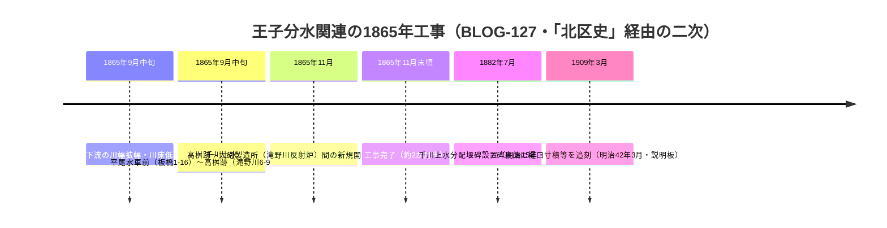

# 2026-11-12（第27回）調査ノート

## 概要

第27回定期実行。search_code・push_files・get_file_contentsとも正常動作。第26回（e51fc0c〜e9fe0ac）を重複なしと確認し、新資料3件（[BLOG-125](sources/blogs/BLOG-125.md)・[BLOG-126](sources/blogs/BLOG-126.md)・[BLOG-127](sources/blogs/BLOG-127.md)）を追加した。

## 1. 暗渠ハンター「谷端川沿い湧水ものがたり」シリーズの未収録回の解消

- 第10回でシリーズ第1〜6回（[BLOG-056](sources/blogs/BLOG-056.md)〜[BLOG-061](sources/blogs/BLOG-061.md)、2012年4月3〜18日）を資料化済みだったが、月次アーカイブ（[2012年4月](https://lotus62ankyo.blog.jp/archives/2012-04.html)）を通読して**4月21日（瓢箪池支流）と4月25日（エンガ堀旭丘支流）の2回が未収録**と判明し、資料化した。
- **BLOG-125（瓢箪池支流）**：BLOG-061の明示的未解決（「瓢箪池支流の詳細は次回記事の所在と本文確認が必要」）を解消。瓢箪池の所在（上池袋1-3湧水〜谷端川合流部）、上池袋1-27の「滝」と呼ばれた洗い場、大正生まれ住民の「山手線ができる前は谷は山手線の内側から続いていた」聴取（山手線建設による谷分断以前の谷延長を示唆）を記録。
- **BLOG-126（エンガ堀旭丘支流）**：紀要11号（BOOK-064）の湧水リストに基づくエンガ堀周辺探訪。長崎6-4の湧水と井戸跡、旭丘2丁目の継ぎ目孔封鎖蓋暗渠・橋・カルデサック終端（本流より1m低い合流）。エンガ堀旭丘支流の実景はrepo初出。
- 豊島区郷土資料館研究紀要第11号（横山恵美「＜調査ノート＞豊島区の湧き水をたずねて」）は、BLOG-056〜061・125・126を通じて谷端川・エンガ堀周辺の湧水支流記述をかなり具体的に間接確認できる状態になった。**紀要本文の直接確認（豊島区立郷土資料館所蔵）が次の一手。**

## 2. 王子分水（1865）の開削工期・区間の具体化（BLOG-127）

- wheatbaku（気ままに江戸）「幕末の大砲製造所」シリーズ⑤⑦を直接確認。「北区史」経由で**慶応元年9月中旬〜11月末、約2か月半の工期**、**平尾水車前（現板橋区板橋1-16付近）から高桝跡（現滝野川6-9付近）までの千川上水拡幅＋高桝跡から大砲製造所までの新規開削**という区間が初めて具体化された。平尾水車・高桝・「堀留」の地名由来はいずれもrepo初出。
- 1865年王子分水＝「堀割」の由来（BLOG-053）から見ると、「堀割」が指す実体（高桝〜反射炉間の新堀）も位置レベルで見えてきた。

## 3. その他の確認・見送り

- **北区教委説明板（分配堰碑）**：BLOG-095（citywalk2020）の碑文採録とほぼ一致する独立裏付けを得た（BLOG-127に統合）。
- **Wikipedia（Weblio複製）谷端川**：放水路「1924年7月開削」・狩野川台風1958→1965年第二排水路（下板橋〜石神井川）の記述を再確認したが、いずれも谷端川.md・第7回ノートで既記録のためsource file化せず。
- **xaymaca note『暗渠』という塞がれた川に魅せられる。**（2021-09-14）：一般コラムで、市兵衛河岸合流等の既知情報のみ。資料化見送り。
- **アクセス不能（継続・再確認）**：nabunken（アクセス集中・板橋区郷土資料館紀要は未取得）、echo-lab深田PDF（「再試行不可」応答）、lotus62.cocolog-nifty.com（直はAccess Deniedだが**lotus62ankyo.blog.jpミラーで全取得可**を今回確認）。
- **README冒頭bullet追記は今回も不可**（1.37MB・git環境なし）。保留bulletは第6〜26回分＋今回分（瓢箪池・エンガ堀旭丘支流・王子分水工期・堀留由来）をgit環境でまとめてprepend。INDEX.md build.py再生成も継続課題。

## 4. 次回課題

1. 豊島区郷土資料館研究紀要第11号（横山恵美）本文の直接確認（瓢箪池の形状・「滝」洗い場・湧水リスト全文）。
2. 「北区史」の王子分水該当頁・掲載古地図の書誌特定（平尾水車・高桝の初出史料）。
3. 広尾水車と平尾水車の表記ゆれの整理（同一水車か別物か）。
4. 「堀留」の地名由来の『いたばしの地名』等での裏付け、地名対照表への追加検討（堀留・瓢箪池）。
5. エンガ堀の江古田駅北側水源説の検証、旭丘支流蓋暗渠の現況確認。
6. nabunken板橋区立郷土資料館紀要目録（特に第6号）の再取得。
7. 山手線建設による谷分断（BLOG-125聴取）の古地図・地籍図での検証。
