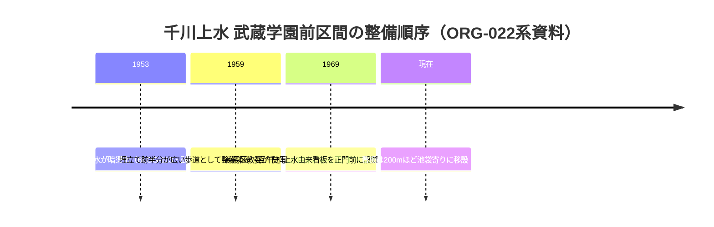
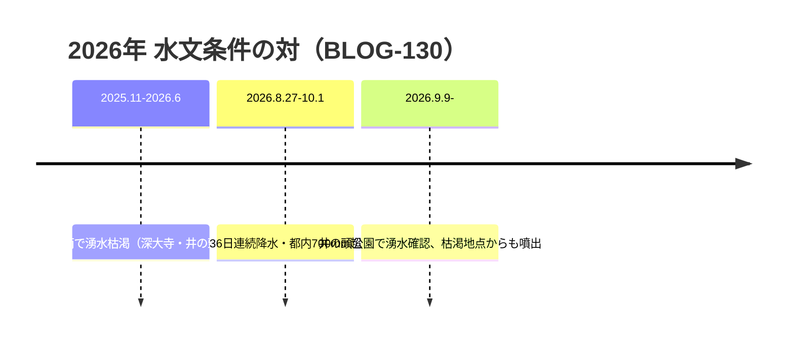

# 2026-11-12（第28回）定期調査ノート

## 実施概要

- 実行開始時点の main ヘッド: eb5dd0b（第27回）。search_code・push_files・get_file_contents とも正常。
- 採番（push直前再確認済み）: BLOG-128〜130、GOV-085〜086、ORG-022 を新規登録。BOOK-019・GOV-076 を既存更新。
- push直前にヘッド再確認し競合なし。

## 今回の新情報

1. **BLOG-128（ameblo・ねこたま・水窪川①② 2017）**：水窪川の碑「1986年」銘の観察記録（[BLOG-110]の碑文言に年次を補強・辻広場整備初年と整合）。「水久保商店街」通称・大正時代の水久保新田/水久保地名の古老聴取（[LOST-005]の字名由来説に接続）。文明開化期地図の上流部読図、根津山（根津嘉一郎売却）切崩し叙述、プリズン排水溝跡2017年現況、都電拡幅計画の2017年聞取。
2. **BLOG-129（kotakemol04・2021・Wayback取得成功）**：令和2年都議会第1回定例会回答の文言（大山町クロスポイント再開発地区の千川上水暗きょ＝法定外公共物・都管理・**通水停止**）＝repo初出の行政回答。沈殿池への清流復活未通水の観察・板橋駅東側放流口「通水を停止中」看板（2021）・下水道台帳で明治通り下の千川上水公園への下水管は確認できない筆者読取・案内板「東部公園緑地事務所管理」。**GOV-080（千川親水公園「暗渠管の中を流れる」）との食い違いは断定せず並記**。
3. **BLOG-130（朝日新聞2026-10-01）**：8/27〜10/1の36日連続降水（過去最長）で井の頭公園・深大寺の湧水が復活。井の頭池はポンプ揚水で水位維持。「普段は枯渇している場所からも水が噴き出した」＝**湧水減衰仮説（PAP-018/021）に対し、降水量回復が短期の湧水復活を起こしうる2026年実例**。
4. **ORG-022（武蔵学園百年史 写真館・スニペット確認）**：ギャラリー102「武蔵の門」に「1950年代の千川通り」「千川上水の看板」「1970年代の千川通り」。看板=1969年練馬区教委設置→200m池袋寄り移設、1959年2月写真=千川上水を埋め立てた側が広い歩道＝**武蔵学園前区間の暗渠化（1953）→歩道化済（1959）→看板設置（1969）の順序が初めて並んだ**。1953 vs 1959-60年次差の傍証（断定せず）。
5. **GOV-085**：令和8年3月の水防法に基づく**雨水出水浸水想定区域図（内水）公表**と豊島区ハザードマップへの反映（スニペット確認）。
6. **GOV-086**：令和8年6月24日都告示で**高田1・2丁目が土砂災害警戒区域に新規指定**（弦巻川谷頭・目白崖線の傾斜地）（スニペット確認）。
7. **BOOK-019更新**：文京ふるさと歴史館特別展図録『川と人と水道と』（2024.10）の書誌をro-da.jp B360で確定（40p・坂詰智美/金子智論考・会期2024.10.26-12.8）。
8. **GOV-076更新**：sirakigi senkawa11頁のスニペット取得（平成8年=1996に武蔵大学学芸員課程学生3名と再調査・掲載写真約100枚）＝枚数表記に第3の数値。

## 解釈（タイムライン）

## 見送り・アクセス不能

- ゆる歴史散歩会「弦巻川跡を歩く」（2025-03-14）・「護国寺〜池袋・水窪川」（2025-11-17）：本文取得可だが辻広場年次・碑文言・地形観察は既収録（BLOG-106/108/110等）の再構成中心のため source file 化せず。
- WANDER×WONDER 池袋暗渠まち歩き（2026-09-23・皆川典久）：第14回で既に「既収録の再構成のみ」と評価済みのため再資料化せず。同・水窪川暗渠遡上さんぽ（2026-06-28）はイベント案内頁で新事実なし。
- BE-PAL斉藤正史谷端川緑道＝BLOG-114既出。art-pi冠水解説＝BLOG-115既出（更新分なし）。
- sirakigi senkawa11・senkawa21（geocities鏡像）：直接open不可、スニペットのみ（senkawa11分はGOV-076へ反映）。
- echo-lab.ddo.jp の深田伊佐夫紀要42 PDF：ddo.jp URLでも遮断（継続）。y-ok.com谷端川頁：直接・Waybackとも不可（継続）。nabunken：アクセス集中（継続）。板橋区公式1065820（8.22被災者頁）：直接不可（既にGOV-079で二次転記対応済み）。kotakemol04直：FC2閲覧制限（Waybackで本文取得可を今回確認）。
- 郵政博物館：資料利用サービスは2026年4月1日から「当面の間」停止継続（公式お知らせで再確認）。
- 特別展「水を守る―千川家と千川上水の330年―」（2026.9.12-11.3終了）はGOV-038に既記録。講演会（大石学）・フィールドワーク等のイベント細目は図録等の新情報が出るまで保留。

## 次回課題

- BLOG-128③「坂下通りの東側へ」の取得。水窪川の碑1986年銘の現地採録。
- 令和2年都議会回答原文の直接確認（都議会会議録）。
- 雨水出水浸水想定区域図の図面本文で旧川筋と想定区域の重なり確認。
- 武蔵百年史「1970年代の千川通り」キャプションとギャラリー062「濯川」（第22回課題の続き）。
- ro-da.jp B360『川と人と水道と』本文閲覧可否。
- senkawa11本文の別ルート取得（第16回課題継続）。
- README冒頭bulletの保留分（第6〜27回分）は引き続きgit環境が使える実行でまとめてprepend。INDEX.md build.py再生成も継続課題。
