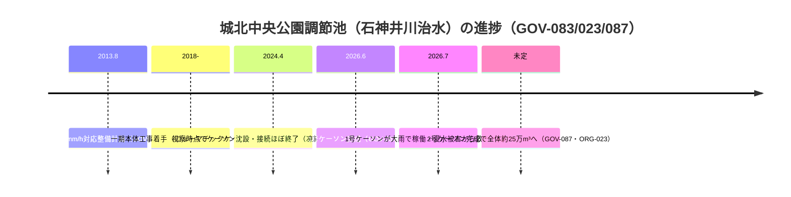
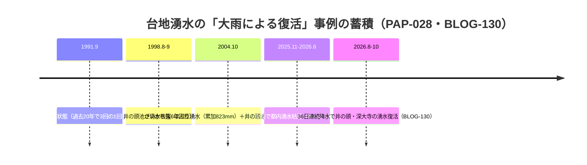

# 2026-11-12（第29回）定期調査ノート

## 実施概要

- 実行開始時点の main ヘッド: 532a52d（第28回）。search_code・push_files・get_file_contents とも正常。
- 採番（push直前再確認済み）: BLOG-131〜132、GOV-087〜088、ORG-023〜024、PAP-028 を新規登録。
- push直前にヘッド再確認（532a52d）し競合なし。

## 今回の新情報

1. **GOV-087（産経新聞2025-12-16）**：城北中央公園調節池の報道公開。**1号ケーソンは平成30年度から2026年6月までの約7年弱で完成（33.4×80.3×35.3m・25mプール約300杯分）、2号ケーソンは工事中で完成時全体約25万m³**。**2026年7月の大雨で1号ケーソンがさっそく稼働し浸水被害から救った**と都が説明。石神井川治水（谷端川放水路の歴史的役割の現在版）が進行中であることを示す。
2. **ORG-023（2024年視察報告PDF）**：一期の工種詳細（ニューマチックケーソン2函同時沈設=日本最大級、**ケーソン間接続の凍結工法**、上下2か所接続）、一期約9万m³+二期で計約25万m³。GOV-083（2022）とGOV-087（2025）の中間時点の技術資料。
3. **ORG-024（武蔵学園百年史 写真館ギャラリー062/104）**：第28回ノート次回課題「ギャラリー062濯川」を確認。**1920年代の濯川（1925年ごろ撮影推測・板材=工事直前）・1957年・1968年・1979年の濯川・1970年代の環境悪化・空堀・玉の橋付近の河床工事・ワンドの造成・通水式・八角井戸**など、濯川の1925年命名から1985-86年通水・竣工までの工程写真群。「ワンド」造成=repo初出文言。ORG-019の記述を写真レベルで裏付ける。
4. **GOV-088（北区観光公式頁・千川上水分配堰碑）**：碑は**明治15年（1882）に水利権を明確にするため設置**（BLOG-095碑文と整合）。**幕末の大砲工場建設時に「この堰から西巣鴨交差点の方向に分水路」**という流向の公式表現はrepo初出の具体化。23か村灌漑と王子の紡績・抄紙・紙幣寮抄紙局の工業用水列挙。所在地滝野川6-9-1。
5. **PAP-028（国分邦紀2005・都土木技研年報）**：**大雨による台地湧水復活の定量的実測**。さいかち窪（黒目川源流）で2004年に6年ぶり湧水（累加降雨823mm・湧出量0.09m³/sec）、井の頭池は20年間で3回（1991/1998/2004）清水状態。武蔵野礫層＋黒ボク土の宙水構造。**PAP-018/021・BLOG-130（2026年井の頭・深大寺湧水復活）を結ぶ都の一次技術資料**で、三河川谷頭湧水の減衰・復活メカニズム考察の裏付け背景文献。
6. **BLOG-131（kak-dela 2024・としま案内人ツアー）**：水番所跡を南長崎6丁目交差点・現セブンイレブン付近に具体化（ガイド伝聞）。千川通り呼称の世代差（左折先をこそ千川通りと呼ぶ地元）。築樋跡の歩道高位観察（明豊中付近）。「千早」=千川の流れが早い命名説（伝聞・要裏付け）。千川親水公園の放置された橋遺構。昭和初期写真に写る寄棟二階建て（旧池田書店）の現存（伝聞）。
7. **BLOG-132（地図子2022・Wayback取得）**：**谷端川（豊島・板橋ゾーン）は「1964年までに暗渠化」、小石川（文京区ゾーン）は「1934年頃に暗渠化」**というカシミール3D依存の個人読図主張。一次史料の裏付けはないが、**谷端川本体の暗渠化終了年を明示する初の読図記録**として位置づけ（断定せず）。小石川1934年頃はBLOG-077（1930着手→1934竣工）と近似。

## 解釈（タイムライン）

## 前回課題の進展・見送り

- **ギャラリー062濯川の確認（第28回課題）は達成**（ORG-024）。ギャラリー062内の「濯川のみなもと」個別頁のキャプションは未取得（次回課題へ）。
- **令和2年都議会回答原文（第28回課題）**：都議会会議録検索で直接該当箇所を特定できず（2020-4会議録は膨大）。継続課題。
- **BLOG-128③（ねこたま・坂下通り）**：ameblo当該エントリは「ご指定のページを表示できません」＝**削除・移動済み**。Waybackでの収蔵確認も次回課題。
- **wanjin FC2カテゴリ頁**：プロキシ経由でAccess Denied（カテゴリ頁も不可）。2026年の水窪川関連新規エントリの有無は未確認のまま。
- **寅さん歩その25（wpage5145.pdf）**：直接は遮断だが**Wayback 20240609スナップショットの存在を確認**（PDF本文抽出は不可）。次回はWaybackのPDF取得を別ルートで試す価値あり。
- **dai60.pdf（ねりまの文化財60号）**：旧URLは404（移転）。新URLの特定を次回課題。
- **nabunken（板橋区立郷土資料館紀要6号目次）**：アクセス集中で継続不可。
- **明治大学リポジトリ（PAP-017）**：JAIRO Cloudメンテナンス継続中（2026-10-28開始・終了日未定）を再確認。
- **淑徳学園・長谷川良信記念館の千川家講座頁**：直接open不可だが既に第18回ノートで処理済み（既収録情報のみ）。
- **xaymaca東京暗歩・水窪川（2020-11-22）**：直接・Waybackとも本文取得不可。イベント案内と同内容の可能性もあり、他ルートでの取得を次回課題。
- **y-ok.com/hakkaisanミラー・谷端川頁**：直接・Waybackとも不可（継続）。
- 巻石通りのバリアフリー・無電柱化整備（文京区・区議レポート2024/2025で1.4kmを3期・2028年3月完成予定）：**旧神田上水沿いの道路整備で三河川そのものへの言及はなく**、BLOG-021の立場（神田上水は別水路）を踏襲し本ノート記録のみ。X投稿の「暗渠由来の高低差」文言は参考記録。

## 次回課題

- ギャラリー062「濯川のみなもと」頁のキャプション取得（濯川水源=千川分水＋校内湧水の確認）。
- BLOG-131の「千早」命名説・橋本屋・池田書店の裏付け。千川親水公園の放置橋遺構の橋名特定。
- BLOG-132「1964年まで」読図の検証（1963年国土地理院空中写真MKT636系・MAP-147等との照合）。
- 寅さん歩その25のWayback PDF本文・ねこたま③のWayback収蔵・dai60.pdf新URL・nabunken紀要6号目次・明治リポジトリ復旧（継続）。
- 令和2年都議会回答原文・wanjinカテゴリの別ルート（継続）。
- README冒頭bulletの保留分（第6〜28回分）は引き続きgit環境が使える実行でまとめてprepend。INDEX.md build.py再生成も継続課題。
