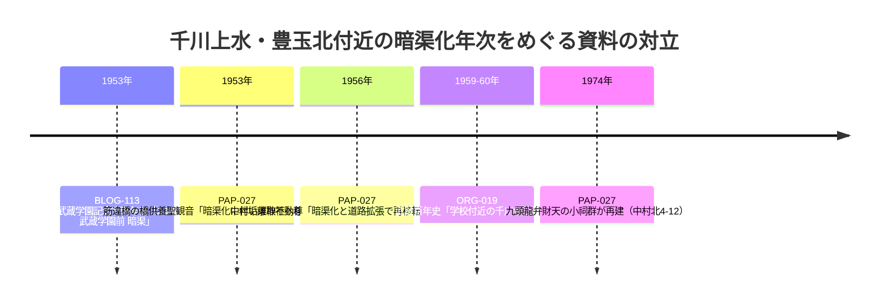
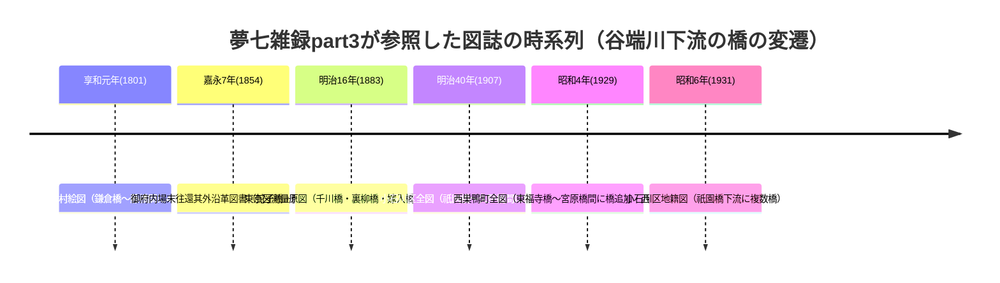

# 2026-11-12（第30回）追加調査ノート：深田2013本文全取得・夢七雑録part3初取得・橋名追補

第29回（コミット 8d85ab8）以降に見つけた新情報の記録。search_code・push_files・get_file_contentsとも正常、push前head確認で競合なし。

## 1. 今回の成果

### PAP-027（深田伊佐夫2013）を直接確認へ格上げ
- echo-lab.ddo.jpの直アクセスは第20・24・25回に続き遮断されたが、**Wayback Machineのid_付きURLで本文全文（p.158-180相当）の取得に初めて成功**。以後の再取得も同手段で可能。
- 主な新事実（資料ファイルPAP-027に全部記載済み）：
  1. **千川地蔵尊は1925（大正14）年の川ざらいで川底から発見**、1940年代の暗渠工事で能満寺（旭丘2-15）へ移設〔BLOG-032既出の千川地蔵の発見年次が初めて一次的に特定〕。
  2. **筋違橋（豊玉北5-8付近）の橋供養聖観音は「1953（昭和28）年、千川上水の暗渠化に伴い東神社境内へ移設」**〔東神社関係者への聞き取り〕。
  3. そのほかrepo初出：井口橋（1841石橋架替）、日川地蔵尊（1940、溺死7人供養、南蔵院内）、川施餓鬼供養塔（中新井分水＝江古田川分水堰付近、**本文「1883（明治15）年」と表「1892（明治15）年」で論文内の年次が食い違い**）、九頭龍橋と九頭龍弁財天（1974再建）、中村垢離取不動尊（1956移転）、**板橋区大谷口の水神社**（1940年代建立推察・1983遷座・2007改修）、千川水道㈱の**社紋入マンホール**（板橋駅〜滝野川6丁目間）。
  4. 流域19ヶ所の宗教的構築物一覧（表2-4）と「直接関係する9ヶ所のうち5ヶ所が慶応元年以降に集中、目的は全て水難供養」という考察枠組み。
  5. **文京区の千川通り（都道436号）は「千川上水長崎分水から導水された谷端川下流部分の小石川（礫川）の暗渠化に由来」**という明示的な記述。
  6. 1880年千川水道㈱設立時の幅員拡幅（130坪→280坪）、旧北豊島郡の人口動態（1889年7.3万→1940年124.8万）。

### BLOG-133（夢七雑録「谷端川…跡を歩く−３−」）を新規資料化
- 第6回以降アクセス不能だったpart3を**Wayback保存版（id_指定）で本文全文取得**（gooブログ終了後もWayback id_で読めることが今回の発見）。
- 谷端川下流（小石川区間）の橋名群・図誌読図の記録。詳細はBLOG-133と四河川の橋名・橋跡調査の追補に記載。

### PAP-029（深田伊佐夫1991）を所在のみで登録
- PAP-027の文献目録から、**1990年の旧千川上水本流・長崎分水（谷端川）流域調査**の論文書誌（中央学術研究所紀要20号、pp.84-100）を特定。echo-labの紀要目録に第20号のPDFがあるかは未確認。

## 2. 解釈・仮説への影響

### 千川上水（練馬区中部）の暗渠化年次：1953 vs 1959-60問題がさらに動いた
- 深田2013の筋違橋条は「**1953（昭和28）年、千川上水の暗渠化に伴い**東神社境内へ移設」と記す（東神社関係者への聞き取り）。東神社は練馬区豊玉北5-8で、**BLOG-113（武蔵学園前＝昭和28年暗渠）と同じ地区**。
- ORG-019（武蔵百年史）の「1959-60年に学校付近が暗渠化」とは食い違うが、**「1953年説」側の独立した（第3の）傍証**になった。ただし聞き取り由来で、東神社の移設年と区間暗渠化の年は厳密には別事件の可能性もある。断定せず、3資料の対立を維持したまま記録。

- PAP-027内部でも**水難供養系構築物の建立・移設事例（1925・1940・1940年代・1953・1956）が昭和前期〜中期に集中しており、「1940年代の暗渠工事」という表現が複数箇所に現れる**。豊島区側（旭丘・千川地蔵1940年代）と練馬区側（昭和25-28年着手）で時期がずれるのは**区間ごとの暗渠化時差**として整理するのが自然で、単一の「暗渠化年」を仮定しない。

### 夢七雑録part3が谷端川下流の橋梁史を一気に具体化
- 下板橋〜市兵衛河岸間の橋名が約20件、典拠図誌（享和元年巣鴨村絵図・嘉永7年沿革図書・明治16東京図測量原図・明治40小石川区全図・昭和4西巣鴨町全図・昭和6小石川区地籍図・上水北小日向小石川辺絵図・安永江戸大絵図・東都小石川絵図）とともに初めて列挙された。
- **谷端川下流部（文京区＝小石川）は「千川上水長崎分水から導水された小石川（礫川）」**というPAP-027の明示記述が、BLOG-133の「谷端川は千川上水長崎村分水でもあり略して千川分水とも呼ばれた」「東京図測量原図の千川橋」と整合。**下流部の千川呼称の由来を「千川上水（本流）」ではなく「長崎分水＝谷端川」に帰する説明が2資料で揃った**（ただし両者とも叙述であって一次史料の文言確認はまだ）。
- 池袋村絵図の谷戸水源（サンシャインシティ付近・池袋の森近く）と西前橋分水路の昭和4年消滅は、谷端川支流・池袋谷頭論（BLOG-125瓢箪池・BLOG-073丸池周辺）に新たな図誌的裏付け候補を加える。

## 3. 見送り・既出確認
- sanpoo.jp「水窪川の暗渠で新発見」（2019-03-19）＝BLOG-036既出（音羽更地の石組み露出）。
- 豊島区公式「谷端川北緑道」042頁＝GOV-008/009で既に整備年次（昭和46年第5児童遊園承認等）収録済み、直アクセスは翻訳遮断。
- 神田川流域河川整備計画（令和5年3月、都建設局）PDF：Waybackで冒頭のみ取得可。目次・支川一覧に弦巻川・水窪川の記載は確認できず（32KB打ち切り）。市兵衛河岸の防災船着場整備の記述は既知内容。source file化せず。
- kawawalk「谷端川児童遊園」（blog.goo 8bf41a09）：goo終了で直不可、Wayback未収蔵。検索スニペットの橋名（南・境井田・他領・熊野・前田上・前田・北浦上・北浦）は既存の32構造物リストと同じ系統で新規性なし。
- Natrium.jp小石川の水路跡頁：2026-10-23ノートで既に評価済み、source file化見送り継続。

## 4. アクセス不能の記録（今回）
- nabunken（板橋区立郷土資料館紀要）：ja頁「アクセス集中」、en/127114頁は取得できるが本文がURL列の巨大テーブルで32KB打ち切り、目次・抄録に届かず。search-article（千川上水）も遮断・Wayback未収蔵。第24回課題は継続。
- i-repository（練馬区史現勢資料編honcho5）：直は遮断、スニペットのみ（「昭和25年5月請願→7月28日区議会請願→本年4月初旬暗渠工事着工」文言は確認できたが既存GOV-075記録と同じ文書群で断定材料にならず）。Waybackは未収蔵。
- echo-lab.ddo.jp直：相変わらず遮断（Wayback id_が有効なのは2013 PDFのみ確認、紀要20号のPDFのURL特定に至らず）。
- regasu-shinjukuの新宿歴史博物館PDF（千川家文書リスト）：遮断。
- 夢七雑録の直（goo終了）は遮断。**Wayback id_付きURLで代替取得可を今回確認**。

## 5. 次回課題
1. echo-lab紀要目録（Wayback）から**紀要20号（1991）のPDFパス特定と深田1991本文取得**（PAP-029の格上げ）。
2. **享和元年巣鴨村絵図・上水北小日向小石川辺絵図・明治16東京図測量原図・昭和6小石川区地籍図の所在確認**（BLOG-133の橋名群の一次検証に必須）。
3. 千川地蔵尊の1925年発見・能満寺移設、日川地蔵尊（南蔵院内）、大谷口水神社の**現地確認・由緒書採録**。
4. 川施餓鬼供養塔の建立年（1883 vs 1892 vs 明治15）の原史料照合。
5. nabunken板橋区立郷土資料館紀要の目次（第6号1987を含む）への到達手段。
6. 御府内場末往還其外沿革図書の「大正大学付近源流の南流小川」の原文確認。
