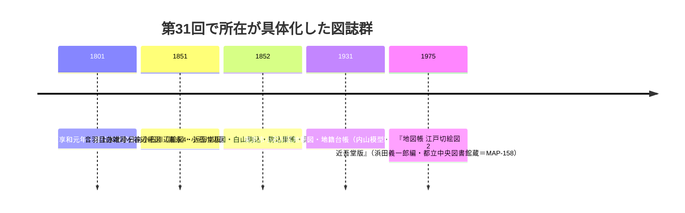

# 2026-11-12（第31回）追加調査：近吾堂版切絵図コンピレーション・文の京デジタル文庫・巣鴨村絵図所蔵・アクセス障害の記録

## 概要

- 実行開始時のhead = 4f3f8f7（第30回）。search_code・push_files・get_file_contentsとも正常。
- 新規資料ファイル: **MAP-158**（浜田義一郎編『地図帳 江戸切絵図 2 近吾堂版』1975・都立中央図書館蔵）。
- 既存更新: **MAP-045**（文の京デジタル文庫・NDLデジタルコレクションの追加所在）、**MAP-017**（享和元年作成・東京都公文書館蔵の二次確認）。
- PAP-029（深田1991紀要20号）の本文格上げは**今回は不可能**（後述のアクセス障害）。次回へ継続。

## 1. 近江屋（近吾堂）板切絵図コンピレーションの発見（MAP-158）

東京都立図書館の古地図目録PDF（4kochizu.pdf・re_chizumokuroku202006_4_kochizu.pdf）を直接取得し、**浜田義一郎編『地図帳 江戸切絵図 2 近吾堂版』（東京堂出版1975・DT0・290/12/12/2）**の内容細目を確認した。収録図のうち repo 未収録だった図名：

- **白山駒込辺之絵図（嘉永5）**・**駒込巣鴨辺之絵図（嘉永5）**（谷端川下流〜中流の読図比較候補）
- **上水北小日向小石川辺絵図（嘉永5）**・**小石川辺図（嘉永5）**・**巣鴨染井王子辺図（嘉永5）**

第30回ノートの次回課題「享和元年巣鴨村絵図・上水北小日向小石川辺絵図…の所在」のうち**上水北小日向小石川辺絵図の所在が複数機関で具体化**した（都立中央図書館コンピレーション・文京区立図書館デジタル index_873/874・姫路文学館〔村上吾嶂誌・玉香園为人画・嘉永5年版近吾堂板〕）。

## 2. 小石川区地籍図・地籍台帳（昭和6）の区デジタル公開（MAP-045更新）

文京区立図書館デジタルアーカイブ（文の京デジタル文庫）が『東京市小石川区地籍図（昭和6年）』（index_825・data_id=825）と『東京市小石川区地籍台帳（昭和6年）』（index_836・data_id=827）を公開していることを所在確認（本文は遮断）。NDLデジタルコレクション pid 1445086（地籍台帳）の書誌も確認。図面本文は未閲覧。

## 3. 巣鴨村絵図の作成年・所蔵（MAP-017更新）

kawawalk の巣鴨村頁（blog.goo.ne.jp/kawawalk/e/f9114a909e16ef420b1f55b8ec7cae6f）のスニペットで「享和（1801）年作成・『豊島区地域地図』第7集（平成21年）収録・**東京都公文書館蔵**」と確認（本文取得不可・二次転記）。MAP-016（巣鴨村図 共十六枚之内）との同一・別図の関係は未解決のまま。

## 4. 解釈・仮説メモ

- 谷端川下流（小石川大下水・西大下水）の江戸期描線比較は、これまで尾張屋系（MAP-021/022）と近江屋単図（MAP-019）が主だった。**近吾堂板の白山・駒込系図葉が読図候補として加わった**ことで、版元系統を横断した水路描写の異同確認が可能になる（図面未閲覧のため現時点では可能性の記録）。
- 「上水北小日向小石川辺絵図」は神田上水（樋筋）と小石川谷（＝谷端川下流）の重なる範囲を扱う図とみられ、谷端川下流の水路名・橋名（BLOG-133の橋名群）の比定に使える可能性がある〔推定〕。

## 5. 見送り・既収録の再確認

- サンポー「水窪川の暗渠で新発見」＝**BLOG-036既出**（2019/03/19・音羽更地石組み・造幣局2016年消滅と同一記事と確認）。
- 雨男note「階段路地に囲まれた暗渠道〜水窪川」（2025-05-22）＝既収録のBLOG-107/110内容の再構成が中心で新観察は乏しく、source file化せず。
- 黒田涼note「ひたすら暗渠歩きの豊島区西北境」＝**BLOG-050既出**。
- WANDER×WONDER 2026-09-23＝第14/28回評価済み。文春88508-88510＝BLOG-063既出。
- warpal（谷端川の跡を歩く・アーチカルバート）＝BLOG-005/062で既収録。
- 板橋区雨水出水ハザードマップ頁（1065493・令和8年3月都公表の板橋区反映）＝原典はGOV-085既収録の都図と同一のため、区反映頁の追記は見送り（ノート記録のみ）。
- 武蔵野市「千川上水整備基本計画」＝GOV-084既出。ゆる歴史散歩会弦巻川・小日向解説＝第19/28回評価済み。

## 6. アクセス障害の記録（2026-11-12時点）

- **Internet Archive が一時オフライン**（web.archive.org/cdx が「Temporarily Offline」を返却）。Wayback依存の取得（echo-lab紀要20号PDF= PAP-029格上げ、warpal未取得頁等）は今回不可。復旧後に再試行すること。
- echo-lab.ddo.jp 直＝遮断（4回目）。紀要42号PDF（PAP-027）は検索に露出しているが、紀要20号のPDFパスはWayback収蔵確認もできていない。
- 文京区立図書館 dl.lib（文の京デジタル文庫det.html）＝遮断。lib.city.bunkyoのindex_825/836は「ページが見つからない」応答だが検索スニペットで頁タイトル確認可。
- nabunken＝再び「アクセス集中中」（板橋区立郷土資料館紀要の目録調査は第24回課題のまま継続）。
- 読売「47都道府県・暗渠百科」（丸善出版・2026-08-25記事）＝遮断。**水窪川・谷端川の収録有無の確認を次回課題に追加**。
- 高口ようこ区議の特別展レポート（2026-10-21・学芸員解説）＝一時的ネットワーク障害で取得できず、次回再試行。

## 7. 次回課題

1. PAP-029（深田1991）本文：Internet Archive 復旧後に echo-lab の Wayback id_ で紀要20号PDFパスを特定・取得。
2. MAP-158の読図：文京区デジタルアーカイブ「上水北小日向小石川辺図」・「小石川辺図」の画像取得、都立中央図書館での『地図帳 江戸切絵図 2 近吾堂版』閲覧。「白山駒込辺之絵図」「駒込巣鴨辺之絵図」の水路描写。
3. 巻鴨村絵図の都公文書館一次書誌（請求番号）の特定と MAP-016 との異同。
4. 「47都道府県・暗渠百科」の四河川収録有無。
5. 高口区議レポート再取得（特別展「水を守る」の展示内容の新事実）。
6. 継続課題：README冒頭bullet（第6回〜第30回分の保留bullet）、INDEX.mdのbuild.py再生成（git環境待ち）。
