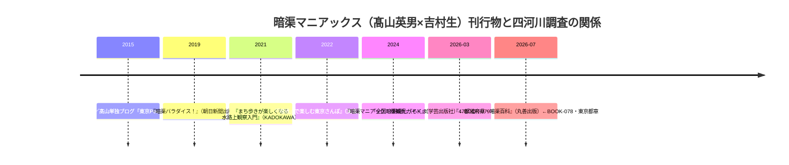

# 2026-11-12（第32回）・暗渠マニアックス新刊2冊・板橋区立郷土資料館紀要目録の追加調査

第31回（コミット 3918b51）以降の新情報調査。水窪川・弦巻川・谷端川・千川上水について、出版物・学術論文・公的アーカイブの角度から調査した。

## 1. 今回の新資料

- **[BOOK-078](../sources/books/BOOK-078.md)**：髙山英男・吉村生『47都道府県・暗渠百科』（丸善出版・2026年7月・ISBN9784621313053）。四河川調査の当事者・髙山英男（[BLOG-036](../sources/blogs/BLOG-036.md)・[BLOG-099](../sources/blogs/BLOG-099.md)・[BLOG-100](../sources/blogs/BLOG-100.md)・[BLOG-123](../sources/blogs/BLOG-123.md)）と吉村生の共著による全国164か所の暗渠紹介書で、第Ⅱ部に**東京都章**を含む。東京章の採録対象に四河川が含まれるかは本文未確認。
- **[BOOK-079](../sources/books/BOOK-079.md)**：同『全国暗渠観光ガイド 街と歴史のウラ名所めぐり』（学芸出版社・2026年3月5日・ISBN9784761529642）。目次第2章2-3の**事例6「文京区〜豊島区｜池袋の裏を流れていた川と橋のものがたり」**は、地域的に谷端川・水窪川流域（文京区〜豊島区）と重なる。対象川の特定は本文確認待ち（推定段階）。
- **[PAP-030](../sources/papers/PAP-030.md)**：「東京都公文書館収蔵史料に見る板橋の水車 その用水争論をめぐって」『板橋区立郷土資料館紀要』第10号（1994年3月）。板橋の水車と用水争論を都公文書館史料から扱った論文の存在をCiNii記事目録で確認。千川用水の水車・争論（[BLOG-094](../sources/blogs/BLOG-094.md)の文化4年溢水事故・水車不許可と軌を一にする主題）を含む可能性が高いが、本文未見のため断定しない。

## 2. 暗渠マニアックス刊行物の時系列〔確認：各出版社ページ・著者ブログ〕

- 髙山の四河川調査は個人ブログ（2010〜2014年の音羽川・谷端川支流シリーズ＝[BLOG-046](../sources/blogs/BLOG-046.md)〜[BLOG-061](../sources/blogs/BLOG-061.md)・[BLOG-125](../sources/blogs/BLOG-125.md)・[BLOG-126](../sources/blogs/BLOG-126.md)）が主だったが、**2026年に初めて全国書籍の東京章・事例という形で書籍収録される可能性が生じた**。事例6の対象川特定が当面の焦点。

## 3. 板橋区立郷土資料館紀要の目録調査（第24回課題の進展）

- **nabunken が引き続き「アクセス集中」で遮断**されているため、**CiNii誌名書誌（[ncid AN10129259](https://ci.nii.ac.jp/ncid/AN10129259)）の記事目録（創刊号〜第21号・全202件・ISSN 0289-8535）で代替**した。
- 千川・谷端・水窪・弦巻・用水・上水の語を含む記事は、**第10号（1994年3月）の「東京都公文書館収蔵史料に見る板橋の水車 その用水争論をめぐって」1本のみ**（[PAP-030](../sources/papers/PAP-030.md)に資料化）。第6号（1987年）に千川関連記事なし（第24回ノートで懸案だった第6号の内容を否定）。15号からは「板橋区立郷土資料館年報」と合綴刊行。
- 大学図書館37館所蔵（立教大学は第1-5,7-12,14-23号所蔵）。第22号・年報30/31号は板橋区立郷土資料館サイトで刊行案内あり〔[出版物ページ](https://www.city.itabashi.tokyo.jp/kyodoshiryokan/shuppan/3000048/3000049.html)〕。

## 4. 今回確認できた周辺情報（ノート記録のみ）

- **読売新聞2026-08-25地方版**「東京：暗渠への愛一冊に 都内の2人 全国164か所歩き調査」（open遮断・スニペット確認）：2人が「暗渠マニアックス」名義で活動、1年8か月の行脚、地元図書館で古い新聞を調査したとの文言。四河川の直接記述は確認できず。
- **吉村生のX投稿**（[発売日告知](https://x.com/nama_kaeru/status/2082969071981883736)・[担当県紹介](https://x.com/nama_kaeru/status/2085146140304130479)）：北海道・秋田・山形・宮城等の担当県紹介を連投。**東京都章の執筆担当と採録地点の言及はこの時点では発見できず**（東京は髙山担当と推定されるが確認できていない）。
- 見送り：『暗渠マニアック！』等の既刊5冊の目次照合（四河川の既出記事との重複確認は現物ベースで必要なため、次回課題に積んだ）。

## 5. アクセス不能の記録（2026-11-12時点）

- nabunken（ja・enとも遮断。CiNii誌名書誌で代替成功）
- cir.nii.ac.jp（opensearch遮断。ncid誌名ページはopen_urlで取得可）
- echo-lab.ddo.jp/libraries/中央学術研究所（直・Wayback id_とも不可・Wayback未収蔵。[PAP-029](../sources/papers/PAP-029.md)の本文格上げは継続課題）
- 読売2026-08-25記事、寅さん歩wpage5145.pdf（直遮断・スニペットのみ）
- sirakigi senkawa51（Wayback未収蔵）
- 丸善出版ページ（ナビゲーション部のみ取得・書誌詳細は版元ドットコムで代替）

## 6. 次回課題

1. 『47都道府県・暗渠百科』東京都章・『全国暗渠観光ガイド』事例6の**現物確認**（四河川採録の有無・内容の抽出）。都立中央図書館等の所蔵確認。
2. [PAP-030](../sources/papers/PAP-030.md)の著者名・頁数の特定と本文確認（板橋区立郷土資料館）。千川上水系の水車を扱うかの判定。
3. 暗渠マニアックス既刊5冊（『暗渠マニアック！』『暗渠パラダイス！』『水路上観察入門』『「暗橋」で楽しむ東京さんぽ』『暗渠マニアック！増補版』）の目次確認と四河川関連記事の棚卸し。
4. 第22号（2024?）・年報30/31号の目次確認（CiNii掲載分以降）。
5. [PAP-029](../sources/papers/PAP-029.md)のecho-lab紀要20号PDFの取得（継続）。
