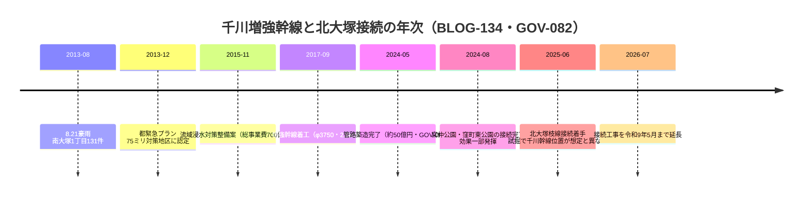

# 2026-11-12（第33回）追加調査ノート

- 実行日: 2026-11-12。前回コミット: ebde44e（第32回）。search_code・push_files・get_file_contentsとも正常、push前head確認（ebde44e）で競合なし。

## 新資料・更新

1. **[GOV-005](sources/gov/GOV-005.md)を本文全文確認に格上げ**: 練馬わがまち資料館「千川上水の分水を訪ねて（2）」をWayback（2024-12-01スナップショット）で全文取得。従来は谷端川分水のスタブだったが、中新井村分水3か所（明治10年樋口伏替願・豊玉上2-20/豊玉上1-26）、**中新井の池=中新井川原流+明和8年「江古田村鑑帳」旱損の補水伝承**、**濯川（武蔵大学）=北新井分水水路跡の復元**という書き言葉資料、葛ケ谷村分水の南長崎6-9=千川北曲折点、滝ノ川村・巣鴨村用水の初出文言を記録。
2. **[GOV-089](sources/gov/GOV-089.md)新規**: ふるさと文化館所蔵品アーカイブid=10003「千川家文書」（2000-1-0002）の総括レコード。**297点（江戸期168・明治期62・不詳67）・元禄9年〜明治17年**。MAP-155/156等の上位コレクション。年代下限1884が明治17年絵図群と一致。
3. **[BLOG-134](sources/blogs/BLOG-134.md)新規**: 豊島区議・細川正博「ゲリラ豪雨対策」ページ。千川増強幹線人孔設置3接続部（宮仲公園・北大塚2-23・窪町東公園）、2024.8.21接続完了で効果一部発揮、北大塚1-16→2-23への位置変更（埋設物輻輳）、**試掘で千川幹線の位置が想定と違っていた**こと、枝線接続工事の令和9年までの工程を記録。2013年南大塚被害131件・700億円/30億円の事業費規模も。

## 千川増強幹線（2013〜2026）の工程

## 見送り・重複確認

- 豊島区「千川上水公園」公式頁（340/shisetsu/koen/008.html）: 既収録の沈殿池・堀割・明治13年寄付情報の再構成のため見送り。
- 板橋区「浸水履歴」1005716: [GOV-074](sources/gov/GOV-074.md)で更新日2026-10-26・令和7年3月統合表記まで既に記録済み。PDF本文は未確認のまま。
- 大乗淑徳学園senkawa2026（千川上水と千川家講座・渡邉嘉之氏）: 直アクセス不可は第18回と同様、スニペット情報のみのため見送り。
- ゆる歴史散歩会「音羽絵図を徹底解説」: 水路記述なし・既収録地図情報の再構成のため見送り。
- Wikipedia練馬区指定・登録文化財一覧の「千川上水の記録フィルム2004年登録」表記: GOV-070の「平成17年度区登録」との表記差があるが、二次一覧の年に依拠した表記差と判断しsource file化せず本ノートにのみ記録〔断定せず〕。

## アクセス不能・継続課題

- echo-lab系・nabunken・i-repository本文・wanjin 240/241・かたりべ45・寅さん歩PDF: 継続不能。
- [GOV-089]の297点個別目録の通し調査（neribunアーカイブの2000-1-0002-xxx系列の列挙手段がないか）。
- 樋口伏替願・明治17年「千川上水絵図」・「江古田村鑑帳」の所在（千川家文書297点内か都公文書館か）。
- 枝線工事の都下水道局資料（千川幹線の実測位置と想定の食い違い内容）。
- README冒頭bullet追記は今回も不可（1.37MB・git環境なし）。保留bulletは第6〜32回分＋今回分。INDEX.md build.py再生成も継続課題。
