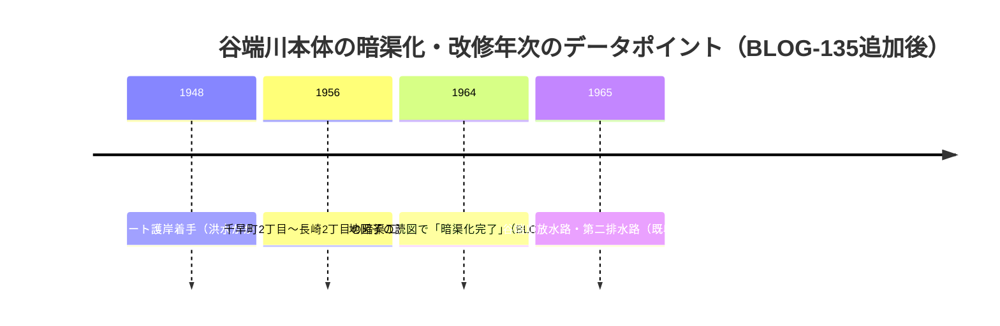

# 2026-11-12（第34回）追加調査ノート

- 実行日: 2026-11-12。前回コミット: d85d03a（第33回）。search_code・push_files・get_file_contentsとも正常、push前head確認（d85d03a）で競合なし。

## 新資料・更新

1. **[GOV-090](sources/gov/GOV-090.md)新規**: 練馬区「サポーター体験記246」（令和3年7月、渡邉嘉之学芸員インタビュー）。**千川家4軒（播磨屋・和泉屋・加藤屋・中嶋屋）と播磨屋の姫路出身自称**、**「千川郷」地名説**（渡邉推定）、**暗渠化の戦前開始・約25年は予算の都合**、昭和15年・27年写真の筋違橋定点比較、上石神井1-2・3の谷埋め盛り土と絵図の「土手」の印、分水「何分開き」ルール、濯川=中新井村分水路の区広報での明記。
2. **[BLOG-135](sources/blogs/BLOG-135.md)新規**: 落合道人「谷端川は夕暮れて。」2005-12-28（Wayback取得・現行403）。**1948年護岸→1956年千早町〜長崎2丁目暗渠完成**の一次証言（『豊島区80年のあゆみ』1982経由）、椎名町駅300m間に西武線が谷端川を二度渡るU字読図、こだまコメント=粟島神社の池を水源とする天然河川+千川上水補水〔聴取〕、椎名町「ドブ川」呼称、『豊島区50年のあゆみ』洪水写真の豊島区広報課所蔵情報。
3. **[BLOG-136](sources/blogs/BLOG-136.md)新規**: 池袋ジャーナル2025-03-26。**立教大学古地図デジタルライブラリで『大東京最新明細地圖』（東亰日日新聞1932.12）が公開**、蟹ヶ窪に美久仁小路含む、**日出優良商店街=旧水久保商店街**。
4. **[MAP-016](sources/maps/MAP-016.md)更新**: 都公文書館資料詳細を直接確認。**請求番号654-02-03-10（ZB-063坤）・大整理番号428・享和元年十月・67×95cm彩色図・閲覧用複製図あり**（第31回課題の請求番号特定を解消）。都公文書館解説「江戸各郷村図を読む」で乾/坤帙構成と「編脩地志備用典籍」印=昌平坂学問所収集の解釈も確認。

## 谷端川上流部の暗渠化年次：新データポイント

BLOG-135の「1948年護岸→1956年千早町〜長崎完成」は、既存の暗渠化年次論に上流部（豊島区西側）の一次証言を追加する。矛盾はなく、むしろBLOG-132の「1964年までに全域暗渠」読図を下部構造から補強する。

## 見送り・重複確認

- NEWSポストセブン2022-04-12（1743260）: repo既出（BLOG-089系。文面は既収録の昭和8年頃・1681年護国寺門前町・音羽富士前保存と同一）。
- sirakigi senkawa51/61: 直は遮断。ともにrepoで既参照（それぞれ5・2ヒット）。
- 国土地理院古地図コレクションの五千分一東京図測量原図: MAP-007で既登録（高田村近傍も既出）。
- 中央学術研究所紀要20号（深田1991=PAP-029）: echo-lab直は5度目も遮断。紀要目録ページも遮断でPDFパス特定には至らず。
- 都環境局・nabunken・i-repository: 今回は未着手（継続課題）。

## アクセス不能・継続課題

- echo-lab（紀要20号PDFパス特定→PAP-029格上げ）、nabunken（板橋区郷土資料館紀要目録）、i-repository本文、wanjin 240/241、かたりべ45、寅さん歩PDF: 継続不能。
- **立教大学古地図デジタルライブラリの『大東京最新明細地圖』（1932.12）の原図閲覧と水路描写の読図**（BLOG-136経由で所在を確認。新MAP候補）。
- 千川家4軒の屋号（播磨屋・和泉屋・加藤屋・中嶋屋）と千川家文書297点（GOV-089）の対応、請負文書「千河より本郷迄…」の原本特定。
- GOV-090の「暗渠化戦前開始・約25年＝予算」説の行政文書照合（板橋区側・都側）。
- 『豊島区80年のあゆみ』（1982）・『豊島区50年のあゆみ』の洪水写真の実物確認（豊島区広報課所蔵情報あり）。
- README冒頭bullet追記は今回も不可（1.37MB・git環境なし）。保留bulletは第6〜33回分＋今回分。INDEX.md build.py再生成も継続課題。
