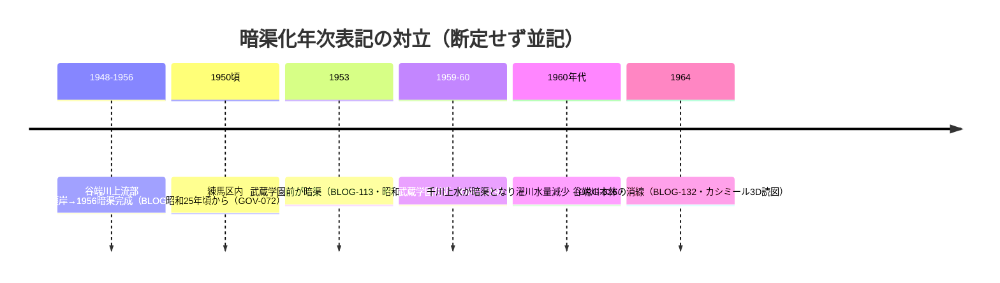

# 2026-11-12（第36回）調査ノート

- 実行日: 2026-11-12（第36回定期実行）。headコミット 4571c11（第35回）に対して実施。push前head再確認で競合なし。
- 資料化: 2件（ORG-025・ORG-026）。

## 今回の要点

1. **千川上水調査アルバムのデジタル公開（ORG-025）**: 武蔵学園百年史サイト（100nenshi.musashi.jp）の更新情報に「**2026.08.01 資料館に「千川上水調査アルバム」を追加**」を確認。[GOV-076]（平成17年度練馬区登録文化財・昭和13〜16年石山乾二の調査・4冊200カット超）の本文確認手段がネット上に開けた。**アルバム個別頁のURLは今回特定できず**、資料館「所蔵資料一覧」経由の閲覧が次回の一手。収録写真の判読は1953 vs 1959-60年次差の解消資料として最有力。
2. **オンライン博物館「濯川」頁（ORG-026）**: 構内看板解説頁を直接確認。蘇生計画が**学園創立60周年記念事業・太田博太郎学園長・大坪秀二校長・井戸＋還流水ポンプ**と具体化（repo初出の細部）。千川上水暗渠化を「**1960年代**」と表記し、1953年（BLOG-113）・1950年代末（ORG-019）に第三の表記が加わった。**断定せず並記**。
3. **suddendeafness（ねこたま）シリーズの所在が前回課題から部分解決**: 弦巻川シリーズ④（entry-12600732661・2020-06-05・都電〜弦巻通り）と⑤（entry-12600898380・せんべい小倉屋〜清土鬼子母神）のURLを特定、本文取得して内容確認。④は南坂橋（弦巻川.md既出）・弦巻通りと流路の乖離（BLOG-063既出）の再構成が中心で**source file化を見送り**。同作者の「谷端川暗渠を歩く」シリーズ①（entry-12386051286・2018-07-01・千川〜椎名町）・④（entry-12386165474・北緑道〜板橋駅）もrepo未収録と判明したが、①は粟島神社池の2018年現況観察（池残存・手水舎は蛇口式）と「1960年代に全て暗渠化」の筆者理解（BLOG-132読図と同系統）が中心で**source file化を見送り**。②③⑥（弦巻川）・⑤⑥（谷端川）・⑧（弦巻川・江戸川橋方面）のURLは依然未特定。
4. **PAP-029格上げ（echo-lab紀要20号）は今回も不可**: echo-lab.ddo.jpの紀要ディレクトリURLパターン（紀要42(2013)と同型の「紀要20(1991)」）を推定してWayback id_で試したが未収蔵。CDX APIも遮断。一方で新たに**中央学術研究所公式サイト（cari.ne.jp）に紀要目録データベース（論文検索）が存在することを確認**（publication2/paper のid頁で目次閲覧可・本文PDFは会員登録制）。深田論文の同DB内収録は確認できず。次回はcari.ne.jp論文検索からの深田1991・深田2013の検索を試す価値あり。
5. **xaymaca「東京暗歩」弦巻川編（2020-11-27）**: 大鳥神社の「弦巻川暗渠化祈念碑」観察（文字は読めずと記載）＝GOV-062・BLOG-049の大鳥神社記念碑の再観察と判断し、source file化を見送り。弦巻川源流を元池袋史跡公園の池とする叙述はBLOG-075系と同型。
6. **武蔵百年史ギャラリー062「武蔵学園の象徴・濯川」**: 写真館ギャラリー062（[Gallery](https://100nenshi.musashi.jp/Gallery/Photo/ff8a9f34-6785-4980-90c2-2586eccf8526)）の収録写真リストに「**濯川のみなもと**」「濯川の中流部」「1920年代の濯川」「欅橋からみた濯川と校舎」等の見出しを確認（第29回課題「濯川のみなもと頁」の所在特定）。個別写真頁のキャプション本文は今回未取得（個別頁URLの特定が次回課題）。ギャラリー102「武蔵の門」に「1950年代の千川通り」「1970年代の千川通り」「千川上水の看板」の写真があることも確認（第28回課題のキャプション本文は未取得）。

## 図: 千川上水暗渠化年次表記の対立（ORG-026追加後）

## ノートのみの記録（source file化せず）

- **cari.ne.jp（中央学術研究所）論文検索DBの存在**: [publication2目録](https://www.cari.ne.jp/search/detail/publication2/id/85)で紀要各号の目次が表形式で閲覧可（例: id/85=2016年号）。本文PDFは会員登録制。深田1991（PAP-029）の収録確認は次回課題。
- **武蔵学園百年史サイトの資料館ページ（2026-06-19公開）**: 「所蔵資料一覧」に所蔵文化財・本間文書等が並ぶ構成。千川上水調査アルバムはこの一覧内にあると推定されるが、リンクURLの抽出は今回不成功。
- **suddendeafnessの谷端川シリーズ**: ①千川〜椎名町（2018-07-01）・④北緑道〜板橋駅（entry-12386165474）の本文を確認。①の粟島神社池2018年観察（池残存・手水舎蛇口式・境内に倉庫・二宮金次郎像）は池の現況記録としての価値はあるが、BLOG-030/135等の既存粟島神社観察と重複が大きく見送り。
- **かつての池袋の暗渠ブログ横断の再検討で見送ったもの**: 銀木犀note水窪川頁（BLOG-108と同一note・重複）、xaymaca 2023-09-11聖地巡礼（個人的写真日記・水窪川沿いの染み出水の2023年乾燥観察のみ）、4travel 2026-04谷端川2本（第14回評価済みの再構成系）、urawa8.fc2（Access Denied・Wayback未確認）、mikimoto07・o-emperor・jean1hの弦巻川散策（既知内容の再構成中心で新規観察の核なし）。

## アクセス不能の記録

- **echo-lab.ddo.jp**: 紀要目録・紀要20(1991)ディレクトリとも直もWaybackも不可（Wayback未収蔵）。CDX APIは「site blocked」応答。
- **sinsuinew.pdf（板橋区浸水履歴PDF）**: 検索で直接URL（city.itabashi.tokyo.jp/_res/.../sinsuinew.pdf）を特定したがopen_urlで「お探しのページを表示できません」応答。第35回課題④は継続。
- **nabunken**: 英文頁127114/127128は32KB打ち切りで千川関連記述に届かず（第24回と同状況）。
- **urawa8.blog.fc2.com**: Access Denied。
- **wanjin 240/241・かたりべ45・寅さん歩PDF・i-repository本文**: 継続不可。

## 次回課題

1. **千川上水調査アルバム（ORG-025）の個別頁URL特定と収録写真の判読**（1953 vs 1959-60年次差・上石神井1-2,3盛土地の絵図比較〔GOV-090〕の一次資料）。
2. cari.ne.jp論文検索で深田1991（PAP-029）・深田2013（PAP-027）の収録有無を確認。
3. ギャラリー062「濯川のみなもと」・ギャラリー102「1950/1970年代の千川通り」「千川上水の看板」の個別写真頁キャプション本文取得。
4. suddendeafness弦巻川②③⑥⑧・谷端川②③⑤⑥のURL特定。
5. 板橋区浸水履歴PDF（sinsuinew.pdf）の本文取得（別ルート: Wayback・ブラウザ UA）。
6. 継続: 東京路地紀行112の所在、郵政博物館明治44年地図（サービス再開待ち）、『豊島区80年のあゆみ』洪水写真。

- **README冒頭bullet追記は今回も不可**（1.37MB・git環境なし、継続課題）。保留bulletは第6〜35回分＋今回分（アルバム公開・濯川1960年代表記）をgit環境でまとめてprepend。INDEX.md build.py再生成も継続課題。
