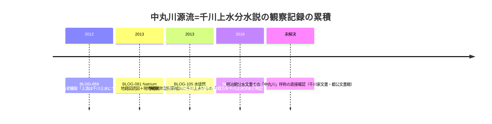

# 第37回調査（2026-11-12）・境井田支流本文初取得・wanjin中丸川本文初取得・飛泉の滝・特別展イベントの追加調査

## 概要

- github_app のsearch_code・get_file_contents・push_filesとも正常。push前head確認（725db0e＝第36回）で競合なし。採番はBLOG-139/140を使用（push_files配列形式）。
- コミット: c8564be（BLOG-139/140新規）、b4b603a（BLOG-066/GOV-038追記）、当コミット（対照表追記＋本ノート）。

## 新資料2件（いずれも本文初取得）

### BLOG-139: 暗渠さんぽ「ふとみれば花街、谷端川境井田支流（仮）」（nama・2012-03-05）

- kaeru.moe-nifty.com はAccess Deniedだが **Wayback（2022年・id_指定）で全文取得に成功**。
- repo初出: ①**明治初期の古地図に境井田支流（仮）が水路として描かれるのはただ一度のみ・流末は二股**、②**江戸期池袋村絵図（「豊島郡の村絵図」・豊島区立郷土資料館刊「歴史をたずねて」池袋村）に御嶽神社と境内西の道の橋**、③**字名「境井田／大上／下上／上」**、④**鈴木牧場・和田牧場が川沿い**（「ミルク色の残像」）、⑤池袋三業地の成立史（豊島区史）、⑥銭湯「栄湯」・蓋がけ痕跡・大谷石護岸状残欠・河口の橋状構造物の観察。
- 2026-10-23横断調査ノートでD.2.C.目次（境井田（御嶽）支流）だけが見えていた領域の本文が開けた。**猫またぎ元記事（2011）は未取得**。

### BLOG-140: 水の行方を追って「中丸川」（わんじん・2018-06-06）

- wanjin.blog.fc2.com はAccess Deniedだが **Wayback（2026-10-25スナップショット）で全文取得に成功**。
- **中丸川=千川上水分水説の第4の独立裏付け**: 西源流（豊島区側・靴の像）も大山西町起点の流れ（境界石すぐそば・板橋第二中学校経由）も千川上水からの分水と踏査・読図。BLOG-059（古老聴取）→BLOG-081（地籍図+観察）→BLOG-105（学校周年誌）に続き、流路細部（区境沿い・大山西町・板橋第二中学校）が整合する。
- 2024-08-21の地元出身者コメント（「あさり屋」の小屋・8枚目からの細い道=川跡）も聴取記録として付記。
- 同ブログの2018年6月支流連載（entry-243〜247周辺）は未索引のまま（次回課題）。

## 既存2件更新

- **BLOG-066追記**: 本文末尾の付記で紹介されていた**『遊歴雑記』の「飛泉の滝」（新田堀ノ内村=現上池袋・北から西南に四段になった細い滝）**がrepo未収録文言と確認し追記（伝聞段階・原本該当箇所未特定。『遊歴雑記』=BLOG-073/074と同じ史料）。上池袋谷頭の湧水・滝地形を示唆。
- **GOV-038追記**: 特別展「水を守る」の関連イベントを練馬区文化振興協会頁で直接確認。**講演会「江戸の上水インフラ―千川上水の開削と運営―」（大石学・9/22）**・FW（10/25・上井草→東伏見）・解説会（9/27・10/21）。

## 地名対照表

- 池袋村の字名**「境井田／大上／下上」**の行を追加（BLOG-139由来）。

## 中丸川=千川上水接続説の裏付けの積み重ね

## ノートのみの記録（source file化せず）

- **武蔵写真館「千川上水の看板」個別頁のURL特定**: https://100nenshi.musashi.jp/Gallery/Photo/ea1b75a9-4c43-433b-b631-3745a9b152cf （ギャラリー102内・**資料番号NU115-003・1969年撮影・「200メートルほど池袋寄りに移設」のキャプションを直接確認**）。ORG-022のスニペット情報が本文レベルで裏付けられた。同ギャラリーの「1950年代の千川通り」「1970年代の千川通り」の個別写真頁は未訪問。
- **東京都下水道局・工事情報詳細（豊島区）116**（2026-11-12時点）: **北大塚二丁目の枝線工事（2026.5.10-8.12・大豊建設・第一基幹施設再構築事務所）が存在**＝BLOG-134記載の千川増強幹線枝線接続（北大塚1-16→2-23へ計画変更・令和9年5月まで）の実施が工事公示レベルで確認できる。谷端川流域の2026年度再構築工事群（要町三丁目/千早二、三丁目8.3-10.9、千早一/長崎一/西池袋四8.5-10.11、長崎五/千早三8.7-13.3、南長崎三〜五/西落合三8.7-12.8、目白三/西池袋二、三8.9-10.11、池袋二、三8.9-12.6、池袋本町四/板橋一「再構築その2」6.8-9.4）を確認。
- **echo-lab紀要20号（PAP-029格上げ）は今回も不可**: 第42号PDFの命名規則（「中央学術研究所紀要　第20号 084深田伊佐夫「東京市街地に流域をもつ中小河川の現状と親水機能回復の有用性」.pdf」）を推定して直アクセス・Waybackとも試行したが遮断/未収蔵。ディレクトリ頁自体もWayback未収蔵。継続課題。
- **suddendeafness弦巻川①（entry-12600718416）は横断調査ノートに記載済みと判明**（第37回での再発見ではなく既知）。②③⑥（弦巻川）・②③⑤⑥（谷端川）の所在は引き続き未特定。⑦（BLOG-137）・④⑤は既評価。
- **東京路地紀行111＝BLOG-066と同定**（露塚散=azabu_mamiana、2026-05-02。note番号とBLOG-066のURLが同じnote記事）。末尾「＜続く＞」で**112（支流上流端の続編）の存在が示唆**されるが、note.com内検索では所在を特定できず（第9回課題のまま）。
- 検索で見えたが見送り: 東京都「中小河川における今後の整備のあり方 最終報告書」（H24）・都管理河川の特別区移管と管理変遷（kensetsu.metro PDF・直遮断・Wayback未収蔵）・TMU土木史研究講演集166.pdf（千川上水は清流復活通水H1.3の年表掲載のみで既知情報の範囲）・武蔵学園百年史ホームページ更新情報（千川上水調査アルバム以降は本間文書・Fauna等で川関係なし）・練馬区立美術館相互割引。wanjin entry-242（谷端川本編・「名前に偽りあり」）はWayback未収蔵かつ直はAccess Deniedで未取得のまま。

## 次回課題

1. wanjin 2018年6月支流連載の残り（entry-243〜247・下り谷・出端川等。Wayback 2026-10-25の同日スナップショットが有効な可能性が高い）
2. 猫またぎの境井田支流（仮）2011年元記事の所在（frognest/旧ブログ）
3. 『遊歴雑記』「飛泉の滝」の該当箇所（新田堀ノ内村）の原本特定
4. 「ミルク色の残像」「東京花街・粋な街」「歴史をたずねて 豊島区の文化財」池袋村の書誌・本文
5. echo-lab紀要20号PDFの別ルート（CiNii紀要20号目次・cari.ne.jp収録確認）
6. 武蔵写真館ギャラリー102「1950年代/1970年代の千川通り」個別写真頁
7. 大石学講演「江戸の上水インフラ」の要旨・配布資料の所在
8. 東京路地紀行112の所在特定
