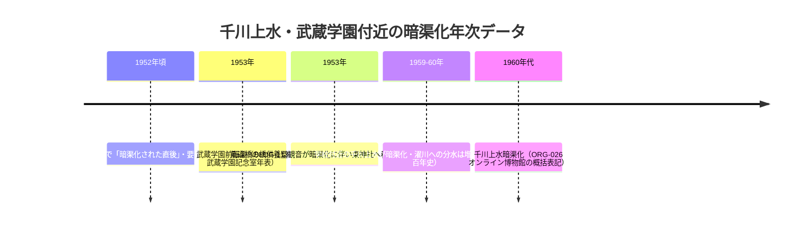

# 2026-11-12（第38回）・所蔵資料リスト記録フィルム写真群・wanjin支流連載2編・GHQ関東軍政部取水の追加調査

第38回定期実行。第37回（コミット d734845）以降のmainを取り直して重複確認した上で、下記を追加した。search_code・push_files・get_file_contentsとも正常。

## 追加した資料（GOV-092・BLOG-141〜142）

- [GOV-092](../sources/gov/GOV-092.md)：石神井公園ふるさと文化館「所蔵資料リスト」PDFの**千川上水記録フィルム写真39枚キャプション群**を直接確認して資料化。**GHQ関東軍政部の千川上水取水（板橋一丁目児童遊園地点）はrepo初出**。そのほか田中水車「昭和40年頃まで」（廃業年の第3データ）、九頭竜橋=富士見台駅入口交差点、中新井（上新街）分水=中新井川合流の文言、植桜楓碑の浅間神社移設の公式確認、1952年時点の暗渠化進捗の地点別記録（旭丘で「暗渠化された直後」）等。
- [BLOG-141](../sources/blogs/BLOG-141.md)：wanjin entry-247（2018-05-30）谷端川支流。**池袋御嶽神社右岸を通る約500m支流の水路敷観察・御嶽橋南東で本流合流**。Wayback 2026-10-25で全文取得。第37回課題「entry-243〜247」の部分解決。
- [BLOG-142](../sources/blogs/BLOG-142.md)：wanjin entry-249（2018-06-13）千川上水総説。**板橋浄水場1969年取水停止説（BLOG-113年表の1970と1年の表記差）**と豊島区通水断念経緯の2018年時点の独立二次記録。

## 既存仮説への影響（解釈メモ）

### 千川上水暗渠化の年次差問題（1953 vs 1959-60）

GOV-092の記録フィルムキャプションで、**1952年頃撮影時点で旭丘1丁目（武蔵学園付近）は「暗渠化された直後」**と明記された。年次データの累積:

- GOV-092は**1952年末〜1953年説を支持する方向の傍証**（撮影「昭和27年頃」の幅・キャプションの推定性を含め断定しない）。ORG-019の1959-60年は「濯川への分水が増水時のみになる」時点の記述と読むこともでき、暗渠化の完了定義の差として並記を維持する。

### 田中水車の廃業年

- sirakigi（BLOG-094・『練馬の産業I』経由）: **昭和44年（1969）2月まで・杵43本**
- GOV-092（文化館目録キャプション）: **昭和40年（1965）頃まで稼働**
- 周辺観察系（GOV-069等）: 昭和30年頃には南田中付近で既に暗渠化・「昭和40年頃まで」系の観察
→ 表記差は『練馬の産業I』原本確認（継続課題）まで断定しない。

### そのほか

- **GHQ関東軍政部の千川取水（板橋1丁目）**: 1971年途絶までの千川上水の利用者像（造兵廠→GHQ→印刷局）が補完された。GHQ期の取水地点・用途の原史料（都水道局・軍政部文書）が探索課題。
- **植桜楓碑の移設先=浅間神社**が公式目録レベルで確認（BLOG-101の伝聞が裏付けられた）。
- **中丸川=千川上水分水説**: GOV-092の「中新井（上新街）分水は中新井川に合流していた」は、谷端川支流（中新井川=江古田川水系）と千川上水の接続文脈に間接的に関わる（[BLOG-140](../sources/blogs/BLOG-140.md)・第37回Mermaid参照）。

## ノートのみの記録（source file化せず）

- **東京新聞2026-09-29「マニアが見つけた『蓋をされた川』」**（tokyo-np article/518187・有料会員限定で途中まで）: 暗渠マニアックス（髙山英男・吉村生）の桃園川案内。四河川への言及なし。E&I（Evidence & Imagination）メソッドの叙述のみ。BOOK-078既登録の著者であるため資料化せず。
- **読売新聞2026-08-25「暗渠への愛一冊に」**: 47都道府県・暗渠百科（丸善出版・四六判288頁・税込4840円）の刊行経緯報道。都内代表例は渋谷川・上下之割用水西井堀で、四河川の直接記述なし。BOOK-078の背景資料としての価値のみ。
- **武蔵学園百年史写真館ギャラリー087「武蔵に残る武蔵野のかけら」**の「濯川沿の「欅橋」付近」（2020年代撮影・DS20210420-010m）: キャプションに「**濯川の川縁は当初は水田であったが、学校創立以降はずっと樹林・緑地として維持**」とあり、濯川縁の土地利用史の一次的追記になりうる。欅橋自体はORG-019/024/026既出のため、ORG-024への小追記候補として記録のみ。
- **特別展「水を守る―千川家と千川上水の330年―」**の会場・会期詳細（石神井公園ふるさと文化館2階企画展示室・neribun event id 202602131770944638・一般300円）を確認。GOV-038既登録の特別展の会場情報レベルのため source file 化せず。
- **雨男note「階段路地に囲まれた暗渠道〜水窪川」2025-05-22**: BLOG-107/110既出の再構成（訪問2021年4-5月・富士山広場・イケ・サンパーク・美久仁小路など既知情報のみ）で見送り。

## アクセス不能・見送り

- **echo-lab紀要20号（1991）の深田論文PDF**: echo-lab直は遮断。Waybackで中央学術研究所紀要のindex.html（2023-05-28スナップショット）は取得でき**第20号(1991)ディレクトリの存在を確認**したが、紀要20(1991)ディレクトリ本体はWayback未収蔵でPDFパス特定ならず。目次ページに「非公開のものも多数在ります」の注記あり。PAP-029格上げは継続課題。cari.ne.jp論文検索はJSフォームで検索不可（publication2/id/85は紀要2016号の目次）。
- **wanjin entry-243/245/251/252**: Wayback未収蔵（2026-10-25スナップショットはentry-247/249/250のみ。250=BLOG-080既出の出端川）。「谷端川支流－驚愕の思い…」「－平成の絶景…」の2本が残り。
- **武蔵百年史・千川上水調査アルバムの個別頁**: 資料館トップページ（historical_materials）の「所蔵資料一覧」リンクの宛先が抽出不能で個別頁URL未特定（/Archives・/Collection等の推定パスは不在）。更新情報で「2026.08.01 資料館に千川上水調査アルバムを追加」を再確認（ORG-025の記載どおり）。
- nabunken（板橋区郷土資料館紀要）は再びアクセス集中で本文不可。第24回課題のまま。
- 東京路地紀行112: 今回も所在不明（111が最新の池袋関係）。第37回課題継続。

## 次回課題

1. GOV-092の39枚写真とGOV-070（60コマ）・neribun個別コマ（5000-0057-xxx）の番号対応整理。
2. GHQ関東軍政部の千川上水取水の原史料探索（都水道局年報・軍政部文書）。
3. 『練馬の産業I』原本（田中水車の昭和44年2月説の原典）確認。
4. echo-lab紀要20号（1991）PDFの特定（IA収蔵待ち・cari.ne.jp会員制DB）。
5. wanjin支流連載残り2本（entry-243/245/251/252）のWayback収蔵待ち。
6. 武蔵百年史・千川上水調査アルバム個別頁のURL特定（所蔵資料一覧リンク経由）。
7. 継続: README冒頭「現時点で重要なこと」への保留bullet（第6〜37回分＋今回分）のprepend（git環境待ち）、INDEX.mdのbuild.py再生成（git環境待ち）。
