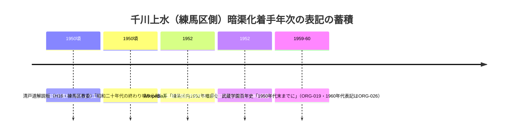

# 2026-11-12（第39回）・miwa3k千川上水全線歩き・平尾邸大池水源説・水道端（大谷口）の追加調査

## 今回の新情報

1. **[BLOG-143](../sources/blogs/BLOG-143.md) miwa3k「千川上水を歩く その１」**: 品川用水の分水口（玉川上水直下・repo初出）、文字庚申塔（西東京市指定文化財・天明4年・上保谷新田入口・「五穀成就」）、井口橋石橋供養塔の武蔵野市教委解説全文（市内唯一の文言）、上石神井千川児童遊園の水車解説板（昭和40年頃まで・区内最後＝廃業年次の第4データ）、上石神井立野の庚申塔・観音供養塔。
2. **[BLOG-144](../sources/blogs/BLOG-144.md) miwa3k「千川上水を歩く その２」**: **板橋区教委平成29年「千川上水跡」案内板の「加賀藩下屋敷平尾邸内の池泉回遊式庭園にあった大池の水源ともなっていました」＝repo初出**。九頭竜弁財天の移設先（中村橋駅西側）、清戸道解説板（H16練馬区教委）「昭和二十年代の終わり頃から暗渠工事が始まりました」＝着手年次表記の追加、桜台＝千川上水桜並木由来の駅名説、石神井川揚水合流点＝筋違橝付近の二次記録、板橋駅前の凸状築堤と谷端川並行の地形観察。
3. **[BLOG-145](../sources/blogs/BLOG-145.md) kotakemol04「千川上水（千川通り交差点から千川親水公園直前まで）」2011**: 南長崎交差点の籾山牧場→チーズ工場→明治乳業（平成6年3月操業終了）、**板橋区大谷口側の「水道端交番」＝滝野川のスイドウバタとは別地点の「水道端」地名repo初出**、明豊中学校わきの築樋（石神井川に注ぐ水路との立体交差）の独立裏付け＋**「大谷口北町のエンガ掘に至る流れの一つ」＝築樋水路とエンガ堀の接続記述repo初出**、大正5年地図の「旧千川上水」記載。

## 解釈

### 千川上水暗渠化着手年次の表記蓄積（いずれも決着していない）

- **「昭和20年代終わり頃から」（区教委解説板）は「25年頃」説と「27年3月」説の間に入り、着手年代の範囲を狭める方向に働く**。ただし原文ごとの対象区間（全区間か特定区間か）が違う可能性を排除できないため、断定はしない。

### 平尾邸大池水源説の位置づけ

- 千川上水の板橋宿内利用は、火薬製造所（[GOV-070](../sources/blogs/BLOG-113.md)文脈）・水車（[BLOG-094](../sources/blogs/BLOG-094.md)）に続き、**加賀藩下屋敷（平尾邸）の庭園大池の水源が案内板レベルで確認された**。大名下屋敷の庭園池への上水供給は、神田川水系では椿山荘（[ORG-015](../sources/org/ORG-015.md)）・六義園（[GOV-092](../sources/gov/GOV-092.md)）と同型の事例であり、千川上水の給水先リストの補強になる。平尾邸の位置と大池の現況（現・区立施設か）の確認が次の一手。

### 水道端の2地点問題

- 「水道端」は滝野川区間（石神井川沿い・[BLOG-092](../sources/blogs/BLOG-092.md)）で知られていたが、**板橋区大谷口（大谷口給水所前・千川上水沿い）にも交番名として現存**する。上水に由来する「水道端」地名の分布が2地点に拡大した。両地点の呼称の関係（同一由来か独立か）は未確認のため対照表では別行に整理。

### エンガ堀への給水系統

- 明豊中学校脇の築樋で立体交差していた「石神井川に注ぐ水路」が「**大谷口北町のエンガ掘に至る流れの一つ**」という2011年の記述は、エンガ堀（[BLOG-103](../sources/blogs/BLOG-103.md)起点＝東長崎3号踏切北）と石神井川支流（中丸川・出端川）の間の中間水流の存在を示す候補。中丸川の千川上水接続説（[BLOG-140](../sources/blogs/BLOG-140.md)）とも関連し、大谷口〜氷川町の水路網の再検討材料になる。

## 地名対照表への追記

「桜台（千川上水桜並木由来の駅名）」「水道端（板橋区大谷口・滝野川とは別地点）」の2行を追記した。

## 見送り・重複回避の記録

- 川のプロムナード entry-249（千川上水4）＝ [BLOG-042](../sources/blogs/BLOG-042.md)で既収録。
- 雨男note「階段路地に囲まれた暗渠道〜水窪川」2025-05-22 ＝ 第38回評価済み（BLOG-107/110再構成）。
- Wikipedia千川上水（ja・Weblio複製スニペット）の平成4年度暗渠管調査・20箇所異状 ＝ 第10回ノート・[BLOG-142](../sources/blogs/BLOG-142.md)で既記録。
- 武蔵学園百年史サイト：資料館の千川上水調査アルバム追加（2026.08.01）は [ORG-025](../sources/org/ORG-025.md)どおり。Historical_Materials頁の「所蔵資料一覧」からアルバム個別頁へのリンク先は本文抽出不能（個別頁URL特定は継続課題）。
- khaaw.cocolog（2018千川上水散歩）・sakamitisanpo・walk-life.me・y-ok.com（千川上水-3/-4）＝ 概観の再構成と評価し、既知情報の組み替え中心のため今回未評価（要再評価なら次回）。
- moguratushin（玉川上水事典・千川上水頁）＝ 文字コード不一致で本文抽出不能（請負人の太兵衛・徳兵衛は [GOV-004](../sources/gov/GOV-004.md)既知）。

## アクセス不能

- wanderxwonder「暗渠ナイトさんぽ」（2026-06-28・水窪川暗渠遡上イベント頁）＝ **404**（イベント終了で削除と推定。 Waybackの収蔵確認は次回）。
- echo-lab.ddo.jp（深田1991・紀要20号）＝ 今回も遮断。PAP-029格上げは継続課題。
- wanjin entry-243/245/251/252 ＝ Wayback未収蔵のまま。

## 次回課題

1. 平尾邸（加賀藩下屋敷）の所在・庭園大池の現況確認（板橋区側史料）。
2. 大正5年「旧千川上水」記載の地図の原図特定。
3. 「水道端」2地点の関係の原典確認（大谷口給水所前・練馬区HPの水車言及ページ）。
4. 明豊中築樋の「モノの資料」の特定とエンガ堀接続水路の流路確認。
5. miwa3k両記事の投稿年特定。
6. 品川用水分水口の既知情報との突き合わせ（玉川上水側史料）。
7. 武蔵学園百年史・千川上水調査アルバム個別頁URL（継続）。
