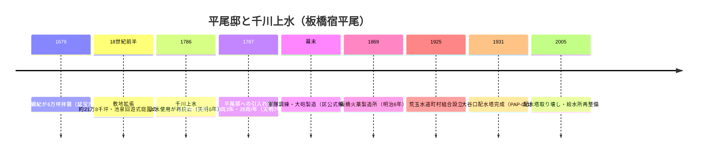
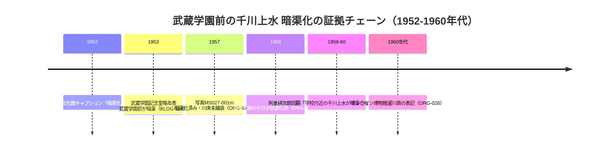

# 2026-11-12（第40回）・平尾邸天明7年分水見積書・谷端川緑道32橋の個別URL確定・1957年千川写真・水窪川暗渠マップの追加調査

第40回定期調査（2026-11-12実施）。search_code・get_file_contents・push_filesとも正常、push前head確認（7ba3615＝第39回）で競合なし。新規資料: BLOG-146〜149・GOV-093・ORG-027・PAP-031。

## 今回の新情報と解釈

### 1. 平尾邸と千川上水の接続が「数量」で裏付けられた（BLOG-146・GOV-093）

- kawawalk「加賀藩下屋敷分水」（スニペット確認・goo終了で本文取得不能）により、**天明7年（1787）の平尾邸への千川用水引き入れ話の見積書**（板橋区史通史編上経由: 分水路延長168間≒306m・費用193両2朱・使用料・管理料毎年25両）が見えた〔repo初出〕。上水使用再廃止の翌年という時序も初出。実施の有無は未確認。
- 板橋区公式「時代を紡ぐ」平尾邸頁（GOV-093・直接確認）で、延宝7年6万坪→約21万8千坪・**御下屋敷惣絵図の庭園内の大池**・池泉回遊式庭園・幕末大砲製造を区学芸員解説（吉田政博・広報いたばし平成26年）で確認。
- **これで平尾邸大池水源説（BLOG-144・区教委H29案内板）が、屋敷側の公式記述（GOV-093）と上水側の見積書（BLOG-146）の双方から参照可能になった**。ただし大池の水源そのものにはどちらの資料も触れておらず、水源説の裏付けは今後も間接的。

### 2. 谷端川緑道32橋シリーズの個別URL確定（BLOG-148）

- freedomwalk「ぶらっと遡上探索」のScene-1043〜1047（2026年9月17日〜10月3日）の**個別entry URLを特定**（blog-entry-1257〜1261）。32橋リスト自体は四河川の橋名・橋跡調査.md既記録（カテゴリ頁経由）なので重複と明記した上で、**流路延長3.5km表記・「暗渠化計画時点で欄干・親柱を残しての緑道化が計画された模様」後書き・上流下流の他行政区では緑道化されなかったという観察**を新規記録。
- 欄干・親柱残置が「計画時からの意図」かは踏査者の推定。豊島区（南・北緑道）と板橋区・北区の対応差の行政文書による裏付けが課題。
- 併せて wanjin entry-240（長らくアクセス不能の谷端川編）のスニペットが初めて中身を見せた: **「金井窪橋のすぐ先の左岸に千川上水から分水を受けた中丸川が合流。その先には西前橋が架かっていた。西前橋を通る道は高田雑司ヶ谷道」**〔金井窪橋=32橋#07・西前橋=#06（BLOG-148）と整合する位置情報で、中丸川の谷端川合流位置の新データポイント。スニペット段階なのでsource file化せず本ノートに記録〕。

### 3. 1957年の千川学園前写真が暗渠化年次問題の空白を埋めた（ORG-027）

- 武蔵写真館045の個別写真「千川通りの桜」（MS027-001m・1957-04-12）: **暗渠化された千川の川床部分は未だ舗装されていない**。1952年（GOV-092・旭丘「暗渠化された直後」）→1953年（BLOG-113着手・完工）→**1957年（暗渠化済み・未舗装）**→1959年（ORG-022・歩道化半分）→1960年代（ORG-026）の並びで、**写真3点+目録1点+年表1点の証拠チェーン**が完成。1953年説支持の第4傍証（断定は従来どおり避ける）。
- 同ギャラリーに「千川通りでの植樹」3枚・「1959年の千川通り」等の個別頁存在も確認（URL特定は次回）。
- 武蔵今昔物語の追悼記事（Story/Index/cb44eacb…）のスニペットに「**昭和30年代（1955〜64）に撮影された空中写真で、千川通りの北側に沿う黒い細い線は千川上水で、まだ暗渠ではなく上水として機能していた**」という判読文言〔Story/Index頁は本文抽出不能でスニペットのみ。撮影年が1955年前後なら1957年写真（暗渠化済み）と食い違うため、**空中写真の撮影年特定が必須**。断定せず課題として記録〕。また「清濁を呑み今日も流れる」storyのスニペットで**八角井戸（埋設）の楚辞の筆者を矢代素川**と記す文言〔ORG-018の山本良吉命名説と矛盾しないが筆者の別記録。スニペット段階〕。

### 4. 水窪川の現代探索地図（BLOG-149）と大鳥神社碑の第三呼称（BLOG-147）

- いたばしデザイン同好会が2024年3月に**「水窪川暗渠MAP」を無料公開**（としまくMONOづくりメッセ出展記念・イケブクロフィールドワークとのコラボ・美久仁小路起点・成増暗渠探検マップの姉妹編）。2010年代の観察ブログ群とは独立の図化資料で、画像閲覧後の照合が有効。
- xaymaca「東京暗歩」弦巻川前編（2020-11-27）を全文取得: **大鳥神社の碑を「弦巻川暗渠化祈念碑」と観察**〔「鶴巻川暗渠記念碑」（GOV-062・1932）、「下水道施設記念碑」（BLOG-049・1931）に次ぐ第三の呼称。同一碑推定だが碑面の正式名は現地採録まで保留〕。清土鬼子母神へ向かう脇路地の支流読図・2020年時点での弦巻通り昭和建築の消失記録も含む。

### 5. 大谷口配水塔論文の所在確認（PAP-031）

- 窪田陽一ほか「大谷口配水塔の設計の過程と技術的特徴」土木史研究論文集25巻（2006）75-86頁・doi:10.11532/journalhs2004.25.75。本文はJ-STAGEのfetch障害で未確認（Wikipedia二次情報で概要記録）。**水道端交番（BLOG-145）の「水道端」地名の近代的実体（荒玉水道1925・配水塔1931）の学術文献**。中島洋吉設計説が有力という主張を含む。

## ノートのみの記録

- **miwa3k「千川上水を歩く その1」の投稿年**: はてなフォトライフのサムネイルURL日付（20180508）から**2018年5月8日頃と推定**〔BLOG-143/144の投稿年未詳課題への推定回答。断定は避ける〕。
- 板橋区浸水履歴PDF（sinsuinew.pdf）のURLを検索経由で再確認（https://www.city.itabashi.tokyo.jp/_res/projects/default_project/_page_/001/032/211/sinsuinew.pdf）するも、前回同様open不能。浸水履歴頁（1005716）の「浸水記録がない地域」リストに大谷口一丁目が含まれることは第35回記録どおり。
- アクセス不能: **J-STAGE（fetch障害・2回試行）**、**Wayback Machine（今セッションは全滅・wanjin 240/241の取得、echo-lab紀要20号〔PAP-029格上げ〕は今回も不可）**、kawawalk個別entry直、chizuchizuko弦巻川頁（地図サービスの応答）、らんまる弦巻川2015（ameblo）、suddendeafness弦巻川②③⑥⑧（引き続き未特定）、東京路地紀行112（111が最新のまま）。
- 見送り: ゆる歴史散歩会2025-03-14弦巻川（第28回評価済み再構成）・o-emperor弦巻川2024（第36回評価済み）・雨男note弦巻川自噴井戸（第4回既出）・地図豆14-1 PDF（BLOG-049既出）・tokyoriver谷端川1985（既参照）・4travel 2026-04谷端川（第14回評価済み）・smtrc/kanazawa-burari/yuru-rekishi平尾邸（GOV-093公式の再構成・坪数表記差のみ記録）・xaymaca谷端川北緑道2020-08-26（BLOG-121と同一シリーズ内容）。

## 次回課題

1. **Scene-1043〜1046個別entry本文**（各橋の写真・観察の読み取り、#07金井窪橋・#06西前橋とwanjin 240の照合）。
2. **J-STAGE再試行**（PAP-031本文）とIA復旧後のwanjin 240/241・echo-lab紀要20号（PAP-029）。
3. **御下屋敷惣絵図の所蔵先特定**（板橋区・金沢市立玉玉図書館〔note maki.Kanazawaの「江戸下屋敷絵図」〕）と平尾邸坪数表記差（21.8万坪vs2.8万坪）の原典確認。
4. **観明寺の現地確認**（石橋跡・赤門=通用門伝承・移築稲荷社）と天明7年分水の実施可否（板橋区史通史編上現物）。
5. 武蔵写真館045の「千川通りでの植樹」3枚・「1959年の千川通り」個別頁URLとキャプション。Story追悼記事の空中写真撮影年。
6. 水窪川暗渠MAP（BLOG-149）の画像閲覧と流路表現の検証。イケブクロフィールドワークの活動記録。
7. 大鳥神社碑面の採録（鶴巻川／弦巻川／下水道施設の三呼称の解消）。
