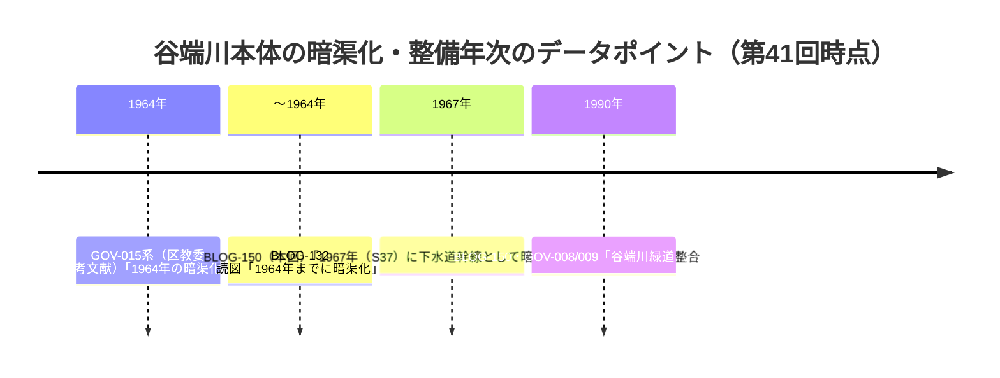

# 第41回ノート（2026-11-12）

## 概要

- push前head: 7ea56d6（第40回）→本回コミット。search_codeは実行開始直後に504エラーが多発（一時不調・間欠障害の再発）、重複確認はget_file_contentsによる既存ファイル直接読みと冒頭のsearch_code成功分で代替。
- 新規: [BLOG-150](sources/blogs/BLOG-150.md)・[BLOG-151](sources/blogs/BLOG-151.md)。更新: [ORG-024](sources/org/ORG-024.md)（濯川のみなもとキャプション直接確認）・[ORG-027](sources/org/ORG-027.md)（1956年4月12日写真）・[PAP-031](sources/papers/PAP-031.md)（英文アブストラクト直接取得）。

## 1. BLOG-150: freedomwalk Scene-1043〜1046個別entry本文（第40回課題①）

- BLOG-148（纏め）で未取得だった個別entry本文4本を直接確認。**32構造物の起点からの実測距離・遺構の個別データ**（#01一の橋0.19km〜#32宮下橋3.4km・#30羽黒橋のみ橋跡碑のみ）を取得。
- **冒頭の沿革文言「1967年（S37）に下水道幹線として暗渠化」**は谷端川本体の暗渠化年次の新データポイント。ただし1967年=S42であり本文内の内他不整合（S37=1962の意図か1967の意図か判別不能）。GOV-015の1964年説・BLOG-132の1964年まで説と**断定せず並列**。

- 中丸熊野神社の応永勧請・天正15年遷座・「くまくま神社」通称＝repo初出（熊野橋・熊野町の由来神社）。
- 長崎羽黒神社=出羽三山（山形）分霊・延宝年間＝BLOG-138羽黒橋由来説の裏付け。
- 弁天池2026年8月現況（循環式・藻で緑池）＝BLOG-110/135に続く観察の新時点。

## 2. BLOG-151: 雑司が谷大鳥神社・1940年弦巻川暗渠化文言（第40回課題⑦の前段）

- 現行頁はブロック応答、**Wayback 2024-09-09スナップショットで本文全文取得**（直接確認扱い）。
- **「1940（昭和15）年、社地北側を流れていた弦巻川の暗渠化に伴い、社殿配置の変換」＋同年宮司私有地120数坪寄進**＝repo初出文言。高田町下水道1929〜33（BLOG-063）・碑の1931/1932説（BLOG-049/GOV-062）・「昭和4年暗渠化」（BLOG-034）と並ぶ第四のデータポイント。**下水道管埋設と河川覆蓋・社地整形の別工事と解する余地を残し断定しない**。
- 三杉稲荷神社の1967年首都高5号線遷座（日出町から）＝BLOG-137青柳小学校移転と同系列の首都高5号線建設による移転記録。
- 創祀1712正徳2年（千登世橋近くの高田村下屋敷）・矢嶋昌郁二百坪奉献→1887現在地遷座など社地変遷の年次群。

## 3. ORG-024更新: 「濯川のみなもと」キャプション直接確認（第36回課題③）

- DS20200928-014m。**「湧出場所は講堂南側・大学十号館西側であり、正田建次郎学長の石碑が傍にある」**＝濯川の循環系の出水地点の所在地レベル特定（repo初出）。「欅橋からみた濯川と校舎」キャプション（欅橋=総合図書館南側）もスニペット確認。

## 4. ORG-027更新: 1956年4月12日「千川通りを隔てての三号館」

- MS028-005m。「**千川通りの手前側は舗装されておらず**」＝1957年「千川通りの桜」に先行する**1956年時点でも未舗装**の公式キャプション。暗渠化→舗装の経過を1952・1956・1957・1959の4時点で追える体制になった。

## 5. PAP-031更新: 英文アブストラクト直接取得

- doi.org経由でJ-STAGE記事頁が開き、abstractを直接確認。**中島洋吉計画→2度の変更→後継者設計・準アーク溶接工法・ロマネスク様式**。本文PDFは依然fetch障害で未取得（ステータスを「書誌・アブストラクト直接確認」へ更新）。

## 6. アクセス不能・見送り・次回課題

- **アクセス不能**: J-STAGE本文PDF（doi経由は記事頁可・PDF不可）、nabunken板橋区立郷土資料館紀要127114（直・enとも32KB打ち切り、第24回課題のまま）、wanjin entry-240/241（直もWaybackにも未収蔵を再確認）、echo-lab紀要20号（Wayback未収蔵・PAP-029格上げは継続）、search_code 504（間欠・並走実行への注意は既知）。
- 見送り: 板橋区「時代を紡ぐ」平尾邸頁（GOV-093既出）、文春Yahoo再掲（BLOG-063既出・海老澤了之介「百年ノ大計」も既収録）、特別展「水を守る」会期頁（GOV-038既出・neribun詳細は既記録）、CiNii板橋区郷土資料館紀要AN10129259（書誌のみ・紀要第6号1987の目次本文は取得できず）。
- **次回課題**: ①BLOG-150「1967年（S37）」文言の原典（谷端川下水道幹線完工年）の行政史料照合②大鳥神社1940年暗渠化文言の初出資料（由緒書・棟札）と社殿配置変換前後の境内図③武蔵写真館045の残る千川個別頁（正門前の千川・植樹3枚・1959年の千川通り）④ギャラリー062「正田建次郎学長の石碑」「濯川の中流部」のキャプション⑤PAP-031本文PDF⑥echo-lab紀要20号（PAP-029格上げ・継続）⑦nabunken板橋区郷土資料館紀要第6号目録⑧README冒頭bullet（第6〜40回分）とINDEX.md build.py再生成（git環境待ち・継続）。
