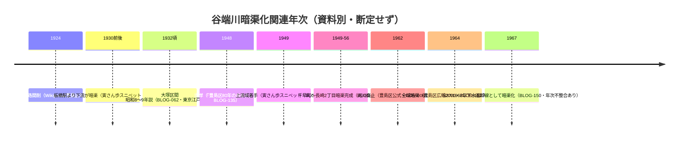

# 2026-11-12（第42回）寅さん歩年次スニペット・JIA谷端川第二弾・氷川神社裏貝塚・暗渠探索紀part.2の追加調査

## 実行概要
- 対象: 水窪川・弦巻川・谷端川（千川上水関連含む）。GitHub head 34db13c（第41回）から開始、push前に再取得して競合なしを確認。
- 採番確認時点: blogs=BLOG-151、org=ORG-027、gov=GOV-093、papers=PAP-031、books=BOOK-079、maps=MAP-160。

## 新規登録
1. **BLOG-152（寅さん歩 その25・平野武宏）**: アクセス不能が続いていた wpage5145.pdf について、Web検索スニペットで本文の年次文言を取得。**板橋駅より下流=昭和10年前後暗渠、上流域=昭和24年から改修・暗渠、昭和39年全域暗渠**。「昭和24年着手」はrepo初出の文言で、BLOG-135（1948年護岸→1956年暗渠完成）と整合。スニペット段階のため文脈・出典は未特定のまま。
2. **ORG-028（JIA城北地域会 2019.9.21 まち歩き「谷端川をたどる。（第二弾）」）**: ORG-014（2017年・千川用水コース）とは別イベント。経路（北池袋→氷川神社→神社下遺跡→谷端川緑道→板橋駅ガード→旧鎌倉橋→上池袋東公園→大塚三業地）と、**千川増強幹線を「第三の谷端川」と呼ぶ用例（repo初出）**を記録。
3. **ORG-029（としま遺跡調査会「氷川神社裏貝塚」）**: 池袋本町三丁目・旧「池袋村貝塚」。主淡貝塚（シジミ中心）・白井光太郎1886年土偶発見・縄文中期〜晩期。谷端川上流域の縄文期の湧水・低湿地環境の傍証資料。

## 既存資料の更新
- **BLOG-037**: part.2（2023-03-27）をopen_urlで直接確認し「所在のみ」から格上げ。ミョウガ畑の記憶〔伝聞〕・現役防災井戸〔確認〕・銭湯と暗渠の立地〔観察〕を追記。

## 見送り（既出・重複）
- warpal「谷端川の跡を歩く」=BLOG-005・BLOG-062で既登録（river-yabataの14ヒットを確認）。
- ma-maison「江戸名所図会の小石川を歩く」=BOOK-009のメモで既記録（猫又橋1895年石橋寸法も同一『礫川要覧』依拠と既に整理済み）。
- 雑司が谷大鳥神社の諸紹介頁（tesshow・powerspot・jinjamemo等）=BLOG-151の1940年暗渠化文言と同一由緒の再構成。
- senseki-kikou.net・citywalk2020の巣鴨刑務所排水口記事=BLOG-025/107と同一事象の再観察。東京国際大学池袋キャンパス・造幣局桜・マンホールテーブルなどは四河川と無関係。
- sanpoo「谷端川跡を歩いて大塚を目指す」（2020）=観察中心で既知事項の再構成、source file化見送り。
- peepooblue 2009年弁天池頁・fish-b 2020大谷口頁=link-audit収録済みURLで本文取得不可（cocolog遮断）／配水塔はPAP-031・Wikipediaで既整理。
- G.LiFE Web「目白の地理さんぽ」=open_url遮断（Wayback未確認）。

## 谷端川暗渠化年次の現状整理（Mermaid）
新データポイント（BLOG-152「昭和24年着手・板橋駅下流昭和10年前後」）を既存の年次群に加えた整理。断定はしない。

## 次回課題
1. BLOG-152の本文PDF取得（Wayback 2024-06-09スナップショットのPDFテキスト抽出の別手段）と年次説明の出典特定。
2. ORG-028「神社下遺跡」の正式遺跡名特定（ORG-029氷川神社裏貝塚との異同）。
3. ORG-029関連: 『豊島区史』通史編1（1981）該当頁・池袋東貝塚（2017年調査・toshima-iseki パンフ）との位置関係。
4. BLOG-037 part.2の防災井戸の位置特定（吹き上げ稲荷の防災協定井戸=BLOG-100との異同）。
5. （継続）echo-lab紀要20号PDF（PAP-029格上げ）、J-STAGE PAP-031本文PDF、nabunken板橋区郷土資料館紀要、武蔵学園千川上水調査アルバム個別頁URL。
