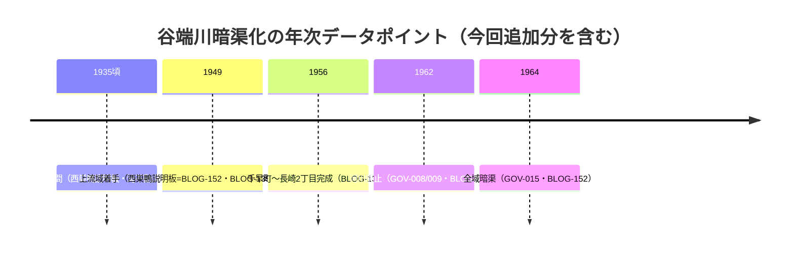

# 2026-11-13（第43回）定期調査ノート

## 今回の経緯

- 第42回まで「PDF本文取得不可」だった**寅さん歩その25（谷端川の流れを歩く）のシリーズPDF**を、Waybackの**id_付きURL**（`https://web.archive.org/web/<timestamp>id_/<元URL>`）で取得できることを発見し、その25-2〜-4の3本を取得した（-1のみid_・直とも遮断）。
  - -4（wpage5145）: 全文取得 → **BLOG-152をスニペット確認から直接確認へ格上げ**
  - -2（wpage5143）: 前半のみ → **BLOG-153新規**
  - -3（wpage5144）: 前半のみ → **BLOG-154新規**
- この手段はPAP-027（echo-lab紀要42号）で有効性が分かっていた手段のPDFへの適用であり、**寅さん歩や夢七雑録系の「PDF本文取得不可」もid_付きで再試行する価値がある**ことを示す。

## 主な新情報

1. **BLOG-152の年次文言の出典が「谷端川跡」説明板（豊島区西巣鴨1-17）と判明**（第42回の未解決①解消）。昭和初年着手→板橋駅より下流は昭和10年前後→上流域は昭和24年から→昭和39年全域暗渠、という年次チェーンの帰属が確定した。
2. **説明板の「全長約11km」**はrepo初出の数値表記（既存は流域面積中心の記述）。
3. **宮仲公園＝渋沢栄一三男・正雄の居住地を昭和13年に東京市へ寄付**したもの（千川増強幹線の人孔接続部として既出の公園の起源が具体化。渋沢正雄はrepo初出）。
4. **滝不動（北大塚1-14）**：昭和10年頃の暗渠化工事で消滅し平成11年に元の位置へ復帰したという説明板文言（BLOG-038の城所note推定を裏付けると同時に、大塚区間暗渠化年次の近似値を与える）。
5. **谷端川南緑道の命名年次**：昭和37年（1962）河川廃止→整備→**平成2年（1990）に西武池袋線〜川越街道を「谷端川南緑道」と命名**（BLOG-153）。
6. **南緑道の橋名由来群**（日ノ出橋=日の出、北荒井橋=字「荒井」の北、東橋=諸説、高松橋=地名、上ノ橋=字「上」、中上橋=地名+字の合成、御嶽橋=御嶽神社）と地番つき位置（BLOG-154）。橋名調査ドキュメントに追補した。

## 年次チェーンの整理（暗渠化）

- 説明板文言により「昭和10年前後（下流）／昭和24年から（上流）」という**上下流で異なる着手年次の体系**が、BLOG-135・BLOG-152という2つの独立した豊島区系資料で揃った。BLOG-062の「昭和8年または9年」・BLOG-133の西前橋分水路「昭和4年消滅」との厳密な区間別整理は今後の課題（断定しない）。

## 重複確認

- search_codeで確認: 「全長約11」0件、「西巣鴨1丁目17」0件、「渋沢正雄」0件、「宮仲公園 渋沢」0件、「日の出橋（の表記）」0件（「日ノ出橋」はBLOG-150の32構造物に既出→表記差に注意）、「滝不動」0件（「瀧不動」はBLOG-038に既出）。
- warpal谷端川アーチ・カルバート頁（yabata-r.htm）はBLOG-062で既登録（再取得したが差分なし）。
- 暗渠ハンター7712072（谷端川長崎支流）はBLOG-056で既登録。

## 見送り・アクセス不能

- 寅さん歩-1（wpage5142.pdf）: Waybackスナップショット（20240610053135）は存在するが本文抽出不可。
- -2/-3の本文後半: 再試行時にWaybackが不安定となり未取得（次回再試行）。
- echo-lab紀要20号（PAP-029格上げ）・武蔵アルバム個別頁・wanjin 243/245/251/252・かたりべ45: 今回は未着手（次回課題に継承）。
- Zenodoに『中央学術研究所紀要』42号（深田2013=PAP-027）の再公開PDF（zenodo.org/records/23305601）が存在することを確認（既に本文直接確認済みのためsource file化せず、ミラー所在のみ記録）。

## 次回課題

1. 寅さん歩-1（wpage5142）と-2/-3後半・その26（最終回）の再取得。
2. 「谷端川跡」説明板（西巣鴨1-17）の現地採録・設置主体・設置年。
3. 字「荒井」のGAZ-022等との照合と地名対照表への収録可否。
4. 谷端川南緑道「平成2年命名」の行政文書照合（区の公園台账）。
5. （継続）echo-lab紀要20号・README冒頭bullet prepend・INDEX.md再生成（git環境待ち）。
