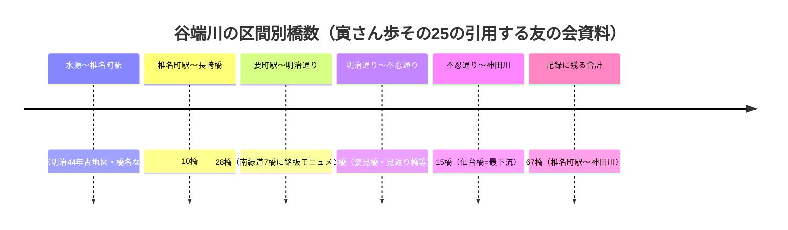

# 2026-11-13（第44回）定期調査ノート

## 概要

前回（第43回・コミット a3a3f56）から引き続き、寅さん歩その25シリーズの残り取得を主軸に調査。**新規3件・既存2件の全文格上げ**をmainへ反映（コミット 2824155、橋名調査追補は別コミット）。

## 新資料・格上げ

| ID | 内容 | 区分 |
| --- | --- | --- |
| BLOG-155 | 寅さん歩その25-1（wpage5142）。千川駅「千川上水跡」説明板全文（河村端賢・千川太兵衛/徳兵衛請負・7里6町39間約28km・安政8年〔1779〕表記不整合・**区内昭和2年桜ほとんど伐採**・平成元年親水公園）。弁天池=「分水池」・雨乞い・元禄9年水料条件。つつじが丘アトリエ村1938年10棟。**水源〜椎名町6橋（明治44年古地図）** | 直接確認（新規） |
| BLOG-156 | 寅さん歩その25-5最終回（wpage5146）。**シリーズ全5回完結・「その26」不存在の確定**。猫貍橋説明板の狸伝承全文。**千川通り=宮仲通り→プラタナス通り→千川通り区間呼称・練馬区の千川通りとは未接続**。氷川町下町会史地図に共同印刷。東京ドーム下を流れる。**仙台橋=仙台藩が架けた橋・水道橋と小石川橋の間・市兵衛河岸防災船着き場**。**文京区間15橋・椎名町〜神田川合計67橋** | 直接確認（新規） |
| BLOG-157 | わんじんentry-243（2018-05-02）。谷端川右岸支流2本：**長崎支流（仮）**＝水源・長崎公園（旧学習院大学職員住宅地）・合流点=四隅ミラーの交差点、**椎名町支流（仮）**＝トキワ荘通り起点・井戸跡実見・椎名町駅西側踏切近辺で本流合流 | 直接確認（新規） |
| BLOG-153 | 同-2の後半取得（格上げ）。**霜田橋=下田（ゲデン）検地用語由来**、羽黒神社（明治2年社寺取調書・長崎村一社）、宮下橋=長崎神社下、**椎名町駅〜長崎橋10橋**、祥雲寺（小石川区戸崎台より明治39年移転） | 格上げ |
| BLOG-154 | 同-3の後半取得（格上げ）。**橋名由来の出典=友の会『旧谷端川の橋の跡を探る』（BOOK-062）と本文に明記**〔第43回未解決を解消〕。前田上の橋・前田橋・北浦橋・西前橋・豊橋の由来、熊野神社応永勧請・天正15年遷座（BLOG-150と独立整合）、三の橋/二の橋/一の橋の順、**要町〜明治通り28橋** | 格上げ |

## 区間別橋数のチェーン（谷端川）

※各区間数は筆者による友の会1999冊子の引用（二次）。67との整合（加算一致か否か）は冊子現物確認まで保留。

## その他の調査記録（source file化せず）

- **武蔵学園百年史**: 資料館「千川上水調査アルバム」は2026.08.01追加（ORG-025どおり）。ギャラリー045「武蔵周辺の江古田風景」に「**正門前の千川**」（1929年の江古田駅と並ぶ初期項目）「屋上から見た千川通り」（1956年4月・三号館屋上・西武池袋線・武蔵野稲荷神社）「正門前の人々」（撮影時期不明・千川通り・碟会所看板）など千川写真が複数存在することを確認。個別頁キャプションは検索スニペットでのみ部分的に取得可能で、アルバム個別頁URLは依然未特定。
- **道路WEB（douroweb.jp）千川通り頁**: 本文は文字化け（Shift-JIS）で正確な抽出不可。検索スニペットで「千川通りは暗渠化された千川上水の用地を活用した道路」「昭和40年代までは農業用水や工業用水として利用」「都道439号椎名町上石神井線」等を確認済み。文字化け解消後にsource file化を検討。
- **ゆるゆるな毎日（ameblo kelly-anne）路地探訪・千川通りその1〜3・Fire and forget（aim7.exblog）千川通り起点**: repo未収録だが、今回の時間枠で本文評価に至らず。次回評価対象。
- **ありゃりゃサンポ「千川上水を往く」**: gooブログ直接遮断。Wayback収蔵確認は次回（IA一時オフラインのため不可）。

## アクセス不能の記録

- **Internet Archiveが実行中に一時オフライン再発**（web.archive.org/cdx が「Temporarily Offline」）→ echo-lab紀要20号PDFパス特定（PAP-029格上げ）は今回は不可。ただしCDX API自体は本実行で一時的に稼働し、echo-lab配下の「佛教學セミナー」等のPDFパス一覧が取得できることを確認済み（中央学術研究所紀要20号の直接的パスは抽出できず）。
- wanjin entry-240/241/242/244/245/251/252: Wayback（2026-10-25snapshot指定）未収蔵。entry-243のみ取得成功。
- かたりべ45 PDF・寅さん歩-2/-3の古いsnapshot差分: 引き続き。

## 次回課題

1. **友の会『旧谷端川の橋の跡を探る』（BOOK-062）の現物確認**（67橋・区間別橋数・由来の一次出典）。第44回で出典特定が進んだため最優先度が上がった。
2. 仙台橋=仙台藩架設説の一次史料（仙台藩側史料・文京区資料）。
3. 氷川町下町会史地図の所在・作成年（BLOG-156）。
4. IA復旧後: echo-lab紀要20号PDF（PAP-029格上げ）、ありゃりゃサンポ「千川上水を往く」のWayback確認。
5. ゆるゆるな毎日・Fire and forgetの千川通り記事の評価。douroweb本文の文字化け回避取得。
6. 武蔵ギャラリー045「正門前の千川」（1929年時点の開渠写真候補）のキャプション・撮影年取得。
7. （継続）README冒頭bullet prepend・INDEX.md build.py再生成はgit環境待ち。保留bulletは第6〜43回分＋今回分。
