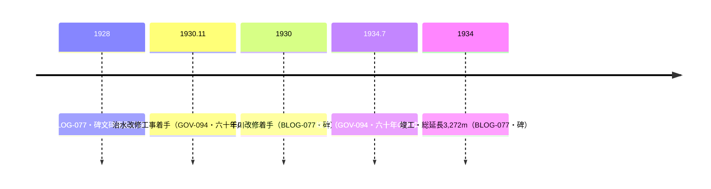

# 2026-11-13（第45回）定期調査ノート

## 概要

第44回の次回課題（ゆるゆるな毎日・Fire and forget・ありゃりゃサンポ・氷川下町会史・ギャラリー045キャプション・wanjin残りentry）を中心に調査。**新規4件（BLOG-158〜160・GOV-094）＋既存2件更新（ORG-027・BLOG-114）**を main へ反映。

## 新資料・更新の要点

1. **GOV-094（文京区「氷川下町会」頁・直接確認）**: 文京区町会連合会『六十年のあゆみ』（2014年11月）掲載内容の引用として、**千川下流の治水改修が「昭和5年11月開始→水流をコンクリート暗渠に→昭和9年7月竣工」**と月次まで記述。千川改修記念碑（BLOG-077）の年次（1930着手→1934竣工）の独立文献裏付け。氷川たんぼ（享保年中開墾・明治30年代埋立）・播麿たんぼ（明治29博進社進出=ORG-001の1896年と整合）・明治24町名・昭和42年1月住居表示廃止の沿革も一枚の文献で揃った。
2. **BLOG-160（マーちゃんの数独日記2020）**: **『氷川下町会史』の所在（文京区立図書館で貸出可）と内容（応永29年〜令和2年の年表、「猫又橋と千川」「太田胃散」「興真舎牛乳店」等の項目）** を確認〔第44回課題③の部分解消〕。窪町東公園（GOV-082千川増強幹線起点と同地）改築囲いに町会史掲載写真4枚が掲示されていたという観察も記録。
3. **BLOG-158（暗渠ハンター2012・blog.jpミラー）**: 「豊玉水車分水」の流路（豊玉北5-17起点→豊玉上2-27の水車→豊玉中3丁目で練馬郵便局南側の池の流れと合流→中新井川）を「千川上水と江古田を潤した分水　江古田分水の周辺」という資料（著者不詳）の抜き書きとして記録。中村分水の**田中稲荷神社**・中村中学校付近の支流観察も初出。豊玉水車の位置・合流点はGOV-005の記述と食い違うため断定せず並記。
4. **BLOG-159（ゆるゆるな毎日2023）**: 上井草開渠20mの2023年2月・春先・6月の3回とも無水の観察と、**毎年6月に赤い染料で通水テストをしているという聴取〔repo初出〕**。昭和25年頃着手・昭和40年完了の表記はGOV-072と同一内容の二次言及。
5. **ORG-027更新**: 武蔵写真館045の個別写真キャプション3件を追加。**「1960年頃の旧一号館」（千川通りのグリーンベルト造成中）、「1970年代の千川通り」（昭和40年代後半・車道拡幅）、「正門前の人々」PS050-004m（碁会所の看板）**〔第44回課題⑥の部分解消〕。武蔵学園前区間の影像史料が1952→1956→1957→1959→1960頃→1970年代の6時点に。
6. **BLOG-114更新**: FILE.36末尾の**池袋水天宮（昭和初期鎮座）・池袋四面塔稲荷大明神（江戸期鎮座）**の記述を追記。記事自体は川との関係に言及しないため水神祭祀と弦巻川水源の関連は仮説としても記録せず。

## 千川下流改修の年次チェーン（文献2系統で裏付け）

## 見送り・アクセス不能

- **文春オンライン弦巻川2記事（88508/88509）**: BLOG-063で既収録（2026-06-08シリーズ）と確認、差分なし。
- **BE-PAL FILE.36**: BLOG-114で既資料化、池袋水天宮記述のみ追記。
- **4travel福ヒット2026年4月谷端川2本**: 第19回評価済み（再構成系）と同様の内容で見送り。
- **Fire and forget（aim7.exblog.jp/238641695）**: 本文抽出がナビ部分のみで失敗（千川上水の開渠・橋梁=BLOG-090と同一箇所と思われる）。次回再試行。
- **気まぐれスマホ散歩日記・弦巻川散策シリーズ**: URL特定まで至らず、次回評価対象。
- **らんまる弦巻川散歩2015-12-26**: 第40回以来アクセス不能継続。
- **ありゃりゃサンポ「千川上水を往く」**: 今回も該当entryのURL特定に至らず（空堀川編は見つかったが四河川と無関係）。
- **echo-lab紀要20号（PAP-029格上げ）**: Wayback該当ディレクトリ未収蔵のまま。
- **wanjin entry-241/242/244/245**: Wayback未収蔵（2026-10-25スナップショットはentry-239/243/247〜250のみ）継続。
- **マーちゃんの数独日記**: 現行はgoo終了で不可、Waybackで取得可（BLOG-114と同様の回避手段）。
- **文京区公式p001251**: 直は翻訳遮断、Waybackで全文取得可（GOV-082と同じ）。
- **仙台橋=仙台藩架設の一次史料**: 今回の検索では新出資料なし。
- **氷川下セツルメント史**（ISBN9784871685382・1953年開始のセツルメントの記録）: 氷川下地域の関連書誌として存在確認したが、四河川との直接関係は確認できないためsource file化せず本ノートにのみ記録。

## 次回課題

1. 『氷川下町会史』の正式書誌（文京区立図書館蔵書検索）と「猫又橋と千川」項の本文。
2. 『六十年のあゆみ』（2014）原本の当該頁。
3. BLOG-158の抜き書き元「千川上水と江古田を潤した分水 江古田分水の周辺」の書誌特定（練馬区関係資料か）と、GOV-005の豊玉水路記述との食い違いの原典照合。
4. 通水テスト（6月・染料）の実施主体・公的記録。
5. 武蔵写真館「正門前の千川」「千川通りでの植樹」3枚の個別頁キャプション。
6. Fire and forget本文の別ルート、気まぐれスマホ散歩日記弦巻川散策、らんまる弦巻川2015。
7. （継続）echo-lab紀要20号（PAP-029）・wanjin 241/242/244/245・BOOK-062現物・仙台橋一次史料・README prepend・INDEX.md再生成（git環境待ち）。
