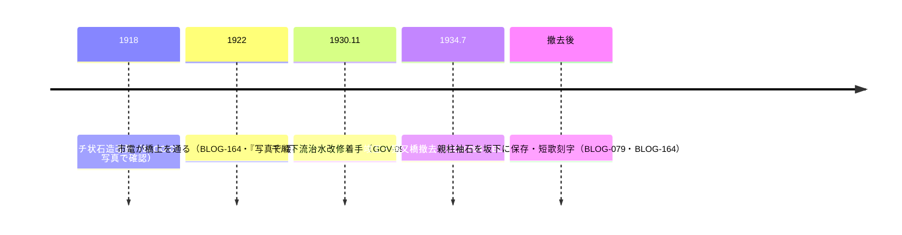

# 2026-11-13（第46回）定期調査ノート

## 概要

第45回の次回課題（らんまる弦巻川2015・ありゃりゃサンポ・Fire and forget・気まぐれスマホ散歩日記）と、千川分水（杉並側）・猫又橋写真史料・江古田分水の新規角度を調査。**新規6件（BLOG-161〜166）を main へ反映**。

## 新資料の要点

1. **BLOG-161（らんまる「弦巻川散歩」2015-12-26・直接確認）**：第40回以来アクセス不能とされた記事をamebloで直接取得。**八百招地蔵（明治建立・repo初出）・鳥尾坂（repo初出の坂名）**、昭和7年暗渠化の独立二次記録、大鳥神社参道＝流路読図、首都高下空き地の浸み出し水観察、弦巻川→水窪川合流説の読図。
2. **BLOG-162（暗渠さんぽ「千川分水（観音川）」2012-07-24・Wayback）**：kaeru.moe/ankyo/16をWayback 20240419で全文取得。**田中士郎「観音川と松庵川」杉並郷土史会会報第127号（平成6年）＝repo初出の命名文献書誌**。観音川＝六ヶ村分水「四面道口からの田用水」と重なる復元、白山通りの大正初期の崖下湧水（矢嶋又次記憶画）〔伝聞〕、「清水口支流（仮）」の整理。参考文献群（井口昭英『井草のむかし』・『おぎくぼいまむかし』桃井二小50周年・記憶画）を記録。
3. **BLOG-163（地図子「弦巻川を歩く」2021-03・Wayback 20241213）**：chizuchizukoの弦巻川単独記事（BLOG-132谷端川と別記事）を初資料化。此花亭・茶亭なか山の**現役井戸ポンプ（墓参り者が使用）と弦巻通り手前小道の掘り抜き井戸の湧水（2021年3月）観察**。1932年工事開始（BLOG-001整合）・江戸川橋排水口の同定（BLOG-076整合）。
4. **BLOG-164（千石のそよ風「千石さかみち部①猫又坂」2021-03-21・直接確認）**：千石地域コミュニティサイトを初資料化。**袖石短歌の全文「水泳に魚掻いし千川も地下に流れて見るよしもがな」（repo初出）**、『写真で綴る「文の京」』（文京区刊）の**大正7年橋梁完成写真・大正11年市電通過写真の存在**、『江戸の花名勝会』の「巣鴨氷川下猫又橋」見立て（犬村大角／市川市蔵）＝江戸期文献記録。
5. **BLOG-165（ありゃりゃサンポ「千川上水を往く（板橋から掘割）」2018-10-04・Wayback 20251103）**：第44回課題④の当該entryをgoo終了後もWaybackで特定・取得。**板橋駅前で千川上水と谷端川暗渠が僅か120m**〔観察・repo初出の数値〕、「千・川・上・水」4文字マンホール、板橋駅前マンホール＝石神井川余水放流分岐点の推定と「千川上水の放流について」説明看板の存在。
6. **BLOG-166（Natrium「江古田川周辺の水路敷その1」2020-02・直接確認）**：Natrium水路敷シリーズの江古田川頁を初資料化。**弁天分水（桜台分水とも）＝下新街分の別名〔repo初出〕**、江古田分水の合流点＝東橋下流排水口（2020年水流確認）と流路踏査、濯川命名（武蔵高校成立後＝ORG-019整合）、江古田植物化石層。

## 千川下流・猫又橋の年次チェーン（BLOG-164で写真史料が加わる）

## 見送り・アクセス不能

- **風と緑と散歩道「千川上水緑道整備記念」**: walk-lifeは第39回と同様の再構成系。千川上水緑道（BLOG-056・GOV-077既出）の改修時期等の新情報なし。
- **warpal文京区千石編1**: 表組レイアウトで本文抽出不能。猫股橋〜仮称氷川下橋の写真頁で、千石のそよ風（BLOG-164）で主要な新情報は押さえたため見送り。
- **暗渠さんぽ「梅見る暗渠、清水口支流（仮）」**: BLOG-162と同一頁内（ankyo/16）で本文を取得済みだが、清水口支流の後半部は頁分割で途切れている。次回「その2」候補。
- **Fire and forget・気まぐれスマホ散歩日記弦巻川散策**: 今回も本文取得に至らず（前者は本文抽出失敗のまま、後者はamebloの対象entryを特定できず）。継続課題。
- **らんまる水窪川跡を歩く1/2**: BLOG-046（2/2）の前編。amebloで今回も検索にヒットせず。継続課題。
- **生活と文化 第32号（2023年3月・昭和館デジタルアーカイブで目次確認）**: 学童疎開・東福門院・菅野文書・飯能倉庫で四河川関連記事なし。
- **としまの記憶 谷端川編（yabata-3他）**: 2023年シリーズ頁は404。ORG-007・ORG-016・ORG-017で既カバー。
- **echo-lab紀要20号（PAP-029格上げ）・wanjin 241/242/244/245・BOOK-062現物・仙台橋一次史料**: 今回も進展なし、継続課題。

## 次回課題

1. 田中士郎「観音川と松庵川」（杉並郷土史会会報127号・1994）の本文と、矢嶋又次記憶画（杉並区郷土博物館分館）の閲覧手段。
2. 『写真で綴る「文の京」』（文京区刊）の書誌（発行年）と、大正7年・大正11年猫又橋写真の図版確認。
3. 石神井川沿いの「千川上水の放流について」説明看板の設置主体・本文。
4. 千石のそよ風「千石さかみち部」第2回以降（川崎邸のお花見と猫又橋際公衆トイレ）の取得。
5. 暗渠さんぽ「清水口支流（仮）」後半（ankyo/16の分割頁）とNatrium「江古田川周辺の水路敷その2」。
6. （継続）echo-lab紀要20号（PAP-029）・wanjin残りentry・BOOK-062現物・らんまる水窪川1/2・README冒頭bullet prepend（第6〜45回分保留）・INDEX.md build.py再生成（git環境待ち）。
