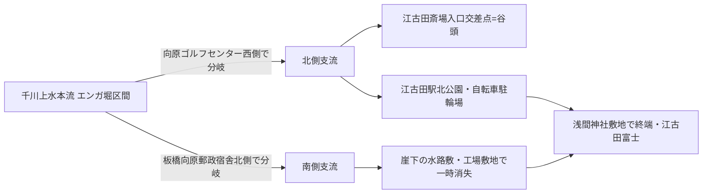

# 第47回定期調査（2026-11-13）

## 概要

- search_code・get_file_contents・push_filesとも正常。push前head確認（0c7fa3e=第46回）で競合なし。
- **新資料4件（BLOG-167〜170）をmainへ反映**。
- README冒頭bullet追記は今回も不可（約1.37MB・git環境なし）。保留bulletは第6〜46回分＋今回分。INDEX.md build.py再生成も継続課題。

## 新資料

- **BLOG-167**（Natrium「エンガ掘と周辺の水路敷群（江古田の支流）」・2017年6月撮影・直接確認）: エンガ堀の江古田駅方面支流2本の並行流路（向原ゴルフセンター西側分岐・板橋向原郵政宿舎北側分岐）、北側支流の谷頭＝江古田斎場入口クリーニング店交差点、江古田駅北公園の水路敷、終端の浅間神社と江古田富士（国指定重要有形民俗文化財）。
- **BLOG-168**（平井園「千川上水を辻る旅」2021-01-03・直接確認）: **明治生まれの祖父が大八車で千川沿いの道を下り神田へ野菜出荷〔聴取・生活史一次証言〕**、上石神井踏切の空堀、桜の根による土手強化の機能美解釈〔筆者解釈〕、**要町の粟島神社と阿波州神社の共通性・浅草淡島堂オマージュ仮説〔仮説〕**。
- **BLOG-169**（Code for Nerima note 2018-04-22・直接確認）: **立野橋交差点の千川上水・庚申塔案内版〔観察〕**、2018年時点の緑道整備直後の記録、開渠区間の音環境・畑地との並存の土地利用観察。
- **BLOG-170**（高口ようこ区議レポート 2026-10-21・直接確認）: **特別展学芸員解説での「千川」名由来推測＝開削地点の地名から（調布市仙川とは別）〔伝聞〕**、**千川家は現在練馬区外へ転居〔伝聞〕**、解説会約50人参加。第31回アクセス障害頁の初取得。

## ノートのみの記録（source file化せず）

- **東京都公文書館「当館展示による原本閲覧停止資料一覧」令和8年5月22日**（soumu.metro.tokyo.lg.jpの[PDF](https://www.soumu.metro.tokyo.lg.jp/documents/d/soumu/0306eturanteisi_siryou_20260522)を直接確認）: **江戸明治期史料006362「江戸川、神田上水川、千川元上水堀通見分絵図」が令和8年5月22日〜7月14日の展示で原本閲覧停止**だったことを確認〔GOV-061で所在特定済みの絵図が2026年に展示に出品された記録。一覧表のレイアウトからは同絵図の請求番号（626.A2.26の該当欄）と文化財指定欄の対応が一意に読めないため、請求番号の追認は原本・目録での確認待ち〕。
- **Wander x Wonder「夕暮れの水窪川暗渠遡上さんぽ」ツアー頁（2026年6月28日開催・本田創ガイド）**: 江戸川橋→音羽今宮神社→大塚坂下通り→東池袋→美久仁小路の4.8km経路〔ツアー告知の一般記事で、第39回の404頁の現行版。水路の新事実なし〕。
- **miwa3k「江古田川を歩く」（egotagawa）は直接open不可・Wayback未収蔵**（水窪川検索で出たスニペットは中新井池湧水枯渇→千川上水から3本の分水=GOV-005/BLOG-166既出の再構成と判断し、本文未確認のまま見送り）。
- **大貫伸樹「千川上水・坂上水車取水口、鎮守前水車」（2018-10-13）は直接open不可**。鎮守前水車・坂上水車の語はいずれもBLOG-097既収録のため再取得の優先度は低い。
- kotakemol04 entry-2533（千川上水公園）=BLOG-129と同一URLで重複なし。chizuchizuko谷端川・小石川（yabatagawakoishikawa1）=BLOG-132既出。池袋ジャーナル地名記事=BLOG-136既出。江戸マップ巣鴨絵図ジオレファレンス版（codh.rois.ac.jp/edo-maps/owariya/23・NDL doi:10.11501/1286674）はMAP-021の同シリーズで、第31回MAP-158（近吾堂版）と異なる尾張屋版のgeoref頁の読図比較は次回課題に残す。
- nabunken板橋区立郷土資料館紀要（en/127114他）は今回もアクセス集中で不可〔第24回課題継続〕。としま案内人「消えた川弦巻川を歩こう！」イベント頁（city.toshima 2507220957）は直接翻訳遮断・Wayback未収蔵。

## エンガ堀支流の流路整理（第47回時点）

〔BLOG-167の観察・読図に基づく。分岐形態の江戸期の実体は未確認（千川上水分水か谷頭湧水か）。[GOV-072]（エンガ堀起点=東長崎3号踏切北）・[BLOG-102]（エンガ堀と庚申橋）・[BLOG-105]（学校誌絵図のどぶ川）との接続整理が次回課題。〕

## 次回課題

1. 立野橋案内版（BLOG-169）の設置主体・年次の現地・行政確認。
2. 千川名由来「開削地点の地名」説の学芸員解説の公式記録（展示図録・要旨）。
3. miwa3k egotagawa本文の別ルート取得、江戸マップ尾張屋版巣鴨絵図georefの読図（MAP-158との比較）。
4. 都公文書館展示停止資料一覧の請求番号対応の確認（GOV-061文脈）。
5. （継続）echo-lab紀要20号（PAP-029格上げ）・wanjin 241/242/244/245・BOOK-062現物・README prepend・INDEX.md build.py再生成（git環境待ち）・武蔵アルバム個別頁・nabunken板橋区郷土資料館紀要。
## 追記（後半・BLOG-146格上げ）

- **BLOG-146（kawawalk「加賀藩下屋敷分水」2015-10-06）をWayback保存版で本文全文取得し直接確認へ格上げ**。新規確認事項: **①文化3年（1806）「中山道分間延絵図」の石橋描写を根拠に天明7年分水が「実際に施工・運用された」とする筆者推定＝repo初出**（分水実施可否問題への初の具体根拠）、**②加賀藩江戸下屋敷絵図（前田育徳会尊経閣文庫所蔵）と「下屋敷御林大綱之絵図」（文政7年・板橋区公文書館電子展示室で閲覧可）の所在＝repo初出**、③大池先端への水路注入口（東板橋体育館前あたり）、④分水口=平尾橋手前推定、⑤王子新道=明治21年（1889）開通。
- らんまる「水窪川跡を歩く2/2」はBLOG-046として既登録（検索で再確認。1/2〔前回分〕の取得は継続課題）。
- 第47回ノート（前半）で登録の4件と併せ、本回の反映は計**新規4件＋格上げ1件**。
