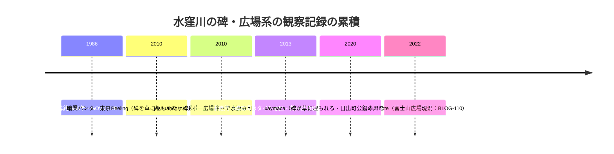

# 2026-11-13（第48回）・板橋区電子展示室52号の特定と水窪川関係3ブログの追加調査

第47回の次回課題（板橋区公文書館電子展示室の「下屋敷御林大綱之絵図」頁・らんまる水窪川1/2・千石のそよ風第2回以降・echo-lab紀要20号・wanjin残り）と、水窪川の未収録ブログを中心に調査。**新規4件（GOV-095・BLOG-171〜173）を main へ反映**。

## 新資料

1. **GOV-095（板橋区公文書館 こうぶんしょ館電子展示室52号「いたばしの『加賀』」・2020年1月25日更新・直は削除のためWayback 2024取得）**: [BLOG-146](../sources/blogs/BLOG-146.md)が「電子展示室で閲覧可」と記録した**下屋敷御林大綱之絵図の展示頁（52号）を特定し、図版キャプション「原本玉川図書館蔵」で原本の所蔵図書館が公式に明記されていることを確認**〔第47回課題③の部分解消〕。御成橋・大山（築山）・下屋敷内を流れた石神井川の2020年撮影写真、6万坪拝領→21万坪余・明治初年まで屋敷→石神井川水力で陸軍工場→戦後学校用地の転用沿革も記録。
2. **BLOG-171（xaymaca「東京暗歩②」水窪川 美久仁小路〜護国寺編・2020年11月22日・現行Not FoundのためWayback 2023取得）**: 第30回のアクセス不能を解消。**雑誌『東京人』2020年10月号「東京暗渠散歩」特集が池袋発神田川行きの暗渠を扱った書誌情報〔repo初出候補〕**、水窪川の碑の碑面（1986年銘）の直接読取り＝[BLOG-110](../sources/blogs/BLOG-110.md)/[BLOG-128](../sources/blogs/BLOG-128.md)の独立確認、**日出町公園の川モチーフ観察〔repo初出候補〕**、碑を水源のモニュメントとする広場の空間構成の観察。
3. **BLOG-172（追憶の旅路 joshuanchin「水窪川跡を辿る -4 大塚坂下町の谷」・2010年8月6日付・直接取得）**: **未収録シリーズの発見**。護岸壁の名残の民家、**ポポー広場の井戸で水が汲めた観察**（BLOG-108の補強）、**ラムネ工場跡=坂下通り交差地点の右手の駐車場〔BLOG-099の位置具体化・repo初出〕**。
4. **BLOG-173（水徒然「水窪川に沿って街歩き。」・2013年9月5日・直接取得）**: 水窪川の碑広場の**「水が流れ出るように敷かれたタイル」の意匠観察〔repo初出候補〕**、流域の井戸群（覆屋・柄杓・手洗い場・給湯器付き）の2013年現況、**吹上稲荷の池・鏡ヶ池会館〔repo初出候補〕**（鏡ヶ池=水面の記憶の示唆は仮説として記録）。

## 解釈

### 水窪川の碑・広場・井戸の観察時点チェーン

- 碑文言「昔ここに小さな川が流れていた 後世にコレを伝える 1986年」が2020年の独立観察で直接確認され、BLOG-110（2022）・BLOG-128（2017）と3時点で一致した。
- ラムネ工場（BLOG-099：1990年すぎ頃取り壊し）の位置が「坂下通り交差地点の右手の駐車場」と具体化（BLOG-172）。水窪川中流域の生活史（井戸・洗い場）も2010（BLOG-052）→2013（BLOG-173）→2020（BLOG-171）と3時点の観察が揃った。

## アクセス不能・見送り

- **wanjin entry-240/241**: Wayback（2026-10-25ほか）未収蔵を再確認。ただし検索スニペットで「金井窪橋のすぐ先の左岸に中丸川が合流・西前橋・高田雑司ヶ谷道」が読め、[BLOG-146](../sources/blogs/BLOG-146.md)・[BLOG-150](../sources/blogs/BLOG-150.md)の32構造物列挙と整合（本文取得後のsource file化は次回以降）。
- **千駄木菜園（tkobays）水窪川の地形と戦前地図**: CAPTCHA遮断。BLOG-019/020で既収録のため再試行せず。
- **山は猫（neko-yama）猫又坂〜護国寺**: CAPTCHA遮断。袖石短歌の刻字年代（昭和9年以降）の観察はBLOG-164の全文確認で実質カバー済みのため、再取得は優先度低。
- **暗渠ハンター「東池袋・水窪川が作った谷を巡る③水窪川の碑」（2010年1月・cocolog）**: 直はAccess Denied、blog.jpミラーのarchives番号は今回未特定（BLOG-099/100と同シリーズの可能性大）。
- **suddendeafness 水窪川①〜③**: 直不可・Wayback 2023で①本文取得するも、repo横断調査ノートに既参照（8ヒット）。プリズン排水溝・造幣局移転後の更地など既知内容のためsource file化せず。
- **らんまる 水窪川1/2**: URL特定に至らず（2/2=entry-12110859674は既収録）。
- **追憶の旅路 -1〜-3・-5**: URL未特定（テーマ「神田川水系の川跡」7件のうち水窪川5回分の所在は次回課題）。
- **気まぐれスマホ散歩日記弦巻川散策・Fire and forget**: 今回もURL未特定・本文抽出不能。

## 次回課題

1. joshuanchin「水窪川跡を辿る」-1〜-3・-5のURL特定と本文（日の出町商店街・水窪川の碑・東青柳町区間）。
2. 暗渠ハンター水窪川シリーズ③のblog.jpミラー番号特定。
3. 『東京人』2020年10月号「東京暗渠散歩」特集の目次・水窪川関連記事の書誌。
4. 鏡ヶ池会館の所在地と「鏡ヶ池」の水窪川との関係（現地確認・他史料）。
5. 下屋敷御林大綱之絵図（玉川図書館蔵）の図版判読（水路描写の有無）。
6. （継続）echo-lab紀要20号PDF（PAP-029格上げ）・wanjin 240/241・BOOK-062現物・らんまる1/2・README冒頭bullet prepend（第6回〜第47回分）・INDEX.md build.py再生成。
