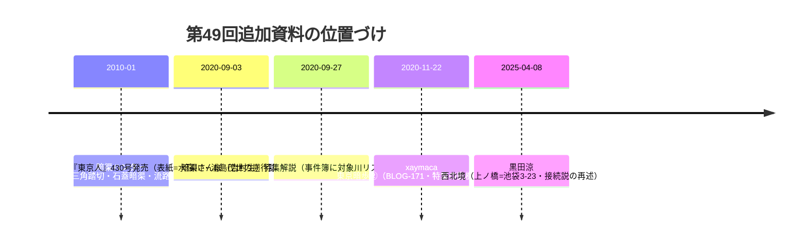

# 第49回調査（2026-11-13）：東京人430号目次・暗渠ハンター谷を巡る①・黒田涼西北境

## 今回の追加（コミット参照）

- **BOOK-080**：『東京人』2020年10月号（no.430）特集「東京暗渠散歩」の**目次全文をFujisan頁で直接確認**。表紙=水窪川の川跡（渡部さとる撮影）、浦島茂世「江戸川橋から美久仁小路へ　住宅街の流路を遡上する」（26頁）、細馬宏通×本田創対談（32頁）、本田創「東京の暗渠空間学」（34頁）、谷端川コース「『Uの字エリア』からの挑戦状」（42頁）、前谷津川（板橋区・別河川）を収録。**BLOG-171が未確認としていた特集の書誌を確定し、BLOG-171の記述も更新**。
- **BLOG-174**：暗渠さんぽ（吉村生）「東京人１０月号は暗渠特集号でした（１）」2020-09-27。**特集「開渠だった頃の事件簿」の対象川リスト（千川上水を含む）＝repo初出**。前谷津川「板橋史談によれば昭和20年代半ばまでに改修」の伝聞。
- **BLOG-175**：暗渠ハンター「東池袋・水窪川が作った谷を巡る①谷の入口、都電三角踏切へ」2010-01-19。**都電の隣接2踏切「三角踏切」・石材の蓋暗渠の観察＝repo初出候補**。①のGoogleマップ流路は筆者自身が誤りと後記（横断調査ノートの指摘を本文レベルで確認）。
- **BLOG-176**：黒田涼「ひたすら暗渠歩きの豊島区西北境」2025-04-08（23区全区境踏破第42回）。**「上ノ橋」の位置が「池袋3-23」電柱で具体化**、谷端川の千川上水接続の独立二次記述、下板橋駅付近の180度屈曲、谷端川北緑道の板橋区管理区間（川越街道手前）。

## 資料関係図

## ノートのみの記録

- **joshuanchin「水窪川跡を辿る」シリーズ**：-4（BLOG-172・2010-08-06）の前後リンクで**-5「日の出町商店街、水窪川の碑」と-3「東青柳町〜坂下通り」の存在を確認**（-1・-2も連載構成上存在か）。個別entry URLは未特定。
- **wanjin「水窪川　－増殖する池袋と和紙職人－」（blog-entry-2）**：カテゴリ頁のスニペットで存在確認。FC2直は403、**Wayback未収蔵**（2024・2026年両スナップショットで確認）。和紙職人＝BLOG-099（望月家の紙漉き）との関連で本文取得が望ましい。
- **武蔵学園百年史**：写真館ギャラリー102「武蔵の門」の写真一覧で「1950年代の千川通り」「1970年代の千川通り」「千川上水の看板」等の個別写真名を確認。「千川上水の看板」個別頁（[Gallery/Photo/ea1b75a9](https://100nenshi.musashi.jp/Gallery/Photo/ea1b75a9-4c43-433b-b631-3745a9b152cf)）のキャプション（1969年撮影・練馬区教委設置・200m池袋寄りに移設）は第37回ノート記録と一致。**資料館トップの「千川上水調査アルバム」追加日付が2026.07.15と表示**（ORG-025の「2026.08.01」との表記差・要原本確認）。
- **対照表候補（今回追加せず）**：ともえ通り・さいわい通り（旧下板橋町・震災後区画整理で成立、BLOG-176）。
- **見送り・既出再確認**：tkobays「水窪川の地形と戦前地図」=BLOG-019既出同一記事。星降る広場=BLOG-110既出。としまの記憶「消えたとしまの川１水窪川（5/13）」ページ=ORG-016の同一イベント告知頁。黒田涼note・文春・NEWSポストセブン等は既出の再構成。**news_search（2026-10-01以降）で四河川関連の新報道は確認できず**。

## アクセス不能

- 暗渠ハンター谷を巡る⑦（blog.jp 7711788）・cocolog版③：直・Waybackとも遮断。②〜⑥・⑧のblog.jp URLはWayback未収蔵。
- wanjin blog-entry-2：上記のとおり。FC2カテゴリ頁もAccess Denied。
- kaeru.moe現行・joshuanchin -1〜-3/-5（URL未特定）。

## README冒頭bullet・INDEX.md

例年どおり**README冒頭「現時点で重要なこと」へのprependは今回も不可**（1.37MB・git環境なし）。保留bulletは第6〜48回分＋今回分（東京人430号目次確定・事件簿の千川上水扱い・三角踏切石蓋暗渠・上ノ橋池袋3-23）をgit環境が使える実行でまとめてprepend。INDEX.mdのbuild.py再生成も継続課題。

## 次回課題

1. 『東京人』430号本文（浦島茂世記事・谷端川「Uの字」コース・事件簿の千川上水項）の現物確認（図書館）。
2. 暗渠ハンター谷を巡る②〜⑧本文取得（cocolog旧URLのWayback再試行・月別アーカイブ頁経由）。
3. joshuanchin「水窪川跡を辿る」-1〜-3/-5のentry URL特定（amebloテーマ別・月別アーカイブ）。
4. wanjin blog-entry-2「増殖する池袋と和紙職人」本文（FC2の別ミラー・再取得待ち）。
5. 武蔵学園資料館「所蔵資料一覧」経由の千川上水調査アルバム個別頁（更新日2026.07.15表記の確認を含む）。
6. 前谷津川「板橋史談」の原史料特定（BLOG-174）。
7. 継続課題：echo-lab紀要20号（PAP-029）・BOOK-062現物・README prepend・INDEX再生成。
