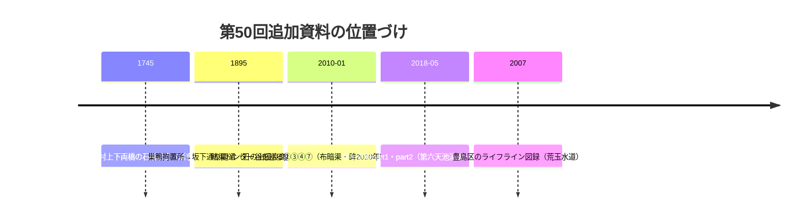

# 第50回調査（2026-11-13）：夢七雑録part1/2本文初取得・暗渠ハンター谷を巡る②〜⑦・ライフライン図録

## 今回の追加（コミット参照）

- **BLOG-033格上げ**：夢七雑録「谷端川（千川上水長崎村分水）跡を歩く−１−」（2018-05-24）を**Wayback id_で本文全文取得し二次転記から直接確認へ格上げ**。**第六天の祠と池（現駐車場・消滅）・不動湯（廃業・水路跡現存）＝repo初出**。弁天池の南北分断と北池消滅、上流部二股→大正15年一本化、要小南側のショートカット分水路（嘉永7年地図で大山道を潜る→大正末直線化→消滅）、大正14年地図の西側合流水路（線路側溝が代役）、暗渠化以前の膝までの冠水記憶〔伝聞〕、分水第一橋=千川駅前郵便局近く〔読図〕。
- **BLOG-177**：同part2（2018-05-27）を**Wayback id_で本文全文初取得**。**西光院の橋供養碑「中丸村の上下両橋を延享2年（1745）に石橋として造立」＝repo初出の碑文情報**（両橋=中上橋・中丸橋とする比定は筆者推定）。下田橋→霜田橋改称、野菜洗い場（BLOG-138伝聞の独立裏付け）、上の橋へのわきみず通り流れ、境橋以降の橋名列挙（南橋・境井田橋・他領橋・熊野橋）。**シリーズ3回（part1〜3）の本文が全部揃った**。
- **BLOG-178**：暗渠ハンター「水窪川が作った谷を巡る②日の出優良商店会」2010-01-21（blog.jp 7711782）**直取得**。**日の出優良商店会沿革碑（明治28年巣鴨拘置所→坂下通り開通・昭和初期まで牛乳牧場・戦災焼失・昭和30年代急速宅地化）＝repo初出**。商店街=流路でなかった筆者訂正の後記。コメント欄の地元聴取「戦災を免れた古い家・豊島区が空き地を買い上げ広場にしている」〔伝聞〕＝辻広場群成立背景の一次聴取。
- **BLOG-179**：同連載③（7711784）④（7711785）⑦（7711788）の**直取得**。第49回「⑦は直・Waybackとも遮断」が解消。**布暗渠（布→被コンクリへの遷移）＝repo初出候補**、星降る広場の星座描画+スポットライト施工、君の湯裏=水窪川本流水路の読み替え（⑥訂正に基づく）、大塚坂下町公園の崖上施錠扉。**碑・タイル流路の観察時系列が2010（今回）→2013（BLOG-173）→2015（BLOG-110）→2022と4時点化**。
- **BOOK-081**：『豊島区のライフライン 電気と水道の地域史』豊島区立郷土資料館・2007.1・23p（**ro-da A215で書誌直接確認**）。荒玉水道キーワード。本文未確認・千川上水記載の有無は次回課題。

## 資料関係図

## ノートのみの記録

- **暗渠ハンター谷を巡るシリーズのID体系を特定**：①=7711781（BLOG-175）→②=7711782→③=7711784→④=7711785→⑦=7711788。**⑤「階段暗渠の美しさ」=7711786・⑥「もしかしてこれがホントの流路？」=7711787と推定特定**したが本回は遮断（blog.jpの遮断は間欠的で、②③④⑦は直で通った）。⑧のIDは未特定（7711789〜91は不該当）。
- **PAP-017（明治一〇年代の千川上水再興と東京府）**：meiji.repo.nii.ac.jpは**依然JAIRO Cloudメンテナンス中**（2026-10-28〜終了日未定）を再確認。echo-lab紀要42のPDFは検索経由で現行URLを再確認したがPAP-027で既に全文取得済みで重複なし。
- **豊島区「豊島区のライフライン」紹介頁**：直は遮断（翻訳応答）。ro-da側で書誌を確定した（BOOK-081）。
- **板橋区公文書館電子展示室46号「石神井川のいま・むかし」**（2020）：石神井川の概況・蛍の記録（宝丙密秘登津）・狩野川台風を収録。**四河川直接の言及はなし**（谷端川放水路関係も本文取得範囲になし）でGOV化せず。石神井川湧水（練馬区内の富士見池・三宝寺池・豊島園池）の言及は周辺文脈として参考。
- **eno「谷端川支流〜千川上水〜石神井川支流〜久松湯」2016**：粟島神社の池の白濯（2016年観察）以外は既収録（BLOG-110・暗渠ハンター図）の再構成で資料化せず。**eno 2015年「池袋〜巣鴨①」=BLOG-110既登録**を再確認（広場名の重複なし）。
- **千葉大学紀要64（2016）前谷津川論文**（井上）・**JIA「旧前谷津川を歩く」**：前谷津川（別河川）中心で四河川直接関係はスニペット範囲になし。BLOG-174の板橋史談伝聞の裏付け候補として本文確認は次回以降。
- **news_search（2026-09以降）**：千川上水・谷端川・池袋暗渠の新報道は確認できず。

## アクセス不能

- 暗渠ハンター谷を巡る⑤（7711786）・⑥（7711787）・⑧：本回遮断（ID特定済み・再試行余地あり）。
- wanjin blog-entry-2「増殖する池袋と和紙職人」：FC2直は403。Waybackは一時障害で未確認（次回再試行）。
- dream9「谷端川跡地の道路」2008：非公開設定。Wayback未収蔵。
- kotodute-kanto-tokyo「＠東京 闇市の本場 池袋──旧水窪川」2015：blogspot直遮断。Wayback一時障害で未確認。
- ikebukuro-ifw.com「水窪川を歩く」：遮断。
- kawawalk「長崎村分水2」（blog-entry b0207053a2…）：Wayback未収蔵を確認。
- PAP-017：meiji.repo（JAIRO Cloud）メンテナンス継続。

## README冒頭bullet・INDEX.md

例年どおり**README冒頭「現時点で重要なこと」へのprependは今回も不可**（1.37MB・git環境なし）。保留bulletは第6〜49回分＋今回分（西光院碑延享2年・日の出優良商店会碑・布暗渠・夢七シリーズ完結・ライフライン図録）をgit環境が使える実行でまとめてprepend。INDEX.mdのbuild.py再生成も継続課題。

## 次回課題

1. **西光院（中丸）の橋供養碑の現地採録**（延享2年・中丸村上下両橋の文言）＝橋名調査の最重要新課題。
2. 暗渠ハンター谷を巡る⑤（7711786）⑥（7711787）⑧の直再試行。
3. 日の出優良商店会沿革碑の実物確認（設置主体・碑名・年）。
4. BOOK-081本文（水道歴史館）と千川上水記載の有無。
5. wanjin entry-2・kotodute・夢七雑録の他カテゴリ（神田川と支流28件等）のWayback再試行。
6. joshuanchin「水窪川跡を辿る」-1〜-3/-5のentry URL特定（第49回課題継続）。
7. 継続課題：echo-lab紀要20号（PAP-029）・BOOK-062現物・PAP-017（JAIRO復旧後）・README prepend・INDEX再生成。
