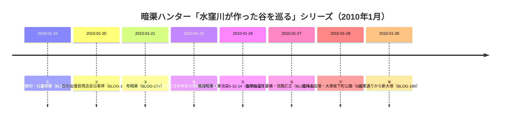

# 2026-11-13（第52回）・暗渠ハンター谷を巡る⑤⑥本文取得・シリーズ完結・水道歴史館ro-da新規書誌2件の追加調査

- **実行時のhead**: 00c9a6e（第51回）。push前に再確認し、競合があれば採番し直す。
- **ツール状況**: search_code・get_file_contents・push_filesとも正常。**git環境なし**（bashでwhich gitを再確認）のためREADME冒頭bulletのprepend・INDEX.mdのbuild.py再生成は今回も不可。

## 1. 今回の成果（4件新規＋BLOG-180追記）

1. **BLOG-181（谷を巡る⑤・2010-01-26・7711786）**: 第50〜51回でblog.jp直・Waybackとも遮断だった⑤を**直で本文取得**。東池袋5-32-14付近の階段暗渠（踊り場の蓋暗渠・崖上から階段と同段差で下る水路）＝**repo初出の位置特定観察**。
2. **BLOG-182（谷を巡る⑥・2010-01-27・7711787）**: 同く⑥を本文取得。**造幣局崖下の半円穴塞ぎ跡・「水を流していた管」**（repo初出観察）と、**日の出商店街=流路でない訂正→本田創流路説採用→Googleマップ「新・水窪川」掲載**の訂正文を直接確認（BLOG-179/180の読み替えの依拠元）。**HONDA本人コメント（2010-01-27）「つい先日、水窪川と弦巻川を再訪」**も記録。
3. **PAP-032（角田清美「千川上水の歴史と水利用」・羽村市郷土博物館紀要第37号・2023）**: ro-da書誌で所在確認。**2023年刊行の千川上水史の新規学術文献**。同号に岡崎学「『治水要辨』と森田通定」。
4. **BOOK-082（『練馬の水系』祖先の足跡4・石神井図書館郷土資料室編・練馬区教委・1976）**: ro-da書誌で所在確認。**練馬区水系の昭和51年基礎文献**、区側資料群の1970年代を埋す。
5. **BLOG-180追記**: ⑤⑥本文取得済み・シリーズ完結の追記。

**谷を巡るシリーズ観察時系列（完結）**:

## 2. 未解決の確認結果（ノート記録のみ）

- **暗渠な日々＝暗渠探索紀（ankyo.chikyu-kagaku）の異同**: 同一サイト（サイト名を「暗渠な日々」へリニューアル、コンテンツ名は「暗渠探索紀」）。**水窪川part.3は未投稿**（part.2末尾「Part.3に続く…」だが、カテゴリ一覧は水窪川part1・part2・穏田川の3本のみ）。第51回課題⑤「part2以降」は「part3存在せず」で解消。
- **joshuanchin「水窪川跡を辿る」-1〜-3/-5**: ameba検索・月別アーカイブ（2019年7月は0件表示・Yahooブログ移行のため投稿日は2010年当時のまま）・Web検索いずれでもentry URL特定不能。テーマ「神田川水系の川跡」に7記事。-4の本文で前後記事の**タイトルは特定済み**（-5「日の出町商店街、水窪川の碑」・-3「東青柳町〜坂下通り」）。**Internet Archiveが実行中にオフライン**（cdx「Temporarily Offline」）でCDX照合も不可→次回再試行。
- **西巣鴨小学校校歌**: schoolweb.ne.jpの校歌フレーム（id=1310119&frame=kouka）は本文取得不能（JS描画）。歌詞は学校要覧PDF等で確認する必要がある（第51回課題②は未解決のまま）。
- **ikebukuro-ifw.com**: 「サイトが自動アクセスを遮断」との応答で本文取得不能。スニペットの1933年文言の確認は継続課題。
- **wanjin blog-entry-2**: FC2 403が継続。WaybackはIAオフラインで未確認。
- **news_search**: 谷端川・水窪川・千川上水に関する新報道なし（2026-11-13時点）。
- **warpal谷端川サイト**: BLOG-005/062既登録（再確認）。
- **文春弦巻川（88508）・repo README検索スニペット**: 「坂まち通信第2号（1993年）」の弦巻川証言（原っぱ・段差の滝・ホタル）はBLOG-063文春シリーズ経由の既知情報と判断（README本文は1.37MBで直接確認不可）。

## 3. 次回課題

1. **角田清美2023・『練馬の水系』1976の現物確認手段**（羽村市郷土博物館・石神井図書館・水道歴史館）。
2. **joshuanchin -1〜-3/-5のentry URL特定**（IA復旧後のCDX照合が有望: ameblo.jp/joshuanchin/entry*）。
3. 西光院橋供養碑（延享2年）の現地採録（第50回課題①・継続最重要）。
4. 西巣鴨小学校校歌の歌詞確認（学校要覧PDF）。
5. （継続）echo-lab紀要20号（PAP-029格上げ）・wanjin entry-2/240/241・BOOK-062現物・README冒頭prepend・INDEX.md再生成（git環境待ち）。
