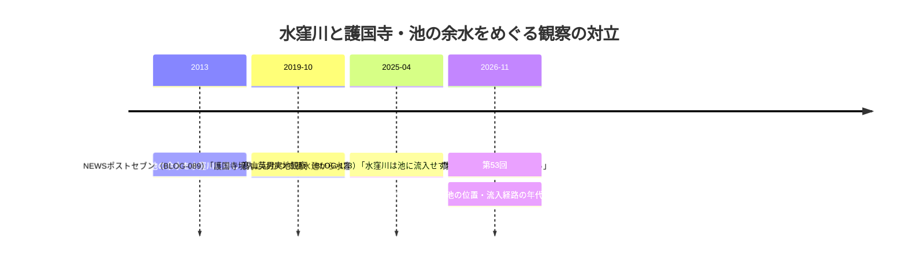

# 2026-11-13（第53回）・wanjin水窪川連載2本の初取得・双子の川呼称・大塚地名由来の追加調査

## 概要

- 実行日: 2026-11-13。GitHub（search_code・get_file_contents・push_files）は正常。push前head確認（af5590c=第52回追記）で競合なし。
- **wanjin「水の行方を追って」FC2ブログの水窪川連載（2013年9月・entry-3/entry-4）をWayback 2026-10-25スナップショットで本文全文取得し、BLOG-183/184として資料化**（第50回以降の「wanjin entry-2/240/241」系の未収蔵問題について、entry-3/4がスナップショット存在していたことを確認）。
- このほか新規資料はなく、武蔵野市観光機構むー観の千川上水頁（構成既知情報の再編で見送り・§4参照）などはノート記録のみ。

## 新資料

### BLOG-183: wanjin「水窪川－たゆとう時間の淀みと開発の波－」（2013-09-28）

- **「中西の森」＝根津山の前呼名〔repo初出〕**: 旗本三千石中西氏数代の拡領地「中西の森」→明治末に根津嘉一郎が買収し「根津山」。中西氏の系譜は要原本確認。
- **巣鴨監獄誘致の年次**: 明治18年誘致運動開始・明治21年土地買収・明治28年移転〔誘致運動・買収年次はrepo初出候補〕。
- **『池袋の夜』（作詞吉川静夫）の美久仁小路文言**〔文化的引用としてrepo初出〕。
- wanjinカテゴリ構成の確認: 水窪川5本・**弦巻川3本**（entry-23「懐旧の念やみがたき郷愁の故郷」2014-01-21ほか・Wayback未収蔵）・千川上水1本（=BLOG-142既出）・東大下水7本・逆川8本。

### BLOG-184: wanjin「水窪川－分身が本体を駆逐しつつある街－」（2013-09-30）

- **「双子の川」呼称〔repo初出文言〕**: 「弦巻川を音羽谷の西側に流して、双子の川と呼んだり、両方で鼠ヶ谷下水と呼んだり」。鼠ヶ谷下水の包括呼称（BLOG-002）の独立二次裏付け。
- **護持院から池の余水を水窪川に流入（不忍通り北側合流推定）〔2013年記録〕**: BLOG-123（2025年髙山観察: 池に流入せずカルバート）と食い違い。年次・条件差を考慮し**断定せず並記**。護国寺池→水窪川余水経路は今後の現地・文献確認課題。
- **芋洗橋（地震橋）寸法**（長さ九尺・幅二間半『御府内備考』）: GAZ-013の直接確認済み記述と一致する二次記録。
- **『大塚』地名由来〔repo初出〕**: 『改撰江戸志』経由・森川鉾太郎屋敷の塚（高さ五尺・榎）と大塚稲荷・茗荷谷駅西南約150m。
- **ミョウガ畑の荒廃・看板消失（2013年観察）**: BLOG-037ミョウガ畑〔伝聞〕の現況変遷データ。
- **お茶の水女子大学崖下湧水の減少〔2013年聴取〕**: 湧水減衰仮説の時系列データポイント。
- 今宮神社前橋遺構観察・音羽谷人工流路説〔仮説〕。

## 護国寺池の余水流入説の対立（BLOG-184 vs BLOG-123）

- 池そのものの水源・池と水窪川の高低関係が年代ごとに変化した可能性があり、「流入した」がいつの時点かが両説の鍵。護国寺側の池（蛇池=BLOG-120追記）の変遷史料の探索が次の一手。

## 見送り・ノートのみの記録

- **武蔵野市観光機構むー観「千川上水」頁（musashino-kanko.com）**: 直接本文取得。元禄9年開削・河村瑞賢設計・太兵衛/徳兵衛請負・「仙川」→「千川」の字改め・宝永4年灌漑許可（7か村分水口）・享保7年上水停止・安永8年再興・天明6年再廃止→「仙川用水」・明治13年千川水道会社・明治40年給水停止、という**既知の通説年表の再編**のため資料化せず。ただし**「桜上水ともいう」別称**（repo既出）・**延長30キロメートル表記**（22km説・28km説と食い違う既知の表記差）・**恩恵地域80ヵ町**・**流末を「豊島区西巣鴨3丁目の巣鴨庚申塚の溜池」とする表現**を確認〔「溜池に至る」文言はrepo初出候補。庚申塚自体は既出10件。流末表現の食い違い（板橋駅東口=流末〔駅からマンホール〕・西巣鴨3丁目）は原典確認までノート記録にとどめる〕。
- なまけものメガネ「谷端川南北緑道」（nmkmn-mgn.com・2017）: 直open遮断。スニペットは既出の橋名観察と同系統のため、Wayback取得後に再評価。
- 地図子「弦巻川を歩く」（chizuchizuko tsurumakigawa）: 直openはGoogleマップ埋め込みのみで本文抽出不能。検索スニペットに「弦巻川は池袋駅の西側を水源としていて、東側を水源とする水窪川と**双子のようです**」（2019年頃・NHK文化センター講座受講記事）=BLOG-184の「双子の川」と同系統の後年用例。本文取得できず断念。
- news_search（2026-11-06以降）: 四河川関連の新報道なし。
- kak-dela「千川上水跡まち歩き（その2）」・優和な暮らし「水窪川」: 直・Waybackとも本文取得不能（その2はスナップショットがIA汎用ページのみ）。
- 駅からマンホール千川上水頁・文春50033・ゆる歴史散歩会護国寺〜池袋・BE-PAL等: いずれも既登録の再確認。

## アクセス不能（継続）

- wanjin entry-2（増殖する池袋と和紙職人）・entry-240/241（継続）。wanjin弦巻川3本（entry-23は2014-01-21投稿・Waybackにスナップショットなし。entry-18〜30を試行するも未特定）。
- echo-lab紀要20号（PAP-029格上げ）・wanjin 243/245/251/252・かたりべ45・寅さん歩その26（存在せずと判明済み）。
- CDX API（自動アクセス遮断）。

## 次回課題

1. wanjin弦巻川カテゴリ3本（entry-23「懐旧の念やみがたき郷愁の故郷」ほか）の取得（IA収蔵待ち・fc2直の再試行）。
2. 「双子の川」呼称の他の用例の探索と、谷端川＝「西大下水」系の呼称群（東大下水・西大下水）との関係整理（wanjin「西大下水」カテゴリ23本に谷端川関連の可能性）。
3. 護持院→水窪川余水流入説（BLOG-184）の裏付け: 護国寺・護持院の池の変遷史料。
4. 「中西の森」旗本中西氏の系譜（根津嘉一郎買収以前）の史料確認。
5. 巣鴨監獄誘致運動明治18年・買収明治21年の原典（板橋区史・豊島区史）。
6. （継続）README prepend・INDEX.md build.py再生成（git環境待ち）・echo-lab紀要20号・BOOK-062現物・wanjin entry-2。
