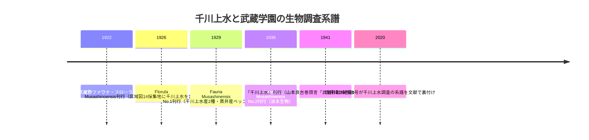

# 2026-11-13（第55回）・武蔵高校紀要昆虫標本2論文・大塚坂下町古老聴取ブログ・オンライン博物館濯川頁の追加調査

第54回（コミット 23aefeb）以降の新情報調査。search_code・get_file_contents・push_filesとも正常、push前head確認で競合なし。

## 1. 今回の新資料

- **PAP-033（白井亮久・高田陽・福田悠人2020『武蔵高等学校中学校紀要』4号pp.29-73）**: 武蔵大学機関リポジトリPDFをWayback id_で本文全取得。**『千川上水』1941の巻頭言（山本良吉）引用により、千川上水調査1938-41が創立時の武蔵野ファウナ・フローラ調査（和田八重造・半径2.5マイル・10年計画）の系譜上にあることが学術文献で裏付けられた＝repo初出の文脈**。Florula1926の生物調査区域図14採集地に「SENKAWA AQUEDUCT（千川上水）」が含まれFauna No.1に千川上水産2種記録〔repo初出〕。1926年の水生昆虫標本（カワラハンミョウ南蔵院＝江古田川源流部・ゲンジボタル北新井・ヘイケボタル弁天）＝**1920年代の中新井・弁天・北新井の水環境の生物標本による独立傍証**。
- **PAP-034（白井亮久2022『武蔵高等学校中学校紀要』6号pp.49-56）**: ベッコウトンボ1926.5.12練馬採集標本の発見。**練馬駅北部（練馬2・4丁目・桜台4・5丁目付近）の「石神井川に繋がる細い二つの谷戸地形と僅かな水田」の1926年記述**＝谷頭水田環境の背景史料。
- **BLOG-187（uenchmap「大塚 暗渠っぽい道探索編」2019-05-23）**: 大塚5丁目クネクネ道（水窪川暗渠）の**地元古老聴取（川遊びの記憶・路地＝坂下通り呼称・サンシャインシティ以後の呼び分け）＝repo初出の生活史証言**。ポポー広場入口・井戸の2019年観察を加え、観察時系列（BLOG-110〔2015〕→173〔2013〕→179〔2010〕→172〔2019〕→182）に2019点を接続。

## 2. 千川上水調査の系譜（PAP-033・ORG-025/026統合）

## 3. ノートのみの記録（source file化せず）

- **kotodute「＠東京」2015-08-10「闇市の本場」池袋──旧水窪川**〔本文直接取得・第50回のアクセス障害を解消〕: 蟹窪埋立・プリズン米兵フットボール場（BLOG-099既出）のほか、**護国寺〜江戸川橋の谷筋（弦巻川西崖・水窪川東崖）に出版・印刷・製本業が集積し、江戸期の和紙業との連続説〔筆者推測〕・鳩山御殿と崖上宅地化**の言及。和紙→出版関連業ルーツ説は二次推測でBLOG-099の望月家紙漉きで実体は既出のためノート記録にとどめる。
- **オンライン博物館「濯川と自然観察」頁**（100nenshi.musashi.jp/Museum/Index/f9a8d486-db15-4455-92e8-071a3c872252）〔直接確認〕: ORG-026（濯川看板）と同内容中心だが、**濯川周辺が和田八重造の自然観察の拠点であったこと・Florula/Faunaの出版費用を根津嘉一郎理事長が援助したこと・調査写真に高宮篤（1期）・桑原萬寿太郎（2期）**の細部を追加〔PAP-033に併記〕。
- **武蔵大学機関リポジトリの「千川」件名ブラウズが存在**（handle/11149/1869?value=千川）が直は遮断。紀要4・6号以外にも千川関係登録の有無は未確認。
- **「大塚物語る」（豊島区のボランティアガイド団体・旧坂下町〜美久仁小路の水窪川暗渠ウォークイベント）の存在**をamebaブログタグ頁スニペットで確認〔団体名と経路の記録。個別記事の特定は次回〕。
- **joshuanchin「水窪川跡を辿る-4」のentry番号を特定**（entry-12490754603・2019-07-06）。-1〜-3/-5のentry番号は前後番号の総当たり（±100〜300）では特定できず。
- **らんまる「水窪川跡を歩く2/2」のURL特定**（ameblo.jp/goldentrout/entry-12110859674）=BLOG-046と確認。1/2（entry-12110535xxx台）は引き続き未特定。

## 4. アクセス不能（継続・再確認）

- echo-lab紀要20号（PAP-029格上げ）: 推定PDFパス（紀要20(1991)/…84深田….pdf）のWayback id_照合で**「The Wayback Machine has not archived that URL」**。CDX照合も遮断。継続課題。
- wanjin水窪川entry-2・弦巻川entry-23（?no=23）/25: **Wayback id_照合でいずれも未収蔵を確認**。?no=形式のURLは保存対象外の可能性。
- 武蔵百年史「千川上水調査アルバム」個別頁: Historical_Materialsトップ頁は取得可だが、所蔵資料一覧のリンク先URL（Index/GUID形式）は検索エンジン未収録・リンク抽出不能。
- 東京些末観光（tokyo.txt-nifty）大塚坂下町頁: 直403・Wayback未照合（次回）。
- 板橋区浸水履歴ページ・sinsuinew.pdf: Wayback id_照合で「not archived」。

## 5. 次回課題

1. Fauna No.1原本（武蔵学園記念室・ORG-025の2026-09-03デジタル公開）での**千川上水産2種の種名特定**。
2. 武蔵百年史資料館「所蔵資料一覧」ページの実URL特定（Historical_Materials配下のIndex/GUID）。アルバムの写真判読＝1953 vs 1959-60年次差の一次資料。
3. repository.musashi.ac.jpの千川件名の他登録（handle 2416のキバネツノトンボ論文を含む白井一連）の収集。
4. joshuanchin -1〜-3/-5のentry番号特定（Google cache・Bing収蔵の再照合）。
5. （継続）echo-lab紀要20号・BOOK-062現物・README冒頭bullet prepend（第6〜55回分）・INDEX.md build.py再生成（git環境待ち）。
