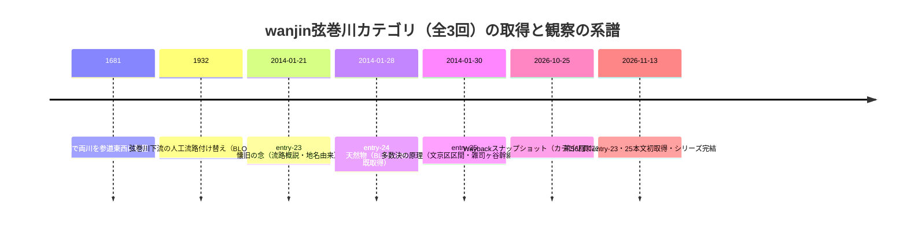

# 2026-11-13（第56回）追加調査：wanjin弦巻川entry-23・25本文初取得（カテゴリ全3回完結）

## 1. 今回の調査の経緯

- 実行開始時に github_app 書き込み関数の復帰と head（b7e54bb＝第55回）を確認。push前にhead再確認して競合なし（並行実行対策）。
- news_search（水窪川/弦巻川・谷端川/千川上水、2026-10-13以降）は四河川関連の新報道なし。
- **Internet Archive が実行中に再びオフライン**（cdx「Temporarily Offline」）。echo-lab紀要20号（PAP-029格上げ）・かたりべ45・wanjin水窪川entry-2の再試行は今回も不可。
- joshuanchin「水窪川跡を辿る」-1〜-3/-5のentry URL特定は今回も失敗（ameblo月別頁はJS描画で記事一覧取得不能・Web検索でも-4しか出ない）。
- 板橋区浸水履歴ページ（1005716）は直でリンク切れ応答（GOV-074記録分に更新なし）。
- 新規学術文献検索（谷端川・千川上水・雑司ヶ谷幹線、2026年以降）は該当なし。

## 2. 新資料2件（wanjin弦巻川カテゴリ完結）

- **[BLOG-188](sources/blogs/BLOG-188.md)**: entry-23「懐旧の念やみがたき郷愁の故郷」（2014-01-21）。**FC2のカテゴリ頁（blog-category-8.html）のWayback 2026-10-25 id_スナップショットに3回分の本文全文が含まれる**ことを発見して取得（entry単体がWayback未収蔵でもカテゴリ頁経由で取れる新手法）。主な新情報：
  - **雑司が谷の地名由来諸説**（『新編武蔵風土記』経由の転記：雑司料説・柳式若狭ら土着説・吉宗の表記統一命令）＝repo初出。
  - **上川口屋1781年（天明元年）創業・日本最古の駄菓子屋**＝repo初出（生活史）。
  - **千歳橋**（明治通りの弦巻川橋名候補）＝repo初出候補。
  - 護国寺1681年参道両側配置説・源頼家弓弦由来伝承（「後世のでっちあげ」評）＝既出説の二次記録。
- **[BLOG-189](sources/blogs/BLOG-189.md)**: entry-25「多数決の原理…」（2014-01-30）。blog-entry-25.html単体がWayback 2026-10-25 id_で取得可。主な新情報：
  - **雑司ヶ谷幹線の運用＝水量が多い際は神田川へ直接放水、少ない場合は処理場へ**＝repo初出文言（第2雑司ヶ谷幹線の運用面の記述は初めて）。
  - **「西青柳下水」呼称の記録は見当たらない**という指摘＝repo初出（東青柳下水＝水窪川との対比）。
  - 高速下公園の**フェイクの水流・噴水**（2014年観察）＝repo初出の観察記録。
  - **江戸川公園1984年神田川拡幅改修・大洗堰復原・大井玄洞胸像**＝大井玄洞がrepo初出。
  - 首都高5号池袋線＝五輪突貫工事で廃河川上に建設との筆者解釈（仮説として記録）。

## 3. 解釈：弦巻川カテゴリの取得と観察の時系列

- 横断調査ノート（2026-10-23）の「1681年付け替え説」評価は、3回全文取得後も維持する。entry-23・25は同説を繰り返すのみで、出典（文献・聞き書き・古図）を提示しないため、一次証拠にはならない。
- 一方、entry-25の雑司ヶ谷幹線運用記述は下水道史の新情報で、雑司ヶ谷幹線関連の未解決課題に接続する。都下水道局資料での裏付けが次の一歩。

## 4. 既存資料の更新

- **[BLOG-185](sources/blogs/BLOG-185.md)**: 「entry-23・25未取得」の制限記述を解消し、BLOG-188/189への参照を追記。

## 5. 見送り・アクセス不能（今回分）

- **見送り**: yuru-rekishi-sanpo護国寺〜池袋・wanderxwonder暗渠ナイト・千駄木菜園・大塚物語るblogtag記述＝既収録の再構成。日本地理学会2026秋季要旨ブラウズ＝千川関連の明示なし。
- **アクセス不能**: echo-lab（直・cdxとも不可、8回目）、joshuanchin -1〜-3/-5、wanjin水窪川entry-1/2/5（Wayback未収蔵）、板橋区浸水履歴PDF、武蔵学園アルバム個別頁（所蔵資料一覧のリンク宛先抽出不能を再確認）。

## 6. 次回課題

1. **雑司ヶ谷幹線の神田川直接放水の一次資料**（都下水道局の設計図書・下水道台帳・江戸川橋付近の放流設備の現地確認）。
2. 千歳橋の位置特定（明治通り・弦巻川交点の名寄せ、四河川の橋名・橋跡調査への追加候補）。
3. 雑司が谷の地名由来の原典確認（『新編武蔵風土記』該当項の原文・当該頁）。
4. 上川口屋1781年創業の出典（上川口屋側・文京区・豊島区の資料）。
5. （継続）echo-lab紀要20号、joshuanchin -1〜-3/-5、wanjin水窪川entry-1/2/5、BOOK-062現物、README prepend・INDEX再生成（git環境待ち）。
