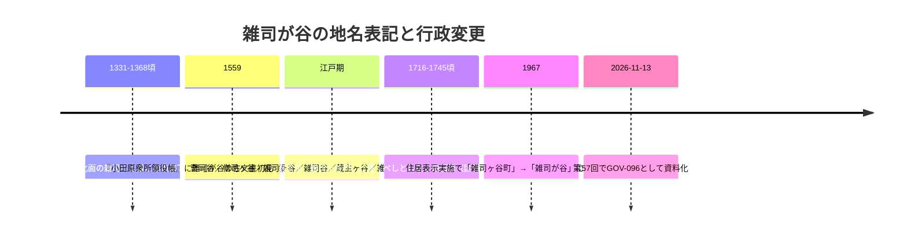

# 2026-11-13（第57回）追加調査：雑司が谷地名史の区公式資料・上川口屋13代目取材記事の追加調査

## 1. 今回の調査の経緯

- 実行開始時に head（afa00e5＝第56回）を確認。push前head再確認で競合なし（並行実行対策）。
- news_search（千川上水・谷端川／水窪川・弦巻川、2026-10-13以降）は四河川関連の新報道なし。
- 第56回ノートの次回課題①（雑司ヶ谷幹線の神田川直接放水の一次資料）・②（千歳橋の位置特定）は今回の検索では決着資料を得られず。国交省サイトの「雑司ヶ谷幹線再構築工事事故調査報告書」（平成20年9月・mlit.go.jp/common/000024056.pdf）の所在を確認したが、対象は建設工事事故で河川・水路記述の所在は未確認のため資料化見送り（次回本文確認候補）。
- 第56回ノートの地名由来（③新編武蔵風土記の原典）・上川口屋（④出典）を検索したところ、豊島区「わが街ひすとりぃ」雑司が谷版と週刊ポスト取材記事に到達した（下記2件）。

## 2. 新資料2件

- **[GOV-096](sources/gov/GOV-096.md)**: 豊島区「わが街ひすとりぃ」基本情報・雑司が谷（平成30年度）。adeac掲載PDFを直接取得。主な新情報：
  - **雑司が谷の古文書初見＝永禄2（1559）年『小田原衆所領役帳』**（池袋村の永禄2年既存説〔BLOG-084〕と同一史料だが雑司が谷項目としての初見指摘はrepo初出）。
  - 地名由来4説・**出典書名付きの表記史**（『江戸雀』『江戸名所記』＝曹司谷、『御江戸図説集覧』＝僧司ヶ谷、『遊歴雑記』＝雑司ヶ谷、『江戸名図会』＝雑司谷、『新編日本風土記稿』＝蔵主ヶ谷・雑士ヶ谷）。**wanjin〔BLOG-188〕の地名由来転記が区公式資料で裏付けられた**。
  - 吉宗「雑司ヶ谷村」と書くべし伝承、**昭和41年住居表示で「雑司ヶ谷町」→「雑司が谷」変更**、スポット一覧に「柳下家」掲載。
- **[BLOG-190](sources/blogs/BLOG-190.md)**: 週刊ポスト2022年5月27日号（WEB転載2022-05-22）。**上川口屋が1781年に飴屋として鬼子母神堂境内で創業→駄菓子屋へ宗旨替え・女性代々継承・13代目内山雅代・東京大空襲で焼け残らず・屋号「川口屋」は先代時に他者へ譲渡**。BLOG-188の「1781年創業・日本最古の駄菓子屋」記述の独立裏付け。

## 3. 既存資料の更新

- **[BLOG-188](sources/blogs/BLOG-188.md)**: 地名由来諸説にGOV-096の区公式裏付け、上川口屋にBLOG-190の裏付けを追記。制限①を一部解消。

## 4. 地名表記の変遷（GOV-096の整理）

## 5. 見送り・アクセス不能（今回分）

- **見送り**: mlit雑司ヶ谷幹線事故調査報告書（本文未確認・四河川記述の所在不明）、水道歴史館『上水記』プレスリリース（GOV-091で展覧会情報既収録で差分なし）、アットホーム雑司が谷記事・新旧霊園案内（生活・観光再構成）、kawawalk「雑司ヶ谷村」entry（goo終了・Wayback未収蔵。スニペットのみで**「（弦巻川の谷筋にあたる）神田久保の地に僧都の主堂があり、ここから蔵主ヶ谷の名前が発生した」異説**と『新編武蔵風土記稿』雑司料説・元弘建武土着説を確認。神田久保＝僧都の主堂説はノート記録のみ。URL: blog.goo.ne.jp/kawawalk/e/1c20be23a0d18635e091d4c5ec4f09a2）。
- **アクセス不能**: echo-lab紀要20号（直・Waybackとも不可・PAP-029格上げは継続課題）、らんまる「水窪川跡を歩く1/2」のentry URL（月別アーカイブ頁で**投稿日2015-12-27の存在**を確認したがID特定に至らず。2/2〔12-28・BLOG-046〕の前日で、弦巻川散歩〔12-26・BLOG-161〕との連載順序も確認）。

## 6. 次回課題

1. 『小田原衆所領役帳』雑司が谷・池袋村該当部の原文所在・閲覧（『戦国遺文』等の翻刻）。
2. 千歳橋（第56回課題②）・雑司ヶ谷幹線の神田川直接放水（同①）は継続。
3. kawawalk「雑司ヶ谷村」の本文再取得ルート（Waybackの新規収蔵待ち）。
4. mlit事故調査報告書本文の四河川関連記述の有無。
5. らんまる水窪川1/2のentry URL特定（ameblo検索・Waybackの新規収蔵待ち）。
6. （継続）echo-lab紀要20号（PAP-029）、joshuanchin -1〜-3/-5、wanjin水窪川entry-1/2/5、BOOK-062現物、README prepend・INDEX.md build.py再生成（git環境待ち）。
